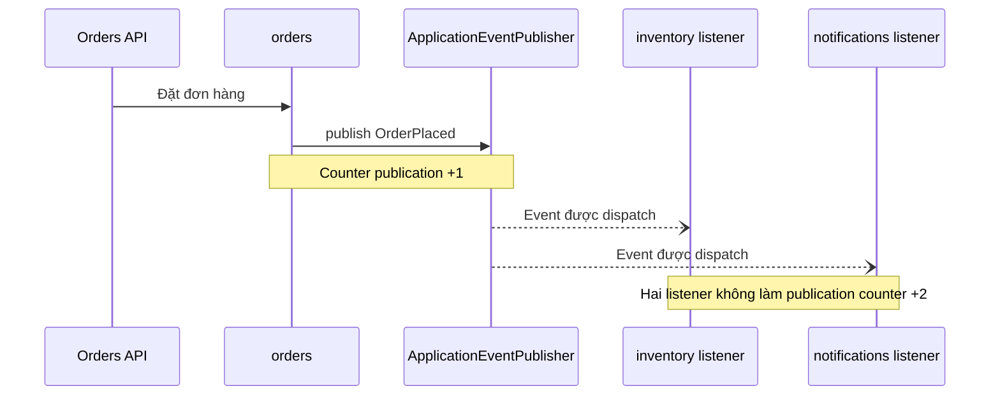

# Đếm tổng số lần công bố event

## 1. Bài toán: ứng dụng đã phát bao nhiêu domain event?

Trong một ứng dụng Spring Boot dùng **Spring Modulith**, nghiệp vụ được tổ chức thành các *application module* với ranh giới trách nhiệm rõ ràng. Ví dụ, module `orders` tiếp nhận đơn hàng, phát `OrderPlaced`; module `inventory` và `notifications` có thể đăng ký xử lý sự kiện đó. Khi hệ thống vận hành, nhóm kỹ thuật cần biết **đã công bố bao nhiêu domain event**, nhịp phát event có thay đổi không, và event xuất phát từ module nào.

Trong chương **Event metrics** của mô-đun học **SPRING_MODULITH_DOCUMENTATION_OBSERVABILITY**, bài này tập trung vào metric tổng hợp do Spring Modulith cung cấp: **`module.events.published`**. Đây là một *counter* trong Micrometer dùng để tổng hợp các lần công bố domain event được Spring Modulith ghi nhận.

Kết hợp metric này với **module graph**, **Spring Boot Actuator**, **module spans/tracing** và **context propagation** giúp đối chiếu giữa kiến trúc mô-đun đã thiết kế và tương tác thật của hệ thống. Tuy nhiên, cần hiểu chính xác *điều gì được đếm* trước khi dùng counter để vẽ dashboard hoặc kết luận về độ tin cậy xử lý event.

### Mục tiêu

Sau bài học, bạn có thể:

- Giải thích ý nghĩa của counter `module.events.published` và phạm vi phép đếm.
- Phân biệt tổng số lần **công bố** sự kiện với số listener đã chạy, số công việc hoàn thành và số bản ghi trong event publication registry.
- Đọc giá trị tổng hoặc lọc theo `module.identifier`, `module.name` và `module.event.type` qua Actuator.
- Hiểu vì sao counter có thể tăng, reset và tạo nhiều chuỗi theo tag; tính nhịp phát event bằng `rate()` hoặc `increase()` trên Prometheus khi có exporter.
- Kết hợp metrics với logs, traces và module graph để điều tra sai lệch trong luồng event.

## 2. Counter tổng hợp `module.events.published`

Theo tài liệu **Spring Modulith 2.2**, phần observability đăng ký **hai nhóm counter** cho domain event được phát trong ứng dụng:

| Meter trong Micrometer | Ý nghĩa |
| --- | --- |
| `module.events.published` | **Counter tổng hợp các lần công bố domain event**; có các tag giúp phân nhóm theo module và loại sự kiện. |
| `module.events.published.$moduleIdentifier.$simpleEventTypeName` | Counter riêng cho một event type thuộc module; có thể được bổ sung tag nghiệp vụ bằng API tùy biến. |

Bài này tập trung vào **meter đầu tiên**. Counter thứ hai phù hợp khi muốn có tên meter riêng cho từng event type; không nên cộng cả hai nhóm để tính “tổng sự kiện” vì một publication có thể được ghi nhận trong cả hai, dẫn đến đếm hai lần.

### 2.1. Đơn vị được đếm là một lần công bố

Về mặt nghiệp vụ, *event publication* là thao tác phát thông báo rằng một sự kiện đã xảy ra, ví dụ `ApplicationEventPublisher.publishEvent(new OrderPlaced(...))`. Với domain event được instrumentation của Spring Modulith nhận diện, counter publication tăng để phản ánh hoạt động **phát sự kiện**.

Xét minh họa:



Một `OrderPlaced` được phát một lần, sau đó có thể được hai listener nhận. **Số listener không làm số lần công bố tăng từ 1 lên 2**. Nếu publisher chủ động phát cùng loại event ba lần thì đó là ba lần công bố được ghi nhận, dù thực tế có thể biểu thị cùng một đơn hàng nghiệp vụ.

Không nên đồng nhất “1 publication” với “1 domain event đã được xử lý chính xác một lần”, bởi vì các listener có thể chạy bất đồng bộ, retry, thất bại, bị vô hiệu hóa hoặc được gọi nhiều lần tùy thiết kế. Nếu sự kiện được công bố nhiều lần do retry ở phía publisher, counter có thể tăng nhiều lần; nó không tự loại trùng theo `orderId`.

### 2.2. Counter cộng dồn trong phạm vi nào?

**Micrometer Counter** là số đếm không giảm trong thời gian meter tồn tại, ngoại trừ việc một instance khởi động lại hoặc meter/registry được tạo lại. Cần phân biệt:

- **Một instance:** counter quan sát trong một tiến trình ứng dụng, từ khi meter được tạo/đăng ký.
- **Nhiều instance:** mỗi instance có counter riêng; muốn tổng hợp toàn cụm phải truy vấn/aggregate trên backend giám sát.
- **Qua thời gian:** tổng giá trị tích lũy không thay thế cho số event trong 5 phút gần nhất. Để nhìn xu hướng, dùng hàm tốc độ hoặc tăng trưởng theo cửa sổ thời gian.
- **Qua nhiều lần restart/deploy:** không được lấy giá trị hiện tại từ một instance làm “tổng số event từ ngày hệ thống ra đời”.

Ví dụ giả định: sau khi chạy, `orders` phát 12 `OrderPlaced` và 3 `OrderCancelled`, còn `payments` phát 4 `PaymentAuthorized`. Nếu mọi publication được ghi nhận, trên **một instance** có thể quan sát:

| Nhóm | Số lần công bố |
| --- | ---: |
| `orders` / `OrderPlaced` | 12 |
| `orders` / `OrderCancelled` | 3 |
| `payments` / `PaymentAuthorized` | 4 |
| **Cộng tất cả nhóm** | **19** |

Con số **19** là tổng các lần công bố trong ví dụ và phạm vi meter đang quan sát, **không phải** số đơn thành công, số event đã lưu bền vững hay số listener hoàn tất.

## 3. Các tag dùng để nhóm số liệu

Metric `module.events.published` có ba **low-cardinality keys** theo tài liệu Spring Modulith:

| Tag | Ý nghĩa | Giá trị minh họa |
| --- | --- | --- |
| `module.identifier` | Định danh logic của application module phát domain event. | `orders` |
| `module.name` | Tên hiển thị của module phát event. | `Quản lý đơn hàng` |
| `module.event.type` | Loại domain event được phát. | `OrderPlaced` |

Khi phân tích, hãy nhớ rằng **tên và giá trị tag là metadata module**, không phải nội dung payload của event. Ví dụ, `module.identifier=orders` giúp biết event xuất phát từ module nào. Nó không nói event đó thuộc đơn hàng số mấy.

### 3.1. “Tổng” nghĩa là cộng các nhóm có tag

Một tên meter có thể tương ứng với **nhiều time series**, mỗi series mang một tổ hợp tag. Vì vậy, `module.events.published` được gọi là *all events metric* vì nó cung cấp **một tên meter chung cho mọi domain event được ghi nhận**. Điều đó không có nghĩa mỗi lúc chỉ tồn tại một số duy nhất không có nhãn.

Ví dụ hình dung:

```text
module.events.published
  {module.identifier=orders, module.event.type=OrderPlaced}       = 12
  {module.identifier=orders, module.event.type=OrderCancelled}    =  3
  {module.identifier=payments, module.event.type=PaymentAuthorized} = 4

Tổng tất cả series phù hợp = 19
Tổng chỉ module.identifier=orders = 15
Tổng chỉ module.event.type=OrderPlaced = 12
```

Lược đồ trên cố ý rút gọn, chưa hiển thị `module.name`; dữ liệu thực tế còn chứa nhãn đó. Trong Spring Boot Actuator, endpoint metrics có thể **cộng các measurements của mọi meter trùng tên và bộ lọc tag**; khi chỉ định tag, kết quả chỉ còn những series phù hợp.

### 3.2. Nguyên tắc giới hạn cardinality

Ba key mặc định có tập giá trị tương đối ổn định nếu số application module và loại event có giới hạn. Để tránh số time series tăng ngoài kiểm soát:

| Tag hữu ích | Không nên thêm vào metric |
| --- | --- |
| `module.identifier=orders` | `orderId=25e...` |
| `module.event.type=OrderPlaced` | `customerId=19844` |
| `channel=web|mobile` nếu chỉ có vài giá trị ổn định | `traceId`, `requestId`, email, token |

Spring Modulith có `ModulithEventMetricsCustomizer` cho **per-event metric** nếu cần thêm tag nghiệp vụ. Không thêm `orderId` hoặc giá trị tùy ý từ payload: số tổ hợp label có thể bùng nổ, đồng thời tạo nguy cơ lộ dữ liệu. Việc tùy biến metric riêng không nhất thiết làm thay đổi metric tổng `module.events.published`.

## 4. Bật chức năng đếm event của Spring Modulith

Để có metric, cần observability support của Modulith và một Micrometer `MeterRegistry` phù hợp. Hai lựa chọn thường gặp:

| Cách kích hoạt | Phù hợp khi nào? |
| --- | --- |
| `spring-modulith-observability-core` | Chỉ cần instrumentation của Modulith; chủ động ghép các dependency khác. |
| `spring-modulith-starter-insight` | Muốn cả observability và Modulith Actuator để xem mô hình application module. |

### 4.1. Gradle Groovy DSL

Ví dụ cho ứng dụng đã dùng Spring Boot và Spring Modulith BOM tương thích:

```groovy
dependencies {
    implementation 'org.springframework.boot:spring-boot-starter-actuator'
    runtimeOnly 'org.springframework.modulith:spring-modulith-observability-core'

    // Chỉ cần khi muốn Prometheus lấy metrics.
    runtimeOnly 'io.micrometer:micrometer-registry-prometheus'
}
```

Nếu dự án đã khai báo `runtimeOnly 'org.springframework.modulith:spring-modulith-starter-insight'` thì observability core cùng nền Actuator đã được kéo theo; không phải thêm core lần nữa.

### 4.2. Maven

```xml
<dependencies>
  <dependency>
    <groupId>org.springframework.boot</groupId>
    <artifactId>spring-boot-starter-actuator</artifactId>
  </dependency>
  <dependency>
    <groupId>org.springframework.modulith</groupId>
    <artifactId>spring-modulith-observability-core</artifactId>
    <scope>runtime</scope>
  </dependency>
  <dependency>
    <groupId>io.micrometer</groupId>
    <artifactId>micrometer-registry-prometheus</artifactId>
    <scope>runtime</scope>
  </dependency>
</dependencies>
```

Ví dụ Maven cũng giả định dự án đã quản lý version qua Spring Boot BOM và Spring Modulith BOM (hoặc cấu hình quản lý dependency tương đương). Tên artifact `observability-core` phù hợp với dòng Spring Modulith **2.x**; khi dùng dòng cũ, cần đối chiếu tài liệu tương ứng.

### 4.3. Cấu hình Actuator để xem số đếm

```yaml
management:
  endpoints:
    web:
      exposure:
        include: "health,metrics,prometheus"
```

Cấu hình này dành cho **môi trường thực hành**. `/actuator/metrics` cần Actuator và expose HTTP; `/actuator/prometheus` cần cả Prometheus registry và expose endpoint. Trong production, hạn chế HTTP exposure, bảo vệ truy cập, dùng management port/ingress nội bộ và chính sách lấy metric phù hợp.

**Lưu ý:** metric publication chỉ xuất hiện khi framework ghi nhận event phù hợp và meter được đăng ký. Nếu vừa khởi động ứng dụng mà chưa phát event, không thấy `module.events.published` **chưa đủ để kết luận** instrumentation lỗi.

## 5. Ví dụ phát sự kiện và quan sát counter

Giả sử mã ứng dụng nằm ở `com.example.shop.orders`. Domain event đơn giản:

```java
// OrderPlaced.java
package com.example.shop.orders;

import java.util.UUID;

public record OrderPlaced(UUID orderId) {}
```

Publisher:

```java
// PlaceOrderService.java
package com.example.shop.orders;

import java.util.UUID;
import org.springframework.context.ApplicationEventPublisher;
import org.springframework.stereotype.Service;

@Service
public class PlaceOrderService {
    private final ApplicationEventPublisher events;

    public PlaceOrderService(ApplicationEventPublisher events) {
        this.events = events;
    }

    public void placeOrder(UUID orderId) {
        // Ví dụ giản lược: giả sử đã validate và lưu đơn thành công.
        events.publishEvent(new OrderPlaced(orderId));
    }
}
```

Mỗi lần gọi `placeOrder(...)` có thể phát một `OrderPlaced`, qua đường event publication mà Spring Modulith instrument. Trong ứng dụng thực tế còn phải xem transaction boundary, sự kiện được tạo lúc nào, công bố trong hay ngoài transaction, và có cơ chế xử lý bất đồng bộ/tin cậy hay không.

Để kiểm tra counter, chạy ứng dụng rồi thực hiện thao tác nghiệp vụ tạo event. Ví dụ, gọi endpoint đặt hàng của **chính dự án mẫu** nếu dự án có endpoint đó; đoạn `PlaceOrderService` trên chưa tự tạo REST controller hay API HTTP.

### 5.1. Xem meter có tồn tại

```bash
curl -i http://localhost:8080/actuator/metrics
```

Danh sách có thể gồm:

```json
{
  "names": [
    "jvm.memory.used",
    "http.server.requests",
    "module.events.published"
  ]
}
```

Đây chỉ là **ví dụ response rút gọn**, không phải dữ liệu từ một ứng dụng được chạy. Danh sách meter thực tế phụ thuộc dependency và event đã phát.

### 5.2. Đọc tổng counter theo tên meter

```bash
curl -i http://localhost:8080/actuator/metrics/module.events.published
```

Một response minh họa:

```json
{
  "name": "module.events.published",
  "description": null,
  "baseUnit": null,
  "measurements": [
    { "statistic": "COUNT", "value": 19.0 }
  ],
  "availableTags": [
    { "tag": "module.identifier", "values": ["orders", "payments"] },
    { "tag": "module.name", "values": ["Quản lý đơn hàng", "Thanh toán"] },
    { "tag": "module.event.type", "values": ["OrderPlaced", "OrderCancelled", "PaymentAuthorized"] }
  ]
}
```

Trường `measurements[].value` với `statistic=COUNT` phản ánh tổng các meters phù hợp với truy vấn tại thời điểm đó. Nó không phải số event toàn cụm nếu bạn chỉ truy vấn một instance riêng. `availableTags` giúp biết có thể lọc theo những giá trị nào; thứ tự, các tag cụ thể và giá trị thực tế không cố định như ví dụ.

### 5.3. Lọc theo module và loại event

Spring Boot Metrics endpoint hỗ trợ tham số `tag=KEY:VALUE`, có thể lặp lại nhiều lần:

```bash
# Tổng các event do module orders phát:
curl -G 'http://localhost:8080/actuator/metrics/module.events.published' \
  --data-urlencode 'tag=module.identifier:orders'

# Chỉ event OrderPlaced do orders phát:
curl -G 'http://localhost:8080/actuator/metrics/module.events.published' \
  --data-urlencode 'tag=module.identifier:orders' \
  --data-urlencode 'tag=module.event.type:OrderPlaced'
```

Trong ví dụ số liệu ở trên, hai truy vấn tương ứng kỳ vọng **15** và **12** nếu bộ lọc khớp đúng giá trị tag mà ứng dụng xuất ra. Tên `module.event.type` và **giá trị thực tế** phải đọc từ `availableTags`; tùy cách event type được biểu diễn theo phiên bản, đừng giả định chuỗi `OrderPlaced` luôn là nhãn duy nhất.

## 6. Từ tổng số tích lũy sang tốc độ phát event

Một counter 100.000 có thể biểu thị hệ thống đã hoạt động lâu ngày, chưa chắc hệ thống đang có lưu lượng lớn **ngay lúc này**. Tín hiệu vận hành quan trọng hơn thường là:

- **Rate:** trung bình bao nhiêu lần công bố/giây trong một cửa sổ thời gian.
- **Increase:** ước lượng số lần công bố tăng thêm trong một khoảng thời gian.
- **Tổng theo module/event:** so sánh nguồn phát và loại event trước/sau deploy.

Khi dữ liệu được Prometheus scrape, tên meter Micrometer `module.events.published` thường được chuẩn hóa thành dạng counter Prometheus như `module_events_published_total`, và tên tag chứa dấu chấm có thể được chuyển thành gạch dưới. **Luôn mở `/actuator/prometheus` để xác nhận tên series và labels thực tế**; không copy một PromQL từ bài học rồi mặc định dùng được trong mọi registry/version.

### 6.1. Đọc dữ liệu export

```bash
curl -s http://localhost:8080/actuator/prometheus
```

Các dòng **minh họa**:

```text
# TYPE module_events_published_total counter
module_events_published_total{module_identifier="orders",module_name="Quản lý đơn hàng",module_event_type="OrderPlaced"} 12
module_events_published_total{module_identifier="orders",module_name="Quản lý đơn hàng",module_event_type="OrderCancelled"} 3
module_events_published_total{module_identifier="payments",module_name="Thanh toán",module_event_type="PaymentAuthorized"} 4
```

Nhãn và cú pháp exporter có thể khác, nên xem phần này là hình dung về nhiều series của một counter chung.

### 6.2. Ví dụ PromQL

Giả sử backend thực sự có series `module_events_published_total` và nhãn `module_identifier`:

```promql
# Tốc độ công bố tất cả event của mọi instance, lần/giây:
sum(rate(module_events_published_total[5m]))

# Tốc độ event do module orders phát, lần/giây:
sum(rate(module_events_published_total{module_identifier="orders"}[5m]))

# Tăng trưởng event theo từng module trong 15 phút:
sum by (module_identifier) (
  increase(module_events_published_total[15m])
)

# Nhịp công bố theo module và loại event:
sum by (module_identifier, module_event_type) (
  rate(module_events_published_total[5m])
)
```

Trong Prometheus, `rate()` và `increase()` xử lý việc counter reset khi một instance khởi động lại, miễn là query nhận đủ dữ liệu và label phân biệt các instance. Lưu ý **tính `rate()`/`increase()` trên từng time series trước khi `sum()`**, để không che mất counter reset. `increase()` có thể trả số thập phân do nội suy theo cửa sổ và thời điểm scrape; đừng dùng kết quả đó như số bản ghi sự kiện chính xác tuyệt đối.

### 6.3. Vì sao không lấy `sum(module_events_published_total)` làm “tổng từ trước tới nay”?

`sum(...)` cộng giá trị hiện tại của các instance đang được scrape. Ví dụ, instance A chạy 2 ngày, instance B vừa restart, instance C mới autoscale: giá trị cộng lại phụ thuộc uptime từng instance. Nếu cần **số công bố trong ngày** hoặc **tốc độ hiện tại**, nên dùng truy vấn theo khoảng thời gian phù hợp và tính đến thời điểm scrape.

Nếu nghiệp vụ cần **con số chuẩn phục vụ đối soát**, ví dụ “chính xác bao nhiêu event đã được ghi nhận bền vững trong tháng”, metrics không thay thế bảng dữ liệu nghiệp vụ, event store hoặc publication registry được thiết kế cho kiểm toán. Counter quan sát đặc biệt hữu ích để theo dõi xu hướng và cảnh báo chứ không phải nguồn kế toán giao dịch chính xác.

## 7. Quan hệ giữa publication counter và việc xử lý event

Câu hỏi “đã công bố bao nhiêu event?” khác với “bao nhiêu listener xử lý thành công?”.

| Tình huống | Publication counter | Điều chưa thể khẳng định |
| --- | --- | --- |
| `orders` phát `OrderPlaced`, hai listener xử lý thành công | Thường tăng cho **một** lần phát event được ghi nhận | Không phải counter hai lần chỉ vì có hai listener. |
| `notifications` nhận event nhưng SMTP timeout | Publisher vẫn đã công bố event; counter có thể đã tăng | Email chưa chắc gửi thành công. |
| Listener bất đồng bộ đang chờ thread pool | Publisher có thể đã phát xong event | Listener đã bắt đầu hay kết thúc chưa? |
| Publisher phát trùng cùng event type do thao tác lặp | Số publication được ghi nhận có thể tăng theo số lần phát | Không có cơ chế tự deduplicate bằng `orderId` trong counter. |
| Consumer retry một công việc thất bại mà không có publication mới | Publication counter không bắt buộc tăng theo retry xử lý | Cần metric consumer, retry và dữ liệu khác. |
| Ứng dụng restart | Giá trị counter của instance mới thường bắt đầu lại | Không được xem đây là bằng chứng event cũ bị xóa. |

### 7.1. Phân biệt bốn loại số liệu

1. **Published:** có bao nhiêu lần domain event được phát mà instrumentation nhận diện?
2. **Received/handled:** có bao nhiêu lần listener được gọi? Đây là metric riêng nếu cần instrument.
3. **Succeeded/failed:** có bao nhiêu lần xử lý listener hoàn tất hoặc thất bại? Cần metric/log nghiệp vụ ở consumer.
4. **Pending/retried:** có bao nhiêu publication chưa hoàn tất hoặc bị retry theo cơ chế bền vững? Cần dữ liệu của event publication registry/cơ chế xử lý tin cậy đang dùng.

Đừng trừ đơn giản `published - succeeded` rồi kết luận tất cả phần chênh lệch là event “bị mất”: một event có thể có nhiều listener, mỗi listener có thể retry; thời điểm đo không đồng bộ và hệ thống có thể sử dụng các phạm vi thời gian khác nhau.

### 7.2. Vì sao event metrics không thay thế tracing?

`module.events.published` thống kê **nhịp công bố** theo module và loại event. Nếu muốn theo dõi một `OrderPlaced` cụ thể từ publisher sang `inventory` và `notifications`, cần logs/correlation ID, **module entry spans** và trace context được truyền qua thread/transport phù hợp.

Spring Modulith có thể instrument các điểm vào Spring bean/module API và event listener, tạo span với tag như:

- `module.identifier` — module mà span đang quan sát.
- `module.invocation-type` — ví dụ bean hoặc event listener.
- `module.method` — method ở ranh giới module.
- `module.name` — tên hiển thị module.

Trong một luồng, metric publication có thể mang `module.identifier=orders` vì `orders` **phát** event, còn span listener có `module.identifier=inventory` vì `inventory` **xử lý** event. Đây là khác biệt hợp lý giữa **nguồn phát** và **nơi tiếp nhận**.

Nếu listener chạy bằng `@Async`, phải kiểm tra **Micrometer context propagation** trên đúng executor; nếu đi qua message broker, cần propagation qua headers/transport tương ứng. Thiếu context có thể khiến trace listener không nối với trace publisher dù event vẫn được xử lý.

## 8. Kịch bản thực hành: đo trước và sau khi phát event

Giả sử ứng dụng mẫu có module `orders`, actuator đã expose `metrics` và code phát domain event được Spring Modulith quan sát:

1. **Đảm bảo dependency:** kiểm tra runtime classpath có `spring-modulith-observability-core` hoặc `spring-modulith-starter-insight`, Spring Boot Actuator và meter registry.
2. **Kiểm tra trạng thái ban đầu:** đọc `/actuator/metrics/module.events.published`. Nếu trả 404/không có meter vì chưa phát event, ghi nhận và chuyển sang bước kế tiếp.
3. **Phát ba event thử:** gọi đường nghiệp vụ để phát ba `OrderPlaced` độc lập; bảo đảm thao tác tạo event thực sự được thực thi.
4. **Đọc lại counter:** lọc theo `module.identifier:orders` và `module.event.type` thích hợp. Khi không có publisher khác cùng lúc và meter hoạt động, mức chênh lệch trước/sau kỳ vọng là ba lần publication được ghi nhận.
5. **Thêm event khác:** phát một `OrderCancelled`, kiểm tra tổng của `orders` tăng nhưng bộ lọc chỉ `OrderPlaced` không tăng.
6. **Thử hai listener:** thêm hoặc bật một listener khác cho cùng loại event. Quan sát rằng một lần publisher phát event không vì có thêm listener mà biến thành hai publication.
7. **Thử xử lý bất đồng bộ:** quan sát log/trace ở listener, xem khác biệt giữa chỉ số công bố và trạng thái xử lý. Đừng dựa vào publication counter để chứng nhận kết quả nghiệp vụ.
8. **Xem dashboard:** nếu đã có Prometheus, so sánh tốc độ `rate()` trong giai đoạn tạo tải và khi dừng; quan sát counter reset nếu khởi động lại instance trong môi trường demo.

Một bảng mẫu để ghi nhận:

| Mốc | Trước | Sau | Chênh lệch kỳ vọng |
| --- | ---: | ---: | ---: |
| Phát 3 `OrderPlaced` | 0 | 3 | +3 |
| Phát 1 `OrderCancelled`, xem tổng `orders` | 3 | 4 | +1 |
| Phát 1 `OrderCancelled`, chỉ lọc `OrderPlaced` | 3 | 3 | 0 |
| Hai listener nhận cùng một publication mới | 4 | 5 | +1 |

Các con số là **giả định của một môi trường kiểm thử không có publication khác đồng thời**. Thực tế hãy tính **chênh lệch theo cùng meter/tag trên cùng instance**, tránh so sánh giá trị tuyệt đối lấy từ hai instance hoặc hai môi trường khác nhau.

## 9. Khắc phục sự cố khi không đếm đúng kỳ vọng

| Triệu chứng | Nguyên nhân thường gặp | Kiểm tra |
| --- | --- | --- |
| `/actuator/metrics` trả 404 | Chưa có Actuator hoặc chưa expose endpoint; management path/port khác | Kiểm tra dependency, `management.endpoints.web.exposure.include` và đường truy cập. |
| Có Actuator nhưng không có `module.events.published` | Chưa có observability-core/Insight, chưa phát domain event, registry/meter chưa được đăng ký | Xem runtime dependency tree, luồng gọi `publishEvent(...)` và log khởi động. |
| Counter tổng lớn hơn số đơn hàng | Có nhiều loại event trên một đơn, có phát lại hoặc nhiều business actions | Lọc theo `module.event.type` và `module.identifier`; không so trực tiếp với số đơn. |
| Counter không bằng số lần listener chạy | Một publication có nhiều listener hoặc listener retry/async | Đếm publication ở phía publisher và xử lý ở consumer bằng các metric riêng. |
| Query từ Actuator trên một pod khác cho số khác | Mỗi instance có meter riêng và tuổi thọ khác nhau | Phân biệt pod/instance, tổng hợp từ backend trong khoảng thời gian. |
| Counter giảm sau deploy/restart | Instance/registry được khởi động lại | Dùng `rate()`/`increase()` và kiểm tra counter reset, không lấy hai raw values để trừ tùy ý. |
| `/actuator/prometheus` trả 404 | Chưa có Prometheus registry hoặc chưa expose | Kiểm tra `micrometer-registry-prometheus` và cấu hình endpoint. |
| PromQL không thấy series | Tên meter/tag đã chuẩn hóa khác; Prometheus chưa scrape thành công | Xem trực tiếp output `/actuator/prometheus`, job/target và query label thực tế. |
| Số time series tăng mạnh | Custom tag chứa ID động, giá trị không giới hạn | Kiểm tra `ModulithEventMetricsCustomizer` và cấu hình Micrometer. |
| Counter tăng nhưng không có trace listener | Tracing exporter thiếu, sampling hoặc context propagation bị đứt | Kiểm tra tracing pipeline, executor/transport và module entry instrumentation. |

## 10. Những giới hạn của “tổng số lần công bố”

**Độ chính xác của metric phụ thuộc phạm vi quan sát.** Số liệu có thể không chứa sự kiện xảy ra trước khi meter được đăng ký, từ instance đã tắt hoặc ngoài hệ thống đang được scrape. Nó cũng không thay thế dữ liệu durable được thiết kế riêng cho kiểm toán.

**Counter phản ánh hoạt động publication, không bảo đảm giao dịch.** Nếu một event được phát rồi transaction nghiệp vụ rollback hoặc listener xử lý lỗi, metric vẫn cần được diễn giải theo điểm instrumentation và transaction boundary của ứng dụng. Đừng dùng duy nhất counter này để chứng minh business operation đã commit.

**Số liệu từ module không thay thế module graph.** Counter nói event được phát ở thời gian nào và module nào; Actuator Modulith hoặc tài liệu kiến trúc cho biết module nào phụ thuộc module nào. Kết hợp module spans/tracing để biết một lần thực thi đã đi qua những ranh giới nào.

**Quyền truy cập và chi phí cần được quản lý.** Endpoints như `/actuator/metrics`, `/actuator/prometheus`, `/actuator/modulith` tiết lộ thông tin về hoạt động và kiến trúc. Giới hạn exposure và xác thực phù hợp; dùng tag có cardinality thấp, không để mã khách hàng/đơn hàng hoặc token trong metric labels.

## 11. Tổng kết

`module.events.published` là **counter tổng hợp các lần công bố domain event** do Spring Modulith ghi nhận. Nó được phân nhóm theo `module.event.type`, `module.identifier` và `module.name`, cho phép xem tổng theo ứng dụng đang quan sát, theo module hoặc theo loại event. Dùng Spring Boot Actuator để xác nhận meter; dùng Prometheus `rate()`/`increase()` khi cần theo dõi thay đổi theo thời gian và giữa nhiều instance.

Điểm cốt lõi: **đếm số lần phát event không đồng nghĩa đếm số lần xử lý thành công**. Để kiểm chứng kiến trúc mô-đun lúc vận hành, hãy kết hợp publication counter với module graph/Actuator, logs, listener metrics, module spans và trace context propagation. Với nhu cầu đối soát chính xác, bổ sung dữ liệu nghiệp vụ hoặc event publication registry thay cho việc coi raw counter là sổ cái.

## Tài liệu tham khảo

- [Spring Modulith 2.2 — Production-ready Features](https://docs.spring.io/spring-modulith/reference/production-ready.html): hai metric publication và các low-cardinality keys của all-events counter.
- [Spring Boot — Metrics](https://docs.spring.io/spring-boot/reference/actuator/metrics.html): Micrometer Registry, HTTP metrics endpoint, lọc bằng `tag=KEY:VALUE` và chuẩn hóa tên meter.
- [Micrometer — Counters](https://docs.micrometer.io/micrometer/reference/concepts/counters.html): ý nghĩa counter, increment và khuyến nghị phân tích tốc độ theo thời gian.
- [Prometheus — Query Functions](https://prometheus.io/docs/prometheus/latest/querying/functions/): `rate()`, `increase()` và xử lý counter reset.
- [Spring Boot — Actuator Endpoints](https://docs.spring.io/spring-boot/reference/actuator/endpoints.html): cấu hình endpoint exposure, access và quyền truy cập.

> **Giới hạn phiên bản và ví dụ:** Tên artifact, tên series sau export và cách đăng ký meter có thể thay đổi theo Spring Modulith, Spring Boot và Micrometer registry đang dùng. Các con số, JSON và Prometheus series trong bài chỉ để minh họa, chưa được tạo từ một ứng dụng thực tế. Hãy kiểm chứng bằng dependency, endpoint và dữ liệu của dự án trước khi xây cảnh báo sản xuất.
