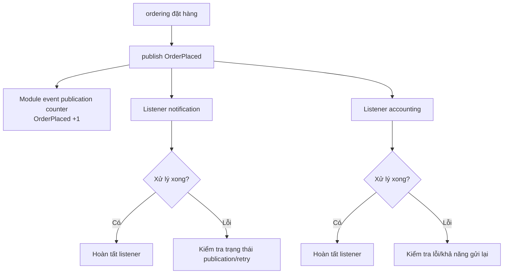

# Đếm event theo simple event type name trong Spring Modulith

## 1. Vì sao cần đếm từng loại domain event?

Trong ứng dụng **Spring Boot** tổ chức bằng **Spring Modulith**, các application module thường giao tiếp bằng domain event. Chẳng hạn module `ordering` công bố `OrderPlaced` khi đơn hàng được xác nhận; module `notification` nhận sự kiện này để gửi thông báo; module `inventory` có thể phản ứng để cập nhật trạng thái giữ hàng.

Khi hệ thống vận hành, nhóm phát triển muốn biết:

- Trong một khoảng thời gian có bao nhiêu lượt `OrderPlaced` được công bố?
- Sau khi triển khai phiên bản mới, số lượt `OrderCancelled` có tăng bất thường không?
- Event phát sinh từ phần nào của ứng dụng, và loại event nào chiếm phần lớn lưu lượng?
- Có thể tạo dashboard cho từng loại event mà không tự viết bộ đếm trong từng service không?

**Spring Modulith observability** cung cấp các **Micrometer Counter** phục vụ trường hợp này. Ngoài counter tổng hợp, framework còn định danh counter riêng bằng **module identifier** và **simple event type name**.

Tên meter riêng có mẫu:

```text
module.events.published.$moduleIdentifier.$simpleEventTypeName
```

Ví dụ, nếu module được nhận diện với identifier `ordering` và event là `OrderPlaced`, tên meter kỳ vọng là:

```text
module.events.published.ordering.OrderPlaced
```

Đây là **tên logic của meter trong Micrometer**, chưa nhất thiết là tên chuỗi thời gian mà Prometheus hay một backend khác hiển thị. Để đếm chính xác, cần hiểu từ đâu có hai phần trong tên, khi nào counter tăng và giới hạn mà phép đo này có thể chứng minh.

> **Phạm vi của bài:** đếm **lượt công bố domain event được Spring Modulith observability ghi nhận theo kiểu event**, không đồng nhất số lượt publish với số listener đã xử lý thành công, số bản ghi nghiệp vụ hoặc số trace được lưu.

## 2. Phân biệt counter tổng hợp và counter riêng cho từng event

Theo tài liệu Spring Modulith, có hai dạng metric:

| Tên meter Micrometer | Ý nghĩa | Nhãn mặc định được mô tả |
| --- | --- | --- |
| `module.events.published` | Counter tổng hợp các lượt công bố domain event; có thể phân tách theo nhãn | `module.event.type`, `module.identifier`, `module.name` |
| `module.events.published.$moduleIdentifier.$simpleEventTypeName` | Counter cho **một loại event cụ thể trong một module**; có thể bổ sung nhãn theo nghiệp vụ | `module.identifier`, `module.name` |

Hai meter cùng phản ánh hoạt động publish, nhưng cung cấp **hai cách nhận diện phép đo**: một meter dùng tên ổn định và nhãn loại event; meter còn lại đưa loại event trực tiếp vào **tên meter**.

Giả sử ứng dụng phát sinh những lượt sau:

| Module | Kiểu event | Số lượt publish được quan sát |
| --- | --- | ---: |
| `ordering` | `OrderPlaced` | 3 |
| `ordering` | `OrderCancelled` | 2 |
| `payment` | `PaymentAuthorized` | 4 |

Khi không có bộ lọc hoặc tình huống đặc biệt khác, cách diễn giải mong đợi:

```text
module.events.published.ordering.OrderPlaced       count = 3
module.events.published.ordering.OrderCancelled    count = 2
module.events.published.payment.PaymentAuthorized  count = 4
```

Đồng thời, tổng số lượt publish được quan sát trên các nhóm tương ứng là `3 + 2 + 4 = 9`. Đừng xem tổng của **cả counter tổng hợp lẫn counter riêng** là 18: đó là hai dạng số đo cho cùng hoạt động, nên cộng cả hai sẽ **đếm trùng**.

Các con số trong bảng chỉ là minh họa cho **một khoảng dữ liệu và một phạm vi đo thống nhất**. Trong hệ thống nhiều instance, counters tồn tại theo từng instance/registry; phải gom dữ liệu đúng theo backend trước khi nói về tổng toàn hệ thống.

## 3. Simple event type name là gì?

### 3.1. Simple name khác fully qualified class name

Trong Java, mỗi class hoặc record có thể được gọi bằng **fully qualified class name** (tên đầy đủ kèm package) và **simple name** (tên kiểu không kèm package).

Ví dụ:

```java
package com.example.shop.ordering;

public record OrderPlaced(String orderId, String channel) {
}
```

Java reflection cho kết quả khái niệm:

```java
System.out.println(OrderPlaced.class.getName());
// com.example.shop.ordering.OrderPlaced

System.out.println(OrderPlaced.class.getSimpleName());
// OrderPlaced
```

Khi biểu diễn theo mẫu tên metric của Spring Modulith:

```text
moduleIdentifier    = ordering
simpleEventTypeName = OrderPlaced

meter name = module.events.published.ordering.OrderPlaced
```

Vì vậy, phần `OrderPlaced` **không phải** `com.example.shop.ordering.OrderPlaced`. Nếu tự đoán tên meter bằng cách nối cả package vào hậu tố, bạn có thể truy vấn nhầm.

### 3.2. Module identifier không phải tên package đầy đủ

`moduleIdentifier` là định danh application module mà **mô hình Spring Modulith nhận diện trong ngữ cảnh của event**. Với cấu trúc module mặc định có package `com.example.shop.ordering`, identifier thường là `ordering`. Tuy nhiên, tên module có thể khác cách suy luận thủ công khi dự án tùy biến module detection hoặc tổ chức nested modules.

Không nên suy meter name bằng cách lấy thành phần cuối của package một cách máy móc. Hãy đối chiếu **module identifier thực tế** từ `ApplicationModules` hoặc endpoint `/actuator/modulith` và danh sách meter đã đăng ký.

### 3.3. Những trường hợp cần kiểm tra kỹ

| Tình huống | Ảnh hưởng đến việc đếm |
| --- | --- |
| Đổi tên class `OrderPlaced` thành `PurchaseCreated` | Hậu tố simple event type name thay đổi; dashboard dùng tên cũ cần cập nhật |
| Chuyển event sang module khác hoặc đổi identifier | Phần `$moduleIdentifier` có thể thay đổi, tạo tên meter logic khác |
| Hai event trong cùng module có simple name trùng nhau nhưng khác package | Tên meter dự kiến có nguy cơ đụng nhau; cần kiểm tra cách registry/tags phân biệt để không gộp nhầm |
| Hai module khác nhau có event cùng simple name | Phần module identifier giúp phân biệt tên logic nếu identifiers khác nhau |
| Event là class lồng nhau hoặc được tạo bởi proxy | Simple name có thể không khớp cách người viết gọi tên; kiểm tra type thực tế và meter được đăng ký |
| Event không thuộc application module mà framework nhận diện được | Không nên tự kết luận counter theo mẫu nào sẽ xuất hiện; cần xác nhận trên runtime của đúng phiên bản |

Đặc biệt, **simple name không phải định danh duy nhất toàn JVM**. Khi thiết kế module events, nên dùng tên event rõ nghĩa, tránh trùng lặp khó phân biệt trong cùng module và kiểm tra ảnh hưởng khi đổi tên class.

## 4. Ví dụ ứng dụng: publish `OrderPlaced` và `OrderCancelled`

Giả sử ứng dụng có:

```text
com.example.shop
├── ShopApplication.java
└── ordering
    ├── OrderPlaced.java
    ├── OrderCancelled.java
    └── OrderApplicationService.java
```

Để đơn giản, mỗi event là một Java record (Java 17 trở lên):

```java
// OrderPlaced.java
package com.example.shop.ordering;

public record OrderPlaced(String orderId, String channel) {
}
```

```java
// OrderCancelled.java
package com.example.shop.ordering;

public record OrderCancelled(String orderId, String reason) {
}
```

Service công bố event qua `ApplicationEventPublisher` của Spring:

```java
package com.example.shop.ordering;

import org.springframework.context.ApplicationEventPublisher;
import org.springframework.stereotype.Service;

@Service
public class OrderApplicationService {

    private final ApplicationEventPublisher events;

    public OrderApplicationService(ApplicationEventPublisher events) {
        this.events = events;
    }

    public void place(String orderId, String channel) {
        // Trong hệ thống thực, chỉ publish sau khi thỏa mãn điều kiện nghiệp vụ.
        events.publishEvent(new OrderPlaced(orderId, channel));
    }

    public void cancel(String orderId, String reason) {
        events.publishEvent(new OrderCancelled(orderId, reason));
    }
}
```

Giả sử ứng dụng được cấu hình Spring Modulith observability và những event trên được framework nhận diện để đo publication. Nếu gọi `place(...)` ba lần và `cancel(...)` hai lần, ta kỳ vọng số lượt tăng ở:

```text
module.events.published.ordering.OrderPlaced       +3
module.events.published.ordering.OrderCancelled    +2
```

Đây là số **lượt publish được ghi nhận**, không phải “ba đơn hàng đã lưu thành công”. Nếu cùng một `orderId` được publish nhiều lần do code nghiệp vụ hoặc thao tác gửi lại, counter vẫn biểu diễn **số lượt publish**, không tự loại các bản ghi trùng `orderId`.

Spring Modulith sử dụng event publication infrastructure trong một số cấu hình để lưu dấu trạng thái xử lý listener. Dù ứng dụng dùng cách công bố event nào, **event metrics và event publication registry là hai loại thông tin khác nhau**; đừng suy trạng thái listener từ counter publish.

## 5. Làm thế nào để bật và đọc metrics?

### 5.1. Dependencies

Đối với dự án Spring Boot đã quản lý phiên bản Spring Modulith tương thích, có thể thêm **Insight starter** để sử dụng observability và Actuator:

```kotlin
// build.gradle.kts, minh họa phần dependency
dependencies {
    runtimeOnly("org.springframework.modulith:spring-modulith-starter-insight")
}
```

Nếu chỉ cần phần module observability, có thể dùng `spring-modulith-observability-core` thay cho starter tổng hợp; Spring Boot Actuator vẫn cần có nếu muốn đọc `/actuator/metrics`. Các ví dụ không cố định version vì giả định dự án đã dùng BOM/dependency management tương thích với Spring Boot đang chạy.

**Không phải cứ thêm starter là có dashboard**. Trong môi trường học tập, có thể xem metrics qua Actuator sau khi endpoint được expose; muốn thu thập ở Prometheus/Grafana còn cần registry, cấu hình thu thập và hệ thống hiển thị.

### 5.2. Expose endpoint `metrics`

Ví dụ `application.yml`:

```yaml
management:
  endpoints:
    web:
      exposure:
        include: health, metrics, modulith
```

Các đường dẫn mặc định:

```bash
curl -sS http://localhost:8080/actuator/metrics
curl -sS http://localhost:8080/actuator/modulith
```

`/actuator/modulith` hỗ trợ xác minh module identifier, còn `/actuator/metrics` cho biết những meter đã thực sự được đăng ký. Ứng dụng có thể thay management port, base path hoặc yêu cầu xác thực, nên ví dụ URL cần điều chỉnh theo môi trường.

### 5.3. Truy vấn counter theo simple event type name

Sau khi publish event từ một kịch bản thử nghiệm, có thể gọi:

```bash
# Liệt kê các tên meter đang có
curl -sS http://localhost:8080/actuator/metrics

# Truy vấn meter tổng hợp
curl -sS http://localhost:8080/actuator/metrics/module.events.published

# Truy vấn meter riêng cho OrderPlaced thuộc ordering
curl -sS \
  http://localhost:8080/actuator/metrics/module.events.published.ordering.OrderPlaced
```

Kết quả **minh họa**, có thể trông như:

```json
{
  "name": "module.events.published.ordering.OrderPlaced",
  "description": null,
  "baseUnit": null,
  "measurements": [
    {
      "statistic": "COUNT",
      "value": 3.0
    }
  ],
  "availableTags": [
    {
      "tag": "module.identifier",
      "values": ["ordering"]
    },
    {
      "tag": "module.name",
      "values": ["Ordering"]
    }
  ]
}
```

Đây là dạng response tham khảo của **Spring Boot Actuator metrics endpoint**, không phải bản ghi được thu trực tiếp từ ứng dụng cụ thể. Số đo thực tế phụ thuộc việc meter đã được tạo, thời điểm publish, registry, tags và mức tích lũy của instance.

Nếu tên meter chưa có trong `/actuator/metrics`, **đừng cho rằng count bằng 0**: có thể chưa phát sinh event được đo, chưa có dependency observability hoặc tên module/event khác dự đoán. Hãy kiểm tra tên được trả về trước khi truy vấn theo một chuỗi tự suy.

### 5.4. Truy vấn theo nhãn

Nếu một meter có nhiều giá trị tag, Actuator cho phép lọc theo giá trị bằng tham số `tag`. Ví dụ:

```bash
curl -G \
  --data-urlencode "tag=module.identifier:ordering" \
  http://localhost:8080/actuator/metrics/module.events.published
```

Counter tổng hợp có tag `module.event.type`, nhưng biểu diễn chính xác của **giá trị tag** cần kiểm tra từ response `availableTags` của registry đang chạy. Không mặc định giá trị này luôn trùng tên Java simple name hay fully qualified name ở mọi phiên bản.

Nếu dùng Prometheus registry, tên series sẽ được biến đổi theo quy tắc naming convention của Micrometer/Prometheus (chẳng hạn thay dấu chấm và thêm suffix phù hợp loại counter). **Tên `module.events.published.ordering.OrderPlaced` là tên Micrometer**, vì vậy luôn xác minh tên series thực tế trên `/actuator/prometheus` trước khi viết PromQL.

## 6. Tính số lượt publish trong một khoảng thời gian

### 6.1. Counter lưu giá trị tích lũy

Micrometer `Counter` là phép đo tăng dần. Cách đọc `COUNT=125` trong Actuator thường là “counter hiện giữ giá trị 125 trong phạm vi bộ đo/instance” chứ không phải “125 event trong phút vừa qua”.

Ví dụ một instance đang chạy liên tục:

| Thời điểm | Giá trị meter `OrderPlaced` | Diễn giải |
| --- | ---: | --- |
| 10:00 | 120 | Giá trị tích lũy đến 10:00 |
| 10:05 | 135 | Giá trị tích lũy đến 10:05 |
| Chênh lệch | 15 | Có thêm 15 lượt được ghi nhận trong 5 phút đó |

Trường hợp minh họa này dùng công thức:

\[
\Delta C = C_{\text{cuối}}-C_{\text{đầu}}
\]

Nhưng công thức chênh lệch đơn giản **không an toàn khi process khởi động lại**, khi exporter mất mẫu hoặc khi có nhiều replica. Khi ấy giá trị counter có thể reset hoặc mỗi replica có một trạng thái độc lập. Backend time-series như Prometheus cung cấp hàm xử lý counter reset và tập hợp dữ liệu theo instance.

### 6.2. Prometheus: dùng `rate` hoặc `increase`

Sau khi đã xác minh tên Prometheus thực tế, có thể sử dụng các truy vấn dạng:

```promql
# Dạng ý tưởng, thay METRIC_NAME bằng series counter có thật:
sum(rate(METRIC_NAME[5m]))

# Số lượt tăng ước lượng trong 1 giờ:
sum(increase(METRIC_NAME[1h]))
```

Ví dụ `rate` cho biết **lượt event mỗi giây** tính trên cửa sổ 5 phút; nhân với 60 nếu dashboard muốn biểu diễn theo phút. `increase` ước lượng số lượt tăng trong cửa sổ, có xử lý counter reset và phép nội suy của Prometheus.

Khi chọn metric cho dashboard:

- Dùng **meter tổng hợp** để xem toàn bộ event publication; áp dụng nhãn loại event/module nếu backend hỗ trợ.
- Dùng **meter riêng theo simple event type name** nếu mục tiêu là theo dõi `OrderPlaced` hay `OrderCancelled` cụ thể.
- Tránh **cộng meter tổng hợp với meter riêng** cho cùng một luồng dữ liệu.
- Nếu có nhiều replica, cần tổng hợp các series theo nhãn instance/pod thích hợp; đừng diễn giải số đo từ một Actuator endpoint là tổng của cả cụm.

### 6.3. Tên class và tên metric không phải contract nghiệp vụ

Giả sử refactor `OrderPlaced` thành `PurchaseCreated` mà semantics vẫn giống nhau. Nếu dashboard query meter `module.events.published.ordering.OrderPlaced`, đồ thị mới có thể về 0 do metric đổi tên, dù nghiệp vụ vẫn hoạt động.

Do đó, khi đổi class/module identifier hoặc cách publish event, hãy:

1. Review ảnh hưởng đến tên meter và alert.
2. Ghi nhận mapping cũ/mới trong migration dashboard.
3. Theo dõi song song trong thời gian chuyển đổi nếu backend có dữ liệu của nhiều version.
4. So sánh dữ liệu theo **cùng phiên bản ứng dụng** trước khi kết luận lượng event giảm.

Trong rolling deployment, một phần replica có thể công bố meter tên cũ, phần còn lại dùng tên mới. Phép cộng theo một tên đơn lẻ sẽ không phản ánh đầy đủ toàn bộ lưu lượng trong khoảng chuyển đổi đó.

## 7. Bổ sung tag cho counter theo loại event

Đôi khi chỉ biết `OrderPlaced` được công bố bao nhiêu lần là chưa đủ. Ta còn muốn tách theo **kênh có tập giá trị nhỏ**, ví dụ `channel=web` hoặc `channel=mobile`.

Spring Modulith cung cấp `ModulithEventMetricsCustomizer` để tùy biến **counter cho event cụ thể**. API nhận class của event và một hàm dùng giá trị event để bổ sung thuộc tính trên `Counter.Builder`.

Vì cấu hình sau **tham chiếu lớp của Spring Modulith trong source code**, dự án cần thêm `spring-modulith-observability-api` vào **compile classpath** bên cạnh runtime starter. Ví dụ Gradle:

```kotlin
dependencies {
    implementation("org.springframework.modulith:spring-modulith-observability-api")
    runtimeOnly("org.springframework.modulith:spring-modulith-starter-insight")
}
```

Ví dụ Java cho event `OrderPlaced` đã khai báo ở mục 4:

```java
package com.example.shop.ordering;

import org.springframework.context.annotation.Bean;
import org.springframework.context.annotation.Configuration;
import org.springframework.modulith.observability.ModulithEventMetricsCustomizer;

@Configuration
public class EventMetricsConfiguration {

    @Bean
    ModulithEventMetricsCustomizer modulithEventMetricsCustomizer() {
        return metrics -> metrics.customize(
                OrderPlaced.class,
                (event, counter) -> counter.tag("channel", event.channel())
        );
    }
}
```

Với event `OrderPlaced(orderId, "web")`, counter có thể mang thêm tag `channel=web`. Nếu quan sát `COUNT` theo tag `channel=mobile`, bạn có thể tách lượt công bố đến từ mobile trong cùng loại event.

**Lưu ý cardinality:** chỉ dùng tag có tập giá trị **nhỏ, được kiểm soát**. Không đưa `orderId`, `userId`, email, URL động hoặc timestamp vào tags. Mỗi tổ hợp tag tạo ra khả năng có thêm meter/time series, dễ làm tăng bộ nhớ, độ lớn dữ liệu và chi phí vận hành.

Nếu `event.channel()` có thể rỗng hoặc giá trị tùy ý từ client, hãy **chuẩn hóa/kiểm tra đầu vào trước khi dùng làm tag**. Ví dụ, gộp các giá trị không thuộc danh sách cho phép vào `other` để tránh cardinality cao.

## 8. Phân biệt đếm publish, xử lý listener và tracing

Một `OrderPlaced` có thể được **publish một lần** nhưng được nhiều listener nhận, hoặc listener được gọi lại sau lỗi. Điều này tạo ra ba loại câu hỏi khác nhau:

| Câu hỏi | Dữ liệu phù hợp | Điều không thể kết luận trực tiếp |
| --- | --- | --- |
| “Bao nhiêu lượt `OrderPlaced` đã được publish?” | Counter `module.events.published.ordering.OrderPlaced` | Số đơn hàng duy nhất hoặc số listener thành công |
| “Listener đã hoàn tất công việc chưa?” | Event Publication Registry và trạng thái publication/handler, logs, kiểm thử nghiệp vụ | Không thể lấy chính xác từ counter publish |
| “Request này publish event ở đâu và listener chạy bước nào?” | Traces/spans nếu được instrument và context propagation đúng | Trace thiếu span không đủ chứng minh listener không chạy |
| “Lỗi xử lý event có tăng theo thời gian không?” | Metric lỗi listener tùy hệ thống, logs và publication status | Counter publish tăng không chứng minh listener lỗi |

Sơ đồ minh họa:



Counter `OrderPlaced` phản ánh publication, không được nhân với số listener. Việc hai listener cùng nhận một event **không tự tạo hai event publication ở cấp API publish ban đầu**. Nếu chính listener lại publish một event mới, lượt publish mới sẽ được đếm theo loại event tương ứng.

### 8.1. Liên hệ với module graph

`GET /actuator/modulith` có thể cho biết `notification` phụ thuộc `ordering` theo kiểu `EVENT_LISTENER`. Đó là quan hệ **cấu trúc**: module nào định nghĩa event và module nào lắng nghe.

Meter `module.events.published.ordering.OrderPlaced` cho biết hoạt động **publish theo loại** được ghi nhận. Hai tín hiệu bổ sung nhau nhưng không thay thế nhau: có dependency listener không chứng minh đã publish; có publication counter cũng không chứng minh toàn bộ listeners xử lý thành công.

### 8.2. Liên hệ với spans/traces và context propagation

Khi có Micrometer Tracing cùng exporter/backend, một request có thể có các spans:

```text
HTTP POST /orders
  ordering.placeOrder
    publish OrderPlaced              (nếu được instrument)
  notification.onOrderPlaced         (nếu listener được tracing)
```

Nếu listener chạy bất đồng bộ, phải đảm bảo ngữ cảnh tracing được truyền qua `@Async`, executor hoặc broker nếu muốn liên hệ các spans. Việc chỉ có counter tăng không nói gì về `traceId`, parent span hay thời gian xử lý.

Traces giúp phân tích **một lần thực thi cụ thể**; event counters giúp nhìn **xu hướng trên nhiều lần thực thi**; event publication registry giúp theo dõi **trạng thái hoàn tất** trong các cấu hình hỗ trợ bền vững.

## 9. Các lỗi thường gặp khi đếm event bằng simple type name

| Triệu chứng | Nguyên nhân có thể | Cách xác minh |
| --- | --- | --- |
| Không thấy `module.events.published.ordering.OrderPlaced` | Chưa publish event được đo, sai identifier/simple name, thiếu observability hoặc registry không đăng ký meter | Mở `/actuator/metrics`, phát thử event, đối chiếu module ID và class event |
| Truy vấn endpoint metrics trả 404 | Endpoint chưa expose hoặc URL/management port khác | Kiểm tra `management.endpoints.web.exposure.include` và security |
| Count không tăng sau lời gọi nghiệp vụ | Code chưa chạy đến `publishEvent`, event không được quan sát, tên meter không đúng | Dùng log/debug kiểm tra điểm publish và danh sách meter có thật |
| Count lớn hơn số đơn hàng | Một đơn hàng có thể publish nhiều lần; counter không loại trùng theo `orderId` | Đối chiếu log nghiệp vụ và cơ chế idempotency/deduplication |
| Count bằng 0 sau restart | Counter trong instance mới đã reset | Dùng backend time series với `increase`/`rate` và tổng hợp các replicas |
| Dashboard số liệu giảm sau refactor | Class hoặc module identifier đổi, làm đổi tên meter | Kiểm tra tên cũ/mới và migration dashboard |
| Counter tổng và counter riêng cộng lại cho kết quả gấp đôi | Hai metric là hai cách đo cùng hoạt động publish | Chỉ chọn một nguồn cho mỗi phép tính |
| Counter tăng nhưng listener lỗi | Counter đếm publish, không đo completion | Kiểm tra trạng thái publication, logs và listener metrics riêng |
| Có quá nhiều series | Custom tag chứa ID hoặc giá trị không kiểm soát | Giới hạn low-cardinality keys và chuẩn hóa giá trị tag |
| Một loại event xuất hiện ở nhiều module | Cách framework nhận diện module, định nghĩa event hoặc cấu hình detection cần làm rõ | So tên meter thực tế, module model và source event |
| Không thấy tên meter y hệt trong Prometheus | Naming convention chuyển dấu chấm, đơn vị hoặc suffix counter | Kiểm tra `/actuator/prometheus` và tên series exporter thực tế |

### 9.1. Quy trình chẩn đoán ngắn

Với trường hợp “đã publish `OrderPlaced` nhưng không thấy metric”, thử theo thứ tự:

1. Kiểm tra runtime dependency `spring-modulith-observability-core` hoặc `spring-modulith-starter-insight` và Spring Boot Actuator khi cần endpoint.
2. Đảm bảo `/actuator/metrics` truy cập được và registry đang hoạt động.
3. Thực thi **một kịch bản thật sự gọi `publishEvent(...)`** trong môi trường thử nghiệm.
4. Liệt kê tất cả meter, tìm các tên bắt đầu bằng `module.events.published`.
5. Đọc identifier module từ `/actuator/modulith`, đối chiếu simple name của event Java.
6. Nếu chạy nhiều instances, thử đọc từng instance trước khi tổng hợp backend.
7. Nếu dùng tag customizer, kiểm tra nhãn có giá trị ngoài dự kiến hoặc làm phát sinh meter mới.

Đừng dùng việc thiếu metric như bằng chứng duy nhất rằng domain event chưa phát sinh. Hạ tầng observability có thể chưa bật hoặc chưa xuất đúng dữ liệu.

## 10. Bài tập tự kiểm tra

Giả sử hệ thống có hai module `ordering` và `billing`. Các class event:

```text
com.example.shop.ordering.OrderPlaced
com.example.shop.ordering.OrderCancelled
com.example.shop.billing.InvoiceIssued
```

Trong một khoảng chạy, ứng dụng publish:

- `OrderPlaced`: 18 lượt.
- `OrderCancelled`: 4 lượt.
- `InvoiceIssued`: 11 lượt.

**Câu 1.** Viết tên logic của ba meter riêng theo mẫu `module.events.published.$moduleIdentifier.$simpleEventTypeName`.

**Câu 2.** Nếu bộ đếm tổng và ba bộ đếm riêng cùng đại diện cho các lượt publish trên, có được lấy tổng tất cả bốn counter để tính tổng số event không?

**Câu 3.** Một listener nhận `OrderPlaced` bị lỗi ba lần trước khi thành công. Từ count `OrderPlaced=18`, có suy được số lần retry và số đơn hàng đã hoàn tất không?

**Câu 4.** Nếu team thêm tag `orderId` vào counter riêng, rủi ro vận hành nào xuất hiện?

**Gợi ý đáp án:**

1. `module.events.published.ordering.OrderPlaced`, `module.events.published.ordering.OrderCancelled`, `module.events.published.billing.InvoiceIssued`.
2. Không. Tổng lượt publish được quan sát trong ví dụ là `18 + 4 + 11 = 33`. Counter tổng và counter riêng là hai dạng quan sát cùng hoạt động; cộng cả hai gây đếm trùng.
3. Không. Counter publish không xác nhận listener hoàn tất, số lần retry hay số đơn hàng duy nhất; cần theo dõi publication/handler và trạng thái nghiệp vụ riêng.
4. `orderId` có cardinality cao, có thể tạo một time series cho mỗi đơn hàng và tăng chi phí bộ nhớ/lưu trữ.

## 11. Tổng kết

Muốn **đếm event theo simple event type name** trong Spring Modulith, hãy nhớ:

1. Tên meter riêng được hình thành theo **`module.events.published.$moduleIdentifier.$simpleEventTypeName`**; ví dụ `module.events.published.ordering.OrderPlaced`.
2. **Simple event type name** là tên kiểu Java không kèm package; **module identifier** do mô hình Spring Modulith nhận diện.
3. Counter ghi **lượt publish**, không phải số sự kiện nghiệp vụ duy nhất hoặc lượt listener xử lý thành công.
4. Đọc `/actuator/metrics` trước để biết tên meter thật, sau đó quan sát `COUNT` hoặc dùng backend time series tính `rate`/`increase` cho khoảng thời gian và nhiều instances.
5. Khi cần nhãn bổ sung, dùng `ModulithEventMetricsCustomizer` với giá trị có cardinality thấp; luôn tính đến đổi tên event/module và các ranh giới tracing/context propagation.

Khi kết hợp metric này với **module graph, Actuator, traces và trạng thái event publication**, nhóm phát triển có thể theo dõi lưu lượng domain event mà vẫn biết giới hạn của từng nguồn dữ liệu.

### Tài liệu tham khảo

- [Spring Modulith — Production-ready Features, Observability Metrics](https://docs.spring.io/spring-modulith/reference/production-ready.html): hai counter mặc định, low-cardinality keys và `ModulithEventMetricsCustomizer`.
- [Spring Modulith — ModulithEventMetrics API](https://docs.spring.io/spring-modulith/docs/current/api/org/springframework/modulith/observability/ModulithEventMetrics.html): tùy biến `Counter.Builder` theo class event.
- [Spring Modulith — Working with Application Events](https://docs.spring.io/spring-modulith/reference/events.html): event publication, listener, trạng thái và retry.
- [Spring Boot — Metrics](https://docs.spring.io/spring-boot/reference/actuator/metrics.html): Micrometer, Actuator metrics và backend.
- [Micrometer — Counters](https://docs.micrometer.io/micrometer/reference/concepts/counters.html): đặc tính counter, tính tốc độ và nguyên tắc sử dụng.
