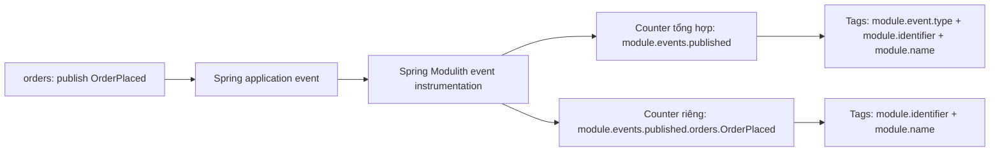
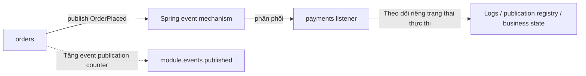

# Low-cardinality tags của event metric

## 1. Vì sao cần hiểu tag cardinality khi quan sát sự kiện?

Trong hệ thống Spring Boot được chia thành các **application module**, nhóm phát triển thường muốn trả lời các câu hỏi: module nào đang công bố nhiều sự kiện nhất, loại domain event nào đột ngột tăng, và một bản triển khai mới có làm thay đổi lưu lượng sự kiện hay không?

Spring Modulith cung cấp **event publication metrics** để theo dõi các lần công bố domain event. Micrometer cho phép gắn **tags** vào metric, nhờ đó cùng một bộ đếm có thể được phân tích theo module hoặc loại sự kiện. Tuy nhiên, tag có số lượng giá trị quá lớn sẽ tạo rất nhiều chuỗi thời gian riêng biệt (time series), làm tăng tài nguyên của bộ thu thập metrics và có thể khiến dashboard khó sử dụng.

Đây là bài **“Low-cardinality tags của event metric”** thuộc chương **Event metrics** trong học phần **SPRING_MODULITH_DOCUMENTATION_OBSERVABILITY**. Học phần dùng Spring Modulith để tạo tài liệu ranh giới application module, đối chiếu module graph với Spring Boot Actuator, và quan sát tương tác bằng event metrics, tracing cùng context propagation. Bài này tập trung vào **thiết kế, đọc và kiểm chứng tags có cardinality thấp** của event metric.

Sau khi học, bạn cần:

1. Giải thích cardinality của một **tag** và của **toàn bộ meter**.
2. Nhận diện đúng các low-cardinality tags mặc định của **hai loại event counter** trong Spring Modulith.
3. Dùng Actuator Metrics và Prometheus để lọc sự kiện theo module, event type mà không nhầm lẫn tên meter.
4. Bổ sung tag nghiệp vụ một cách an toàn bằng `ModulithEventMetricsCustomizer`.
5. Tránh gắn order ID, user ID, trace ID và dữ liệu tùy ý vào metrics.
6. Phân biệt **event được công bố** với **event được xử lý thành công**, tránh suy diễn sai từ counter.
7. Kiểm tra cardinality và phát hiện tag bùng nổ sau khi thay đổi ứng dụng.

> **Phạm vi:** Các số liệu và JSON trong bài là ví dụ minh họa. Tên tag mặc định và loại metric được đối chiếu theo [Spring Modulith Production-ready Features](https://docs.spring.io/spring-modulith/reference/production-ready.html). Giá trị tag cụ thể và các tên được exporter chuẩn hóa cần kiểm tra trên phiên bản ứng dụng thực tế.

## 2. Khái niệm: metric, tag, cardinality và time series

### 2.1. Meter là số đo, tag là chiều phân loại

Giả sử hệ thống có hai module `orders` và `payments`. Khi mỗi module công bố domain event, một **Counter** có thể tăng. Nếu chỉ có tổng số, ta biết ứng dụng đã công bố bao nhiêu event nhưng không biết event đến từ đâu. Gắn tag theo module giúp phân biệt:

```text
module.events.published{module.identifier="orders"}    120
module.events.published{module.identifier="payments"}   40
```

Đây là cú pháp giải thích ý tưởng, **không phải định dạng chính xác** của Prometheus exporter. Mỗi tập giá trị tag riêng cùng với tên metric tạo ra một chuỗi số đo khác nhau.

**Metric name** mô tả *đang đo điều gì*; **tag key** mô tả *phân loại theo tiêu chí nào*; **tag value** là *giá trị của tiêu chí tại thời điểm ghi nhận*.

Ví dụ một lần công bố sự kiện có thể có thông tin:

| Thành phần | Giá trị minh họa | Cách hiểu |
| --- | --- | --- |
| Tên meter | `module.events.published` | Tổng hợp các lần công bố event |
| Tag key | `module.identifier` | Chiều phân loại bằng technical identifier module |
| Tag value | `orders` | Module được ghi nhận là nguồn sự kiện theo metadata của Modulith |
| Tag key | `module.event.type` | Chiều phân loại bằng loại event |
| Tag value | `com.example.shop.orders.OrderPlaced` | Một **ví dụ** giá trị event type; định dạng thực tế lấy từ endpoint |
| Measurement | `COUNT = 120` | Giá trị counter ở thời điểm quan sát |

Một câu hỏi dạng **“Trong 5 phút qua, module orders công bố bao nhiêu event?”** cần metric counter, chiều phân loại module và dữ liệu theo thời gian ở monitoring backend. Một snapshot từ `/actuator/metrics` chỉ thể hiện phép đo tại thời điểm truy vấn.

### 2.2. Cardinality thấp và cao khác nhau ở tập giá trị

**Cardinality của tag** là số giá trị khác nhau mà tag có thể nhận trong phạm vi theo dõi.

- **Low cardinality:** số lượng giá trị được kiểm soát, có giới hạn thực tế và tương đối ổn định. Ví dụ `module.identifier` có các giá trị từ tập module đã định nghĩa; `sales.channel` thuộc `WEB`, `MOBILE`, `POS`.
- **High cardinality:** số lượng giá trị tăng theo đối tượng hoặc sự kiện riêng lẻ, thậm chí không có giới hạn thực tế. Ví dụ `orderId`, `customerId`, `userId`, `traceId`, `transactionId`, URI chứa ID thật, timestamp.
- **Giá trị được nhóm (bucket):** biến dữ liệu đa dạng thành một tập phân loại nhỏ, ví dụ các mức `small`, `medium`, `large` thay cho giá trị tiền chính xác của từng đơn.

Một tag tên `country` hoặc `status` không tự động an toàn: cần xem giá trị sinh ra như thế nào. `status=success/failure` thường có tập nhỏ; `status=<message lỗi động>` có thể thành vô hạn. Tương tự, một tag tên `eventType` có thể ổn định nếu lấy từ các class Java đã định nghĩa, nhưng rủi ro nếu đội ngũ ghi vào đó tên event được lắp từ ID runtime.

### 2.3. Cardinality của meter là số tổ hợp tag

Đối với cùng một metric name, mỗi **tổ hợp tag key–value khác nhau** thường tạo ra một meter/series khác nhau.

Giả sử một counter được phân loại theo:

- 4 module identifiers;
- 6 event types;
- 3 sales channels;
- 2 môi trường (`staging` và `production`).

Giới hạn trên đơn giản của số tổ hợp là:

\[
4 \times 6 \times 3 \times 2 = 144
\]

Trong thực tế, nhiều tổ hợp có thể không xảy ra (một loại event chỉ phát từ một module), nên số series thường **thấp hơn tích các tập giá trị**. Nếu thêm `orderId` với 200.000 giá trị, giới hạn lý thuyết có thể tăng cực lớn và các series mới liên tục xuất hiện.

Cần nhớ hai điều:

1. **Tag cardinality của từng key không phải tổng số time series.** Chi phí chủ yếu phụ thuộc các tổ hợp khác nhau, số meter, exporter, instance và thời gian lưu trữ.
2. **Một tag có ít giá trị trong hôm nay chưa chắc ổn định về lâu dài.** `buildId`, `podName`, thông báo lỗi có tham số động hoặc ID job có thể làm series churn tăng qua các lần triển khai.

### 2.4. Vấn đề không chỉ là RAM

Cardinality quá cao có thể gây:

- Nhiều đối tượng meter trên JVM và nhiều series tại Prometheus/backend.
- Chi phí scrape, ingestion, indexing, query và lưu trữ cao.
- Dashboard chậm, biểu đồ khó đọc, cảnh báo khó tổng hợp.
- Series churn: các label set xuất hiện một lần rồi biến mất, khiến dữ liệu rời rạc.
- Nguy cơ lộ dữ liệu cá nhân nếu tag chứa email, mã khách hàng hoặc định danh nhạy cảm.

Vì thế, chọn low-cardinality tags là một **quyết định thiết kế observability**, không chỉ là tối ưu sau khi gặp lỗi hiệu năng.

## 3. Hai họ event metrics của Spring Modulith

Theo tài liệu Spring Modulith, khi có hỗ trợ observability và domain event được ghi nhận, thư viện cung cấp hai nhóm counter:

| Metric | Mục đích | Low-cardinality tags mặc định |
| --- | --- | --- |
| `module.events.published` | Counter tổng hợp mọi lần **công bố domain event được ghi nhận** | `module.event.type`, `module.identifier`, `module.name` |
| `module.events.published.<moduleIdentifier>.<simpleEventTypeName>` | Counter riêng cho một loại event cụ thể của một module | `module.identifier`, `module.name` |

**Chi tiết quan trọng:** `module.event.type` có trong **counter tổng hợp** nhưng **không nằm trong bộ low-cardinality tags mặc định được tài liệu liệt kê cho counter riêng từng loại event**. Ở counter riêng, loại event đã được phân biệt bằng **metric name**.

Không nên gộp hai loại counter thành một danh sách tag mặc định duy nhất.

### 3.1. Counter tổng hợp: `module.events.published`

Giả sử ứng dụng bán hàng phát hai loại sự kiện:

- `com.example.shop.orders.OrderPlaced` từ `orders`.
- `com.example.shop.orders.OrderCancelled` từ `orders`.

Mỗi lần phát event, counter tổng hợp có thể được phân chia bằng:

```text
metric name: module.events.published
  tags:
    module.identifier = orders
    module.name       = Orders
    module.event.type = <giá trị type thực tế của OrderPlaced>

metric name: module.events.published
  tags:
    module.identifier = orders
    module.name       = Orders
    module.event.type = <giá trị type thực tế của OrderCancelled>
```

Ví dụ sử dụng placeholder cho `module.event.type` vì định dạng chuỗi phải kiểm chứng qua `availableTags` của phiên bản đang chạy; không được tự mặc định luôn là simple class name hoặc fully qualified class name.

Ưu điểm của counter tổng hợp là có thể truy vấn:

- Tổng tất cả sự kiện được công bố.
- Tổng theo từng `module.identifier`.
- Tổng theo `module.event.type`.
- Tổng theo một **tổ hợp module–event type**.

Tập các module và event class thường được xác định từ mã nguồn, nên các chiều phân loại này phù hợp với triết lý low cardinality.

### 3.2. Counter riêng từng loại event

Đối với `OrderPlaced` được phát bởi module `orders`, tên minh họa là:

```text
module.events.published.orders.OrderPlaced
```

Counter riêng hữu ích khi cần xem một event cụ thể mà không phải luôn lọc `module.event.type` trên counter tổng hợp. Nó cũng là điểm mở rộng để bổ sung **một số tag nghiệp vụ đã được kiểm soát**.

Ví dụ:

```text
metric name: module.events.published.orders.OrderPlaced
  tags:
    module.identifier = orders
    module.name       = Orders
```

Vì loại event đã xuất hiện trong metric name, **không tự thêm `module.event.type` vào bảng tags mặc định của counter riêng**. Nếu hệ thống có customizer hoặc common tags, kết quả thực tế có thể có thêm tags ngoài danh sách chuẩn.

**Lưu ý:** Cả counter tổng hợp lẫn counter riêng đều đếm việc công bố. Khi phân tích tổng số event, không cộng giá trị của hai metric lại với nhau như hai luồng sự kiện độc lập, vì cùng một event có thể được biểu diễn ở cả hai họ counter.

### 3.3. Sơ đồ phân tách cùng một lần publish



Sơ đồ chỉ mô tả **hai cách biểu diễn phép đếm** và bộ tag liên quan. Nó không khẳng định event đã đến mọi listener, đã được xử lý thành công hoặc đã hoàn tất một transaction nghiệp vụ.

## 4. Ý nghĩa của từng low-cardinality tag mặc định

### 4.1. `module.identifier` — khóa kỹ thuật của module

Đây là technical identifier của application module mà Spring Modulith dùng trong mô hình module.

Ví dụ:

```text
module.identifier=orders
module.identifier=inventory
module.identifier=payments
```

Giá trị này thường đến từ cách phát hiện module/package và metadata/module customization. Nó **không phải** ID của một order nghiệp vụ.

Vì số application module trong một bản build có giới hạn, `module.identifier` thường là tag thích hợp để làm chiều tổng hợp. Khi một module được đổi tên hoặc cấu trúc package thay đổi, truy vấn dashboard và alert theo identifier có thể cần cập nhật.

### 4.2. `module.name` — tên hiển thị

Đây là tên hiển thị của module, ví dụ `Orders` hoặc `Payments`. Nó phục vụ đọc báo cáo và phân biệt ý nghĩa nghiệp vụ, trong khi `module.identifier` thuận tiện hơn để tạo truy vấn ổn định.

Hai tag này có thể tương quan một–một. Do đó, nếu hệ thống có 10 module, việc có cả `identifier` và `name` **không nhất thiết tạo 10 × 10 chuỗi**: chỉ các cặp thực sự xuất hiện mới tạo series. Vẫn phải kiểm tra các thay đổi naming và cách customizer đặt giá trị.

Tránh dùng `module.name` để chứa tên khách hàng hoặc nhãn được tạo động theo mỗi yêu cầu. Tên module phải phản ánh **cấu trúc hệ thống**, không phản ánh từng instance nghiệp vụ.

### 4.3. `module.event.type` — phân loại sự kiện

Tag này xuất hiện trong **counter tổng hợp** `module.events.published` và cho biết loại event được công bố.

Ví dụ các event type của một cửa hàng:

```text
OrderPlaced
OrderCancelled
PaymentAuthorized
StockReserved
```

Danh sách trên là **tên class minh họa**; **giá trị chuỗi cụ thể trong tag** có thể được biểu diễn theo quy ước phiên bản Spring Modulith. Khi cần viết bộ lọc Actuator hoặc PromQL, phải lấy giá trị thật từ dữ liệu đo.

Nếu hệ thống chỉ có vài chục loại domain event đã định nghĩa trong mã, `module.event.type` thường có cardinality thấp. **Không truyền event payload, order ID, email hoặc tên sự kiện được sinh động theo request vào trường này**.

### 4.4. Bảng đối chiếu tags giữa event metrics và module spans

| Tên key | Counter tổng hợp event | Counter riêng event | Module-entry span/tracing |
| --- | --- | --- | --- |
| `module.identifier` | Có mặc định | Có mặc định | Có theo instrumentation |
| `module.name` | Có mặc định | Có mặc định | Có theo instrumentation |
| `module.event.type` | Có mặc định | Không liệt kê mặc định | Không phải tag module-entry chung |
| `module.invocation-type` | Không liệt kê mặc định | Không liệt kê mặc định | Có theo instrumentation |
| `module.method` | Không liệt kê mặc định | Không liệt kê mặc định | Có theo instrumentation |

Không lấy một thuộc tính thấy trong **trace/span** để khẳng định nó cũng là tag của **event counter**. Spring Modulith dùng các tập metadata khác nhau cho quan sát lời gọi module và quan sát công bố domain event.

## 5. Kích hoạt và đọc event metrics bằng Spring Boot Actuator

### 5.1. Các dependency cần có

Ví dụ Gradle Groovy DSL trong ứng dụng đã quản lý version Spring Boot/Spring Modulith tương thích:

```groovy
dependencies {
    runtimeOnly 'org.springframework.modulith:spring-modulith-starter-insight'
}
```

`spring-modulith-starter-insight` gom hỗ trợ Actuator và observability của Spring Modulith. Nếu dự án chỉ khai báo các artifact con, phải bảo đảm có hỗ trợ observability và `spring-boot-starter-actuator` tương ứng.

Để xuất metric sang Prometheus:

```groovy
dependencies {
    runtimeOnly 'io.micrometer:micrometer-registry-prometheus'
}
```

Các ví dụ không ghi số phiên bản vì dự án cần dùng bộ phiên bản được quản lý đồng nhất. Nếu kết nối dashboard/tracing bên ngoài, còn phải cấu hình registry/exporter cho backend tương ứng.

### 5.2. Expose endpoint quản trị cho bài thực hành

Trong môi trường local:

```yaml
management:
  endpoints:
    web:
      exposure:
        include: "health,metrics,modulith,prometheus"
```

Cấu hình này chỉ cho phép HTTP exposure đối với những endpoint **thực sự có sẵn** trong ứng dụng. `prometheus` cần dependency registry; `modulith` cần Modulith Actuator. Nếu ứng dụng dùng Spring Security hoặc quản trị trên cổng khác, phải dùng đúng cơ chế xác thực, port và base path.

Trong production, nên expose có chọn lọc trên mạng quản trị được bảo vệ; endpoint metrics có thể tiết lộ cấu trúc module và số liệu vận hành nội bộ.

### 5.3. Tạo một domain event được ghi nhận

Ví dụ các lớp thuộc module `orders`:

```java
package com.example.shop.orders;

import java.util.UUID;

public record OrderPlaced(UUID orderId) {
}
```

```java
package com.example.shop.orders;

import java.util.UUID;
import org.springframework.context.ApplicationEventPublisher;
import org.springframework.stereotype.Service;

@Service
public class OrderService {

    private final ApplicationEventPublisher publisher;

    public OrderService(ApplicationEventPublisher publisher) {
        this.publisher = publisher;
    }

    public void placeOrder(UUID id) {
        // Phần lưu dữ liệu/kiểm tra giao dịch được lược bỏ.
        publisher.publishEvent(new OrderPlaced(id));
    }
}
```

Để kiểm tra metrics, cần **gọi thực tế** `placeOrder(...)` qua luồng nghiệp vụ thích hợp. Trên môi trường thử nghiệm, đếm số lần `publishEvent(...)` có thực sự được gọi và kiểm tra cách Spring Modulith instrumentation ghi nhận sự kiện.

**Điểm quan trọng:** Trên các bản cấu hình khác nhau, không phải mọi loại `ApplicationEvent` nội bộ đều nhất thiết được hiển thị như một domain event của bài toán; hãy kiểm chứng trực tiếp loại event được instrument và số liệu của nó trên bản chạy.

### 5.4. Đọc tên meter và tags từ `/actuator/metrics`

Đầu tiên:

```bash
curl -s http://localhost:8080/actuator/metrics
```

Tìm tên `module.events.published` và các tên riêng dạng `module.events.published.<module>.<event>`. Sau đó:

```bash
curl -s http://localhost:8080/actuator/metrics/module.events.published
```

Một response **minh họa cấu trúc**, không phải response lấy từ ứng dụng thật:

```json
{
  "name": "module.events.published",
  "measurements": [
    { "statistic": "COUNT", "value": 7.0 }
  ],
  "availableTags": [
    { "tag": "module.identifier", "values": ["orders", "payments"] },
    { "tag": "module.name", "values": ["Orders", "Payments"] },
    {
      "tag": "module.event.type",
      "values": ["com.example.shop.orders.OrderPlaced"]
    }
  ]
}
```

Đọc đúng ba điều:

1. `measurements[].value` là phép đo hiện tại của các meter khớp điều kiện truy vấn; ở đây `7.0` chỉ là số minh họa.
2. `availableTags` cho biết **các key và giá trị có trong các meter đang được hiển thị**, hữu ích để xác định giá trị lọc thực tế.
3. Nếu không có meter nào được đăng ký thì endpoint riêng có thể trả `404`; cần tạo hoạt động thử và kiểm tra dependency/configuration trước khi kết luận event không được phát.

Khi không truyền `tag=...`, Actuator có thể tổng hợp các series cùng tên meter. Muốn phân tách, truyền một hoặc nhiều tham số tag.

### 5.5. Lọc theo module và event type

Lọc theo module:

```bash
curl -s "http://localhost:8080/actuator/metrics/module.events.published?tag=module.identifier:orders"
```

Lọc đồng thời theo module và event type, **thay chuỗi giá trị dưới đây bằng chuỗi thật trong `availableTags`**:

```bash
curl -s "http://localhost:8080/actuator/metrics/module.events.published?tag=module.identifier:orders&tag=module.event.type:com.example.shop.orders.OrderPlaced"
```

Khi được URL-decode, hai `tag=...` tạo điều kiện lọc kết hợp. Đây là phép chọn theo tag trên **cùng một counter tổng hợp**; không liên quan đến số listener nhận event.

Nếu muốn xem counter riêng của `OrderPlaced`, tra **tên meter trong danh sách thực tế**; ví dụ:

```bash
curl -s http://localhost:8080/actuator/metrics/module.events.published.orders.OrderPlaced
```

Có thể dùng `jq` để đọc dễ hơn:

```bash
curl -s http://localhost:8080/actuator/metrics/module.events.published \
  | jq '{name, measurements, availableTags}'
```

Tập values và cách chuẩn hóa tên chính xác phải dựa vào output runtime, không suy diễn theo tên Java class trong ví dụ.

## 6. Dùng Prometheus: tên meter và label có thể thay đổi

### 6.1. Micrometer name khác tên xuất ra backend

Trong Actuator Metrics API, dùng **tên meter Micrometer**: `module.events.published`. Khi xuất Prometheus, tên và tag keys có thể được chuẩn hóa theo quy ước của registry.

Ví dụ biểu diễn **minh họa**:

```text
module_events_published_total{
  module_identifier="orders",
  module_name="Orders",
  module_event_type="com.example.shop.orders.OrderPlaced"
} 7
```

Không được giả định mọi phiên bản exporter đều xuất đúng ví dụ trên. Trước khi viết PromQL, hãy gọi:

```bash
curl -s http://localhost:8080/actuator/prometheus
```

và tìm **tên metric, hậu tố counter và tên labels thật**. Dấu chấm của tag key trong Micrometer thường được chuyển sang dấu gạch dưới ở Prometheus, nhưng tên cuối cùng còn phụ thuộc quy ước và cấu hình.

### 6.2. Hai kiểu truy vấn thường dùng

Giả sử endpoint Prometheus thực sự xuất metric/labels đúng như ví dụ, truy vấn tổng **tốc độ công bố event mỗi giây** trên cửa sổ 5 phút:

```promql
sum by (module_identifier) (
  rate(module_events_published_total[5m])
)
```

Phân tích tốc độ theo module và event type:

```promql
sum by (module_identifier, module_event_type) (
  rate(module_events_published_total[5m])
)
```

Đây là các truy vấn **ví dụ có điều kiện**. Nếu tên thật khác, phải điều chỉnh query theo output exporter. Phép `rate(...)` phù hợp với counter tăng và có thể xử lý reset khi tiến trình khởi động lại. Để ước lượng số event trong một khoảng thời gian, có thể dùng `increase(...[1h])` và tổng hợp theo các label mong muốn.

Không nên so sánh trực tiếp giá trị counter tích lũy của hai instance có thời gian chạy khác nhau mà bỏ qua reset/restart.

### 6.3. Đừng nhân đôi phép đếm

Nếu cùng một event làm tăng cả:

- `module.events.published`, và
- `module.events.published.orders.OrderPlaced`,

thì một dashboard đếm “tổng sự kiện đã công bố” chỉ nên chọn **một trong hai nguồn số đếm**, rồi áp dụng nhóm/lọc thích hợp. Cộng cả hai sẽ làm sai nghĩa số lượng sự kiện.

Trong mô hình nhiều instance, mỗi instance có counter riêng. Truy vấn của backend cần tổng hợp qua các instance theo mục đích phân tích. Khi debug trên một instance, đọc `/actuator/metrics` chỉ phản ánh số liệu mà instance đó có trong `MeterRegistry`.

## 7. Bổ sung low-cardinality tags nghiệp vụ an toàn

### 7.1. Vì sao cần customizer?

Ba tag mặc định của counter tổng hợp đã đủ để trả lời: module nào và loại event nào. Nhưng đôi khi người vận hành cần xem một phân loại nghiệp vụ ít giá trị, ví dụ:

- Kênh nhận đơn `WEB`, `MOBILE`, `POS`.
- Phân loại nguồn giao dịch `MANUAL`, `SCHEDULED`.
- Loại thanh toán `CARD`, `BANK_TRANSFER`, `CASH`.

Spring Modulith cung cấp `ModulithEventMetricsCustomizer` để bổ sung tags cho **counter riêng của một loại event**. Không nên dùng nó để gắn các định danh có một giá trị riêng cho mỗi event.

### 7.2. Ví dụ event chứa một enum hữu hạn

Ví dụ module `orders` khai báo:

```java
package com.example.shop.orders;

import java.util.UUID;

public record OrderPlaced(UUID orderId, SalesChannel channel) {

    public enum SalesChannel {
        WEB, MOBILE, POS
    }
}
```

`OrderPlaced.channel()` chỉ trả về **ba** giá trị đã định nghĩa. Ngược lại, `OrderPlaced.orderId()` trả về một UUID gần như duy nhất cho mỗi đơn và **không phù hợp làm metric tag**.

Để dùng API customizer trong mã compile, ngoài runtime Insight starter, khai báo artifact observability API ở compile scope theo tài liệu Spring Modulith:

```groovy
dependencies {
    implementation 'org.springframework.modulith:spring-modulith-observability-api'
    runtimeOnly 'org.springframework.modulith:spring-modulith-starter-insight'
}
```

### 7.3. Đăng ký `ModulithEventMetricsCustomizer`

```java
package com.example.shop.orders;

import java.util.Locale;

import org.springframework.context.annotation.Bean;
import org.springframework.context.annotation.Configuration;
import org.springframework.modulith.observability.ModulithEventMetricsCustomizer;

@Configuration(proxyBeanMethods = false)
public class OrderEventMetricsConfiguration {

    @Bean
    ModulithEventMetricsCustomizer orderPlacedMetricsCustomizer() {
        return metrics -> {
            metrics.customize(OrderPlaced.class, (event, builder) -> {
                builder.tag(
                    "sales.channel",
                    event.channel().name().toLowerCase(Locale.ROOT)
                );
            });
        };
    }
}
```

Trong ví dụ này:

- `OrderPlaced.class` chỉ ra **loại event** mà customizer xử lý.
- `builder` là `Counter.Builder` cho metric riêng của loại event đó.
- `sales.channel` là tag nghiệp vụ mới có các giá trị `web`, `mobile`, `pos`.
- Không gắn `orderId`; ví dụ vẫn chứa `orderId` trong payload event để nghiệp vụ xử lý, nhưng **không đưa nó vào metric tags**.

Mẫu customizer chỉ phù hợp khi event đã được gắn một channel hợp lệ; code sản xuất cần kiểm tra dữ liệu đầu vào và hành vi khi event thiếu channel. Cũng cần xác định rõ bộ phiên bản Spring Modulith đang dùng, vì API cần khớp phiên bản của các module.

**Giới hạn phạm vi:** Customizer trên bổ sung tag cho **counter riêng của `OrderPlaced`** theo cơ chế API, không đồng nghĩa tự thêm `sales.channel` vào **counter tổng hợp `module.events.published`** hay tất cả module-entry spans.

### 7.4. Vì sao chọn enum tốt hơn chuỗi do người dùng nhập?

So sánh:

| Nguồn dữ liệu | Tập giá trị | Dùng làm tag metric? | Lý do |
| --- | --- | --- | --- |
| `SalesChannel.WEB/MOBILE/POS` | 3 giá trị cố định | Có thể | Bounded, dễ tổng hợp |
| `PaymentMethod.CARD/CASH/TRANSFER` | Số lượng cố định | Có thể | Phân loại nghiệp vụ nhỏ |
| `orderId` UUID | Tăng theo đơn hàng | Không | Một series mới cho nhiều event |
| `customerEmail` | Tăng theo người dùng | Không | Cardinality cao, còn là dữ liệu nhạy cảm |
| `traceId` | Gần như mỗi trace một giá trị | Không | Nên dùng trong tracing/log correlation |
| `errorMessage` | Có thể chứa thông số động | Không | Khó kiểm soát giá trị và an toàn dữ liệu |
| `paymentAmount` chính xác | Nhiều giá trị tùy ý | Không | Không phù hợp làm chiều phân loại |
| `amountBucket=small/medium/large` | 3 giá trị | Có thể | Tập giá trị hữu hạn, nhưng cần định nghĩa ranh giới bucket |

Hãy xem **giá trị phát sinh thực tế** chứ không chỉ tên biến. Một tag `partner` có vẻ là danh mục hữu hạn nhưng có thể tăng từ vài giá trị thành hàng chục nghìn khi hệ thống mở rộng.

### 7.5. Quy tắc thêm tag

Trước khi thêm một tag, tự trả lời:

1. Tag giúp trả lời **câu hỏi vận hành cụ thể nào**?
2. Có thể mô tả **toàn bộ tập giá trị cho phép** không?
3. Một sự kiện mới có tạo giá trị mới vô hạn không?
4. Tag có chứa thông tin nhận dạng cá nhân hoặc bí mật không?
5. Tag có trùng ý nghĩa với tag đã có không?
6. Có thực sự cần tag này trên **mọi metric** hay chỉ trên counter riêng một event?
7. Dashboard/alert cần chịu ảnh hưởng gì khi thêm/bớt/đổi tên tag?
8. Có giới hạn số series hoặc cảnh báo cho tag mới không?

Nếu không trả lời được, hãy giữ thông tin chi tiết trong log/trace hoặc dữ liệu nghiệp vụ thích hợp thay vì đưa vào metric label.

## 8. Low cardinality trong Micrometer Observation và trong Counter

### 8.1. Hai API có tên gần nhau nhưng dùng ở hai chỗ khác nhau

Trong Micrometer Observation:

```java
Observation.createNotStarted("shop.checkout", observationRegistry)
        .lowCardinalityKeyValue("channel", "web")
        .highCardinalityKeyValue("order.id", "a-unique-order-id")
        .observe(this::checkout);
```

Đoạn này chỉ minh họa cú pháp; `observationRegistry` và `checkout()` phải được định nghĩa trong ngữ cảnh code thực. Observation có thể được chuyển thành metric và trace qua các handler tương ứng. **Low-cardinality key-values** là những key phù hợp dùng làm metric tags; **high-cardinality key-values** không được đưa vào meter tags bởi metrics observation handler mặc định, vì nguy cơ cardinality explosion.

Trong **Spring Modulith event metric customizer**, lại dùng `Counter.Builder.tag(...)`:

```java
metrics.customize(OrderPlaced.class, (event, builder) -> {
    builder.tag("sales.channel", event.channel().name());
});
```

Ở đây lập trình viên đang gắn tag **trực tiếp vào counter builder**; API không tự phân biệt “đây là high-cardinality vì giá trị đến từ event”. Vì vậy nếu viết `builder.tag("order.id", event.orderId().toString())` thì bạn **đã trực tiếp tạo rủi ro**, dù trong một custom observation khác cùng dữ liệu được đánh dấu bằng `highCardinalityKeyValue`.

### 8.2. Observation tags, event counter tags và span tags không thể thay thế nhau

| Ngữ cảnh | API điển hình | Mục tiêu |
| --- | --- | --- |
| Quan sát một thao tác | `Observation.lowCardinalityKeyValue(...)` | Cung cấp metadata ít giá trị cho observation handlers |
| Theo dõi chi tiết từng trace | `Observation.highCardinalityKeyValue(...)` | Cung cấp metadata có nhiều giá trị cho tracing khi phù hợp |
| Tùy biến counter sự kiện | `Counter.Builder.tag(...)` qua `ModulithEventMetricsCustomizer` | Phân loại metric event theo giá trị được kiểm soát |
| Điều chỉnh metric registry | `MeterFilter` | Giới hạn, đổi hoặc từ chối meter theo chính sách hệ thống |
| Kiểm tra metric | `/actuator/metrics/{name}?tag=key:value` | Truy vấn một nhóm meter đã đăng ký |

**Không dùng `ModulithObservationConvention` để thay thế mặc nhiên cho `ModulithEventMetricsCustomizer`.** Convention liên quan đến cách mô tả observation module, còn customizer được thiết kế để mở rộng metrics của event publication.

## 9. Giám sát cardinality thực tế

### 9.1. Kiểm tra ngay trên Actuator

Sau khi chạy vài event thử, gọi:

```bash
curl -s http://localhost:8080/actuator/metrics/module.events.published \
  | jq -r '.availableTags[] | "\(.tag): \(.values | join(", "))"'
```

Với counter riêng `OrderPlaced`:

```bash
curl -s http://localhost:8080/actuator/metrics/module.events.published.orders.OrderPlaced \
  | jq -r '.availableTags[] | "\(.tag): \(.values | join(", "))"'
```

Thứ tự tags không được bảo đảm. Dùng kết quả runtime để xác nhận `sales.channel` chỉ có các giá trị được phép sau khi customizer được kích hoạt.

Khi endpoint trả `404`, cần kiểm tra event đã được công bố chưa, meter có được tạo chưa, tên metric có đúng không, và có registry/Actuator endpoint phù hợp hay không.

### 9.2. Đếm số giá trị tag là một bước, không phải toàn bộ bài toán

Một cách kiểm tra thủ công là xem số lượng `availableTags[].values` cho từng key. Đây là phép kiểm tra đơn giản hữu ích trên một instance, nhưng không đại diện cho **tổng series theo thời gian trên nhiều instance**, vì:

- Mỗi pod/instance có thể có bộ tags hơi khác nhau.
- Meter mới có thể xuất hiện khi có event lần đầu.
- Instance bị thay thế liên tục gây churn.
- Registry/exporter/backend có thể thêm common tags như `instance`, `region`, `environment`.
- Hai tag có tương quan không tạo mọi tích Descartes, nên phép nhân cardinality là **giới hạn trên**, không phải con số thực tế.

Để kiểm soát lâu dài, hãy đo số series của **toàn bộ họ metric** trên backend, so sánh trước/sau thay đổi, và theo dõi số series mới theo thời gian.

### 9.3. Chính sách số series và MeterFilter

Micrometer hỗ trợ `MeterFilter` để từ chối meter hoặc giới hạn số giá trị tag. Ví dụ bảo vệ bổ sung đối với tag `sales.channel` trên các metric riêng:

```java
import io.micrometer.core.instrument.config.MeterFilter;
import org.springframework.context.annotation.Bean;
import org.springframework.context.annotation.Configuration;

@Configuration(proxyBeanMethods = false)
class EventMetricsLimits {

    @Bean
    MeterFilter limitSalesChannelValues() {
        return MeterFilter.maximumAllowableTags(
            "module.events.published.",
            "sales.channel",
            4,
            MeterFilter.deny()
        );
    }
}
```

Đây là **hàng rào phòng vệ**: khi vượt giới hạn, các meter mới có thể bị từ chối, làm giảm dữ liệu mà dashboard nhìn thấy. Nó **không sửa nguyên nhân** của giá trị tag không kiểm soát. Vì vậy, cần ưu tiên chuẩn hóa giá trị ngay khi tạo metric, đặt alert cho hiện tượng từ chối meter và thử nghiệm trước khi áp dụng chính sách trên production.

Khi dùng MeterFilter, phải đăng ký vào **Spring-managed MeterRegistry** phù hợp; đừng tạo `new SimpleMeterRegistry()` tách biệt rồi mong Actuator/Prometheus tự nhìn thấy các meter đó.

### 9.4. Quan sát tăng trưởng theo đợt triển khai

Một cách đánh giá khả năng chịu tải:

1. Ghi số series trước khi đưa tag mới vào.
2. Xác định tập tag values kỳ vọng từ mã và sản phẩm.
3. Đưa lên staging, chạy event trên các nhánh nghiệp vụ thông dụng.
4. Quan sát tất cả series có liên quan, không chỉ một metric của một instance.
5. Kiểm tra sự gia tăng series khi rollback hoặc restart.
6. Thiết lập giới hạn/alert cho số series và ingestion nếu backend hỗ trợ.
7. Ghi nhận quyết định sử dụng tag trong tài liệu vận hành.

Tag `module.identifier` và `module.name` giúp hiểu ranh giới module; tag nghiệp vụ tùy biến phải có **hợp đồng giá trị được kiểm soát** tương tự.

## 10. Event metric có thể và không thể chứng minh điều gì?

### 10.1. Counter publication khác kết quả listener

Giả sử `orders` công bố `OrderPlaced` và `payments` có listener xử lý giao dịch.



Nếu counter tăng, nó cho thấy **instrumentation đã ghi nhận một lần publish**, không đảm bảo:

- Listener nhận event thành công.
- Listener đã hoàn tất.
- Giao dịch thanh toán đã commit.
- Event đã được xử lý đúng một lần.
- Không có retry hoặc redelivery.

Muốn xác nhận outcome cần thêm kết quả nghiệp vụ, logs, trạng thái event publication và tracing phù hợp. Không nên đặt tag `listener.status=success` lên **publication counter** nếu đó là kết quả chưa biết tại thời điểm publish.

### 10.2. Không xem metadata module graph như dữ liệu event rate

`/actuator/modulith` công bố **cấu trúc module**, trong đó có ranh giới và quan hệ phụ thuộc. Event counter thể hiện **hoạt động công bố event**. Sự tồn tại của cạnh `payments → orders` loại `EVENT_LISTENER` không chứng minh trong 5 phút qua có event `OrderPlaced` nào được phát.

Ngược lại, counter tăng mà graph không có cạnh mong đợi có thể do event không tạo dependency như giả định, cách phát hiện module khác, hoặc code chạy ngoài vị trí mong muốn. Hãy kiểm tra chính xác package/API và phiên bản build trước khi suy ra lỗi kiến trúc.

### 10.3. Tracing cung cấp mức chi tiết khác

Một trace được lấy mẫu có thể chứa **span của lần xử lý cụ thể**, kèm trace ID và timing. Đây là nơi thích hợp để điều tra một request hoặc listener. Counter tổng hợp cho biết **tần suất** và **xu hướng**; trace cho biết **đường đi và thời lượng của một mẫu thực thi**. Không đưa trace ID vào metric tag chỉ để liên kết hai loại dữ liệu.

Context propagation quan trọng khi event listener chạy bất đồng bộ: thiếu propagation có thể khiến trace bị tách, trong khi event counter vẫn tăng bình thường.

## 11. Bài thực hành: thiết kế tag cho sự kiện đặt hàng

### 11.1. Bối cảnh

Ứng dụng Spring Boot có ba application module:

```text
com.example.shop
├── ShopApplication.java
├── orders
│   ├── OrderService.java
│   └── OrderPlaced.java
├── inventory
│   └── InventoryService.java
└── payments
    └── PaymentListener.java
```

`orders` phát `OrderPlaced` sau khi ghi nhận đơn. Bộ phận vận hành cần theo dõi lượng event theo **module**, **loại event** và **kênh bán hàng**. Thiết kế ban đầu đề xuất thêm `orderId` và `customerId` làm tag để tra từng đơn.

Yêu cầu là **giữ số series kiểm soát được** trong khi vẫn hỗ trợ dashboard.

### Bước 1 — Chọn đúng metric cho câu hỏi

- Muốn **tổng sự kiện theo module/event type**: dùng `module.events.published`.
- Muốn **riêng OrderPlaced theo kênh bán hàng**: dùng counter riêng `module.events.published.orders.OrderPlaced` được mở rộng bằng customizer.
- Muốn biết **đơn nào lỗi và vì sao**: dùng log/trace/trạng thái nghiệp vụ, không thêm ID từng đơn vào metric.

### Bước 2 — Phân loại tags

| Đề xuất tag | Quyết định | Lý do |
| --- | --- | --- |
| `module.identifier` | Dùng mặc định | Tập module nhỏ |
| `module.name` | Dùng mặc định | Tên hiển thị theo module |
| `module.event.type` | Dùng trên counter tổng hợp | Tập event classes xác định |
| `sales.channel` | Có thể bổ sung cho OrderPlaced | Chỉ có `web/mobile/pos` |
| `orderId` | Loại khỏi metrics | UUID gần như riêng mỗi event |
| `customerId` | Loại khỏi metrics | Cardinality lớn, dữ liệu định danh |
| `requestTimestamp` | Loại khỏi metrics | Gần như giá trị duy nhất |
| `eventOutcome` | Chỉ dùng nếu định nghĩa rõ nguồn/ý nghĩa | Publication outcome khác listener outcome |

### Bước 3 — Dự kiến số tổ hợp

Giả sử có 3 module, 4 loại event, 3 channel và 2 instance. Giới hạn trên đơn giản:

\[
3 \times 4 \times 3 \times 2 = 72
\]

Trong bài này, `sales.channel` chỉ gắn cho counter riêng của `OrderPlaced`; vì vậy **không nên nhân 3 channel vào toàn bộ counter tổng hợp** để báo là số series thực tế. Với counter riêng `OrderPlaced`, nếu chỉ có một module nguồn và 3 channel trên 2 instance, kỳ vọng tối đa khoảng `1 × 3 × 2 = 6` tổ hợp (chưa tính common tags khác).

### Bước 4 — Thử event trên staging

Gửi lần lượt ba yêu cầu tương ứng với `WEB`, `MOBILE`, `POS`. Sau mỗi request:

```bash
curl -s http://localhost:8080/actuator/metrics/module.events.published
curl -s http://localhost:8080/actuator/metrics/module.events.published.orders.OrderPlaced
```

Kiểm tra có đúng module identifier, loại event và `sales.channel`; quan sát số tăng trên cùng một instance. Nếu một yêu cầu tạo nhiều lần publish vì retry, số counter có thể tăng theo số lần instrumentation ghi nhận publish, không phải số “đơn hàng thành công”.

### Bước 5 — Kiểm tra hai tình huống lỗi thiết kế

**Tình huống A:** Một lập trình viên thay `sales.channel` bằng `orderId` trong `builder.tag(...)`. Khi chạy hàng nghìn đơn, số series tăng rất nhanh. Cách sửa là đưa lại tag phân loại hữu hạn, và dùng logs/traces để điều tra từng order.

**Tình huống B:** Dashboard cộng counter tổng hợp và counter riêng. Kết quả tổng sự kiện cao bất thường. Cách sửa là chọn một nguồn duy nhất cho từng phép đếm và phân nhóm đúng label.

### Bước 6 — Đối chiếu với kiến trúc và trace

Kiểm tra `/actuator/modulith` để chắc chắn `orders` được phát hiện đúng. Nếu cần biết một lần xử lý `OrderPlaced` đi qua listener của `payments` như thế nào, xem trace và context propagation. Đừng đưa `module.method` hoặc trace ID vào tag mặc định của counter công bố event.

### Bước 7 — Ghi nhận quyết định

Lưu vào tài liệu vận hành: tên metric, tập tag keys, tập giá trị hợp lệ, ai sở hữu, phạm vi counter, truy vấn mẫu, giới hạn series và cách xác minh khi dữ liệu bất thường. Điều này giúp việc đổi tên event hoặc tách application module không làm dashboard sai âm thầm.

## 12. Các lỗi hiểu sai thường gặp

| Hiểu sai | Cách hiểu đúng |
| --- | --- |
| “Low-cardinality tag nghĩa là giá trị ngắn.” | Cardinality phụ thuộc **số giá trị khác nhau**, không phụ thuộc số ký tự |
| “Có 3 tag nghĩa là chỉ có 3 series.” | Series phụ thuộc **tổ hợp** các tag values và metric name |
| “Counter riêng và counter tổng hợp có cùng tags mặc định.” | Counter tổng hợp có `module.event.type`; counter riêng mặc định có hai tag module |
| “`module.event.type` luôn là simple class name.” | Định dạng giá trị thật phải kiểm tra ở `availableTags` |
| “`module.name` là tên người dùng.” | Đây là **tên hiển thị của application module** |
| “`orderId` cần cho việc lọc từng đơn nên là tag tốt.” | ID riêng mỗi event gây cardinality cao; nên dùng trace/log hoặc truy vấn dữ liệu nghiệp vụ |
| “Một counter publication tăng = payment đã hoàn tất.” | Counter chỉ phản ánh **publish được instrumentation ghi nhận** |
| “Prometheus dùng nguyên dấu chấm trong tên metric và tag.” | Exporter có naming convention; cần xem output thật |
| “Cộng counter tổng hợp và counter riêng để được số event.” | Hai họ có thể biểu diễn **cùng lượt publish**; cộng làm đếm đôi |
| “Tag được đánh dấu high-cardinality trong Observation sẽ tự an toàn khi gắn qua Counter.Builder.” | Counter.Builder đăng ký tag trực tiếp; phải tự kiểm soát số values |
| “Một tag enum luôn an toàn mãi mãi.” | Phải kiểm soát danh sách enum khi phát triển và kết hợp với các tag khác |
| “Bật `MeterFilter.deny()` đã sửa vấn đề.” | Filter có thể làm mất dữ liệu; cần sửa nguồn tag và theo dõi series growth |

## 13. Câu hỏi tự kiểm tra

1. Cardinality của một tag khác gì số series thực tế của một meter?
2. Ba low-cardinality tags mặc định của `module.events.published` là gì?
3. Vì sao counter `module.events.published.orders.OrderPlaced` không cần `module.event.type` như một tag mặc định?
4. Khi truy vấn `/actuator/metrics/module.events.published`, trường nào giúp biết **giá trị event type thực tế** để lọc?
5. Nếu có 4 modules, 6 event types và 3 channels, phép nhân `4 × 6 × 3` cho biết điều gì và **không** cho biết điều gì?
6. Tại sao `module.identifier` thường phù hợp làm tag, còn `orderId` thường không?
7. `ModulithEventMetricsCustomizer` tác động đến họ counter nào theo cách dùng thông thường?
8. Nếu cần thêm `sales.channel=web/mobile/pos`, nên lấy từ enum hay raw text do người dùng nhập? Vì sao?
9. Sự khác biệt giữa `Observation.highCardinalityKeyValue(...)` và `Counter.Builder.tag(...)` là gì?
10. Khi thấy `module.events.published` tăng, bạn đã chứng minh điều gì về event listener? Cần bằng chứng gì thêm?
11. Muốn tính tốc độ publish theo module trong Prometheus, tại sao nên dùng `rate(...)` thay vì so sánh hai giá trị counter tuyệt đối?
12. Nếu backend đột ngột tăng gấp 100 lần số series sau deploy, các tag và customizer nào cần kiểm tra đầu tiên?

## 14. Tài liệu tham khảo chính thức

- [Spring Modulith — Production-ready Features](https://docs.spring.io/spring-modulith/reference/production-ready.html): hai họ event metrics, low-cardinality keys mặc định và `ModulithEventMetricsCustomizer`.
- [Spring Modulith — ModulithEventMetricsCustomizer API](https://docs.spring.io/spring-modulith/docs/current/api/org/springframework/modulith/observability/ModulithEventMetricsCustomizer.html): extension point tùy biến metric sự kiện.
- [Spring Modulith — ModulithEventMetrics API](https://docs.spring.io/spring-modulith/docs/current/api/org/springframework/modulith/observability/ModulithEventMetrics.html): `customize(Class<T>, BiConsumer<T, Counter.Builder>)`.
- [Spring Boot — Metrics](https://docs.spring.io/spring-boot/reference/actuator/metrics.html): MeterRegistry, common tags, MeterFilter, Metrics endpoint và cách lọc `tag=KEY:VALUE`.
- [Spring Boot — Actuator Endpoints](https://docs.spring.io/spring-boot/reference/actuator/endpoints.html): exposure, access và bảo mật endpoint.
- [Micrometer — Observation Introduction](https://docs.micrometer.io/micrometer/reference/observation/introduction.html): low/high-cardinality key-values và vòng đời observation.
- [Micrometer — Observation Components](https://docs.micrometer.io/micrometer/reference/observation/components.html): handler, convention, filtering và cách dùng tags với metrics.
- [Micrometer — Meter Filters](https://docs.micrometer.io/micrometer/reference/concepts/meter-filters.html): giới hạn tag cardinality và từ chối meter.
- [Prometheus — Querying Functions](https://prometheus.io/docs/prometheus/latest/querying/functions/): cách đọc counter theo thời gian bằng `rate` và `increase`.

> **Ghi nhớ:** Event metric cần tags đủ chi tiết để phân tích nhưng có **tập giá trị được kiểm soát**. Với Spring Modulith, counter tổng hợp `module.events.published` có ba low-cardinality keys mặc định: `module.event.type`, `module.identifier`, `module.name`; counter riêng từng event có hai tag module theo mặc định và có thể mở rộng bằng customizer. Hãy dùng tags cho **nhóm sự kiện**, dùng traces/logs cho **từng sự kiện riêng lẻ**, đồng thời luôn kiểm chứng dữ liệu xuất thực tế bằng Actuator và monitoring backend.
