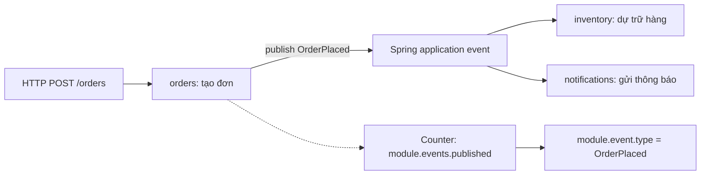
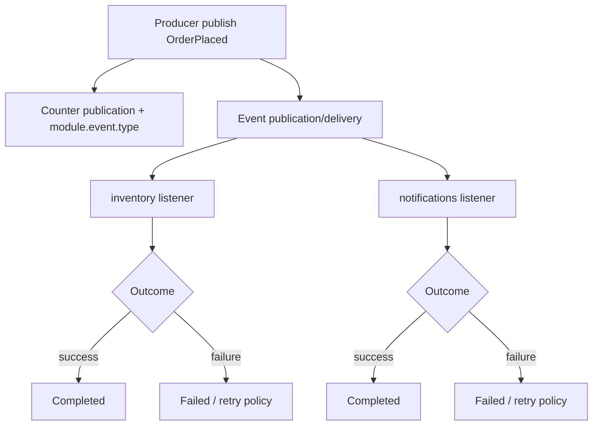
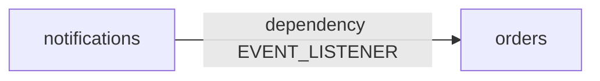

# `module.event.type` và ý nghĩa phân tích

## 1. Đặt vấn đề: biết sự kiện nào đang được phát

Một ứng dụng Spring Boot dùng **Spring Modulith** thường gồm nhiều *application module* trong cùng một tiến trình. Ví dụ hệ thống bán hàng có module `orders` phát sự kiện `OrderPlaced`, module `inventory` nhận sự kiện để dự trữ hàng và `notifications` nhận sự kiện để gửi thông báo. Khi khối lượng giao dịch tăng, nhóm vận hành cần phân biệt:

- Số sự kiện được **publish** tăng hay giảm?
- Sự kiện **thuộc loại nào** đang chiếm phần lớn lưu lượng?
- Sự kiện có quan hệ với **application module** nào?
- Sau khi phát sự kiện, các listener có thực sự xử lý thành công không?

Spring Modulith cung cấp các **event metrics** dựa trên Micrometer. Trong đó, **`module.event.type` là một nhãn (tag/low-cardinality key) biểu diễn loại sự kiện được phát** trên metric tổng hợp `module.events.published`. Nhãn này giúp phân chia lưu lượng event theo *event type* thay vì chỉ nhìn một counter chung của toàn ứng dụng.

Trong module học **SPRING_MODULITH_DOCUMENTATION_OBSERVABILITY**, mục tiêu rộng hơn là kết hợp module graph, tài liệu kiến trúc, Actuator, event metrics, tracing và context propagation để kiểm chứng hệ thống vận hành đúng ranh giới thiết kế. Bài học này đi sâu vào ý nghĩa phân tích của `module.event.type`, cách đọc counter, cách truy vấn theo module và những kết luận **không thể** rút ra chỉ từ số lượng event được phát.

> Điểm then chốt: `module.event.type` nói **sự kiện nào được ghi nhận là đã publish**. Nó không mô tả payload của một sự kiện cụ thể, không phải trạng thái xử lý của listener và không tự cung cấp tỷ lệ thành công khi tiêu thụ event.

## 2. `module.event.type` nằm ở đâu trong dữ liệu quan sát?

Theo tài liệu Spring Modulith về **Observability Metrics**, framework cung cấp hai dạng counter cho domain event publication được theo dõi:

| Meter Micrometer | Chức năng | Các low-cardinality key được tài liệu nêu |
| --- | --- | --- |
| **`module.events.published`** | Counter tổng hợp các lần publish domain event | `module.event.type`, `module.identifier`, `module.name` |
| **`module.events.published.$moduleIdentifier.$simpleEventTypeName`** | Counter dành riêng cho một loại event của module; có thể tùy chỉnh thêm tag | `module.identifier`, `module.name` |

Ví dụ giả định `orders` phát `OrderPlaced` và `OrderCancelled`:

```text
Micrometer meter: module.events.published
  module.identifier = orders
  module.name       = Orders
  module.event.type = OrderPlaced
  COUNT             = 420

Micrometer meter: module.events.published
  module.identifier = orders
  module.name       = Orders
  module.event.type = OrderCancelled
  COUNT             = 20
```

Và một counter riêng cho loại event:

```text
Micrometer meter (minh họa): module.events.published.orders.OrderPlaced
  module.identifier = orders
  module.name       = Orders
  COUNT             = 420
```

Đây là **số liệu và cách hiển thị giả lập**. Tên/giá trị tag chính xác phải kiểm tra trong registry đang chạy; `$simpleEventTypeName` nói về tên ngắn của kiểu sự kiện, còn chuỗi event type trên metric tổng hợp cần lấy từ `availableTags` hoặc output thật của hệ thống. Đặc biệt, **metric tổng hợp và metric dành riêng cho event là hai góc nhìn trên cùng hoạt động publish**: không cộng cả hai rồi kết luận có 840 sự kiện.

### 2.1. Ba nhãn của counter tổng hợp

| Nhãn | Diễn giải | Ý nghĩa khi phân tích |
| --- | --- | --- |
| **`module.event.type`** | Kiểu sự kiện được phát | Phân loại `OrderPlaced`, `OrderCancelled`, `PaymentCaptured`… |
| **`module.identifier`** | ID kỹ thuật của application module | Nhóm số liệu theo module; đối chiếu module model / Actuator |
| **`module.name`** | Tên module | Hỗ trợ hiển thị/đọc bảng điều khiển |

`module.event.type` là **một giá trị mô tả class/type của event**, khác với `eventId`, `orderId` hoặc một trường nghiệp vụ trong payload. Nó cũng khác `module.identifier`: cùng một module `orders` có thể phát nhiều loại event. Ngược lại, khi phân tích hệ thống lớn, nhiều module có thể dùng những event type giống tên ngắn; nên lọc thêm module ID để tránh hiểu nhầm nguồn dữ liệu.

## 3. Tại sao event type cần có cardinality thấp?

Một loại event thường tương ứng với một **kiểu dữ liệu Java** có tập tên tương đối ổn định, ví dụ `OrderPlaced`, `OrderCancelled`, `StockReserved`. Vì số lượng event type trong ứng dụng thường có giới hạn, nhãn `module.event.type` là **low-cardinality key** hữu ích cho metrics.

So sánh:

| Giá trị đưa vào tag | Số lượng giá trị tiềm năng | Có thích hợp làm metric label? |
| --- | --- | --- |
| `module.event.type=OrderPlaced` | Số event type đã định nghĩa, tương đối nhỏ | Thường có |
| `module.identifier=orders` | Số application module | Có |
| `sales.channel=WEB/MOBILE/PARTNER` | Enum ít giá trị | Có thể, sau khi đánh giá |
| `orderId=9f3…` | Mỗi đơn hàng một giá trị | Không |
| `customerEmail=…` | Gần như mỗi khách hàng một giá trị; còn có rủi ro riêng tư | Không |
| `exceptionMessage=…` | Thông điệp đa dạng, không giới hạn | Không |

Nếu đưa một giá trị động vào tag, Micrometer/Prometheus có thể tạo **một time series mới cho mỗi tổ hợp nhãn**. Ví dụ 3 module × 12 loại event × 3 kênh bán hàng đã có thể sinh nhiều chuỗi; gắn thêm hàng trăm nghìn `orderId` sẽ làm số chuỗi tăng vọt. Thay vì đưa ID giao dịch vào metrics, hãy dùng logs/traces và correlation ID với chính sách dữ liệu phù hợp.

Thậm chí khi `module.event.type` vốn ít giá trị, số lượng của nó có thể phình to nếu hệ thống tạo class event động, dùng tên type chứa dữ liệu nghiệp vụ, hoặc thêm event type vô kiểm soát. Nên theo dõi cả **danh sách giá trị mới xuất hiện** chứ không chỉ tổng số publish.

## 4. Minh họa một domain event chạy giữa các module

Giả sử `orders` sở hữu hợp đồng sự kiện `OrderPlaced`, công bố sự kiện sau thao tác đặt hàng; `inventory` và `notifications` có listener tương ứng.



**Counter được dùng để quan sát publication**, không đo số lần từng listener được gọi. Một lần `orders` publish `OrderPlaced` có thể dẫn đến *hai* listener khác nhau xử lý. Vì vậy:

```text
1 lần publish OrderPlaced
    -> module.events.published tăng theo hoạt động publication được instrument
    -> inventory listener có thể chạy 1 lần
    -> notifications listener có thể chạy 1 lần
    -> mỗi listener có thể retry hoặc thất bại độc lập
```

Không thể suy ra có hai event đã được phát chỉ vì hai listener nhận cùng một event. Tương tự, **HTTP 200** trả về cho yêu cầu tạo đơn không chứng minh rằng các listener bất đồng bộ đã hoàn tất.

### 4.1. Ví dụ event public contract

```java
package com.example.shop.orders;

import java.util.UUID;

public record OrderPlaced(UUID orderId, SalesChannel channel) { }
```

```java
package com.example.shop.orders;

public enum SalesChannel {
    WEB, MOBILE, PARTNER
}
```

`OrderPlaced` thuộc API công khai của module `orders`. `SalesChannel` là enum được dùng sau này để minh họa cách tùy chỉnh metric bằng một nhãn ít giá trị.

Ví dụ service phát event:

```java
package com.example.shop.orders;

import java.util.UUID;
import org.springframework.context.ApplicationEventPublisher;
import org.springframework.stereotype.Service;
import org.springframework.transaction.annotation.Transactional;

@Service
public class OrderService {

    private final ApplicationEventPublisher publisher;

    public OrderService(ApplicationEventPublisher publisher) {
        this.publisher = publisher;
    }

    @Transactional
    public void placeOrder(UUID orderId, SalesChannel channel) {
        // Lưu đơn hàng trong transaction hiện tại.
        publisher.publishEvent(new OrderPlaced(orderId, channel));
    }
}
```

Và module `inventory` đăng ký listener:

```java
package com.example.shop.inventory;

import com.example.shop.orders.OrderPlaced;
import org.springframework.modulith.events.ApplicationModuleListener;
import org.springframework.stereotype.Component;

@Component
class ReserveStockOnOrderPlaced {

    @ApplicationModuleListener
    void on(OrderPlaced event) {
        // Dự trữ hàng; triển khai cần idempotency theo orderId.
    }
}
```

Ví dụ minh họa luồng xử lý, chưa có logic persistence/transaction nghiệp vụ đầy đủ. `@ApplicationModuleListener` biểu diễn cách tích hợp event qua listener module. Lúc phân tích metrics, cần giữ riêng **module phát event** và **module listener xử lý event**: metric publication cho biết những gì hệ thống ghi nhận lúc publish, còn kết quả listener cần nguồn giám sát khác.

## 5. Kích hoạt Spring Modulith event metrics

Để có các metric đã nêu, ứng dụng cần các thành phần observability phù hợp với phiên bản Spring Modulith. Tài liệu Spring Modulith 2.2 minh họa starter hỗ trợ Actuator và observability:

```xml
<dependency>
    <groupId>org.springframework.modulith</groupId>
    <artifactId>spring-modulith-starter-insight</artifactId>
    <scope>runtime</scope>
</dependency>
```

Starter giúp bật các tích hợp liên quan. Nếu không dùng starter, Spring Modulith 2.2 dùng artifact `spring-modulith-observability-core` ở runtime; khi viết Java code **tùy chỉnh** event metrics, cần `spring-modulith-observability-api` trong compile classpath. Ở các phiên bản cũ hơn, tên artifact và cách cấu hình có thể khác, vì vậy hãy dùng BOM/phiên bản tương thích và đọc tài liệu của đúng nhánh đang dùng.

Muốn xem metrics qua Spring Boot Actuator, bảo đảm ứng dụng có hạ tầng Actuator và cấu hình endpoint trong môi trường phát triển. Nếu dùng Prometheus, thêm registry thích hợp:

```xml
<dependency>
    <groupId>io.micrometer</groupId>
    <artifactId>micrometer-registry-prometheus</artifactId>
    <scope>runtime</scope>
</dependency>
```

Ví dụ `application.yml` cho **môi trường dev**:

```yaml
management:
  endpoints:
    web:
      exposure:
        include: health,metrics,prometheus,modulith
```

Endpoint `/actuator/metrics` cho phép xem các meter Micrometer; `/actuator/prometheus` là dạng exposition dùng cho Prometheus khi có registry. Trong môi trường production cần giới hạn management port/network và quyền truy cập, không để toàn bộ metadata kiến trúc và metrics công khai nếu không có nhu cầu.

**Lưu ý khi kiểm tra:** metric gắn với event publication có thể chỉ xuất hiện sau khi ứng dụng **thực sự publish một event được hỗ trợ/instrument**. Nếu mới khởi động mà chưa chạy luồng đặt hàng, việc chưa thấy tên metric không đủ kết luận cấu hình bị lỗi.

## 6. Đọc `module.event.type` qua Actuator

Sau khi gọi nghiệp vụ đặt hàng vài lần trong môi trường dev, thử liệt kê các meter:

```bash
curl -sS http://localhost:8080/actuator/metrics | jq .
```

Tìm meter tổng hợp:

```bash
curl -sS http://localhost:8080/actuator/metrics/module.events.published | jq .
```

Phản hồi dưới đây là **JSON minh họa về hình thức trả lời của Actuator metrics**, không phải snapshot từ hệ thống thực:

```json
{
  "name": "module.events.published",
  "description": null,
  "baseUnit": null,
  "measurements": [
    { "statistic": "COUNT", "value": 440.0 }
  ],
  "availableTags": [
    {
      "tag": "module.event.type",
      "values": ["OrderPlaced", "OrderCancelled"]
    },
    {
      "tag": "module.identifier",
      "values": ["orders"]
    },
    {
      "tag": "module.name",
      "values": ["Orders"]
    }
  ]
}
```

Actuator liệt kê `availableTags` để người vận hành biết **nhãn và giá trị đang được ghi nhận**. Tại một bản chạy khác, giá trị của `module.event.type` có thể có định dạng khác với tên ngắn minh họa, ví dụ tên type đầy đủ theo cách framework biểu diễn; cần dùng **giá trị thực tế** khi lọc. Counter `COUNT=440` trong ví dụ là tổng số đo phù hợp với truy vấn, không phải số lần listener đã xử lý thành công.

### 6.1. Lọc theo event type

```bash
curl -sS \
  'http://localhost:8080/actuator/metrics/module.events.published?tag=module.event.type:OrderPlaced' \
  | jq .
```

Lọc kết hợp module và event type bằng cách lặp tham số `tag`:

```bash
curl -sS \
  'http://localhost:8080/actuator/metrics/module.events.published?tag=module.identifier:orders&tag=module.event.type:OrderPlaced' \
  | jq .
```

Đổi `OrderPlaced` thành đúng giá trị nằm trong `availableTags` của ứng dụng. Khi truy vấn bằng HTTP, sự hiện diện của query parameters, ký tự đặc biệt hoặc proxy có thể cần URL encoding; đường dẫn quản trị cũng có thể thay đổi theo `management.endpoints.web.base-path` và `management.server.port`.

### 6.2. Đọc counter của riêng một event

Spring Modulith còn có counter mang tên theo module identifier và tên loại event. Ví dụ minh họa:

```bash
curl -sS \
  'http://localhost:8080/actuator/metrics/module.events.published.orders.OrderPlaced' \
  | jq .
```

Đây là **tên counter ví dụ** theo quy tắc tài liệu. Không mặc định mọi event của mọi phiên bản đều được đo với tên như vậy nếu chưa kiểm tra danh sách meter thực tế. Counter riêng thường hữu ích khi cần thêm tag nghiệp vụ qua `ModulithEventMetricsCustomizer`.

## 7. Phân tích bằng Prometheus và Grafana

Khi dùng Micrometer Prometheus registry, tên metric và label được chuyển sang quy ước của Prometheus, thường đổi dấu chấm thành dấu gạch dưới và thêm hậu tố counter. Ví dụ, **giả sử** hệ thống thực sự expose:

```text
module_events_published_total{
  module_identifier="orders",
  module_name="Orders",
  module_event_type="OrderPlaced"
} 420
```

Đây chỉ là **dạng minh họa**. Hãy kiểm tra `/actuator/prometheus` để lấy đúng tên series và label đã qua Micrometer naming convention trước khi tạo dashboard hoặc alert. Các PromQL dưới đây giả định series `module_events_published_total` và label `module_event_type`, `module_identifier` tồn tại đúng như ví dụ.

### 7.1. Tốc độ phát event theo loại

```promql
sum by (module_event_type) (
  rate(module_events_published_total[5m])
)
```

`rate(...[5m])` đưa counter tăng dần thành **số lần publish trung bình mỗi giây** trong cửa sổ năm phút, có xử lý các lần reset counter. Nếu muốn tốc độ mỗi phút, có thể nhân kết quả với `60`:

```promql
60 * sum by (module_event_type) (
  rate(module_events_published_total[5m])
)
```

Kết quả thích hợp để xem event type nào tăng đột biến hoặc thay đổi sau triển khai. Đơn vị của kết quả nhân `60` là **lần publish/phút**.

### 7.2. Phân tích một loại event theo module

```promql
sum by (module_identifier) (
  rate(module_events_published_total{module_event_type="OrderPlaced"}[5m])
)
```

Câu truy vấn giúp phân nhóm lần publish `OrderPlaced` theo module ID. Nó không có nghĩa mỗi module trong kết quả là listener nhận `OrderPlaced`; `module.identifier` phản ánh module gắn với hoạt động publication theo instrumentation thực tế. Nếu đang điều tra module tiêu thụ, cần bổ sung metrics/logs cho listener hoặc event publication registry.

### 7.3. Số lần publish trong một giờ

```promql
sum by (module_event_type) (
  increase(module_events_published_total[1h])
)
```

`increase` ước tính số sự kiện được ghi nhận trong một khoảng thời gian. Kết quả có thể là số thập phân do cách nội suy và lấy mẫu của Prometheus; không nên tự động hiểu nó là số đếm kiểm toán chính xác tuyệt đối. Muốn đối soát nghiệp vụ hoặc tiền tệ, hãy dùng bản ghi nghiệp vụ/transaction đáng tin cậy.

### 7.4. Tỷ trọng của một event type

Giả sử cần ước lượng tỷ trọng `OrderCancelled` trong các event publication đang được quan sát:

```promql
100 *
sum(rate(module_events_published_total{module_event_type="OrderCancelled"}[10m]))
/
sum(rate(module_events_published_total[10m]))
```

Đây là **tỷ trọng event publication** chứ không mặc định là “tỷ lệ hủy đơn hàng”. Một đơn có thể phát nhiều event cùng loại trong các tình huống khác nhau; ví dụ event được phát lại trong nghiệp vụ, retry ở producer, hoặc có nhiều dòng sự kiện liên quan. Muốn đo tỷ lệ hủy đơn trên tổng đơn, cần định nghĩa **đơn vị nghiệp vụ**, mẫu số và chính sách loại trùng theo domain.

Nếu mẫu số bằng 0, truy vấn có thể trả giá trị không hữu ích hoặc không có chuỗi. Dashboard và alert cần xử lý khoảng thời gian không có lưu lượng để tránh báo động sai.

## 8. Các câu hỏi kinh doanh/vận hành mà event type giúp trả lời

| Câu hỏi | Cách dùng `module.event.type` | Giới hạn diễn giải |
| --- | --- | --- |
| Loại event nào chiếm nhiều lưu lượng? | `sum by (module_event_type)` của `rate` | Không có nghĩa nhiều event hơn là nhiều đơn thành công hơn |
| Sau deploy có xuất hiện loại event mới không? | So sánh danh sách label/type theo version | Event mới có thể là tính năng mới đã duyệt |
| Số `OrderCancelled` có tăng đột ngột không? | Theo dõi `rate`/`increase` của loại event | Cần chia theo số đơn, cohort hoặc kênh để biết ý nghĩa nghiệp vụ |
| Module `orders` có còn phát event dự kiến không? | Lọc `module_identifier=orders`, event type dự kiến | Không thấy event có thể do không có traffic hoặc metric chưa instrument |
| Vì sao consumer tồn đọng tăng? | So sánh published rate với completion/backlog thực tế | Counter publish không tự chỉ ra listener nào chậm |
| Khi refactor có phá hợp đồng event không? | Theo dõi tên event type trước/sau, đối chiếu module graph và test | Metric không thay thế kiểm tra contract, schema và backward compatibility |
| Event tăng có làm độ trễ hệ thống cao không? | Kết hợp event rate với tracing, DB metrics và listener duration | Chỉ tương quan thời điểm chưa chứng minh nguyên nhân |

Để phân tích đáng tin cậy, nên ghi nhận **cùng phiên bản triển khai, cùng phạm vi module, cùng cửa sổ thời gian**. Nếu version mới đổi tên event Java class, giá trị `module.event.type` có thể đổi và dashboard lịch sử cần điều chỉnh mapping. Thay đổi label không nhất thiết đồng nghĩa hệ thống phát ít event hơn.

## 9. Publication metric khác listener completion, retry và failure

Đây là phân biệt quan trọng nhất khi dùng `module.event.type` trong vận hành:



Trong Spring Modulith, **Event Publication Registry** là cơ chế bổ sung nhằm ghi nhận publication tới listener giao dịch và theo dõi tiến trình xử lý khi đã tích hợp persistence tương ứng. Tùy phiên bản, registry hỗ trợ nhiều trạng thái, thao tác xử lý lại và cơ chế lưu trữ khác nhau. Event metrics mặc định nêu ở đây **không phải** một bảng trạng thái registry hay bộ đếm lỗi listener.

| Dữ liệu | Trả lời được | Không trả lời được nếu đứng riêng |
| --- | --- | --- |
| `module.events.published` + `module.event.type` | Có bao nhiêu publication được instrument, loại event nào? | Bao nhiêu consumer đã xử lý thành công? |
| Metric riêng `module.events.published.<module>.<event>` | Số publication của một loại event, có thể thêm tag nghiệp vụ | Thời gian xử lý của mỗi listener |
| Event Publication Registry | Những publication được lưu để theo dõi trạng thái xử lý | Lưu lượng/tốc độ trung bình nếu chưa tổng hợp thành metrics |
| Listener duration/error metrics tự instrument | Listener nào chậm hoặc báo lỗi? | Số event đã publish trên toàn ứng dụng nếu không đo producer |
| Trace/log có correlation | Một lần xử lý đã đi qua đâu, lỗi cụ thể ở bước nào? | Tổng chính xác và đầy đủ khi trace có sampling |

Vì một event có thể có nhiều listener, không thể lấy đơn giản **`published_count - completed_count`** để suy ra backlog nếu hai số đếm có khác đơn vị. Muốn tính tồn đọng cần **định nghĩa publication theo listener**, thời điểm lưu, trạng thái cuối, retry và chính sách retention. Với event có thể giao lại hoặc chạy lặp, listener cũng cần xử lý **idempotent** theo định danh nghiệp vụ phù hợp.

Một listener xử lý thành công không tự chứng minh tác dụng phụ bên ngoài như gửi email hay ghi hệ thống thứ ba đã xảy ra *exactly once*. Muốn kiểm chứng điều đó cần cơ chế idempotency/acknowledgment của hệ thống ngoài, ngoài metrics publish.

## 10. Tùy chỉnh metric riêng từng event một cách an toàn

Spring Modulith cung cấp `ModulithEventMetricsCustomizer` để tùy chỉnh counter cho **một loại event nhất định**. Ví dụ thêm kênh bán hàng với số giá trị giới hạn:

```java
package com.example.shop.config;

import com.example.shop.orders.OrderPlaced;
import org.springframework.context.annotation.Bean;
import org.springframework.context.annotation.Configuration;
import org.springframework.modulith.observability.ModulithEventMetricsCustomizer;

@Configuration
class EventMetricsConfiguration {

    @Bean
    ModulithEventMetricsCustomizer eventMetricsCustomizer() {
        return metrics -> metrics.customize(OrderPlaced.class,
            (event, counter) -> counter.tag(
                "sales.channel", event.channel().name()
            )
        );
    }
}
```

Trong ví dụ, `event.channel()` chỉ nhận một trong ba enum `WEB`, `MOBILE`, `PARTNER`, nên phù hợp hơn `event.orderId()` để làm metric tag. Phần tùy chỉnh áp dụng cho **counter riêng của event** theo API framework; không giả định tất cả các tag tự thêm sẽ lập tức xuất hiện trên counter tổng hợp `module.events.published`.

Với Spring Modulith 2.2, khi compile code sử dụng interface trên mà không kéo API transitively theo cấu hình dự án, cần khai báo:

```xml
<dependency>
    <groupId>org.springframework.modulith</groupId>
    <artifactId>spring-modulith-observability-api</artifactId>
</dependency>
```

**Rủi ro cardinality:** không nên thêm `orderId`, `customerId`, email, số điện thoại hoặc message lỗi vào counter tags. Ngay cả giá trị enum cũng cần tính tổng các chiều tag để đảm bảo số chuỗi thời gian trong ngân sách monitoring.

Khi cần điều chỉnh naming/convention chung cho dữ liệu observability, Spring Modulith có cơ chế `ModulithObservationConvention` theo API phiên bản; không nên tự ý đổi tên tag mặc định nếu dashboard và truy vấn của nhóm đang dựa vào chúng. Thay đổi convention cần đi kèm kiểm tra metric thực xuất ra sau deployment.

## 11. Từ event metrics quay lại kiểm chứng kiến trúc module

`module.event.type` giúp phân tích vận hành nhưng không tự cho biết các ranh giới phụ thuộc có đúng hay không. Một quy trình kết hợp:

1. **Mô hình tĩnh:** dùng `ApplicationModules.of(ShopApplication.class)`, `modules.verify()` và `Documenter` để xác định module, ranh giới API và dependency.
2. **Metadata bản chạy:** `GET /actuator/modulith` giúp đối chiếu tên module, package gốc và các outgoing dependencies của cùng bản build.
3. **Event metrics:** tìm loại event đã được publish, module gắn với publication và tốc độ theo thời gian qua `module.event.type`.
4. **Tracing:** tìm module entry spans có `module.identifier`, `module.name`, `module.invocation-type`, `module.method` để quan sát nơi xử lý được instrument.
5. **Event Publication Registry và logs:** xác định các publication/listener cụ thể có hoàn tất, lỗi hay cần retry theo cơ chế đã cấu hình.
6. **Context propagation:** kiểm tra trace/correlation xuyên executor hoặc event xử lý bất đồng bộ. Nơi tiêu thụ event phải được gắn danh tính module đích khi quan sát, dù producer thuộc module khác.

Ví dụ `notifications` lắng nghe `OrderPlaced` được khai báo trong `orders`:



Ở **module graph**, chiều phụ thuộc tĩnh có thể là `notifications -> orders` vì listener tham chiếu class event. Trong **luồng runtime**, `orders` là producer còn `notifications` là consumer. Metric `module.event.type=OrderPlaced` ở phía publication và một span listener ở `notifications` mô tả **hai pha khác nhau**; chúng không phủ định nhau.

Một thay đổi event type hoặc số lần publish tăng có thể là chỉ báo cần review kiến trúc, nhưng **không tự động là vi phạm module**. Để xác định vi phạm, cần xem hợp đồng, dependency và kết quả verification từ mã nguồn.

## 12. Các lỗi diễn giải và cấu hình thường gặp

| Triệu chứng hoặc nhận định | Nguyên nhân có thể | Cách xử lý |
| --- | --- | --- |
| `GET /actuator/metrics/module.events.published` trả `404` | Chưa publish event, meter chưa được tạo, thiếu instrumentation hoặc endpoint chưa expose | Chạy use case có event, kiểm tra dependency, `metrics` exposure và registry |
| Có số publish nhưng không có listener success | Metric này chỉ đo publication | Bổ sung registry và đo completion/error/duration của listener |
| `module.event.type` không khớp chuỗi `OrderPlaced` dự đoán | Cách biểu diễn type/phiên bản khác | Xem `availableTags` và label thực tế rồi mới truy vấn |
| PromQL trả không có data | Tên metric/label đã được đổi bởi Prometheus naming, chưa có scrape hoặc sai thời gian | Kiểm tra `/actuator/prometheus` và Prometheus targets |
| Dashboard đếm gấp đôi | Cộng counter tổng hợp với counter riêng từng event | Chọn một nguồn cho cùng phép đếm |
| Tỷ lệ hủy đơn tính từ event cao bất thường | Một đơn có thể phát nhiều event hoặc bị publish lại | Xác định mẫu số theo domain, loại trùng theo định danh nghiệp vụ |
| Label tăng quá nhiều | Customizer gắn ID động hoặc payload vào metric tag | Dùng enum / nhóm giá trị hữu hạn; chuyển ID sang logs/traces |
| Counter giảm về 0 sau restart | Counter tích lũy theo process/instance có thể reset | Dùng `rate`/`increase` thay vì trừ counter thô giữa hai mốc |
| Module ID trong metrics khác Actuator | Khác build, mapping hoặc phiên bản instrumentation | Đối chiếu module model, version và custom conventions |
| Không thấy event tiêu thụ trong trace | Listener async chưa truyền context, sampling hoặc thiếu instrumentation | Kiểm tra executor, propagation, span links, correlation |
| Event type mới sau deploy | Đổi class, thay contract hoặc tính năng mới | Review compatibility và cập nhật dashboard có chủ ý |

Một lỗi phổ biến khác là lấy **tổng publish làm số giao dịch nghiệp vụ**. Nếu một đơn hàng tạo đồng thời `OrderPlaced` và `OrderPaymentRequested`, hai counter tăng nhưng chỉ có một đơn. Để báo cáo số đơn đã tạo, dùng metric nghiệp vụ hoặc dữ liệu transaction được định nghĩa riêng.

## 13. Bài thực hành: phân tích `OrderPlaced` và `OrderCancelled`

**Bối cảnh:** ứng dụng `shop-app` có `orders`, `inventory`, `notifications`. Module `orders` publish hai loại event, listener module khác xử lý độc lập. Bạn cần xác nhận event type, giải thích tốc độ publish và kiểm tra các khoảng trễ/lỗi xử lý bằng nguồn khác.

| Bước | Thao tác | Tiêu chí đạt |
| --- | --- | --- |
| 1 | Bật Spring Modulith Insight/Observability theo phiên bản | Runtime có cơ chế instrument event publication |
| 2 | Expose Actuator metrics ở môi trường dev | Truy vấn được `/actuator/metrics` |
| 3 | Publish nhiều `OrderPlaced`, ít `OrderCancelled` | Counter tổng hợp xuất hiện sau khi có hoạt động |
| 4 | Đọc `availableTags` | Xác định giá trị thực tế của `module.event.type` và `module.identifier` |
| 5 | Lọc metric qua `tag=module.event.type:…` | Đọc được COUNT của từng loại event |
| 6 | Xem `/actuator/prometheus` | Xác nhận tên metric/label đã chuẩn hóa trước khi viết PromQL |
| 7 | Vẽ `rate` theo event type trong Grafana | Nhận biết `OrderPlaced`/`OrderCancelled` thay đổi theo thời gian |
| 8 | Làm một listener thất bại có kiểm soát | Publication counter vẫn không đủ để kết luận thành công/thất bại của listener |
| 9 | Đối chiếu Event Publication Registry/log/trace | Xác định listener lỗi, trạng thái hoặc retry theo cấu hình |
| 10 | Kiểm tra nhãn custom `sales.channel` | Giá trị có giới hạn, không chứa ID đơn hàng |

### 13.1. Câu hỏi tự kiểm tra

1. **`module.event.type` là gì?** Là nhãn biểu diễn **loại event được phát** trên counter tổng hợp `module.events.published`, không phải một field payload hay mã định danh của event instance.
2. **`module.identifier` cho biết gì?** Cho biết application module được gắn với hoạt động publication, hữu ích để phân tích theo ranh giới module; cần xác nhận trên hệ thống đang chạy.
3. **Một event có hai listener thì counter published tăng bao nhiêu?** Theo hoạt động publish được instrument, **không tự nhân đôi vì số listener**. Số hoàn tất của listener được quản lý riêng.
4. **Vì sao dùng `rate` thay vì lấy COUNT hai thời điểm rồi trừ thô?** Counter có thể reset khi process restart; `rate`/`increase` xử lý reset theo dữ liệu chuỗi thời gian của Prometheus.
5. **Có nên thêm `orderId` vào metric tag?** Không; giá trị gần như duy nhất từng đơn gây cardinality cao. Hãy dùng correlation/log/trace và dữ liệu nghiệp vụ khi cần truy xuất từng đơn.
6. **Tại sao có metric publish nhưng không chứng minh listener thành công?** Vì publish, delivery, xử lý, retry và tác dụng phụ ngoài tiến trình là các giai đoạn khác nhau.
7. **Tại sao metric event type không thay thế module graph?** Metric mô tả hoạt động runtime được đo, còn graph/verification kiểm tra cấu trúc và tính hợp lệ của dependency trong code.

## 14. Ghi nhớ

**`module.event.type` là low-cardinality key chính thức trên counter tổng hợp `module.events.published` của Spring Modulith**, giúp phân tích event publication theo loại sự kiện và kết hợp với `module.identifier`, `module.name` để xem theo application module. Counter riêng `module.events.published.$moduleIdentifier.$simpleEventTypeName` hỗ trợ phân tích và tùy chỉnh chi tiết theo một event type.

Khi lập dashboard, kiểm tra tên metric/label thực tế, dùng `rate` hoặc `increase` cho counter, giữ cardinality thấp và không cộng hai cách biểu diễn cùng một publication. **Số event đã được publish không đồng nghĩa số listener xử lý thành công**: để chẩn đoán cần kết hợp Event Publication Registry, logs, tracing và context propagation.

Mục tiêu cuối cùng là dùng dữ liệu `module.event.type` như **một chỉ báo hoạt động của hợp đồng sự kiện giữa module**, rồi đối chiếu với module graph, Actuator và các kiểm tra ranh giới Spring Modulith để hiểu cả thiết kế lẫn hành vi vận hành.

### Tài liệu tham khảo

- [Spring Modulith — Production-ready Features / Observability Metrics](https://docs.spring.io/spring-modulith/reference/production-ready.html): hai counter publication, ba tag của counter tổng hợp và API tùy chỉnh metric.
- [Spring Modulith — Working with Application Events](https://docs.spring.io/spring-modulith/reference/events.html): `@ApplicationModuleListener` và Event Publication Registry.
- [Spring Modulith — ModulithEventMetrics API](https://docs.spring.io/spring-modulith/docs/current/api/org/springframework/modulith/observability/ModulithEventMetrics.html): contract tùy chỉnh `Counter.Builder` theo loại event.
- [Spring Boot — Metrics](https://docs.spring.io/spring-boot/reference/actuator/metrics.html): Micrometer, metrics endpoint và Prometheus.
- [Prometheus — Querying Functions](https://prometheus.io/docs/prometheus/latest/querying/functions/): `rate`, `increase` cho counter và lưu ý tính toán.
