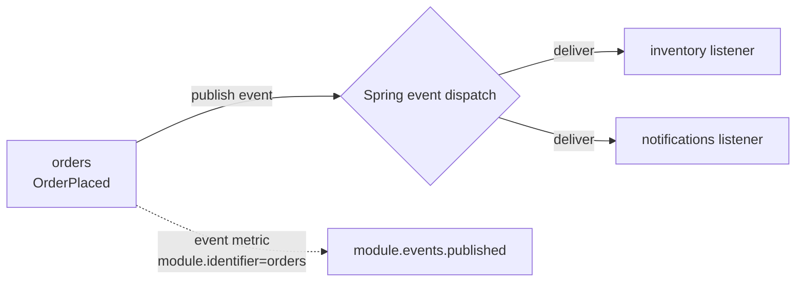
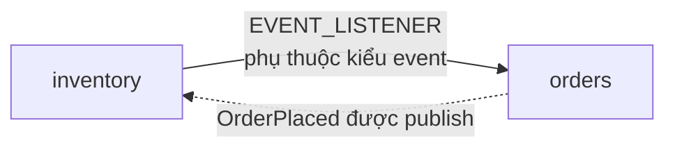

# module.identifier và module.name

> **Chương:** Event metrics  
> **Phạm vi:** Spring Modulith trong ứng dụng Spring Boot, sử dụng Micrometer để quan sát domain event được công bố. Bài học tập trung vào hai nhãn (tag) `module.identifier` và `module.name`, cách chúng xuất hiện trong **event metrics**, cách đối chiếu với **module entry span** và **module graph**, cũng như nguyên tắc sử dụng các nhãn này trong dashboard vận hành.

## Mục tiêu học tập

Sau bài này, bạn có thể:

1. Giải thích `module.identifier` là **định danh logic của application module** và `module.name` là **tên hiển thị của module**.
2. Xác định sự hiện diện của hai tag trong counter tổng `module.events.published` và counter theo loại event `module.events.published.<moduleIdentifier>.<simpleEventTypeName>`.
3. Hiểu tag của **event được công bố** khác với tag của **module đang chạy event listener**; tránh suy diễn sai hướng giao tiếp giữa các module.
4. Truy vấn `/actuator/metrics` hoặc hệ thống giám sát để lọc/nhóm event metric theo module, đồng thời kiểm soát cardinality.
5. Xử lý các tình huống tag bị thiếu, tên module đổi, counter không tăng, số liệu trùng giữa nhiều instance hoặc không khớp số lần xử lý thành công.

## 1. Vì sao cần định danh module trong event metrics?

Một ứng dụng Spring Boot theo kiến trúc modular monolith có thể chứa các application module `orders`, `payments`, `inventory`. Khi một module công bố domain event, việc chỉ đếm tổng số event trên toàn ứng dụng là chưa đủ để trả lời:

- Loại event đó thuộc phạm vi nghiệp vụ của module nào?
- Event phát sinh từ module nào đang tăng hoặc giảm bất thường sau một lần phát hành?
- Có thể gom số liệu của một module lên dashboard mà không phụ thuộc vào tên package Java dài hay không?
- Làm sao đối chiếu một module trong biểu đồ metric với module trong sơ đồ kiến trúc và trace?

Spring Modulith bổ sung ngữ nghĩa module vào Micrometer metrics. Trong tài liệu chính thức, hai tag **low cardinality** của event metric là:

- `module.identifier`: **định danh logic** của application module.
- `module.name`: **tên hiển thị**, thuận tiện cho con người đọc dashboard/tài liệu.

Một event metric có thể mang cả hai: ID làm khóa nhận diện ổn định, tên hiển thị giúp người vận hành hiểu đó là khu vực nghiệp vụ nào.

Không nên lẫn hai tag này với `spring.application.name`. Một ứng dụng modular monolith có thể có **một** tên service, ví dụ `shop-service`, nhưng có **nhiều** module có ID và tên riêng.

## 2. Định nghĩa chính xác hai tag

| Thuộc tính | `module.identifier` | `module.name` |
| --- | --- | --- |
| Bản chất | ID logic của application module trong mô hình Spring Modulith | Tên module thân thiện với người đọc |
| Ví dụ | `orders` | `Orders` hoặc `Đơn hàng` |
| Công dụng | Liên kết số liệu với module, lọc/group theo module, đối chiếu định danh trong graph | Hiển thị ở dashboard, báo cáo và tài liệu |
| Mức độ ổn định | Nên được quản lý như khóa định danh kiến trúc, hạn chế đổi tùy tiện | Có thể đổi theo nhu cầu đặt tên, nhưng đổi sẽ ảnh hưởng series có label này |
| Nguồn | Mô hình module được Spring Modulith phát hiện/cấu hình | Tên hiển thị do mô hình module xác định/cấu hình |
| Có phải ID event? | Không | Không |
| Có phải ID của một lần publish? | Không | Không |
| Có phải tên Java package đầy đủ? | Không nhất thiết | Không nhất thiết |
| Có phải `traceId` hoặc `spanId`? | Không | Không |

Theo quy ước mặc định, application module thường được phát hiện từ các package con trực tiếp bên dưới package gốc của ứng dụng. Khi đó `com.example.shop.orders` có thể được nhận diện bằng ID `orders`. Tuy nhiên, ứng dụng có thể cấu hình ID riêng, nested module hoặc một chiến lược phát hiện module khác. **Không cố định quy tắc “ID luôn bằng segment package cuối cùng”** cho mọi dự án.

### 2.1. Khai báo tên hiển thị trong package-info.java

Ví dụ package ứng dụng:

```text
com.example.shop
├── ShopApplication.java
├── orders
│   ├── package-info.java
│   ├── OrderPlaced.java
│   └── internal/Checkout.java
├── inventory
│   └── internal/OnOrderPlaced.java
└── payments
    └── PaymentService.java
```

Trong `src/main/java/com/example/shop/orders/package-info.java`:

```java
@org.springframework.modulith.ApplicationModule(
    displayName = "Đơn hàng"
)
package com.example.shop.orders;
```

Với cách phát hiện module mặc định và không đặt ID tùy biến, ví dụ thường cho:

```text
module.identifier = orders
module.name       = Đơn hàng
```

Nếu muốn định danh logic rõ ràng hơn, annotation cũng hỗ trợ thuộc tính `id`:

```java
@org.springframework.modulith.ApplicationModule(
    id = "sales-orders",
    displayName = "Đơn hàng"
)
package com.example.shop.orders;
```

Khi đó `module.identifier` có thể là `sales-orders` thay vì `orders`. **ID không phải chỉ là nhãn để trình bày**: khi đổi ID, các metric series, tên counter theo module, liên kết trong module graph và bộ lọc dashboard có thể cần cập nhật. Vì vậy, nên đặt và quản lý ID như một phần hợp đồng kiến trúc.

Trong phần ví dụ tiếp theo, ta giữ ID mặc định `orders` để tên counter ngắn và dễ hiểu.

### 2.2. Ba tên thường bị nhầm

| Tên/ID | Ví dụ | Phạm vi |
| --- | --- | --- |
| Spring application/service name | `shop-service` | Ứng dụng hoặc service hiển thị trong hệ thống quan sát |
| Module identifier | `orders` | Application module thuộc ứng dụng |
| Module display name | `Đơn hàng` | Tên dễ đọc của module |
| Event type | `OrderPlaced` hoặc tên kiểu đủ package | Loại sự kiện nghiệp vụ |
| Event instance/business ID | `orderId = ...` | Một đơn hàng hoặc một lần thực thi nghiệp vụ |

Tách các cấp độ này giúp tránh đưa `orderId` hoặc giá trị biến thiên theo từng request vào nơi vốn chỉ cần nhãn module có cardinality thấp.

## 3. Hai nhóm event metric của Spring Modulith

Theo tài liệu production-ready features, Spring Modulith đăng ký **hai loại counter** để đo event được công bố:

1. `module.events.published`: counter tổng hợp mọi domain event được ghi nhận trong phạm vi quan sát.
2. `module.events.published.<moduleIdentifier>.<simpleEventTypeName>`: counter riêng theo module và kiểu event, có thể được mở rộng thêm tag nghiệp vụ nếu cấu hình customizer.

Hai dạng counter có các tag mặc định khác nhau:

| Metric | `module.identifier` | `module.name` | `module.event.type` |
| --- | --- | --- | --- |
| `module.events.published` | Có | Có | Có |
| `module.events.published.<moduleIdentifier>.<simpleEventTypeName>` | Có | Có | Không nằm trong bộ tag mặc định được tài liệu liệt kê |

Trong counter riêng, kiểu event đã xuất hiện ở **tên metric**, nên các tag mặc định tập trung vào thông tin module. Từng bản phát hành có thể bổ sung thay đổi qua customizer/convention; bảng trên mô tả **các key mặc định được tài liệu Spring Modulith công bố**.

### 3.1. Counter tổng hợp

Với một event `OrderPlaced` thuộc module `orders`, giá trị minh họa có thể biểu diễn:

```text
Metric name:       module.events.published
module.identifier: orders
module.name:       Đơn hàng
module.event.type: <giá trị kiểu OrderPlaced do phiên bản đang chạy xuất ra>
Count:             42
```

Giá trị cụ thể của `module.event.type` có thể được biểu diễn theo quy ước của thư viện/phiên bản. Khi cần lọc theo event type, hãy lấy **giá trị thực tế** từ endpoint metrics hoặc hệ thống xuất metric thay vì đoán tên đầy đủ hay tên rút gọn.

### 3.2. Counter theo event

Một meter riêng minh họa:

```text
Metric name:       module.events.published.orders.OrderPlaced
module.identifier: orders
module.name:       Đơn hàng
Count:             42
```

Đây là **mẫu tên** từ công thức chính thức; sự tồn tại của meter cụ thể phụ thuộc việc event tương ứng thực sự được ghi nhận và cách runtime xác định module/loại event.

### 3.3. Một lần publish tạo ra điều gì?

Khi một sự kiện được publish và được cơ chế đo lường của Modulith nhận diện, nó đóng góp vào các counter phù hợp. **Counter tăng là bằng chứng publish**, không tự là bằng chứng listener đã xử lý thành công hay transaction đã commit.

Không cộng hai dạng counter này như thể chúng đại diện cho hai loại hành động độc lập. Một lần publish có thể được phản ánh đồng thời ở counter tổng và counter chuyên biệt; cộng chúng sẽ **đếm đôi** cùng một việc.

## 4. Tag thuộc module nào: module event hay module listener?

Đây là điểm dễ diễn giải sai nhất khi ghép event metrics với tracing.

Giả sử:

- Module `orders` định nghĩa kiểu `OrderPlaced` và công bố event đó.
- Module `inventory` đăng ký listener cho `OrderPlaced`.
- Module `notifications` cũng đăng ký listener cho cùng kiểu event.



Trong mô hình này:

| Tín hiệu | Module thể hiện | Cách hiểu |
| --- | --- | --- |
| Event publish counter cho `OrderPlaced` | `module.identifier=orders` | Thông tin module gắn với **kiểu domain event** được Modulith xác định; thường là module sở hữu kiểu event. |
| Span khi xử lý listener ở `inventory` | `module.identifier=inventory` | Instrumentation đang quan sát điểm vào listener thuộc module `inventory`. |
| Span khi xử lý listener ở `notifications` | `module.identifier=notifications` | Instrumentation đang quan sát điểm vào listener thuộc module `notifications`. |
| Dependency `inventory → orders` trong module graph | Cạnh tĩnh `EVENT_LISTENER` | `inventory` phụ thuộc vào kiểu event do `orders` cung cấp. |

Do đó, **không kết luận `inventory` không tham gia nghiệp vụ** chỉ vì event counter `OrderPlaced` mang `module.identifier=orders`. Ngược lại, một listener span mang `module.identifier=inventory` không có nghĩa `inventory` là chủ sở hữu event `OrderPlaced`.

Spring Modulith suy ra module liên quan đến event từ mô hình application module; với event type nằm ở package khác, nested module hoặc metadata tùy biến, phải xem cách runtime phân giải kiểu event. Nhãn metric không nên bị diễn giải như một dấu vết call stack xác định chính xác Java method nào vừa gọi `publishEvent()`.

### 4.1. Một event nhiều listener không có nghĩa nhiều lần publish

Giả sử một lần `publisher.publishEvent(new OrderPlaced(...))` được gửi đến hai listener. Trong tình huống này:

- Publish counter cho event được đo theo **lần công bố event**, không nhân mặc định theo số listener.
- Hai listener có thể tạo hai **listener spans** (nếu tracing được instrument và xuất dữ liệu).
- Event Publication Registry, khi được cấu hình, có thể tạo **bản ghi theo từng transactional listener đích** để theo dõi kết quả riêng.

Vì vậy, 100 lần publish, 200 lần xử lý listener theo thiết kế và 2 publication chưa hoàn tất có thể cùng là dữ liệu hợp lệ. Không dùng một counter publish để suy ra trực tiếp số lần xử lý thành công.

## 5. Ví dụ Java tối thiểu

### 5.1. Định nghĩa event ở module orders

```java
// com/example/shop/orders/OrderPlaced.java
package com.example.shop.orders;

import java.util.UUID;

public record OrderPlaced(UUID orderId) {}
```

### 5.2. Công bố event

```java
// com/example/shop/orders/internal/Checkout.java
package com.example.shop.orders.internal;

import com.example.shop.orders.OrderPlaced;
import java.util.UUID;
import org.springframework.context.ApplicationEventPublisher;
import org.springframework.stereotype.Service;
import org.springframework.transaction.annotation.Transactional;

@Service
public class Checkout {

    private final ApplicationEventPublisher publisher;

    public Checkout(ApplicationEventPublisher publisher) {
        this.publisher = publisher;
    }

    @Transactional
    public UUID placeOrder() {
        UUID orderId = UUID.randomUUID();

        // Ứng dụng thực: lưu đơn hàng qua repository trong transaction.
        publisher.publishEvent(new OrderPlaced(orderId));
        return orderId;
    }
}
```

Đoạn code được rút gọn để tập trung vào event metric. Trong ứng dụng thật, `@Transactional` chỉ có hiệu lực khi lời gọi qua proxy giao dịch và có transaction manager được cấu hình.

### 5.3. Listener ở module inventory

```java
// com/example/shop/inventory/internal/OnOrderPlaced.java
package com.example.shop.inventory.internal;

import com.example.shop.orders.OrderPlaced;
import org.springframework.modulith.events.ApplicationModuleListener;
import org.springframework.stereotype.Component;

@Component
class OnOrderPlaced {

    @ApplicationModuleListener
    void reserve(OrderPlaced event) {
        // Ứng dụng thực: giữ tồn kho theo event.orderId().
        // Cần idempotency để an toàn khi retry.
    }
}
```

Với `@ApplicationModuleListener`, listener được xử lý theo transaction, bất đồng bộ và trong transaction mới; khi event được phát trong transaction hợp lệ, listener thường chạy sau commit. Trong trace, listener có thể mang module identifier `inventory`; trong **event publish metric** của `OrderPlaced`, identifier thường là `orders` theo module sở hữu kiểu event.

### 5.4. Vì sao không lấy orderId làm metric tag?

Mỗi `OrderPlaced` có `orderId` khác nhau. Nếu thêm `orderId` vào tag, số lượng series có thể tăng gần bằng số đơn hàng:

```text
# Tránh tạo hàng triệu series như:
module.events.published{module.identifier="orders", orderId="order-001"}
module.events.published{module.identifier="orders", orderId="order-002"}
module.events.published{module.identifier="orders", orderId="order-003"}
...
```

Điều đó làm tăng cardinality, bộ nhớ, chi phí lưu trữ và độ phức tạp của query. `orderId` phù hợp hơn trong log/tracing nghiệp vụ có kiểm soát truy cập hoặc trong trạng thái dữ liệu; còn event metrics nên dùng các tag có tập giá trị hữu hạn như module, event type và một số nhóm nghiệp vụ ít biến thiên.

## 6. Bật event metrics trong Spring Boot

### 6.1. Dependency

Với dự án quản lý version bằng Spring Modulith BOM tương thích dòng Spring Boot:

```groovy
dependencies {
    runtimeOnly 'org.springframework.modulith:spring-modulith-starter-insight'
}
```

Insight starter tích hợp Actuator và khả năng observability của Spring Modulith. Nếu chỉ cần phần observability, dự án có thể khai báo riêng các artifact tương ứng phiên bản đang dùng, chẳng hạn `spring-modulith-observability-core`, nhưng phải kiểm tra dependency management và starter Actuator/Micrometer nếu dùng endpoint HTTP.

**Event metric counter không yêu cầu OpenTelemetry/Brave tracer bridge.** Metric được quản lý bởi Micrometer `MeterRegistry`. Muốn đưa metrics ra Prometheus, OTLP metrics backend hoặc hệ thống khác, cần registry/exporter **cho metrics** tương ứng; exporter chỉ dành cho trace không đủ để xuất metric.

### 6.2. Cấu hình Actuator cho môi trường học tập

```yaml
spring:
  application:
    name: shop-service

management:
  endpoints:
    web:
      exposure:
        include: health,info,metrics,modulith
```

Trong môi trường lab với cổng `8080`, các URL thường là:

```http
GET http://localhost:8080/actuator/modulith
GET http://localhost:8080/actuator/metrics
GET http://localhost:8080/actuator/metrics/module.events.published
```

`/actuator/modulith` trả về **mô hình module** để đối chiếu ID/display name. `/actuator/metrics` cho phép đọc meter và tag đã được đăng ký. Nếu chưa có lần publish nào hoặc phần metric instrumentation chưa hoạt động, meter có thể chưa xuất hiện.

Không expose rộng các endpoint nội bộ trong production. Cần bảo vệ bằng mạng quản trị, xác thực và chính sách quyền đọc phù hợp.

### 6.3. Prometheus là một lựa chọn xuất metric

Nếu nhóm vận hành dùng Prometheus, thêm registry tương ứng:

```groovy
dependencies {
    runtimeOnly 'org.springframework.modulith:spring-modulith-starter-insight'
    runtimeOnly 'io.micrometer:micrometer-registry-prometheus'
}
```

Và expose endpoint Prometheus:

```yaml
management:
  endpoints:
    web:
      exposure:
        include: health,info,metrics,modulith,prometheus
```

Prometheus cần được cấu hình scrape đúng endpoint, port, đường mạng và quyền truy cập. Với Docker/Kubernetes, `localhost` từ máy ngoài không tự trỏ tới pod ứng dụng.

## 7. Đọc hai tag qua /actuator/metrics

### 7.1. Bắt đầu với danh sách tags thực tế

Trước tiên hãy gọi một luồng nghiệp vụ thực sự publish `OrderPlaced`. Sau đó xem:

```bash
curl -fsS 'http://localhost:8080/actuator/metrics/module.events.published'
```

Một response **minh họa** có thể có dạng:

```json
{
  "name": "module.events.published",
  "measurements": [
    { "statistic": "COUNT", "value": 12.0 }
  ],
  "availableTags": [
    { "tag": "module.identifier", "values": ["orders"] },
    { "tag": "module.name", "values": ["Đơn hàng"] },
    { "tag": "module.event.type", "values": ["OrderPlaced"] }
  ]
}
```

Đây là ví dụ để đọc cấu trúc `measurements` và `availableTags`; phiên bản Spring Boot/Micrometer có thể trả thêm `description`, `baseUnit` và giá trị tag thực tế khác. Hãy lấy **chuỗi tag thực tế** trước khi tạo query tự động.

Đặc biệt:

- `name` là tên meter.
- `COUNT` là số đếm của meter trong registry đang truy vấn.
- `availableTags` liệt kê các chiều có thể dùng để lọc.
- Khi chưa lọc, `measurements` có thể tổng hợp nhiều series có cùng tên meter, nên không phải số riêng của `orders`.

### 7.2. Lọc theo module.identifier

Khi khóa thực tế là `module.identifier`:

```http
GET /actuator/metrics/module.events.published?tag=module.identifier:orders
```

Hoặc sử dụng `curl` và mã hóa query parameter:

```bash
curl -fsSG 'http://localhost:8080/actuator/metrics/module.events.published' \
  --data-urlencode 'tag=module.identifier:orders'
```

Lọc này trả về số đếm từ series thuộc module `orders` trong registry của ứng dụng đang truy vấn.

### 7.3. Lọc theo module.name

```bash
curl -fsSG 'http://localhost:8080/actuator/metrics/module.events.published' \
  --data-urlencode 'tag=module.name:Đơn hàng'
```

Hai cách lọc có thể cho cùng số đếm trong ví dụ, nhưng **nên ưu tiên identifier làm khóa dashboard** vì display name có thể đổi theo cách đặt tên hay nhu cầu trình bày. Chỉ dùng name làm filter dài hạn khi quy ước đổi tên đã được quản lý rõ.

### 7.4. Kết hợp nhiều tag

Lấy các giá trị có thật từ `availableTags`, rồi truyền nhiều tham số `tag`:

```bash
curl -fsSG 'http://localhost:8080/actuator/metrics/module.events.published' \
  --data-urlencode 'tag=module.identifier:orders' \
  --data-urlencode 'tag=module.event.type:OrderPlaced'
```

Ví dụ này giả định meter đang xuất `module.event.type=OrderPlaced`. Nếu `availableTags` cho biết một giá trị khác (chẳng hạn tên có package), **thay bằng giá trị thực tế**. Truy vấn nhiều tag giúp tách một event type khỏi các event khác được publish trong cùng module.

### 7.5. Meter riêng cho loại event

```http
GET /actuator/metrics/module.events.published.orders.OrderPlaced
```

Nếu meter này được tạo đúng mẫu tên và đã có dữ liệu, bạn sẽ thấy tag `module.identifier`, `module.name` và các tag bổ sung (nếu có customizer). Không cần giả định `module.event.type` là tag mặc định của meter riêng vì kiểu event đã có trong tên meter.

## 8. Diễn giải trong hệ thống Prometheus

Micrometer đưa meter name và tag name qua **naming convention** của hệ thống đích. Chẳng hạn, dấu chấm trong tên meter/tag thường được chuyển thành dấu gạch dưới, và counter được biểu diễn với hậu tố `_total`.

Một dạng chuỗi mẫu trong Prometheus có thể giống:

```text
module_events_published_total{
  module_identifier="orders",
  module_name="Đơn hàng",
  module_event_type="OrderPlaced"
} 42
```

Tên metric và label ở trên **chỉ minh họa**: hãy mở `/actuator/prometheus` và dùng đúng tên do registry thực tế xuất ra. Không sao chép tên key theo dấu chấm của Micrometer nguyên xi thành PromQL label khi backend đã chuẩn hóa thành dấu gạch dưới.

Ví dụ PromQL dưới đây giả định series có tên/label đúng như đoạn minh họa:

```promql
sum by (module_identifier) (
  rate(module_events_published_total[5m])
)
```

Query cho biết **tốc độ publish event mỗi giây** theo module trong cửa sổ 5 phút, nếu có dữ liệu đủ mẫu. Nếu muốn đếm số lần tăng trong khoảng thời gian:

```promql
sum by (module_identifier) (
  increase(module_events_published_total[1h])
)
```

Đây là các ví dụ truy vấn trên **counter**. Không dùng giá trị raw counter như thể nó là số event “trong một phút”: counter thường tích lũy từ lúc process/registry hoạt động và có thể reset khi restart.

Khi có nhiều instance, Prometheus cần gắn định danh target phù hợp (`instance`, `pod`, `job` hoặc tag tương đương). Nhóm theo `module_identifier` sau `rate()/increase()` giúp tổng hợp nhiều instance, nhưng phải kiểm tra cấu hình scrape để tránh scrape trùng một instance.

## 9. Lựa chọn identifier hay name cho dashboard

Một dashboard tốt nên sử dụng cả hai tag với mục đích rõ ràng:

| Nhu cầu | Khóa khuyến nghị | Vì sao |
| --- | --- | --- |
| Lọc hoặc group số liệu theo module | `module.identifier` | Đây là ID logic, phù hợp làm khóa tham chiếu giữa các nguồn dữ liệu. |
| Hiển thị tiêu đề/legend thân thiện | `module.name` | Người vận hành dễ đọc tên nghiệp vụ. |
| Nối với JSON của `/actuator/modulith` | Identifier thực tế của module | Tên hiển thị có thể khác ID. |
| Phát hiện thay đổi ID sau release | `module.identifier` và snapshot module graph | Giúp nhận diện chuỗi số liệu đã bị phân mảnh theo ID mới. |
| Kiểm tra đổi tên thân thiện | `module.identifier` kết hợp `module.name` | Cùng ID nhưng name khác gợi ý thay đổi metadata hoặc nhiều phiên bản đang cùng chạy. |

### 9.1. Đổi module.name có hậu quả gì?

Giả sử sau release, cùng module `orders` đổi display name từ `Orders` sang `Đơn hàng`:

```text
Trước: module.identifier=orders, module.name=Orders
Sau:   module.identifier=orders, module.name=Đơn hàng
```

Từ góc nhìn của backend lưu metrics theo nhãn, đây có thể là **hai tập series khác nhau**. Dashboard group theo `module.name` có thể hiện hai dòng trong thời gian chuyển tiếp hoặc tách lịch sử. Dashboard group theo `module.identifier` thường giữ liên tục hơn nếu ID không đổi.

Trong thời gian rolling deployment, cả hai giá trị name có thể tồn tại do instance cũ và mới cùng chạy. Không kết luận cấu trúc module bị nhân đôi chỉ từ sự khác biệt nhãn hiển thị.

### 9.2. Đổi module.identifier có hậu quả gì?

Ví dụ đổi `orders` thành `sales-orders`:

- Bộ lọc `module.identifier=orders` cũ có thể không lấy số liệu mới.
- Meter riêng có thể đổi từ `module.events.published.orders.OrderPlaced` sang `module.events.published.sales-orders.OrderPlaced`.
- Sơ đồ module, các quy định dependency và dashboard liên quan cần được rà soát.
- Hệ thống giám sát có thể coi ID mới là một nhóm series hoàn toàn khác.

Nếu phải đổi ID, nên ghi vào release notes, cập nhật dashboard, theo dõi phiên bản trong rollout và tránh kết luận số lượng event “bằng 0” khi thực ra bộ lọc đang dùng ID cũ.

## 10. Tags trong module entry span và event metrics có giống nhau không?

Tên key `module.identifier` và `module.name` có thể xuất hiện ở **hai loại dữ liệu**:

| Tín hiệu | `module.identifier` biểu thị | `module.name` biểu thị | Tag bổ sung |
| --- | --- | --- | --- |
| Event publish counter | Module được gắn với event được publish | Tên hiển thị của module đó | Counter tổng có `module.event.type`. |
| Module entry span của bean | Module mà execution đang đi vào | Tên hiển thị của module đang được gọi | `module.method`, `module.invocation-type=bean`. |
| Module entry span của listener | Module chứa listener đang xử lý event | Tên hiển thị của module listener | `module.method`, `module.invocation-type=event listener`. |

Ví dụ:

```text
Event metric:
  module.events.published
  module.identifier=orders
  module.name=Đơn hàng

Trace span của listener nhận OrderPlaced:
  module.identifier=inventory
  module.name=Kho hàng
  module.invocation-type=event listener
```

Hai tín hiệu không mâu thuẫn. Metric phản ánh **event được công bố** theo module của event; span phản ánh **module được đi vào khi xử lý**. Nếu muốn biết event đã chạy từ bên phát đến bên nhận và kết thúc ra sao, cần kết hợp cả hai với trace context, log, registry và trạng thái nghiệp vụ.

### 10.1. Module graph cung cấp bằng chứng khác



`/actuator/modulith` phản ánh dependency tĩnh, chẳng hạn `inventory → orders` vì listener import event type từ `orders`. Nó không phải danh sách những lần publish hay lịch sử execution. Số liệu `module.events.published` và module entry spans thể hiện hành vi **trong lúc chạy**.

## 11. Low cardinality và cách dùng tag an toàn

Theo Micrometer, các nhãn **low cardinality** nên có số lượng giá trị hữu hạn, dự đoán được. Trong một ứng dụng modular monolith, số module thường nhỏ và được kiểm soát; vì vậy `module.identifier` và `module.name` là chiều lọc hợp lý.

| Tag đề xuất | Có phù hợp cho metric? | Lý do |
| --- | --- | --- |
| `module.identifier=orders` | Có | Tập module hữu hạn theo kiến trúc. |
| `module.name=Đơn hàng` | Có | Tập tên module hữu hạn; cần kiểm soát đổi tên. |
| `module.event.type=OrderPlaced` | Có, trong phạm vi quản lý event types | Tập kiểu event hữu hạn theo mã nguồn. |
| `channel=WEB/MOBILE` | Thường phù hợp nếu enum nhỏ và ổn định | Có số lượng giá trị giới hạn. |
| `orderId=<UUID>` | Không | Mỗi event có thể tạo giá trị mới, làm nổ số series. |
| `customerId`, `sessionId`, email | Không | Cardinality rất cao, có thể chứa dữ liệu nhạy cảm. |
| `exception.message` động | Không | Có thể biến thiên lớn và rò rỉ dữ liệu. |

Trong tài liệu Spring Modulith, meter riêng có thể được bổ sung tag theo domain bằng `ModulithEventMetricsCustomizer`. Nếu dùng API này, chọn tag như enum nghiệp vụ hữu hạn và không để giá trị biến thiên theo từng event thành **low-cardinality key**.

Lưu ý phạm vi dependency: khi tự khai báo type `ModulithEventMetricsCustomizer` trong mã nguồn, dự án có thể cần thêm `spring-modulith-observability-api` ở compile scope, theo cấu trúc artifact của phiên bản Spring Modulith đang dùng. Insight starter ở runtime chỉ là ví dụ kích hoạt tính năng; không nên giả định mọi API class đều có mặt trên compile classpath.

## 12. Đọc counter đúng khi điều tra lỗi

### 12.1. Publish không bằng consumer hoàn tất

Giả sử trong 10 phút có 250 lần publish `OrderPlaced`, nhưng chỉ ghi nhận 247 lần giữ tồn kho thành công.

`module.events.published` có thể cho biết số lần phát event, **không phân biệt** consumer đã chạy, đang chờ hay thất bại. Sự khác biệt 3 lần cần điều tra:

1. Event có được phát trong transaction đã commit không?
2. Listener dùng `@ApplicationModuleListener`, `@EventListener` hay một cơ chế dispatch khác?
3. Có lỗi trong async executor hoặc transaction của listener không?
4. Có bản ghi publication chưa hoàn tất trong Event Publication Registry (nếu cấu hình) không?
5. Có retry, xử lý trùng hoặc side effect thất bại sau khi listener trả về không?

Nếu phát event trước khi transaction rollback, counter publish có thể đã tăng dù listener chạy sau commit không thực thi. Điều đó không làm counter “sai”: nó đang đo **lần publish**, không đo **lần commit thành công**.

### 12.2. Counter có thể reset

Micrometer counter thường tích lũy trong vòng đời registry/process. Khi khởi động lại instance:

- Giá trị raw counter có thể bắt đầu lại từ 0.
- `rate()` hoặc `increase()` có thể xử lý counter reset theo ngữ nghĩa Prometheus.
- Dashboard chỉ hiển thị raw `COUNT` của một instance sẽ không bằng tổng từ đầu ngày nếu đã có restart.

Muốn báo cáo số event theo ngày/hệ thống, cần lưu dữ liệu trong time-series backend và dùng truy vấn thích hợp, đồng thời hiểu cách nhiều instance được tổng hợp.

### 12.3. Hai loại meter cùng đo một publish

Đây là một sai lầm phổ biến:

```text
module.events.published = 250
module.events.published.orders.OrderPlaced = 250
Kết luận sai: có 500 events
```

Hai số đếm có thể phản ánh **cùng 250 lượt công bố** ở hai mức chi tiết. Khi xây dashboard, chọn một nguồn và group/tag phù hợp; không cộng counter tổng với counter theo event.

### 12.4. Event ngoài phạm vi module

Nếu event class không nằm trong package mà Spring Modulith nhận diện là application module, hoặc hệ thống dùng discovery tùy biến, việc xác định `module.identifier` có thể không giống các ví dụ mặc định. Hãy kiểm tra:

- Package của event type.
- Mô hình module qua `/actuator/modulith`.
- Cấu hình phát hiện module và phiên bản Spring Modulith.
- Sự tồn tại của meter và tags thực tế sau khi event được phát.

Không tự gán một tag `module.identifier` cho event mà runtime chưa xác định rõ sở hữu module nào.

## 13. Bảng xử lý sự cố

| Triệu chứng | Cách hiểu hoặc nguyên nhân cần kiểm tra | Hành động |
| --- | --- | --- |
| `/actuator/modulith` có module nhưng không thấy `module.events.published` | Module graph tồn tại, nhưng chưa có event phù hợp hoặc thiếu observability/MeterRegistry | Gọi nghiệp vụ phát event, kiểm tra dependency và registry. |
| Có meter tổng nhưng không thấy module mong đợi | Event type có thể thuộc module khác, module ID đã đổi hoặc event chưa được đo | Xem `availableTags`, event package và module graph. |
| `module.name` khác với tên kỳ vọng | Display name được tùy biến hoặc có instance chạy phiên bản khác | Kiểm tra `@ApplicationModule`, metadata và build/version. |
| Cùng `module.identifier` có hai giá trị `module.name` | Đổi display name hoặc rolling deployment trộn phiên bản | So sánh instance/build SHA, dashboard group theo ID. |
| Counter không tăng dù listener chạy | Listener có thể nhận event phát từ nguồn ngoài hoặc công cụ đo không bắt được lần publish tương ứng | Kiểm tra nguồn event, registry và pipeline instrumentation. |
| Counter tăng nhưng listener không xuất hiện trong trace | Event publish khác listener execution; hoặc tracing/sampling/exporter không ghi nhận | Kiểm tra transaction, async listener, trace backend, sampling. |
| Counter tổng và counter riêng cho cùng event bằng nhau | Có thể đều phản ánh cùng lượt publish | Không cộng hai counter để tính tổng. |
| Số event giảm đột ngột sau restart | Counter reset hoặc dashboard chỉ nhìn một instance | Kiểm tra instance lifecycle, `rate()/increase()` và việc scrape. |
| Không dùng được query với dấu chấm trong PromQL | Exporter đã chuẩn hóa tên metric/label | Đọc `/actuator/prometheus`, lấy tên thực. |
| Prometheus báo quá nhiều series | Có tag tùy biến mang ID riêng cho mỗi event hoặc label không kiểm soát | Loại tag cardinality cao, giới hạn số chiều. |
| Sau đổi ID, dashboard báo 0 event | Filter vẫn dùng identifier cũ | Đối chiếu release mới, cập nhật query và ghi mapping chuyển đổi. |
| Query metrics trả 401/403/404 | Sai quyền, chưa expose endpoint, sai port/base path hoặc dependency | Kiểm tra chính sách Actuator, cấu hình exposure và đường mạng. |

## 14. Quy trình kiểm chứng hai tag trong một ứng dụng thật

Một bài lab/kiểm tra sau triển khai có thể theo trình tự:

1. **Xác định mô hình module:** gọi `/actuator/modulith`, ghi lại identifier, display name và base package của `orders`, `inventory`.
2. **Kiểm tra cấu hình:** xác nhận Insight starter/observability và Micrometer registry hoạt động; expose `metrics` chỉ trong phạm vi cho phép.
3. **Phát event thử:** gọi nghiệp vụ phát `OrderPlaced` số lần kiểm soát được.
4. **Đọc counter tổng:** truy vấn `/actuator/metrics/module.events.published`, xem hai tag `module.identifier` và `module.name`.
5. **Lọc từng module:** truy vấn theo tag identifier, so số đếm với loại event đã phát; ghi nhận cả tên hiển thị.
6. **Đọc meter riêng:** thử `module.events.published.orders.OrderPlaced` nếu có; nhớ rằng đây không phải event mới.
7. **Đối chiếu listener:** nếu có tracing, tra span của `inventory` và so với published counter của `orders`. Kiểm tra kết quả tồn kho bằng dữ liệu nghiệp vụ.
8. **Xem trường hợp rollout:** nếu đổi display name, xác nhận dashboard không đánh mất chuỗi số liệu do group theo tên cũ.

### 14.1. Mẫu biên bản kỳ vọng

| Bằng chứng | Kỳ vọng trong lab | Ý nghĩa |
| --- | --- | --- |
| Module graph | Có ID `orders` và `inventory` | Hai module được nhận diện. |
| Publish counter | Có `module.identifier=orders` | Event thuộc phạm vi module `orders` được ghi nhận. |
| Publish counter | Có `module.name=Đơn hàng` | Tên hiển thị gắn với ID `orders` như cấu hình. |
| Meter riêng | Có counter cho `orders.OrderPlaced` sau khi publish | Có số đếm theo loại event. |
| Listener span | Nếu được instrument, có `module.identifier=inventory` | Listener thuộc `inventory` đã thực thi ở đường được quan sát. |
| Kết quả nghiệp vụ | Tồn kho thay đổi như thiết kế | Có bằng chứng thực tế ngoài metrics. |

Nếu thiếu một bằng chứng, xác định nguyên nhân theo **loại dữ liệu** trước: graph tĩnh, metrics, tracing hay kết quả nghiệp vụ. Chúng không thay thế cho nhau.

## 15. Bài tập tự kiểm tra

### Câu 1 — Chọn khóa dashboard

Module `orders` có `module.name=Đơn hàng`. Sau release, người quản trị đổi tên hiển thị thành `Xử lý đơn hàng`, nhưng ID vẫn là `orders`. Nên group dashboard theo tag nào để hạn chế tách chuỗi số liệu?

### Câu 2 — Một event và hai listener

Một lời gọi `publishEvent(OrderPlaced)` được hai listener ở `inventory` và `notifications` xử lý. Có thể suy ra event publish counter tự tăng hai lần không? Span listener thường mang module identifier nào?

### Câu 3 — Lọc counter

Meter `module.events.published` có `availableTags` là `module.identifier = orders, payments` và `module.event.type = OrderPlaced, PaymentCaptured`. Bạn cần đọc số event được publish thuộc `orders`. Query Actuator nào phù hợp?

### Câu 4 — Hai meter cùng tồn tại

Một ứng dụng hiện `module.events.published = 60` khi lọc `module.identifier=orders`, đồng thời `module.events.published.orders.OrderPlaced = 60`. Có thể kết luận đã có 120 lượt event không?

### Câu 5 — Đổi ID

Release mới đổi `@ApplicationModule(id = "orders")` thành `id = "sales-orders"`. Query cũ `tag=module.identifier:orders` báo không còn tăng. Nên kiểm tra dữ liệu nào trước khi xác định nghiệp vụ ngừng phát event?

### Câu 6 — Metrics và transaction

Sau khi gọi một giao dịch đặt hàng, counter publish tăng nhưng transaction bị rollback và listener after-commit không chạy. Đây có phải bằng chứng counter bị lỗi?

### Câu 7 — Cardinality

Nhóm muốn thêm `orderId` vào `ModulithEventMetricsCustomizer` để tra từng đơn hàng trong Prometheus. Hãy giải thích vì sao không nên làm vậy và chỉ ra nguồn dữ liệu thay thế.

### Gợi ý đáp án

1. Ưu tiên `module.identifier` làm khóa group; dùng `module.name` cho legend và có quy trình xử lý đổi tên.
2. **Không.** Publish counter đo lượt công bố, không mặc định nhân theo listener. Listener spans có thể mang ID `inventory` và `notifications`.
3. `GET /actuator/metrics/module.events.published?tag=module.identifier:orders`; nếu muốn tách event type, thêm tag tương ứng lấy từ `availableTags`.
4. **Không.** Hai meter có thể đang đo cùng 60 lần publish ở hai mức chi tiết.
5. Kiểm tra module graph, ID thực tế sau triển khai, tag trong `availableTags` và meter riêng có chứa `sales-orders` không; tiếp đến mới kiểm tra đường publish.
6. **Không nhất thiết.** Counter đo publish; nó không phải chỉ số commit hoặc listener thành công.
7. `orderId` tạo cardinality rất cao và có thể ảnh hưởng dữ liệu riêng tư; dùng log/trace có kiểm soát hoặc dữ liệu nghiệp vụ, không dùng metric label.

## 16. Ghi nhớ

- `module.identifier` là **ID logic** của application module, thuận tiện cho việc nhóm, lọc và liên kết nhiều nguồn dữ liệu quan sát.
- `module.name` là **tên hiển thị**; hữu ích cho con người nhưng có thể thay đổi và làm phân tách metric series theo nhãn.
- Counter tổng `module.events.published` mang các tag `module.event.type`, `module.identifier`, `module.name`; counter riêng theo event mặc định mang hai tag module.
- Với cùng một nghiệp vụ, event counter có thể gắn `orders` trong khi listener span gắn `inventory`. Đây là **hai góc quan sát khác nhau**.
- Counter publish không chứng minh transaction đã commit hoặc listener đã hoàn tất. Kết hợp metrics, trace, Event Publication Registry và trạng thái nghiệp vụ khi điều tra.
- Chỉ dùng tag có cardinality thấp; ghi nhận ID module và quy trình đổi tên/đổi ID như một phần hợp đồng quan sát của hệ thống.

### Tài liệu tham khảo

- [Spring Modulith — Production-ready Features](https://docs.spring.io/spring-modulith/reference/production-ready.html): mục **Observability Metrics**, **The All Events Metric**, **The Individual Events Metric** và **Module Entry Span**.
- [Spring Modulith — Application Module Annotation API](https://docs.spring.io/spring-modulith/docs/current/api/org/springframework/modulith/ApplicationModule.html): `id` và `displayName`.
- [Spring Modulith — Fundamentals](https://docs.spring.io/spring-modulith/reference/fundamentals.html): định nghĩa module, API module và chiến lược phát hiện.
- [Spring Boot — Metrics](https://docs.spring.io/spring-boot/reference/actuator/metrics.html): MeterRegistry, tags, exporter và Actuator metrics.
- [Spring Modulith — Working with Application Events](https://docs.spring.io/spring-modulith/reference/events.html): giao sự kiện, listener và Event Publication Registry.
- [Micrometer — Concepts: Counters](https://docs.micrometer.io/micrometer/reference/concepts/counters.html): đặc điểm counter và cách đọc tốc độ thay đổi.
