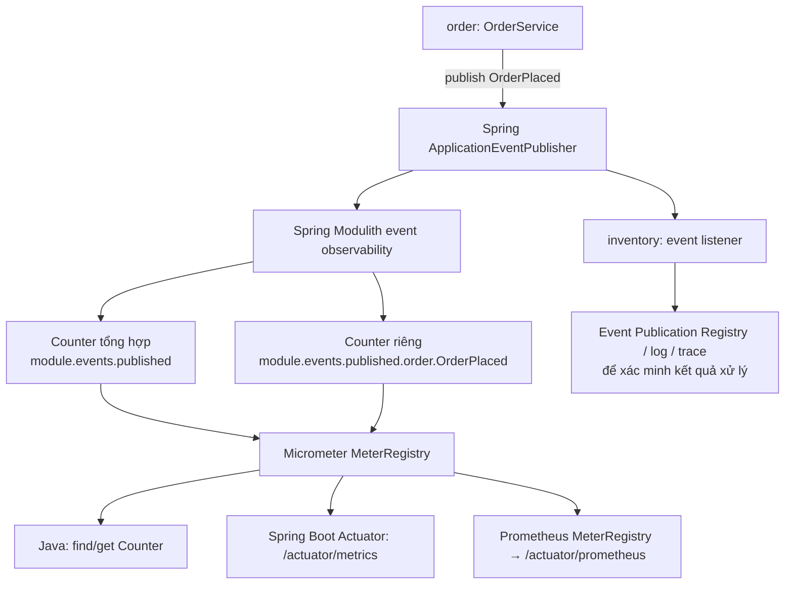
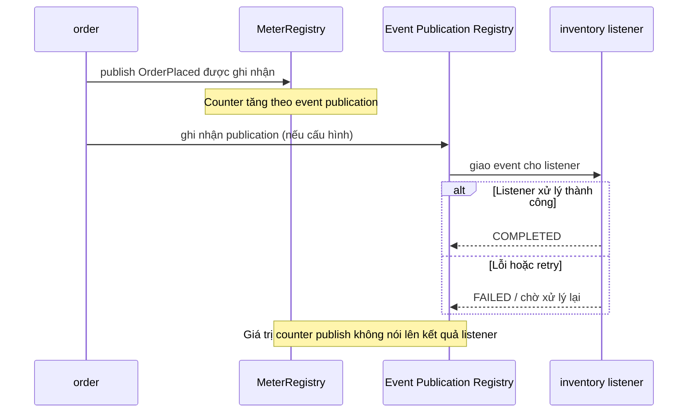

# Đọc metric qua Micrometer MeterRegistry

## 1. Vì sao phải đọc event metrics trong Spring Modulith?

Trong chương **Event metrics** thuộc học phần **SPRING_MODULITH_DOCUMENTATION_OBSERVABILITY**, chúng ta tìm hiểu cách Spring Modulith giúp quan sát tương tác giữa các application module của ứng dụng Spring Boot. Module graph và Actuator cho biết ranh giới, quan hệ phụ thuộc được suy ra từ code; **event metrics** cho biết hoạt động **phát sự kiện nghiệp vụ** đã được hệ thống ghi nhận trong quá trình chạy.

Ví dụ: module `order` phát `OrderPlaced` sau khi tạo đơn hàng. Module `inventory` có listener để trừ tồn kho. Khi số đơn hàng tăng cao, kỹ sư muốn biết liệu ứng dụng có đang phát `OrderPlaced` với tần suất bình thường hay không. Spring Modulith cung cấp counter do Micrometer quản lý; ứng dụng có thể đọc các counter này trực tiếp từ **`MeterRegistry`** mà không bắt buộc phải có Prometheus hay một tracing backend.

Nhưng cần đặt đúng câu hỏi:

- **Counter phát event**: sự kiện được publish bao nhiêu lần theo những series đã được ghi nhận?
- **Listener thành công**: có bao nhiêu lần một listener thực sự hoàn tất xử lý?
- **Event còn chờ hoặc retry**: có publication nào chưa hoàn tất trong Event Publication Registry?
- **Luồng thực thi**: event được phát ở đâu, listener chạy trên thread nào, trace có nối được hay không?

Bài này tập trung vào câu hỏi **đầu tiên** và hướng dẫn đọc dữ liệu bằng `MeterRegistry`. Ba câu hỏi còn lại cần bổ sung event publication state, log, module spans, tracing hoặc metrics riêng.

### Mục tiêu học tập

Sau bài, bạn có thể:

1. Phân biệt hai meter do Spring Modulith tạo cho sự kiện và các tag quan trọng.
2. Giải thích `MeterRegistry`, `Counter`, `Meter.Id`, tên meter và tag.
3. Đọc counter bằng `registry.find(...).counter()` hoặc `registry.find(...).counters()`, xử lý trường hợp meter chưa tồn tại.
4. Tránh nhầm thao tác **đọc meter** với API **đăng ký/tạo meter**.
5. Đối chiếu kết quả đọc trực tiếp với `/actuator/metrics` và Prometheus.
6. Chẩn đoán số đếm không xuất hiện, không tăng hoặc không khớp trạng thái listener.

## 2. Luồng dữ liệu: event → Counter → MeterRegistry

Micrometer định nghĩa `MeterRegistry` là nơi quản lý các meter đang được ghi nhận trong một ứng dụng. `Counter` là một loại meter lưu số đếm tăng dần; `count()` cho biết tổng giá trị counter hiện tại trong registry đó.



Một số điểm dễ nhầm:

- `MeterRegistry` quản lý **meters bên trong tiến trình**, không phải database lưu vĩnh viễn số đơn hàng.
- `Counter` **không giảm**; sau restart hoặc thay registry, giá trị quan sát được có thể trở về giá trị ban đầu.
- `Counter#count()` đo **giá trị số đếm đã ghi nhận**, không tự diễn giải thành số transaction commit hoặc số listener xử lý thành công.
- `ApplicationEventPublisher.publishEvent(...)` là thao tác gửi sự kiện vào hạ tầng ứng dụng; listener có thể chạy đồng bộ hoặc bất đồng bộ. Một event publish và một listener hoàn thành là **hai mốc khác nhau**.

## 3. Spring Modulith đăng ký những event metrics nào?

Tài liệu Spring Modulith 2.2 mô tả hai dạng counter cho những domain events mà hạ tầng observability theo dõi:

| Tên meter Micrometer | Đặc điểm | Khi nào sử dụng |
| --- | --- | --- |
| **`module.events.published`** | Counter tổng hợp, phân tách bằng tag của module và loại event | So sánh volume event giữa các module/loại event |
| **`module.events.published.$moduleIdentifier.$simpleEventTypeName`** | Counter cho một loại event thuộc một module, ví dụ `module.events.published.order.OrderPlaced` | Theo dõi riêng loại event, có thể bổ sung tag nghiệp vụ an toàn |

Trong tên thứ hai, `$moduleIdentifier` và `$simpleEventTypeName` là chỗ giữ chỗ trong tài liệu, không phải ký tự `$` cần nhập nguyên văn. Nếu module có ID `order` và event có simple class name `OrderPlaced`, tên ví dụ là `module.events.published.order.OrderPlaced`.

### Tags tiêu chuẩn

**Counter tổng hợp `module.events.published`** có các key cardinality thấp:

| Tag | Ý nghĩa |
| --- | --- |
| `module.event.type` | Loại event được phát; đọc giá trị thực từ meter thay vì đoán nó dùng simple name hay fully qualified name |
| `module.identifier` | ID kỹ thuật của module phát sự kiện |
| `module.name` | Tên hiển thị của module |

**Counter riêng theo loại event** có các key `module.identifier` và `module.name`. Có thể thêm tag tùy chỉnh nếu số lượng giá trị nhỏ và được kiểm soát.

Hai counter có thể cùng tăng khi một event phù hợp được publish. **Không cộng số đếm của chúng với nhau**: đó là hai cách biểu diễn cùng hoạt động publish ở mức tổng hợp và mức từng loại event.

### Phân biệt metric ID với một giá trị metric

Ví dụ có hai event:

```text
name = module.events.published
tags = {module.identifier=order, module.name=Order, module.event.type=OrderPlaced}
count = 12

name = module.events.published
tags = {module.identifier=order, module.name=Order, module.event.type=OrderCancelled}
count = 3
```

Đây là **hai meter series khác nhau** vì tag khác nhau, dù cùng tên `module.events.published`. Khi lọc chỉ bằng tên, bạn có thể thu được **nhiều Counter**. Nếu lọc tiếp theo `module.identifier` hoặc `module.event.type`, số series phù hợp sẽ thu hẹp. Các giá trị và số đếm trên chỉ là dữ liệu minh họa.

## 4. Kích hoạt observability và registry trong Spring Boot

### 4.1. Dependency cần thiết

Với Spring Boot tương thích Spring Modulith **2.2.x**, cách thuận tiện để bật Modulith Actuator và observability là `spring-modulith-starter-insight`.

```groovy
// build.gradle (Groovy DSL), ví dụ với Spring Modulith 2.2.0
dependencies {
    implementation platform('org.springframework.modulith:spring-modulith-bom:2.2.0')

    // Bao gồm hỗ trợ Actuator và observability của Modulith.
    runtimeOnly 'org.springframework.modulith:spring-modulith-starter-insight'

    // Chỉ cần khi muốn xuất số liệu qua /actuator/prometheus.
    runtimeOnly 'io.micrometer:micrometer-registry-prometheus'
}
```

Nếu ứng dụng không cần Modulith Actuator, có thể dùng `spring-modulith-observability-core` cùng Spring Boot Actuator/Micrometer phù hợp. Khi **viết code tùy biến event metric** bằng `ModulithEventMetricsCustomizer`, cần có `spring-modulith-observability-api` ở compile scope:

```groovy
dependencies {
    implementation 'org.springframework.modulith:spring-modulith-observability-api'
}
```

**Lưu ý về phiên bản:** Ví dụ trên dựa trên Spring Modulith 2.2.0. Dự án dùng Spring Boot hoặc Modulith phiên bản khác phải chọn bộ dependency tương thích; một số tên artifact đã thay đổi giữa các dòng. Không cần khai báo trùng những artifact mà starter đã kéo theo.

Nếu Spring Boot Actuator và Micrometer được cấu hình đúng, ứng dụng có thể inject trực tiếp một bean `MeterRegistry`. **Không bắt buộc** phải có exporter Prometheus để đọc số đếm trong Java. `SimpleMeterRegistry` là registry in-memory thích hợp cho ví dụ nhỏ; registry của hệ thống monitoring thật có cách lưu và xuất dữ liệu riêng.

### 4.2. Cấu hình endpoint để quan sát từ ngoài

Chỉ khi muốn truy cập qua HTTP mới cần expose `metrics` hoặc `prometheus`:

```yaml
# src/main/resources/application.yml
management:
  endpoints:
    web:
      exposure:
        include: "health,metrics,prometheus"
```

Sau đó, có thể truy cập:

```text
GET http://localhost:8080/actuator/metrics
GET http://localhost:8080/actuator/metrics/module.events.published
GET http://localhost:8080/actuator/prometheus
```

`/actuator/prometheus` cần Prometheus registry ở runtime; `/actuator/metrics` chỉ dùng để chẩn đoán các meter đã đăng ký trong ứng dụng. Hai endpoint cần chính sách truy cập phù hợp, đặc biệt khi công bố ở production. Việc bật `/actuator/modulith` **không phải điều kiện** để đọc `module.events.published` qua `MeterRegistry`.

## 5. Ví dụ domain event để phát sinh dữ liệu

Ứng dụng bán hàng có module `order` định nghĩa một sự kiện nghiệp vụ công khai:

```java
// com/acme/shop/order/OrderPlaced.java
package com.acme.shop.order;

import java.util.UUID;

public record OrderPlaced(UUID orderId, SalesChannel channel) {}
```

```java
// com/acme/shop/order/SalesChannel.java
package com.acme.shop.order;

public enum SalesChannel {
    WEB, STORE
}
```

Ứng dụng phát event sau khi xử lý thao tác đặt hàng:

```java
// com/acme/shop/order/OrderService.java
package com.acme.shop.order;

import java.util.UUID;
import org.springframework.context.ApplicationEventPublisher;
import org.springframework.stereotype.Service;

@Service
public class OrderService {

    private final ApplicationEventPublisher publisher;

    public OrderService(ApplicationEventPublisher publisher) {
        this.publisher = publisher;
    }

    public void place(UUID orderId, SalesChannel channel) {
        // Ví dụ tối giản: trong ứng dụng thực cần logic lưu đơn và transaction.
        publisher.publishEvent(new OrderPlaced(orderId, channel));
    }
}
```

Nếu hệ thống đã bật Spring Modulith event observability và `OrderPlaced` được nhận diện là domain event do module `order` phát, bạn có thể kiểm tra các meter:

```text
module.events.published
module.events.published.order.OrderPlaced
```

Một lần gọi `publishEvent(...)` thành công ở tầng publisher chưa chứng minh listener `inventory` đã xử lý, và cũng chưa khẳng định dữ liệu đơn hàng đã commit. Cần kiểm tra transaction và event publication state bằng cơ chế riêng khi phân tích tính nhất quán nghiệp vụ.

## 6. Đọc counter đúng cách qua MeterRegistry

Có ba API phổ biến dễ bị nhầm:

| API | Hành vi | Dùng khi nào |
| --- | --- | --- |
| `registry.find(name)` | Tìm meter có sẵn theo tên, có thể bổ sung bộ lọc tag | **Đọc/kiểm tra** và xử lý meter chưa xuất hiện |
| `registry.get(name)` | Tìm meter hiện có, báo lỗi nếu không tìm thấy hoặc lựa chọn không phù hợp | Khi chắc chắn metric đã được đăng ký |
| `registry.counter(name, tags...)` | Lấy **hoặc đăng ký** Counter với ID tương ứng | Khi **chủ động ghi** vào counter, tránh dùng chỉ để “thử đọc” |

**Không dùng `registry.counter("module.events.published")` để kiểm tra metric có tồn tại không**. Vì API này có khả năng **tạo thêm một meter** cùng tên nhưng thiếu tag, bạn có thể tạo dữ liệu gây hiểu lầm và làm việc chẩn đoán khó hơn.

### 6.1. Lấy một Counter theo tên và tag

```java
import io.micrometer.core.instrument.Counter;
import io.micrometer.core.instrument.MeterRegistry;

// Giả sử registry là bean được inject từ Spring Boot.
Counter counter = registry.find("module.events.published")
        .tag("module.identifier", "order")
        .tag("module.event.type", "OrderPlaced")
        .counter();

if (counter == null) {
    System.out.println("Chưa có series phù hợp trong MeterRegistry");
} else {
    System.out.println("Số event đã ghi nhận: " + counter.count());
}
```

Trong ví dụ này, `OrderPlaced` chỉ là **giá trị tag giả định**. Nếu `module.event.type` thực tế chứa fully qualified class name, tìm bằng `OrderPlaced` sẽ trả `null` dù metric tồn tại. Vì vậy nên **liệt kê tags của meter trước**, rồi truy vấn bằng giá trị chính xác.

`find(...).counter()` có thể trả `null` khi chưa có meter phù hợp. Phân biệt rõ:

- **Không có series**: chưa quan sát metric phù hợp hoặc các điều kiện instrumentation không thỏa mãn.
- **Có series, count bằng 0**: meter tồn tại nhưng chưa ghi nhận lần tăng nào trong registry đó.
- **Có series, count lớn hơn 0**: registry đã ghi nhận các lần tăng tương ứng; cần đối chiếu thời gian chạy/instance.

### 6.2. Liệt kê tất cả series của counter tổng hợp

Khi chưa biết các giá trị tag, nên đọc tất cả `Counter` cùng tên:

```java
// com/acme/shop/observability/PublishedEventMetricReader.java
package com.acme.shop.observability;

import io.micrometer.core.instrument.Counter;
import io.micrometer.core.instrument.MeterRegistry;
import java.util.List;
import java.util.OptionalDouble;
import org.springframework.stereotype.Component;

@Component
public class PublishedEventMetricReader {

    private static final String METER = "module.events.published";

    private final MeterRegistry registry;

    public PublishedEventMetricReader(MeterRegistry registry) {
        this.registry = registry;
    }

    public record EventSeries(
            String moduleId,
            String moduleName,
            String eventType,
            double count) {}

    // Chỉ đọc các meter đã tồn tại, không đăng ký thêm.
    public List<EventSeries> listAllPublishedEventSeries() {
        return registry.find(METER).counters().stream()
                .map(counter -> new EventSeries(
                        counter.getId().getTag("module.identifier"),
                        counter.getId().getTag("module.name"),
                        counter.getId().getTag("module.event.type"),
                        counter.count()))
                .toList();
    }

    // Tổng hợp các event series thuộc một module.
    public double countForModule(String moduleId) {
        return registry.find(METER)
                .tag("module.identifier", moduleId)
                .counters()
                .stream()
                .mapToDouble(Counter::count)
                .sum();
    }

    // Đọc một loại event cụ thể. Empty khác với có meter count=0.
    public OptionalDouble findCount(String moduleId, String eventTypeTag) {
        Counter counter = registry.find(METER)
                .tag("module.identifier", moduleId)
                .tag("module.event.type", eventTypeTag)
                .counter();

        return counter == null
                ? OptionalDouble.empty()
                : OptionalDouble.of(counter.count());
    }
}
```

Cách sử dụng tại một điểm chẩn đoán đã được bảo vệ:

```java
List<PublishedEventMetricReader.EventSeries> series =
        metricReader.listAllPublishedEventSeries();

series.forEach(System.out::println);

double orderEvents = metricReader.countForModule("order");
System.out.println("Order published events: " + orderEvents);
```

`metricReader` ở đoạn dùng thử là biến chỉ tới bean `PublishedEventMetricReader`, cần được inject vào thành phần gọi. Có thể gọi các phương thức này từ một lệnh quản trị, service nội bộ hoặc bài test tích hợp. Tránh log counter liên tục trên mỗi event vì sẽ tăng lượng log không cần thiết.

**Vì sao `listAllPublishedEventSeries()` hữu ích?** Nó trả về tên module và **giá trị thực** của tag `module.event.type`. Bạn có thể lấy những giá trị đó làm đầu vào cho `findCount(...)`, thay vì đoán format tên class event.

### 6.3. Đọc counter riêng cho một event

Nếu đã biết module ID là `order` và simple event type là `OrderPlaced`:

```java
String meterName = "module.events.published.order.OrderPlaced";

Counter orderPlaced = registry.find(meterName)
        .tag("module.identifier", "order")
        .counter();

if (orderPlaced != null) {
    System.out.println("OrderPlaced total = " + orderPlaced.count());
}
```

Counter riêng có thể mang thêm tag do ứng dụng tùy chỉnh. Khi có **nhiều series cùng tên** (ví dụ phân chia theo `channel=WEB/STORE`), chỉ lọc `module.identifier=order` có thể không chọn được một Counter duy nhất. Khi đó hãy đọc **tất cả series phù hợp** rồi cộng count, hoặc lọc thêm tag `channel`:

```java
double allChannels = registry.find(meterName)
        .tag("module.identifier", "order")
        .counters()
        .stream()
        .mapToDouble(Counter::count)
        .sum();
```

Đoạn code đọc này không thay thế hệ thống phân tích thời gian thực: nó cho biết **snapshot** tại thời điểm gọi trên registry/instance hiện tại.

## 7. Minh họa Micrometer bằng SimpleMeterRegistry

Để hiểu API đọc metric độc lập với cấu hình Spring Modulith, có thể tạo một registry trong bộ nhớ và **tự đăng ký meter mô phỏng**:

```java
import io.micrometer.core.instrument.Counter;
import io.micrometer.core.instrument.simple.SimpleMeterRegistry;

SimpleMeterRegistry registry = new SimpleMeterRegistry();

Counter placed = Counter.builder("module.events.published")
        .tag("module.identifier", "order")
        .tag("module.name", "Order")
        .tag("module.event.type", "OrderPlaced")
        .register(registry);

Counter cancelled = Counter.builder("module.events.published")
        .tag("module.identifier", "order")
        .tag("module.name", "Order")
        .tag("module.event.type", "OrderCancelled")
        .register(registry);

placed.increment();
placed.increment(2.0);
cancelled.increment();

// Đọc theo bộ tag cụ thể:
double placedTotal = registry.find("module.events.published")
        .tag("module.identifier", "order")
        .tag("module.event.type", "OrderPlaced")
        .counter()
        .count(); // 3.0

// Đọc toàn bộ event series của module order:
double orderTotal = registry.find("module.events.published")
        .tag("module.identifier", "order")
        .counters()
        .stream()
        .mapToDouble(Counter::count)
        .sum(); // 4.0
```

**Đây là ví dụ Micrometer thuần**, không chứng minh Spring Modulith tự đếm đúng những sự kiện nêu trên. Mục đích là thể hiện rằng **cùng tên + khác bộ tag → khác meter series**, và cách dùng `Counter#count()` để đọc giá trị. Trong ứng dụng thật, các meter event được Spring Modulith tạo/tăng khi publish event phù hợp.

Giá trị counter là `double` vì API Micrometer trả về số thực; số lần event được tăng từng đơn vị có thể hiển thị dưới dạng `3.0`, `4.0`. Đừng chuyển ép sang `int` nếu không có lý do: giá trị tổng có thể lớn và API vẫn là `double`.

## 8. Đối chiếu kết quả với Spring Boot Actuator

Khi bật và expose `metrics`, endpoint có thể cung cấp tên metric, giá trị và các tag đang có.

### 8.1. Liệt kê tên metric

```bash
curl -s http://localhost:8080/actuator/metrics
```

Danh sách `names` sẽ có `module.events.published` **nếu meter tương ứng đã được đăng ký**. Nếu ứng dụng chưa phát domain event nào, một số meter động có thể chưa xuất hiện.

### 8.2. Xem giá trị tổng hợp

```bash
curl -s http://localhost:8080/actuator/metrics/module.events.published
```

JSON minh họa:

```json
{
  "name": "module.events.published",
  "measurements": [
    { "statistic": "COUNT", "value": 15.0 }
  ],
  "availableTags": [
    { "tag": "module.identifier", "values": ["order"] },
    { "tag": "module.event.type", "values": ["OrderPlaced", "OrderCancelled"] },
    { "tag": "module.name", "values": ["Order"] }
  ]
}
```

`COUNT = 15` ở ví dụ này là tổng các series đang khớp tên meter. Nó **không phải số lượng series** và cũng không mặc nhiên là tổng lifetime của nghiệp vụ trên toàn hệ thống nhiều instance.

### 8.3. Lọc theo module hoặc loại event

```bash
# Một module; Actuator trả tổng các series khớp bộ lọc.
curl -s 'http://localhost:8080/actuator/metrics/module.events.published?tag=module.identifier:order'

# Lọc tiếp theo giá trị tag event type đọc được từ availableTags.
curl -s 'http://localhost:8080/actuator/metrics/module.events.published?tag=module.identifier:order&tag=module.event.type:OrderPlaced'
```

Giá trị `OrderPlaced` trong URL là minh họa. Nếu `availableTags` cho thấy giá trị khác, dùng **đúng chuỗi trả về**. Actuator `metrics` là công cụ chẩn đoán, không nên coi là giải pháp lưu dữ liệu lịch sử hay endpoint để hệ thống monitoring scrape liên tục.

**So sánh với API Java:** `/actuator/metrics` thường tổng hợp những meter cùng tên khớp bộ lọc; `registry.find(name).counter()` tìm một meter cụ thể; `registry.find(name).counters()` cho phép duyệt nhiều series và tự tổng hợp theo nhu cầu.

## 9. Quan sát cùng metric qua Prometheus

Khi có `micrometer-registry-prometheus` và endpoint được expose:

```bash
curl -s http://localhost:8080/actuator/prometheus
```

Prometheus có **quy tắc chuẩn hóa tên**. Chẳng hạn, dấu chấm của meter/tag Micrometer thường được biến thành dấu gạch dưới, counter có hậu tố `_total` theo exporter. Một dạng output **minh họa**:

```text
# TYPE module_events_published_total counter
module_events_published_total{module_identifier="order",module_name="Order",module_event_type="OrderPlaced"} 12.0
```

Tên metric, label và số liệu phải lấy từ endpoint thật vì phiên bản exporter, naming convention hoặc tùy biến có thể ảnh hưởng cách hiển thị.

Một truy vấn PromQL thường được dùng để theo dõi **tốc độ publish** (ví dụ nếu metric thực tế là `module_events_published_total`):

```promql
sum by (module_identifier, module_event_type) (
  rate(module_events_published_total[5m])
)
```

Truy vấn này có ý nghĩa là số lần tăng counter **mỗi giây** trong cửa sổ 5 phút, tổng hợp các series khớp nhóm label. Khác với `Counter#count()` là **giá trị tích lũy hiện có** của một series tại một thời điểm. Cần dùng mức tăng/rate khi theo dõi các instance có thể restart, thay vì chỉ vẽ số counter tuyệt đối.

**Thực hành vận hành:** Không mở `/actuator/prometheus` hoặc `/actuator/metrics` rộng ra Internet. Cấu hình authentication, mạng quản trị và cơ chế scrape phù hợp.

## 10. Tùy biến metric riêng theo event một cách an toàn

Với `ModulithEventMetricsCustomizer`, ứng dụng có thể thêm tag domain cho **counter riêng theo loại event**. Ví dụ `OrderPlaced` có `SalesChannel` với hai giá trị cố định `WEB` và `STORE`:

```java
// com/acme/shop/observability/EventMetricsConfiguration.java
package com.acme.shop.observability;

import com.acme.shop.order.OrderPlaced;
import org.springframework.context.annotation.Bean;
import org.springframework.context.annotation.Configuration;
import org.springframework.modulith.observability.ModulithEventMetricsCustomizer;

@Configuration(proxyBeanMethods = false)
class EventMetricsConfiguration {

    @Bean
    ModulithEventMetricsCustomizer orderPlacedMetricsCustomizer() {
        return metrics -> metrics.customize(
                OrderPlaced.class,
                (event, builder) ->
                        builder.tag("channel", event.channel().name()));
    }
}
```

Ví dụ này cần `spring-modulith-observability-api` tại compile scope và hỗ trợ observability ở runtime. Khi `channel` là enum hữu hạn, cardinality nhỏ và dễ dự đoán. Nếu thêm `channel`, Counter riêng `module.events.published.order.OrderPlaced` có thể có hai series, một cho `WEB` và một cho `STORE`.

**Không nên** đặt `orderId`, `userId`, email, session ID, trace ID hoặc UUID tùy ý vào metric tag: số lượng giá trị gần như vô hạn sẽ gây **cardinality explosion**, tiêu tốn bộ nhớ và làm hệ thống monitoring chậm/đắt. Nếu cần liên kết một event cụ thể, dùng log có cấu trúc, trace hoặc metadata event theo chính sách bảo mật.

| Tag bổ sung | Phù hợp? | Lý do |
| --- | --- | --- |
| `channel=WEB/STORE` | Có, nếu tập giá trị cố định | Cardinality thấp |
| `paymentMethod=CARD/BANK_TRANSFER/CASH` | Có, nếu được kiểm soát | Ít nhóm phân loại |
| `orderId=<UUID>` | Không | Mỗi đơn có thể tạo một series |
| `userEmail=<email>` | Không | Cardinality cao, dữ liệu nhạy cảm |
| `eventStatus=SUCCESS/FAILURE` | Chỉ khi định nghĩa metric thật sự đo trạng thái đó | **Không gắn nhãn kết quả xử lý vào counter chỉ đo publish** |

Một cách mở rộng đúng hướng là tạo **counter/timer riêng** đo hoạt động listener thành công, thất bại và latency, với các tag giới hạn giá trị; không đánh tráo ý nghĩa `module.events.published`.

## 11. Sự kiện được publish không có nghĩa đã được xử lý

Giả sử trong 10 phút:

- Module `order` ghi nhận **100** lần phát `OrderPlaced`.
- Listener `inventory` xử lý thành công **96** lần.
- Có **4** publication đang chờ, retry hoặc thất bại.

Counter publish chỉ phản ánh **100** ở phía nguồn (giả sử 100 lần phát đã được instrument và ghi nhận). Nó không chứa thông tin phân biệt `96` và `4`. Muốn biết trạng thái hoàn thành, cần quan sát **Event Publication Registry** nếu ứng dụng dùng hạ tầng transactional event publications, hoặc metric/log do listener cung cấp.

Spring Modulith có cơ chế quản lý vòng đời publication; ở dòng 2.x, các trạng thái như `PUBLISHED`, `PROCESSING`, `COMPLETED`, `FAILED` và `RESUBMITTED` cho phép phân biệt việc chờ xử lý, đang xử lý, thành công và lỗi. Việc có registry và công cụ truy xuất trạng thái phải được cấu hình theo dự án; **không được suy ra trạng thái từ `Counter#count()`**.



Nếu listener bất đồng bộ, trace có thể tách khỏi request gốc khi thiếu context propagation; nhưng counter phát sự kiện vẫn là metric của mốc publish. Vì thế **đọc meter** và **đọc trace/module entry span** là các thao tác bổ sung cho nhau.

## 12. Các lỗi thường gặp khi đọc MeterRegistry

| Hiện tượng | Nguyên nhân thường gặp | Cách kiểm tra |
| --- | --- | --- |
| `find("module.events.published").counter() == null` | Chưa có meter phù hợp hoặc chưa phát event được theo dõi | Dùng `counters()` để liệt kê, thử phát event, xem dependency |
| `find("module.events.published").counter()` chỉ trả một series | Có nhiều series cùng tên, khác tag | Dùng `counters()` và lọc/tổng hợp theo tag để không bỏ sót |
| Có meter nhưng `count() == 0` | Meter đã đăng ký nhưng chưa tăng, registry mới khởi tạo | Kiểm tra thời điểm đọc so với thời điểm publish |
| Đọc `OrderPlaced` trả `null` | Tag `module.event.type` có giá trị khác giả định | Liệt kê `counter.getId().getTags()` hoặc xem `availableTags` trên Actuator |
| Sau restart count giảm hoặc trở về 0 | Counter trong registry theo vòng đời tiến trình | Dùng hệ thống monitoring và truy vấn rate/increase có xử lý counter reset |
| Java đọc được số nhưng Prometheus chưa có | Chưa có registry Prometheus, chưa expose endpoint hoặc scrape sai URL | Kiểm tra dependency, HTTP exposure, cổng management và `/actuator/prometheus` |
| `/actuator/metrics` có giá trị lớn hơn một Counter Java | Actuator đang cộng nhiều series cùng tên | Lọc thêm tag, hoặc cộng `counters()` theo đúng nhóm |
| Có `module.events.published` nhưng không thấy event cụ thể | Chọn sai tên meter riêng hoặc module/event type | Đọc danh sách tên từ `registry.getMeters()` hoặc Actuator `names` |
| Metric publish tăng nhưng nghiệp vụ không đổi | Listener lỗi, xử lý bất đồng bộ, transaction rollback hoặc retry | Xem Event Publication Registry, log, span listener và trạng thái dữ liệu |
| Có hai counter rồi cộng cả hai loại | Counter tổng hợp và counter riêng cùng đại diện việc publish | Chọn **một** dạng meter theo mục tiêu báo cáo |
| Tạo meter 0 ngoài ý muốn | Dùng `registry.counter(name)` để “kiểm tra” | Đổi sang `registry.find(name)` |

### Quy trình chẩn đoán gợi ý

1. Xác định **đúng application module phát event** và event thực sự được publish qua `ApplicationEventPublisher`.
2. Kiểm tra starter `spring-modulith-starter-insight` hoặc `spring-modulith-observability-core` tương thích có trên runtime classpath.
3. Đọc `registry.find("module.events.published").counters()` để biết đã có series nào.
4. In **`counter.getId().getName()`**, **`getTags()`** và `count()`; đối chiếu module ID, event type và thời điểm chạy.
5. Nếu có HTTP Actuator, xem `/actuator/metrics/module.events.published` và lọc theo tag.
6. Nếu có Prometheus, xác minh tên và label đã được chuẩn hóa, đồng thời so sánh đúng instance/cửa sổ thời gian.
7. Khi cần kết luận thành công nghiệp vụ, kiểm tra riêng trạng thái publication/listener và trace; không dựa vào counter phát sự kiện một mình.

## 13. Bài thực hành: đọc sự kiện theo module và loại

Giả sử một ứng dụng có:

```text
order:
  OrderPlaced       -> đã publish 8 lần
  OrderCancelled    -> đã publish 2 lần
payment:
  PaymentCompleted  -> đã publish 5 lần
```

**Yêu cầu:**

1. Cho biết có bao nhiêu series `module.events.published` nếu mỗi cặp module/event type tạo một series và không có tag bổ sung.
2. Với `MeterRegistry` đã ghi nhận các giá trị trên, xác định kết quả `countForModule("order")`.
3. Viết đoạn code dùng `registry.find("module.events.published")` để đọc các series thuộc module `payment`.
4. Nếu `OrderPlaced` nhận thêm tag `channel=WEB/STORE`, cần thay đổi cách đọc counter riêng thế nào?
5. Nếu chỉ `4/5` lần `PaymentCompleted` được listener xử lý thành công, metric `module.events.published` có cho biết sự khác biệt này không?
6. Hãy đề xuất truy vấn PromQL để nhìn thấy tốc độ publish theo module trong 5 phút nếu exporter dùng tên `module_events_published_total`.

**Đáp án tham khảo:**

1. **3 series**: `order/OrderPlaced`, `order/OrderCancelled` và `payment/PaymentCompleted`.
2. `countForModule("order") = 8 + 2 = 10.0`.
3. `registry.find("module.events.published").tag("module.identifier", "payment").counters()` cho ra danh sách series của `payment`; duyệt `Counter#count()` nếu cần tổng hợp.
4. Dùng `counters()` và cộng toàn bộ series `channel`, hoặc lọc đúng `channel` cần xem; không gọi `counter()` khi bộ tag chưa xác định một series duy nhất.
5. **Không**; cần metric listener riêng hoặc Event Publication Registry và log/traces.
6. `sum by (module_identifier) (rate(module_events_published_total[5m]))` sau khi xác nhận tên metric/label thực tế ở Prometheus.

## 14. Ghi nhớ

**`MeterRegistry` là điểm truy cập các meter của Micrometer trong ứng dụng.** Spring Modulith tạo `module.events.published` để tổng hợp lần publish event và các counter riêng `module.events.published.$moduleIdentifier.$simpleEventTypeName` để theo dõi từng loại event. Muốn đọc dữ liệu đã có, hãy ưu tiên `registry.find(...)`, dùng `Counter#count()` để lấy giá trị, và lọc theo **tag có thật trong registry**.

Để hiểu hoạt động mô-đun một cách đầy đủ, kết hợp **module graph/Actuator** (cấu trúc và ranh giới), **event metrics** (mức hoạt động publish), **Event Publication Registry** (trạng thái xử lý), **module spans và tracing** (đường thực thi) cùng **context propagation** khi luồng xử lý chuyển qua thread hoặc retry. Không biến counter phát sự kiện thành thước đo thành công nghiệp vụ khi chưa có tín hiệu bổ sung.

## Tài liệu tham khảo

1. [Spring Modulith 2.2 – Production-ready Features, Observability Metrics](https://docs.spring.io/spring-modulith/reference/production-ready.html): hai dạng counter, tags và starter insight.
2. [Spring Modulith – ModulithEventMetrics](https://docs.spring.io/spring-modulith/docs/current/api/org/springframework/modulith/observability/ModulithEventMetrics.html): API tùy chỉnh `Counter.Builder` theo loại event.
3. [Spring Modulith – ModulithEventMetricsCustomizer](https://docs.spring.io/spring-modulith/docs/current/api/org/springframework/modulith/observability/ModulithEventMetricsCustomizer.html): customizer cho metric của event giữa các module.
4. [Micrometer – Registry](https://docs.micrometer.io/micrometer/reference/concepts/registry.html): `MeterRegistry`, `SimpleMeterRegistry` và composite registries.
5. [Micrometer – Counters](https://docs.micrometer.io/micrometer/reference/concepts/counters.html): `Counter#increment()`, `count()` và vì sao nên phân tích rate.
6. [Spring Boot – Metrics endpoint](https://docs.spring.io/spring-boot/reference/actuator/metrics.html): `/actuator/metrics`, `availableTags` và lọc `tag=KEY:VALUE`.
7. [Spring Modulith – Working with Application Events](https://docs.spring.io/spring-modulith/reference/events.html): listener, Event Publication Registry và vòng đời publication.
