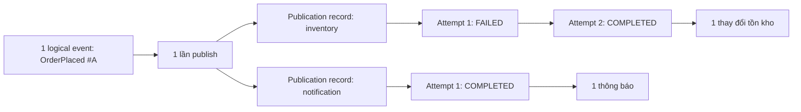

# Giới hạn khi event bị retry hoặc công bố nhiều lần

## 1. Bài toán: counter tăng có nghĩa nghiệp vụ thành công nhiều lần?

Giả sử một ứng dụng Spring Boot tổ chức theo **Spring Modulith** có hai application module:

- `order` lưu đơn hàng và phát sự kiện `OrderPlaced`.
- `inventory` lắng nghe `OrderPlaced` để trừ số lượng tồn kho.

Hệ thống quan sát ghi nhận **100 lần công bố** `OrderPlaced` trong năm phút. Có thể kết luận đã tạo 100 đơn hàng khác nhau và đã giữ tồn kho thành công 100 lần không? **Không.** Một request có thể bị gửi lại, cùng một event có thể được phát nhiều lần, listener có thể lỗi rồi được thực thi lại, hoặc event được gửi đến nhiều listener khác nhau.

Đó là lý do bài **“Giới hạn khi event bị retry hoặc công bố nhiều lần”** thuộc chương **Event metrics** của **SPRING_MODULITH_DOCUMENTATION_OBSERVABILITY**: học cách đọc metric công bố sự kiện, sử dụng Event Publication Registry và trace để quan sát tương tác giữa application module, đồng thời kiểm chứng kiến trúc module trong môi trường vận hành.

Sau bài này, bạn có thể:

1. Phân biệt **logical event**, **lần publish**, **publication record**, **lần listener được gọi** và **tác động nghiệp vụ thành công**.
2. Giải thích vì sao metric `module.events.published` không đủ để tính số giao dịch thành công hoặc số retry.
3. Hiểu trạng thái và khả năng resubmit của Spring Modulith Event Publication Registry.
4. Thiết kế listener idempotent để xử lý event lặp mà không trừ tồn kho hai lần.
5. Đề xuất metric, log và trace bổ sung để phân biệt retry, duplicate, lỗi và backlog.

## 2. Năm đơn vị đếm thường bị nhầm

| Đơn vị | Mô tả | Câu hỏi trả lời |
| --- | --- | --- |
| **Logical event** | Một sự kiện nghiệp vụ về một sự thật, ví dụ “đơn X đã được tạo”; nên có định danh ổn định | Có bao nhiêu thay đổi nghiệp vụ **khác nhau**? |
| **Publish invocation** | Một lần ứng dụng gọi `ApplicationEventPublisher.publishEvent(...)`, được instrumentation ghi nhận khi áp dụng | Code đã phát một instance event bao nhiêu lần? |
| **Publication record** | Bản ghi trong Event Publication Registry cho **một event và một listener đích** được registry theo dõi | Listener nào còn publication cần xử lý? |
| **Delivery/processing attempt** | Một lần listener thực sự được gọi, bao gồm retry | Handler đã được thử chạy bao nhiêu lần? |
| **Successful business effect** | Thay đổi nghiệp vụ đã được commit hoặc được dịch vụ ngoài chấp nhận | Thực tế đã giữ tồn kho/ghi nhận thanh toán bao nhiêu lần? |

Các đơn vị trên **không có quan hệ 1:1**. Một publish có thể tạo hai publication record vì có hai transactional listener. Một publication record có thể trải qua ba lần xử lý trước khi hoàn tất. Ngược lại, hai publish do request lặp có thể cùng đại diện cho **một logical event** nếu chúng dùng cùng một mã nghiệp vụ ổn định.

Ví dụ minh họa:



Trong tình huống này, số liệu có thể là:

| Đại lượng | Giá trị minh họa |
| --- | ---: |
| Logical event | 1 |
| Lần ứng dụng publish event | 1 |
| Publication record của registry | 2 |
| Tổng lần gọi listener | 3 |
| Lần xử lý hoàn tất theo từng listener | 2 |
| Tác động nghiệp vụ thành công | Tối đa 2 loại hiệu ứng khác nhau, cần kiểm chứng riêng |

Vì vậy, **không tính tỷ lệ retry bằng cách lấy số record hay số lần listener gọi trừ trực tiếp số publish toàn hệ thống**: nhiều listener và chênh lệch thời điểm xử lý làm mẫu số không cùng đơn vị.

## 3. Spring Modulith cung cấp những event metrics nào?

Khi dùng observability của Spring Modulith, tài liệu chính thức mô tả hai loại counter:

| Meter Micrometer | Ý nghĩa | Tag mặc định đáng chú ý |
| --- | --- | --- |
| `module.events.published` | Counter tổng hợp các lần công bố domain event | `module.event.type`, `module.identifier`, `module.name` |
| `module.events.published.$moduleIdentifier.$simpleEventTypeName` | Counter riêng theo module và loại event, có thể được tùy biến thêm | `module.identifier`, `module.name` |

Tên thứ hai có `$moduleIdentifier` và `$simpleEventTypeName` là **phần thay thế bằng giá trị thật**, chẳng hạn một event của module `order`. Đây là tên Micrometer; khi xuất Prometheus, dấu chấm và hậu tố counter thường được chuyển thành dạng dấu gạch dưới và `_total`. Hãy xem tên series thực tế trên `/actuator/prometheus` thay vì suy đoán chính xác tên ở mọi phiên bản registry.

### 3.1. Counter thực sự đếm điều gì?

Counter công bố sự kiện cho biết **hoạt động publish đã được instrument**. Nó không xác nhận:

- Transaction của publisher cuối cùng đã commit.
- Sự kiện đại diện cho một đơn hàng **duy nhất**.
- Một listener cụ thể đã bắt đầu hoặc hoàn thành.
- Handler chỉ được chạy đúng một lần.
- Tác động ở database hoặc hệ thống ngoài đã commit.
- Một lần retry đã được thực hiện.

Ví dụ publisher gọi `publishEvent(new OrderPlaced(...))` trong một transaction rồi transaction rollback: hành động publish đã xảy ra trong code, nhưng điều đó không đảm bảo nghiệp vụ được commit. Tương tự, nếu request retry làm code publish hai lần, counter có thể tăng hai dù đó cùng một ý định đặt hàng.

**Không diễn giải `module.events.published` thành “số event được xử lý thành công”.** Nó là metric phát event, không phải metric kết quả của listener.

### 3.2. Publish mới và resubmit publication cũ khác nhau

Hai luồng thường cùng bị gọi là “retry”:

1. **Publish lại:** code gọi `ApplicationEventPublisher.publishEvent(...)` thêm lần nữa, ví dụ vì client gửi lại request. Đây là một hành động publish mới; meter phát event sẽ quan sát lần publish mới nếu đi qua instrumentation tương ứng. Registry có thể tạo bộ publication record mới cho listener.
2. **Resubmit một publication còn thiếu/chưa thành công:** Event Publication Registry tìm bản ghi cũ và yêu cầu listener thử xử lý lại. Đây là lần **listener attempt** khác trên publication đã tồn tại, không thể mặc nhiên coi là một lời gọi mới của publisher hoặc một logical event mới.

Đường xử lý resubmit và điểm instrumentation có thể khác giữa phiên bản/cấu hình, nên không dùng chênh lệch `module.events.published` để suy ra số lần resubmit. Nếu cần biết attempt chính xác, dùng metadata của Event Publication Registry hoặc metric ở listener.

## 4. Bốn kịch bản gây sai lệch số liệu

### Kịch bản A — Một event, hai listener

`order` công bố một `OrderPlaced` và có hai listener transactional: `inventory` và `notification`.

```text
order.publishEvent(OrderPlaced #A)   => publish counter +1
  ├── inventory listener            => 1 publication record
  └── notification listener         => 1 publication record
```

Nếu cả hai listener xử lý thành công, registry có thể ghi hai publication đã hoàn tất nhưng counter publish chỉ tăng một. Không so tổng completed publication với publish như cùng một loại đối tượng.

### Kịch bản B — Listener thất bại rồi resubmit

`order` publish một lần. `inventory` thử xử lý, lỗi database, sau đó người vận hành resubmit:

```text
T0  OrderPlaced #A được publish              : publish = 1
T1  inventory attempt 1 -> lỗi              : attempts = 1
T2  publication ở trạng thái FAILED
T3  resubmit publication đang FAILED
T4  inventory attempt 2 -> hoàn tất         : attempts = 2
```

Khi đó **publish có thể vẫn là 1**, attempts là 2, completed publication là 1. Nếu một phần tác động đã xảy ra trước lỗi hoặc trước khi registry ghi nhận hoàn tất, retry có thể làm hiệu ứng lặp nếu handler không idempotent.

### Kịch bản C — Client gọi lại, cùng ý định nghiệp vụ được publish hai lần

Client gọi `POST /orders`, timeout và gửi lại. Nếu server không có cơ chế idempotency cho command, nó có thể tạo hai `OrderPlaced`:

```text
POST /orders (lần 1) -> publish OrderPlaced
POST /orders (lần 2) -> publish OrderPlaced
```

Đây là **hai hành động publish**, khác với cơ chế resubmit một publication cũ. Nếu muốn chỉ một đơn hàng, cần idempotency ở tầng command (chẳng hạn request idempotency key và unique constraint), không thể trông chờ chỉ vào Event Publication Registry.

### Kịch bản D — Listener đã làm xong tác động, nhưng không ghi nhận completion

Listener gọi một dịch vụ ngoài, dịch vụ đó đã thực hiện thanh toán, nhưng ứng dụng crash trước khi đánh dấu publication hoàn tất. Sau khi phục hồi, publication có thể được xử lý lại.

```text
listener -> payment provider: charge #A  (đã thành công)
listener -> crash trước khi ghi trạng thái COMPLETED
registry -> publication cần phục hồi
resubmit -> listener thử charge #A lần nữa
```

Nếu payment provider không hỗ trợ idempotency key hoặc cách kiểm tra giao dịch cũ, retry có thể tạo **hai giao dịch thanh toán**. Một database transaction cục bộ không thể tự rollback một charge đã hoàn tất ở hệ thống khác.

## 5. Event Publication Registry theo dõi điều gì?

Event Publication Registry của Spring Modulith ghi một publication cho từng transactional event listener đích mà cơ chế registry quản lý. Theo mặc định, những listener được meta-annotate với `@TransactionalEventListener` nằm trong phạm vi này; `@ApplicationModuleListener` cũng thuộc nhóm đó. Một `@EventListener` đồng bộ đơn thuần không mặc định có publication record trong registry.

Tùy persistence starter (JDBC/JPA/MongoDB/Neo4j) và cấu hình hiện có, publication được lưu cùng giao dịch phát event. Nếu listener hoàn thành thành công, publication được đánh dấu completed. Nếu lỗi, thông tin chưa hoàn tất được giữ lại để có thể phục hồi/resubmit. **Registry không tự làm cho tác động bên ngoài trở thành exactly-once.**

### 5.1. Trạng thái publication ở Spring Modulith 2.x

Từ Spring Modulith **2.0**, lifecycle của publication được mô tả chi tiết:

| Trạng thái | Ý nghĩa | Điều cần quan sát |
| --- | --- | --- |
| `PUBLISHED` | Đã ghi publication, đang đợi xử lý | Độ tuổi của publication nếu tồn đọng |
| `PROCESSING` | Listener đã nhận và đang thực thi | Thời gian xử lý, trường hợp bị treo/crash |
| `FAILED` | Listener ném lỗi hoặc publication bị đánh dấu stale | Loại lỗi, thời điểm thất bại và khả năng retry |
| `RESUBMITTED` | Publication thất bại đã được đưa vào hàng chờ thử lại | Số lần thử và thời điểm resubmit gần nhất |
| `COMPLETED` | Listener xử lý thành công theo cơ chế registry | Đừng đồng nhất với việc mọi external side effect chắc chắn đúng |
| `ABANDONED` | Dừng retry theo chính sách bỏ cuộc, có từ **2.2** | Cần quy trình xử lý/đối soát riêng |

Hai trường metadata rất hữu ích:

- `EventPublication.getCompletionAttempts()`: số lần gọi listener mà registry theo dõi, tăng khi chuyển sang `PROCESSING`, kể cả trường hợp crash khi đang chạy.
- `EventPublication.getLastResubmissionDate()`: lần resubmit gần nhất.

Đây là những nguồn phù hợp hơn `module.events.published` nếu câu hỏi là **“listener đã thử bao nhiêu lần?”**.

**Giới hạn:** Một số hệ thống vẫn dùng Spring Modulith 1.x, nơi API và trạng thái lifecycle khác dòng 2.x. Không viết dashboard phụ thuộc trực tiếp các trạng thái `FAILED/PROCESSING/RESUBMITTED/ABANDONED` mà chưa xác nhận phiên bản.

### 5.2. Retry và phục hồi không tự động đúng với mọi triển khai

Spring Modulith có API `FailedEventPublications.resubmit(ResubmissionOptions)` để resubmit những publication đã FAILED (từ 2.0). `IncompleteEventPublications` cũng có các API phục hồi publication chưa hoàn tất. Cấu hình `spring.modulith.events.republish-outstanding-events-on-restart` cho phép tự kích hoạt phục hồi khi restart, nhưng **mặc định tắt** và không được khuyến nghị bật tùy tiện trong triển khai nhiều instance, vì instance khác có thể vẫn đang xử lý.

Từ 2.0 có Staleness Monitor để đánh dấu publication ở trạng thái chờ/đang xử lý quá lâu thành failed nếu cấu hình threshold khác không. Khi các ngưỡng staleness để mặc định bằng 0, tính năng đánh dấu stale tự động không chạy. Từ 2.2 có thêm chính sách `AbandonPolicy` hoặc giới hạn số attempt để dừng retry những lỗi không thể phục hồi.

Đây là các **cơ chế phục hồi có điều kiện**, không đồng nghĩa mọi lỗi sẽ được retry ngay hoặc vô hạn. Cần có chính sách riêng cho lỗi tạm thời, lỗi vĩnh viễn, batch size, giãn cách và giới hạn số lần thử.

## 6. Thiết kế consumer idempotent

**Idempotent** nghĩa là xử lý cùng một **logical event** nhiều lần vẫn tạo ra một kết quả nghiệp vụ mong muốn, tương đương xử lý một lần. Để làm được điều này:

1. Gán `eventId` ổn định cho một logical event. Khi redeliver, giữ nguyên ID đó.
2. Ở từng consumer, dùng cặp `(consumer, eventId)` làm khóa chống xử lý trùng.
3. Ghi dấu đã xử lý và tác động vào **cùng một local database transaction** nếu cả hai dùng cùng dữ liệu.
4. Nếu thao tác ra hệ thống ngoài, cần idempotency key/cơ chế đối soát phía hệ thống đó; transaction của database nội bộ không bao phủ hệ thống ngoài.
5. Đối với command từ client, có thể còn cần khóa idempotency ở tầng API/order để tránh phát lại event với **eventId mới** cho cùng một đơn.

### 6.1. Một event có ID ổn định

Định nghĩa contract tại API package `order`:

```java
package com.example.shop.order;

import java.util.UUID;

public record OrderPlaced(
    UUID eventId,
    UUID orderId,
    String sku,
    int quantity
) {}
```

`eventId` là định danh một sự kiện nghiệp vụ. Khi registry redeliver cùng event, ID phải được giữ lại trong payload. Nếu client retry khiến server tạo một logical event mới với ID khác, consumer **không thể biết chắc** đó là trùng chỉ bằng `eventId`; tầng xử lý command phải kiểm tra cả `orderId` hoặc idempotency key.

### 6.2. Schema ví dụ dùng PostgreSQL

```sql
CREATE TABLE inventory_stock (
    sku           varchar(80) PRIMARY KEY,
    available_qty bigint NOT NULL CHECK (available_qty >= 0)
);

CREATE TABLE processed_events (
    consumer      varchar(80) NOT NULL,
    event_id      uuid NOT NULL,
    processed_at  timestamptz NOT NULL DEFAULT CURRENT_TIMESTAMP,
    PRIMARY KEY (consumer, event_id)
);
```

Khóa chính `(consumer, event_id)` cho phép cùng event được xử lý **một lần ở mỗi consumer**. Nếu có hai listener độc lập, chúng không dùng chung một dòng marker để vô tình chặn nhau.

### 6.3. Listener ghi dấu và trừ kho nguyên tử

Ví dụ sau giả định sử dụng `spring-modulith-starter-jdbc` cho publication registry, Spring JDBC, PostgreSQL và event listener được quản lý qua Spring:

```java
package com.example.shop.inventory;

import com.example.shop.order.OrderPlaced;
import io.micrometer.core.instrument.MeterRegistry;
import org.springframework.jdbc.core.JdbcTemplate;
import org.springframework.modulith.events.ApplicationModuleListener;
import org.springframework.stereotype.Component;

@Component
class InventoryOnOrderPlaced {

    private final JdbcTemplate jdbc;
    private final MeterRegistry meters;

    InventoryOnOrderPlaced(JdbcTemplate jdbc, MeterRegistry meters) {
        this.jdbc = jdbc;
        this.meters = meters;
    }

    @ApplicationModuleListener
    void on(OrderPlaced event) {
        meters.counter(
            "app.inventory.listener.attempts",
            "event_type", "OrderPlaced"
        ).increment();

        int inserted = jdbc.update("""
            INSERT INTO processed_events (consumer, event_id)
            VALUES (?, ?)
            ON CONFLICT (consumer, event_id) DO NOTHING
            """, "inventory", event.eventId());

        if (inserted == 0) {
            meters.counter(
                "app.inventory.listener.duplicates",
                "event_type", "OrderPlaced"
            ).increment();
            return; // Event đã được xử lý trong transaction trước đó.
        }

        int updated = jdbc.update("""
            UPDATE inventory_stock
            SET available_qty = available_qty - ?
            WHERE sku = ? AND available_qty >= ?
            """, event.quantity(), event.sku(), event.quantity());

        if (updated != 1) {
            throw new IllegalStateException("Inventory reservation failed");
        }
    }
}
```

**Vì sao ví dụ này chống trừ kho lặp?**

- `@ApplicationModuleListener` là shortcut cho listener transactional, bất đồng bộ và chạy trong giao dịch riêng sau khi giao dịch nguồn commit. Các thao tác JdbcTemplate của handler dùng **cùng transaction listener**, với transaction manager phù hợp.
- Nếu đây là lần đầu xử lý thành công, dòng `processed_events` được insert và tồn kho được trừ trong cùng transaction.
- Nếu cùng `eventId` được giao lại sau khi transaction trước đã commit, khóa chính khiến `INSERT ... ON CONFLICT DO NOTHING` trả về 0; handler bỏ qua thao tác trừ kho.
- Nếu update stock thất bại, exception làm transaction rollback, bao gồm cả dòng marker vừa insert. Lần retry vẫn có thể thử xử lý lại.
- Nếu hai attempt chạy đồng thời, unique constraint là hàng rào đồng bộ ở database; chỉ một transaction có thể commit marker cho cùng `(consumer, eventId)`.

**Giới hạn của ví dụ:** cú pháp `ON CONFLICT` đặc thù PostgreSQL; phải đổi theo database khác. Cần validate `quantity > 0`, `sku` và quyền cập nhật tồn kho trong mã thực tế. Với nhiều transaction manager, cần bảo đảm listener và cả hai bảng thật sự nằm trong **một** local transaction; nếu không, tính nguyên tử bị phá vỡ.

### 6.4. Metric trong listener cũng có giới hạn

Counter `app.inventory.listener.attempts` tăng khi listener **bắt đầu chạy**, gồm cả retry và duplicate. Counter `app.inventory.listener.duplicates` tăng khi listener nhận ra ID đã xử lý. Chúng **không** tự chứng minh transaction hoàn tất vì Micrometer counter không rollback khi database rollback. Nếu cần metric “commit thành công”, ghi nhận sau commit hoặc tính từ nguồn dữ liệu đã lưu bền vững; nếu cần đánh giá trạng thái publication, xem registry.

Với ngoại lệ ném trước khi đến nhánh duplicate, counter attempts vẫn tăng, còn kết quả thất bại có thể cần được instrument riêng (ví dụ một wrapper đo outcome, log và trạng thái registry). Không gọi các counter này là “số đơn hàng thành công”.

## 7. Một giải pháp khác: idempotency với hệ thống ngoài

Trường hợp `payment` gọi cổng thanh toán, không thể gộp giao dịch của provider vào transaction PostgreSQL ở ví dụ trên. Phương án có thể gồm:

- Gửi một **idempotency key ổn định**, dựa trên mã của logical payment intent, cho provider nếu API hỗ trợ.
- Ghi trạng thái payment intent trong database; khi retry, tra cứu giao dịch đã xử lý bằng khóa đó trước khi charge.
- Sử dụng outbox hoặc cơ chế phối hợp giao dịch thích hợp nếu cần gửi command/event qua broker.
- Có cơ chế đối soát thủ công nếu provider timeout sau khi đã thực hiện tác động nhưng trước khi trả response.

**Đừng sinh idempotency key mới cho mỗi retry.** Điều đó vô hiệu hóa cơ chế chống tác động lặp của provider.

Tương tự, consumer nhận event qua broker có thể gặp phân phối *at least once*. Phải xét cả việc broker redelivery, replay thủ công, producer publish lại và retry ở ứng dụng, thay vì chỉ xét retry của Event Publication Registry.

## 8. Đo metric nào để nhìn đúng hệ thống?

### 8.1. Bộ tín hiệu khuyến nghị

| Tín hiệu | Nguồn | Mục đích |
| --- | --- | --- |
| `module.events.published` | Spring Modulith observability | Theo dõi tốc độ phát event theo module và loại |
| `app.inventory.listener.attempts` | Counter tự định nghĩa tại listener | Biết số lần handler được gọi, gồm retry |
| `app.inventory.listener.duplicates` | Counter tự định nghĩa | Theo dõi số lần phát hiện ID đã xử lý |
| Listener failures theo `event_type`/`consumer` | Counter hoặc observation tự định nghĩa | Theo dõi lỗi nghiệp vụ/kỹ thuật |
| Age/count của publication `FAILED`/`PUBLISHED`/`PROCESSING` | Registry hoặc metric tổng hợp tự định nghĩa | Phát hiện tồn đọng, tác vụ treo, recovery chưa hoàn tất |
| `completionAttempts` và `lastResubmissionDate` | Metadata của publication (2.x) | Phân tích lịch sử thử xử lý một publication |
| Thời lượng listener | Micrometer Timer hoặc trace span | Tìm listener chậm và đánh giá hiệu năng |
| Business outcomes | Dữ liệu đơn hàng/kho/payment đã commit | Xác nhận hiệu ứng nghiệp vụ thực tế |

Spring Modulith **không bảo đảm tự động phát sinh toàn bộ các metric tùy biến** trong bảng. Counter publication do Modulith cung cấp, còn metric attempts, duplicate, failure, backlog hay business outcome cần thêm instrumentation/đọc dữ liệu phù hợp.

### 8.2. Ví dụ Actuator và Prometheus

Một cấu hình phát triển:

```yaml
management:
  endpoints:
    web:
      exposure:
        include: "health,info,metrics,prometheus,modulith"
```

Cần có Spring Modulith observability (chẳng hạn `spring-modulith-starter-insight`), Actuator và `micrometer-registry-prometheus` để sử dụng endpoint xuất Prometheus. Nếu có mã sử dụng `MeterRegistry` trong compile scope, bảo đảm `micrometer-core` có mặt ở compile classpath.

Sau khi phát event, truy vấn meter:

```powershell
curl.exe http://localhost:8080/actuator/metrics/module.events.published
curl.exe http://localhost:8080/actuator/metrics/app.inventory.listener.attempts
curl.exe http://localhost:8080/actuator/prometheus
```

Khi chưa có lần phát event hoặc listener chưa được gọi, meter tương ứng có thể chưa được đăng ký. Giá trị counter có thể reset sau restart; đọc theo rate hoặc increase trong cửa sổ thời gian khi dùng Prometheus.

Ví dụ PromQL **cần đối chiếu tên series/label thực tế** từ `/actuator/prometheus`:

```promql
# Tốc độ publish event theo module và loại event
sum by (module_identifier, module_event_type) (
  rate(module_events_published_total[5m])
)
```

```promql
# Số lần listener bị gọi trong 30 phút, gồm retry
increase(app_inventory_listener_attempts_total[30m])
```

```promql
# Số lần nhận diện event trùng trong 30 phút
increase(app_inventory_listener_duplicates_total[30m])
```

Không lấy trực tiếp `increase(attempts) / increase(module_events_published)` để gọi là tỷ lệ retry: attempts có thể bao gồm nhiều listener, publish và attempt có thể nằm ở những khung thời gian khác nhau, đồng thời meter có thể bị sampling/scrape reset. Nếu muốn tỷ lệ attempt bị nhận diện là duplicate ở **cùng listener**, có thể dùng `duplicates / attempts` trong cùng khung thời gian và tag, nhưng vẫn phải hiểu ý nghĩa nghiệp vụ của nó; duplicate không luôn đồng nghĩa retry.

## 9. Tag cardinality, trace và tương quan event

Để phân tích event lặp, có thể cần `eventId`, `orderId` hoặc `publicationId`. Tuy nhiên, đây là những giá trị có cardinality cực lớn và **không nên dùng làm tag của Micrometer/Prometheus**.

| Nên dùng làm metric tag | Nên đặt ở log hoặc trace có kiểm soát |
| --- | --- |
| `module.identifier` | `eventId` |
| `event_type` | `orderId` |
| `consumer` với tập giá trị hữu hạn | `publicationId` |
| `outcome=success/duplicate/failure` | Trace ID/span ID |
| `failure_category=transient/permanent` | Thông tin lỗi chi tiết đã làm sạch |

Mỗi giá trị tag khác nhau có thể sinh một time series mới. Đưa UUID vào metric tag sẽ làm tăng chi phí lưu trữ và query rất nhanh; đồng thời có thể làm lộ thông tin không cần thiết.

Trace giúp lần theo **một lần thực thi**, nhưng event listener bất đồng bộ thường không nằm trên cùng call stack với request publisher. Khi chuyển thread hoặc chạy lại publication sau nhiều phút, trace context có thể không được truyền hoặc một trace mới được tạo. Vì thế:

1. Dùng metric để phát hiện tỷ lệ duplicate/lỗi và thời điểm bất thường.
2. Dùng log có event ID/consumer/publication ID để liên kết các attempt theo thời gian.
3. Dùng trace để soi độ trễ và lỗi ở từng attempt khi tracing được instrument, sampled và export.
4. Dùng registry để xác nhận publication đang xử lý, hoàn tất, thất bại hoặc được resubmit.

**Không dựa vào việc thiếu một trace để kết luận không có retry.** Một retry có thể xảy ra trong tiến trình khác hoặc bị sampling loại; metric và registry bổ sung thông tin mà trace đơn lẻ không có.

## 10. Kịch bản chẩn đoán end-to-end

Giả sử sau triển khai, số lượng thông báo “đã đặt hàng” mà người dùng nhận được tăng bất thường.

| Bước | Điều kiểm tra | Ví dụ phát hiện | Cách diễn giải |
| --- | --- | --- | --- |
| 1 | `module.events.published` theo `OrderPlaced` | Tốc độ publish không tăng | Chưa thấy bằng chứng producer phát nhiều hơn |
| 2 | Counter attempt của `notification` | Attempts tăng gấp đôi | Có thể listener được gọi nhiều lần |
| 3 | Registry của `notification` | Nhiều publication FAILED/RESUBMITTED, completionAttempts > 1 | Có retry trên publication cũ |
| 4 | Log tương quan theo `eventId` | Cùng ID bị nhận nhiều lần | Củng cố giả thuyết redelivery |
| 5 | Database/provider nhận thông báo | Cùng ID gửi notification nhiều lần | Listener chưa idempotent hoặc provider chưa chống trùng |
| 6 | Sau khi sửa | Duplicate attempts có thể còn nhưng tác động nghiệp vụ không lặp | Cơ chế idempotency hoạt động; tiếp tục theo dõi backlog/lỗi |

Một tình huống khác: publish counter tăng gấp đôi **và** registry có nhiều publication mới với eventId khác nhau cho cùng `orderId`. Khi đó cần kiểm tra API command/request retry và việc sinh sự kiện mới ngoài ý muốn, thay vì chỉ sửa logic resubmit của consumer.

### Khi có lỗi vĩnh viễn

Một event có payload không hợp lệ hoặc chứa mã hàng không tồn tại có thể luôn thất bại nếu retry nguyên trạng. Không nên resubmit vô hạn. Spring Modulith 2.2 hỗ trợ chính sách bỏ cuộc `AbandonPolicy`; trong ứng dụng cần phân loại lỗi tạm thời/vĩnh viễn và quy trình xử lý publication bị abandoned. Backlog `FAILED`/`ABANDONED` là vấn đề riêng với tốc độ publish.

## 11. Các kết luận sai thường gặp

| Kết luận sai | Cách hiểu đúng |
| --- | --- |
| “Counter publish tăng 2 nghĩa có 2 đơn hàng khác nhau.” | Hai lần publish có thể thuộc một ý định nghiệp vụ; cần định danh/đối soát. |
| “Counter publish bằng 1 nên listener chỉ chạy 1 lần.” | Registry có thể resubmit và listener có nhiều attempts. |
| “Một publish luôn có đúng một publication record.” | Registry thường tạo một record cho **mỗi transactional listener đích**. |
| “Publication COMPLETED chứng minh hệ thống ngoài không bị charge trùng.” | Completion mô tả listener hoàn thành theo registry; external effect cần idempotency/đối soát. |
| “Đặt unique constraint sau khi trừ kho vẫn chống trùng tốt.” | Marker và thay đổi kho phải cùng transaction, áp dụng trước/đúng thứ tự để không tạo hiệu ứng lặp. |
| “EventId mới trên mỗi retry không sao.” | Nếu ID thay đổi, consumer khó phát hiện cùng logical event. |
| “Tất cả trạng thái registry đều có sẵn trong event metrics mặc định.” | Counter publish và lifecycle publication là hai nguồn dữ liệu khác nhau. |
| “Retry luôn được Spring Modulith tự bật.” | Cần xem cấu hình/phiên bản và chính sách resubmit cụ thể. |
| “Event không có trace tức event không được retry.” | Sampling, async propagation và backend có thể khiến trace vắng mặt. |
| “Gắn eventId vào Prometheus tag giúp điều tra nhanh.” | Cardinality quá cao; đưa ID vào log/trace có kiểm soát. |

## 12. Bài thực hành có thể kiểm chứng

Thực hiện trong môi trường phát triển với PostgreSQL và ít nhất một transactional listener:

1. **Baseline:** phát một `OrderPlaced` duy nhất với `eventId=A`. Ghi meter publication, số publication record và attempts của listener.
2. **Thử lỗi:** làm `inventory` ném exception trước khi commit. Kiểm tra tồn kho không đổi, marker cũng rollback và registry ghi nhận trạng thái thất bại phù hợp phiên bản.
3. **Resubmit:** sau khi sửa lỗi, resubmit publication cũ. Kiểm tra attempts tăng, eventId giữ nguyên, chỉ một thay đổi tồn kho được commit.
4. **Thử duplicate sau thành công:** gửi lại **cùng eventId=A** trong một publication mới do ứng dụng tạo có chủ đích. Kiểm tra marker idempotency bỏ qua thay đổi kho thứ hai, dù publish counter có thể tăng.
5. **Thử retry command:** gửi lại cùng API request nhưng phát event với `eventId=B`. Quan sát rằng dedup theo eventId không chặn B; bổ sung idempotency key/unique business constraint ở publisher.
6. **Thử nhiều listener:** thêm `notification`. Kiểm tra một lần publish có thể tạo hai publication record nhưng không tương đương hai logical event.
7. **Kiểm tra observability:** phân biệt `module.events.published`, `listener.attempts`, `listener.duplicates`, registry states và dữ liệu nghiệp vụ cuối cùng.

Checklist hoàn thành:

- [ ] Phân biệt đúng năm đơn vị đếm: logical event, publish, publication, attempt, business effect.
- [ ] Hiểu metric công bố sự kiện không thể xác nhận listener xử lý thành công hoặc transaction commit.
- [ ] Giải thích được khác biệt giữa publish lại và resubmit publication cũ.
- [ ] Biết registry quản lý publication theo transactional listener, có thể có nhiều record cho một event.
- [ ] Biết dùng completionAttempts/lastResubmissionDate và các trạng thái hỗ trợ ở Spring Modulith 2.x.
- [ ] Có cơ chế dedup bằng ID ổn định, với marker và tác động database trong cùng transaction.
- [ ] Biết giới hạn của transaction nội bộ đối với API của hệ thống ngoài.
- [ ] Không dùng eventId/orderId/traceId làm metric tag.
- [ ] Có bảng/dashboard phân biệt publish, attempts, duplicate, failed và backlog.

## 13. Tài liệu tham khảo

- [Spring Modulith — Production-ready Features](https://docs.spring.io/spring-modulith/reference/production-ready.html): các counter `module.events.published` và tag được hỗ trợ.
- [Spring Modulith — Working with Application Events](https://docs.spring.io/spring-modulith/reference/events.html): `@ApplicationModuleListener`, Event Publication Registry, trạng thái lifecycle, resubmission và completion attempts.
- [Spring Modulith — EventPublicationRegistry API](https://docs.spring.io/spring-modulith/docs/current/api/org/springframework/modulith/events/core/EventPublicationRegistry.html): các thao tác lưu/truy vấn/đánh dấu publication.
- [Spring Modulith — IncompleteEventPublications API](https://docs.spring.io/spring-modulith/docs/current/api/org/springframework/modulith/events/IncompleteEventPublications.html): resubmit publication chưa hoàn tất.
- [Spring Boot — Metrics](https://docs.spring.io/spring-boot/reference/actuator/metrics.html): Micrometer, Actuator, Prometheus và quy ước tên metrics.
- [Micrometer — Concepts: Counters](https://docs.micrometer.io/micrometer/reference/concepts/counters.html): ý nghĩa counter và cách dùng rate thay cho giá trị tích lũy thô.
