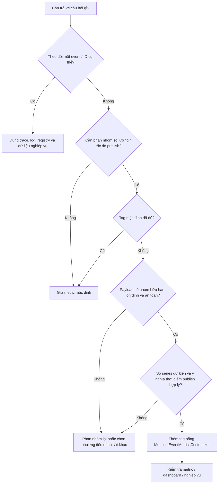
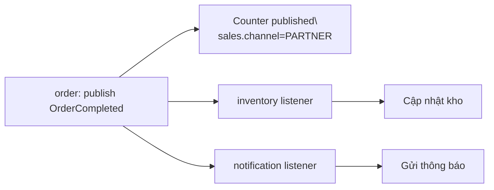

# Khi nào cần thêm tag theo nội dung event

> **Chương:** Event customizer  
> **Module học tập:** `SPRING_MODULITH_DOCUMENTATION_OBSERVABILITY`  
> **Định hướng:** Dùng Spring Modulith để sinh tài liệu ranh giới application module và quan sát tương tác giữa các phần trong ứng dụng Spring Boot. Học module graph, Actuator, event metrics, tracing và context propagation để kiểm chứng kiến trúc mô-đun khi hệ thống vận hành.
>
> **Câu hỏi trọng tâm:** Khi đo một domain event bằng Spring Modulith, lúc nào nên lấy một phần nội dung event làm **metric tag**, lúc nào nên để dữ liệu đó ở **log/trace** hoặc một phép đo nghiệp vụ riêng?

## 1. Tình huống mở đầu: cùng một event, nhiều nhóm kinh doanh

Giả sử hệ thống bán hàng có application module `order` phát ra `OrderCompleted`. Sự kiện mang thông tin: đơn hàng được tạo từ kênh `WEB`, `MOBILE` hay `PARTNER`, loại giao nhận `SHIP` hay `PICKUP`, mã đơn hàng, số tiền và thời điểm hoàn tất.

Spring Modulith đã có thể ghi nhận số lần phát sự kiện `OrderCompleted`. Nhưng nhóm vận hành muốn trả lời câu hỏi: **“Trong 15 phút qua, tốc độ phát sự kiện hoàn tất đơn hàng từ kênh PARTNER có giảm khác thường không?”**

Nếu chỉ có tổng số event của `order`, dashboard khó phân biệt từng kênh. Gắn một tag `sales.channel=WEB|MOBILE|PARTNER` vào **counter riêng của `OrderCompleted`** có thể giúp nhóm kiểm tra chính xác giả thuyết đó.

Ngược lại, nếu cần trả lời **“Đơn hàng có ID 8c41… đi qua listener nào và thất bại ở đâu?”**, không nên thêm `orderId` vào metric tag. Mã đơn gần như duy nhất cho mỗi sự kiện, tạo nhiều time series. Hãy dùng **trace, log có correlation ID và dữ liệu xử lý sự kiện**.

Sự khác nhau nằm ở mục đích:

- **Metric tag:** phân nhóm lượng lớn event theo một số ít giá trị có ý nghĩa để so xu hướng, tỷ lệ và cảnh báo.
- **Trace/log:** điều tra một event, đơn hàng hoặc luồng thực thi cụ thể.
- **Event Publication Registry:** theo dõi tình trạng publication đến transactional listener trong phạm vi được cấu hình.
- **Kiểm tra dữ liệu nghiệp vụ:** xác nhận tác động cuối cùng đã đúng, ví dụ kho đã trừ hoặc hóa đơn đã phát hành.

### Mục tiêu học tập

Sau bài này, người học có thể:

1. Quyết định **có cần** tag lấy từ payload của domain event hay không, dựa trên câu hỏi vận hành cụ thể.
2. Phân biệt tag low cardinality với định danh/giá trị high cardinality và ước tính chi phí số time series.
3. Dùng `ModulithEventMetricsCustomizer` để thêm tag vào counter riêng cho một loại event.
4. Đọc giá trị metric sau tùy biến bằng Spring Boot Actuator, theo đúng tên metric/tag được đăng ký.
5. Tránh nhầm **event published** với **listener processed**, **business outcome** hoặc **transaction committed**.
6. Xây dựng quy trình review, thử nghiệm và kiểm soát thay đổi tag trong hệ thống Spring Boot dùng Spring Modulith.

## 2. Những metric sẵn có trước khi tùy biến

Trong phần hỗ trợ observability, Spring Modulith công bố hai loại **Micrometer Counter** cho domain event publication được instrument:

| Meter name (dạng logic) | Tác dụng | Tag mặc định được tài liệu mô tả |
|---|---|---|
| `module.events.published` | Counter tổng hợp các lần phát domain event | `module.event.type`, `module.identifier`, `module.name` |
| `module.events.published.$moduleIdentifier.$simpleEventTypeName` | Counter riêng cho một event type của một module | `module.identifier`, `module.name`; có thể thêm tag nghiệp vụ |

Ví dụ nếu module identifier là `order` và kiểu event là `OrderCompleted`:

```text
module.events.published
module.events.published.order.OrderCompleted
```

**Không cộng hai counter với nhau** để tính tổng số lần publish. Chúng biểu diễn cùng loại hoạt động ở hai mức phân loại khác nhau. Giá trị `COUNT` là số lần tăng được ghi nhận trong phạm vi registry/process và thời gian quan sát.

Spring Modulith dành cơ chế `ModulithEventMetricsCustomizer` cho việc **tùy biến counter riêng của từng event type**. Vì vậy, trước khi thêm tag, hãy kiểm tra liệu metric/tags mặc định đã trả lời câu hỏi của bạn chưa. Nếu chỉ cần biết module nào phát event nào thì `module.identifier` và `module.event.type` thường đã đủ.

### Ranh giới giữa cấu trúc và runtime

`ApplicationModules`, `Documenter` và `/actuator/modulith` giúp đọc **kiến trúc module** và quan hệ phụ thuộc đã nhận diện; metric trên cho thấy **lượt công bố sự kiện được quan sát**. Một cạnh `inventory → order` trong module graph có thể do consumer tham chiếu kiểu `OrderCompleted` của publisher; counter `OrderCompleted` tăng cho thấy publish được instrument, nhưng vẫn chưa chứng minh listener inventory đã hoàn tất.

## 3. Quy tắc quyết định: khi nào đáng thêm tag?

Một tag từ nội dung event chỉ thực sự hữu ích khi thỏa mãn **đồng thời** các điều kiện:

1. **Có câu hỏi vận hành cụ thể.** Ví dụ muốn so tốc độ `OrderCompleted` giữa `WEB` và `PARTNER`, dùng số liệu này để phát hiện lỗi hoặc đánh giá vận hành.
2. **Giá trị lấy từ event là một nhóm hữu hạn, ổn định.** Ví dụ enum có ba kênh bán hàng; số nhóm phải đủ ít để metric backend xử lý được.
3. **Giá trị tồn tại và có ý nghĩa ngay tại thời điểm publish.** Không dùng tag `consumer.success=true` nếu thành công listener chỉ được biết sau này.
4. **Không lặp lại phân loại đã có.** Nếu đã lọc được `module.identifier=order` thì chưa cần thêm tag thứ hai `source.module=order`.
5. **Chi phí series chấp nhận được** khi kết hợp với những tag đang có và labels ở backend (instance, environment, cluster...).
6. **Không chứa dữ liệu nhạy cảm hoặc định danh cá thể.** Tránh đưa thông tin khách hàng hoặc nội dung tự do lên metric label.
7. **Có người sở hữu và chính sách sử dụng.** Tên tag, các giá trị được phép, dashboard và alert cần được ghi nhận để tránh đổi âm thầm.

Nếu thiếu mục đích sử dụng rõ ràng, đừng thêm tag chỉ vì event có sẵn trường đó.

### Sơ đồ ra quyết định



### Những tình huống nên và không nên

| Dữ liệu từ event | Thêm metric tag? | Giải thích |
|---|---|---|
| `channel=WEB/MOBILE/PARTNER` | **Có thể nên** | Nhóm ít, ổn định, phù hợp dashboard vận hành theo kênh |
| `fulfillment=SHIP/PICKUP` | **Có thể nên** | Nhóm hữu hạn, giúp tìm vấn đề theo loại giao nhận |
| `region=APAC/EMEA/AMER` | **Tùy nhu cầu** | Hữu ích nếu dashboard cần phân biệt vùng; không thêm nếu đã có tag vùng đáng tin cậy |
| `orderId` (UUID) | **Không** | Mỗi đơn tạo giá trị riêng, khiến series tăng theo số đơn |
| `customerId`, email, số điện thoại | **Không** | Cardinality cao và liên quan đến quyền riêng tư |
| `orderAmount=109.95` | **Không dùng giá trị thô** | Có vô số giá trị; cân nhắc bucket cố định nếu thật sự có câu hỏi về dải giá |
| `productSku` hàng triệu loại | **Thường không** | Số nhóm lớn, thay đổi theo catalog |
| `errorMessage` hoặc URL tự do | **Không** | Giá trị không giới hạn và có thể chứa dữ liệu nhạy cảm |
| `eventType=OrderCompleted` | **Thường không cần** | Tên counter riêng đã chứa event type; counter tổng hợp có tag loại event |
| `listenerStatus=SUCCESS` tại thời điểm publish | **Không** | Trạng thái listener chưa được biết khi event vừa phát |
| `paymentMethod=CARD/CASH/BANK_TRANSFER` | **Có thể** | Chỉ khi event chứa loại thanh toán đã được xác định và dashboard thực sự cần |

**Điều kiện cốt lõi:** giá trị tag phải thể hiện *thuộc tính của event tại thời điểm nó được ghi nhận*, với một tập giá trị được kiểm soát. Nó không nên mạo nhận kết quả của bước xử lý phía sau.

## 4. Cardinality: lý do phải tiết chế số tag

Micrometer xác định một meter bằng **tên + tập tag**. Hai counter cùng tên nhưng có tag khác nhau là hai chuỗi đo có định danh khác nhau. Khi dữ liệu được xuất sang Prometheus hoặc hệ thống tương tự, mỗi tổ hợp labels tạo thêm một time series.

Giả sử muốn gắn ba thuộc tính lên `OrderCompleted`:

| Tag | Số giá trị hợp lệ |
|---|---:|
| `sales.channel` | 3 |
| `sales.fulfillment` | 2 |
| `sales.region` | 5 |
| **Tổ hợp tối đa cho một meter/event type** | **3 × 2 × 5 = 30** |

Con số **30** là *giới hạn kết hợp lý thuyết* nếu mọi tổ hợp đều xuất hiện. Trong thực tế có thể ít hơn. Tuy nhiên, backend còn gắn nhãn instance/pod, job, environment...; ví dụ cùng 30 tổ hợp trên **8 instance** tạo tối đa khoảng **240 series** cho một metric ở cùng phạm vi thu thập, trước khi tính các label khác.

Nếu tiếp tục thêm `orderId` có khoảng 200.000 giá trị, số tổ hợp tiềm năng tăng đột biến. Hệ thống có thể gặp:

- Bộ nhớ/CPU và số meter trong ứng dụng tăng.
- Chi phí lưu trữ, mạng và truy vấn backend tăng.
- Dashboard chậm hoặc query trả quá nhiều series.
- Khó xây alert ổn định khi nhãn thay đổi liên tục.

**Cardinality không chỉ là số giá trị của từng tag riêng lẻ.** Cần xem **tích số tổ hợp** với toàn bộ tag hiện có và nhãn gắn ở hệ thống giám sát.

### Chuẩn hóa thay vì dùng giá trị thô

Nếu nghiệp vụ cần xem các mức giá trị đơn hàng, dùng bucket cố định, có ý nghĩa:

```text
Dữ liệu gốc: 17.50, 85.00, 356.00, 928.00, ...
Tag cân nhắc: amount.band=LOW|MID|HIGH
```

Đặt ranh giới bucket theo nhu cầu nghiệp vụ, phiên bản và đơn vị tiền tệ rõ ràng. Một bucket tự tạo có thể làm mất chi tiết; nếu mục tiêu là **phân bố giá trị**, hãy cân nhắc `DistributionSummary` hoặc histogram đúng ngữ nghĩa hơn thay vì chỉ đếm số event theo bucket.

Với dữ liệu không thuộc enum, bắt buộc có lớp chuẩn hóa:

```java
static String normalizeChannel(String raw) {
    if (raw == null) {
        return "UNKNOWN";
    }

    return switch (raw.trim().toUpperCase(java.util.Locale.ROOT)) {
        case "WEB" -> "WEB";
        case "MOBILE" -> "MOBILE";
        case "PARTNER" -> "PARTNER";
        default -> "OTHER";
    };
}
```

Hàm trên giới hạn tag tối đa ở năm giá trị, bao gồm `UNKNOWN` và `OTHER`. **Không** dùng mặc định `raw` khi gặp giá trị lạ vì sẽ phá ràng buộc cardinality.

## 5. Ví dụ event: mô hình hóa thuộc tính có thể phân nhóm

Ví dụ trong application module `order`, sự kiện `OrderCompleted` có ID phục vụ correlation, kênh bán hàng và loại giao nhận:

```java
// src/main/java/com/acme/shop/order/OrderCompleted.java
package com.acme.shop.order;

import java.util.Objects;
import java.util.UUID;

public record OrderCompleted(
        UUID orderId,
        Channel channel,
        Fulfillment fulfillment) {

    public OrderCompleted {
        Objects.requireNonNull(orderId, "orderId");
        Objects.requireNonNull(channel, "channel");
        Objects.requireNonNull(fulfillment, "fulfillment");
    }

    public enum Channel {
        WEB, MOBILE, PARTNER
    }

    public enum Fulfillment {
        SHIP, PICKUP
    }
}
```

Hai trường `channel` và `fulfillment` là enum ít giá trị và được gắn vào sự kiện ngay khi phát. `orderId` vẫn có trong event để giải quyết nghiệp vụ/correlation, nhưng không được chuyển thành metric tag.

Ví dụ publisher:

```java
// src/main/java/com/acme/shop/order/OrderManagement.java
package com.acme.shop.order;

import org.springframework.context.ApplicationEventPublisher;
import org.springframework.stereotype.Service;

import java.util.UUID;

@Service
public class OrderManagement {

    private final ApplicationEventPublisher publisher;

    public OrderManagement(ApplicationEventPublisher publisher) {
        this.publisher = publisher;
    }

    public void complete(
            UUID orderId,
            OrderCompleted.Channel channel,
            OrderCompleted.Fulfillment fulfillment) {

        // Trong ứng dụng thật: kiểm tra và ghi trạng thái đơn hàng.
        publisher.publishEvent(new OrderCompleted(
                orderId, channel, fulfillment));
    }
}
```

Đoạn mã là **minh họa tối thiểu**. Cơ chế transactional event publication, database commit và xử lý đơn hàng thật cần được thiết kế riêng. Số metric publish không chứng minh đã có giao dịch thành công hoặc listener hoàn tất.

## 6. Triển khai `ModulithEventMetricsCustomizer` đúng phạm vi

### 6.1. Dependency cần có

Giả sử dự án đã quản lý phiên bản Spring Modulith bằng BOM tương thích với Spring Boot, Gradle có thể cấu hình:

```groovy
dependencies {
    // Actuator + observability cho ứng dụng khi chạy.
    runtimeOnly "org.springframework.modulith:spring-modulith-starter-insight"

    // Cần để mã Java ứng dụng biên dịch được Customizer SPI.
    implementation "org.springframework.modulith:spring-modulith-observability-api"
}
```

`spring-modulith-starter-insight` đưa hỗ trợ observability vào runtime classpath. `spring-modulith-observability-api` cần ở compile classpath **nếu mã nguồn trực tiếp import** `ModulithEventMetricsCustomizer`. Nếu dự án khai báo dependency theo cách khác, hãy xác nhận phiên bản và các thư viện thực sự được resolve.

Không phải mọi phiên bản Spring Modulith đều có cùng cách tách artifact. API này được Javadoc hiện hành ghi nhận từ dòng **1.4**; hướng dẫn code dưới đây đối chiếu Javadoc dòng **2.2.0**. Nếu dùng version khác, cần xem tài liệu của đúng phiên bản.

### 6.2. Đăng ký bean cấu hình

```java
// src/main/java/com/acme/shop/config/EventMetricConfiguration.java
package com.acme.shop.config;

import com.acme.shop.order.OrderCompleted;
import org.springframework.context.annotation.Bean;
import org.springframework.context.annotation.Configuration;
import org.springframework.modulith.observability.ModulithEventMetricsCustomizer;

@Configuration
class EventMetricConfiguration {

    @Bean
    ModulithEventMetricsCustomizer orderCompletedMetricTags() {

        return metrics -> metrics.customize(
                OrderCompleted.class,
                (event, builder) -> {
                    builder.tags(
                            "sales.channel",
                            event.channel().name());

                    builder.tags(
                            "sales.fulfillment",
                            event.fulfillment().name());
                }
        );
    }
}
```

Giải thích:

- `@Bean` đưa customizer vào Spring ApplicationContext để Spring Modulith lấy cấu hình khi khởi tạo metric instrumentation.
- `metrics.customize(OrderCompleted.class, ...)` chỉ nhắm **counter riêng cho loại event** `OrderCompleted`.
- Hàm nhận event thật và `io.micrometer.core.instrument.Counter.Builder`; nó thêm tags vào builder trước khi metric được ghi nhận.
- `event.channel().name()` chỉ sinh một trong ba giá trị `WEB`, `MOBILE`, `PARTNER`.
- `event.fulfillment().name()` chỉ sinh một trong hai giá trị `SHIP`, `PICKUP`.
- Kết hợp hai tags tạo nhiều nhất **3 × 2 = 6** phân nhóm cho counter event này, chưa tính các nhãn khác.

**Giữ hàm tùy biến nhẹ, thuần và dễ dự đoán:** lấy giá trị đã có trên event, không gọi database, REST API hay phép tính nặng để tạo tag. Việc thu thập telemetry phải tránh gây tác dụng phụ và lỗi cho đường xử lý nghiệp vụ.

### 6.3. Vì sao customizer chọn event class thay vì tên metric?

API `ModulithEventMetricsCustomizer` nhận một đối tượng `ModulithEventMetrics`; từ đó `customize(Class<T>, BiConsumer<T, Counter.Builder>)` gắn cấu hình theo **loại event Java**. Nhờ vậy, đoạn code mô tả rõ logic phân nhóm từ chính payload của sự kiện đó, không tự dựng lại tên counter thủ công.

Javadoc cũng định nghĩa overload:

```java
<T> ModulithEventMetrics customize(
        Class<T> type,
        java.util.function.Function<
                T, io.micrometer.core.instrument.Counter.Builder> factory);
```

Overload `Function` cho phép tùy chỉnh cách **tạo Counter.Builder**; overload `BiConsumer` chỉnh builder đã được tạo. Nếu yêu cầu chỉ là **thêm tags**, dùng `BiConsumer` là đủ và đơn giản hơn. Không cần tự xây `Counter` riêng với cùng tên hoặc thay thế bộ instrument hiện tại.

### 6.4. Không nhầm với `ModulithObservationConvention`

`ModulithObservationConvention` là extension point của **observation cho module invocation**, ví dụ mô tả tên/context của lời gọi vào ranh giới module. Nó có mục đích khác `ModulithEventMetricsCustomizer`.

| Cần làm gì? | Công cụ phù hợp |
|---|---|
| Thêm `sales.channel` từ payload `OrderCompleted` vào event counter riêng | `ModulithEventMetricsCustomizer` |
| Tùy biến cách mô tả observation khi đi vào application module | `ModulithObservationConvention` |
| Đếm business outcome sau khi listener cập nhật kho thành công | Một phép đo tại điểm **hoàn tất xử lý** hoặc dữ liệu registry thích hợp |
| Theo dõi event ID cụ thể | Log/trace có correlation và giới hạn dữ liệu |

Đặc biệt, customizer cho event metrics **không tạo span riêng cho từng event**; nó cấu hình counter. Không dùng nó để thay thế tracing hoặc context propagation.

## 7. Đọc metric sau khi thêm tag bằng Actuator

### 7.1. Expose endpoint trong môi trường thử nghiệm

Trong ứng dụng Spring Boot web đã có hỗ trợ Actuator, đặt cấu hình phù hợp:

```yaml
management:
  endpoints:
    web:
      exposure:
        include: "health,info,metrics,modulith"
```

Theo mặc định, nhiều phiên bản Spring Boot chỉ expose `health` qua HTTP. Muốn xem `metrics` cần cấu hình exposure, đồng thời đáp ứng điều kiện endpoint hoạt động, quyền truy cập, web server và đúng management port/base path.

Gọi:

```bash
curl -i http://localhost:8080/actuator/metrics
```

Nếu counter riêng đã được đăng ký từ event thực tế và module identifier là `order`, danh sách `names` có thể chứa:

```json
{
  "names": [
    "module.events.published",
    "module.events.published.order.OrderCompleted"
  ]
}
```

Đây là **payload minh họa rút gọn**; ứng dụng thực tế còn nhiều meter khác. Khi mới khởi động mà chưa có event được instrument, counter có thể chưa xuất hiện.

### 7.2. Xem counter theo event type

```bash
curl -s http://localhost:8080/actuator/metrics/module.events.published.order.OrderCompleted
```

Ví dụ sau khi chạy một số event:

```json
{
  "name": "module.events.published.order.OrderCompleted",
  "measurements": [
    { "statistic": "COUNT", "value": 9.0 }
  ],
  "availableTags": [
    {
      "tag": "sales.channel",
      "values": ["WEB", "MOBILE", "PARTNER"]
    },
    {
      "tag": "sales.fulfillment",
      "values": ["SHIP", "PICKUP"]
    },
    {
      "tag": "module.identifier",
      "values": ["order"]
    }
  ]
}
```

**Không coi ví dụ này là schema bắt buộc của mọi version.** Những field như `description`, `baseUnit`, `module.name` có thể có thêm; giá trị COUNT và availableTags phản ánh những series thực sự đã được ghi nhận.

### 7.3. Lọc theo tag

Ví dụ xem riêng event của kênh `PARTNER`:

```bash
curl -G \
  --data-urlencode "tag=sales.channel:PARTNER" \
  "http://localhost:8080/actuator/metrics/module.events.published.order.OrderCompleted"
```

Lọc hai tag đồng thời:

```bash
curl -G \
  --data-urlencode "tag=sales.channel:PARTNER" \
  --data-urlencode "tag=sales.fulfillment:SHIP" \
  "http://localhost:8080/actuator/metrics/module.events.published.order.OrderCompleted"
```

Endpoint Actuator nhận các tham số `tag=key:value`, có thể nhiều lần; giá trị trả về là kết quả tổng hợp trên những meter khớp điều kiện lọc. Nếu query trả rỗng, hãy kiểm tra **tên metric, availableTags, giá trị tag, event đã được phát hay chưa và endpoint có cho phép truy cập**.

**Đừng tự thay tên meter thành Prometheus naming convention** khi gọi `/actuator/metrics`; API này dùng tên meter logic của Micrometer. Cách chuyển dấu chấm sang dấu gạch dưới và hậu tố như `_total` chỉ áp dụng ở exporter/backend tương ứng.

## 8. Thực nghiệm: chứng minh tag đáp ứng câu hỏi ban đầu

Giả sử trong một môi trường thử nghiệm ít traffic, nhóm phát 10 sự kiện `OrderCompleted`:

| Kênh | SHIP | PICKUP | Tổng |
|---|---:|---:|---:|
| WEB | 3 | 2 | 5 |
| MOBILE | 1 | 2 | 3 |
| PARTNER | 2 | 0 | 2 |
| **Tổng** | **6** | **4** | **10** |

Trong trường hợp **tất cả 10 sự kiện đều được instrumentation ghi nhận, không có publish khác và không restart ứng dụng**, giá trị chênh lệch của counter riêng theo từng tag nên phản ánh phân bố trên.

Các bước thực hiện:

1. Chạy ứng dụng với dependency observability, bean customizer, endpoint `metrics` và cấu hình quyền truy cập phù hợp.
2. Ghi baseline `module.events.published.order.OrderCompleted` trước khi phát loạt event; nếu meter chưa có, xem đó là baseline 0 của thử nghiệm.
3. Phát event có dữ liệu thử riêng: 5 WEB, 3 MOBILE, 2 PARTNER; ghi lại chính xác các cặp `channel/fulfillment`.
4. Gọi metric tổng, sau đó lọc `sales.channel` và tổ hợp `sales.channel + sales.fulfillment`.
5. Đối chiếu **độ tăng**, không chỉ số tuyệt đối, vì registry có thể chứa dữ liệu của các lượt trước.
6. Gây lỗi có kiểm soát trong listener; xác nhận counter publish vẫn chỉ mô tả lượt phát, không phải trạng thái thành công của consumer.
7. Khi có nhiều instance, ghi rõ instance và khoảng thời gian; nếu dùng backend chung, kiểm tra query có cộng các series nhiều pod đúng hay không.

### Cần chứng minh điều gì?

- **Đúng ngữ nghĩa:** 10 lượt publish được instrument thì phân nhóm cộng lại thành 10 theo phạm vi thử nghiệm; không tự tăng theo số listener.
- **Đúng số tag:** với hai enum, số tổ hợp tiềm năng bị giới hạn ở 6.
- **Đúng hành vi:** event vẫn được phát và listener vẫn hoạt động như trước khi thêm telemetry.
- **Đúng yêu cầu vận hành:** có thể trả lời câu hỏi “tốc độ OrderCompleted từ PARTNER là bao nhiêu?” mà không cần tạo một series cho mỗi order ID.

## 9. Tag event không cho biết consumer thành công

Xét một `OrderCompleted(channel=PARTNER, fulfillment=SHIP)` được module `order` phát. Có hai listener: `inventory` và `notification`.



Một lượt publish có thể làm tăng counter riêng theo `PARTNER` một lần, trong khi:

- Listener `inventory` chạy thành công.
- Listener `notification` có thể chạy sau, lỗi hoặc retry.
- Event publication đến listener có thể được Event Publication Registry theo dõi **nếu backend registry và listener phù hợp đã được cấu hình**.
- Kết quả cuối cùng như “kho đã được cập nhật” cần dữ liệu nghiệp vụ để xác minh.

**Không thêm tag `processed=SUCCESS` vào counter `published` dựa trên suy đoán.** Trạng thái thành công có thể chỉ được xác định **sau** khi event được xử lý; đặt nó lên publish metric là sai thời điểm và dễ gây diễn giải sai.

Nếu yêu cầu là **“Bao nhiêu listener xử lý thành công theo channel?”**, cần đo ở điểm listener thực sự hoàn thành, dùng registry hoặc metric nghiệp vụ riêng. Khi đó cũng phải phân biệt completion của listener với tác động cuối cùng lên hệ thống bên ngoài.

### Retry và nhiều listener

| Sự kiện runtime | Counter publish được instrument | Điều cần xem thêm |
|---|---|---|
| Một event, ba listener | Có thể tăng một lượt publish | Cả ba listener đã chạy/hoàn tất? |
| Listener thất bại rồi retry, không publish lại | Không mặc nhiên tăng thêm do retry | Publication state, retry log |
| Request nghiệp vụ bị gọi lại và phát event mới | Có thể tăng theo lượt publish mới | Idempotency, correlation, transaction |
| Transaction rollback sau khi gọi publish | Counter publish không đủ để khẳng định commit | Trạng thái DB, transaction log |
| Một event khác loại được phát | Counter riêng `OrderCompleted` không đại diện event đó | Tên meter và loại event đúng |

Cấu hình observability và phạm vi domain event có thể thay đổi giữa các phiên bản, nên hãy gắn kết luận với build/instance/khung thời gian thực tế.

## 10. Khi nào chọn giải pháp khác thay vì thêm tag?

### 10.1. Cần xem một đơn hàng hoặc người dùng cụ thể

Dùng correlation ID trong trace/log (có kiểm soát quyền truy cập) và tra cứu trạng thái dữ liệu/registry. Không tạo metric series theo `orderId`, `customerId` hoặc email.

### 10.2. Cần biết dải giá trị số tiền, thời gian xử lý hoặc phân vị

Counter kèm tag thích hợp để **đếm** theo một vài loại, không đo phân phối liên tục. Nếu muốn xem p95 thời gian thanh toán, dùng `Timer`; nếu cần phân bố giá trị, cân nhắc `DistributionSummary`/histogram. Tránh dùng tag `latencyMs=... ` cho từng request.

### 10.3. Cần kết quả sau một bước bất đồng bộ

Thực hiện phép đo ở **listener completion**, publication registry hoặc bước nghiệp vụ quyết định kết quả. Không thể lấy giá trị `listenerStatus` chưa tồn tại để gắn lên event lúc publish.

### 10.4. Cần chỉ biết event type/module

Dùng metric tổng hợp và tag mặc định hoặc counter riêng đã có. Tránh nhân bản `module`, `eventType` bằng tên tag custom mới.

### 10.5. Cần phân loại nhưng trường event chứa vô số giá trị

Áp dụng bucket/enum quy chuẩn, bỏ giá trị chi tiết hoặc dùng log/trace. Chỉ thêm tag sau khi có quy tắc chuẩn hóa và kiểm thử.

### 10.6. Cần thay đổi tên, mô tả hoặc tags của module invocation span

Đó là phạm vi của observation convention, không phải customizer event counter. Hai cơ chế giải quyết hai vấn đề khác nhau.

## 11. Nguyên tắc thiết kế tag bền vững

### 11.1. Tên phải mô tả đúng nghĩa

`sales.channel` là kênh bán hàng tại thời điểm `OrderCompleted` được công bố. Đừng đặt `source=ok` hay `result=success` nếu không nói rõ *thành công ở giai đoạn nào*. Nếu tên mơ hồ, người viết dashboard dễ dùng sai.

### 11.2. Giá trị phải ổn định qua các phiên bản

Nếu `WEB` đổi thành `ONLINE` ở phiên bản mới, dashboard lọc `WEB` sẽ mất dữ liệu dù hành vi nghiệp vụ không đổi. Nên có hợp đồng tên tag và tập giá trị được hỗ trợ; khi thay đổi, cập nhật query/alert đồng thời và lưu ý dữ liệu lịch sử.

### 11.3. Sử dụng enum hoặc mapping hữu hạn

Nếu payload lấy trực tiếp từ request bên ngoài, các giá trị `web`, `Web`, `WEB` và chuỗi rác có thể bị xem là nhiều nhãn khác nhau. Chuẩn hóa trước khi ghi metric; giữ các nhóm `UNKNOWN` và `OTHER` với quy tắc nhất quán.

### 11.4. Tránh thông tin cá nhân hoặc bí mật

Ngay cả tag ít cardinality cũng có thể nhạy cảm nếu mô tả một thuộc tính cá nhân không cần cho giám sát. Chỉ đưa dữ liệu tối thiểu cần thiết cho mục tiêu vận hành vào hệ thống metrics, xem xét quyền truy cập và thời gian lưu giữ.

### 11.5. Hạn chế số tag trên một meter

Thêm một tag hữu hạn vẫn nhân số tổ hợp với các tags khác. Khi review, yêu cầu báo rõ **cardinality tối đa**, số instance và dashboard nào sẽ dùng nhãn.

### 11.6. Giữ thống nhất semantic publish

Nếu event có `sales.channel=PARTNER`, counter chỉ cho biết số lượt publish được instrument theo kênh đó. Đừng đổi tên thành “đơn PARTNER xử lý thành công” trong dashboard khi chưa có phép đo completion tương ứng.

### 11.7. Không tạo observation trùng

Nếu Spring Modulith đã instrument việc publish, không tự tăng thêm một counter có tên/tags đồng nghĩa ở cùng dòng code chỉ để thêm chiều `sales.channel`. Dùng đúng SPI customizer, rồi kiểm tra số lần metric tăng.

## 12. Kiểm soát nguy cơ tăng series

Có thể sử dụng một số cơ chế của Micrometer để phát hiện/bảo vệ khi tag vô tình bùng nổ:

- **Theo dõi số lượng meter/series** theo tên và nhóm metric quan trọng; kiểm tra sau deploy.
- **`HighCardinalityTagsDetector`** có thể giúp phát hiện meter name có quá nhiều tổ hợp tag. Nó phát hiện dấu hiệu high cardinality qua số meter; không chứng minh tag nào gây ra hay phát hiện mọi trường hợp như random suffix trong **tên metric**.
- **`MeterFilter.replaceTagValues`** có thể nhóm giá trị về một tập hữu hạn nếu không thể sửa ngay nơi instrument.
- **`MeterFilter.maximumAllowableTags`** có thể đặt giới hạn phòng vệ khi chưa sửa được nguồn phát.

Những biện pháp này là **lớp bảo vệ bổ sung**, không thay thế thiết kế tag đúng ngay từ event/customizer. Ví dụ rủi ro nhất là thêm tag `orderId`, sau đó hy vọng filter cứu chi phí backend; việc đo theo ID từ đầu đã không phù hợp với metrics.

### Đánh giá thay đổi tag trước khi merge

| Câu hỏi review | Ví dụ câu trả lời đạt |
|---|---|
| Dashboard nào cần tag mới? | Tốc độ OrderCompleted theo kênh bán hàng |
| Giá trị tag đến từ đâu? | Enum `OrderCompleted.Channel` đã có khi publish |
| Có bao nhiêu giá trị? | 3 giá trị cố định |
| Kết hợp với tag khác tăng bao nhiêu series? | Tối đa 3 × 2 nhóm trên mỗi event counter, trước labels backend |
| Có chứa ID/cá nhân/bí mật không? | Không |
| Có làm sai semantic published không? | Không; chỉ nhóm lượt publish |
| Có kế hoạch kiểm thử và theo dõi sau deploy không? | Có; so baseline/delta theo từng nhóm |
| Nhóm nào sở hữu tag và query? | Nhóm phụ trách observability/đơn hàng |

## 13. Lỗi thường gặp và cách khắc phục

| Hiện tượng | Nguyên nhân có thể | Hướng kiểm tra |
|---|---|---|
| `/actuator/metrics` trả 404 | Chưa expose metrics, thiếu Actuator, sai port/base path | Kiểm tra dependency, exposure, management access |
| Không thấy `module.events.published.order.OrderCompleted` | Event chưa được instrument hoặc module identifier khác ví dụ | Phát event có kiểm soát, đọc `/actuator/metrics`, xem module detection |
| Counter có nhưng không có `sales.channel` | Customizer bean không được quét, thiếu API/observability runtime, event type không khớp | Xem startup config, bean và counter riêng đúng |
| `sales.channel` có `web` và `WEB` | Payload/normalizer không ổn định | Chuẩn hóa enum/mapping trước khi ghi |
| Quá nhiều series | Tag chứa ID hoặc nhiều giá trị tự do, hoặc kết hợp quá nhiều tags | Loại ID, bucket hóa và xem toàn bộ label dimensions |
| Giá trị COUNT không bằng số request | Request có thể phát 0, 1 hoặc nhiều events; counter tích lũy | Log publish, baseline/delta và lọc đúng event |
| Metric reset sau deploy | Counter nằm ở process mới | Dùng rate/increase ở backend với thông tin instance |
| Trace không thấy listener dù metric có giá trị | Sampling, exporter, instrumentation, context propagation hoặc listener thực sự chưa chạy | Đối chiếu log, registry và cấu hình tracing |
| Counter publish tăng nhưng kho chưa đổi | Publication ≠ xử lý thành công | Xem Event Publication Registry, listener log, DB |
| Alert không chạy sau khi đổi giá trị enum | Dashboard/query đang lọc label cũ | Cập nhật hợp đồng tags và điều chỉnh alert |
| Metric tên khác trong Prometheus | Exporter chuẩn hóa meter name/tag names | Đọc output Prometheus thật và phân biệt tên Actuator |
| Thêm customizer nhưng compile lỗi | `spring-modulith-observability-api` không có trên compile classpath hoặc khác API version | Kiểm tra dependency và API Javadoc đúng version |

Một endpoint hoạt động vẫn không chứng minh luồng nghiệp vụ đúng; mọi phép chẩn đoán cần gắn với build, thời gian, kịch bản và phạm vi quan sát cụ thể.

## 14. Bài tập áp dụng

**Bài A — Chọn tag phù hợp.** Module `payment` phát `PaymentCaptured` chứa `paymentId`, `provider` (`BANK_A`, `BANK_B`, `OTHER`), `amount`, `customerEmail`. Nhóm muốn theo dõi lỗi giảm lượng thanh toán ở `BANK_B`.

*Gợi ý:* `provider` có thể là tag phù hợp **nếu** counter đo đúng sự kiện cần theo dõi. Không dùng `paymentId`, email hoặc amount thô. Nếu nhóm hỏi “số thanh toán được xử lý thành công”, phải bảo đảm `PaymentCaptured` thực sự mang nghĩa captured, chứ không dùng metric của event trước khi xử lý.

**Bài B — Dự toán cardinality.** Một event counter đang có `channel` 4 giá trị và `region` 6 giá trị, muốn thêm `tier` 5 giá trị. Có thể có tối đa bao nhiêu tổ hợp?

*Gợi ý:* `4 × 6 × 5 = 120` tổ hợp event tags cho một metric name nếu tất cả xuất hiện. Tiếp tục tính labels instance/env của backend để ước lượng tổng chuỗi.

**Bài C — Phân tích sai semantics.** Event `OrderCompleted` phát lúc 10:00, listener cập nhật tồn kho lúc 10:01. Nhóm muốn gắn `stock.updated=true` vào metric publish tại 10:00.

*Gợi ý:* Không thể ghi nhận một kết quả chưa xảy ra ở thời điểm publish. Tạo phép đo/quan sát tại listener completion hoặc xem registry/dữ liệu tương ứng.

**Bài D — Đọc Actuator.** Sau khi customizer thêm `sales.channel`, `GET /actuator/metrics/module.events.published.order.OrderCompleted` trả `COUNT=30` và `availableTags.sales.channel=[WEB,MOBILE,PARTNER]`. Query lọc `tag=sales.channel:PARTNER` trả `COUNT=8`.

*Gợi ý:* Trong phạm vi registry và thời gian quan sát đó, 8 lượt publish được instrument có nhãn PARTNER. Không suy ra có 8 đơn hàng commit hoặc 8 listener hoàn thành.

**Bài E — Review yêu cầu.** Có đề xuất thêm `productSku` với 80.000 giá trị vì muốn biết SKU nào bị hoàn tiền nhiều nhất.

*Gợi ý:* Với nhu cầu phân tích từng SKU, metrics tag thường không hợp lý. Xem báo cáo nghiệp vụ/OLAP hoặc phân nhóm nhóm hàng hữu hạn; giữ trace/log cho điều tra từng giao dịch.

### Câu hỏi tự kiểm tra

**1.** Khi đã có `module.identifier` và `module.event.type`, có nên thêm `eventClass` cùng nội dung?

**Đáp án:** Thường không; tag trùng nghĩa làm tăng độ phức tạp và có thể tăng series mà không bổ sung khả năng phân tích.

**2.** `ModulithEventMetricsCustomizer` có chỉnh `module.events.published` tổng hợp theo cùng cách với counter riêng không?

**Đáp án:** Tài liệu Spring Modulith mô tả nó là SPI để bổ sung tags cho **individual event metrics**. Không giả định bean đó tùy biến cả counter tổng hợp.

**3.** Vì sao tag `channel` là phương án tốt hơn `orderId`?

**Đáp án:** Channel có vài giá trị ổn định và hỗ trợ phân tích xu hướng; orderId gần như duy nhất cho từng đơn, có cardinality cao và phù hợp correlation hơn.

**4.** Nếu một event được phát nhưng listener thất bại, counter có tag `sales.channel=PARTNER` có được tăng không?

**Đáp án:** Có thể tăng nếu publish đã được instrument. Trạng thái listener là một giai đoạn khác và không được phản ánh bởi metric published.

**5.** Tại sao một tag enum ít giá trị vẫn cần review?

**Đáp án:** Khi kết hợp với nhiều tag khác và instance labels, số tổ hợp nhân lên; ngoài ra cần kiểm tra semantic, tính ổn định, quyền riêng tư và giá trị vận hành.

## 15. Tóm tắt thực hành

**Chỉ lấy nội dung event làm metric tag khi muốn phân nhóm số lượt publish bằng những nhãn hữu hạn, ổn định, an toàn và thực sự phục vụ quyết định vận hành.**

Trong Spring Modulith:

- Counter tổng hợp đã có thông tin module và event type; counter riêng có thể bổ sung tags qua `ModulithEventMetricsCustomizer`.
- Dùng `customize(OrderCompleted.class, (event, builder) -> { ... })` với enum/normalizer để tránh uncontrolled values.
- Giữ `orderId`, `customerId` và dữ liệu chi tiết ở những nguồn correlation phù hợp; không cho vào meter tags.
- Tính cardinality theo **tổ hợp** tag và labels backend, không chỉ từng tag riêng lẻ.
- Phân biệt **published**, **listener completed**, **transaction committed** và **business outcome correct**.
- Đọc `/actuator/metrics` trước/sau một kịch bản thử nghiệm có kiểm soát; so delta và availableTags để xác nhận tag đang hoạt động.

## Tài liệu tham khảo

1. [Spring Modulith Reference — Production-ready Features](https://docs.spring.io/spring-modulith/reference/production-ready.html) — Hai event counters, tags mặc định và ví dụ `ModulithEventMetricsCustomizer`.
2. [Spring Modulith Javadoc — ModulithEventMetricsCustomizer](https://docs.spring.io/spring-modulith/docs/current/api/org/springframework/modulith/observability/ModulithEventMetricsCustomizer.html) — SPI dành cho tùy biến metrics.
3. [Spring Modulith Javadoc — ModulithEventMetrics](https://docs.spring.io/spring-modulith/docs/current/api/org/springframework/modulith/observability/ModulithEventMetrics.html) — Hai overload `customize(Class<T>, ...)`.
4. [Spring Boot Reference — Metrics](https://docs.spring.io/spring-boot/reference/actuator/metrics.html) — Micrometer và `/actuator/metrics`.
5. [Micrometer — High Cardinality Tags Detector](https://docs.micrometer.io/micrometer/reference/concepts/high-cardinality-tags-detector.html) — Rủi ro và công cụ phát hiện nhãn nhiều giá trị.
6. [Micrometer — Meter Filters](https://docs.micrometer.io/micrometer/reference/concepts/meter-filters.html) — Normalize/giới hạn tags ở MeterRegistry.
7. [Micrometer — Counters](https://docs.micrometer.io/micrometer/reference/concepts/counters.html) — Ý nghĩa Counter và cách xem tốc độ thay vì số tuyệt đối.
8. [Spring Modulith Reference — Working with Application Events](https://docs.spring.io/spring-modulith/reference/events.html) — Event publication, listener, Event Publication Registry.

