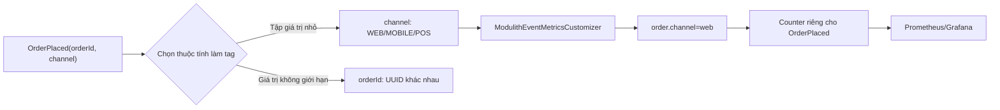

# Chuyển thuộc tính event thành tag

Trong ứng dụng Spring Boot được tổ chức bằng **Spring Modulith**, một module có thể phát nhiều domain event để các module khác phản ứng. Ví dụ module `order` phát `OrderPlaced` khi đơn hàng được đặt, còn `notification` nhận sự kiện để gửi thông báo. Biết **số lượng** `OrderPlaced` được phát là hữu ích, nhưng đôi khi nhóm vận hành còn muốn biết các đơn hàng đó đến từ **kênh web, ứng dụng di động hay cửa hàng**.

Tính năng **event metrics customizer** của Spring Modulith cho phép chuyển một **thuộc tính có tập giá trị giới hạn** của event thành **tag (label)** trên Micrometer Counter tương ứng với loại event. Khi đó Prometheus/Grafana có thể thống kê tốc độ phát event theo kênh mà không cần tạo metric thủ công cho từng giá trị.

Bài thuộc chương **Event customizer** của học phần `SPRING_MODULITH_DOCUMENTATION_OBSERVABILITY`. Học phần dùng Spring Modulith để sinh tài liệu ranh giới application module, kết hợp module graph, Actuator, event metrics, tracing và context propagation để kiểm chứng cách các module tương tác khi ứng dụng Spring Boot vận hành. Ở đây, ta tập trung vào **chuyển thuộc tính event thành tag một cách có kiểm soát và kiểm chứng được**.

Sau bài học, bạn có thể:

- Giải thích quan hệ giữa **event**, **Counter**, **tag key/value** và **time series**.
- Phân biệt counter tổng hợp `module.events.published` với counter riêng cho từng loại event.
- Đăng ký bean `ModulithEventMetricsCustomizer` và gắn tag vào `Counter.Builder` dựa trên dữ liệu của một event class.
- Chọn, chuẩn hóa, giới hạn các giá trị tag để tránh **high cardinality** và rò rỉ dữ liệu.
- Kiểm tra tag qua Spring Boot Actuator và hệ thống Prometheus/Grafana.
- Đánh giá đúng giới hạn: counter đo lần **phát sự kiện**, không tự xác nhận listener đã xử lý thành công.

> **Phạm vi ví dụ:** Spring Modulith **1.4.x**, nơi `ModulithEventMetricsCustomizer` và `ModulithEventMetrics` có API gắn tag cho counter sự kiện. Ví dụ dùng Java và Spring Boot tương thích với dòng Modulith đã chọn. Spring Modulith 2.x có thể tách artifact observability API khác 1.4.x; cần đối chiếu đúng BOM và Javadoc trước khi sao chép dependency.

## 1. Từ event trong code đến metric trên dashboard

Giả sử `OrderPlaced` chứa hai loại thông tin:

1. `orderId` dùng để định danh **một đơn hàng cụ thể**.
2. `channel` là kênh tạo đơn hàng với ba giá trị `WEB`, `MOBILE` và `POS`.

Event được phát từ module `order`:

```text
OrderPlaced(
  orderId = "f0c3...9a17",
  channel = WEB
)
```

Nếu theo dõi metric theo kênh, ta muốn có những series như:

```text
order.channel=web
order.channel=mobile
order.channel=pos
```

Đây là ba giá trị cố định, thuận tiện để nhóm và tổng hợp dữ liệu. Ngược lại, nếu lấy `orderId` làm tag, mỗi đơn hàng có thể tạo ra một tổ hợp label mới; với hàng triệu đơn hàng, số series tăng mạnh và gây chi phí cao.



Customizing tag là thao tác ở **lớp quan sát**. Nó không thay đổi payload của sự kiện đã được phát và không tự chuyển sự kiện thành một message trên broker. Người nhận event vẫn xử lý đối tượng nghiệp vụ thông qua cơ chế event đã có.

## 2. Hai loại event metrics và vị trí customizer tác động

Tài liệu Spring Modulith mô tả hai dạng counter được tạo để ghi nhận domain events:

| Metric | Mục đích | Đặc điểm liên quan đến customizer |
| --- | --- | --- |
| `module.events.published` | Tổng hợp các lần phát event, có các tag module/loại event | Có những tag mặc định do Spring Modulith tạo |
| `module.events.published.$moduleIdentifier.$simpleEventTypeName` | Counter riêng cho loại event do một module phát | **Đích của `ModulithEventMetricsCustomizer` để bổ sung tag nghiệp vụ** |

Trong mẫu tên counter riêng, `$moduleIdentifier` và `$simpleEventTypeName` là **thành phần tên động**, không phải giá trị literal. Với module có identifier `order` và class `OrderPlaced`, tên Micrometer dự kiến theo mẫu là:

```text
module.events.published.order.OrderPlaced
```

Tên cụ thể cần được xác nhận từ runtime, đặc biệt nếu cách phát hiện module hoặc đặt tên event khác giả định.

Các tag mặc định thường dùng:

| Counter | Tag cơ bản | Ý nghĩa |
| --- | --- | --- |
| Tổng hợp | `module.event.type` | Kiểu event được phát |
| Tổng hợp | `module.identifier` | Tên kỹ thuật/định danh module |
| Tổng hợp | `module.name` | Tên module phục vụ hiển thị |
| Counter riêng | `module.identifier` | Module phát event |
| Counter riêng | `module.name` | Tên module |
| Counter riêng sau customizer | `order.channel` (tự khai báo) | Giá trị đã chuẩn hóa từ thuộc tính event |

**Điểm dễ nhầm:** `ModulithEventMetricsCustomizer` được mô tả là cách thêm tag cho **individual event metrics**. Không mặc định việc thêm `order.channel` sẽ làm counter tổng hợp `module.events.published` cũng mang tag đó. Muốn viết dashboard theo kênh, hãy truy vấn counter cụ thể có tag hoặc thiết kế một metric tùy chỉnh khác khi thực sự cần.

Một counter đơn lẻ có thể chia thành nhiều **time series**, mỗi series ứng với tổ hợp tag khác nhau. Do đó, tăng số lượng tag hoặc số giá trị tag ảnh hưởng trực tiếp tới chi phí monitoring.

## 3. Thiết kế event có thuộc tính phù hợp để gắn tag

Ví dụ module `order` có record:

```java
package com.example.shop.order;

import java.util.Objects;
import java.util.UUID;

public record OrderPlaced(UUID orderId, Channel channel) {

    public OrderPlaced {
        Objects.requireNonNull(orderId, "orderId");
        Objects.requireNonNull(channel, "channel");
    }

    public enum Channel {
        WEB,
        MOBILE,
        POS
    }
}
```

Ở đây, `Channel` dùng enum nên chỉ nhận được ba giá trị được định nghĩa. Cùng một event có thể mang cả thông tin định danh nghiệp vụ và thuộc tính thống kê, nhưng **không phải mọi thuộc tính đều phù hợp làm metric tag**.

| Thuộc tính | Có nên làm tag? | Giải thích |
| --- | --- | --- |
| `channel` = `WEB/MOBILE/POS` | Có | Ba nhóm hữu hạn, dễ tổng hợp |
| `paymentMethod` = `CARD/CASH/TRANSFER` | Có thể | Cần định nghĩa ổn định, không nhầm thông tin thanh toán nhạy cảm |
| `priority` = `NORMAL/EXPRESS` | Có thể | Ít giá trị và có ý nghĩa vận hành |
| `orderId` | Không | Hầu như mỗi event có một ID mới |
| `customerId` / email | Không | Cardinality cao, còn có vấn đề bảo mật và riêng tư |
| `totalAmount` chính xác | Không | Tạo quá nhiều series; nếu cần phân nhóm, dùng mức giá đã được quy định rõ |
| `freeTextNote` / thông báo lỗi | Không | Giá trị không kiểm soát, có thể chứa dữ liệu nhạy cảm |
| `country` | Cân nhắc | Nếu chỉ chấp nhận danh sách mã hữu hạn, có thể phù hợp; cần đánh giá mục tiêu và số nhóm |

Một event có thể trải qua nhiều module hoặc nhiều lần retry. **Metric tag phải phản ánh thuộc tính của lần publication đã được instrument**, không tự đảm bảo giá trị đó tồn tại đồng nhất trong bản ghi event cũ hoặc khi schema event thay đổi.

## 4. Khai báo `ModulithEventMetricsCustomizer`

Cách mở rộng chính thức của Spring Modulith là đăng ký một Spring bean kiểu `ModulithEventMetricsCustomizer`. Interface này nhận một `ModulithEventMetrics`, cho phép đăng ký quy tắc cho **một class event cụ thể**.

Ví dụ cấu hình Java:

```java
package com.example.shop.configuration;

import com.example.shop.order.OrderPlaced;
import java.util.Locale;
import org.springframework.context.annotation.Bean;
import org.springframework.context.annotation.Configuration;
import org.springframework.modulith.observability.ModulithEventMetricsCustomizer;

@Configuration(proxyBeanMethods = false)
class EventMetricsConfiguration {

    @Bean
    ModulithEventMetricsCustomizer orderPlacedMetricsCustomizer() {
        return metrics -> metrics.customize(
            OrderPlaced.class,
            (event, builder) -> {
                String value = event.channel()
                    .name()
                    .toLowerCase(Locale.ROOT);

                builder.tag("order.channel", value);
            }
        );
    }
}
```

Trong đoạn mã:

1. `@Bean` đăng ký customizer trong Spring ApplicationContext.
2. `metrics.customize(OrderPlaced.class, ...)` giới hạn quy tắc vào **loại event `OrderPlaced`**; không sửa counter của mọi event.
3. Lambda nhận **event instance** và **`Counter.Builder`** do Modulith tạo.
4. `event.channel().name().toLowerCase(Locale.ROOT)` chuyển enum thành một trong ba giá trị chuẩn `web`, `mobile`, `pos`.
5. `builder.tag("order.channel", value)` bổ sung cặp key/value vào counter riêng của event, sau đó framework đăng ký và tăng counter theo đường instrumentation tương ứng.

Đoạn code dùng overload:

```java
<T> ModulithEventMetrics customize(
    Class<T> type,
    BiConsumer<T, Counter.Builder> consumer
);
```

Đây là **chữ ký API minh họa** để giải thích tham số generic; trong ứng dụng bạn chỉ cần bean ở ví dụ trước. Trong Java, dấu ngoặc nhọn của lambda làm rõ đây là `BiConsumer` sửa builder thay vì một hàm trả về builder.

### Customizer không làm nhiệm vụ gì?

- Không tự tạo event hoặc tự gọi `ApplicationEventPublisher.publishEvent()`.
- Không quyết định module nào nghe event hoặc thứ tự xử lý listener.
- Không đo thời gian listener chạy; muốn latency cần timer/span phù hợp.
- Không tự phát sinh dữ liệu ở Prometheus khi exporter/registry chưa được cấu hình.
- Không biến counter publication thành số sự kiện **được nhận thành công**.

Một event đã được phát nhưng listener xử lý thất bại vẫn có thể tăng counter publication. Khi cần phát hiện lỗi xử lý, phải quan sát thêm Event Publication Registry, metrics/logs/traces của listener và cơ chế retry.

## 5. Chuẩn bị dependency đúng phạm vi phiên bản

Đối với **Spring Modulith 1.4.x**, customizer nằm trong package `org.springframework.modulith.observability`. Nếu đang chỉ khai báo `spring-modulith-starter-insight` ở **runtime scope**, Java source có import `ModulithEventMetricsCustomizer` sẽ cần artifact chứa API đó xuất hiện ở **compile classpath**.

Ví dụ Maven cho dòng **1.4.x**, với Spring Modulith BOM và Spring Boot dependency management đã được cấu hình:

```xml
<dependencies>
    <!-- API customizer cần ở compile classpath trong Modulith 1.4.x. -->
    <dependency>
        <groupId>org.springframework.modulith</groupId>
        <artifactId>spring-modulith-observability</artifactId>
    </dependency>

    <!-- Starter cung cấp Actuator và các tích hợp Insight. -->
    <dependency>
        <groupId>org.springframework.modulith</groupId>
        <artifactId>spring-modulith-starter-insight</artifactId>
        <scope>runtime</scope>
    </dependency>

    <!-- Chỉ cần nếu muốn scrape metrics bằng Prometheus. -->
    <dependency>
        <groupId>io.micrometer</groupId>
        <artifactId>micrometer-registry-prometheus</artifactId>
        <scope>runtime</scope>
    </dependency>
</dependencies>
```

BOM quản lý **version**, còn các khai báo dependency quyết định artifact nào có mặt ở compile/runtime. Kiểm tra version thực sự resolve và phiên bản Spring Boot tương thích. Ở **Spring Modulith 2.x**, tài liệu hiện hành hướng dẫn khai báo `spring-modulith-observability-api` trong compile scope khi dùng customizer; vì vậy **không áp đặt tên artifact 1.4.x cho mọi dòng**.

Nếu dùng Gradle, cần bảo đảm phần API của customizer nằm trong `implementation` và thành phần Insight/registry cần cho runtime ở classpath phù hợp. Cơ chế Gradle platform/BOM phải được thiết lập trước khi bỏ version riêng của các dependency.

### Bật Actuator để kiểm tra

Ví dụ cho **local**:

```yaml
management:
  endpoints:
    web:
      exposure:
        include: "health,metrics,prometheus,modulith"
```

Spring Boot Actuator cho phép tra cứu meter trong tiến trình; `/actuator/prometheus` chỉ có khi registry Prometheus phù hợp. Trong production, nên expose endpoint tối thiểu và đặt quyền truy cập/giới hạn mạng cho các endpoint quản trị. Chỉ thêm tag trong code không đòi hỏi phải expose công khai Actuator.

## 6. Cách Counter.Builder tạo các series theo tag

Giả sử ta phát ba event:

```text
OrderPlaced(orderId=A, channel=WEB)
OrderPlaced(orderId=B, channel=MOBILE)
OrderPlaced(orderId=C, channel=WEB)
```

Instrumentation tạo/sử dụng counter với tag phù hợp, nên về mặt khái niệm các series có thể như sau:

| Meter riêng của OrderPlaced | `order.channel` | Số lần tăng minh họa |
| --- | --- | ---: |
| `module.events.published.order.OrderPlaced` | `web` | 2 |
| `module.events.published.order.OrderPlaced` | `mobile` | 1 |
| `module.events.published.order.OrderPlaced` | `pos` | 0 hoặc chưa có series |

Nếu chưa có event từ kênh POS, **series POS có thể chưa tồn tại**. Đừng kết luận counter POS đã đăng ký sẵn và bằng 0 khi chưa quan sát được dữ liệu.

Ngoài `order.channel`, các series còn có thể có tag mặc định như `module.identifier` và `module.name`. Hai series có cùng metric name nhưng khác tag value sẽ được backend lưu và truy vấn như hai chuỗi thời gian khác nhau.

### Tính cardinality

Giả sử metric có 5 loại event, 4 module và 3 kênh hợp lệ. Nếu mọi tổ hợp đều thực sự xuất hiện, giới hạn thô về số series riêng cho các nhãn này là:

```text
5 loại event × 4 module × 3 channel = tối đa 60 tổ hợp
```

Đây chỉ là mô hình đơn giản để hiểu ảnh hưởng nhãn; tên counter riêng đã chứa loại event và module, nên khi tính series thực tế phải xét từng metric name và các nhãn khác như instance, job, environment. Nếu bổ sung `orderId` với 100.000 giá trị, số tổ hợp có thể tăng lên hàng trăm nghìn hoặc nhiều hơn. Vì vậy lựa chọn tag nên được **review giống một thay đổi thiết kế API monitoring**.

## 7. Đọc tag qua Actuator

Khi ứng dụng chạy local và có event `OrderPlaced` được phát, xem danh sách meter:

```bash
curl -s http://localhost:8080/actuator/metrics
```

Tra cứu counter riêng theo tên đã được framework nhận diện:

```bash
curl -s \
  http://localhost:8080/actuator/metrics/module.events.published.order.OrderPlaced
```

Output **minh họa**:

```json
{
  "name": "module.events.published.order.OrderPlaced",
  "measurements": [
    { "statistic": "COUNT", "value": 3.0 }
  ],
  "availableTags": [
    { "tag": "order.channel", "values": ["web", "mobile"] },
    { "tag": "module.identifier", "values": ["order"] }
  ]
}
```

Kết quả thực tế có thể có thêm `description`, `baseUnit`, `module.name` hoặc các tag khác. Giá trị `COUNT=3.0` ở đây là tổng minh họa cho các series phù hợp. **Hãy lấy tên metric và tag từ response thật** để tránh nhầm khi naming convention hoặc version thay đổi.

Có thể lọc theo tag:

```bash
curl -s \
  'http://localhost:8080/actuator/metrics/module.events.published.order.OrderPlaced?tag=order.channel:web'
```

Khi filter có hiệu lực, `COUNT` dự kiến phản ánh chỉ các series phù hợp với `order.channel=web` trong **instance** đang được truy vấn. Với nhiều instance của Spring Boot, cần backend metrics thu thập đủ instances để tính tổng toàn hệ thống.

### Kiểm tra counter tổng hợp riêng

Song song, xem:

```bash
curl -s http://localhost:8080/actuator/metrics/module.events.published
```

Vì customizer thêm tag cho **individual event metric**, không được giả định counter tổng hợp cũng hiển thị `order.channel`. Nếu cần phân tích theo kênh, dùng counter riêng có tag hoặc chủ động thiết kế một metric riêng khác. Việc cố tùy biến mọi counter không theo tài liệu có thể làm dashboard thiếu nhất quán.

## 8. Xem nhãn trên Prometheus/Grafana

Khi có Prometheus registry và endpoint được expose trong mạng cho phép:

```bash
curl -s http://localhost:8080/actuator/prometheus
```

Micrometer chuyển tên/tag thành định dạng Prometheus. Ví dụ tên `module.events.published.order.OrderPlaced` **có thể** được chuẩn hóa thành một tên tương tự:

```text
module_events_published_order_OrderPlaced_total
```

Và tag `order.channel` có thể thành `order_channel`. **Đây là tên minh họa**, không phải cam kết chuẩn hóa trên mọi Micrometer/Prometheus version. Phải kiểm tra tên metric/label thực tế từ output hoặc Prometheus series explorer trước khi xây dựng query.

Giả sử tên series thật đã được xác nhận, một số PromQL thường dùng:

```promql
# Tốc độ phát OrderPlaced theo kênh, đơn vị event/giây:
sum by (order_channel) (
  rate(module_events_published_order_OrderPlaced_total[5m])
)
```

```promql
# Số lần phát trong 30 phút gần nhất theo kênh:
sum by (order_channel) (
  increase(module_events_published_order_OrderPlaced_total[30m])
)
```

Các ví dụ có điều kiện: tên metric và nhãn phải chính xác, Prometheus phải scrape các instance liên quan và khoảng thời gian truy vấn phải có đủ mẫu. `rate()` và `increase()` thường phù hợp với counter do xử lý được tình huống counter reset khi tiến trình khởi động lại.

### Ý nghĩa dashboard

Một dashboard có thể đặt câu hỏi:

- Trong 15 phút qua kênh nào phát nhiều `OrderPlaced` nhất?
- Tốc độ event từ kênh `mobile` có giảm bất thường so với lưu lượng request đặt hàng từ ứng dụng di động không?
- Sau deploy, có xuất hiện giá trị tag mới ngoài `web`, `mobile`, `pos` không?
- Tỷ lệ các kênh thay đổi do hành vi người dùng hay do nhầm tên tag/cách mapping?

Để chẩn đoán đúng, hãy đối chiếu số liệu với HTTP metrics, logs và traces. **Counter của event không xác nhận có bao nhiêu đơn hàng hợp lệ đã commit**, cũng không cho biết email của notification đã được gửi thành công.

## 9. Chuẩn hóa giá trị tag trước khi đưa vào metrics

Quy tắc chọn nhãn tốt thường gồm:

1. **Ít giá trị và có giới hạn rõ:** enum, danh mục phân loại nghiệp vụ do hệ thống kiểm soát.
2. **Ổn định:** hạn chế đổi chính tả như `mobile` → `app` giữa các bản release vì dữ liệu lịch sử bị chia series.
3. **Không chứa dữ liệu nhạy cảm:** tránh ID khách hàng, email, phone, access token, địa chỉ, nội dung tự do.
4. **Không lấy dữ liệu ngoài chưa kiểm soát:** các giá trị từ client header/query có thể vô hạn hoặc bị cố ý làm nhiễu.
5. **Có phương án cho giá trị lạ:** ép về `other` hoặc `unknown` khi dữ liệu đầu vào không thể xác định, thay vì tạo label mới liên tục.
6. **Phân biệt key kỹ thuật với tên hiển thị:** ví dụ key `order.channel`, value `web`; dashboard có thể hiển thị “Đặt từ website” mà không đổi nhãn lưu trữ.

Trong ví dụ enum ở phần 3, record kiểm tra không null ngay khi khởi tạo, nên customizer không cần tự xử lý null. Nếu hệ thống đọc dữ liệu event từ message không có schema ràng buộc, hãy chuẩn hóa và kiểm tra giá trị **trước khi phát event** hoặc trong một hàm phân loại rõ ràng. Tránh viết mapping trả về event-specific ID khi gặp giá trị không hợp lệ.

### Nếu cần phân nhóm số tiền

Không đưa số tiền chính xác vào label, ví dụ `order.amount=985432.18`. Nếu mục tiêu vận hành thực sự cần, thiết kế các bucket **hữu hạn** với quy tắc rõ ràng và nhất quán (ví dụ `small`, `medium`, `large`), rồi kiểm tra ảnh hưởng khi thay đổi ngưỡng phân loại. Việc chọn bucket là quyết định nghiệp vụ và vận hành, không phải chức năng tự có của Spring Modulith.

### Nhiều customizer cùng sửa một event

Nếu nhiều bean customizer khác nhau cùng thêm tag cho một loại event, cần thống nhất ai sở hữu tên tag và tránh trùng key/giá trị xung đột. Ưu tiên tập trung các quy tắc tag của một event ở nơi dễ review. Không dựa vào thứ tự thực thi tình cờ của các bean để quyết định giá trị cuối cùng của cùng một tag.

## 10. Sự khác nhau giữa event tag, span attribute và log context

Event metrics customizer thêm label vào **Micrometer Counter**. Nó không tự động thêm cùng nhãn vào **span tracing**, cũng không thay đổi log MDC hoặc các trường của event.

| Thành phần | Dữ liệu bổ sung | Phù hợp để làm gì? |
| --- | --- | --- |
| Counter tag `order.channel=web` | Nhãn cardinality thấp cho chuỗi thời gian | Dashboard, thống kê tần suất theo nhóm |
| Span attribute `order.channel` | Metadata trên một lần thực thi được instrument | Điều tra một trace cụ thể |
| Log field `orderId` | Giá trị nghiệp vụ giúp tra cứu sự kiện/đơn hàng | Đối chiếu lỗi, retry, lịch sử xử lý |
| Module graph | Quan hệ ranh giới module ở mức mã nguồn | Đối chiếu phụ thuộc hợp lệ và trách nhiệm module |

Khi xử lý `OrderPlaced` bằng `@ApplicationModuleListener` ở thread khác, tracing context có thể cần được truyền qua executor/message; đôi khi listener thuộc trace mới. Counter publication vẫn có thể được tăng khi event được phát, dù span listener không nằm trong cùng trace. Vì thế, muốn quan sát đầy đủ giữa các module, cần kết hợp:

- **Module graph / `ApplicationModules.verify()`** để kiểm tra cấu trúc module.
- **Event metrics** để thấy tần suất phát event và phân nhóm theo tag.
- **Tracing** để điều tra đường thực thi được lấy mẫu.
- **Event Publication Registry và logs** để theo dõi listener thành công, lỗi hoặc retry.

Không dùng tag `order.channel` của counter để suy ra listener ở module nào. Thông tin module nhận sự kiện phải được xác minh qua listener, registry, dependency graph hoặc các tín hiệu quan sát của listener.

## 11. Những lỗi thường gặp khi chuyển thuộc tính thành tag

| Hiện tượng | Nguyên nhân có thể | Hướng kiểm tra |
| --- | --- | --- |
| Không biên dịch được import `ModulithEventMetricsCustomizer` | API observability không có trong compile classpath | Kiểm tra artifact API tương ứng với version Modulith |
| Không có `module.events.published.order.OrderPlaced` | Chưa phát event hợp lệ, module không được nhận diện hoặc instrumentation thiếu | Kiểm tra event path, starter/observability và danh sách meter |
| Có counter tổng hợp nhưng không thấy `order.channel` | Customizer tác động lên counter riêng, không mặc định lên tổng hợp | Truy vấn đúng individual event metric |
| Counter riêng có nhưng không thấy tag mới | Bean chưa được quét hoặc event class dùng trong customizer khác loại thực tế | Kiểm tra package scan, event type, bean, runtime meter tags |
| Counter chỉ có `web`, không có `pos` | Chưa có publication nào từ POS hoặc dữ liệu chưa tới registry | Phát thử event POS và kiểm tra |
| Một kênh có nhiều cách viết | Mapping chưa chuẩn hóa, ví dụ `WEB`, `web`, `Website` | Chuẩn hóa bằng enum/hàm chuyển đổi rõ ràng |
| Dashboard có hàng nghìn series mới | Tag có giá trị động như UUID/ID | Bỏ tag động, kiểm tra số series/chi phí |
| PromQL không trả kết quả | Tên metric/tag thay đổi sau chuẩn hóa | Xem raw `/actuator/prometheus`, đối chiếu nhãn |
| Tag có trên metric nhưng thiếu trong trace | Counter tag và span attribute là hai cơ chế khác nhau | Cấu hình tracing/observation riêng nếu cần |
| Metric vẫn tăng nhưng notification không gửi | Counter đo publication, listener có thể thất bại | Kiểm tra trạng thái listener, registry, logs và retry |
| Đổi tên `OrderPlaced` làm mất biểu đồ cũ | Tên counter riêng gắn với event type | Xem tác động đến dashboard/alert khi refactor |

Một thay đổi event schema hoặc naming convention có thể làm **số liệu lịch sử và hiện tại tách thành hai series**. Khi nâng cấp, cập nhật dashboard và ghi lại thời điểm chuyển đổi để người vận hành không hiểu nhầm việc giảm đột ngột là sự cố nghiệp vụ.

## 12. Bài thực hành và kiểm chứng kết quả

**Bối cảnh:** Spring Boot application gồm module `order` phát `OrderPlaced` và module `notification` nhận sự kiện. Event có trường `orderId` và `channel`. Mục tiêu là tạo thống kê số lần phát theo ba kênh `web`, `mobile`, `pos`.

**Bước 1 — Thiết kế event.** Tạo `OrderPlaced(UUID orderId, Channel channel)` với enum có ba giá trị và kiểm tra null. Giải thích vì sao chỉ `channel` nên xuất hiện dưới dạng metric tag.

**Bước 2 — Cấu hình dependency.** Chọn đúng dòng Spring Modulith, thêm Insight/observability và API customizer vào compile classpath phù hợp. Với mục tiêu Prometheus, thêm registry và Actuator theo cấu hình dự án.

**Bước 3 — Đăng ký customizer.** Tạo bean `ModulithEventMetricsCustomizer` cho `OrderPlaced.class`, dùng `builder.tag("order.channel", ...)` và chuẩn hóa value thành chữ thường.

**Bước 4 — Phát event có chủ đích.** Tạo hai event `WEB`, một event `MOBILE` và một event `POS`, rồi xác nhận cả bốn lần đều thực sự gọi `publishEvent()`. Nếu có transaction, bảo đảm luồng test đi đến điểm phát event.

**Bước 5 — Kiểm tra Actuator.** Lấy danh sách meter, xác định tên counter riêng, xem `availableTags`, dùng `?tag=order.channel:web` để lọc series. Giá trị dự kiến cho web là 2 nếu đúng bốn lần phát được ghi nhận và không có event thử khác trong cùng instance.

**Bước 6 — Kiểm tra Prometheus.** Đọc raw endpoint, ghi lại tên metric và label thực tế. Viết PromQL `rate()` hoặc `increase()` theo label channel. Nhớ rằng cửa sổ 5 phút cần đủ lần scrape để kết quả có ý nghĩa.

**Bước 7 — Thử sai tag.** Trong nhánh thực hành, tạm đổi sang `orderId` làm tag để giải thích vì sao một ID mới tạo một series mới. **Không đưa thay đổi này vào môi trường thực hoặc môi trường có dữ liệu khách hàng**; sau khi quan sát khái niệm, đưa code về tag `channel`.

**Bước 8 — Kiểm tra tính đúng của diễn giải.** Làm cho listener notification thất bại có kiểm soát; xác minh counter publication vẫn không phải bằng chứng listener thành công. Đối chiếu Event Publication Registry, logs và traces theo cấu hình.

**Bước 9 — Đối chiếu module graph.** Sinh tài liệu ranh giới bằng Spring Modulith, phân biệt module phát `order` và module nghe `notification`; giải thích giới hạn của một metric tag đối với việc nhận diện phụ thuộc module.

**Kết quả mong đợi:** trong dữ liệu metrics có nhãn `order.channel` với đúng tập giá trị; dashboard có thể nhóm các lần phát `OrderPlaced` theo kênh; số series được kiểm soát; và người học không nhầm event publication với delivery/processing.

## Tài liệu tham khảo theo phiên bản

- [Spring Modulith — Production-ready Features](https://docs.spring.io/spring-modulith/reference/production-ready.html): mô tả counter event tổng hợp, counter riêng và ví dụ customizer.
- [Spring Modulith 1.4 — `ModulithEventMetrics` API](https://docs.spring.io/spring-modulith/docs/1.4.x/api/org/springframework/modulith/observability/ModulithEventMetrics.html): hai overload `customize(Class, BiConsumer)` và `customize(Class, Function)`.
- [Spring Modulith — `ModulithEventMetricsCustomizer` API](https://docs.spring.io/spring-modulith/docs/current/api/org/springframework/modulith/observability/ModulithEventMetricsCustomizer.html): giao diện customizer và phạm vi chức năng.
- [Micrometer — Counters](https://docs.micrometer.io/micrometer/reference/concepts/counters.html): ngữ nghĩa Counter và tầm quan trọng của rate.
- [Spring Boot — Metrics](https://docs.spring.io/spring-boot/reference/actuator/metrics.html): Actuator meter endpoint và registry Prometheus.
- [Prometheus — Query Functions](https://prometheus.io/docs/prometheus/latest/querying/functions/): `rate()` và `increase()` khi tổng hợp counter.

**Ghi nhớ:** chuyển thuộc tính event thành tag là một quyết định về **thiết kế dữ liệu observability**. Hãy chọn thuộc tính có số giá trị giới hạn, chuẩn hóa ổn định, kiểm tra metric thực tế và kết hợp nhiều tín hiệu khi đánh giá hành vi giữa các application module.
