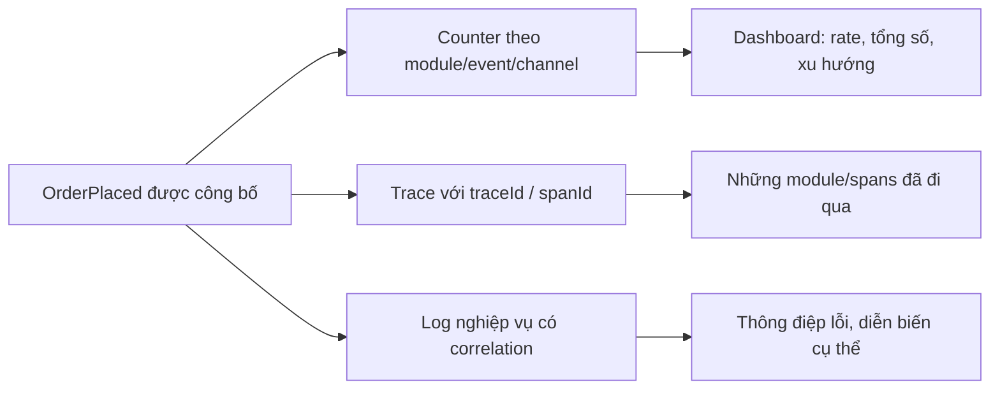

# Tránh đưa user id hoặc request id vào metric

## 1. Bài toán trong chương Event customizer

Giả sử một ứng dụng Spring Boot tổ chức theo **Spring Modulith** có các application module `orders`, `inventory` và `notifications`. Module `orders` phát sự kiện `OrderPlaced`; nhóm kỹ thuật muốn quan sát số lần phát sự kiện theo kênh bán hàng để xem kênh nào tăng tải. Spring Modulith có **`ModulithEventMetricsCustomizer`** để bổ sung tag cho counter của từng loại domain event.

Một cách tùy biến rất dễ mắc lỗi là đưa `userId` hoặc `requestId` vào tag vì những định danh này có sẵn trong sự kiện và giúp tìm kiếm từng yêu cầu. Nhưng **metric được thiết kế để tổng hợp**, còn ID người dùng và ID yêu cầu thường có số lượng giá trị lớn, thay đổi liên tục. Đưa chúng vào metric có thể tạo ra hàng nghìn đến hàng triệu time series, tăng chi phí và làm lộ thông tin không cần thiết.

Trong chương **Event customizer** của module học **SPRING_MODULITH_DOCUMENTATION_OBSERVABILITY**, mục tiêu là tùy biến metric mà vẫn bảo vệ chất lượng quan sát tương tác giữa các module. Bài kết nối **module graph**, **Actuator**, **event metrics**, **tracing** và **context propagation** để xác định khi nào dùng metric tổng hợp, khi nào cần tìm một request cụ thể.

Sau bài học, bạn có thể:

- Giải thích **cardinality của metric tag** và vì sao `userId`/`requestId` nguy hiểm khi dùng làm nhãn.
- Phân biệt default event metrics của Spring Modulith với **counter riêng của event** mà customizer có thể bổ sung tag.
- Viết `ModulithEventMetricsCustomizer` dùng **tập giá trị giới hạn**, ví dụ enum `channel=web|mobile|store`.
- Dùng log có quyền truy cập phù hợp, `traceId`/`spanId` và tracing thay cho việc gắn định danh từng yêu cầu vào metric.
- Kiểm tra meter thực tế, phát hiện cardinality tăng và xử lý khi metric đã bị gắn ID động.

## 2. Metric tag là gì và cardinality được tính như thế nào?

Trong **Micrometer**, một meter có **tên** và các cặp **tag key/tag value**. Một tổ hợp tên meter và tập tag thường đại diện cho một chuỗi đo riêng trong `MeterRegistry` và hệ thống lưu trữ metrics.

Ví dụ, cùng tên counter có thể được chia thành:

```text
module.events.published.orders.OrderPlaced{channel="web"}    120
module.events.published.orders.OrderPlaced{channel="mobile"}  85
module.events.published.orders.OrderPlaced{channel="store"}   30
```

Các giá trị minh họa cho thấy chỉ có **ba nhóm kênh**. Nhờ đó dashboard có thể cộng tổng hoặc phân tích mức chênh lệch giữa các kênh, thay vì xử lý mỗi đơn hàng như một nhóm riêng.

**Cardinality** là số lượng tổ hợp giá trị tag có thể xuất hiện. Với các tag độc lập, giới hạn trên về số tổ hợp xấp xỉ tích số lượng giá trị của từng tag:

\[
N_{\text{series}} \lesssim N_{\text{module}}\times N_{\text{event}}\times N_{\text{channel}}\times N_{\text{status}}\times N_{\text{user}}
\]

Đây là **giới hạn trên lý thuyết**, không phải số series thực sự của một ứng dụng; không phải mọi tổ hợp đều xuất hiện. Ví dụ khi có hai kênh, ba kết quả và 50.000 user ID, một meter có thể cần tới `2 × 3 × 50.000 = 300.000` tổ hợp, trước cả việc xét instance, môi trường hoặc loại event. Nếu thay user ID bằng request ID mới cho từng yêu cầu, cardinality tiếp tục tăng theo lưu lượng.

| Giá trị tag | Cardinality thường gặp | Phù hợp cho metric? |
| --- | --- | --- |
| `module.identifier=orders|inventory|notifications` | Nhỏ, giới hạn bởi số module | Có |
| `eventType=OrderPlaced|OrderCancelled` | Giới hạn bởi số loại event | Có |
| `channel=web|mobile|store` | Nhỏ nếu được kiểm soát bằng enum/allowlist | Có |
| `outcome=success|failure` | Nhỏ, phân nhóm rõ ràng | Có |
| `userId=...` | Có thể có hàng trăm nghìn hoặc hàng triệu giá trị | **Tránh** |
| `requestId=...` / `traceId=...` | Thường gần như một giá trị khác nhau cho mỗi yêu cầu | **Tránh** |
| `email=...`, IP chi tiết, URL chứa ID | Đa dạng lớn, có thể nhạy cảm | **Tránh** |

### 2.1. Hậu quả không chỉ nằm ở biểu đồ

- **Bộ nhớ trong ứng dụng:** mỗi bộ nhãn mới có thể tạo thêm meter mà registry phải giữ; các bộ đếm không tự biến mất ngay khi request kết thúc.
- **Hệ thống metrics:** số time series, số mẫu và chi phí index/lưu trữ/truy vấn tăng theo nhịp phát dữ liệu.
- **Độ tin cậy:** exporter, collector hoặc backend có thể vượt quota, chậm ghi dữ liệu hoặc từ chối một phần series.
- **Bảo mật:** user ID/email có thể hiện ra trong nhãn Prometheus, dashboard, truy vấn, log vận hành và bản xuất dữ liệu.
- **Ít giá trị phân tích:** biểu đồ “tổng số event theo user ID” với mỗi ID chỉ xuất hiện một vài lần thường không phục vụ cảnh báo về sức khỏe module.

**Đổi tên tag** từ `userId` thành `subject`, **hash ID** hoặc đặt ID ở **tên meter** vẫn duy trì nhiều giá trị khác nhau; đó không phải cách khắc phục cardinality. Hash đôi khi làm giảm khả năng liên hệ trực tiếp với người dùng nhưng cũng không bảo đảm ẩn danh hay giảm số series.

## 3. Chính xác Spring Modulith cho phép tùy biến metric nào?

Trong Spring Modulith 2.x, hỗ trợ observability ghi nhận hai nhóm counter khi domain event được phát:

| Counter | Các tag mặc định được tài liệu công bố | Vai trò |
| --- | --- | --- |
| `module.events.published` | `module.event.type`, `module.identifier`, `module.name` | Tổng hợp các lần công bố event; có thể lọc theo module và loại event. |
| `module.events.published.$moduleIdentifier.$simpleEventTypeName` | `module.identifier`, `module.name` | Counter riêng của loại event; hỗ trợ thêm tag nghiệp vụ qua `ModulithEventMetricsCustomizer`. |

**`ModulithEventMetricsCustomizer` tùy biến counter riêng cho loại event**, ví dụ `OrderPlaced`, bằng callback nhận event và một `Counter.Builder`. Đừng mặc định rằng tag `channel` thêm ở counter riêng sẽ đồng thời xuất hiện trên all-events counter `module.events.published`; hai loại meter có mục đích và quy ước tag khác nhau.

Ví dụ, một event `OrderPlaced` được phát một lần thì Spring Modulith có thể ghi nhận trong cả **all-events** và **per-event** counter. Khi thống kê tổng publication, không cộng cả hai nhóm meter vì như vậy có thể **đếm hai lần** cùng một lần công bố.

### 3.1. Khai báo đúng dependency

Với **Spring Modulith 2.x**, nếu chỉ cần instrumentation, dùng `spring-modulith-observability-core` ở runtime; khi **mã Java tham chiếu** API tùy biến, phải thêm `spring-modulith-observability-api` vào compile classpath:

```groovy
// build.gradle (ví dụ, đã quản lý phiên bản bằng Spring Boot/Modulith BOM phù hợp)
dependencies {
    implementation 'org.springframework.boot:spring-boot-starter-actuator'
    implementation 'org.springframework.modulith:spring-modulith-observability-api'
    runtimeOnly 'org.springframework.modulith:spring-modulith-observability-core'
}
```

Nếu đã dùng `spring-modulith-starter-insight`, observability core được kéo theo; khi mã nguồn cần compile customizer vẫn phải kiểm tra và bảo đảm API nằm trên compile classpath. Tên artifact và cơ chế cấu hình có thể khác ở các phiên bản Spring Modulith cũ, vì vậy đối chiếu BOM đang sử dụng.

## 4. Anti-pattern: gắn user ID hoặc request ID vào counter

Giả sử mỗi `OrderPlaced` có thông tin người dùng và mỗi HTTP request có một correlation ID. Đoạn **phản ví dụ** dưới đây thể hiện lỗi về mặt thiết kế tag:

```java
// PHẢN VÍ DỤ - KHÔNG ĐƯA VÀO ỨNG DỤNG!
// Giả sử các biến userId, requestId được lấy từ event/request.
counterBuilder.tags(
    "userId", userId,
    "requestId", requestId
);
```

Mỗi request mới có thể tạo thêm một bộ tag hoàn toàn mới, kể cả khi tất cả request đều là `OrderPlaced` từ cùng module `orders`. Với 10.000 lượt đặt hàng mang request ID khác nhau, có thể phát sinh **10.000 series** cho cùng một metric per-event (nếu mọi publication được ghi nhận và không có quy tắc giới hạn).

Một thiết kế sai khác là ghi ID vào **tên counter**:

```text
module.events.published.orders.OrderPlaced.user-123
module.events.published.orders.OrderPlaced.user-456
...
```

Lúc này, thay vì bùng nổ tổ hợp tag, ứng dụng lại tạo nhiều tên meter, vẫn làm registry và backend tăng tải. Micrometer lưu ý bộ phát hiện high-cardinality tags không phát hiện được tất cả trường hợp giá trị động nằm trong **tên metric**.

### 4.1. Vì sao việc đổi sang “high-cardinality tag” không áp dụng cho Counter.Builder?

Trong **Micrometer Observation**, `lowCardinalityKeyValue(...)` dành cho các key có tập giá trị nhỏ và có thể được dùng làm metric tags; `highCardinalityKeyValue(...)` phục vụ metadata cho tracing/quan sát mà meter handler **không dùng làm tag metrics**.

Nhưng khi bạn gọi trực tiếp `Counter.Builder.tags(...)` bên trong `ModulithEventMetricsCustomizer`, **không có phân biệt low/high cardinality**: mọi tag bạn thêm đều trở thành tag của meter khi đăng ký. Không thể sửa bằng cách đặt tên key là `high.userId`; cách đúng là **không thêm ID động vào Counter.Builder**.

Nếu một nhu cầu điều tra thật sự cần định danh cho từng lần thực thi, hãy dùng trace/correlation ID với kiểm soát truy cập phù hợp, thay vì biến một counter thành nhật ký từng request.

## 5. Cách làm đúng: tag từ tập giá trị cố định

Để dashboard thống kê `OrderPlaced` theo **kênh bán hàng**, mô hình hóa kênh bằng enum:

```java
// com/example/shop/orders/SalesChannel.java
package com.example.shop.orders;

public enum SalesChannel {
    WEB, MOBILE, STORE
}
```

Sự kiện vẫn có ID nghiệp vụ, nhưng **ID đó không dùng làm metric tag**:

```java
// com/example/shop/orders/OrderPlaced.java
package com.example.shop.orders;

import java.util.UUID;

public record OrderPlaced(UUID orderId, SalesChannel channel) {}
```

Bean customizer:

```java
// com/example/shop/observability/EventMetricConfiguration.java
package com.example.shop.observability;

import java.util.Locale;
import org.springframework.context.annotation.Bean;
import org.springframework.context.annotation.Configuration;
import org.springframework.modulith.observability.ModulithEventMetricsCustomizer;
import com.example.shop.orders.OrderPlaced;

@Configuration(proxyBeanMethods = false)
class EventMetricConfiguration {

    @Bean
    ModulithEventMetricsCustomizer orderEventCustomizer() {
        return metrics -> metrics.customize(
            OrderPlaced.class,
            (event, counter) -> {
                // Chỉ có ba giá trị cố định: web, mobile, store.
                counter.tags("channel",
                    event.channel().name().toLowerCase(Locale.ROOT));
            }
        );
    }
}
```

API chính thức định nghĩa `ModulithEventMetricsCustomizer.customize(ModulithEventMetrics)`. Interface `ModulithEventMetrics` có overload `customize(Class<T>, BiConsumer<T, Counter.Builder>)`, đúng với callback `(event, counter)` ở ví dụ. Đây là cách **tùy biến counter cho một loại domain event**.

Các tiền đề của ví dụ:

- `channel` luôn được validate trước khi phát event; nếu nguồn là chuỗi từ client, ánh xạ nó sang enum hoặc allowlist, **không** gắn nguyên chuỗi tùy ý.
- Số lượng kênh chỉ là ba giá trị đã biết; nếu có giá trị thiếu, chọn một nhãn cố định như `unknown` sau khi xác định quy tắc nghiệp vụ.
- `orderId` vẫn nằm trong event để phục vụ xử lý đơn, nhưng customizer **không truy cập** nó để tạo tag.
- Bean customizer phải được Spring quét và phiên bản Modulith phải hỗ trợ API tương ứng.

### 5.1. Một quy tắc đặt tag dễ kiểm soát

| Mong muốn phân tích | Tag nên thêm | Đừng thêm |
| --- | --- | --- |
| Đếm event theo nguồn đặt hàng | `channel=web|mobile|store` | `userId`, số điện thoại |
| Đếm theo nhóm kết quả nếu có metric xử lý riêng | `outcome=success|failure` | Nội dung exception hoặc message lỗi tự do |
| Đếm theo nhóm lỗi | `error.category=timeout|validation|dependency` | Stack trace, mã lỗi chứa giá trị ngẫu nhiên |
| Đếm theo module/loại event | Tag mặc định `module.identifier`, `module.event.type` theo meter | `orderId`, `requestId`, `traceId` |

Nếu các giá trị thay đổi theo cấu hình khách hàng, tenant hoặc nội dung đầu vào, hãy đặt câu hỏi: **tập giá trị có được giới hạn trong toàn bộ vòng đời vận hành không?** “Hiện chỉ có năm tenant” không đủ để mặc định tenant ID là low cardinality nếu số tenant có thể tăng không giới hạn.

## 6. Dùng logs và traces để tìm một yêu cầu cụ thể

Khi điều tra “request của đơn hàng này xảy ra chuyện gì?”, metric không chứa ID chi tiết vẫn có thể kết hợp với các tín hiệu khác:



| Câu hỏi | Nguồn phù hợp | Dữ liệu cần dùng |
| --- | --- | --- |
| “Số event tăng từ khi nào?” | Metrics/Prometheus | `rate()` hoặc `increase()` theo meter/module |
| “Kênh mobile có nhiều event bất thường?” | Metrics | Tag cố định `channel=mobile` |
| “Request này đi qua module nào?” | Distributed tracing | `traceId` và module entry spans |
| “Listener inventory bị timeout vì sao?” | Trace + log | Span, exception, thời gian và correlation ID |
| “User X đã đặt hàng nào?” | Dữ liệu nghiệp vụ được cấp quyền truy cập | Tra cứu theo định danh nghiệp vụ qua hệ thống phù hợp |

Nếu Spring Boot/Micrometer Tracing được cấu hình, `traceId`/`spanId` có thể được đưa vào **MDC** và hiển thị trong log pattern. Có thể tìm trace rồi mở các log liên quan hoặc đi từ log lỗi sang trace.

Ví dụ log dạng minh họa:

```text
INFO [traceId=7fa...2ac spanId=9a8...b11] orders.PlaceOrderService - order.accepted
WARN [traceId=7fa...2ac spanId=2f1...cd0] inventory.StockListener - reservation.delayed
```

**Lưu ý bảo mật:** logs và traces cũng cần kiểm soát access, retention, redaction và nguyên tắc tối thiểu dữ liệu. Không phải cứ dữ liệu “không nằm trong metric” thì được phép đưa toàn bộ user ID, email, IP, token hoặc payload sang tracing/logging. Nếu cần mã định danh để điều tra, phải có nhu cầu rõ, chính sách lưu trữ và mức quyền phù hợp; ưu tiên correlation ID kỹ thuật không tiết lộ danh tính.

### 6.1. Kết nối với context propagation

Trong Modulith, listener `@Async` hoặc task qua executor có thể chạy trên thread khác. Khi không truyền Micrometer trace/observation context phù hợp, log của listener có thể mất correlation ID hoặc xuất hiện ở trace khác. Vì vậy cần kiểm tra context propagation trên đúng executor; qua HTTP hoặc broker thì cần inject/extract trace headers theo transport.

Giải quyết việc truyền context giúp điều tra một request chi tiết bằng tracing/logging. Nó **không** biến `requestId` thành tag hợp lý cho counter. Một lần công bố event có thể kích hoạt nhiều listener, nên cũng không thể dùng `module.events.published` để khẳng định tất cả listener đã xử lý thành công.

## 7. Kiểm tra metric sau khi tùy biến

### 7.1. Kích hoạt Actuator và kiểm tra tên meter

Trong môi trường phát triển, khi đã có Spring Boot Actuator và observability core/Insight:

```yaml
management:
  endpoints:
    web:
      exposure:
        include: "health,metrics,prometheus"
```

`/actuator/prometheus` cần thêm Prometheus registry (ví dụ `io.micrometer:micrometer-registry-prometheus`) và exposure tương ứng. Không nên mở endpoint metrics công khai ở production; kiểm soát mạng, xác thực và phân quyền theo chính sách vận hành.

Sau khi phát sự kiện:

```bash
# Xem các meter được tạo thực tế.
curl -s http://localhost:8080/actuator/metrics

# Counter tổng hợp mặc định theo event/module:
curl -s http://localhost:8080/actuator/metrics/module.events.published

# Counter riêng của OrderPlaced (tên minh họa theo quy ước tài liệu):
curl -s http://localhost:8080/actuator/metrics/module.events.published.orders.OrderPlaced
```

Counter tùy biến có tên theo định danh module và simple event type; hãy **đọc tên từ danh sách meter thực tế** vì tên/phiên bản và cách chuẩn hóa của backend có thể khác. Endpoint `/actuator/metrics` đọc tên Micrometer meter trước khi exporter chuẩn hóa.

### 7.2. Xác nhận không có user/request ID trong tags

Trong response của counter riêng, `availableTags` hoặc tag được liệt kê phải cho thấy tập giá trị nhỏ:

```json
{
  "name": "module.events.published.orders.OrderPlaced",
  "measurements": [{ "statistic": "COUNT", "value": 10.0 }],
  "availableTags": [
    { "tag": "module.identifier", "values": ["orders"] },
    { "tag": "channel", "values": ["web", "mobile", "store"] }
  ]
}
```

Đây là **dữ liệu mô phỏng**; response thực tế thường còn có `description`, `baseUnit`, `module.name` và thứ tự tag khác. Với một meter có tag `module.identifier` và các giá trị cố định của `channel`, nhiều request liên tiếp chỉ làm **tăng giá trị counter**, không tạo tag mới cho từng request.

Kiểm tra:

1. Phát nhiều `OrderPlaced` khác nhau nhưng cùng `channel=web`: counter có một series tag web tăng dần.
2. Phát lần lượt từ `WEB`, `MOBILE`, `STORE`: xuất hiện không quá ba giá trị `channel` trong quy ước ví dụ.
3. Tìm trong `availableTags` và dữ liệu xuất Prometheus: **không có** `userId`, `requestId`, `orderId`, email hoặc trace ID.
4. So sánh counter riêng của `OrderPlaced` với all-events `module.events.published`; tag `channel` là customizer của meter riêng, không mặc định có trong all-events meter.
5. Sau restart và khi có nhiều instance, nhớ counter có vòng đời theo registry/instance; dùng `rate()`/`increase()` phù hợp để phân tích biến động.

Nếu hệ thống xuất Prometheus, tên meter/tags thường được đổi sang định dạng phù hợp. Kiểm tra trực tiếp `/actuator/prometheus` để xác nhận series và label thật, rồi mới viết PromQL. Không coi ví dụ JSON trên là dữ liệu đo của project.

## 8. Đặt hàng rào bảo vệ cardinality trong Micrometer

Biện pháp tốt nhất là **kiểm soát tại nơi thêm tag**. Ngoài ra, có thể dùng `MeterFilter` làm lớp bảo vệ để tránh một phiên bản triển khai sai sinh quá nhiều series.

### 8.1. Giới hạn số giá trị của một tag

Micrometer hỗ trợ `MeterFilter.maximumAllowableTags(...)`. Ví dụ minh họa nếu chọn chính sách tối đa bốn giá trị `channel` cho toàn bộ meter publication:

```java
import io.micrometer.core.instrument.config.MeterFilter;
import org.springframework.context.annotation.Bean;
import org.springframework.context.annotation.Configuration;

@Configuration(proxyBeanMethods = false)
class MetricCardinalityGuard {

    @Bean
    MeterFilter limitPublicationChannels() {
        return MeterFilter.maximumAllowableTags(
            "module.events.published",
            "channel",
            4,
            MeterFilter.deny()
        );
    }
}
```

Ví dụ này là một **guardrail**, không thay thế việc validate event/channel từ đầu. Nếu xuất hiện giá trị thứ năm, các meter mới vượt giới hạn sẽ bị từ chối đăng ký và dữ liệu thuộc các nhóm đó có thể **không được thu thập**; do đó phải có log/cảnh báo ở nơi chuẩn hóa input và kiểm tra dashboard/cardinality. Con số `4` là ngưỡng minh họa gồm ba kênh và một giá trị `unknown` có thể có, không phải mặc định Micrometer.

Phạm vi prefix `module.events.published` có thể áp dụng cả nhóm counter publication. Nên chọn điều kiện/prefix thích hợp với tên meter thực tế của ứng dụng và kiểm thử khi cấu hình các meter khác.

### 8.2. Phát hiện hiện tượng có quá nhiều meter

Micrometer có tài liệu về **`HighCardinalityTagsDetector`**, hỗ trợ phát hiện khi số meter cùng tên vượt ngưỡng. Hữu ích để tìm metric phát sinh nhiều tổ hợp tags do ID động.

Tuy nhiên, detector chủ yếu đếm **meter cùng tên**. Nó không thay thế code review và không phát hiện mọi hình thức như **gắn giá trị ngẫu nhiên vào tên meter**. Việc sử dụng API và cấu hình detector phụ thuộc phiên bản Micrometer; nên đối chiếu tài liệu của bản đang dùng.

### 8.3. Khi đã lỡ đưa ID động vào metric

Nếu đã triển khai customizer tạo tag `userId`/`requestId`:

1. **Dừng phát sinh nhãn mới:** sửa customizer để bỏ ID động, triển khai phiên bản an toàn; kiểm tra mọi caller và instrumentation tương tự.
2. **Đánh giá ảnh hưởng:** đếm số series/meter, tình trạng registry và backend; xem có quota bị vượt hoặc mất dữ liệu do lỗi scrape/ingest.
3. **Xử lý dữ liệu đã xuất:** phối hợp người quản trị monitoring xem retention, bản sao dashboard/export và chính sách xóa dữ liệu nhạy cảm nếu cần. Xóa tag ở code không tự xóa lịch sử series đã lưu.
4. **Sửa query/dashboard:** chuyển bộ lọc sang `module.identifier`, event type, `channel` hoặc nhóm kết quả có tập giá trị giới hạn.
5. **Thêm kiểm tra tái diễn:** review mọi tag mới; kiểm tra `availableTags`/Prometheus output, cảnh báo meter count hoặc cardinality theo quy mô thực tế.

Không nên xử lý bằng cách **cắt ngắn** hoặc **hash** ID rồi tiếp tục lưu từng ID như một time series; đó thường chỉ che đi dấu hiệu, không giải quyết số lượng tổ hợp giá trị.

## 9. Phân biệt các mục đích quan sát để chọn đúng công cụ

| Nhu cầu | Dữ liệu nên lưu | Không nên làm |
| --- | --- | --- |
| Theo dõi số lần công bố `OrderPlaced` theo kênh | Counter publication + `channel` enum | Gắn `userId`, `requestId` vào counter |
| Biết module nào phát event | Tag `module.identifier`/`module.name` theo meter mặc định | Tự tạo module tag từ chuỗi tùy ý của request |
| Xem module nào tiếp nhận event | Module entry span, log listener, metric kết quả xử lý | Suy ra mọi listener thành công từ counter publication |
| So sánh kiến trúc thiết kế và runtime | Module graph, Actuator Modulith, traces | Coi một trace đơn lẻ là toàn bộ dependency graph |
| Điều tra một request lỗi | Tracing + log có correlation và quyền phù hợp | Biến counter thành log của từng request |
| Kiểm toán user/order cụ thể | Dữ liệu nghiệp vụ được phân quyền, audit store nếu có | Dùng metrics backend làm nguồn đối soát danh tính |

### Ví dụ quyết định nhanh

Khi nhóm hỏi **“Mỗi phút module `orders` phát bao nhiêu `OrderPlaced` từ web?”**, giải pháp phù hợp là **counter + tag `channel=web`**, kết hợp `rate()` trên khoảng thời gian.

Khi nhóm hỏi **“Yêu cầu của khách hàng này bị chậm tại module nào?”**, giải pháp phù hợp là tìm bản ghi nghiệp vụ được cấp quyền, xác định correlation/trace ID rồi tra **module spans, logs, tracing backend**; nếu listener chạy bất đồng bộ, kiểm tra context propagation để thấy quan hệ luồng xử lý.

Khi nhóm hỏi **“Có đang phát nhiều event hơn nhưng listener gửi email chậm hơn không?”**, hãy đối chiếu publication rate với metrics của consumer, logs/traces. **Một event publication counter tăng không xác nhận bất kỳ listener nào hoàn tất.**

## 10. Checklist trước khi đưa customizer vào production

| Câu hỏi | Tiêu chí đạt |
| --- | --- |
| Mỗi tag có số giá trị dự kiến rõ ràng chưa? | Có enum/allowlist hoặc tập giá trị nhỏ, ổn định; không lấy chuỗi tự do. |
| Có gắn user ID, request ID, trace ID, order ID không? | **Không** có ID riêng của mỗi cá nhân/request/order. |
| Có đổi ID thành tên metric không? | Không sinh tên metric động. |
| Metric nào được customizer tác động? | Đã phân biệt per-event counter và all-events counter. |
| Có kiểm tra metrics trong ứng dụng thật? | Xem `/actuator/metrics` và registry/exporter, xác nhận nhãn đúng. |
| Có kế hoạch xử lý cardinality tăng? | Có review tag, giám sát meter count và biện pháp giới hạn hợp lý. |
| Khi cần điều tra một request có đường tra cứu khác? | Có tracing/log correlation hoặc audit nghiệp vụ được phân quyền. |
| Dữ liệu metrics/traces/logs có được bảo vệ? | Có access control, retention, redaction và giới hạn endpoint Actuator. |

## 11. Ghi nhớ

**Không đặt `userId`, `requestId`, `traceId` hoặc `orderId` làm metric tag** chỉ để dễ tìm một lần xử lý. Trong Micrometer, mỗi tổ hợp tag mới có thể tạo meter/time series mới; trên Spring Modulith, `ModulithEventMetricsCustomizer` thêm tag trực tiếp vào `Counter.Builder` của **per-event metric**, nên mọi giá trị động có nguy cơ trở thành chiều đo không giới hạn.

Hãy ưu tiên **low-cardinality tags** được kiểm soát như `module.identifier`, event type, enum `channel` hoặc kết quả phân nhóm cố định. Sử dụng **metrics** để theo dõi xu hướng, **module graph/Actuator** để nhìn kiến trúc, **tracing** để lần theo điểm vào module, và **logs/audit có quyền truy cập phù hợp** để điều tra yêu cầu cụ thể. Đây là cách giữ hệ thống observability đủ hữu ích, vừa kiểm soát chi phí vừa giảm rủi ro rò rỉ dữ liệu.

## Tài liệu tham khảo

- [Spring Modulith — Production-ready Features](https://docs.spring.io/spring-modulith/reference/production-ready.html): hai nhóm event metrics, tag mặc định và ví dụ `ModulithEventMetricsCustomizer`.
- [Spring Modulith — ModulithEventMetricsCustomizer API](https://docs.spring.io/spring-modulith/docs/current/api/org/springframework/modulith/observability/ModulithEventMetricsCustomizer.html): hợp đồng tùy biến metric của event.
- [Spring Modulith — ModulithEventMetrics API](https://docs.spring.io/spring-modulith/docs/current/api/org/springframework/modulith/observability/ModulithEventMetrics.html): `customize(Class<T>, BiConsumer<T, Counter.Builder>)`.
- [Micrometer — High Cardinality Tags Detector](https://docs.micrometer.io/micrometer/reference/concepts/high-cardinality-tags-detector.html): hậu quả, ví dụ user/request/trace ID và phát hiện nhiều meter.
- [Micrometer — Meter Filters](https://docs.micrometer.io/micrometer/reference/concepts/meter-filters.html): `maximumAllowableTags(...)`, giới hạn và từ chối meter.
- [Micrometer — Observation Components](https://docs.micrometer.io/micrometer/reference/observation/components.html): phân biệt low/high cardinality và các key được dùng làm metric tag.
- [Spring Boot — Metrics](https://docs.spring.io/spring-boot/reference/actuator/metrics.html): MeterRegistry, Actuator metrics endpoint, meter filter và cách xem tag thực tế.

> **Phạm vi phiên bản:** Ví dụ sử dụng API của Spring Modulith 2.x và Micrometer tương ứng, với dependency được quản lý bằng BOM của dự án. Số liệu, output Actuator và tên counter trong bài là ví dụ minh họa, cần đối chiếu với môi trường thực tế. Bài thuộc STEP 4 và sẽ được kiểm tra nội dung chuyên môn ở bước QA tiếp theo.
