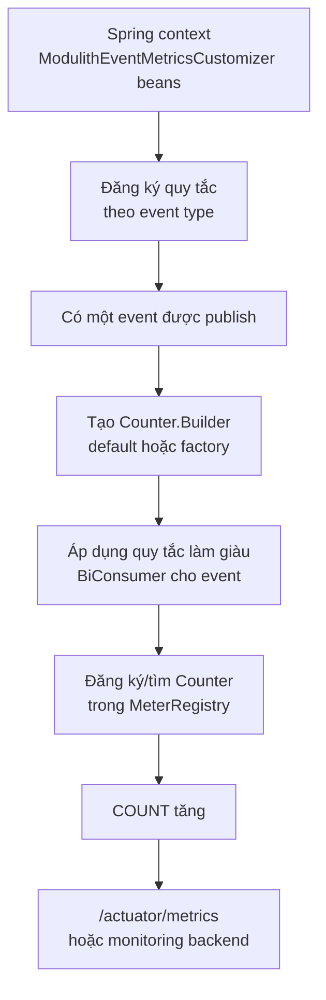
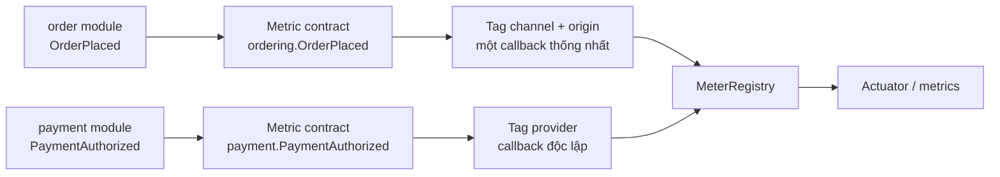

# Nhiều customizer và thứ tự áp dụng trong Spring Modulith event metrics

## 1. Tình huống: hai nhóm cùng muốn gắn nhãn vào event counter

Một ứng dụng Spring Boot được tổ chức bằng **Spring Modulith** có module `ordering` công bố domain event `OrderPlaced`. Khi quan sát ứng dụng, nhóm vận hành muốn xem **số lượt công bố event theo kênh** (`web`, `mobile`). Nhóm sản phẩm lại muốn phân biệt **nguồn tạo đơn** (`self-service`, `staff`).

Spring Modulith hỗ trợ **`ModulithEventMetricsCustomizer`** để điều chỉnh các Micrometer counters theo loại event. Vì những phần khác nhau của ứng dụng có thể khai báo customizer của riêng mình, ta gặp ba câu hỏi:

1. Có thể khai báo **nhiều bean `ModulithEventMetricsCustomizer`** không?
2. Khi **nhiều customizer cùng đăng ký cho `OrderPlaced`**, chúng được áp dụng theo thứ tự nào?
3. Nếu các quy tắc cùng sửa một thuộc tính trên `Counter.Builder`, kết quả có luôn là “customizer cuối cùng thắng” không?

Bài học này phân biệt rõ **thứ tự của Spring beans**, **thứ tự đăng ký quy tắc cho event** và **thứ tự tạo/hoàn thiện `Counter.Builder`**. Cách tiếp cận an toàn là không phụ thuộc vào thứ tự ngầm định khi thiết kế metric contracts.

> **Mục tiêu:** biết cách ghép nhiều customizer, tránh ghi đè/xung đột, hiểu ý nghĩa của `@Order`, và kiểm chứng tên/tags của meter thực tế qua Actuator hoặc một bài kiểm thử tích hợp.

## 2. Customizer thực sự tùy biến cái gì?

Spring Modulith cung cấp hai dạng counter liên quan đến việc công bố domain event:

| Meter Micrometer | Ý nghĩa |
| --- | --- |
| `module.events.published` | Counter tổng hợp các lượt công bố event, dùng tags để phân loại |
| `module.events.published.$moduleIdentifier.$simpleEventTypeName` | Counter riêng theo module và tên kiểu event Java, có thể thêm tags theo giá trị của event |

Ví dụ một lượt công bố `OrderPlaced` thuộc module `ordering` có thể làm tăng meter logic:

```text
module.events.published.ordering.OrderPlaced
```

`ModulithEventMetricsCustomizer` được dùng để tùy biến **cách tạo counter riêng cho event**; nó không phải một hook tự động sửa mọi meter trong `MeterRegistry` và cũng không phải hook điều khiển trình tự gọi các event listeners.

Trong API Spring Modulith:

```java
@FunctionalInterface
public interface ModulithEventMetricsCustomizer {
    void customize(ModulithEventMetrics metrics);
}
```

`ModulithEventMetrics` có hai cách đăng ký tùy biến:

```java
// Kiểu 1: làm giàu Counter.Builder đã được tạo
<T> ModulithEventMetrics customize(
        Class<T> type,
        BiConsumer<T, Counter.Builder> consumer);

// Kiểu 2: cung cấp logic tạo Counter.Builder
<T> ModulithEventMetrics customize(
        Class<T> type,
        Function<T, Counter.Builder> factory);
```

Đây là **chữ ký API để giải thích**, không phải các method được phép viết trực tiếp ngoài interface. Trong ứng dụng, thường dùng một lambda nhận `metrics` và gọi overload cần thiết.

Điểm đáng chú ý từ JavaDoc:

- `BiConsumer` nhận **event instance** và **Counter.Builder**, phù hợp để bổ sung tags theo dữ liệu event.
- Overload `Function` tùy biến việc **tạo builder**. Builder được tạo theo cơ chế này **vẫn được áp dụng** các tùy biến đã đăng ký qua `BiConsumer`.
- API không tuyên bố rằng hai rule cùng thay đổi một tag key sẽ có một chiến lược merge/ghi đè ổn định xuyên mọi phiên bản backend.

Vì vậy, nên tách hai giai đoạn: **tạo builder → làm giàu builder → đăng ký counter vào registry**. Không nhầm giai đoạn này với **thứ tự Spring gọi các bean customizer khi khởi tạo cấu hình**.



Sơ đồ là **mô hình khái niệm**. Cách lưu, chọn, gom quy tắc và thời điểm thực thi có thể thay đổi theo nhánh Spring Modulith; muốn khẳng định precedence trong ứng dụng cụ thể phải xem source/test của đúng phiên bản.

## 3. Nhiều customizer cho **những event khác nhau**

Đây là trường hợp dễ quản lý nhất: mỗi customizer sở hữu một event type hoặc một nhóm event riêng, không cùng can thiệp vào cùng builder.

Giả sử:

```java
package com.example.shop.ordering;

public record OrderPlaced(String orderId, String channel) {}
```

```java
package com.example.shop.payment;

public record PaymentAuthorized(String paymentId, String provider) {}
```

Ta khai báo hai Spring beans ở `com.example.shop.config`:

```java
package com.example.shop.config;

import com.example.shop.ordering.OrderPlaced;
import com.example.shop.payment.PaymentAuthorized;
import org.springframework.context.annotation.Bean;
import org.springframework.context.annotation.Configuration;
import org.springframework.modulith.observability.ModulithEventMetricsCustomizer;

@Configuration(proxyBeanMethods = false)
class DomainEventMetricsConfiguration {

    @Bean
    ModulithEventMetricsCustomizer orderEventTags() {
        return metrics -> metrics.customize(
                OrderPlaced.class,
                (event, builder) ->
                        builder.tag("channel", channel(event.channel())));
    }

    @Bean
    ModulithEventMetricsCustomizer paymentEventTags() {
        return metrics -> metrics.customize(
                PaymentAuthorized.class,
                (event, builder) ->
                        builder.tag("provider", provider(event.provider())));
    }

    private static String channel(String input) {
        return "web".equals(input) || "mobile".equals(input) ? input : "other";
    }

    private static String provider(String input) {
        return "bank".equals(input) || "wallet".equals(input) ? input : "other";
    }
}
```

Với cách tổ chức này:

- Quy tắc `orderEventTags` chỉ gắn tag `channel` cho `OrderPlaced`.
- Quy tắc `paymentEventTags` chỉ gắn tag `provider` cho `PaymentAuthorized`.
- Vì hai rule không cạnh tranh trên **cùng loại event và cùng tag**, thứ tự bean được gọi thường **không ảnh hưởng kết quả mong muốn**.

Cần lưu ý: tự tạo bean không đồng nghĩa metric xuất hiện ngay khi ứng dụng khởi động. Counter riêng thường được đăng ký hoặc có dữ liệu sau khi event phù hợp được ghi nhận. Nếu không thấy metric, hãy kiểm tra event publication thực tế, runtime observability và tên meter của bản đang chạy.

## 4. Nhiều customizer cho **cùng event type**

Tình huống khó hơn: module `ordering` muốn thêm `channel`, còn một thư viện nội bộ muốn thêm `origin` cho chính `OrderPlaced`.

Ví dụ hai bean độc lập:

```java
@Bean
ModulithEventMetricsCustomizer orderChannelTags() {
    return metrics -> metrics.customize(
            OrderPlaced.class,
            (event, builder) -> builder.tag(
                    "channel", normalizeChannel(event.channel())));
}

@Bean
ModulithEventMetricsCustomizer orderOriginTags() {
    return metrics -> metrics.customize(
            OrderPlaced.class,
            (event, builder) -> builder.tag(
                    "origin", "checkout"));
}
```

Đoạn này minh họa hai method `@Bean` đặt trong một class `@Configuration` có sẵn và một helper `normalizeChannel(...)`. Các quy tắc **không trùng tag key**; trong cấu hình hỗ trợ tích lũy nhiều rule cho cùng event, kỳ vọng sẽ thu được cả `channel` và `origin`.

Tuy nhiên, để **không phụ thuộc** vào việc framework lưu/duyệt nhiều rule cùng type và không phải tranh luận bean nào chạy trước, có thể gom các rule liên quan vào một customizer với thứ tự được viết ra rõ ràng:

```java
package com.example.shop.config;

import com.example.shop.ordering.OrderPlaced;
import org.springframework.context.annotation.Bean;
import org.springframework.context.annotation.Configuration;
import org.springframework.modulith.observability.ModulithEventMetricsCustomizer;

@Configuration(proxyBeanMethods = false)
class OrderEventMetricRules {

    @Bean
    ModulithEventMetricsCustomizer orderPlacedMetricCustomizer() {
        return metrics -> metrics.customize(
                OrderPlaced.class,
                (event, builder) -> {
                    builder.tag("channel", normalizeChannel(event.channel()));
                    builder.tag("origin", "checkout");
                });
    }

    private static String normalizeChannel(String input) {
        if ("web".equals(input) || "mobile".equals(input)) {
            return input;
        }
        return "other";
    }
}
```

Ở đoạn mã này, **thứ tự lệnh bên trong lambda** là thứ tự Java đã định nghĩa: gắn `channel` rồi gắn `origin`. Nhưng tốt hơn nữa là dùng **hai tên tag khác nhau**, để kết quả không cần dựa vào việc Micrometer xử lý trùng key theo kiểu “first wins” hay “last wins”.

### 4.1. Khi nào nên tách và khi nào nên gom?

| Tình huống | Cách tổ chức nên ưu tiên |
| --- | --- |
| Hai rule thuộc **hai loại event độc lập** | Tách customizer bean để phân quyền sở hữu |
| Một event cần thêm nhiều tag độc lập, tập quy tắc nhỏ | Một `BiConsumer` với các lệnh `builder.tag(...)` rõ ràng |
| Nhiều module cùng muốn bổ sung tag cho một event | Có một nơi điều phối contract của metric; có thể nhận các rule độc lập rồi ghép có thứ tự chủ động |
| Nhiều rule ghi **cùng tag key** hoặc thay tên meter | Không dựa vào độ ưu tiên ngầm; giải quyết xung đột bằng một quy tắc duy nhất |
| Cần thay đổi cách khởi tạo `Counter.Builder` | Cân nhắc overload `Function` nhưng kiểm tra kỹ naming và tags chuẩn |

Không có yêu cầu tất cả customizer toàn ứng dụng phải được gom thành một class. Điều cần bảo vệ là **mỗi metric có contract nhất quán**: tên, tập tag keys, ý nghĩa giá trị tag và chính sách về cardinality.

## 5. Hiểu đúng **ba loại thứ tự**

Một nguyên nhân của lỗi khó chẩn đoán là dùng cùng từ “order” cho ba việc khác nhau:

| Thứ tự | Áp dụng tại đâu? | Điều có thể đảm bảo |
| --- | --- | --- |
| **A. Thứ tự duyệt Spring beans** | Spring cung cấp các bean `ModulithEventMetricsCustomizer` cho auto-configuration | `@Order`/`Ordered` chỉ có tác dụng khi phía tiêu thụ **sử dụng cơ chế duyệt có thứ tự** |
| **B. Thứ tự đăng ký rule** | `metrics.customize(Event.class, ...)` được gọi để đăng ký từng rule | Phụ thuộc cách SPI/implementation lưu các rule; không được tự suy từ tên bean |
| **C. Thứ tự xử lý builder** | Khi có event: tạo builder rồi chạy callback làm giàu | JavaDoc bảo đảm builder từ overload `Function` vẫn chịu các rule `BiConsumer`; **không** mặc định bảo đảm precedence giữa nhiều callback xung đột |

Chính vì vậy, “bean A có `@Order(1)`” **không tương đương** với “tag A chắc chắn thắng khi hai callback cùng sửa một key”.

### 5.1. `@Order` của Spring làm được gì?

Trong Spring, annotation `@Order` và interface `Ordered` mô tả **độ ưu tiên** của một bean trong các cấu trúc collection/list có cơ chế sort. Theo thông lệ Spring, **số càng nhỏ thì mức ưu tiên càng cao**.

Ví dụ:

```java
import org.springframework.core.annotation.Order;

@Bean
@Order(10)
ModulithEventMetricsCustomizer firstCustomizer() {
    return metrics -> metrics.customize(
            OrderPlaced.class,
            (event, builder) -> builder.tag("channel", "web"));
}

@Bean
@Order(20)
ModulithEventMetricsCustomizer secondCustomizer() {
    return metrics -> metrics.customize(
            OrderPlaced.class,
            (event, builder) -> builder.tag("origin", "checkout"));
}
```

Hai `@Bean` này là mã minh họa trong `@Configuration`. Nếu một consumer gọi `ObjectProvider<ModulithEventMetricsCustomizer>.orderedStream()`, Spring sẽ trả các bean theo chính sách order, tức ưu tiên 10 trước 20. Tuy nhiên:

- Chỉ có `@Order` **chưa chứng minh** phiên bản Spring Modulith đang chạy tiêu thụ customizers theo `orderedStream()`.
- Kể cả thứ tự **gọi `customize(metrics)`** đã rõ, thứ tự **áp dụng callback cho event** còn phụ thuộc implementation.
- Nếu hai callback trùng tag key hoặc thay builder factory, `@Order` không tự tạo một hợp đồng merge được công bố.

Nói cách khác, **`@Order` là tín hiệu ordering cho Spring**, không phải quy tắc ghi đè chung cho mọi API tùy biến.

### 5.2. Nếu bắt buộc có thứ tự cố định, hãy làm rõ tại một nơi

Thay vì để hai bean cùng tranh chấp một tag, tạo **một** bean customizer và thực hiện các bước theo trình tự đã duyệt:

```java
@Bean
ModulithEventMetricsCustomizer orderedOrderPlacedRules() {
    return metrics -> metrics.customize(
            OrderPlaced.class,
            (event, builder) -> {
                String channel = normalizeChannel(event.channel());

                // 1. Chuẩn hóa dữ liệu nghiệp vụ.
                builder.tag("channel", channel);

                // 2. Bổ sung nguồn đã được định nghĩa duy nhất.
                builder.tag("origin", "checkout");

                // 3. Không thêm một tag "channel" lần nữa.
            });
}
```

Đoạn trên giả định helper `normalizeChannel` đã được định nghĩa. Thứ tự Java trong callback là rõ ràng, nhưng **kết quả không phụ thuộc vào xung đột** vì mỗi tag key được thêm một lần. Đây là cách đáng tin cậy hơn so với dự đoán “rule chạy cuối sẽ thay thế giá trị của rule chạy trước”.

### 5.3. Overload `Function` và `BiConsumer`: thứ tự có hợp đồng riêng

JavaDoc của `ModulithEventMetrics` cho biết:

- `customize(Class<T>, Function<T, Counter.Builder>)` cung cấp **cách tạo builder** cho event type đó.
- `customize(Class<T>, BiConsumer<T, Counter.Builder>)` cung cấp **cách làm giàu builder**.
- Builder được tạo bởi factory tùy biến **vẫn được xử lý** bởi các callback làm giàu đã đăng ký.

Điều này cho phép rút ra thứ tự **theo pha**:

```text
Chọn builder (mặc định hoặc factory tùy biến)
    → áp dụng các rule làm giàu (BiConsumer)
    → đăng ký meter và ghi nhận publication
```

Nhưng không đủ để kết luận rằng **hai factory đăng ký cho cùng một event type** sẽ cộng dồn được, hay factory A/B nào thắng khi xung đột. Nếu cần đổi tên metric hoặc thay cách dựng builder, nên quy định **một đầu mối sở hữu factory cho mỗi event type**.

**Cảnh báo:** một `Counter.Builder` tùy biến có thể làm mất naming convention hoặc tag chuẩn nếu xây dựng không đúng. Khi đó dashboard theo `module.events.published.$moduleIdentifier.$simpleEventTypeName` có thể không còn hoạt động. Hãy ưu tiên overload `BiConsumer` khi nhu cầu chỉ là thêm tags.

## 6. Các xung đột cần tránh

### 6.1. Hai quy tắc dùng cùng tag key

Ví dụ customizer A viết `channel=web`, B viết `channel=mobile` cho cùng event. Không nên giả định một trong hai có thể ghi đè mà không có hậu quả:

- Micrometer làm việc với **meter identity** có tên và tập tags. Thêm trùng tag key có thể gây kết quả không như mong đợi hoặc dẫn đến series khác với dashboard đã viết.
- Một số registry/backend còn có quy tắc riêng về **sự nhất quán của tag keys** cho các meter cùng tên.
- Ngay cả khi thấy một giá trị thắng trong bản hiện tại, điều đó không phải hợp đồng nghiệp vụ nên phụ thuộc qua các nâng cấp.

**Giải pháp:** chuẩn hóa giá trị `channel` ở một bước duy nhất, sau đó thêm nó **một lần**. Muốn thêm thông tin khác, dùng một key rõ nghĩa khác như `origin`.

### 6.2. Hai rule cùng thay cách tạo builder

Nếu hai nơi cùng đăng ký overload `Function` cho `OrderPlaced.class`, có thể nảy sinh xung đột tên meter, base unit, description hoặc tags. Không nên gắn `@Order` để “chữa” điều này nếu chưa biết implementation xử lý nhiều factory như thế nào.

**Giải pháp:** thống nhất **một factory cho mỗi event type** nếu thực sự cần thay factory; các thành phần khác chỉ đăng ký tag enrichments có tên riêng và được kiểm soát.

### 6.3. Tags thay đổi cấu trúc theo dữ liệu

Ví dụ:

```java
// Không nên: cùng một meter đôi lúc có tag "discount", đôi lúc không.
if (event.hasDiscount()) {
    builder.tag("discount", "yes");
}
```

Khi cùng một metric name có tập tag keys không ổn định giữa các event, các exporter có thể khó tổng hợp hoặc không chấp nhận series. Nên dùng một tag key nhất quán:

```java
builder.tag("discount", event.hasDiscount() ? "yes" : "no");
```

Đây là **mã minh họa** giả định event có method `hasDiscount()`; không phải method của record `OrderPlaced` ở ví dụ đầu bài.

### 6.4. Cardinality và rò rỉ dữ liệu

Không thêm `orderId`, `paymentId`, email, token, timestamp hay URL chứa ID vào metric tags. Những thuộc tính này có thể làm phát sinh vô số time series, tăng tải bộ nhớ và chi phí backend. Với `channel` hay `provider`, hãy giới hạn vào tập giá trị nhỏ, chuẩn hóa input không hợp lệ thành `other` và tuyệt đối không dùng dữ liệu bí mật làm nhãn.

## 7. Một cấu hình khuyến nghị dễ mở rộng

Một cấu hình cho ứng dụng nhiều module có thể quy định:

1. **Mỗi event type có một chủ sở hữu metric contract**: tên meter/tags và cách chuẩn hóa.
2. **Mỗi tag key chỉ có một nơi quyết định giá trị**.
3. Chỉ tách customizer bean khi các event/rule **độc lập**, hoặc có bằng chứng implementation hỗ trợ kết hợp theo ý định.
4. Với các rule phải chạy theo thứ tự, đặt chúng **trong một chuỗi rõ ràng** ở một customizer thay vì trông chờ thứ tự quét Spring beans.
5. Khi cần thay factory, tách riêng quyền sở hữu factory khỏi các rule làm giàu; kiểm tra kết quả trên `MeterRegistry`.

Ví dụ:



Mẫu này phù hợp với triết lý Spring Modulith: từng application module có ranh giới rõ ràng, còn quan sát runtime có một contract ổn định, giúp kiểm tra tương tác và tránh coupling ẩn từ các module khác vào metrics của nhau.

## 8. Kiểm chứng số liệu và thứ tự sau khi chạy ứng dụng

### 8.1. Dependencies

Nếu dự án Spring Boot đã có BOM/dependency management Spring Modulith tương thích, có thể thêm:

```kotlin
dependencies {
    // Cần compile API khi mã ứng dụng tham chiếu customizer.
    implementation("org.springframework.modulith:spring-modulith-observability-api")

    // Insight cung cấp module observability và Spring Boot Actuator.
    runtimeOnly("org.springframework.modulith:spring-modulith-starter-insight")
}
```

Đây là ví dụ **Gradle Kotlin DSL** không ghim version vì giả định đã có BOM. Nếu chỉ cần module observability, có thể dùng artifact observability core thay vì starter Insight, nhưng để truy cập `/actuator/metrics` còn cần nền tảng Spring Boot Actuator và endpoint được expose.

### 8.2. Bật và xem meter trên Actuator

Ví dụ `application.yml` cho môi trường học tập:

```yaml
management:
  endpoints:
    web:
      exposure:
        include: health, metrics, modulith
```

Sau khi chạy ứng dụng và publish một event mẫu:

```bash
# Liệt kê meter đã đăng ký
curl -sS http://localhost:8080/actuator/metrics

# Tìm counter logic riêng cho OrderPlaced
curl -sS \
  http://localhost:8080/actuator/metrics/module.events.published.ordering.OrderPlaced
```

Response Actuator có thể có `name`, `measurements` và `availableTags`; nếu customizers hoạt động, ta kỳ vọng xuất hiện các key như `channel`, `origin` trong thông tin tags của counter riêng. Giá trị cụ thể cần xác minh trong ứng dụng của bạn.

**Đừng kết luận “customizer thứ hai không chạy” chỉ vì endpoint liệt kê một giá trị `COUNT`.** Counter có thể được gộp theo tags hoặc chưa có event thực sự tương ứng. Hãy truy vấn từng tổ hợp tag hoặc xem trực tiếp `MeterRegistry` trong bài kiểm thử tích hợp.

Ví dụ lọc tag trên metrics endpoint:

```bash
curl -G \
  --data-urlencode "tag=channel:web" \
  --data-urlencode "tag=origin:checkout" \
  http://localhost:8080/actuator/metrics/module.events.published.ordering.OrderPlaced
```

`/actuator/modulith` giúp xác minh tên module theo runtime; endpoint này **không** trả lời thứ tự customizer. Tracing spans có thể liên hệ event với request, nhưng cũng không thay thế việc kiểm tra tags của metric.

### 8.3. Một bài kiểm thử tích hợp nên khẳng định điều gì?

Không chỉ kiểm tra rằng ứng dụng có hai bean. Hãy kiểm tra **sản phẩm cuối cùng**:

| Tình huống thử | Kết quả cần kiểm chứng |
| --- | --- |
| Publish `OrderPlaced("o1", "web")` | Meter riêng `ordering.OrderPlaced` có tag `channel=web` và `origin=checkout` |
| Publish `OrderPlaced("o2", "mobile")` | Có series mang `channel=mobile`, không làm mất series web |
| Publish `OrderPlaced("o3", "unexpected")` | Chuyển thành `channel=other`, không tạo tag động vô hạn |
| Publish `PaymentAuthorized` | Counter của payment có `provider`; không mặc định thừa tag `channel` của ordering |
| Có hai rule vô tình dùng cùng tag key | Test/phần review báo xung đột; không coi “bean thứ hai thắng” là đặc tả |
| Nâng version Spring Modulith/Micrometer | Bộ test tích hợp vẫn xác minh naming, tags, giá trị và thứ tự khi cần |

Trong test Spring Boot có thể inject `ApplicationEventPublisher` và `MeterRegistry` rồi kiểm tra các `Counter` bằng tên + tag keys/values sau khi publish event. Không cần đoán thứ tự bằng log của constructor hay tên phương thức `@Bean`. Đặt tên module vào assertion theo **identifier thực tế**, không suy chỉ từ package khi dự án có module detection tùy chỉnh.

Nếu muốn kiểm tra riêng **Spring bean order**, có thể lấy `ObjectProvider<ModulithEventMetricsCustomizer>.orderedStream()` từ application context. Song **thứ tự được Spring trả về** không tự chứng minh đó là thứ tự callback chạy trong ModuleEventCounterFactory. Test đúng nhất vẫn quan sát counter đã tạo.

### 8.4. Thử nghiệm “hai rule cùng loại event” an toàn

Để nghiên cứu thứ tự trong phiên bản đang dùng mà không dựa vào giả định:

1. Đăng ký hai customizer bổ sung hai key khác nhau, chẳng hạn `channel` và `origin`.
2. Publish một event và xác minh **cả hai tag có xuất hiện** trên meter.
3. Gắn `@Order(10)` và `@Order(20)`; đảo hai giá trị rồi khởi động lại.
4. Quan sát xem tập tags có đổi không; với hai key độc lập, kết quả **nên tương đương**.
5. Nếu cần chứng minh thứ tự callback, tạo **bài kiểm thử có instrumentation thứ tự gọi** dành riêng cho implementation/phiên bản đó; không biến thử nghiệm xung đột tag thành hợp đồng production.

Không yêu cầu phải sửa cấu hình production để thử; dùng hồ sơ local hoặc một test context.

## 9. Phân biệt customizer với event listener và tracing

Một kiến trúc có thể có nhiều listener của `OrderPlaced`, nhưng **số listener khác số customizer**:

- `@ApplicationModuleListener` hoặc `@EventListener` xử lý **nghiệp vụ sau khi có event**.
- `ModulithEventMetricsCustomizer` cấu hình **cách ghi counter của việc công bố event**.
- `ModulithObservationConvention` điều chỉnh **convention cho module observations/spans**, không đồng nghĩa tùy biến event counter.
- `ApplicationModules` và `/actuator/modulith` mô tả **ranh giới module và phụ thuộc được phát hiện**, không có thông tin precedence của metrics customizers.

Kể cả khi counter `module.events.published.ordering.OrderPlaced` tăng, điều đó không chứng minh tất cả listeners đã hoàn tất. Muốn biết publication/listener completion cần dùng Event Publication Registry hoặc telemetry tương ứng. Muốn biết event đi qua các module nào trong một request, cần traces/spans và context propagation phù hợp, đặc biệt qua `@Async` hoặc message broker.

## 10. Lỗi thường gặp và cách xử lý

| Hiện tượng | Nguyên nhân có thể | Hành động |
| --- | --- | --- |
| Có hai customizer beans nhưng chỉ thấy một tag | Phiên bản không tích lũy rule cùng type như kỳ vọng, điều kiện đăng ký khác nhau, hoặc tag bị lọc | Đọc meter từ registry; chuyển sang một customizer điều phối rõ ràng nếu cần |
| Đổi `@Order` mà kết quả metric không đổi | Hai rule độc lập, hoặc consumer không dùng thứ tự bean để quyết định builder callbacks | Không suy lỗi; kiểm tra source/API và yêu cầu thứ tự thật |
| Tag trùng key có kết quả khó hiểu | Nhiều rule cùng ghi một key | Chỉ giữ một chủ sở hữu giá trị tag |
| Meter chưa xuất hiện ngay khi start | Counter riêng chưa được tạo/ghi nhận vì chưa có event phù hợp | Publish event trong test; liệt kê `/actuator/metrics` |
| Counter có tên khác dự đoán | Module identifier, simple event type name hoặc custom builder factory thay đổi | Xem `/actuator/modulith` và tên meter thực tế |
| Một series biến mất sau refactor | Event class/module đổi tên, hoặc tag contract thay đổi | Review dashboard và migration metric names/tags |
| Mỗi event có tag keys khác nhau | Callback thêm tag theo điều kiện | Giữ tập tag keys ổn định; dùng `other`/`none` làm giá trị |
| Số lượng time series tăng vọt | Gắn event ID, user ID hoặc giá trị tự do vào tags | Dùng low-cardinality tags và chuẩn hóa input |
| Counter tăng nhưng listener không hoàn tất | Counter đo publish, không đo kết quả xử lý listener | Kiểm tra publication status, logs và tracing |
| Tracing không nối spans giữa modules | Mất context qua async/executor/broker | Kiểm tra context propagation, không đổ lỗi cho metrics customizer |

## 11. Bài tập tự kiểm tra

**Bài tập 1.** Hai bean customizer lần lượt thêm `channel` và `origin` cho `OrderPlaced`. Có thể khẳng định bean có `@Order(20)` chạy **sau** bean có `@Order(10)` trong mọi implementation Spring Modulith và chắc chắn ghi đè tag trùng key không?

**Gợi ý:** Không. `@Order` có ý nghĩa trong cơ chế collection/stream được sắp xếp của Spring. Việc SPI triển khai thế nào và callback áp dụng theo thứ tự nào phải kiểm tra trong phiên bản cụ thể. Đừng thiết kế xung đột tag key.

**Bài tập 2.** Một customizer sử dụng overload `Function` để tạo builder, customizer khác dùng `BiConsumer` để gắn tag. JavaDoc cho phép kết luận gì?

**Gợi ý:** Builder từ factory vẫn chịu các rule `BiConsumer`. Nhưng chưa thể kết luận thứ tự/precedence giữa **nhiều factory** cho cùng type hoặc giữa nhiều rule cùng sửa một thuộc tính.

**Bài tập 3.** Một event có `channel=null`, event tiếp theo có `channel="mobile"`. Vì sao nên chuẩn hóa?

**Gợi ý:** Tags yêu cầu giá trị hợp lệ và tập giá trị kiểm soát được; nên biến trường hợp null/không thuộc danh sách thành `other`, tránh lỗi và cardinality không dự đoán được.

**Bài tập 4.** Trong cấu hình nhiều module, làm sao chứng minh mọi rule `OrderPlaced` đã tạo ra đúng tập tags sau một lần publish?

**Gợi ý:** Dùng bài kiểm thử tích hợp với event publisher và `MeterRegistry` hoặc truy vấn `/actuator/metrics` kèm bộ lọc `tag`. Kiểm chứng metric cuối cùng thay vì chỉ đếm số bean có mặt.

## 12. Tổng kết

Khi có **nhiều `ModulithEventMetricsCustomizer`**, quy tắc thực dụng là:

1. Phân biệt **Spring bean order**, **thứ tự đăng ký các rule** và **thứ tự xử lý `Counter.Builder`**.
2. **`@Order`** chỉ có tác dụng khi nơi tiêu thụ dùng collection/stream có ordering; không tự bảo đảm một chính sách “last wins” cho các tag bị sửa trùng.
3. Hai overload `customize(...)` có trách nhiệm khác nhau: `Function` tạo builder; `BiConsumer` làm giàu builder sau khi được tạo.
4. Ưu tiên **các customizer độc lập cho event khác nhau**, và **một nơi điều phối** nếu nhiều rule cùng tác động lên một event, nhất là khi trùng tag key hoặc cùng thay factory.
5. Luôn kiểm chứng **meter name, tags và số liệu thực tế**; các giới hạn về cardinality, event publication vs listener completion và context propagation vẫn phải được xem xét riêng.

Áp dụng đúng giúp dashboard ổn định khi ứng dụng Spring Modulith tăng số module, nhiều nhóm cùng mở rộng metrics và hệ thống cần đối chiếu **module graph, Actuator, event metrics và tracing** trong vận hành.

### Tài liệu tham khảo

- [Spring Modulith — Production-ready Features: Observability Metrics](https://docs.spring.io/spring-modulith/reference/production-ready.html): tên counters và ví dụ `ModulithEventMetricsCustomizer`.
- [Spring Modulith — `ModulithEventMetricsCustomizer` API](https://docs.spring.io/spring-modulith/docs/current/api/org/springframework/modulith/observability/ModulithEventMetricsCustomizer.html): callback `customize(ModulithEventMetrics)`.
- [Spring Modulith — `ModulithEventMetrics` API](https://docs.spring.io/spring-modulith/docs/current/api/org/springframework/modulith/observability/ModulithEventMetrics.html): overload `Function` và `BiConsumer` và quan hệ giữa các phase tùy biến.
- [Spring Modulith — Module Observability Auto-configuration API](https://docs.spring.io/spring-modulith/docs/current/api/org/springframework/modulith/observability/autoconfigure/ModuleObservabilityAutoConfiguration.html): nhận `ObjectProvider<ModulithEventMetricsCustomizer>` khi tạo counter factory.
- [Spring Framework — `ObjectProvider.orderedStream()`](https://docs.spring.io/spring-framework/docs/current/javadoc-api/org/springframework/beans/factory/ObjectProvider.html): thứ tự bean dựa trên Spring ordering conventions.
- [Spring Boot — Metrics](https://docs.spring.io/spring-boot/reference/actuator/metrics.html): MeterRegistry, `/actuator/metrics` và cách kiểm tra tags.
