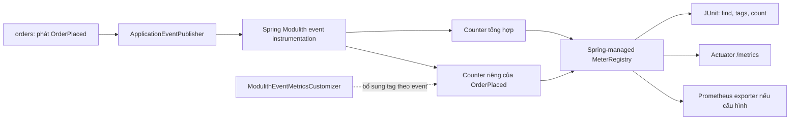
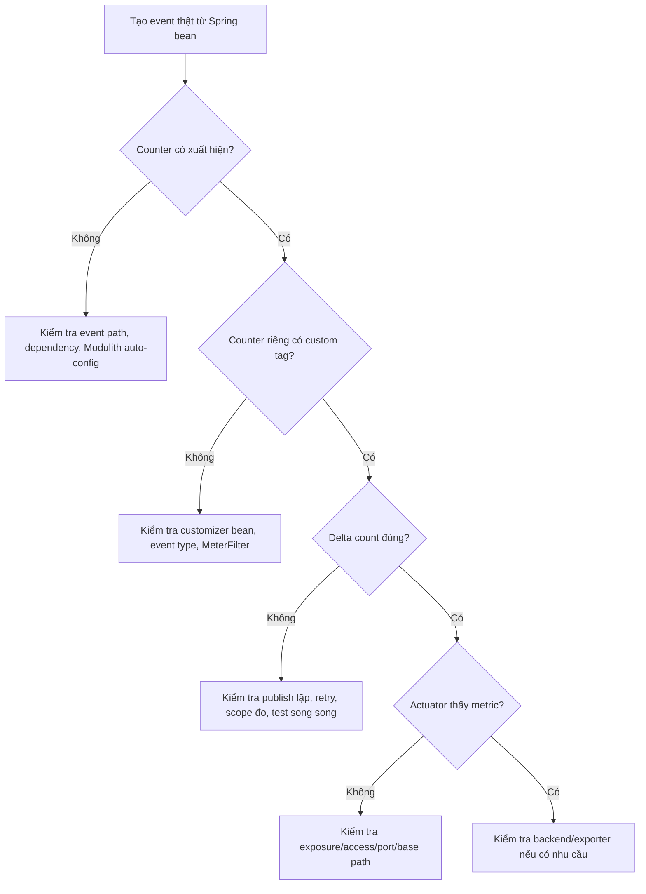

# Kiểm thử metric sau khi customize

## 1. Bối cảnh và mục tiêu bài học

Trong ứng dụng Spring Boot tổ chức theo **application module**, Spring Modulith có thể ghi nhận số lần công bố domain event. Nhóm phát triển thường dùng `ModulithEventMetricsCustomizer` để bổ sung một chiều phân loại nghiệp vụ, chẳng hạn `sales.channel=web/mobile/pos`, vào counter dành riêng cho sự kiện `OrderPlaced`.

Đoạn customizer biên dịch thành công chưa chứng minh metric thực sự có tag như mong đợi. Sau khi khởi động, có thể xảy ra các tình huống:

- Bean customizer không được Spring đăng ký.
- Event không đi qua đường publish được Spring Modulith instrument.
- Tag được gắn vào counter riêng nhưng người kiểm thử lại đọc counter tổng hợp.
- Tên metric hoặc giá trị tag khác với giả định, nên câu lệnh lọc trả về rỗng.
- Counter tăng nhiều lần do publish lặp, retry, hoặc phép đo trùng.
- Tag lấy từ UUID, email hoặc chuỗi tự do làm cardinality tăng mạnh.
- Test tạo `SimpleMeterRegistry` riêng nên không nhìn thấy metric mà application context thực sự ghi.
- Actuator chưa expose `metrics` hoặc Prometheus exporter đổi naming convention.

Vì vậy, muốn xác nhận một customizer hoạt động đúng, cần kiểm tra **cả hành vi ghi counter, tag được gắn và cách metric được công bố**.

Bài **“Kiểm thử metric sau khi customize”** thuộc chương **Event customizer** trong học phần **SPRING_MODULITH_DOCUMENTATION_OBSERVABILITY**. Phạm vi của học phần là dùng Spring Modulith để sinh tài liệu ranh giới application module, xem module graph, đọc Actuator, event metrics, traces và context propagation nhằm kiểm chứng kiến trúc khi Spring Boot vận hành.

Sau bài này, người học sẽ:

1. Phân biệt counter tổng hợp với counter riêng của từng loại domain event.
2. Xác định **hợp đồng kiểm thử** sau khi áp dụng `ModulithEventMetricsCustomizer`.
3. Viết kiểm thử tích hợp dùng chính `MeterRegistry` của Spring Boot, phát event thật và so sánh **giá trị trước/sau**.
4. Kiểm tra tag mặc định, tag mới, giới hạn cardinality và dữ liệu không được phép xuất hiện.
5. Đọc lại kết quả qua `/actuator/metrics` và Prometheus khi cần.
6. Phân biệt lỗi bean wiring, event instrumentation, counter registration, tag filtering và exporter.
7. Tránh lấy event publication counter làm bằng chứng listener đã xử lý thành công.

> **Giả định:** Ví dụ sử dụng Spring Boot, Micrometer, JUnit 5 và Spring Modulith có API `ModulithEventMetricsCustomizer` (các phiên bản Spring Modulith hiện đại). Mã được trình bày theo cấu trúc mẫu để áp dụng vào dự án, cần dùng BOM/phiên bản dependency tương thích. Đây là bài hướng dẫn viết và đọc kiểm thử; không giả định các kiểm thử đã chạy trên ứng dụng của người học.

## 2. Xác định chính xác thứ cần kiểm thử

### 2.1. Spring Modulith có hai họ event counter

Spring Modulith cung cấp hai dạng metric cho các domain event được ghi nhận:

| Metric | Ý nghĩa | Low-cardinality tags mặc định |
| --- | --- | --- |
| `module.events.published` | Counter tổng hợp các lần công bố event | `module.event.type`, `module.identifier`, `module.name` |
| `module.events.published.<moduleIdentifier>.<simpleEventTypeName>` | Counter riêng cho một loại event trong module | `module.identifier`, `module.name` |

Ví dụ module `orders` phát `OrderPlaced` thì tên counter riêng có thể là:

```text
module.events.published.orders.OrderPlaced
```

API `ModulithEventMetricsCustomizer` cho phép thêm tag từ dữ liệu domain event vào **counter riêng**. Một lần publish có thể được phản ánh trong cả counter tổng hợp và counter riêng; đây là hai cách biểu diễn **cùng hoạt động**, không phải hai event độc lập.

Các thuộc tính `module.identifier` và `module.name` lấy từ metadata application module. Giá trị `module.event.type` trên counter tổng hợp phải được đọc từ metric thực tế khi viết bộ lọc; không tự giả định format là simple class name hay fully qualified class name.

### 2.2. “Customize thành công” cần nghĩa cụ thể

Giả sử ta có quy tắc:

> Mỗi `OrderPlaced` được công bố sẽ tăng counter riêng của module `orders` đúng một lần, với tag `sales.channel` lấy từ enum `WEB`, `MOBILE` hoặc `POS` và được chuẩn hóa về chữ thường.

**Hợp đồng kiểm thử** nên tách thành các tiêu chí:

| Tiêu chí | Câu hỏi | Bằng chứng |
| --- | --- | --- |
| Bean wiring | Customizer có nằm trong application context không? | Context load và bean lookup |
| Event instrumentation | Event thật có tạo metric không? | Counter xuất hiện sau publish |
| Metric name | Có đúng họ counter riêng `OrderPlaced`? | `MeterRegistry.find(name)` |
| Default tags | Có metadata module mong đợi? | `Counter.getId().getTag(...)` |
| Customized tag | `sales.channel` mang giá trị đúng? | Tìm counter theo name + tag |
| Count | Một lần publish làm tăng bao nhiêu? | **Delta** count trước/sau |
| Isolation | `web` có làm tăng cả `pos` không? | So sánh hai series theo channel |
| Scope | Tag có vô tình xuất hiện ở counter tổng hợp không? | Kiểm tra `module.events.published` riêng |
| Safety | Có tag `order.id` hoặc ID người dùng không? | Kiểm tra toàn bộ `Meter.Id` liên quan |
| Export | Endpoint quản trị/backend có đọc được không? | Actuator và Prometheus smoke test |

Không nên chỉ assert `counter != null`: sự tồn tại của meter không chứng minh count tăng khi publish, cũng không chứng minh tag đúng.

### 2.3. Sơ đồ đường đi của phép đo



Điểm quan trọng của kiểm thử tích hợp là quan sát **sau khi event được phát trong Spring application context**, qua chính registry mà instrumentation ghi dữ liệu. Điều đó khác với việc tự gọi `Counter.builder(...)` trong một unit test.

## 3. Tạo ví dụ domain event và customizer

### 3.1. Cấu trúc module minh họa

```text
com.example.shop
├── ShopApplication.java
├── orders
│   ├── SalesChannel.java
│   ├── OrderPlaced.java
│   ├── OrderService.java
│   └── OrderMetricsConfiguration.java
└── payments
    └── OrderPaymentListener.java

src/test/java/com/example/shop
└── OrderEventMetricsIntegrationTests.java
```

Trong mẫu này, `orders` là module phát `OrderPlaced`, `payments` là module lắng nghe event. Đặt hai khả năng nghiệp vụ trong hai module giúp người học đồng thời nhìn thấy ranh giới cấu trúc và tình huống event liên module.

### 3.2. Dependency

Ví dụ `build.gradle` (Gradle Groovy DSL):

```groovy
dependencies {
    implementation 'org.springframework.boot:spring-boot-starter'

    // API cần thiết khi khai báo bean ModulithEventMetricsCustomizer.
    implementation 'org.springframework.modulith:spring-modulith-observability-api'

    // Bật Actuator và instrumentation của Spring Modulith tại runtime.
    runtimeOnly 'org.springframework.modulith:spring-modulith-starter-insight'

    testImplementation 'org.springframework.boot:spring-boot-starter-test'
}
```

Ví dụ giả định project đã có `repositories` và quản lý phiên bản tương thích bằng Spring Boot plugin/BOM và Spring Modulith BOM. Các lớp nghiệp vụ và `MeterRegistry` cần nằm trong đúng classpath kiểm thử. Nếu kiểm tra HTTP endpoint thật, ứng dụng còn cần web starter; bản kiểm thử registry dưới đây không cần chạy HTTP server.

### 3.3. Dữ liệu event có enum hữu hạn

```java
// com/example/shop/orders/SalesChannel.java
package com.example.shop.orders;

public enum SalesChannel {
    WEB, MOBILE, POS
}
```

```java
// com/example/shop/orders/OrderPlaced.java
package com.example.shop.orders;

import java.util.UUID;

public record OrderPlaced(UUID orderId, SalesChannel channel) {
}
```

`orderId` là dữ liệu nghiệp vụ dùng để xử lý đơn hàng, nhưng **không được gắn làm tag metric**. `channel` lấy từ enum chỉ có ba giá trị, phù hợp để phân loại counter.

### 3.4. Service thực sự publish event

```java
// com/example/shop/orders/OrderService.java
package com.example.shop.orders;

import java.util.UUID;
import org.springframework.context.ApplicationEventPublisher;
import org.springframework.stereotype.Service;

@Service
public class OrderService {

    private final ApplicationEventPublisher publisher;

    public OrderService(ApplicationEventPublisher publisher) {
        this.publisher = publisher;
    }

    public void place(UUID orderId, SalesChannel channel) {
        // Ở ứng dụng thật, lưu đơn và kiểm soát transaction tại đây.
        publisher.publishEvent(new OrderPlaced(orderId, channel));
    }
}
```

Vì kiểm thử gọi `OrderService` là một Spring bean, event được công bố qua `ApplicationEventPublisher` thực tế trong context, thay vì chỉ giả lập bằng cách tăng counter thủ công.

Một listener đơn giản trong module `payments`:

```java
// com/example/shop/payments/OrderPaymentListener.java
package com.example.shop.payments;

import com.example.shop.orders.OrderPlaced;
import org.springframework.context.event.EventListener;
import org.springframework.stereotype.Component;

@Component
public class OrderPaymentListener {

    @EventListener
    public void on(OrderPlaced event) {
        // Listener đồng bộ tối giản để tạo tình huống event liên module.
        // Không gọi API ngoài hoặc phụ thuộc cơ sở dữ liệu trong bài test.
    }
}
```

Listener này tồn tại để minh họa kiến trúc và giúp fixture có sự tương tác giữa hai module; kết quả counter là **số lần publish được instrument**, không phải số lần listener xử lý xong. Trong bài kiểm thử count, tránh thêm `@Async` hoặc transaction listener nếu mục đích chỉ là kiểm tra phép đếm đồng bộ, vì điều đó đưa thêm yếu tố thời gian và context propagation vào bài.

### 3.5. Đăng ký customizer dưới dạng Spring bean

```java
// com/example/shop/orders/OrderMetricsConfiguration.java
package com.example.shop.orders;

import java.util.Locale;
import org.springframework.context.annotation.Bean;
import org.springframework.context.annotation.Configuration;
import org.springframework.modulith.observability.ModulithEventMetricsCustomizer;

@Configuration(proxyBeanMethods = false)
public class OrderMetricsConfiguration {

    @Bean
    ModulithEventMetricsCustomizer orderEventMetricsCustomizer() {
        return metrics -> {
            metrics.customize(OrderPlaced.class, (event, builder) -> {
                builder.tag(
                    "sales.channel",
                    event.channel().name().toLowerCase(Locale.ROOT)
                );
            });
        };
    }
}
```

Ý nghĩa:

- `metrics.customize(OrderPlaced.class, ...)` chọn counter riêng cho **đúng loại event**.
- `builder` là `Counter.Builder` được Spring Modulith chuẩn bị cho metric đó.
- `sales.channel` là key thêm vào, nhận các giá trị `web`, `mobile` hoặc `pos`.
- Sử dụng `Locale.ROOT` giúp chuẩn hóa chữ thường theo quy ước kỹ thuật ổn định.
- Customizer **không sửa nội dung event**, không tự tạo payment và không dùng `orderId` làm metric tag.
- Không được mặc định customizer này cũng sửa counter tổng hợp `module.events.published`.

Theo API Spring Modulith, `ModulithEventMetricsCustomizer` nhận `ModulithEventMetrics`; trên đối tượng đó có overload `customize(Class<T>, BiConsumer<T, Counter.Builder>)`. Việc nhận **event thật** trong callback cho phép tạo tag từ thông tin của event, nhưng phải kiểm soát cardinality.

### 3.6. Định nghĩa trạng thái kỳ vọng

Trước khi chạy test, ghi lại bảng kỳ vọng:

| Event phát | Counter riêng | Tag `sales.channel` | Delta của series đó |
| --- | --- | --- | --- |
| `OrderPlaced(id1, WEB)` | `...orders.OrderPlaced` | `web` | +1 |
| `OrderPlaced(id2, POS)` | `...orders.OrderPlaced` | `pos` | +1 |
| `OrderPlaced(id3, WEB)` | `...orders.OrderPlaced` | `web` | +1 |
| Không phát event | Không có lần tăng mới | Không đổi | 0 |

Lưu ý: nhiều sự kiện `WEB` cùng loại tạo **một series WEB tăng dần**, không tạo một series mới cho mỗi UUID.

## 4. Viết kiểm thử tích hợp trên MeterRegistry

### 4.1. Vì sao dùng `@SpringBootTest`?

Một unit test gọi trực tiếp logic chuyển `SalesChannel.WEB` thành `"web"` chỉ chứng minh **quy tắc chuyển đổi chuỗi**. Nó không chứng minh Spring đã tạo bean customizer, nhận event, tạo metric hay đăng ký meter.

Kiểm thử tích hợp cần:

1. Khởi tạo **Spring application context thật** bằng `@SpringBootTest`.
2. Để auto-configuration của Spring Boot/Spring Modulith đăng ký instrumentation.
3. Inject `OrderService` để phát event thật.
4. Inject **cùng `MeterRegistry`** mà ứng dụng dùng.
5. Tìm meter đã tồn tại bằng `registry.find(...)`, rồi đọc count và tags.

Không tạo `new SimpleMeterRegistry()` riêng trong kiểm thử tích hợp, vì registry rời đó không tự nhận dữ liệu từ các bean production. `SimpleMeterRegistry` vẫn hữu ích cho unit test của một `Counter.Builder` hoặc helper cô lập, nhưng nó là **một phạm vi kiểm thử khác**.

### 4.2. Kiểm thử count và tag theo delta

```java
package com.example.shop;

import static org.assertj.core.api.Assertions.assertThat;

import java.util.UUID;

import com.example.shop.orders.OrderService;
import com.example.shop.orders.SalesChannel;
import io.micrometer.core.instrument.Counter;
import io.micrometer.core.instrument.MeterRegistry;
import org.junit.jupiter.api.Test;
import org.springframework.beans.factory.annotation.Autowired;
import org.springframework.boot.test.context.SpringBootTest;

@SpringBootTest(
    classes = ShopApplication.class,
    webEnvironment = SpringBootTest.WebEnvironment.NONE
)
class OrderEventMetricsIntegrationTests {

    private static final String EVENT_COUNTER =
        "module.events.published.orders.OrderPlaced";

    @Autowired
    OrderService orders;

    @Autowired
    MeterRegistry registry;

    private Counter findChannel(String channel) {
        // find(...) chỉ tìm meter đã có; không tạo counter mới.
        return registry.find(EVENT_COUNTER)
            .tags("module.identifier", "orders",
                  "sales.channel", channel)
            .counter();
    }

    private double countChannel(String channel) {
        Counter counter = findChannel(channel);
        return counter == null ? 0.0 : counter.count();
    }

    @Test
    void customTagIsRegisteredAndCounterIncrements() {
        double before = countChannel("web");

        orders.place(UUID.randomUUID(), SalesChannel.WEB);

        Counter actual = findChannel("web");
        assertThat(actual).isNotNull();

        assertThat(actual.count()).isEqualTo(before + 1.0);

        assertThat(actual.getId().getTag("module.identifier"))
            .isEqualTo("orders");
        assertThat(actual.getId().getTag("module.name"))
            .isNotBlank();
        assertThat(actual.getId().getTag("sales.channel"))
            .isEqualTo("web");

        // Tất cả OrderPlaced đều có UUID, nhưng UUID không được
        // tham gia vào identity của meter.
        assertThat(actual.getId().getTag("order.id")).isNull();
        assertThat(actual.getId().getTag("customer.id")).isNull();
    }

    @Test
    void differentChannelsAreDifferentMeterSeries() {
        double webBefore = countChannel("web");
        double posBefore = countChannel("pos");

        orders.place(UUID.randomUUID(), SalesChannel.WEB);
        orders.place(UUID.randomUUID(), SalesChannel.POS);

        Counter web = findChannel("web");
        Counter pos = findChannel("pos");

        assertThat(web).isNotNull();
        assertThat(pos).isNotNull();
        assertThat(web.count()).isEqualTo(webBefore + 1.0);
        assertThat(pos.count()).isEqualTo(posBefore + 1.0);
        assertThat(web.getId()).isNotEqualTo(pos.getId());
    }
}
```

**Điều quan trọng trong ví dụ:**

- Test đọc **delta count**: `count_after − count_before`. MeterRegistry có thể được dùng lại giữa các test hoặc đã có hoạt động lúc khởi động; assert count luôn bằng 1 sẽ giòn.
- `registry.find(name).tags(...).counter()` có thể trả `null` nếu chưa có meter. `null` trước khi publish được quy thành 0; `null` sau publish khiến assertion thất bại.
- `registry.find(...)` chỉ **tìm** meter đã được instrument; không gọi `registry.counter(...)` trong assertion, vì API đó có thể **tạo counter mới**, làm test dương tính giả.
- So sánh hai channels cho thấy customizer tạo các **meter identities** khác nhau dựa trên low-cardinality tag.
- Kiểm tra `module.name` không rỗng giúp xác nhận metadata module, nhưng tránh gắn chặt vào tên hiển thị có thể đổi do cấu hình.
- Không đặt `@Transactional` lên test này nếu bạn chưa làm rõ event được công bố trước hay sau commit; ở fixture đơn giản, publish chạy trực tiếp trong service.

**Phạm vi xác minh:** Kiểm thử kiểm tra counter của một application context giả định `orders` là technical identifier. Nếu dự án tùy biến cách đặt identifier hoặc tên event, phải điều chỉnh `EVENT_COUNTER` theo dữ liệu Modulith thực tế và giải thích thay đổi đó trong hợp đồng kiểm thử.

### 4.3. Kiểm tra counter tổng hợp không nhận nhầm tag tùy biến

Customizer dành cho **counter riêng**. Muốn kiểm tra hiệu ứng không lan sang counter tổng hợp:

```java
@Test
void customizedTagDoesNotLeakToAggregateCounter() {
    String aggregate = "module.events.published";

    double before = registry.find(aggregate)
        .tags("module.identifier", "orders")
        .counters()
        .stream()
        .mapToDouble(Counter::count)
        .sum();

    orders.place(UUID.randomUUID(), SalesChannel.MOBILE);

    var aggregateCounters = registry.find(aggregate)
        .tags("module.identifier", "orders")
        .counters();

    double after = aggregateCounters.stream()
        .mapToDouble(Counter::count)
        .sum();

    assertThat(after).isEqualTo(before + 1.0);
    assertThat(aggregateCounters).isNotEmpty();
    assertThat(aggregateCounters).allSatisfy(counter -> {
        assertThat(counter.getId().getTag("sales.channel")).isNull();
    });

    assertThat(findChannel("mobile")).isNotNull();
}
```

Có thể đặt method này trong cùng lớp `OrderEventMetricsIntegrationTests` ở trên. Đoạn code giả định fixture **không đăng ký một customizer hoặc `MeterFilter` khác cố ý thêm `sales.channel` vào counter tổng hợp**.

Nhận xét quan trọng:

- Counter tổng hợp có thể có **nhiều series** theo `module.event.type`, nên ta cộng `count()` của các counter khớp `module.identifier=orders`.
- Một `OrderPlaced` ở fixture này được kỳ vọng tăng tổng cộng **một lần** ở họ counter tổng hợp.
- Không cộng counter tổng hợp với counter riêng khi tính tổng số sự kiện nghiệp vụ: cùng event có thể được đo trong **cả hai họ**.
- Nếu event có retry hoặc publisher gọi nhiều lần, count phản ánh những lần publish được instrument, không phải số đơn đã hoàn tất.

### 4.4. Kiểm tra đủ tag mặc định và không có tag nguy hiểm

Có thể bổ sung kiểm tra trực tiếp `Meter.Id` cho counter riêng:

```java
@Test
void eventCounterKeepsOnlyBoundedBusinessTags() {
    orders.place(UUID.randomUUID(), SalesChannel.WEB);

    Counter counter = findChannel("web");
    assertThat(counter).isNotNull();

    var tagNames = counter.getId().getTags().stream()
        .map(tag -> tag.getKey())
        .toList();

    assertThat(tagNames)
        .contains("module.identifier", "module.name", "sales.channel")
        .doesNotContain("order.id", "customer.id", "trace.id", "email");
}
```

Một ứng dụng thật có thể bổ sung common tags như `application`, `region` hoặc `instance`. Vì vậy, dùng `contains(...)` cho những tag bắt buộc và `doesNotContain(...)` cho những tag bị cấm thường ổn định hơn assert toàn bộ tag set phải **khớp chính xác** một danh sách cố định.

### 4.5. Test “không có event thì count không đổi”

Nếu logic là không phát event khi đơn bị từ chối trong bước validation, tạo một phương thức nghiệp vụ trả về hoặc ném exception **trước `publishEvent(...)`**, rồi kiểm tra delta bằng 0.

Ví dụ pseudocode tập trung vào kỳ vọng:

```text
before = countChannel("web")
when: gọi OrderService với input không hợp lệ
then: không có ApplicationEventPublisher.publishEvent(OrderPlaced)
after = countChannel("web")
assert after == before
```

Không nên viết test chỉ gọi `countChannel("web")` hai lần rồi khẳng định không đổi: test đó không hề kích hoạt nhánh nghiệp vụ cần kiểm tra. Cần có input và một phép gọi thực tế, sau đó xác nhận **thật sự không publish**.

## 5. Kiểm thử logic customizer nhanh và phạm vi giới hạn

### 5.1. Tách phép chuẩn hóa tag thành hàm thuần

Nếu muốn xác minh logic mapping mà không khởi tạo Spring, có thể trích thành một helper:

```java
package com.example.shop.orders;

import java.util.Locale;

public final class EventMetricTags {

    private EventMetricTags() {}

    public static String channel(SalesChannel value) {
        return value.name().toLowerCase(Locale.ROOT);
    }
}
```

Khi đó customizer dùng:

```java
@Bean
ModulithEventMetricsCustomizer orderEventMetricsCustomizer() {
    return metrics -> metrics.customize(
        OrderPlaced.class,
        (event, builder) ->
            builder.tag("sales.channel", EventMetricTags.channel(event.channel()))
    );
}
```

Và kiểm thử nhỏ:

```java
import static org.assertj.core.api.Assertions.assertThat;

import org.junit.jupiter.api.Test;

class EventMetricTagsTests {

    @Test
    void mapsAllChannelsToStableLabels() {
        assertThat(EventMetricTags.channel(SalesChannel.WEB))
            .isEqualTo("web");
        assertThat(EventMetricTags.channel(SalesChannel.MOBILE))
            .isEqualTo("mobile");
        assertThat(EventMetricTags.channel(SalesChannel.POS))
            .isEqualTo("pos");
    }
}
```

Test này hữu ích khi có nhiều quy tắc mapping/normalization. Nhưng **PASS chỉ chứng minh hàm mapping**, chưa chứng minh bean `ModulithEventMetricsCustomizer` được gọi, counter có tag hoặc Actuator xuất số liệu. Do đó **kiểm thử tích hợp** vẫn cần thiết.

### 5.2. Không giả lập đến mức mất cơ chế đang kiểm tra

Các test kiểu sau có thể qua dù integration hỏng:

```java
// Đây KHÔNG phải bằng chứng customizer của Spring Modulith hoạt động.
Counter counter = Counter.builder(
    "module.events.published.orders.OrderPlaced")
    .tag("sales.channel", "web")
    .register(new SimpleMeterRegistry());

counter.increment();
assertThat(counter.count()).isEqualTo(1.0);
```

Bạn đã **tự tạo và tăng counter**, hoàn toàn bỏ qua:

- `ApplicationEventPublisher`;
- instrumentation của Spring Modulith;
- bean `ModulithEventMetricsCustomizer`;
- Spring-managed `MeterRegistry`.

Unit test như thế chỉ có thể dùng để kiểm tra cú pháp Micrometer hoặc một helper nội bộ, không đủ để kết luận metric sau customize hoạt động.

## 6. Smoke test qua Spring Boot Actuator

### 6.1. Bật endpoint cần thiết

Để kiểm tra HTTP, chạy ứng dụng web có `spring-boot-starter-actuator` hoặc Insight starter và exposure:

```yaml
management:
  endpoints:
    web:
      exposure:
        include: "health,metrics,modulith"
```

Nếu có Spring Security hoặc management port/base-path riêng, dùng đúng quyền truy cập và URL đã cấu hình. Cấu hình exposure **không thay thế** authentication/authorization. Trong production, chỉ cho phép truy cập endpoint quản trị trên mạng được bảo vệ.

### 6.2. Quy trình kiểm tra thủ công

Sau khi chạy ứng dụng, xác nhận endpoint:

```bash
curl -i http://localhost:8080/actuator/health
curl -i http://localhost:8080/actuator/metrics
```

Ghi giá trị **trước khi phát event**:

```bash
curl -s "http://localhost:8080/actuator/metrics/module.events.published.orders.OrderPlaced?tag=sales.channel:web"
```

Thực hiện một yêu cầu nghiệp vụ **thật sự gọi `OrderService.place(..., WEB)`**. Không có một URL `POST /orders` được mặc định tạo bởi Spring Modulith; nếu dự án chưa có HTTP controller, gọi service thông qua một test/integration runner phù hợp.

Sau đó truy vấn lại:

```bash
curl -s "http://localhost:8080/actuator/metrics/module.events.published.orders.OrderPlaced?tag=sales.channel:web"
```

Nếu counter tồn tại, Actuator trả về cấu trúc tương tự:

```json
{
  "name": "module.events.published.orders.OrderPlaced",
  "measurements": [
    { "statistic": "COUNT", "value": 3.0 }
  ],
  "availableTags": [
    { "tag": "module.identifier", "values": ["orders"] },
    { "tag": "module.name", "values": ["Orders"] }
  ]
}
```

Đây là **response minh họa sau khi đã lọc `sales.channel:web`**. Trên truy vấn không lọc, `availableTags` có thể hiển thị `sales.channel` cùng các giá trị `web`, `mobile`, `pos`. Các giá trị, tên hiển thị và số count phải lấy từ runtime thật.

### 6.3. Cần đọc phần nào trong JSON?

| Trường | Ý nghĩa kiểm thử |
| --- | --- |
| `name` | Có đúng counter riêng đã customize không? |
| `measurements[?statistic=COUNT].value` | Count có tăng theo delta dự kiến không? |
| `availableTags[].tag` | Những chiều phân loại nào có trên các meter phù hợp |
| `availableTags[].values` | Giá trị tag thực tế để dùng trong truy vấn |
| HTTP status | Endpoint có được đăng ký, expose và cho phép truy cập không? |

**Điểm dễ nhầm:** Khi đã gửi `tag=sales.channel:web`, danh sách `availableTags` có thể **không còn liệt kê giá trị tag đã dùng làm điều kiện lọc**, vì Actuator trình bày các chiều còn lại của tập meter đã chọn. Không nên coi việc tag không xuất hiện trong response đã lọc là bằng chứng tag chưa được gắn.

Để liệt kê toàn bộ giá trị `sales.channel`, gọi tên metric **không có điều kiện tag** rồi đọc `availableTags`.

### 6.4. Lọc nhiều tags để chọn đúng series

```bash
curl -s "http://localhost:8080/actuator/metrics/module.events.published.orders.OrderPlaced?tag=module.identifier:orders&tag=sales.channel:web"
```

Các tham số `tag=KEY:VALUE` có thể được lặp để lọc đồng thời. Muốn kiểm tra riêng `POS`, thay `web` bằng `pos` và xác nhận count không thay đổi khi chỉ phát event `WEB`.

Tên truy vấn Actuator sử dụng **tên meter Micrometer**, không phải tên đã được Prometheus đổi dấu chấm thành dấu gạch dưới.

### 6.5. Tại sao endpoint trả 404 sau lần thử đầu?

Các nguyên nhân thường gặp:

- Metric chưa được đăng ký vì chưa phát đúng event.
- Customizer bean chưa vào context hoặc observability dependency còn thiếu.
- Module identifier hoặc simple event type thực tế khác tên tự đoán.
- `/actuator/metrics` chưa được expose, endpoint bị vô hiệu hóa hoặc sai port/base path.
- Truy cập bị từ chối bởi Spring Security/proxy và công cụ khách hàng không hiển thị đầy đủ lỗi.
- Bộ lọc `MeterFilter` từ chối meter hoặc registry không phải registry mà ứng dụng sử dụng.

Hãy xem **`GET /actuator/metrics`** trước, lấy tên meter thực tế, rồi mới truy vấn tên cụ thể. Nếu endpoint riêng có tồn tại nhưng không có tag muốn lọc, kiểm tra `availableTags` và `Meter.Id` trong test tích hợp.

## 7. Smoke test Prometheus sau customize

### 7.1. Registry và endpoint cần được bật riêng

Nếu muốn kiểm tra exporter, thêm registry:

```groovy
dependencies {
    runtimeOnly 'io.micrometer:micrometer-registry-prometheus'
}
```

Expose endpoint:

```yaml
management:
  endpoints:
    web:
      exposure:
        include: "health,metrics,prometheus"
```

Sau khi phát event mẫu:

```bash
curl -s http://localhost:8080/actuator/prometheus
```

Trong output thực tế, tìm metric có nguồn từ `module.events.published.orders.OrderPlaced`. Prometheus có quy tắc chuẩn hóa metric name, suffix counter và label keys, ví dụ dấu chấm có thể chuyển thành dấu gạch dưới. Không tự mặc định đầu ra phải giống tên hiển thị trong `/actuator/metrics`.

### 7.2. Tên metric xuất ra phải được phát hiện, không đoán

Một dòng **minh họa** có thể mang hình thức:

```text
module_events_published_orders_OrderPlaced_total{
  module_identifier="orders",
  module_name="Orders",
  sales_channel="web"
} 3
```

Đây chỉ là ví dụ có điều kiện. Định dạng chữ hoa/chữ thường, name normalization và suffix cuối cùng có thể khác; cần xem chính xác response exporter của hệ thống đang chạy.

Khi đã biết tên thực tế, có thể dùng PromQL để so sánh tốc độ event theo kênh:

```promql
sum by (sales_channel) (
  rate(module_events_published_orders_OrderPlaced_total[5m])
)
```

Mẫu PromQL giả định exporter đã tạo đúng tên và label trong ví dụ trước. Nếu khác, hãy thay bằng tên do `/actuator/prometheus` công bố.

**Không dùng PromQL trên một cửa sổ quá ngắn chưa có đủ sample rồi kết luận metric không tăng.** Đối với smoke test một event ngay lập tức, đọc `MeterRegistry` hoặc Actuator count delta sẽ dễ xác minh hơn.

### 7.3. Kiểm tra nhiều instance và counter reset

Counters tăng từ lúc registry hoạt động và có thể reset khi ứng dụng khởi động lại. Khi so sánh trước/sau, nên:

1. Thử trên một instance ổn định hoặc đặt điều kiện lọc instance.
2. Ghi baseline ngay trước khi publish.
3. Không restart ứng dụng ở giữa hai lần đo.
4. Dùng phép tăng theo thời gian (`rate` hoặc `increase`) khi phân tích Prometheus.
5. Đừng cộng hai họ metrics cùng phản ánh một event.
6. Kiểm tra xem dashboard đang tổng hợp các instance nào.

Đây là lý do test tích hợp với `MeterRegistry` thường là lớp xác minh đầu tiên; Prometheus smoke test kiểm tra thêm **đường xuất dữ liệu**.

## 8. Kiểm thử cardinality của customized tags

### 8.1. Câu hỏi cần kiểm tra

Sau khi thêm `sales.channel`, số series của counter `OrderPlaced` phải bị chặn bởi tập giá trị hợp lệ. Với ba channel `web`, `mobile`, `pos` và một module nguồn, mỗi series có một tổ hợp tag có giới hạn.

Cần kiểm tra:

- Không có UUID hoặc ID từ event payload làm tag.
- Không xuất hiện giá trị lạ ngoài enum.
- Không có chuỗi rỗng, `null`, giá trị phụ thuộc locale hoặc free-text.
- Không vô tình tạo một tên metric mới cho từng order.
- Có thể tổng hợp theo module, channel và instance mà không gây bùng nổ series.

**Cardinality của một key** là số giá trị khác nhau; **số series** là số tổ hợp tag values, metric name và labels khác. Tích cardinality chỉ là giới hạn trên, không phải con số series chắc chắn xảy ra.

### 8.2. Ví dụ kiểm tra tập channel thực tế

Trong lớp `OrderEventMetricsIntegrationTests`, có thể thêm:

```java
@Test
void channelTagValuesStayWithinApprovedSet() {
    orders.place(UUID.randomUUID(), SalesChannel.WEB);
    orders.place(UUID.randomUUID(), SalesChannel.POS);

    var channels = registry.find(EVENT_COUNTER)
        .counters()
        .stream()
        .map(counter -> counter.getId().getTag("sales.channel"))
        .filter(java.util.Objects::nonNull)
        .collect(java.util.stream.Collectors.toSet());

    assertThat(channels).contains("web", "pos");
    assertThat(channels).isSubsetOf("web", "mobile", "pos");
}
```

Test xác nhận những series được ghi sau khi chạy fixture đều dùng tag values trong danh sách cho phép. Nếu ứng dụng có common tags khác, test vẫn tập trung vào riêng `sales.channel`.

Với dữ liệu tự do từ người dùng, nên **chuẩn hóa về enum hoặc một tập giá trị được allowlist** ngay trong nghiệp vụ/customizer trước khi tạo meter, thay vì chỉ dựa vào MeterFilter chặn sau khi bùng nổ.

### 8.3. Đặt giới hạn như một hàng rào phụ

Micrometer có `MeterFilter.maximumAllowableTags(...)` để từ chối meter mới khi số giá trị của một tag vượt giới hạn:

```java
import io.micrometer.core.instrument.config.MeterFilter;
import org.springframework.context.annotation.Bean;
import org.springframework.context.annotation.Configuration;

@Configuration(proxyBeanMethods = false)
class CardinalityLimits {

    @Bean
    MeterFilter limitChannels() {
        return MeterFilter.maximumAllowableTags(
            "module.events.published.orders.OrderPlaced",
            "sales.channel",
            3,
            MeterFilter.deny()
        );
    }
}
```

Giới hạn này có thể làm **mất series mới** khi giá trị vượt ngưỡng; đó là biện pháp bảo vệ chứ không phải cách sửa logic mapping. Nếu dùng trong production, cần theo dõi hiện tượng meter bị từ chối và phân tích tác động lên dashboard. Test logic nghiệp vụ nên vẫn xác nhận mọi tag xuất ra là giá trị hợp lệ.

### 8.4. Tránh unit test đánh đồng với cardinality thực tế

Một test với ba event tạo tối đa ba series trong một JVM, nhưng **không chứng minh** toàn bộ hệ thống production chỉ có ba series:

- Các instance có labels riêng.
- Common tags như `region`, `environment` làm tăng tổ hợp.
- Nhiều tên metric khác nhau vẫn tạo series riêng.
- Build mới có thể thêm channel hoặc thay đổi module.
- Backend còn có series churn qua các lần triển khai.

Kiểm thử ứng dụng nên kết hợp với quan sát số active series hoặc unique label sets trên backend trong môi trường staging sau khi thay đổi customizer.

## 9. Kiểm thử âm tính và các tình huống cạnh biên

### 9.1. Event khác không nhận nhầm tag

Giả sử ứng dụng có thêm event `OrderCancelled` nhưng customizer chỉ đăng ký cho `OrderPlaced`. Kỳ vọng:

- `OrderPlaced` có tag `sales.channel`.
- Counter riêng `OrderCancelled` **không tự nhận** `sales.channel` từ customizer của `OrderPlaced`.
- Counter tổng hợp vẫn giữ những tags mặc định của nó.

Bài kiểm thử cần phát `OrderCancelled` thật, tìm counter riêng có tên tương ứng, rồi kiểm tra `Meter.Id`. Không được chỉ tạo counter giả và assert tag rỗng.

### 9.2. Event không phù hợp với fixture

Nên kiểm thử dữ liệu thiếu channel theo chính sách nghiệp vụ:

| Tình huống | Cách giải quyết rõ ràng |
| --- | --- |
| `channel == null` | Từ chối event trước publish hoặc ánh xạ vào một giá trị hữu hạn `unknown` |
| Channel không hợp lệ do parsing request | Trả lỗi validation, không phát `OrderPlaced` |
| Thêm channel enum mới | Cập nhật allowlist, dashboard và cardinality test |
| Thông tin channel nằm trong chuỗi tự do | Chuyển đổi thành enum trước khi tạo metric |
| Có retry publish cùng event | Xác định rõ mục đích đo **lượt publish** hay **sự kiện nghiệp vụ duy nhất** |

Không mặc định một exception từ customizer là “cơ chế ghi event sẽ bỏ qua tag”: tùy cách wiring, exception có thể ảnh hưởng cả luồng publish. Cần quyết định và kiểm thử chính sách invalid-data ngay tại đầu vào.

### 9.3. Kiểm tra ràng buộc không đếm trùng

Một request có thể phát nhiều domain event, gọi `publishEvent` nhiều lần hoặc thực hiện retry. Nếu nghiệp vụ mong đợi đúng một lần publish nhưng metric tăng hai, hãy xác định:

1. Có thật sự hai lần gọi publisher không?
2. Listener hay thành phần khác có phát lại một event cùng loại không?
3. Test có được chạy song song với tác vụ nào khác cùng tag không?
4. Có instrumentation custom nào tự tăng counter cùng tên không?
5. Query có đang cộng **hai họ counter** hoặc nhiều instances không?
6. Meter có bị gắn common tags khác làm query tổng hợp rộng hơn dự kiến không?

Một counter bằng 2 không tự động chứng minh customizer bị gọi hai lần. **Customizer chủ yếu thay đổi cách tạo counter**; cần điều tra đường đi của event và phép đếm trước khi kết luận lỗi nằm ở customizer.

### 9.4. Đảm bảo kiểm thử không “đụng” hệ thống ngoài

Để test event metrics ổn định:

- Dùng một fixture Spring Boot nhỏ với listener đồng bộ.
- Tránh gọi payment gateway, Kafka, queue hoặc cơ sở dữ liệu thật.
- Không dùng sleep hoặc polling dài để chờ counter nếu instrumentation publish đồng bộ.
- Tránh cấu hình sampling/tracing khi chỉ đo event counter.
- Sử dụng đúng bean `MeterRegistry` trong context.
- Nếu dự án bật test song song, cô lập context hoặc thiết kế dữ liệu/tags để không có tác vụ khác tăng cùng series.
- Không xóa meter từ registry dùng chung sau mỗi test nếu điều đó có thể ảnh hưởng auto-configuration.

Nếu phép đo cần dựa vào listener async hoặc trạng thái sau transaction commit, đó là một **bài kiểm thử khác**, cần đồng bộ hóa theo kết quả nghiệp vụ, không được gắn giả định thời gian cố định vào kiểm thử event publication.

## 10. Khi nào bổ sung kiểm tra bean wiring?

### 10.1. Bean tồn tại chưa đủ, nhưng là bước chẩn đoán hữu ích

Nếu counter riêng không có `sales.channel`, trước tiên xác nhận customizer bean đã được tạo:

```java
@Autowired
org.springframework.context.ApplicationContext context;

@Test
void customizerBeanIsRegistered() {
    var customizers = context.getBeansOfType(
        org.springframework.modulith.observability.ModulithEventMetricsCustomizer.class
    );

    assertThat(customizers).containsKey("orderEventMetricsCustomizer");
}
```

Bài kiểm tra này xác nhận bean configuration được component scan/import đúng. Nhưng nó **không khẳng định** bean đã được auto-configuration của Modulith sử dụng; bằng chứng quyết định vẫn là **counter sau publish có tag đúng và count tăng**.

### 10.2. Nếu có nhiều customizers

Một ứng dụng có thể đăng ký nhiều bean `ModulithEventMetricsCustomizer`. Khi đó cần xem:

- Mỗi bean nhận những loại event nào.
- Có nhiều customizer cùng sửa một tag key không.
- Thứ tự customizers có ảnh hưởng giá trị cuối cùng không.
- Có customizer nào thay vì chỉ thêm tag lại thay thế cách tạo `Counter.Builder` không.
- Có `MeterFilter` hoặc common tag nào tác động lên meter sau khi tùy biến không.

Nếu nhiều bean xung đột, hãy định nghĩa **quy tắc ưu tiên rõ ràng** và kiểm tra kết quả cuối qua `Meter.Id`. Không dựa vào “bean nào được load trước thì chắc chắn thắng” khi chưa có hợp đồng thứ tự trong cấu hình.

### 10.3. Các API tùy biến nâng cao

`ModulithEventMetrics` hỗ trợ hai overload quan trọng:

```java
customize(Class<T> eventType, BiConsumer<T, Counter.Builder> consumer)
customize(Class<T> eventType, Function<T, Counter.Builder> factory)
```

- `BiConsumer` sửa `Counter.Builder` đã được chuẩn bị, thường phù hợp khi chỉ thêm tags.
- `Function` cho phép tùy biến cách **tạo** `Counter.Builder` khi cần thiết; thay đổi có thể ảnh hưởng tên và metadata của meter.
- Các tùy biến bằng `BiConsumer` vẫn được áp dụng theo cơ chế mô tả trong API khi kết hợp với factory.

Nếu dùng overload `Function`, kiểm thử cần mở rộng thêm **tên metric**, loại meter, tags mặc định còn giữ hay đã bị thay thế, và khả năng đăng ký vào registry. Với use case thêm enum tag đơn giản, dùng `BiConsumer` giúp giới hạn phạm vi thay đổi.

## 11. Quy trình xử lý lỗi theo triệu chứng

| Triệu chứng | Giả thuyết đầu tiên | Cách phân biệt |
| --- | --- | --- |
| Không có `module.events.published` | Chưa publish hoặc observability chưa hoạt động | Xác nhận publisher chạy, dependency, registry và auto-config |
| Có counter tổng hợp, không có counter riêng | Cơ chế event-specific counter chưa đăng ký hoặc tên khác dự kiến | Liệt kê mọi meter trong registry/Actuator |
| Có counter riêng nhưng thiếu `sales.channel` | Customizer bean chưa load, đăng ký sai event type, hoặc tag bị filter | Tìm bean, đối chiếu `OrderPlaced.class`, đọc `Meter.Id` |
| Có `sales.channel` nhưng count = 0 | Chỉ đăng ký meter, chưa có publish được ghi nhận | So sánh count trước/sau event thực |
| Count tăng 2 sau một request | Publish lặp, retry, instrumentation/truy vấn trùng | Đếm publisher calls, xem event path và series |
| `web` tăng khi phát `POS` | Mapping sai hoặc query chưa lọc tag | Kiểm tra event payload, tag mapping và `find(...).tags(...)` |
| Unit test PASS, integration FAIL | Logic mapping đúng nhưng wiring/instrumentation hỏng | Dùng `@SpringBootTest` với registry thật |
| Actuator trả 404 nhưng registry có meter | Endpoint chưa expose/không có quyền/sai URL | Kiểm tra exposure, security, port/base path |
| Actuator có metric, Prometheus không có | Registry/exporter/scrape/naming mismatch | Đọc `/actuator/prometheus`, kiểm tra scrape target |
| `order.id` xuất hiện trên counter | Tag high-cardinality bị gắn trực tiếp | Bỏ ID khỏi builder; kiểm tra customizer/MeterFilter |
| Metric bị mất sau khi thêm giới hạn tags | `MeterFilter` từ chối series mới | Xem tag values thực tế và giới hạn đã đặt |
| Event count tăng nhưng payment chưa hoàn tất | Counter đo publish, không đo listener outcome | Kiểm tra listener logs, publication state, business state |

Để chẩn đoán nhanh, nên xử lý **theo thứ tự nguồn dữ liệu**:



Không nên bắt đầu bằng sửa Prometheus query khi **MeterRegistry còn chưa có counter**. Tương tự, nếu registry có counter đúng mà endpoint HTTP trả `403`, vấn đề nhiều khả năng nằm ở quyền truy cập, không phải tag mapping.

## 12. Bài thực hành đánh giá kết quả customize

### 12.1. Đề bài

Hệ thống có ba module `orders`, `payments`, `inventory`. `orders` publish `OrderPlaced` với channel thuộc tập `WEB`, `MOBILE`, `POS`. Customizer thêm `sales.channel` vào **counter riêng** của `OrderPlaced`.

Hãy thực hiện các phép thử sau trên một môi trường Spring Boot test ổn định:

| Mã thử | Hoạt động | Kết quả kỳ vọng |
| --- | --- | --- |
| T1 | Publish một `WEB` | Counter riêng có tag `web`, delta +1 |
| T2 | Publish một `POS` | Series `pos` tăng; `web` không tăng do event POS |
| T3 | Publish thêm một `WEB` có UUID khác | Series `web` tiếp tục tăng, không phát sinh tag UUID |
| T4 | Đọc counter tổng hợp `module.events.published` | Delta phản ánh publish; không có `sales.channel` do customizer riêng |
| T5 | Kiểm tra `Meter.Id` | Có `module.identifier`, `module.name`; không có `order.id` |
| T6 | Tìm tag values sau các lần publish | Chỉ thuộc tập `web/mobile/pos` |
| T7 | Gọi Actuator không lọc | Metric hiện trong `/actuator/metrics` với tag values được đăng ký |
| T8 | Gọi Actuator lọc `sales.channel:web` | Count tương ứng series WEB |
| T9 | Gọi Prometheus exporter nếu đã bật | Thấy metric/labels sau khi chuẩn hóa tên |
| T10 | Dùng enum mới hoặc input bất hợp lệ trong sandbox | Quy tắc validation/cardinality được kiểm chứng |

### 12.2. Cách ghi kết quả

Mỗi phép thử nên ghi:

- **Điều kiện ban đầu:** service được khởi động, phiên bản code, meter name và baseline count.
- **Hành động:** publish event nào, có kênh nào và có sử dụng listener sync/async không.
- **Bằng chứng:** `MeterRegistry`, response Actuator, exporter hoặc trace/log cần thiết.
- **Phép so sánh:** delta count, tag key–value, số unique series.
- **Kết luận:** PASS/FAIL và nguyên nhân quan sát được, tránh suy đoán.

Bảng ví dụ:

| Test | Before | After | Delta | Tag | Kết quả |
| --- | ---: | ---: | ---: | --- | --- |
| Publish WEB lần 1 | 0 | 1 | +1 | `sales.channel=web` | PASS |
| Publish POS | 0 | 1 | +1 | `sales.channel=pos` | PASS |
| Publish WEB lần 2 | 1 | 2 | +1 | `sales.channel=web` | PASS |
| Kiểm tra UUID tag | — | — | — | Không có `order.id` | PASS |

Đây là **dữ liệu kỳ vọng giả định**, không phải kết quả test đã chạy. Trong context đã có hoạt động trước đó, before có thể là số khác 0; điều cần khẳng định là **delta** và nội dung tag.

### 12.3. Liên hệ module graph và observability

Khi counter có `module.identifier=orders`, đối chiếu metadata đó với `/actuator/modulith`. Nếu `payments` lắng nghe `OrderPlaced` do `orders` công bố, module graph có thể biểu diễn dependency **`payments → orders`** vì listener dùng event type của module `orders`. Đây là **chiều phụ thuộc mã nguồn**; sự kiện runtime được publish từ `orders` và xử lý ở `payments`.

Kết hợp ba nguồn:

- **Module graph/Actuator:** module nào tồn tại, ranh giới và dependency.
- **Event metrics:** số lần publish theo module/event type/channel.
- **Tracing và context propagation:** một lần xử lý được instrument đi qua đâu, bao lâu, có tiếp nối context khi listener chạy async không.

Ba nguồn trả lời các câu hỏi khác nhau. Event counter **không chứng minh** listener đã hoàn tất hoặc transaction đã commit. Muốn biết kết quả, kiểm tra trạng thái nghiệp vụ, logs và cơ chế theo dõi event publications tương ứng.

## 13. Những sai lầm thường gặp khi viết test

1. **Chỉ test enum chuyển thành chữ thường.** Điều đó chưa kiểm tra bean customizer, event instrumentation và meter registration.
2. **Tạo `registry.counter(...)` trong assertion.** Có thể vô tình đăng ký meter chưa tồn tại và tạo kết quả dương tính giả; nên dùng `find(...)`.
3. **Assert count tuyệt đối bằng 1 trong mọi trường hợp.** Registry có thể đã có dữ liệu từ test khác; hãy so sánh trước/sau.
4. **Đọc nhầm counter tổng hợp để chờ tag tùy biến.** `ModulithEventMetricsCustomizer` chủ yếu tùy biến counter riêng theo event type.
5. **Dùng `@Transactional` nhưng không phân biệt publish và commit.** Timing của event/transaction listener có thể làm test sai kỳ vọng.
6. **Đồng nhất publish count với số listener đã xử lý.** Event có thể chưa được listener xử lý, đang retry hoặc đã thất bại.
7. **Gắn UUID để tìm từng event trong metric.** Đây là high cardinality, khiến số series tăng theo mỗi request.
8. **Dùng tên Prometheus cho `/actuator/metrics`.** Actuator cần tên meter Micrometer; exporter có naming convention riêng.
9. **Dùng một registry tự tạo không được Spring quản lý.** Test không nhìn thấy dữ liệu mà Modulith thực sự ghi.
10. **Bỏ qua tags mặc định.** Customizer nên giữ metadata module cần cho dashboard và kiểm chứng kiến trúc.
11. **Không cô lập test chạy song song.** Hai test có thể cùng tăng một series, làm sai phép đo delta.
12. **Giới hạn tag quá chặt mà không kiểm tra meter bị từ chối.** Dữ liệu mất đi có thể khiến dashboard trông như event không được publish.
13. **Giả định mọi event publication đều được đo giống nhau ở mọi phiên bản.** Kiểm tra loại event, cấu hình instrumentation và Spring Modulith BOM thực tế.

## 14. Câu hỏi tự kiểm tra

1. Vì sao `ModulithEventMetricsCustomizer` cần được kiểm thử bằng event publish thật và `MeterRegistry` của application context?
2. Hai họ metric `module.events.published` và `module.events.published.<module>.<event>` khác nhau ở mục đích và bộ tags mặc định như thế nào?
3. Vì sao kiểm thử nên so sánh `count_after − count_before` thay vì chỉ assert `count_after == 1`?
4. Lý do kỹ thuật nào khiến `registry.find(...)` phù hợp hơn `registry.counter(...)` trong assertion?
5. Viết điều kiện nào để xác nhận customizer chỉ gắn `sales.channel` cho counter riêng `OrderPlaced`?
6. Khi `sales.channel=web` và `sales.channel=pos` cùng tồn tại, MeterRegistry phân biệt chúng bằng điều gì?
7. Vì sao một lần publish có thể được phản ánh trong hai họ counter nhưng không được cộng hai count đó lại?
8. Nếu Actuator trả `404` cho tên metric sau khi publish, phải kiểm tra các lớp nguyên nhân nào?
9. Vì sao `availableTags` của response Actuator đã lọc có thể không liệt kê lại tag vừa dùng lọc?
10. Khi đọc `/actuator/prometheus`, điều gì có thể thay đổi ở metric name và label keys?
11. Đâu là giới hạn của unit test chỉ kiểm tra `EventMetricTags.channel(...)`?
12. Vì sao `MeterFilter.maximumAllowableTags(...)` là hàng rào bảo vệ, không phải cách xử lý tận gốc một tag high-cardinality?
13. Khi payment listener xử lý bất đồng bộ, metric publication tăng có thể chứng minh điều gì và không thể chứng minh điều gì?
14. Muốn khẳng định kết quả customize sau triển khai đúng, nên phối hợp test registry, Actuator và backend observability theo thứ tự nào?

## 15. Tài liệu tham khảo chính thức

- [Spring Modulith — Production-ready Features](https://docs.spring.io/spring-modulith/reference/production-ready.html): hai họ event metrics, tags mặc định và ví dụ `ModulithEventMetricsCustomizer`.
- [Spring Modulith — ModulithEventMetricsCustomizer API](https://docs.spring.io/spring-modulith/docs/current/api/org/springframework/modulith/observability/ModulithEventMetricsCustomizer.html): bean SPI để tùy biến metric.
- [Spring Modulith — ModulithEventMetrics API](https://docs.spring.io/spring-modulith/docs/current/api/org/springframework/modulith/observability/ModulithEventMetrics.html): hai overload `customize(Class<T>, ...)`.
- [Spring Modulith — Working with Application Events](https://docs.spring.io/spring-modulith/reference/events.html): publication, listener và trạng thái event publication.
- [Spring Boot — Metrics](https://docs.spring.io/spring-boot/reference/actuator/metrics.html): Spring-managed `MeterRegistry`, `MeterFilter`, Actuator Metrics endpoint, common tags.
- [Spring Boot — Actuator Endpoints](https://docs.spring.io/spring-boot/reference/actuator/endpoints.html): exposure, access, bảo mật và management base path.
- [Micrometer — Registry](https://docs.micrometer.io/micrometer/reference/concepts/registry.html): `SimpleMeterRegistry` và vòng đời registry.
- [Micrometer — Counters](https://docs.micrometer.io/micrometer/reference/concepts/counters.html): `Counter`, `Counter.Builder` và phép đếm.
- [Micrometer — Meter Filters](https://docs.micrometer.io/micrometer/reference/concepts/meter-filters.html): cấu hình từ chối meter và giới hạn tag cardinality.
- [Spring Boot — Actuator Metrics REST API](https://docs.spring.io/spring-boot/api/rest/actuator/metrics.html): `measurements`, `availableTags` và điều kiện `tag=KEY:VALUE`.

> **Ghi nhớ:** Một customizer được xem là đã kiểm chứng khi **event thật** đi qua Spring Modulith, **counter đúng tên** xuất hiện trong **Spring-managed MeterRegistry**, **tag mới đúng tập giá trị**, **count tăng theo delta kỳ vọng**, và **không phát sinh tag high-cardinality**. Sau đó dùng Actuator/Prometheus xác nhận đường công bố dữ liệu. Hãy luôn tách phép đo **publish event** khỏi kết quả **listener xử lý** và đối chiếu metadata module với module graph nếu cần kiểm chứng ranh giới.
