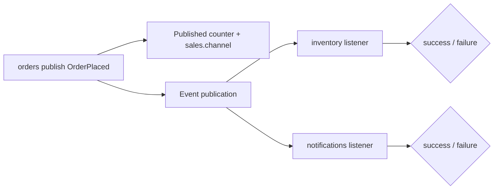
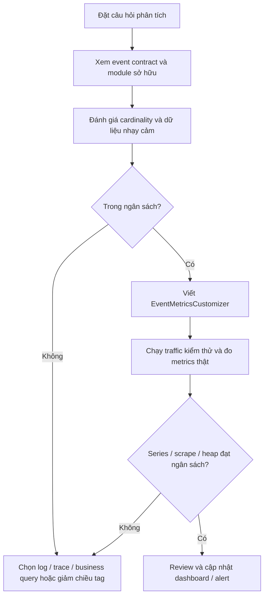

# Đánh giá chi phí khi thêm tag nghiệp vụ

## 1. Bối cảnh: một tag nhỏ có thể tạo ra rất nhiều chuỗi thời gian

Trong ứng dụng Spring Boot tổ chức theo **Spring Modulith**, một application module như `orders` có thể phát các sự kiện `OrderPlaced`, `OrderCancelled`, `OrderPaid`. **Spring Modulith Event Metrics** cho phép theo dõi hoạt động publish event qua Micrometer. Khi phân tích vận hành, nhóm phát triển có thể muốn thêm thông tin nghiệp vụ vào metric, chẳng hạn **kênh đặt hàng** (`WEB`, `MOBILE`, `PARTNER`) hoặc **thị trường** (`VN`, `TH`, `SG`, `OTHER`).

Thông tin mới giúp trả lời câu hỏi chi tiết hơn: lưu lượng `OrderPlaced` qua kênh `MOBILE` có tăng sau triển khai không? Tuy nhiên, mỗi tag mới cũng có thể khiến số **time series** mà hệ thống metrics cần lưu trữ, lập chỉ mục, thu thập và truy vấn tăng mạnh. Đặc biệt, nếu gắn `orderId` hoặc `customerId` vào metric, chi phí có thể tăng theo số giao dịch thay vì theo số loại nghiệp vụ.

Trong chương **Event customizer** thuộc `SPRING_MODULITH_DOCUMENTATION_OBSERVABILITY`, bài này hướng dẫn đánh giá **lợi ích phân tích so với chi phí vận hành** trước khi bổ sung tag nghiệp vụ vào event metrics. Đây là một phần của mục tiêu lớn hơn: kết hợp module graph, Actuator, event metrics, tracing và context propagation để kiểm chứng kiến trúc mô-đun trong lúc hệ thống chạy.

Học xong, bạn cần có thể:

- Phân biệt tag của một metric với payload của event và attribute của trace.
- Ước lượng số time series và số mẫu metrics tăng thêm khi bổ sung một hoặc nhiều tag.
- Chọn trường nghiệp vụ phù hợp để tùy chỉnh `ModulithEventMetricsCustomizer`.
- Kiểm tra kết quả thực tế qua Actuator/Prometheus và tránh đếm trùng các counter.
- Đề xuất giải pháp logs/traces/truy vấn dữ liệu nghiệp vụ khi tag có cardinality quá cao.

## 2. Event customizer đang thay đổi dữ liệu gì?

Spring Modulith có cơ chế instrument hoạt động publish domain event. Trong những phiên bản hỗ trợ event metrics theo mô hình này, hai dạng counter quan trọng là:

| Meter | Ý nghĩa | Metadata mặc định được tài liệu mô tả |
| --- | --- | --- |
| `module.events.published` | Counter tổng hợp hoạt động publish domain event | `module.identifier`, `module.name`, `module.event.type` |
| `module.events.published.$moduleIdentifier.$simpleEventTypeName` | Counter riêng cho một loại event của một module | `module.identifier`, `module.name`; có thể bổ sung tag qua event customizer |

`module.event.type` phân biệt **loại sự kiện**. `module.identifier` xác định **module phát sinh hoạt động được ghi nhận**, còn `module.name` hỗ trợ hiển thị tên module. Chúng là những chiều đã có sẵn để phân tích. Không nên thêm một tag mới chỉ để sao chép lại thông tin đã tồn tại dưới tên khác.

Ví dụ event `OrderPlaced`:

```text
Counter tổng hợp:
  name = module.events.published
  module.identifier = orders
  module.name = Orders
  module.event.type = OrderPlaced

Counter riêng cho event:
  name = module.events.published.orders.OrderPlaced
  module.identifier = orders
  module.name = Orders
  sales.channel = MOBILE          # tag bổ sung minh họa
```

Tên counter và giá trị trong ví dụ thể hiện **cách đọc dữ liệu**, không phải bản dump từ ứng dụng. Tên metric thực xuất ra Prometheus có thể được chuẩn hóa khác với tên Micrometer. Khi dùng API `ModulithEventMetricsCustomizer`, hãy đối chiếu tài liệu **đúng phiên bản**: customizer dành cho metric của loại event cụ thể, không nên mặc định mọi tag bổ sung đều xuất hiện trên counter tổng hợp.

### 2.1. Tag của metrics khác trace attribute và event payload

| Vị trí dữ liệu | Mục đích | Ví dụ | Đặc trưng chi phí |
| --- | --- | --- | --- |
| **Metric label/tag** | Tổng hợp và lọc chuỗi số liệu liên tục | `sales.channel=MOBILE` | Mỗi tổ hợp label có thể sinh time series riêng |
| **Span attribute** | Điều tra một thao tác cụ thể trong trace | `order.id` khi chính sách cho phép | Chi phí theo span được giữ lại, lưu trữ và lập chỉ mục |
| **Structured log field** | Tìm một lần xử lý cụ thể | `orderId` hoặc `eventId` | Chi phí theo số log và các trường được index |
| **Event payload** | Mang dữ liệu hợp đồng nghiệp vụ cho consumer | `OrderPlaced(orderId, channel)` | Chi phí xử lý/truyền/lưu event, độc lập với quyết định metric label |
| **Business table** | Truy vấn/đối soát giao dịch | Bản ghi đơn hàng | Chi phí database và truy vấn nghiệp vụ |

Một trường có giá trị trong event payload **không mặc nhiên nên trở thành metric tag**. Việc `orderId` đã có trong Java record không làm cho `orderId` an toàn về cardinality. Traces và logs cũng có chi phí và yêu cầu bảo vệ dữ liệu riêng, nhưng thường phù hợp hơn metrics để truy tìm từng đơn hàng.

## 3. Cardinality là thước đo đầu tiên

**Cardinality của một tag** là số giá trị khác nhau mà tag có thể nhận. Với metrics, cần quan tâm đến **cardinality kết hợp** của toàn bộ tập tag trên một meter, cộng với các chiều từ hạ tầng như `instance`, `job`, `pod` hoặc môi trường triển khai.

Ví dụ:

| Tag ứng viên | Giá trị ví dụ | Cardinality dự kiến | Đánh giá sơ bộ |
| --- | --- | ---: | --- |
| `sales.channel` | `WEB`, `MOBILE`, `PARTNER` | 3 | Thường phù hợp nếu có câu hỏi phân tích rõ |
| `market` | `VN`, `TH`, `SG`, `OTHER` | 4 | Có thể phù hợp, cần kiểm tra nhãn tương đương đã tồn tại |
| `fulfillment.mode` | `DELIVERY`, `PICKUP` | 2 | Có thể phù hợp cho event liên quan |
| `customer.tier` | `FREE`, `STANDARD`, `PREMIUM` | 3 | Cân nhắc riêng tư và độ cần thiết |
| `tenant.id` | Hàng nghìn hoặc hàng chục nghìn tenant | Rất lớn | Thường không phù hợp làm metric label mặc định |
| `order.id` | Một giá trị cho phần lớn đơn hàng | Gần như không giới hạn | Không phù hợp |
| `customer.email` | Thông tin định danh cá nhân, biến động lớn | Rất lớn | Không phù hợp cả về cardinality lẫn bảo vệ dữ liệu |
| `error.message` | Có thể chứa tham số và ID động | Khó giới hạn | Không phù hợp; dùng error category hữu hạn nếu cần |

Một tag có cardinality 3 không bảo đảm là rẻ trong mọi trường hợp. Nếu metric đã chứa nhiều chiều với số tổ hợp lớn, nhân thêm ba vẫn có thể vượt ngân sách. Ngược lại, một tag có 20 giá trị nhưng chỉ vài tổ hợp được ghi nhận cũng có thể rẻ hơn **ước lượng biên trên**. Vì vậy cần tính **số chuỗi thực sự tồn tại**, không chỉ nhìn từng tag độc lập.

### 3.1. Công thức ước lượng

Với một tập series có **n chiều nhãn**, biên trên xấp xỉ:

\[
S_{\max} = \prod_{i=1}^{n} C_i
\]

Trong đó `C_i` là số giá trị của nhãn thứ `i`. Với event metrics, một cách ước lượng nhanh:

\[
S_{\max} \approx N_{\mathrm{event\ type}}\times
N_{\mathrm{channel}}\times N_{\mathrm{market}}\times
N_{\mathrm{instance}}
\]

**Đây là biên trên, không phải số time series chắc chắn xuất hiện.** Các chiều không phải lúc nào cũng độc lập: một số loại event chỉ xảy ra ở một thị trường; một counter riêng cho event chỉ được đăng ký sau khi tổ hợp tag đó phát sinh; một số instance chưa xử lý event. Số thực tế phụ thuộc cách hệ thống tạo/giữ meter, lifecycle của tiến trình và traffic. Khi dùng `module.identifier` và event type, cũng không nên lấy tổng số module nhân tổng số event type nếu mỗi event type chỉ thuộc một module: điều này tạo ước lượng quá rộng.

## 4. Ví dụ định lượng: từ vài chục đến hàng triệu series tiềm năng

Giả sử ứng dụng có **12 cặp module–event type hợp lệ** và **6 instance** cùng tạo metrics. Ta xét một họ event counter được gắn tag nghiệp vụ theo từng tổ hợp; bỏ qua trước những chiều hạ tầng khác.

| Phương án | Số tổ hợp tối đa | So với ban đầu |
| --- | ---: | ---: |
| Chỉ module–event type và instance | 12 × 6 = **72** | 1× |
| Thêm `sales.channel` (3 giá trị) | 12 × 6 × 3 = **216** | 3× |
| Thêm `market` (4 giá trị) | 12 × 6 × 3 × 4 = **864** | 12× |
| Thêm `tenant.id` (20.000 giá trị) | 12 × 6 × 3 × 4 × 20.000 = **17.280.000** | 240.000× |

Mô hình này chỉ dùng để **sizing giả định**, không phải dự đoán rằng Spring Modulith sẽ luôn tạo đầy đủ 17.280.000 series. Trên thực tế nhiều tổ hợp không bao giờ xuất hiện, nhưng `tenant.id` hoặc `order.id` vẫn là nguy cơ nghiêm trọng vì tập giá trị tăng liên tục theo số khách hàng hoặc đơn hàng.

**Cần tính cả số mẫu được scrape.** Với interval 30 giây, mỗi series tồn tại liên tục và được xuất ở mỗi lần scrape có thể tạo:

\[
N_{\mathrm{samples/day/series}} = 86\,400 / 30 = 2\,880
\]

Theo giả định tất cả series đều tồn tại trong cả ngày:

| Phương án | Series | Mẫu/ngày | Mẫu trong 7 ngày |
| --- | ---: | ---: | ---: |
| Cơ bản | 72 | 207.360 | 1.451.520 |
| Thêm `sales.channel` | 216 | 622.080 | 4.354.560 |
| Thêm `sales.channel` và `market` | 864 | 2.488.320 | 17.418.240 |

Các con số trên **chưa phải dung lượng đĩa hoặc hóa đơn**. Chi phí thực tế còn phụ thuộc nén dữ liệu, retention, remote write, backend, chỉ mục, số lần scrape thành công, mức hoạt động của từng series và các yếu tố quản trị. Tuy nhiên, phép tính cho thấy vì sao một tag tưởng chừng nhỏ có thể nhân đáng kể tốc độ ingest và số chuỗi được lưu.

### 4.1. Vì sao lưu lượng event không bằng cardinality?

Nếu một triệu event `OrderPlaced` trong ngày đều dùng cùng `sales.channel=WEB` trên một instance, counter được **tăng một triệu lần**, nhưng thường vẫn chỉ là **một series** cho tổ hợp nhãn đó. Điều này khác với `order.id` duy nhất: mỗi lần publish có thể đăng ký thêm một tổ hợp nhãn mới, đẩy số series tăng theo giao dịch.

Nói cách khác, **throughput** trả lời “có bao nhiêu lần publish”; **cardinality** trả lời “cần quản lý bao nhiêu chuỗi số liệu khác nhau”. Hai thước đo đều đáng quan tâm nhưng không được thay thế cho nhau.

## 5. Những loại chi phí thực sự phát sinh

| Hạng mục | Vì sao tag mới ảnh hưởng? | Tín hiệu cần đo |
| --- | --- | --- |
| **Bộ nhớ ứng dụng** | Micrometer registry giữ các meter/series đã được đăng ký và metadata | Số meter, heap, thời gian GC |
| **Scrape và truyền dữ liệu** | Mỗi series có thể tạo thêm mẫu và bytes tại mỗi scrape | Payload `/actuator/prometheus`, thời gian scrape, network |
| **Ingestion/backend** | Backend cần nhận và xử lý thêm samples | Ingest rate, active series, rejected samples |
| **Lưu trữ/retention** | Nhiều series và samples hơn cần lưu dữ liệu | Storage growth, retention cost |
| **Index và query** | Bộ lọc/group by xử lý thêm nhãn và tổ hợp | Query latency, CPU, memory của query |
| **Remote write** | Metrics chuyển tới hệ thống ngoài cũng tăng theo samples | Queue backlog, remote write bandwidth |
| **Vận hành dashboard** | Nhãn mới cần truy vấn, panel và cảnh báo phù hợp | Độ dễ hiểu, độ ổn định truy vấn, alert noise |
| **Quản trị dữ liệu** | Có thể vô tình đưa ID/sensitive data vào labels | Review schema, kiểm tra PII, chính sách truy cập |

Không nên chỉ ước tính chi phí lưu trữ ở backend rồi bỏ qua **bộ nhớ tại tiến trình Java**. Nếu mỗi `orderId` tạo một `Counter` mới, số lượng meter trong Micrometer registry của chính ứng dụng cũng có thể tăng theo thời gian chạy, gây áp lực lên heap và quá trình xuất metrics.

Ngược lại, chỉ giảm **scrape interval** không giải quyết nguy cơ cardinality: nó giảm số mẫu theo thời gian nhưng **không tự giảm số series đang tồn tại trong registry/backend**. Việc tăng scrape interval còn làm mất độ chi tiết thời gian trong dashboard. Ưu tiên sửa schema tag trước khi dùng cách này để giảm tải.

## 6. Đặt câu hỏi phân tích trước khi thêm tag

Một tag nghiệp vụ nên được phê duyệt từ **câu hỏi người dùng thực sự cần trả lời**, chẳng hạn:

> “Trong 30 phút sau khi triển khai ứng dụng mới, tốc độ publish `OrderPlaced` từ kênh `MOBILE` có giảm bất thường so với `WEB` hay không?”

Để trả lời, tag `sales.channel` với ba giá trị có thể rất hữu ích. Nhưng nếu câu hỏi là “đơn hàng 8e12… đã được xử lý thành công chưa?”, việc bổ sung `orderId` vào metric counter là lựa chọn sai công cụ. Trường hợp này cần truy vấn bản ghi đơn hàng, log/trace theo correlation ID và trạng thái xử lý event.

Mẫu đánh giá trước khi viết code:

| Tiêu chí | Câu hỏi xem xét | Ví dụ trả lời với `sales.channel` |
| --- | --- | --- |
| **Mục đích** | Dùng tag để quyết định hoặc cảnh báo điều gì? | Phân tích tỷ lệ publish event theo kênh |
| **Nguồn giá trị** | Được lấy ở đâu và có được chuẩn hóa không? | Enum `SalesChannel` trong event payload |
| **Giới hạn giá trị** | Có tập giá trị hữu hạn và kiểm soát được không? | `WEB`, `MOBILE`, `PARTNER` |
| **Nhân với nhãn sẵn có** | Số series có thể tăng bao nhiêu? | Khoảng 3× cho những series liên quan |
| **Dữ liệu nhạy cảm** | Có chứa định danh cá nhân hoặc mã bí mật không? | Không |
| **Độ ổn định** | Khi đổi enum hoặc tên sản phẩm, truy vấn có vỡ không? | Cần review khi đổi tên hoặc thêm kênh |
| **Giải pháp khác** | Có thể dùng dữ liệu nghiệp vụ hiện có không? | Có, nhưng metrics giúp xem xu hướng nhanh |
| **Ngân sách** | Có vượt giới hạn active series / ingest không? | Đo thực tế trên staging |

Không có một ngưỡng cardinality “an toàn cho mọi ứng dụng”. Một giới hạn 2.000 series dành cho event metrics có thể là ngân sách minh họa của nhóm A, trong khi nhóm B có quy mô khác. Điều quan trọng là **định nghĩa ngân sách của chính hệ thống, đo baseline và xác nhận hậu quả sau thay đổi**.

## 7. Tùy chỉnh tag qua `ModulithEventMetricsCustomizer`

Giả sử domain event cần giám sát phân loại kênh đặt hàng. Định nghĩa `SalesChannel.java`:

```java
package com.example.shop.orders;

import java.util.UUID;

public enum SalesChannel {
    WEB, MOBILE, PARTNER
}
```

Và `OrderPlaced.java` ở cùng package:

```java
package com.example.shop.orders;

import java.util.UUID;

public record OrderPlaced(UUID orderId, SalesChannel channel) { }
```

Hai type `public` được đặt trong hai tệp Java riêng và nằm trong package công khai của module `orders` để module khác có thể tham chiếu hợp đồng event khi cần.

Spring Modulith cung cấp `ModulithEventMetricsCustomizer` cho việc tùy chỉnh counter theo event type (API cụ thể cần khớp phiên bản đang dùng):

```java
package com.example.shop.config;

import com.example.shop.orders.OrderPlaced;
import org.springframework.context.annotation.Bean;
import org.springframework.context.annotation.Configuration;
import org.springframework.modulith.observability.ModulithEventMetricsCustomizer;

@Configuration
class EventMetricCustomization {

    @Bean
    ModulithEventMetricsCustomizer eventMetricsCustomizer() {
        return metrics -> metrics.customize(
            OrderPlaced.class,
            (event, builder) -> builder.tag(
                "sales.channel", event.channel().name()
            )
        );
    }
}
```

Ý nghĩa của đoạn code:

1. Đối tượng áp dụng là **`OrderPlaced`**, thay vì mọi event type có thể có trong ứng dụng.
2. `sales.channel` lấy từ enum được chuẩn hóa, nên tập giá trị nhỏ và dự đoán được.
3. Tùy chỉnh thông qua `Counter.Builder` làm xuất hiện **một chiều metric mới**; chi phí cardinality cần được đánh giá trước.
4. Việc tùy chỉnh counter riêng không có nghĩa tag tự động được thêm vào mọi metric `module.events.published` khác hoặc mọi trace span.

Đoạn mã dùng chữ ký API theo họ Spring Modulith có hỗ trợ `ModulithEventMetricsCustomizer`; cách đóng gói artifact đã thay đổi giữa các phiên bản. Khi dự án dùng bản có `spring-modulith-observability-api`, đặt artifact API thích hợp trên **compile classpath** và module runtime observability phù hợp để counter được tạo. Dự án cần quản lý version Spring Modulith qua BOM/cấu hình tương thích với Spring Boot.

### 7.1. Vì sao không thêm `orderId`?

Ví dụ sau là **anti-pattern**, chỉ để nhận diện lỗi thiết kế:

```java
// Không dùng cách này trên metrics production.
metrics.customize(OrderPlaced.class,
    (event, builder) -> builder.tag("order.id", event.orderId().toString())
);
```

Mỗi đơn hàng có một UUID gần như duy nhất; số meter/series có thể tăng theo số đơn. Giá trị đó cũng có thể cho phép truy tìm hành vi khách hàng khi kết hợp với nguồn dữ liệu khác. Hãy giữ `orderId` trong luồng nghiệp vụ và correlation của log/trace theo quyền truy cập phù hợp, không biến nó thành tag của counter.

### 7.2. Khi dữ liệu nghiệp vụ thiếu hoặc không hợp lệ

Một tag cần **tập giá trị ổn định** và logic chuẩn hóa rõ ràng. Nếu kênh đặt hàng có thể `null`, đừng gọi `event.channel().name()` trực tiếp dẫn đến exception trong quá trình instrument. Có thể chuẩn hóa thành `UNKNOWN`:

```java
private static String channelTag(OrderPlaced event) {
    return event.channel() == null
        ? "UNKNOWN"
        : event.channel().name();
}
```

Khi áp dụng thực tế, đặt helper vào class thích hợp và dùng `builder.tag("sales.channel", channelTag(event))`. `UNKNOWN` cũng phải nằm trong danh sách giá trị được chấp nhận. Tránh tạo tag bằng cách nối raw string từ user input; dữ liệu có thể không giới hạn số giá trị, khác chữ hoa/thường hoặc chứa thông tin nhạy cảm.

## 8. Thẩm định riêng dữ liệu không thuộc producer

Một event **được publish** khác với một event **đã được listener xử lý thành công**. Vì vậy không nên thêm `listener.outcome=SUCCESS` vào counter publish rồi coi đó là kết quả consumer; tại thời điểm producer publish, listener có thể còn chưa chạy.



Các câu hỏi cần nguồn khác nhau:

| Câu hỏi | Nguồn phù hợp |
| --- | --- |
| `OrderPlaced` được publish qua từng kênh bao nhiêu lần/phút? | Event publication counter và `sales.channel` nếu đã cấu hình |
| Listener `inventory` mất bao lâu để dự trữ hàng? | Timer/observation cho listener hoặc span tương ứng |
| Publication nào chưa hoàn thành xử lý? | Event Publication Registry khi đã tích hợp persistence phù hợp |
| Lần xử lý một `orderId` cụ thể lỗi gì? | Log, trace, correlation và dữ liệu nghiệp vụ |
| Module nào sở hữu API và được phép phụ thuộc module nào? | `ApplicationModules`, module graph, `verify()` |

Việc gắn tag `sales.channel` có thể giúp tìm mối tương quan giữa traffic và lỗi, nhưng **không tự biến counter publish thành counter lỗi listener**. Đồng thời, nhiều listener cho cùng một event có thể tạo nhiều trạng thái publication riêng; không được lấy số publication trừ tổng số listener hoàn tất nếu chưa thống nhất đơn vị đếm.

## 9. Tính ngân sách trước khi triển khai

Một biểu mẫu sizing đơn giản:

```text
Phạm vi: Event publication counter theo từng event type
Số cặp module-event type:       12
Số instance tối đa:              6
Các nhãn đã có:                 module ID, event type, instance
Nhãn dự kiến:                   sales.channel (3), market (4)
Số series biên trên:            12 x 6 x 3 x 4 = 864
Scrape interval:                30 giây
Mẫu/ngày biên trên:             864 x 2.880 = 2.488.320
Ngân sách minh họa:             2.000 series cho nhóm event metrics
Kết luận theo ngân sách ví dụ:  864 < 2.000, cần đo thực tế trước duyệt
```

Các con số này giả định event type và module mapping ổn định, nhãn hạ tầng chỉ gồm một chiều instance và mọi tổ hợp đều được đăng ký. Trong hệ thống thật, còn có `job`, `environment`, cluster, replica và metric khác dùng chung ngân sách. Nên **đo baseline thực tế** thay vì chỉ tin phép tính trên giấy.

Đối với backend quản lý theo **active series**, cần thống nhất cửa sổ tính “active”; series đã ngừng xuất có thể còn chiếm chỗ trong index/retention một thời gian. Không thể suy dung lượng lưu trữ chính xác chỉ từ số series và interval, bởi compression và mô hình tính phí mỗi nền tảng khác nhau.

### 9.1. Ước lượng ảnh hưởng khi có nhiều nhóm tag

Thêm một nhãn `sales.channel` với 3 giá trị và `market` với 4 giá trị có thể tạo **tối đa 12 tổ hợp** so với không có cả hai. Nếu nhiều nhóm sở hữu metric khác nhau, hãy tính riêng rồi cộng vào ngân sách toàn service, không nhân vô điều kiện mọi metric với mọi nhãn. `sales.channel` chỉ có ý nghĩa trên các event liên quan tới giao dịch; áp dụng nó lên event hạ tầng không cần thiết có thể làm tăng dữ liệu mà không tăng giá trị phân tích.

### 9.2. Mức tăng chấp nhận được phụ thuộc giá trị phân tích

Một tag có thể đáng dùng dù tăng 3× số series nếu dashboard/alert theo kênh thực sự giúp phát hiện sự cố hoặc ra quyết định. Ngược lại, tag có 2 giá trị nhưng không ai dùng chỉ tạo thêm chi phí quản trị. Quyết định nên dựa trên **lợi ích đo được**, **ngân sách**, **sự ổn định của schema** và **phương án thay thế**, không dựa duy nhất vào một con số cardinality.

## 10. Đo ảnh hưởng thật bằng Actuator và Prometheus

Sau khi triển khai trên môi trường kiểm thử, truy cập các management endpoint theo cấu hình bảo mật của ứng dụng. Ví dụ dành cho dev:

```yaml
management:
  endpoints:
    web:
      exposure:
        include: health,metrics,prometheus,modulith
```

Khi có Micrometer Prometheus registry, kiểm tra exposition:

```bash
curl -sS http://localhost:8080/actuator/prometheus \
  | grep 'module_events_published'
```

Tên thực tế sau khi chuyển từ Micrometer sang Prometheus có thể khác ví dụ, nên dùng output thật thay vì hardcode. Quan sát series của counter **riêng event** mà customizer tác động và xác nhận giá trị `sales_channel` đã được chuẩn hóa từ tag Micrometer `sales.channel`.

Để xem meter Micrometer và các tag được đăng ký:

```bash
curl -sS http://localhost:8080/actuator/metrics | jq .
```

Ví dụ lọc meter riêng event (điều chỉnh tên theo danh sách thực tế):

```bash
curl -sS \
  'http://localhost:8080/actuator/metrics/module.events.published.orders.OrderPlaced' \
  | jq .
```

Nếu `sales.channel` không có trong `availableTags`, hãy kiểm tra phiên bản API, dependency compile/runtime, bean customizer được load, event class có được instrument hay chưa và tên meter thực tế. `GET /actuator/modulith` cung cấp **metadata module**, không cung cấp báo cáo số series hoặc chi phí tag. Đừng nhầm endpoint cấu trúc module với endpoint metrics.

### 10.1. PromQL mẫu để đo số time series

Giả sử backend đã có các series từ Micrometer với tên được chuẩn hóa bắt đầu bằng `module_events_published`, có thể khảo sát:

```promql
# Số series hiện được truy vấn nhìn thấy trong nhóm metric đó
count({__name__=~"module_events_published.*"})
```

Và xem phân bố theo module:

```promql
count by (module_identifier) (
  {__name__=~"module_events_published.*"}
)
```

Hai truy vấn trên là **mẫu kiểm tra**, có thể đếm cả counter tổng hợp và counter riêng, nên không phải trực tiếp “chi phí thêm của customizer”. Khi so sánh trước/sau, hãy dùng **cùng tập metric, cùng kiểu scrape, cùng số instance** và cùng workload. Kiểm tra cả các metric hệ thống như head series, số mẫu ingested, scrape duration và query latency theo backend thực tế.

Để xem tốc độ event theo kênh sau khi đã xác nhận tên meter riêng và label `sales_channel`, câu truy vấn có dạng:

```promql
sum by (sales_channel) (
  rate(module_events_published_orders_OrderPlaced_total[5m])
)
```

Tên `module_events_published_orders_OrderPlaced_total` chỉ là **giả định cho ví dụ**. Tên trong backend có thể được Micrometer chuyển về dạng khác; hãy copy chính xác tên series xuất từ `/actuator/prometheus` rồi mới dùng trong Grafana. Quan sát `rate` là số lần publish mỗi giây, **không phải số lần listener thành công**.

### 10.2. Checklist đo trước và sau

| Chỉ số | Trước thay đổi | Sau thay đổi | Cần kết luận |
| --- | --- | --- | --- |
| Active series của nhóm event metrics | Đo cùng workload | Đo lại | Tăng bao nhiêu series thực tế? |
| Kích thước response Prometheus | Đo số bytes | Đo lại | Scrape có tăng đáng kể? |
| Scrape duration và lỗi scrape | Đo ở cùng interval | Đo lại | Có ảnh hưởng collection không? |
| Heap/GC của ứng dụng | Đo baseline | Đo lại | Registry có tăng chi phí bộ nhớ? |
| Ingestion/remote write backlog | Đo baseline | Đo lại | Backend có chịu được tải mới? |
| Dashboard/query latency | Chạy truy vấn tham chiếu | Chạy cùng truy vấn | Truy vấn có chậm đi không? |
| Số giá trị `sales.channel` | Không có hoặc baseline | Quan sát giá trị | Có dữ liệu bất thường ngoài enum? |

Chạy phép đo sau khi tạo đủ lưu lượng cho từng tổ hợp tag đã dự kiến; nếu chỉ thử vài event `WEB`, kết quả sẽ đánh giá thiếu ảnh hưởng khi `MOBILE` và `PARTNER` xuất hiện trong thực tế.

## 11. Thiết kế dashboard để tag mới mang lại giá trị

Tag nghiệp vụ chỉ đáng duy trì nếu giúp nhận diện thay đổi mà metric tổng hợp không thể cho thấy. Chẳng hạn, `OrderPlaced` toàn ứng dụng giữ nguyên 1.000 event/phút, nhưng phân phối thay đổi từ `WEB=700`, `MOBILE=250`, `PARTNER=50` thành `WEB=950`, `MOBILE=0`, `PARTNER=50`. Counter tổng thể gần như không đổi, còn tag `sales.channel` phát hiện ngay kênh `MOBILE` bị gián đoạn.

Một dashboard hữu ích có thể hiển thị:

1. Tốc độ publish `OrderPlaced` theo `sales.channel`, có tổng và đường riêng từng kênh.
2. Tỷ trọng mỗi kênh trong một cửa sổ thời gian, có xử lý mẫu số bằng 0.
3. Đối chiếu với HTTP traffic, event listener duration/error và số publication đang tồn đọng theo nguồn dữ liệu phù hợp.
4. Liên kết từ panel sang traces/logs thông qua service, module và khoảng thời gian; dùng correlation ID khi điều tra một giao dịch cụ thể.

Không nên tạo alert chỉ vì một nhóm có lượng event thấp trong ngày nghỉ hoặc lúc không có traffic. Khi thay đổi version, kênh mới hoặc tên enum thay đổi, dashboard và alert cần được cập nhật có chủ đích. Sự thay đổi label không mặc nhiên đồng nghĩa một kênh bị lỗi.

## 12. Chọn logs, traces hay metric tag?

| Nhu cầu thực tế | Lựa chọn gợi ý | Vì sao? |
| --- | --- | --- |
| Theo dõi tốc độ `OrderPlaced` theo 3 kênh | Metric tag `sales.channel` | Tập giá trị nhỏ, dễ tổng hợp theo thời gian |
| Theo dõi một đơn hàng cụ thể | Log/trace với `orderId` có kiểm soát | ID động không phù hợp với counter labels |
| Kiểm tra event consumer chậm hoặc lỗi | Timer/observation và trạng thái publication | Counter publish không mô tả xử lý listener |
| Đối soát số đơn theo ngày và thị trường | Bản ghi nghiệp vụ hoặc báo cáo dữ liệu | Metrics có thể mất dữ liệu khi restart/scrape thất bại |
| Tìm module đã gây lỗi tại runtime | Span có `module.identifier`, module graph/Actuator | Tag event chỉ phân loại lần publish |
| Lọc theo hàng chục nghìn tenant | Dùng hệ thống phân tích dữ liệu có indexing/retention phù hợp | Metric label tenant có thể gây bùng nổ series |

Traces có sampling nên không bảo đảm thấy mọi sự kiện; logs có thể có retention/indexing chi phí cao; dữ liệu nghiệp vụ lại cần truy vấn phức tạp hơn. Vì vậy, thay thế metric tag bằng nguồn khác **không có nghĩa không còn chi phí**, mà là chọn công cụ phù hợp với yêu cầu và đặc tính dữ liệu.

## 13. Tích hợp việc đánh giá tag vào quy trình kiến trúc

Việc thêm tag nghiệp vụ nên được xem như thay đổi **hợp đồng observability**, có ảnh hưởng tới module, dashboards và môi trường vận hành:



Khi làm việc với Spring Modulith, cần đặt tên module và event type nhất quán với **`ApplicationModules`**, module graph sinh bởi `Documenter` và metadata Actuator của cùng version. Ví dụ `orders` publish `OrderPlaced`, `notifications` lắng nghe event: trong graph, một cạnh listener có thể trỏ từ `notifications` tới `orders` vì module listener phụ thuộc hợp đồng event; trong runtime, event đi từ producer sang consumer. Không nên thay đổi module label hoặc event type tag để “sửa chiều mũi tên” trong dashboard.

Các span của Spring Modulith có thể chứa `module.identifier`, `module.name`, `module.method`, `module.invocation-type` ở điểm vào module được instrument. Chúng cung cấp góc nhìn khi một module thực thi. Khi listener xử lý bất đồng bộ, context propagation và correlation phải được xác minh riêng; **tag `sales.channel` trên producer counter không tự truyền ngữ cảnh trace hay xác nhận kết quả listener**.

## 14. Bài thực hành: duyệt hoặc từ chối một tag nghiệp vụ

**Bối cảnh:** hệ thống `shop-app` có module `orders`, `inventory`, `notifications`. Nhóm muốn bổ sung hai tag cho counter `OrderPlaced`: `sales.channel` có 3 giá trị và `order.id` là UUID của từng đơn. Bạn là người review thay đổi instrumentation.

### 14.1. Các bước thực hiện

| Bước | Công việc | Tiêu chí hoàn thành |
| --- | --- | --- |
| 1 | Xác nhận `OrderPlaced` thuộc module nào bằng module graph/Actuator | Nhận diện đúng module và event contract |
| 2 | Liệt kê nhãn hiện có của metric và các chiều hạ tầng | Có baseline series và scrape interval |
| 3 | Ước lượng tăng trưởng với `sales.channel` = 3 | Có phép tính số series tối đa, ghi rõ giả định |
| 4 | Ước lượng `order.id` theo số đơn thực tế | Nhận diện nguy cơ series tăng theo giao dịch |
| 5 | Tùy chỉnh counter riêng `OrderPlaced` chỉ với `sales.channel` | Không đưa UUID vào metric label |
| 6 | Chạy traffic đủ cả 3 kênh ở staging | Thấy tag và giá trị hợp lệ trong meter |
| 7 | Đo active series, scrape, heap và truy vấn | Có dữ liệu trước/sau thay đổi |
| 8 | Tạo panel tốc độ publish theo kênh | Trả lời được câu hỏi nghiệp vụ đề ra |
| 9 | Tạo một lỗi listener kiểm soát | Phân biệt publish metric với trạng thái consumer |
| 10 | Ghi quyết định trong PR và tài liệu observability | Có lý do chấp thuận/từ chối từng tag |

### 14.2. Kết quả review minh họa

```text
Tag: sales.channel
  Giá trị: WEB, MOBILE, PARTNER
  Mục đích: phát hiện thay đổi tốc độ OrderPlaced theo kênh
  Chi phí dự đoán: tối đa nhân 3 trên các series liên quan
  Quyết định: CÓ THỂ CHẤP THUẬN sau khi đo staging và trong ngân sách

Tag: order.id
  Giá trị: UUID gần như duy nhất cho từng đơn
  Mục đích: tìm một giao dịch cụ thể
  Chi phí dự đoán: tăng theo số đơn, cardinality rất cao
  Quyết định: TỪ CHỐI làm metric label; dùng correlation ở log/trace
```

### 14.3. Câu hỏi tự kiểm tra

1. **Counter tăng một triệu lần có nghĩa có một triệu time series không?** Không. Nếu tổ hợp tag không đổi, counter có thể tăng rất nhiều lần trên một series.
2. **Tag `sales.channel` với 3 giá trị làm tăng tối đa bao nhiêu lần chuỗi trên cùng nhóm counter khi các chiều khác giữ nguyên?** Tối đa khoảng 3 lần, nếu mọi tổ hợp đều xuất hiện; thực tế có thể ít hơn.
3. **Tại sao `order.id` nguy hiểm dù hệ thống chỉ có một module `orders`?** Vì số giá trị của ID tăng theo số giao dịch, tạo ra liên tục các series mới.
4. **Một tag low-cardinality có luôn rẻ không?** Không. Tổng số tổ hợp với nhãn sẵn có, instance, retention và chi phí backend mới quyết định tác động.
5. **`module.events.published` có thể dùng làm số listener xử lý thành công không?** Không. Publish và listener completion là hai pha khác nhau.
6. **Điều gì cần đo sau khi thêm customizer?** Số meter/active series, scrape duration, payload, heap/GC, ingestion và truy vấn thực tế; xác nhận tag nằm trên đúng counter.
7. **Có thể giải quyết cardinality bằng cách đổi scrape interval từ 30 lên 60 giây không?** Chỉ giảm số mẫu theo thời gian, không tự giảm số series đang tồn tại.

## 15. Những lỗi thường gặp

| Sai lầm | Hệ quả | Cách khắc phục |
| --- | --- | --- |
| Thêm ID giao dịch vào `Counter.Builder.tag` | Tăng series và áp lực bộ nhớ, lưu trữ | Chỉ dùng nhãn có tập giá trị nhỏ; dùng log/trace cho ID |
| Chỉ nhân cardinality của tag mới mà bỏ qua `instance` | Ước lượng thấp hơn chi phí thật | Tính các chiều hạ tầng hiện có, kiểm tra active series |
| Nhân toàn bộ module × event type dù mỗi event chỉ có một module | Ước lượng biên trên quá rộng | Dựa trên số cặp module–event type có thật |
| Tưởng customizer gắn nhãn lên mọi meter | Dashboard lọc counter tổng hợp nhưng không thấy tag | Xác nhận counter riêng mà customizer thực sự thay đổi |
| Cộng counter tổng hợp và counter riêng event | Đếm trùng publication | Chọn một cách biểu diễn cho mỗi phép đếm |
| Dùng `event.type` thay cho `module.event.type` không kiểm tra | Query không có dữ liệu hoặc sai nhóm | Xem `availableTags` và tên metric thực tế |
| Dùng `listener.outcome` trên metric publish để tính lỗi consumer | Báo cáo sai về trạng thái xử lý | Instrument listener hoặc dùng publication registry |
| Thêm raw string do người dùng nhập | Cardinality và dữ liệu có thể mất kiểm soát | Chuẩn hóa enum/bucket/`UNKNOWN` |
| Chỉ đo trên một instance hoặc một loại event | Đánh giá thấp tác động ở production | Đo traffic và số replica đại diện |
| Đổi tên tag không cập nhật dashboard | Truy vấn cũ trống sau deploy | Quản lý schema metrics như hợp đồng có version |

## 16. Ghi nhớ

**Thêm tag nghiệp vụ vào Spring Modulith event metrics là một quyết định về khả năng phân tích và chi phí hạ tầng.** `ModulithEventMetricsCustomizer` giúp bổ sung nhãn hữu ích cho counter theo event type, nhưng mỗi tổ hợp tag có thể tạo thêm time series. Giá trị thích hợp thường là enum hoặc nhóm hữu hạn có câu hỏi nghiệp vụ rõ ràng; những ID như `orderId`, `tenantId` quy mô lớn, email hay thông điệp lỗi động không nên dùng làm metric label.

Trước khi chấp thuận, hãy **định nghĩa nhu cầu → đếm tập giá trị → tính tổ hợp với nhãn và instance hiện có → so với ngân sách → đo trên staging → kiểm tra dashboard sau triển khai**. Phân biệt rõ publication metrics với listener completion; dùng traces/logs/Event Publication Registry để điều tra từng lần xử lý, và dùng module graph cùng Actuator để kiểm chứng ranh giới module của bản ứng dụng đang chạy.

### Tài liệu tham khảo

- [Spring Modulith — Production-ready Features](https://docs.spring.io/spring-modulith/reference/production-ready.html): event metrics, `ModulithEventMetricsCustomizer`, module spans và Actuator.
- [Spring Modulith — Application Events](https://docs.spring.io/spring-modulith/reference/events.html): listener, Event Publication Registry và xử lý event.
- [Micrometer — Concepts](https://docs.micrometer.io/micrometer/reference/concepts.html): meter, tags và cách đo metrics.
- [Prometheus — Data Model](https://prometheus.io/docs/concepts/data_model/): metric labels và time series.
- [Prometheus — Querying Functions](https://prometheus.io/docs/prometheus/latest/querying/functions/): sử dụng `rate` và `increase` với counter.
