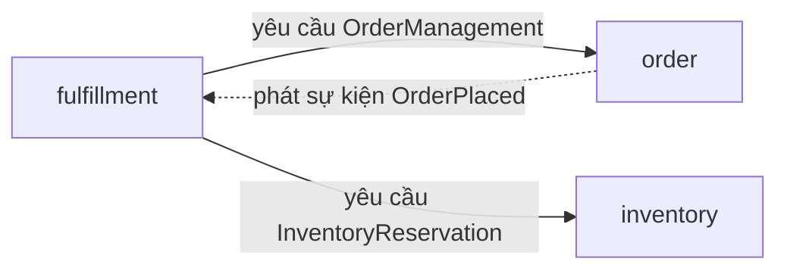

# API cung cấp, API yêu cầu và phần triển khai nội bộ

Trong mô hình `SPRING_MODULITH_MODULE_MODEL`, ta dùng Spring Modulith để xác định ranh giới nghiệp vụ, API công khai và các phụ thuộc giữa package trong một ứng dụng Spring Boot. Một modular monolith chỉ giữ được tính mô-đun khi mỗi module có hợp đồng rõ ràng: module cung cấp điều gì, nó cần điều gì từ module khác, và phần nào là chi tiết riêng có thể thay đổi bên trong.

Ba khái niệm này trả lời ba câu hỏi khác nhau:

- **API cung cấp (provided API):** module cho phép module khác sử dụng những kiểu dữ liệu, thao tác hoặc sự kiện nào?
- **API yêu cầu (required API):** module cần sử dụng hợp đồng nào do module khác cung cấp để hoàn thành trách nhiệm của mình?
- **Phần triển khai nội bộ (internal implementation):** mã nguồn nào chỉ phục vụ việc thực hiện trách nhiệm bên trong module và không phải hợp đồng cho module khác?

Đây là ba góc nhìn để thiết kế và đọc mô hình module. Spring Modulith không định nghĩa một annotation riêng tên `@ProvidedApi` hay `@RequiredApi`. Thay vào đó, framework biểu diễn ranh giới qua cấu trúc package, các named interface, metadata của module và đồ thị phụ thuộc được kiểm chứng bằng `ApplicationModules`.

## 1. Nhìn module như một hợp đồng

Giả sử ứng dụng bán hàng có ba module nghiệp vụ: `order`, `inventory` và `fulfillment`.

```text
com.acme.shop
├── ShopApplication.java
├── order
│   ├── OrderManagement.java       <- API cung cấp
│   ├── OrderPlaced.java           <- hợp đồng sự kiện
│   └── internal
│       ├── OrderManagementImpl.java
│       └── OrderRepository.java
├── inventory
│   ├── InventoryReservation.java  <- API cung cấp
│   └── internal
│       └── InventoryReservationImpl.java
└── fulfillment
    ├── FulfillmentService.java
    └── internal
        └── FulfillmentListener.java
```

Spring Modulith nhận diện các application module theo cấu trúc package bên dưới package gốc của ứng dụng. Với ví dụ trên, `order`, `inventory` và `fulfillment` là các module riêng. Các package con như `order.internal` vẫn thuộc module `order`; chúng không tự động trở thành module độc lập.

Trong mô hình module đóng (closed module), các kiểu `public` nằm trực tiếp trong package gốc của module được phơi bày như API mặc định. Các package con là phần nội bộ, trừ khi một package con được công bố rõ ràng như một named interface. Vì vậy, tên package `internal` giúp người đọc hiểu ý định, nhưng chính quy tắc module và cấu hình Spring Modulith mới xác định ranh giới kiến trúc.



Mũi tên phụ thuộc đi từ module sử dụng API đến module cung cấp API. Khi `fulfillment` gọi `OrderManagement`, `fulfillment` phụ thuộc vào hợp đồng của `order`. Chiều phụ thuộc không đảo ngược chỉ vì `order` là nơi thực hiện nghiệp vụ tạo đơn.

## 2. API cung cấp: điều module cam kết với bên ngoài

API cung cấp là tập hợp các kiểu và thao tác mà module chủ động cho phép module khác sử dụng. API có thể gồm interface, class, record, kiểu định danh, đối tượng kết quả, command hoặc sự kiện nghiệp vụ. Điều quan trọng là chúng tạo thành hợp đồng ổn định ở ranh giới module.

Ví dụ, module `order` cung cấp thao tác tra cứu thông tin đơn hàng:

```java
package com.acme.shop.order;

public interface OrderManagement {

    OrderDetails findDetails(OrderId orderId);
}
```

Các kiểu xuất hiện trong chữ ký cũng là một phần của hợp đồng, vì thế chúng cần nằm trong vùng API được công bố:

```java
package com.acme.shop.order;

import java.util.UUID;

public record OrderId(UUID value) {}
```

```java
package com.acme.shop.order;

import java.math.BigDecimal;

public record OrderDetails(OrderId id, BigDecimal total) {}
```

Module khác có thể phụ thuộc vào `OrderManagement`, `OrderId` và `OrderDetails`. Chúng không cần biết đơn hàng được lưu bằng JPA, JDBC hay một cơ chế khác.

### Công bố API bằng package

Theo quy ước mặc định của module đóng, các kiểu `public` nằm trực tiếp trong package gốc của module được xem là API. Ví dụ, package `com.acme.shop.order` là bề mặt công khai mặc định của module `order`.

Nếu cần công bố thêm một phần API nằm trong package con, hãy dùng `@NamedInterface` trên `package-info.java` của package đó:

```java
@org.springframework.modulith.NamedInterface("spi")
package com.acme.shop.order.spi;
```

Khi đó, `order.spi` trở thành named interface có tên `spi`. Module khác có thể phụ thuộc vào hợp đồng này một cách có chủ đích. Đây là cách hữu ích khi module có nhiều nhóm hợp đồng, chẳng hạn API chính và một SPI dành cho tích hợp mở rộng.

Không nên công bố toàn bộ package nội bộ chỉ để giải quyết một lỗi truy cập. Hãy xác định đúng kiểu nào cần trở thành hợp đồng, đưa kiểu đó vào package API hoặc named interface, rồi giữ các chi tiết còn lại bên trong module.

## 3. API yêu cầu: điều module cần từ module khác

API yêu cầu là các hợp đồng bên ngoài mà một module sử dụng. Nó hình thành quan hệ phụ thuộc từ module tiêu thụ đến module cung cấp.

Ví dụ, `fulfillment` cần biết đơn hàng có tồn tại và cần đặt trước hàng trong kho. Nó có thể sử dụng hai API công khai:

```java
package com.acme.shop.inventory;

import java.util.UUID;

public interface InventoryReservation {

    void reserveFor(UUID orderId);
}
```

```java
package com.acme.shop.fulfillment;

import com.acme.shop.inventory.InventoryReservation;
import com.acme.shop.order.OrderManagement;
import com.acme.shop.order.OrderId;
import org.springframework.stereotype.Service;

@Service
class FulfillmentService {

    private final OrderManagement orders;
    private final InventoryReservation inventory;

    FulfillmentService(
            OrderManagement orders,
            InventoryReservation inventory) {
        this.orders = orders;
        this.inventory = inventory;
    }

    void prepare(OrderId orderId) {
        var order = orders.findDetails(orderId);
        inventory.reserveFor(order.id().value());
    }
}
```

`fulfillment` chỉ nên biết những kiểu thuộc hợp đồng công khai của `order` và `inventory`. Trong ví dụ này, API kho nhận một `UUID`, vì vậy module `inventory` không cần phụ thuộc vào kiểu `OrderId` riêng của module `order`.

Spring Modulith có thể kiểm tra các phụ thuộc giữa module và cho phép khai báo danh sách phụ thuộc được chấp nhận bằng `@ApplicationModule`. Ví dụ, đặt annotation trên `package-info.java` của module `fulfillment`:

```java
@org.springframework.modulith.ApplicationModule(
        allowedDependencies = {"order", "inventory"}
)
package com.acme.shop.fulfillment;
```

Khai báo này diễn đạt rằng `fulfillment` được phép phụ thuộc vào hai module `order` và `inventory`. Nếu module chỉ được phép dùng named interface `spi` của `order`, có thể giới hạn rõ hơn:

```java
@org.springframework.modulith.ApplicationModule(
        allowedDependencies = "order::spi"
)
package com.acme.shop.fulfillment;
```

Cú pháp `module::interface` trỏ đến named interface đã công bố của module đích. Tên module và tên interface phải khớp với cấu trúc package và metadata thực tế.

API yêu cầu không phải một bản sao của API cung cấp. Nó là góc nhìn từ phía module tiêu thụ: module này cần hợp đồng nào, vì mục đích nghiệp vụ gì, và có thể giảm phụ thuộc nào. Khi xem xét một dependency, hãy hỏi liệu module tiêu thụ có thực sự cần gọi trực tiếp nhà cung cấp hay chỉ cần phản ứng với một sự kiện nghiệp vụ.

## 4. Phần triển khai nội bộ: chi tiết có thể thay đổi

Phần triển khai nội bộ chứa mã thực hiện hợp đồng của module: repository, entity lưu trữ, adapter, thuật toán, mapper, service nội bộ và các lớp hỗ trợ. Các module khác không nên gọi trực tiếp những kiểu này.

Ví dụ, module `order` triển khai API trong package con:

```java
package com.acme.shop.order.internal;

import com.acme.shop.order.OrderDetails;
import com.acme.shop.order.OrderId;
import com.acme.shop.order.OrderManagement;
import org.springframework.stereotype.Service;

@Service
class OrderManagementImpl implements OrderManagement {

    private final OrderRepository repository;

    OrderManagementImpl(OrderRepository repository) {
        this.repository = repository;
    }

    @Override
    public OrderDetails findDetails(OrderId orderId) {
        // Đọc dữ liệu và chuyển đổi sang kiểu thuộc API công khai.
        return repository.findDetails(orderId);
    }
}
```

`OrderManagementImpl` và `OrderRepository` thuộc nội bộ của `order`. Module `fulfillment` chỉ cần inject `OrderManagement`; Spring sẽ tìm bean triển khai trong ứng dụng. Việc Spring quản lý bean không đồng nghĩa package triển khai đã trở thành API kiến trúc cho module khác.

Trong module đóng, một lớp `public` đặt trong package con chưa được công bố vẫn là chi tiết nội bộ theo mô hình module của Spring Modulith. Từ khóa `public` của Java quyết định khả năng truy cập ở cấp ngôn ngữ; nó không tự động đưa package con vào API module. Nếu module khác tham chiếu trực tiếp kiểu nội bộ, kiểm tra kiến trúc có thể phát hiện vi phạm.

Để giữ ranh giới rõ ràng:

- Ưu tiên package-private cho lớp chỉ dùng trong package khi điều đó phù hợp với cách triển khai.
- Không trả JPA entity, repository hoặc kiểu lưu trữ nội bộ qua API công khai.
- Chuyển dữ liệu nội bộ thành DTO, record hoặc value object có ý nghĩa nghiệp vụ trước khi trả ra ngoài.
- Đặt interface ở phía module sở hữu hợp đồng; đặt lớp thực thi ở package nội bộ.
- Tránh để module tiêu thụ truy cập repository hoặc service triển khai của module cung cấp.

Khi cần thay đổi cơ sở dữ liệu, cách truy vấn hoặc thuật toán, module có thể sửa phần nội bộ mà không buộc các module gọi nó phải thay đổi, miễn là hợp đồng công khai vẫn giữ nguyên.

## 5. Dùng sự kiện khi module chỉ cần biết một việc đã xảy ra

Không phải mọi quan hệ giữa module đều cần một lời gọi đồng bộ. Nếu `fulfillment` chỉ cần bắt đầu xử lý sau khi đơn hàng được xác nhận, module `order` có thể công bố sự kiện `OrderPlaced`.

Sự kiện là hợp đồng công khai, vì vậy đặt kiểu sự kiện trong package API của module phát hành:

```java
package com.acme.shop.order;

public record OrderPlaced(OrderId orderId) {}
```

Sau khi xác nhận đơn, phần triển khai của `order` phát sự kiện:

```java
package com.acme.shop.order.internal;

import com.acme.shop.order.OrderId;
import com.acme.shop.order.OrderPlaced;
import org.springframework.context.ApplicationEventPublisher;
import org.springframework.stereotype.Service;
import org.springframework.transaction.annotation.Transactional;

@Service
class OrderConfirmationService {

    private final ApplicationEventPublisher events;

    OrderConfirmationService(ApplicationEventPublisher events) {
        this.events = events;
    }

    @Transactional
    void confirm(OrderId orderId) {
        // Lưu trạng thái đơn hàng đã xác nhận.
        events.publishEvent(new OrderPlaced(orderId));
    }
}
```

Module `fulfillment` đăng ký xử lý sự kiện:

```java
package com.acme.shop.fulfillment.internal;

import com.acme.shop.order.OrderPlaced;
import org.springframework.modulith.events.ApplicationModuleListener;
import org.springframework.stereotype.Component;

@Component
class FulfillmentListener {

    @ApplicationModuleListener
    void on(OrderPlaced event) {
        // Bắt đầu quy trình chuẩn bị giao hàng cho đơn đã xác nhận.
    }
}
```

Trong cách tổ chức này, `order` chỉ phát một sự kiện mô tả điều đã xảy ra; nó không cần biết module nào sẽ xử lý sự kiện. `fulfillment` phụ thuộc vào hợp đồng sự kiện của `order`, còn `order` không cần import hay gọi service của `fulfillment`.

Chọn lời gọi API trực tiếp khi bên gọi cần kết quả ngay để tiếp tục một thao tác. Chọn sự kiện khi bên phát chỉ cần thông báo một sự kiện nghiệp vụ đã xảy ra và một hoặc nhiều module khác có thể phản ứng độc lập. Sự kiện không tự giải quyết mọi vấn đề về thứ tự xử lý, tính lặp hoặc tính nhất quán; các yêu cầu đó vẫn cần được thiết kế và kiểm thử trong luồng nghiệp vụ.

## 6. Kiểm chứng ranh giới bằng ApplicationModules

Spring Modulith cung cấp `ApplicationModules` để khám phá mô hình module từ lớp ứng dụng và kiểm tra các quy tắc kiến trúc. Có thể đặt kiểm tra này trong test suite:

```java
import com.acme.shop.ShopApplication;
import org.junit.jupiter.api.Test;
import org.springframework.modulith.core.ApplicationModules;

class ModularityTests {

    @Test
    void verifiesModuleStructure() {
        ApplicationModules.of(ShopApplication.class).verify();
    }
}
```

Khi test chạy, `verify()` kiểm tra mô hình module đã phát hiện, bao gồm các quy tắc phụ thuộc và những truy cập không hợp lệ qua ranh giới module. Nếu một module tham chiếu kiểu nội bộ của module khác hoặc tạo ra quan hệ phụ thuộc bị cấm, kiểm tra sẽ báo lỗi để nhóm xử lý ngay trong quá trình phát triển.

`ApplicationModules` giúp biến quy ước kiến trúc thành kiểm tra có thể chạy lặp lại. Tuy vậy, kiểm tra qua được không chứng minh ranh giới nghiệp vụ đã được chia tối ưu. Nhóm vẫn cần đánh giá xem mỗi module có trách nhiệm gắn kết, API có diễn đạt đúng ngôn ngữ nghiệp vụ và các phụ thuộc có đi theo hướng hợp lý hay không.

## 7. Cách quyết định một kiểu thuộc API hay nội bộ

Khi thêm một class hoặc interface, có thể dùng bảng sau để xác định vị trí:

| Câu hỏi | Vị trí phù hợp | Lý do |
|---|---|---|
| Module khác cần gọi thao tác này? | Package gốc của module | Đây là API mặc định của module đóng |
| Module khác cần một nhóm hợp đồng riêng trong package con? | Package được đánh dấu `@NamedInterface` | Công bố có chọn lọc một phần API |
| Kiểu này chỉ phục vụ lưu trữ, truy vấn hoặc xử lý nội bộ? | Package con nội bộ | Không tạo phụ thuộc kiến trúc từ module khác |
| Module này cần dùng hợp đồng của module khác? | Import API hoặc named interface của module đó | Thể hiện dependency theo hướng tiêu thụ → cung cấp |
| Module khác chỉ cần phản ứng sau một sự kiện? | Kiểu sự kiện trong API của module phát hành | Tránh để module phát hành phụ thuộc vào listener |

Một quy trình thiết kế ngắn có thể áp dụng cho từng module:

1. Xác định trách nhiệm nghiệp vụ và tên module.
2. Liệt kê thao tác, dữ liệu và sự kiện mà module cần cung cấp.
3. Đặt các kiểu hợp đồng vào package gốc hoặc named interface phù hợp.
4. Liệt kê API mà module cần từ các module khác và khai báo `allowedDependencies` khi cần giới hạn hướng phụ thuộc.
5. Đưa repository, entity và lớp thực thi vào package nội bộ.
6. Chạy kiểm tra `ApplicationModules.of(...).verify()` trong test suite.
7. Khi API thay đổi, đánh giá tất cả module tiêu thụ và cập nhật hợp đồng có chủ đích.

## 8. Những nhầm lẫn thường gặp

**Cho rằng mọi lớp `public` đều là API.** Java cho phép truy cập một lớp `public`, nhưng Spring Modulith còn xét package và quy tắc module. Một lớp `public` trong package nội bộ không vì thế mà trở thành hợp đồng công khai.

**Đưa repository hoặc entity vào API để module khác dùng cho nhanh.** Cách này làm lộ cấu trúc lưu trữ và khiến module tiêu thụ phụ thuộc vào chi tiết triển khai. Hãy cung cấp thao tác nghiệp vụ và kiểu dữ liệu phù hợp với hợp đồng.

**Công bố cả package nội bộ để sửa lỗi phụ thuộc.** Mỗi named interface nên có mục đích rõ ràng. Công bố rộng làm tăng số kiểu mà module phải duy trì tương thích.

**Để hai module gọi lẫn nhau theo hai chiều.** Phụ thuộc vòng làm ranh giới khó hiểu và cản trở thay đổi độc lập. Hãy xem lại quyền sở hữu nghiệp vụ, hướng gọi API hoặc dùng sự kiện để thông báo điều đã xảy ra.

**Nhầm API module với REST API.** Bài học này nói về hợp đồng giữa các module trong cùng ứng dụng Spring Boot. REST endpoint là hợp đồng ở ranh giới giao tiếp qua mạng; nó có thể được triển khai bởi một module, nhưng không đồng nghĩa với API package mà Spring Modulith kiểm tra.

## Kết luận

Một module có ranh giới tốt công bố ít hợp đồng nhưng đủ để module khác cộng tác. API cung cấp xác định điều module cam kết; API yêu cầu cho thấy module phụ thuộc vào hợp đồng nào; phần triển khai nội bộ giữ lại các quyết định có thể thay đổi mà không lan sang phần còn lại của ứng dụng. Spring Modulith hỗ trợ thể hiện ba mặt đó qua package, `@NamedInterface`, `@ApplicationModule` và kiểm tra `ApplicationModules`, giúp modular monolith duy trì cấu trúc rõ ràng khi hệ thống phát triển.
