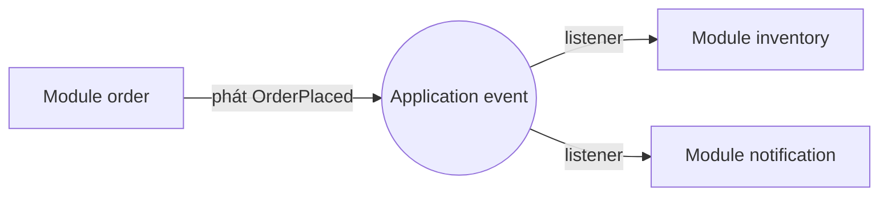

# Quan hệ giữa package, bean Spring, application event và module

Trong một ứng dụng Spring Boot được tổ chức theo Spring Modulith, bốn khái niệm **package**, **Spring bean**, **application event** và **application module** liên quan chặt chẽ nhưng không đồng nghĩa với nhau. Package tạo ra cấu trúc mã nguồn để Spring Modulith nhận diện module. Bean là đối tượng do Spring quản lý và kết nối khi ứng dụng chạy. Application event là hợp đồng giao tiếp giữa các thành phần. Module là ranh giới kiến trúc gom các lớp cùng phục vụ một năng lực nghiệp vụ và quy định phần nào được phép sử dụng từ bên ngoài.

Hiểu đúng quan hệ này giúp ta trả lời bốn câu hỏi khi thiết kế modular monolith:

- Mã nguồn thuộc về module nghiệp vụ nào?
- Thành phần nào được phép gọi trực tiếp thành phần nào?
- Khi hai module cần phối hợp, chúng nên dùng API hay event?
- Làm thế nào để kiểm tra các ranh giới đó vẫn được giữ khi ứng dụng phát triển?

## 1. Bốn khái niệm ở bốn góc nhìn

| Khái niệm | Vai trò | Câu hỏi chính |
|---|---|---|
| Package | Tổ chức lớp và namespace trong mã nguồn | Lớp này nằm ở đâu? |
| Spring bean | Đối tượng được Spring tạo, cấu hình và quản lý vòng đời | Đối tượng nào được Spring quản lý và tiêm vào đâu? |
| Application event | Thông điệp mô tả một sự kiện đã xảy ra trong ứng dụng | Module khác cần biết điều gì đã xảy ra? |
| Application module | Ranh giới nghiệp vụ và kiến trúc được suy ra từ cấu trúc package | Module nào sở hữu chức năng và API này? |

Một package có thể chứa nhiều loại lớp: service, repository, entity, DTO, event hoặc lớp tiện ích. Không phải mọi lớp trong package đều là bean. Ngược lại, một module thường chứa nhiều package con và nhiều bean. Event cũng không phải module: nó là một hợp đồng mà module phát hành có thể cung cấp cho module khác sử dụng.

## 2. Package là nền tảng để hình thành module

Spring Modulith dùng package của ứng dụng làm cơ sở xây dựng application module model. Với cấu trúc mặc định, các package con trực tiếp của package gốc ứng dụng được nhận diện là các application module. Ví dụ, nếu lớp khởi động nằm trong `com.acme.shop`, các package `order`, `inventory` và `notification` có thể trở thành ba module.

```text
com.acme.shop
├── ShopApplication.java
├── order
│   ├── OrderManagement.java
│   ├── OrderPlaced.java
│   └── internal
│       ├── OrderService.java
│       ├── OrderRepository.java
│       └── OrderEntity.java
├── inventory
│   ├── InventoryManagement.java
│   └── internal
│       └── ReserveInventoryOnOrderPlaced.java
└── notification
    └── internal
        └── SendOrderConfirmation.java
```

Trong ví dụ này:

- `order` là module quản lý đơn hàng.
- `inventory` là module quản lý tồn kho.
- `notification` là module gửi thông báo.
- `internal` là package con chứa chi tiết triển khai của module tương ứng.

Theo quy ước mặc định của Spring Modulith, package gốc của một module là phần được công khai; các package con được xem là nội bộ. Vì vậy, `OrderManagement` và `OrderPlaced` đặt trực tiếp trong `order` có thể đóng vai trò API công khai của module `order`, trong khi `OrderRepository` và `OrderEntity` trong `order.internal` là chi tiết triển khai.

Quy ước này tạo ra một ranh giới có thể kiểm tra được. Một lớp ở module `inventory` nên gọi API công khai của `order`, thay vì import trực tiếp repository hoặc entity nội bộ của `order`.

### Package nội bộ không tự động bị Java hoặc Spring khóa lại

Từ `internal` trong tên package không tạo ra cơ chế bảo mật hay quyền truy cập đặc biệt của Java. Nếu một lớp là `public`, mã nguồn ở package khác vẫn có thể import nó khi quy tắc truy cập của Java cho phép. Spring component scanning cũng có thể phát hiện bean nằm trong package con được quét.

Do đó, có hai góc nhìn cần phân biệt:

- **Java và Spring** quyết định lớp có thể được truy cập, tạo instance và tiêm phụ thuộc như thế nào.
- **Spring Modulith** mô hình hóa package nào thuộc module nào, phần nào là API và phần nào là nội bộ, rồi kiểm tra các quan hệ phụ thuộc theo mô hình đó.

Đặt lớp vào package `internal` là cách thể hiện ý định kiến trúc. Việc giữ ý định đó cần được kiểm tra bằng quy tắc module, thay vì chỉ dựa vào tên package hoặc sự tự giác của lập trình viên.

## 3. Bean Spring nằm bên trong module

Spring bean là đối tượng do IoC container quản lý. Các stereotype như `@Component`, `@Service`, `@Repository`, `@Controller` hoặc các phương thức `@Bean` trong `@Configuration` có thể đăng ký bean vào `ApplicationContext`.

Một module có thể chứa nhiều bean cùng các lớp không phải bean. Ví dụ, module `order` có thể có:

- `OrderManagement`: facade công khai để module khác yêu cầu tạo hoặc tra cứu đơn hàng.
- `OrderService`: bean nội bộ điều phối nghiệp vụ.
- `OrderRepository`: bean nội bộ truy cập dữ liệu.
- `OrderEntity`: lớp biểu diễn dữ liệu, thường không phải bean Spring.
- `OrderPlaced`: kiểu dữ liệu event, thường cũng không phải bean.

Khi một bean của module A tiêm một bean thuộc module B, mã nguồn của A phải tham chiếu kiểu của B. Quan hệ tiêm phụ thuộc đó tạo ra một quan hệ phụ thuộc giữa hai module ở góc nhìn mã nguồn. Điều quan trọng là kiểu được tham chiếu phải thuộc API mà module B chủ động công khai.

Ví dụ, một bean trong `inventory` có thể phụ thuộc vào `OrderManagement` nếu lớp này là API của `order`:

```java
package com.acme.shop.inventory.internal;

import com.acme.shop.order.OrderManagement;
import org.springframework.stereotype.Service;

@Service
class InventoryAdjustmentService {

    private final OrderManagement orderManagement;

    InventoryAdjustmentService(OrderManagement orderManagement) {
        this.orderManagement = orderManagement;
    }

    // Các thao tác nghiệp vụ của inventory sử dụng API công khai của order.
}
```

Ở đây Spring chịu trách nhiệm cung cấp bean `OrderManagement` cho `InventoryAdjustmentService`. Spring Modulith quan tâm đến quan hệ kiến trúc được tạo ra bởi việc module `inventory` tham chiếu kiểu thuộc module `order`.

Nếu `InventoryAdjustmentService` import `com.acme.shop.order.internal.OrderRepository`, ứng dụng có thể vẫn biên dịch và Spring có thể vẫn khởi tạo được bean. Tuy nhiên, quan hệ đó đi xuyên qua phần nội bộ của module `order`, làm mất khả năng thay đổi repository mà không ảnh hưởng đến module khác. Đây chính là loại phụ thuộc mà mô hình module cần phát hiện.

## 4. Application event là hợp đồng giao tiếp giữa các module

Khi một module cần thông báo cho module khác về một sự kiện nghiệp vụ, application event giúp bên phát không phải gọi trực tiếp bean của từng bên nhận.

Ví dụ, sau khi đơn hàng được tạo, module `order` phát event `OrderPlaced`. Module `inventory` lắng nghe để giữ hàng; module `notification` lắng nghe để gửi xác nhận. Module `order` chỉ công bố sự kiện và không cần biết có bao nhiêu listener đang xử lý nó.



### Event type phải là hợp đồng được công khai

Nếu module khác cần nhận event, kiểu event phải nằm trong phần API mà module phát công khai. Với cấu trúc mặc định, có thể đặt event trong package gốc của module phát:

```java
package com.acme.shop.order;

import java.util.List;
import java.util.UUID;

public record OrderPlaced(
        UUID orderId,
        List<OrderLine> lines
) {

    public record OrderLine(String productCode, int quantity) {}
}
```

Event nên mô tả một sự kiện nghiệp vụ đã xảy ra, chẳng hạn `OrderPlaced`, `PaymentCaptured` hoặc `ShipmentDispatched`. Payload nên chứa dữ liệu cần thiết để bên nhận xử lý, thường là định danh và các giá trị bất biến. Tránh đưa entity JPA, repository hoặc kiểu dữ liệu thuộc package nội bộ vào payload, vì như vậy sẽ kéo chi tiết triển khai của module phát sang module nhận.

### Module phát event

Bean nội bộ của `order` có thể dùng `ApplicationEventPublisher` để phát event:

```java
package com.acme.shop.order.internal;

import com.acme.shop.order.OrderPlaced;
import org.springframework.context.ApplicationEventPublisher;
import org.springframework.stereotype.Service;
import org.springframework.transaction.annotation.Transactional;

import java.util.List;
import java.util.UUID;

@Service
class OrderService {

    private final ApplicationEventPublisher events;

    OrderService(ApplicationEventPublisher events) {
        this.events = events;
    }

    @Transactional
    void placeOrder(UUID orderId, List<OrderPlaced.OrderLine> lines) {
        // Kiểm tra và lưu đơn hàng.
        events.publishEvent(new OrderPlaced(orderId, lines));
    }
}
```

Đoạn mã minh họa vị trí phát event trong luồng nghiệp vụ. Trong ứng dụng thực tế, `orderId` và `lines` được tạo hoặc lấy từ kết quả xử lý đơn hàng trước khi event được phát.

### Module nhận event

Bean trong `inventory` có thể đăng ký listener bằng `@EventListener` hoặc `@TransactionalEventListener`:

```java
package com.acme.shop.inventory.internal;

import com.acme.shop.order.OrderPlaced;
import org.springframework.stereotype.Component;
import org.springframework.transaction.event.TransactionPhase;
import org.springframework.transaction.event.TransactionalEventListener;

@Component
class ReserveInventoryOnOrderPlaced {

    @TransactionalEventListener(phase = TransactionPhase.AFTER_COMMIT)
    void on(OrderPlaced event) {
        // Yêu cầu giữ hàng dựa trên orderId và lines trong event.
    }
}
```

`@TransactionalEventListener` cho phép gắn thời điểm xử lý listener với một pha của transaction. Trong ví dụ, listener chạy sau khi transaction phát event commit thành công. Điều này hữu ích khi phần xử lý tiếp theo cần đọc dữ liệu đã được commit. Nếu dùng `@EventListener` thông thường, listener mặc định được gọi đồng bộ trong luồng phát event; thời điểm và transaction xử lý vì thế có thể khác với listener gắn pha transaction.

### Event giảm phụ thuộc trực tiếp nhưng không xóa mọi phụ thuộc

Ở luồng chạy, `order` phát event và các listener của `inventory`, `notification` phản ứng. Tuy nhiên, ở góc nhìn mã nguồn, listener vẫn phải tham chiếu kiểu `OrderPlaced`. Vì vậy, module nhận vẫn phụ thuộc vào hợp đồng event do module `order` sở hữu.

Có thể diễn đạt hai hướng này như sau:

- **Luồng điều khiển lúc chạy:** `order` phát sự kiện; các module đăng ký listener được gọi.
- **Phụ thuộc mã nguồn:** `inventory` và `notification` tham chiếu kiểu event được công khai bởi `order`.

Event giúp module phát không phụ thuộc vào các listener cụ thể. Nó không làm cho hợp đồng event biến mất và cũng không tự động biến ứng dụng thành hệ thống message broker phân tán. Spring application event là cơ chế giao tiếp trong cùng ứng dụng; nếu cần độ bền, retry hoặc giao tiếp qua tiến trình khác, cần thiết kế cơ chế lưu và chuyển giao phù hợp.

## 5. Named Interface mở rộng API mà không công khai toàn bộ package con

Đôi khi một module cần giữ phần lớn package con ở trạng thái nội bộ nhưng vẫn muốn công khai một nhóm kiểu có mục đích rõ ràng. Spring Modulith hỗ trợ named interface để đánh dấu package con là một giao diện được công khai có tên.

Ví dụ, module `order` có thể đặt hợp đồng tích hợp trong `order.spi`:

```java
@org.springframework.modulith.NamedInterface("spi")
package com.acme.shop.order.spi;
```

Module khác khi đó có thể phụ thuộc vào named interface `spi` theo cấu hình module, thay vì truy cập tùy ý mọi package con của `order`. Khi dùng `allowedDependencies`, tên module và tên named interface được khai báo theo dạng `order::spi`.

Named interface phù hợp khi muốn phân biệt các nhóm API, chẳng hạn API nghiệp vụ chính và SPI dành cho tích hợp. Không nên tạo named interface cho mọi package; mỗi giao diện công khai bổ sung đều là một cam kết mà module phải duy trì.

## 6. Spring Modulith kiểm tra quan hệ giữa các module như thế nào?

`ApplicationModules` xây dựng mô hình module từ package gốc của ứng dụng và phân tích các quan hệ phụ thuộc giữa các thành phần. Có thể dùng `verify()` trong một bài kiểm tra kiến trúc để kiểm tra mô hình:

```java
import com.acme.shop.ShopApplication;
import org.junit.jupiter.api.Test;
import org.springframework.modulith.core.ApplicationModules;

class ModularityTests {

    @Test
    void verifiesApplicationModuleStructure() {
        ApplicationModules.of(ShopApplication.class).verify();
    }
}
```

Việc kiểm tra giúp phát hiện những vấn đề kiến trúc như:

- Một module truy cập package nội bộ của module khác.
- Các module tạo thành vòng phụ thuộc.
- Một module phụ thuộc vào module hoặc named interface không được cho phép theo quy tắc đã khai báo.

Ví dụ, module `inventory` có thể khai báo chỉ được phụ thuộc vào module `order`:

```java
@org.springframework.modulith.ApplicationModule(
        allowedDependencies = "order"
)
package com.acme.shop.inventory;
```

Khi cần giới hạn phụ thuộc vào named interface, có thể khai báo `order::spi`. Cấu hình này làm rõ module nào được phép sử dụng hợp đồng nào, đồng thời giúp bài kiểm tra kiến trúc có thể phát hiện phụ thuộc ngoài dự kiến.

Lưu ý rằng `verify()` kiểm tra mô hình kiến trúc được suy ra từ mã nguồn và cấu hình. Nó không thay thế kiểm thử nghiệp vụ, kiểm thử transaction hoặc kiểm thử việc listener thực sự thực hiện đúng tác vụ.

## 7. Cách lựa chọn giữa gọi bean và phát event

Không phải mọi giao tiếp giữa module đều cần event. Chọn cơ chế dựa trên ý nghĩa của tương tác:

| Tình huống | Cách giao tiếp thường phù hợp | Lý do |
|---|---|---|
| Cần yêu cầu module khác thực hiện một thao tác và nhận kết quả ngay | Gọi API công khai qua bean | Bên gọi cần kết quả hoặc cần biết thao tác có thành công không |
| Cần thông báo một sự kiện đã xảy ra để một hoặc nhiều module phản ứng | Application event | Bên phát không cần biết danh sách bên nhận |
| Cần chia sẻ một kiểu dữ liệu hoặc hợp đồng ổn định | API công khai hoặc named interface | Hợp đồng được đặt ở vị trí có chủ sở hữu rõ ràng |
| Cần truy cập repository, entity hoặc service nội bộ của module khác | Thiết kế lại API hoặc event | Truy cập nội bộ làm rò rỉ chi tiết triển khai |

Một quy tắc thực tế là: dùng lời gọi API khi cần hỏi hoặc yêu cầu; dùng event khi muốn thông báo một sự kiện nghiệp vụ đã xảy ra. Đừng phát event chỉ để né việc thiết kế API, và đừng gọi trực tiếp bean của module khác nếu bên gọi không thực sự cần kết quả đồng bộ.

## 8. Những nhầm lẫn thường gặp

**Cho rằng mỗi package là một module.** Trong cấu trúc mặc định, module được nhận diện từ các package con trực tiếp của package gốc ứng dụng. Các package sâu hơn thường là một phần bên trong module, trừ khi được đánh dấu là named interface.

**Cho rằng một lớp `public` đương nhiên là API module.** `public` là mức truy cập của Java. API module còn phụ thuộc vị trí package và mô hình module của Spring Modulith. Một lớp `public` nằm trong package nội bộ vẫn là chi tiết triển khai theo ranh giới module.

**Cho rằng bean Spring chính là module.** Bean là đối tượng được container quản lý; module là ranh giới kiến trúc. Một module có thể có nhiều bean, còn một bean không tạo ra module mới.

**Cho rằng event loại bỏ mọi phụ thuộc.** Listener vẫn tham chiếu kiểu event. Event làm giảm phụ thuộc vào triển khai và danh sách người nhận, nhưng hợp đồng event vẫn cần được công khai và quản lý.

**Cho rằng application event mặc nhiên được chuyển giao bền vững.** Cơ chế event trong bộ nhớ không tự bảo đảm retry sau khi tiến trình dừng hoặc chuyển thông điệp sang ứng dụng khác. Yêu cầu giao nhận bền vững cần giải pháp lưu trữ và xử lý lỗi tương ứng.

## 9. Checklist khi thiết kế một module

Khi thêm một chức năng vào modular monolith, hãy lần lượt kiểm tra:

1. Chức năng thuộc năng lực nghiệp vụ nào và nên nằm trong package module nào?
2. Lớp nào là API công khai; lớp nào phải nằm trong package nội bộ?
3. Các bean có đang tham chiếu trực tiếp vào API của module khác không?
4. Tương tác là một yêu cầu cần kết quả hay là thông báo về sự kiện đã xảy ra?
5. Event type và payload có nằm trong hợp đồng công khai, không kéo theo entity hoặc lớp nội bộ không?
6. Các quan hệ phụ thuộc có tạo vòng lặp hoặc vượt qua `allowedDependencies` không?
7. Bài kiểm tra `ApplicationModules.of(...).verify()` có chạy trong quy trình kiểm tra của dự án không?

Khi package, bean và event được đặt đúng vai trò, module trở thành đơn vị nghiệp vụ có ranh giới rõ: package thể hiện cấu trúc, bean thực thi hành vi, API và event xác định hợp đồng giao tiếp, còn Spring Modulith cung cấp mô hình để kiểm tra các hợp đồng đó theo thời gian.
