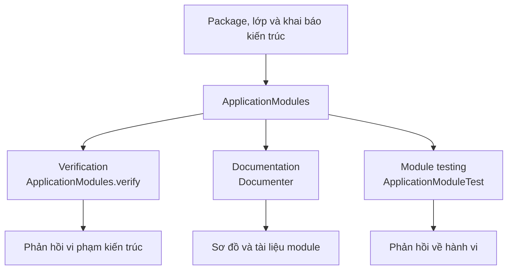

# Mô hình module hỗ trợ verification, documentation và testing ra sao?

Trong một ứng dụng Spring Boot dạng modular monolith, package chỉ giúp tổ chức mã nguồn; bản thân việc chia package chưa bảo đảm các phần nghiệp vụ thực sự độc lập. Một module có thể vô tình gọi thẳng vào lớp triển khai nội bộ của module khác, các phụ thuộc có thể tạo thành vòng tròn, hoặc tài liệu kiến trúc có thể nhanh chóng lỗi thời so với code.

Spring Modulith giải quyết vấn đề này bằng cách xây dựng **application module model** — mô hình mô tả các module nghiệp vụ, API mà mỗi module công khai và các quan hệ phụ thuộc giữa chúng. Mô hình được suy ra từ cấu trúc package và các khai báo kiến trúc trong mã nguồn. Cùng một mô hình đó có thể được dùng để kiểm chứng quy tắc kiến trúc (*verification*), sinh tài liệu (*documentation*) và thiết lập phạm vi kiểm thử (*testing*).

Đối với `SPRING_MODULITH_MODULE_MODEL`, đây là điểm quan trọng của tư duy mô hình module: ranh giới nghiệp vụ phải trở thành thông tin có thể kiểm tra và sử dụng được trong vòng đời phát triển, thay vì chỉ tồn tại trong sơ đồ hoặc quy ước truyền miệng.

## 1. Từ cấu trúc package đến application module model

Giả sử ứng dụng bán hàng có package gốc `com.acme.shop`:

```text
com.acme.shop
├── ShopApplication.java
├── order
│   ├── package-info.java
│   ├── OrderManagement.java
│   └── internal
│       └── OrderRepository.java
└── inventory
    ├── package-info.java
    ├── InventoryManagement.java
    └── internal
        └── StockRepository.java
```

Theo quy ước phát hiện module mặc định, các package con trực tiếp của package ứng dụng là các application module. Trong ví dụ này, `order` và `inventory` là hai module. Các package lồng bên trong một module thường thuộc về module đó; chúng không tự động trở thành module nghiệp vụ độc lập.

Mô hình module chứa những thông tin có ý nghĩa kiến trúc:

- **Danh tính và ranh giới module:** module nào tồn tại, package nào thuộc module nào.
- **Giao diện công khai:** module khác được phép sử dụng những kiểu nào của module này.
- **Phụ thuộc:** module nào đang sử dụng kiểu hoặc API của module nào.
- **Quy tắc phụ thuộc được khai báo:** module được phép phụ thuộc vào module hoặc named interface nào.

Trong Spring Modulith, lớp `ApplicationModules` là điểm vào để tạo mô hình từ lớp ứng dụng Spring Boot:

```java
ApplicationModules modules = ApplicationModules.of(ShopApplication.class);
```

`ApplicationModules` biểu diễn cấu trúc module mà Spring Modulith phát hiện được. Từ đối tượng này, ta có thể yêu cầu kiểm chứng kiến trúc hoặc truyền mô hình cho công cụ sinh tài liệu. Như vậy, verification và documentation cùng dựa trên một mô tả kiến trúc được tạo từ code.

## 2. Verification: biến quy tắc kiến trúc thành điều kiện có thể kiểm tra

Nếu kiến trúc chỉ được mô tả trong tài liệu, lập trình viên có thể vô tình phá vỡ ranh giới module trong một lần refactor. Verification giúp phát hiện những thay đổi như vậy sớm, thường ngay trong test suite hoặc pipeline CI.

### Những vi phạm mô hình module có thể phát hiện

**Phụ thuộc vòng giữa các module.** Ví dụ, `order` gọi `inventory`, đồng thời `inventory` lại gọi trực tiếp `order`. Hai module lúc này không còn có hướng phụ thuộc rõ ràng. Vòng phụ thuộc làm tăng mức độ kết dính và khiến việc thay đổi hoặc kiểm thử từng module khó khăn hơn.

**Truy cập vào phần triển khai nội bộ.** Một module có thể cố sử dụng repository, entity hoặc service nội bộ của module khác. Việc này khiến chi tiết triển khai trở thành một phần phụ thuộc ngầm. Khi module sở hữu thay đổi cách lưu trữ hoặc tổ chức code, các module tiêu thụ cũng có thể bị ảnh hưởng.

**Vi phạm danh sách phụ thuộc được cho phép.** Khi module khai báo rõ các module hoặc named interface mà nó được phép sử dụng, Spring Modulith có thể kiểm tra các phụ thuộc thực tế có tuân theo khai báo đó hay không.

Các quy tắc này giúp trả lời những câu hỏi thiết thực: module có đang phụ thuộc theo đúng hướng đã thiết kế không, API công khai có được tôn trọng không, và một thay đổi có vô tình tạo thêm liên kết giữa các vùng nghiệp vụ không?

### Kiểm chứng bằng `ApplicationModules.verify()`

Có thể tạo một bài kiểm tra kiến trúc đơn giản:

```java
import org.junit.jupiter.api.Test;
import org.springframework.modulith.core.ApplicationModules;

class ModularityTests {

    @Test
    void verifiesApplicationModuleStructure() {
        ApplicationModules.of(ShopApplication.class).verify();
    }
}
```

Khi cấu trúc module hợp lệ, bài kiểm tra hoàn tất bình thường. Khi phát hiện vi phạm, `verify()` làm bài kiểm tra thất bại và báo các vấn đề kiến trúc để nhóm phát triển xử lý. Vì đây là kiểm tra cấu trúc phụ thuộc, nó không cần khởi chạy toàn bộ luồng nghiệp vụ như một bài kiểm thử end-to-end.

Đặt kiểm tra này trong test suite giúp mọi pull request đều được kiểm tra theo cùng một bộ quy tắc. Nếu một thay đổi tạo vòng phụ thuộc hoặc truy cập vào package nội bộ, CI có thể phát hiện trước khi thay đổi được tích hợp.

### Khai báo ranh giới công khai bằng Named Interface

Theo quy ước, các kiểu nằm ngay trong package gốc của module có thể tạo thành giao diện không tên (*unnamed interface*). Các package con thường được xem là nội bộ. Khi cần công khai một phần cụ thể nằm trong package con, ta có thể đánh dấu package đó bằng `@NamedInterface`.

Ví dụ, module `inventory` công khai package `api`:

```java
@org.springframework.modulith.NamedInterface("api")
package com.acme.shop.inventory.api;
```

Module `order` có thể khai báo rằng nó chỉ được phụ thuộc vào named interface `api` của module `inventory`:

```java
@org.springframework.modulith.ApplicationModule(
    allowedDependencies = "inventory::api"
)
package com.acme.shop.order;
```

Ký hiệu `inventory::api` chỉ rõ cả module đích lẫn giao diện được phép sử dụng. Khi `order` gọi một lớp thuộc package nội bộ của `inventory`, hoặc phụ thuộc vào một module không nằm trong danh sách cho phép, việc kiểm chứng có thể báo vi phạm.

Named Interface đặc biệt hữu ích khi module có nhiều nhóm chức năng nhưng chỉ muốn công khai một số hợp đồng. Chẳng hạn, module `inventory` có thể cung cấp API cho nghiệp vụ đặt hàng, trong khi các repository và thuật toán điều chỉnh tồn kho vẫn được giữ nội bộ.

## 3. Documentation: sinh tài liệu từ mô hình thay vì vẽ tay

Sơ đồ kiến trúc thường hữu ích trong onboarding, review thiết kế và phân tích ảnh hưởng của thay đổi. Tuy nhiên, sơ đồ được cập nhật thủ công có thể không còn phản ánh code sau vài lần refactor. Khi tài liệu được tạo từ application module model, cấu trúc thể hiện trong tài liệu có thể được tái tạo từ trạng thái mã nguồn hiện tại.

Spring Modulith cung cấp `Documenter` để tạo tài liệu kiến trúc từ `ApplicationModules`:

```java
ApplicationModules modules = ApplicationModules.of(ShopApplication.class);

new Documenter(modules).writeDocumentation();
```

Tùy phiên bản và cấu hình dự án, tài liệu được sinh có thể bao gồm sơ đồ quan hệ giữa các module và biểu diễn chi tiết hơn cho từng module. Các sơ đồ giúp người đọc nhận biết:

- Ứng dụng đang được chia thành những module nghiệp vụ nào.
- Module nào phụ thuộc vào module nào.
- Giao diện nào là điểm giao tiếp giữa các module.
- Một module có những thành phần và quan hệ nội bộ đáng chú ý nào.

Ví dụ, nếu sơ đồ cho thấy `order` phụ thuộc vào `inventory`, người đọc có thể bắt đầu phân tích từ hợp đồng tồn kho mà `order` sử dụng. Nếu sơ đồ xuất hiện một quan hệ phụ thuộc ngoài dự kiến, nhóm có thể xem lại thiết kế hoặc kiểm tra xem code có đang truy cập nhầm phần nội bộ hay không.

### Đưa tài liệu vào quy trình phát triển

Một quy trình hữu ích là sinh tài liệu từ cùng lớp ứng dụng được dùng trong verification, sau đó lưu hoặc xuất bản kết quả theo cách phù hợp với dự án. Khi cấu trúc package, named interface hoặc phụ thuộc thay đổi, tài liệu có thể được sinh lại để phản ánh trạng thái mới.

Tài liệu sinh tự động trả lời tốt câu hỏi **code hiện tại đang có cấu trúc module như thế nào**. Nó không tự giải thích đầy đủ lý do nghiệp vụ khiến nhóm chọn ranh giới đó. Vì vậy, phần mô tả mục tiêu module, thuật ngữ nghiệp vụ và các quyết định thiết kế quan trọng vẫn cần được viết rõ trong tài liệu hướng dẫn của dự án.

## 4. Testing: kiểm thử hành vi trong phạm vi một module

Verification kiểm tra cấu trúc phụ thuộc; testing kiểm tra hành vi khi code thực thi. Hai việc này bổ trợ cho nhau. Một module có thể tuân thủ hoàn toàn quy tắc kiến trúc nhưng vẫn có lỗi nghiệp vụ, chẳng hạn tính sai số lượng hàng tồn hoặc xử lý đơn hàng sai trạng thái.

Spring Modulith cung cấp `@ApplicationModuleTest` để viết kiểm thử Spring Boot tập trung vào một application module. Thay vì khởi tạo toàn bộ ứng dụng cho mọi bài kiểm thử, test có thể xác định module đang được kiểm tra và phạm vi các module phụ thuộc cần đưa vào context.

Ví dụ:

```java
import org.junit.jupiter.api.Test;
import org.springframework.modulith.test.ApplicationModuleTest;

@ApplicationModuleTest
class OrderModuleTests {

    @Test
    void createsAnOrder() {
        // Kiểm tra hành vi của module order.
    }
}
```

`@ApplicationModuleTest` giúp giới hạn ngữ cảnh kiểm thử theo ranh giới module. Điều này làm cho test thể hiện rõ vùng nghiệp vụ mà nó chịu trách nhiệm, đồng thời giảm việc vô tình phụ thuộc vào toàn bộ ứng dụng.

### Chọn phạm vi khởi tạo phù hợp

Trong các bài kiểm thử module, không phải lúc nào cũng cần cùng một phạm vi Spring context. Spring Modulith cung cấp các chế độ bootstrap để điều chỉnh mức độ đưa module phụ thuộc vào test:

| Chế độ | Phạm vi khởi tạo | Khi nên dùng |
|---|---|---|
| `STANDALONE` | Tập trung vào module đang kiểm thử | Khi muốn kiểm tra module với mức cô lập cao và có thể thay thế hoặc giả lập các cộng tác viên bên ngoài |
| `DIRECT_DEPENDENCIES` | Bao gồm các phụ thuộc trực tiếp của module | Khi hành vi cần kiểm tra dựa trên các module mà module hiện tại gọi trực tiếp |
| `ALL_DEPENDENCIES` | Bao gồm cả các phụ thuộc có thể truy vết qua nhiều cấp | Khi kịch bản tích hợp cần chuỗi module phụ thuộc đầy đủ |

Có thể chọn chế độ ngay trên annotation, ví dụ:

```java
@ApplicationModuleTest(
    mode = ApplicationModuleTest.BootstrapMode.DIRECT_DEPENDENCIES
)
class OrderModuleIntegrationTests {
    // Các bài kiểm thử tích hợp của module order.
}
```

Nên chọn phạm vi nhỏ nhất vẫn đủ cho hành vi cần kiểm tra. Test càng tập trung thì thường càng dễ hiểu nguyên nhân thất bại và ít bị ảnh hưởng bởi thay đổi không liên quan. Khi cần kiểm tra tương tác giữa nhiều module, có thể mở rộng phạm vi bootstrap có chủ đích.

### Kiểm thử hợp đồng và tương tác giữa các module

Một cách tổ chức test hữu ích là đặt trọng tâm vào API công khai của module. Ví dụ, test của `order` gọi các use case mà module cung cấp và xác nhận kết quả nghiệp vụ. Test không nên phải truy cập trực tiếp repository hoặc lớp triển khai nội bộ của `inventory` để chuẩn bị trạng thái.

Với ứng dụng dùng domain event, Spring Modulith còn có hỗ trợ kiểm thử kịch bản sự kiện thông qua `Scenario`. Cách tiếp cận này giúp mô phỏng hành động kích hoạt, chờ sự kiện được phát hoặc xử lý, rồi xác minh kết quả. Nó hữu ích khi hợp đồng giữa các module được thể hiện qua sự kiện thay vì lời gọi đồng bộ.

Điểm cốt lõi là kiểm thử nên đi qua ranh giới giao tiếp mà kiến trúc đã công bố. Nếu test của module tiêu thụ phải biết quá nhiều về cấu trúc nội bộ của module cung cấp, đó có thể là dấu hiệu ranh giới API chưa rõ hoặc test đang gắn chặt vào chi tiết triển khai.

## 5. Ba khả năng phối hợp với nhau như thế nào?

Verification, documentation và testing dùng chung application module model nhưng trả lời ba nhóm câu hỏi khác nhau:

| Khả năng | Câu hỏi chính | Bằng chứng tạo ra |
|---|---|---|
| Verification | Cấu trúc code có tuân thủ ranh giới và quy tắc phụ thuộc không? | Kết quả kiểm tra, danh sách vi phạm hoặc test thất bại |
| Documentation | Ứng dụng hiện có những module nào và chúng liên hệ ra sao? | Sơ đồ và tài liệu cấu trúc module được sinh từ mô hình |
| Testing | Hành vi của từng module và tương tác qua API/sự kiện có đúng không? | Kết quả các bài kiểm thử module và tích hợp |

Có thể hình dung luồng sử dụng như sau:



Khi package hoặc quan hệ phụ thuộc thay đổi, mô hình có thể được dựng lại từ code. Verification xác nhận thay đổi có giữ đúng quy tắc không; documentation thể hiện cấu trúc mới; module tests kiểm tra hành vi sau thay đổi. Ba kết quả tạo thành các góc nhìn khác nhau về cùng một kiến trúc.

## 6. Tổ chức các kiểm tra trong CI

Một pipeline cho modular monolith có thể kết hợp các bước sau:

1. **Chạy unit test:** kiểm tra các quy tắc nghiệp vụ ở phạm vi nhỏ.
2. **Chạy module test:** kiểm tra hành vi của từng module và các tương tác cần thiết qua API hoặc sự kiện.
3. **Chạy architecture verification:** gọi `ApplicationModules.of(ShopApplication.class).verify()` để phát hiện phụ thuộc vòng, truy cập nội bộ và các vi phạm quy tắc đã khai báo.
4. **Sinh tài liệu kiến trúc:** chạy `Documenter` để tạo lại sơ đồ từ cấu trúc hiện tại.
5. **Lưu kết quả phù hợp:** giữ lại log kiểm tra và tài liệu sinh ra dưới dạng build artifact hoặc cập nhật nơi lưu trữ tài liệu của dự án.

Thứ tự cụ thể có thể thay đổi theo thời gian chạy và cách tổ chức build. Điều quan trọng là verification phải được thực thi tự động, còn tài liệu cần có quy trình tái sinh rõ ràng khi kiến trúc thay đổi.

## 7. Những giới hạn cần hiểu đúng

Application module model là mô hình cấu trúc và phụ thuộc ở cấp mã nguồn. Nó không tự chứng minh rằng quy trình nghiệp vụ đúng, dữ liệu luôn nhất quán, hiệu năng đạt yêu cầu hay mọi tình huống runtime đều an toàn. Những điều đó cần unit test, integration test, kiểm thử hiệu năng và các biện pháp phù hợp khác.

Tương tự, sơ đồ sinh tự động phản ánh những gì Spring Modulith nhận diện từ code và cấu hình. Sơ đồ không thể thay thế phần giải thích ngữ cảnh nghiệp vụ hoặc quyết định kiến trúc của nhóm. Nếu ranh giới module được đặt sai ngay từ đầu, verification vẫn có thể xác nhận code đang tuân thủ một thiết kế chưa tốt.

Vì vậy, cần xem mô hình module là một công cụ giúp làm rõ và duy trì quyết định kiến trúc. Nhóm vẫn phải chọn ranh giới theo năng lực nghiệp vụ, xác định API có ý nghĩa, viết test cho các hành vi quan trọng và xem xét các vi phạm được báo ra thay vì chỉ tìm cách làm cho pipeline xanh.

## Kết luận

Spring Modulith biến cấu trúc module thành một mô hình có thể dùng xuyên suốt quá trình phát triển. `ApplicationModules.verify()` kiểm tra các quy tắc kiến trúc; `Documenter` tạo tài liệu và sơ đồ từ cấu trúc thực tế; `@ApplicationModuleTest` giúp kiểm thử hành vi trong phạm vi module và các phụ thuộc cần thiết. Khi ba khả năng được đưa vào quy trình phát triển và CI, ranh giới nghiệp vụ trở nên dễ kiểm chứng, dễ truyền đạt và dễ duy trì hơn khi ứng dụng mở rộng.
