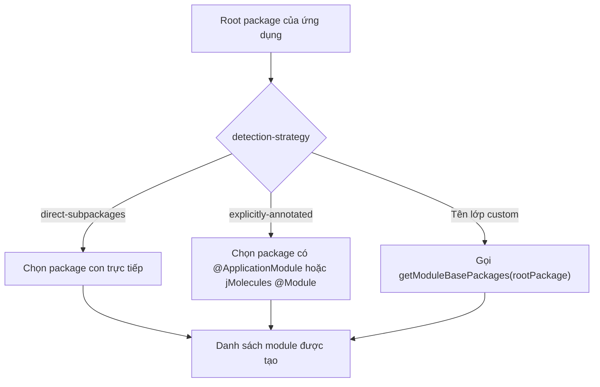

# Thiết lập `spring.modulith.detection-strategy`

Spring Modulith dùng thuộc tính `spring.modulith.detection-strategy` để chọn cách tìm application module trong package của ứng dụng. Nếu không cấu hình thuộc tính này, framework dùng chiến lược mặc định `direct-subpackages`: mỗi package con trực tiếp của package chứa lớp Spring Boot chính được xem là một module.

Khi cấu trúc package cần quy ước khác, bạn có thể chuyển sang `explicitly-annotated` để chỉ nhận diện package có annotation module, hoặc đăng ký một lớp tự triển khai `ApplicationModuleDetectionStrategy`. Thuộc tính này cho phép chọn chiến lược ở cấp ứng dụng mà không phải thay đổi cấu trúc Java package chỉ để phù hợp với một quy tắc phát hiện cố định.

Sau bài học, bạn có thể:

- Cấu hình `spring.modulith.detection-strategy` trong `application.properties` hoặc `application.yml`.
- Phân biệt `direct-subpackages` và `explicitly-annotated`.
- Đăng ký một custom `ApplicationModuleDetectionStrategy` bằng tên lớp đầy đủ.
- Chọn nơi đặt cấu hình phù hợp khi chỉ kiểm tra kiến trúc hoặc khi sử dụng tính năng Modulith lúc runtime.
- Xác minh danh sách module thực tế bằng `ApplicationModules`.

## 1. Thuộc tính dùng để làm gì?

`spring.modulith.detection-strategy` quyết định cách Spring Modulith chọn package làm base package cho application module. Chiến lược được gọi với package của lớp Spring Boot chính và trả về các package sẽ được xem là module.

Các cách cấu hình thường dùng:

| Giá trị | Cách hoạt động |
|---|---|
| Không khai báo thuộc tính | Dùng fallback mặc định `direct-subpackages` |
| `direct-subpackages` | Nhận diện các package con trực tiếp của root package |
| `explicitly-annotated` | Chỉ nhận diện package được đánh dấu bằng `@ApplicationModule` hoặc jMolecules `@Module` |
| Tên lớp đầy đủ | Dùng implementation tùy chỉnh của `ApplicationModuleDetectionStrategy` |

Giá trị `direct-subpackages` là chuỗi cấu hình chính xác. Hãy giữ nguyên dấu gạch nối và chữ thường khi đặt trong file cấu hình.

## 2. Dùng chiến lược mặc định `direct-subpackages`

Nếu cấu trúc dự án có package gốc và các module là package con trực tiếp, bạn không cần khai báo thuộc tính. Ví dụ:

```text
com.acme.shop                         <- package của ShopApplication
├── ShopApplication.java
├── catalog                           <- module catalog
├── order                             <- module order
└── customer                          <- module customer
```

Spring Modulith tự nhận diện `catalog`, `order` và `customer`. Có thể ghi rõ chiến lược mặc định trong `src/main/resources/application.properties`:

```properties
spring.modulith.detection-strategy=direct-subpackages
```

Hoặc dùng YAML:

```yaml
spring:
  modulith:
    detection-strategy: direct-subpackages
```

Việc khai báo tường minh giúp người đọc cấu hình biết dự án đang dựa trên quy ước package con trực tiếp. Khi không có cấu hình, kết quả phát hiện vẫn dùng fallback này.

## 3. Chỉ phát hiện package có annotation với `explicitly-annotated`

Nếu muốn kiểm soát module bằng metadata, hãy cấu hình:

```properties
spring.modulith.detection-strategy=explicitly-annotated
```

Với chiến lược này, Spring Modulith chỉ chọn các package được đánh dấu bằng một trong các annotation sau:

- `org.springframework.modulith.ApplicationModule`.
- `org.jmolecules.ddd.annotation.Module` của jMolecules.

Trong Java, cách khai báo thường đặt annotation trên package bằng `package-info.java`. Ví dụ:

```java
@org.springframework.modulith.ApplicationModule
package com.acme.shop.catalog;
```

Và module `order`:

```java
@org.springframework.modulith.ApplicationModule
package com.acme.shop.order;
```

Nếu package `com.acme.shop.customer` không có annotation phù hợp, package đó sẽ không được phát hiện chỉ vì nó nằm ngay dưới `com.acme.shop`.

So sánh hai chiến lược trên cùng một cây package:

| Package | `direct-subpackages` | `explicitly-annotated` |
|---|---|---|
| `catalog` có `@ApplicationModule` | Được phát hiện | Được phát hiện |
| `order` có `@ApplicationModule` | Được phát hiện | Được phát hiện |
| `customer` không có annotation | Được phát hiện | Không được phát hiện |
| `reporting` có jMolecules `@Module` | Được phát hiện | Được phát hiện |



Khi chuyển sang `explicitly-annotated`, hãy rà soát các package module hiện tại và thêm annotation cho từng module cần được phát hiện. Nếu quên annotation ở một package, module đó sẽ biến mất khỏi mô hình và các kiểm tra kiến trúc có thể không còn bao phủ phần mã tương ứng.

## 4. Đăng ký custom detection strategy

Khi hai chiến lược có sẵn không phù hợp, bạn có thể tự triển khai `ApplicationModuleDetectionStrategy`. Interface này cung cấp phương thức `getModuleBasePackages(JavaPackage rootPackage)`. Spring Modulith truyền vào package của lớp ứng dụng Spring Boot; implementation trả về stream các package sẽ được xem là module.

Ví dụ, dự án quy ước tên các module kết thúc bằng `Module`:

```java
package com.acme.shop;

import java.util.stream.Stream;

import org.springframework.modulith.core.ApplicationModuleDetectionStrategy;
import org.springframework.modulith.core.JavaPackage;

public class ShopModuleDetectionStrategy implements ApplicationModuleDetectionStrategy {

    @Override
    public Stream<JavaPackage> getModuleBasePackages(JavaPackage rootPackage) {
        return rootPackage.getDirectSubPackages().stream()
                .filter(pkg -> pkg.getLocalName().endsWith("Module"));
    }
}
```

Với quy ước này, các package như `com.acme.shop.catalogModule` và `com.acme.shop.orderModule` được chọn làm module. Package `com.acme.shop.configuration` không khớp hậu tố `Module` nên bị bỏ qua.

Đăng ký implementation bằng tên lớp đầy đủ trong `application.properties`:

```properties
spring.modulith.detection-strategy=com.acme.shop.ShopModuleDetectionStrategy
```

Hoặc trong `application.yml`:

```yaml
spring:
  modulith:
    detection-strategy: com.acme.shop.ShopModuleDetectionStrategy
```

Lớp custom phải có mặt trên classpath nơi Spring Modulith xây dựng mô hình. Tên lớp trong property phải bao gồm package và đúng tên class. Phương thức trả về các `JavaPackage` thuộc root package được chọn làm module base package; đừng trả về package con tùy tiện nếu chúng không đại diện cho ranh giới module của ứng dụng.

## 5. Đặt cấu hình ở test hay runtime?

Nếu custom strategy chỉ phục vụ kiểm tra kiến trúc và sinh tài liệu module, bạn có thể đặt implementation cùng cấu hình trong test source set, ví dụ:

```text
src/test/java/com/acme/shop/ShopModuleDetectionStrategy.java
src/test/resources/application.properties
```

Điều này giúp test dùng đúng quy ước phát hiện module mà không cần đưa implementation vào artifact ứng dụng.

Nếu ứng dụng cần dùng custom strategy ở runtime, hãy đặt implementation trong `src/main/java` và cấu hình trong `src/main/resources`. Khi ứng dụng sử dụng các thành phần Spring Modulith lúc runtime như `ApplicationModuleInitializer`, hoặc các tính năng production-ready như Actuator và observability, tài liệu Spring Modulith yêu cầu khai báo `spring-modulith-core` như dependency compile-time để các API và custom strategy có mặt trên runtime classpath.

Gradle:

```groovy
dependencies {
    implementation 'org.springframework.modulith:spring-modulith-core'
}
```

Maven:

```xml
<dependency>
    <groupId>org.springframework.modulith</groupId>
    <artifactId>spring-modulith-core</artifactId>
</dependency>
```

Hãy dùng cùng một phiên bản Spring Modulith do dependency management của dự án quản lý; không tự chọn một phiên bản khác chỉ cho `spring-modulith-core`.

## 6. Kiểm tra chiến lược đã được áp dụng

Sau khi cấu hình, hãy tạo mô hình từ lớp Spring Boot chính:

```java
import org.springframework.modulith.core.ApplicationModules;

class ModuleDetectionInspection {

    void inspect() {
        var modules = ApplicationModules.of(ShopApplication.class);

        modules.forEach(System.out::println);
        modules.verify();
    }
}
```

Đầu ra cho biết logical name, base package và các Spring bean thuộc từng module. Đối chiếu danh sách này với quy ước mà strategy cần thực hiện.

Bạn cũng có thể khóa hành vi bằng bài kiểm tra JUnit:

```java
import org.junit.jupiter.api.Test;
import org.springframework.modulith.core.ApplicationModules;

class ModularityTests {

    @Test
    void verifiesApplicationModuleStructure() {
        ApplicationModules.of(ShopApplication.class).verify();
    }
}
```

`verify()` kiểm tra các quy tắc cấu trúc và phụ thuộc của những module đã được phát hiện. Nếu một module không xuất hiện trong đầu ra, hãy kiểm tra detection strategy và package base trước khi điều tra lỗi phụ thuộc.

## 7. Lỗi cấu hình thường gặp

| Hiện tượng | Nguyên nhân có thể | Cách xử lý |
|---|---|---|
| Module biến mất sau khi đổi strategy | Package chưa có `@ApplicationModule` hoặc jMolecules `@Module` | Bổ sung annotation hoặc chọn lại `direct-subpackages` |
| Property không chọn custom strategy | Sai tên lớp, package hoặc class không có trên classpath | Dùng tên đầy đủ và bảo đảm implementation được biên dịch vào source set phù hợp |
| Custom strategy không trả về module nào | Bộ lọc package quá chặt hoặc kiểm tra sai tên package | In tên `rootPackage` và rà soát từng package con trực tiếp |
| Module xuất hiện nhiều hơn dự kiến | Bộ lọc custom chọn cả package cấu hình hoặc package tiện ích | Thu hẹp điều kiện chọn package theo quy ước module |
| Test và runtime phát hiện khác nhau | Strategy hoặc property chỉ có trong test source set | Quyết định rõ strategy thuộc test hay runtime và đặt class/config đúng classpath |
| Thay `scanBasePackages` nhưng Modulith không đổi module | Component scan và module detection là hai cơ chế riêng | Dùng `spring.modulith.detection-strategy` hoặc `@Modulithic` cho Modulith |

## 8. Ghi nhớ

`spring.modulith.detection-strategy` chọn cách Spring Modulith tìm module. Không khai báo thuộc tính sẽ dùng fallback `direct-subpackages`; `explicitly-annotated` chỉ chọn package có `@ApplicationModule` hoặc jMolecules `@Module`; tên lớp đầy đủ đăng ký custom `ApplicationModuleDetectionStrategy`. Custom strategy nhận root package của lớp Spring Boot và trả về các module base package. Nếu chỉ dùng cho kiểm tra kiến trúc, có thể đặt implementation và property trong test source set; nếu dùng các thành phần Modulith lúc runtime, cần bảo đảm `spring-modulith-core` có mặt ở compile-time/runtime classpath. Luôn quan sát mô hình bằng `ApplicationModules` và chạy `verify()` sau khi đổi chiến lược.

## Tài liệu tham khảo

- [Spring Modulith Fundamentals – Customizing Module Detection](https://docs.spring.io/spring-modulith/reference/fundamentals.html#modules.detection)
- [Spring Modulith Appendix – Configuration Properties](https://docs.spring.io/spring-modulith/reference/appendix.html)
- [ApplicationModuleDetectionStrategy API](https://docs.spring.io/spring-modulith/docs/current/api/org/springframework/modulith/core/ApplicationModuleDetectionStrategy.html)
- [JavaPackage API](https://docs.spring.io/spring-modulith/docs/current/api/org/springframework/modulith/core/JavaPackage.html)
