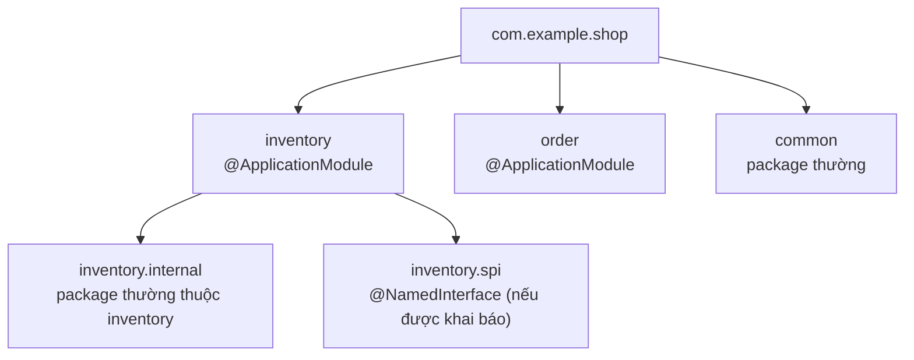

# Phân biệt module được đánh dấu với package thông thường

Khi sử dụng detection strategy `explicitly-annotated`, Spring Modulith chỉ chọn những package được đánh dấu tường minh làm package gốc của application module. Package được đánh dấu bằng `@ApplicationModule` của Spring Modulith hoặc `@Module` của jMolecules có thể trở thành module; package không được đánh dấu không tự trở thành module chỉ vì nó nằm trực tiếp dưới package gốc ứng dụng.

Điều này tạo ra hai khái niệm cần phân biệt: **module được đánh dấu** là một ranh giới kiến trúc mà Spring Modulith quản lý; **package thông thường** chỉ là một phần của cây package Java và không tự có danh tính module. Nếu package thông thường nằm bên trong một module đã được nhận diện, nó thuộc module đó. Nếu nó nằm ngang hàng với các module dưới package gốc và không được đánh dấu, nó không thuộc một application module nào.

Trong `SPRING_MODULITH_MODULE_MODEL`, phân biệt đúng hai trường hợp này giúp xác định quyền sở hữu mã nguồn, API công khai và phạm vi mà `ApplicationModules.verify()` có thể kiểm soát.

## 1. Nhắc lại chiến lược `explicitly-annotated`

Để chỉ nhận diện những package được đánh dấu, cấu hình:

```properties
spring.modulith.detection-strategy=explicitly-annotated
```

Hoặc trong `application.yml`:

```yaml
spring:
  modulith:
    detection-strategy: explicitly-annotated
```

Với chiến lược này, Spring Modulith tìm các package có metadata module phù hợp. Hai annotation được hỗ trợ là:

- `org.springframework.modulith.ApplicationModule` — annotation của Spring Modulith, có thể khai báo thêm metadata như `displayName`, `type` và `allowedDependencies`.
- `org.jmolecules.ddd.annotation.Module` — annotation module thuộc jMolecules DDD.

Các package con trực tiếp không được đánh dấu sẽ không tự động trở thành module như khi dùng chiến lược mặc định `direct-sub-packages`.

## 2. Module được đánh dấu là gì?

Module được đánh dấu là package được chọn làm package gốc của application module nhờ annotation module. Với Java, cách phổ biến là đặt annotation trong `package-info.java` của package đó.

Ví dụ, đánh dấu module `inventory`:

```java
@org.springframework.modulith.ApplicationModule
package com.example.shop.inventory;
```

Vị trí file:

```text
src/main/java/com/example/shop/inventory/package-info.java
```

Với cấu hình `explicitly-annotated`, package `com.example.shop.inventory` được nhận diện thành module có logical name mặc định là `inventory`. Module đó có ranh giới riêng để Spring Modulith phân tích API, package nội bộ và dependency.

Bạn cũng có thể khai báo metadata trên annotation:

```java
@org.springframework.modulith.ApplicationModule(
    displayName = "Inventory Management",
    allowedDependencies = { "catalog", "pricing" }
)
package com.example.shop.inventory;
```

Trong trường hợp này, `inventory` vẫn là module được đánh dấu; `displayName` cung cấp tên hiển thị, còn `allowedDependencies` mô tả các module mà `inventory` được phép phụ thuộc khi áp dụng whitelist.

## 3. Package thông thường là gì?

Package thông thường là package không được chọn làm package gốc module bởi detection strategy hiện tại. Với `explicitly-annotated`, có hai tình huống phổ biến.

**Package thông thường nằm bên trong một module đã đánh dấu.** Ví dụ `com.example.shop.inventory.internal` không có annotation module riêng. Nó vẫn thuộc module `inventory`, vì nó nằm trong cây package của module đó và không tạo một ranh giới module mới.

**Package thông thường nằm ngang hàng với các module dưới root package.** Ví dụ `com.example.shop.common` không được đánh dấu trong khi `inventory` và `order` được đánh dấu. `common` không trở thành module độc lập và cũng không tự thuộc module `inventory` hoặc `order`; đó là code không được gán vào application module.

Ví dụ cấu trúc:

```text
com.example.shop
├── ShopApplication.java
├── inventory                         // @ApplicationModule
│   ├── package-info.java
│   ├── InventoryManagement.java
│   └── internal                      // package thông thường thuộc inventory
│       └── InventoryRepository.java
├── order                             // @ApplicationModule
│   ├── package-info.java
│   └── OrderManagement.java
└── common                            // package thông thường, không được gán module
    └── DateTimeProvider.java
```

Kết quả có thể tóm tắt như sau:

| Package | Có annotation module? | Vai trò với `explicitly-annotated` |
|---|---:|---|
| `com.example.shop.inventory` | Có | Module `inventory` |
| `com.example.shop.inventory.internal` | Không | Package nội bộ thuộc `inventory` |
| `com.example.shop.order` | Có | Module `order` |
| `com.example.shop.common` | Không | Package không được gán vào module |

Điểm mấu chốt: package thông thường không tự trở thành module, nhưng vẫn có thể chứa lớp Java và được các phần khác của ứng dụng sử dụng theo các quy tắc tương ứng.

## 4. Cây package và quyền sở hữu module

Hãy xem module được đánh dấu như một ranh giới sở hữu. Các package con nằm dưới module đó thuộc cây package của module, trừ khi một package con được đánh dấu riêng để tạo nested application module theo phiên bản Spring Modulith hỗ trợ.



Trong sơ đồ:

- `inventory` và `order` là các module riêng vì được đánh dấu.
- `inventory.internal` là package nội bộ của `inventory`, không phải module mới.
- `inventory.spi` cũng thuộc module `inventory`; nếu được đánh dấu `@NamedInterface`, nó trở thành một nhóm API được expose chứ không phải module độc lập.
- `common` không được gán vào module nào vì nó nằm ngoài các package module được đánh dấu.

## 5. Package không được gán vào module có ý nghĩa gì?

Một package không được gán vào module vẫn là code Java bình thường trên classpath. Tuy nhiên, nó không có ranh giới module riêng để Spring Modulith áp dụng các quy tắc encapsulation như với một application module.

Điều này có hai hệ quả:

1. Module có thể tham chiếu code không được gán vào module. Tài liệu Spring Modulith mô tả rằng khi module khai báo `allowedDependencies`, code của module đó được phép tham chiếu module được liệt kê và code không thuộc module nào.
2. Code không được gán vào module không có API package hoặc internal package theo mô hình module. Nếu nhiều module cùng sử dụng nó, trách nhiệm và mức ổn định của hợp đồng cần được quản lý bằng quy ước thiết kế khác.

Vì vậy, không nên đặt tùy tiện các kiểu nghiệp vụ quan trọng trong package ngang hàng không được đánh dấu rồi xem chúng như một module dùng chung. Nếu `common` có trách nhiệm nghiệp vụ độc lập, hãy đánh dấu nó thành module và công bố API rõ ràng. Nếu nó chỉ chứa tiện ích kỹ thuật nhỏ, hãy cân nhắc đặt nó trong module sở hữu hoặc giữ phạm vi sử dụng thật hẹp.

## 6. So sánh với chiến lược `direct-sub-packages`

Cùng một cây package có thể tạo ra mô hình khác nhau tùy detection strategy.

```text
com.example.shop
├── inventory        // @ApplicationModule
├── order            // @ApplicationModule
├── common           // không đánh dấu
└── configuration    // không đánh dấu
```

| Package | `direct-sub-packages` | `explicitly-annotated` |
|---|---|---|
| `inventory` | Module do nằm trực tiếp dưới root | Module do có annotation |
| `order` | Module do nằm trực tiếp dưới root | Module do có annotation |
| `common` | Module do nằm trực tiếp dưới root | Không phải module vì không được đánh dấu |
| `configuration` | Module do nằm trực tiếp dưới root | Không phải module vì không được đánh dấu |

Sự khác biệt nằm ở điều kiện chọn package gốc module. Với `direct-sub-packages`, vị trí package quyết định. Với `explicitly-annotated`, annotation module quyết định.

## 7. Dùng `@Module` của jMolecules

Ngoài annotation của Spring Modulith, package cũng có thể được đánh dấu bằng `@Module` của jMolecules:

```java
@org.jmolecules.ddd.annotation.Module
package com.example.shop.customer;
```

Khi cấu hình `explicitly-annotated`, package này được xem là package gốc module. Annotation thuộc artifact `org.jmolecules:jmolecules-ddd`; dự án cần dependency đó nếu sử dụng cách đánh dấu này.

`@Module` của jMolecules là từ vựng DDD tổng quát. `@ApplicationModule` của Spring Modulith phù hợp khi cần khai báo thêm metadata riêng của Spring Modulith, ví dụ `allowedDependencies`, `displayName` hoặc `type`.

## 8. Nested application module khác package thường

Từ Spring Modulith 1.3, có thể tạo nested application module bằng cách đánh dấu package con bên trong một module hiện có. Khi package con không được đánh dấu, nó vẫn thuộc module cha.

Ví dụ:

```text
com.example.shop
└── inventory                         // @ApplicationModule
    ├── package-info.java
    ├── InventoryManagement.java
    ├── internal                      // package thường thuộc inventory
    └── replenishment                 // @ApplicationModule
        ├── package-info.java
        └── ReplenishmentManagement.java
```

Trong ví dụ, `inventory.replenishment` được đánh dấu riêng nên trở thành nested module. `inventory.internal` không được đánh dấu, vì vậy tiếp tục thuộc module cha `inventory`.

Không nên nhầm `@NamedInterface` với nested module. `@NamedInterface` expose một package như nhóm API của module hiện tại; `@ApplicationModule` trên package con tạo một ranh giới module lồng nhau.

## 9. Kiểm tra module nào được nhận diện

Sau khi bật `explicitly-annotated`, hãy tạo mô hình và in các module được phát hiện:

```java
import org.springframework.modulith.core.ApplicationModules;

ApplicationModules modules = ApplicationModules.of(ShopApplication.class);
modules.forEach(System.out::println);
```

Nếu muốn xác nhận một module cụ thể tồn tại:

```java
var inventory = modules.getModuleByName("inventory")
        .orElseThrow(() -> new IllegalStateException("inventory module not found"));

System.out.println(inventory.getIdentifier());
System.out.println(inventory.getBasePackage());
```

Để điều tra một package không xuất hiện như module, hãy xác định:

- Package có annotation module được hỗ trợ không?
- Annotation có nằm đúng package gốc mong muốn không?
- Package có nằm trong root package mà `ApplicationModules` phân tích không?
- Package có phải package con bên trong một module khác nên được xem là package thuộc module cha không?
- Detection strategy có thực sự là `explicitly-annotated` không?

## 10. Kiểm tra dependency và package không được gán module

Bạn có thể kiểm tra các ranh giới bằng `ApplicationModules.verify()`:

```java
import org.junit.jupiter.api.Test;
import org.springframework.modulith.core.ApplicationModules;

class ModularityTests {

    @Test
    void verifiesModuleStructure() {
        ApplicationModules.of(ShopApplication.class).verify();
    }
}
```

Khi module khai báo `allowedDependencies`, Spring Modulith kiểm tra các phụ thuộc tới module khác theo whitelist. Code không được gán vào module nào được xem là code ngoài các module trong mô hình và có thể được module tham chiếu. Vì vậy, việc đặt một lớp vào package `common` không được đánh dấu không tương đương với việc tạo một module `common` có ranh giới và API được kiểm soát.

Nếu muốn `common` trở thành một module thực sự, hãy đánh dấu package đó bằng `@ApplicationModule` hoặc jMolecules `@Module`, sau đó xác định API và dependency mà các module khác được phép sử dụng.

## 11. Những nhầm lẫn thường gặp

| Nhầm lẫn | Cách hiểu đúng |
|---|---|
| Mọi package con trực tiếp đều là module khi bật `explicitly-annotated` | Chỉ package được đánh dấu bằng annotation module được hỗ trợ mới được chọn. |
| Package không đánh dấu không chứa code hợp lệ | Nó vẫn là package Java bình thường; chỉ là không có danh tính application module. |
| Package con `inventory.internal` cần annotation để thuộc `inventory` | Không cần; nó thuộc module cha nếu không được đánh dấu thành nested module. |
| Package `common` ngang hàng tự thuộc `inventory` | Không; nó không thuộc module nào nếu không nằm dưới module đã nhận diện hoặc không được đánh dấu riêng. |
| Package không gán module tương đương module dùng chung | Code không gán module không có ranh giới, API và quy tắc phụ thuộc riêng như một application module. |
| `@NamedInterface` tạo module mới | Nó chỉ expose package như một nhóm API của module sở hữu. |
| `@Module` và `@ApplicationModule` hoàn toàn giống nhau | Cả hai có thể đánh dấu module cho detection; `@ApplicationModule` còn cung cấp metadata riêng của Spring Modulith. |

## 12. Checklist phân biệt module và package thường

- [ ] Kiểm tra detection strategy đang dùng là `explicitly-annotated`.
- [ ] Xác định package nào được đánh dấu `@ApplicationModule` hoặc jMolecules `@Module`.
- [ ] Xem các package con không đánh dấu nằm bên trong module nào.
- [ ] Phân biệt package ngang hàng không được đánh dấu với package nội bộ thuộc module cha.
- [ ] Không xem package không được gán module là một module dùng chung có ranh giới.
- [ ] Đánh dấu `common` thành module nếu nó thực sự có trách nhiệm và hợp đồng riêng.
- [ ] Dùng `@NamedInterface` khi chỉ cần expose một package con.
- [ ] Dùng `@ApplicationModule` trên package con khi cần nested module và phiên bản hỗ trợ.
- [ ] Quan sát mô hình bằng `ApplicationModules.of(...).forEach(...)`.
- [ ] Chạy `ApplicationModules.verify()` để kiểm tra dependency và encapsulation.

## 13. Kết luận

Với detection strategy `explicitly-annotated`, module được nhận diện là package được đánh dấu tường minh bằng `@ApplicationModule` hoặc jMolecules `@Module`. Package không được đánh dấu không tự trở thành module. Nếu nó nằm dưới package gốc của một module đã nhận diện, nó thuộc module cha; nếu nó nằm ngang hàng dưới root ứng dụng và không được đánh dấu, nó là code không được gán vào module.

Sự phân biệt này giúp nhóm phát triển hiểu rõ phần nào có ranh giới module được Spring Modulith quản lý và phần nào vẫn là package thông thường. Hãy đánh dấu các module có trách nhiệm nghiệp vụ rõ ràng, giữ package triển khai bên trong module sở hữu và quản lý code dùng chung bằng một hợp đồng có chủ đích. Dùng `ApplicationModules` để quan sát mô hình và `verify()` để kiểm tra các phụ thuộc theo ranh giới đã thiết kế.

## Tài liệu tham khảo

- [Spring Modulith — Fundamentals: Customizing Module Detection](https://docs.spring.io/spring-modulith/reference/fundamentals.html)
- [Spring Modulith — Application Module Verification](https://docs.spring.io/spring-modulith/reference/verification.html)
- [Spring Modulith — `ApplicationModule` API](https://docs.spring.io/spring-modulith/docs/current/api/org/springframework/modulith/ApplicationModule.html)
- [jMolecules — DDD annotations](https://github.com/xmolecules/jmolecules)
