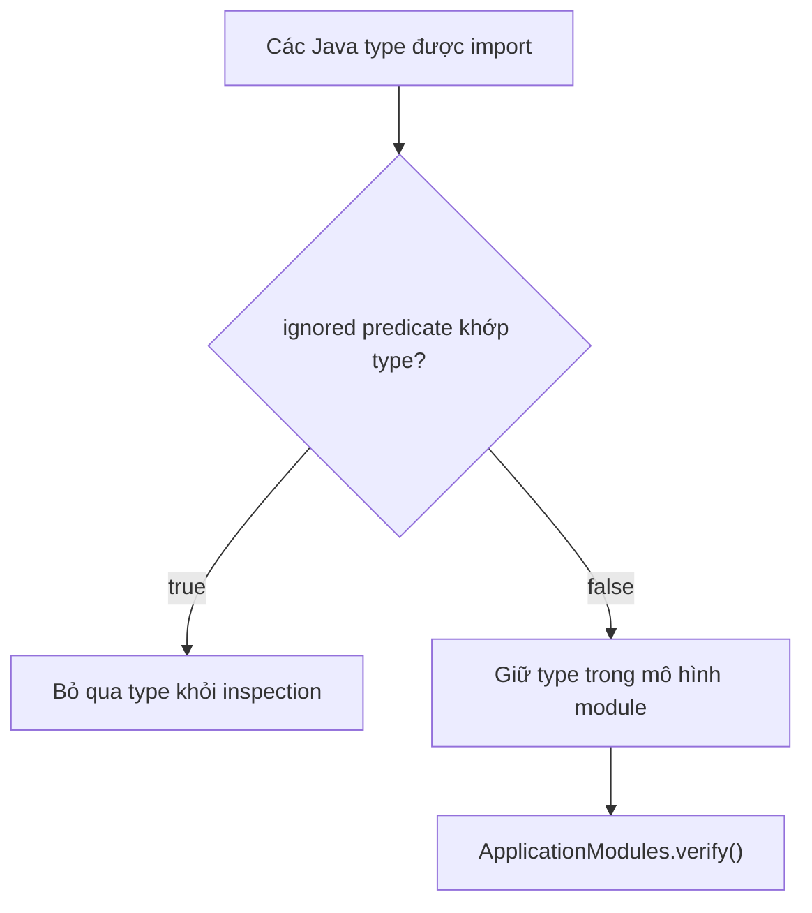

# `ApplicationModules.of()` với predicate bỏ qua type

`ApplicationModules.of()` có overload nhận thêm một predicate để bỏ qua các Java type hoặc package khi Spring Modulith phân tích cấu trúc module. Predicate này thuộc ArchUnit và có kiểu `DescribedPredicate<? super JavaClass>`. Khi predicate khớp một type, type đó được loại khỏi lần kiểm tra kiến trúc đang tạo.

Tính năng này hữu ích khi một ứng dụng có lớp tương thích cũ, mã sinh tự động hoặc package kỹ thuật nằm ngoài phạm vi kiến trúc muốn kiểm tra. Ví dụ, bạn có thể bỏ qua một lớp adapter cũ hoặc toàn bộ package `com.acme.shop.legacy` khi gọi `ApplicationModules.of(ShopApplication.class, ignored)`.

Sau bài học, bạn có thể:

- Dùng overload `ApplicationModules.of(Class, DescribedPredicate)` để bỏ qua type.
- Phân biệt predicate chọn đối tượng bị bỏ qua với predicate chọn đối tượng cần kiểm tra.
- Bỏ qua một type cụ thể, một package hoặc nhiều nhóm type kết hợp.
- Chọn đúng package pattern khi cần bao gồm cả package con.
- Hiểu giới hạn của exclusion và tránh che giấu vi phạm kiến trúc thật.

## 1. Overload nhận predicate

`ApplicationModules` cung cấp overload nhận lớp ứng dụng và predicate:

```java
ApplicationModules.of(
        ShopApplication.class,
        JavaClass.Predicates.resideInAPackage("com.acme.shop.legacy")
).verify();
```

Tham số thứ nhất là lớp ứng dụng dùng làm điểm bắt đầu để phát hiện module. Tham số thứ hai mô tả các `JavaClass` cần bỏ qua trong quá trình phân tích. Kiểu predicate là `DescribedPredicate<? super JavaClass>` của ArchUnit, không phải `java.util.function.Predicate<Class<?>>`.

Điều quan trọng là chiều ý nghĩa của predicate: **predicate trả về `true` cho type cần bỏ qua**. Ví dụ, `resideInAPackage("com.acme.shop.legacy")` khớp các type thuộc package đó, vì vậy những type ấy bị loại khỏi inspection.



## 2. Bỏ qua một type cụ thể

Giả sử ứng dụng có lớp `LegacyAuditAdapter` được giữ lại để tương thích với một hệ thống cũ. Lớp này không thuộc phạm vi quy tắc module mà nhóm muốn xác minh trong bài kiểm tra hiện tại.

```java
package com.acme.shop.audit;

public class LegacyAuditAdapter {

    public void publish(String message) {
        // Tích hợp với hệ thống audit cũ
    }
}
```

Bạn có thể tạo predicate bằng `JavaClass.Predicates.type(...)`:

```java
import com.acme.shop.ShopApplication;
import com.acme.shop.audit.LegacyAuditAdapter;
import com.tngtech.archunit.core.domain.JavaClass;
import org.springframework.modulith.core.ApplicationModules;

var ignored = JavaClass.Predicates.type(LegacyAuditAdapter.class);

var modules = ApplicationModules.of(ShopApplication.class, ignored);
modules.verify();
```

Predicate `type(LegacyAuditAdapter.class)` khớp type được chỉ định. Các type khác vẫn được đưa vào quá trình phân tích bình thường.

Nếu cần bỏ qua các lớp có cùng tên đơn giản, ArchUnit còn có `JavaClass.Predicates.simpleName("LegacyAuditAdapter")`. Tuy nhiên, cách này có thể khớp nhiều lớp ở các package khác nhau. Khi có thể tham chiếu lớp cụ thể, dùng `type(Class<?>)` sẽ thể hiện ý định rõ hơn.

## 3. Bỏ qua toàn bộ package

Khi nhiều lớp trong một package đều nằm ngoài phạm vi cần kiểm tra, hãy dùng `resideInAPackage`:

```java
var ignored = JavaClass.Predicates.resideInAPackage("com.acme.shop.legacy");

ApplicationModules.of(ShopApplication.class, ignored).verify();
```

ArchUnit dùng package identifier có cú pháp gần với AspectJ. Hai biểu thức sau có phạm vi khác nhau:

| Package identifier | Phạm vi khớp |
|---|---|
| `com.acme.shop.legacy` | Các type trong đúng package `com.acme.shop.legacy` |
| `com.acme.shop.legacy..` | Các type trong package `legacy` và tất cả package con |
| `..legacy..` | Các type trong một package có segment `legacy` ở bất kỳ vị trí nào trong cây package |

Ví dụ, nếu cây package là:

```text
com.acme.shop
└── legacy
    ├── LegacyAdapter.java
    ├── persistence
    │   └── LegacyRecord.java
    └── migration
        └── ImportJob.java
```

Predicate `resideInAPackage("com.acme.shop.legacy")` chỉ khớp type trực tiếp trong package `legacy`. Nếu muốn bỏ qua cả `persistence` và `migration`, hãy dùng:

```java
JavaClass.Predicates.resideInAPackage("com.acme.shop.legacy..");
```

Đừng quên dấu `..` cuối biểu thức khi mục tiêu là bao gồm các package con. Nếu không, các lớp ở package con vẫn có thể tham gia inspection.

## 4. Kết hợp nhiều điều kiện bỏ qua

ArchUnit cho phép kết hợp các `DescribedPredicate` bằng `or()` và `and()`. Ví dụ, bỏ qua một lớp adapter cụ thể cùng toàn bộ package chứa mã sinh tự động:

```java
import com.acme.shop.ShopApplication;
import com.acme.shop.audit.LegacyAuditAdapter;
import com.tngtech.archunit.core.domain.JavaClass;
import org.springframework.modulith.core.ApplicationModules;

var ignored = JavaClass.Predicates.type(LegacyAuditAdapter.class)
        .or(JavaClass.Predicates.resideInAPackage("com.acme.shop.generated.."));

ApplicationModules.of(ShopApplication.class, ignored).verify();
```

Ở đây, một type bị bỏ qua nếu nó là `LegacyAuditAdapter` **hoặc** nằm trong package `com.acme.shop.generated` hay bất kỳ package con nào của package đó.

Nếu muốn bỏ qua một nhóm type theo tên, có thể dùng các predicate có sẵn:

```java
var ignored = JavaClass.Predicates.simpleNameEndingWith("Generated")
        .or(JavaClass.Predicates.resideInAPackage("com.acme.shop.legacy.."));
```

Các predicate được kết hợp theo đúng logic Boolean. `or()` phù hợp khi bất kỳ điều kiện nào cũng đủ để bỏ qua type; `and()` chỉ khớp khi tất cả điều kiện đều đúng. Hãy viết biểu thức sao cho người đọc có thể hiểu chính xác nhóm type nào bị loại khỏi inspection.

## 5. Dùng predicate trong bài kiểm tra kiến trúc

Trong dự án thực tế, hãy gom logic exclusion vào một biến có tên rõ ràng và dùng nó khi tạo mô hình:

```java
import com.acme.shop.ShopApplication;
import com.tngtech.archunit.core.domain.JavaClass;
import org.junit.jupiter.api.Test;
import org.springframework.modulith.core.ApplicationModules;

class ModularityTests {

    @Test
    void verifiesModulesIgnoringLegacyIntegration() {
        var ignored = JavaClass.Predicates.resideInAPackage(
                "com.acme.shop.legacy.."
        );

        var modules = ApplicationModules.of(ShopApplication.class, ignored);

        modules.verify();
    }
}
```

Khi test thất bại, thông báo vi phạm sẽ tập trung vào những type còn lại sau khi áp dụng predicate. Điều này có thể giúp tách các vấn đề kiến trúc mới khỏi một vùng mã cũ chưa được đưa vào phạm vi kiểm tra.

Nếu ứng dụng có nhiều bài kiểm tra kiến trúc, có thể tái sử dụng predicate chung để các test có cùng phạm vi inspection. Hãy đặt tên và tài liệu cho predicate theo lý do nghiệp vụ hoặc kỹ thuật cụ thể, chẳng hạn `ignoredLegacyIntegrationTypes`, thay vì tên chung chung như `ignoreEverything`.

## 6. Exclusion không thay đổi ứng dụng

Predicate truyền vào `ApplicationModules.of()` chỉ điều chỉnh lần phân tích kiến trúc được tạo từ lời gọi đó. Nó không:

- Xóa lớp khỏi source code hoặc bytecode.
- Ngăn Spring Boot component scan hoặc tạo bean.
- Thay đổi access modifier hay khả năng import của Java.
- Tạo một ranh giới module mới hoặc chuyển package sang module khác.
- Tự động áp dụng cho mọi lời gọi `ApplicationModules.of()` khác.

Ví dụ, nếu `LegacyAuditAdapter` vẫn được Spring Boot quét và đăng ký làm bean, nó tiếp tục hoạt động lúc runtime. Predicate chỉ khiến Spring Modulith bỏ qua type đó trong mô hình kiến trúc được tạo bằng overload tương ứng.

Điều này cũng có nghĩa exclusion có thể che khuất vi phạm nếu dùng quá rộng. Nếu bỏ qua toàn bộ package nghiệp vụ chỉ vì đang có một lỗi phụ thuộc, bài kiểm tra có thể xanh trong khi ranh giới module vẫn chưa đúng. Chỉ loại những type hoặc package thực sự nằm ngoài phạm vi kiến trúc cần xác minh, và ghi rõ lý do.

## 7. Lỗi thường gặp

| Hiện tượng | Nguyên nhân | Cách xử lý |
|---|---|---|
| Package con vẫn xuất hiện trong vi phạm | Chỉ dùng `com.acme.shop.legacy` nên không khớp package con | Dùng `com.acme.shop.legacy..` |
| Bỏ qua nhầm nhiều lớp | Dùng `simpleName("Adapter")` hoặc pattern tên quá rộng | Ưu tiên `type(SomeClass.class)` hoặc package identifier cụ thể |
| Predicate không biên dịch | Truyền `java.util.function.Predicate<Class<?>>` thay vì ArchUnit `DescribedPredicate<JavaClass>` | Dùng `JavaClass.Predicates` hoặc tạo `DescribedPredicate` phù hợp |
| Vẫn thấy bean bị bỏ qua trong Spring context | Nhầm exclusion của Modulith với component scan | Nhớ rằng predicate chỉ ảnh hưởng module inspection |
| Bài kiểm tra bỏ sót lỗi kiến trúc | Exclusion bao phủ cả package nghiệp vụ đang cần kiểm tra | Thu hẹp predicate và rà soát lại phạm vi type bị bỏ qua |
| Một test bị bỏ qua nhưng test khác vẫn phân tích type đó | Mỗi lời gọi `ApplicationModules.of()` tạo mô hình với predicate riêng | Tái sử dụng predicate ở các test cần cùng phạm vi |

## 8. Ghi nhớ

Overload `ApplicationModules.of(ShopApplication.class, ignored)` nhận một `DescribedPredicate<? super JavaClass>` của ArchUnit. Predicate khớp với type hoặc package nào thì type đó bị bỏ qua khỏi lần inspection. Dùng `JavaClass.Predicates.type(...)` cho một type cụ thể, `resideInAPackage("...")` cho package, và thêm `..` cuối package identifier để bao gồm các package con. Kết hợp điều kiện bằng `or()` hoặc `and()` khi cần. Exclusion chỉ tác động đến mô hình kiến trúc được tạo bởi lời gọi đó; nó không thay đổi code, bean hay ranh giới runtime của ứng dụng.

## Tài liệu tham khảo

- [Spring Modulith Fundamentals – Excluding Packages](https://docs.spring.io/spring-modulith/reference/fundamentals.html#modules.excluding-packages)
- [ApplicationModules API – overload `of(Class, DescribedPredicate)`](https://docs.spring.io/spring-modulith/docs/current/api/org/springframework/modulith/core/ApplicationModules.html)
- [ArchUnit JavaClass.Predicates API](https://javadoc.io/doc/com.tngtech.archunit/archunit/latest/com/tngtech/archunit/core/domain/JavaClass.Predicates.html)
- [ArchUnit User Guide – Predicates](https://www.archunit.org/userguide/html/000_Index.html)
