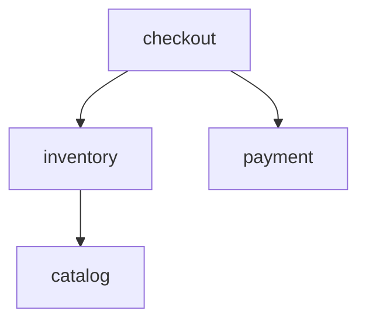
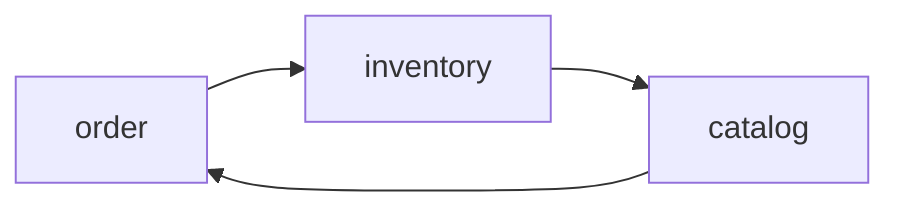

# Dependency graph giữa các `ApplicationModule`

Dependency graph của Spring Modulith biểu diễn module nào cần sử dụng API của module nào. Mỗi application module là một node; một cạnh có hướng từ module tiêu thụ đến module cung cấp API thể hiện quan hệ phụ thuộc trực tiếp. Ví dụ, nếu `checkout` sử dụng `InventoryManagement` của `inventory`, đồ thị có cạnh `checkout → inventory`.

Đồ thị giúp nhìn thấy mức độ kết nối giữa các phần nghiệp vụ, phát hiện chu trình phụ thuộc và xác định những module đang phụ thuộc quá nhiều vào module khác. Spring Modulith xây dựng mô hình từ package và các tham chiếu trong mã nguồn, sau đó cung cấp `ApplicationModules.verify()` để kiểm tra các quy tắc kiến trúc trên đồ thị đó.

Sau bài học, bạn có thể:

- Giải thích node, cạnh và hướng của dependency graph giữa các application module.
- Phân biệt phụ thuộc trực tiếp và phụ thuộc gián tiếp.
- Đọc một đồ thị module và nhận biết chu trình.
- Hiểu mối liên hệ giữa API công khai, named interface và cạnh phụ thuộc.
- Tạo và xác minh mô hình bằng `ApplicationModules`.

## 1. Node và cạnh trong dependency graph

Mỗi `ApplicationModule` được biểu diễn thành một node. Một module có thể cung cấp API cho module khác và đồng thời sử dụng API của module thứ ba.

Một cạnh `A → B` có nghĩa là **module A phụ thuộc vào module B**: mã thuộc A sử dụng một phần API được B công khai. Hướng cạnh đi từ bên tiêu thụ đến bên cung cấp. Vì vậy, cạnh đi ra từ A thể hiện các module mà A cần; cạnh đi vào B thể hiện các module đang cần B.

Ví dụ ứng dụng thương mại điện tử có bốn module:

```text
checkout
inventory
payment
catalog
```

Giả sử:

- `checkout` gọi API giữ hàng của `inventory`.
- `checkout` gọi API thanh toán của `payment`.
- `inventory` sử dụng API tra cứu sản phẩm của `catalog`.

Đồ thị phụ thuộc:



Đồ thị này có ba cạnh trực tiếp. Không có cạnh trực tiếp `checkout → catalog` nếu mã của `checkout` không tham chiếu API của `catalog`.

Đừng đọc mũi tên như luồng gọi hàm hoặc thứ tự xử lý nghiệp vụ. Mũi tên biểu diễn quan hệ phụ thuộc kiến trúc: module ở đầu mũi tên cần module ở cuối mũi tên.

## 2. Phụ thuộc trực tiếp và phụ thuộc gián tiếp

Trong đồ thị trên, `checkout` phụ thuộc trực tiếp vào `inventory` và `payment`. Vì `inventory` phụ thuộc vào `catalog`, `checkout` có một đường phụ thuộc gián tiếp đến `catalog` thông qua `inventory`.

| Module nguồn | Phụ thuộc trực tiếp | Có thể tiếp cận gián tiếp qua đồ thị |
|---|---|---|
| `checkout` | `inventory`, `payment` | `catalog` qua `inventory` |
| `inventory` | `catalog` | Không có trong ví dụ |
| `payment` | Không có | Không có |
| `catalog` | Không có | Không có |

Phụ thuộc gián tiếp là một đường đi qua nhiều cạnh. Nó cho biết thay đổi ở module sâu hơn có thể ảnh hưởng đến chuỗi module phía trên nếu hợp đồng hoặc hành vi được truyền qua các lớp trung gian. Tuy nhiên, đường đi gián tiếp không tự tạo ra một phụ thuộc trực tiếp trong mã nguồn. Nếu `checkout` import trực tiếp một kiểu từ `catalog`, đồ thị sẽ có thêm cạnh `checkout → catalog`.

Phân biệt hai loại này giúp bạn hiểu phạm vi của một module. Một module có nhiều cạnh đi ra thường cần nhiều module khác để hoàn thành chức năng. Một module có nhiều cạnh đi vào thường được nhiều module sử dụng và cần giữ API ổn định.

## 3. Spring Modulith nhận diện phụ thuộc từ đâu?

Spring Modulith xây dựng mô hình application module từ package của ứng dụng và cấu trúc mã. Một module thường có:

- **Provided interface:** API mà module công khai qua package gốc, named interface, Spring bean hoặc hợp đồng sự kiện.
- **Required interface:** các API của module khác mà module cần sử dụng.
- **Internal implementation:** các lớp và package phục vụ triển khai bên trong module.

Khi mã của module A tham chiếu kiểu được công khai bởi module B, Spring Modulith ghi nhận quan hệ phụ thuộc từ A đến B. Các quan hệ bean và hợp đồng ứng dụng, chẳng hạn module tiêu thụ lắng nghe event type được module khác công khai, cũng là cách các module tương tác cần được thể hiện qua API.

Ví dụ, module `inventory` công khai hợp đồng trong package gốc:

```java
package com.acme.shop.inventory;

public interface InventoryManagement {

    boolean reserve(String sku, int quantity);
}
```

Module `checkout` sử dụng hợp đồng đó:

```java
package com.acme.shop.checkout;

import com.acme.shop.inventory.InventoryManagement;
import org.springframework.stereotype.Service;

@Service
class CheckoutService {

    private final InventoryManagement inventory;

    CheckoutService(InventoryManagement inventory) {
        this.inventory = inventory;
    }

    void placeOrder(String sku, int quantity) {
        inventory.reserve(sku, quantity);
    }
}
```

Quan hệ tham chiếu này tạo phụ thuộc `checkout → inventory`. Module `checkout` không cần biết `inventory` dùng repository hoặc thuật toán giữ hàng nào ở bên trong.

## 4. Ranh giới API quyết định cạnh nào hợp lệ

Một cạnh có thể tồn tại trong đồ thị phụ thuộc nhưng vẫn vi phạm kiến trúc. Với module `CLOSED`, module khác chỉ được tham chiếu API công khai: package gốc và các named interface được khai báo. Package con nội bộ không trở thành API chỉ vì lớp Java trong đó có modifier `public`.

Ví dụ, module `inventory` có:

```text
com.acme.shop.inventory
├── InventoryManagement.java        <- API ở package gốc
├── spi
│   ├── package-info.java            <- @NamedInterface("spi")
│   └── StockReservation.java
└── internal
    └── DefaultStockRepository.java  <- nội bộ
```

Module khác có thể phụ thuộc vào `InventoryManagement` hoặc `StockReservation` nếu named interface `spi` được công khai. Tham chiếu `DefaultStockRepository` từ module khác là truy cập nội bộ trái quy tắc.

Khai báo named interface:

```java
@org.springframework.modulith.NamedInterface("spi")
package com.acme.shop.inventory.spi;
```

Nếu `checkout` được cấu hình allowlist, có thể giới hạn nó vào named interface:

```java
@org.springframework.modulith.ApplicationModule(
        allowedDependencies = "inventory::spi"
)
package com.acme.shop.checkout;
```

Khi đó, `checkout` được phép tham chiếu `inventory::spi`; tham chiếu package gốc `inventory` hoặc module khác có thể không được phép theo allowlist này. Nếu muốn cho phép cả package gốc lẫn named interface, có thể khai báo `inventory::**`.

Điều này cho thấy dependency graph không chỉ là danh sách module có liên hệ. Việc xác minh còn kiểm tra cạnh có đi qua API được công khai và có nằm trong danh sách phụ thuộc được phép hay không.

## 5. Đồ thị module phải không có chu trình

Spring Modulith yêu cầu dependency graph ở cấp application module là một directed acyclic graph (DAG), tức đồ thị có hướng không chu trình. Một chu trình xuất hiện khi có thể đi theo các cạnh phụ thuộc và quay lại module ban đầu.

Ví dụ:



Trong ví dụ này:

- `order` phụ thuộc `inventory`.
- `inventory` phụ thuộc `catalog`.
- `catalog` lại phụ thuộc `order`.

Ba cạnh tạo thành chu trình `order → inventory → catalog → order`. Các module trở nên gắn chặt theo vòng: thay đổi hợp đồng của một module có thể lan qua các module còn lại và khó xác định ranh giới chịu trách nhiệm.

Để phá chu trình, hãy xác định quan hệ nghiệp vụ đang bị đặt sai chiều. Một số cách xử lý thường gặp:

1. Chuyển hợp đồng dùng chung đến module sở hữu đúng khái niệm nghiệp vụ.
2. Để module phát sự kiện và module cần phản ứng đăng ký listener, thay vì tạo phụ thuộc gọi ngược.
3. Tách một abstraction ổn định thành API được sở hữu rõ ràng.
4. Hợp nhất các module nếu chúng luôn thay đổi cùng nhau và thực chất không có ranh giới độc lập.

Không nên chỉ xóa một cạnh khỏi sơ đồ bằng cách che giấu tham chiếu. Mã nguồn và quyền sở hữu hợp đồng phải được điều chỉnh để đồ thị phản ánh kiến trúc thực.

## 6. Tạo và xem dependency graph bằng `ApplicationModules`

Spring Modulith cung cấp `ApplicationModules` để phân tích ứng dụng và giữ mô hình module trong bộ nhớ. Truyền lớp Spring Boot chính để tạo mô hình:

```java
import org.springframework.modulith.core.ApplicationModules;

class ModuleGraphInspection {

    void inspect() {
        var modules = ApplicationModules.of(ShopApplication.class);

        modules.forEach(System.out::println);
    }
}
```

Việc in từng module giúp xem logical name, base package và các Spring bean thuộc module. Để kiểm tra quan hệ phụ thuộc và quy tắc kiến trúc, gọi `verify()`:

```java
import org.junit.jupiter.api.Test;
import org.springframework.modulith.core.ApplicationModules;

class ModularityTests {

    @Test
    void verifiesApplicationModuleStructure() {
        ApplicationModules.of(ShopApplication.class).verify();
    }
}
```

`verify()` kiểm tra ít nhất các quy tắc quan trọng sau:

- Không có chu trình phụ thuộc ở cấp application module.
- Module chỉ truy cập API package được phép; tham chiếu package nội bộ của module `CLOSED` bị từ chối.
- Nếu module khai báo `allowedDependencies`, phụ thuộc trực tiếp phải phù hợp với danh sách đó.

Khi có vi phạm, `verify()` ném exception mô tả lỗi kiến trúc. Bạn có thể dùng `detectViolations()` nếu muốn thu thập và xử lý danh sách vi phạm theo cách riêng trước khi quyết định ném lỗi.

## 7. Đọc đồ thị để đánh giá coupling

Khi xem dependency graph, đừng chỉ đếm số node. Hãy đọc cả cạnh đi vào và cạnh đi ra:

| Dấu hiệu | Cách diễn giải | Hướng xem xét |
|---|---|---|
| Một module có nhiều cạnh đi ra | Module cần nhiều module khác để thực hiện chức năng | Kiểm tra trách nhiệm có quá rộng hoặc hợp đồng bị phân tán không |
| Một module có nhiều cạnh đi vào | Nhiều module tiêu thụ API của module này | Giữ API ổn định, tránh thay đổi không tương thích |
| Hai module có cạnh theo hai chiều | Có thể đang tồn tại chu trình trực tiếp | Tách hợp đồng hoặc chuyển giao tiếp sang sự kiện |
| Một module trung gian có nhiều đường đi | Module này nằm trên nhiều chuỗi phụ thuộc | Kiểm tra nó có đang trở thành điểm kết nối quá quan trọng không |
| Một cạnh chỉ hợp lệ nhờ API quá rộng | Module tiêu thụ có thể biết quá nhiều chi tiết | Thu hẹp API và dùng named interface |

Một đồ thị có ít cạnh không tự động có nghĩa kiến trúc tốt. Hãy xem các cạnh có thể giải thích bằng quan hệ nghiệp vụ rõ ràng hay không, module sở hữu API có đúng không và thay đổi ở một module có buộc nhiều module khác phải sửa theo không.

## 8. Ghi nhớ

Dependency graph biểu diễn application module bằng node và quan hệ phụ thuộc trực tiếp bằng cạnh có hướng. Cạnh `A → B` có nghĩa A cần API do B cung cấp. Một đường nhiều cạnh thể hiện phụ thuộc gián tiếp, nhưng không tự tạo thêm cạnh trực tiếp. Spring Modulith kiểm tra đồ thị phải không có chu trình, các tham chiếu phải đi qua API được công khai và các phụ thuộc phải phù hợp với `allowedDependencies` nếu module khai báo allowlist. Dùng `ApplicationModules.of(ShopApplication.class)` để tạo mô hình, quan sát các module và gọi `verify()` để kiểm tra ranh giới kiến trúc.

## Tài liệu tham khảo

- [Spring Modulith Fundamentals – Application Modules và Dependencies](https://docs.spring.io/spring-modulith/reference/fundamentals.html)
- [Verifying Application Module Structure](https://docs.spring.io/spring-modulith/reference/verification.html)
- [Spring Modulith Runtime Support – Application Module Initializers](https://docs.spring.io/spring-modulith/reference/runtime.html)
