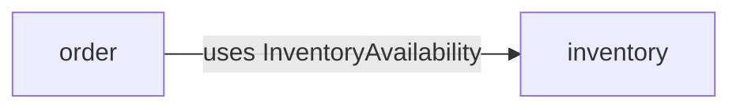
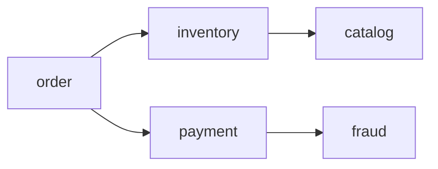
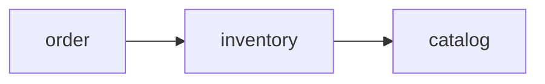
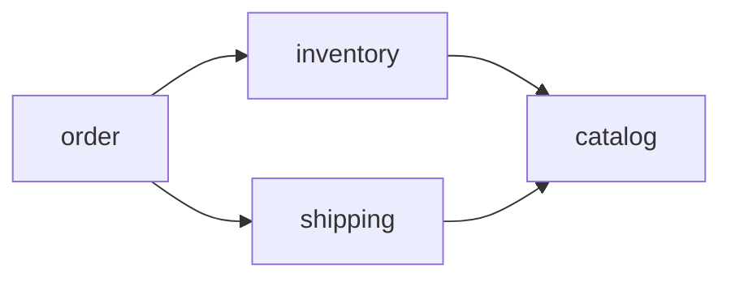
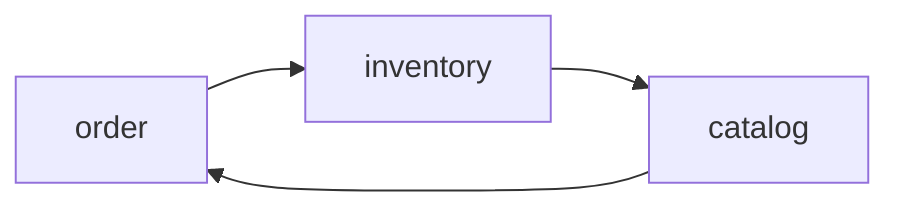

# Direct dependency và transitive dependency

Trong một modular monolith, mỗi application module có thể sử dụng API của một số module khác. Có module được sử dụng trực tiếp trong mã nguồn; cũng có module chỉ xuất hiện ở phía sau một chuỗi phụ thuộc. Hai trường hợp này được gọi là **direct dependency** (phụ thuộc trực tiếp) và **transitive dependency** (phụ thuộc bắc cầu).

Spring Modulith xây dựng mô hình phụ thuộc từ các tham chiếu giữa những kiểu thuộc các application module. Từ mô hình đó, có thể xem các module mà một module phụ thuộc trực tiếp và toàn bộ các module có thể đi tới qua nhiều bước. Phân biệt hai phạm vi giúp đọc đúng coupling, thiết kế API và đánh giá tác động khi thay đổi một module.

Trong `SPRING_MODULITH_MODULE_MODEL`, dependency được hiểu ở cấp application module trong cùng ứng dụng Spring Boot. Đây là quan hệ kiến trúc giữa các module, khác với dependency thư viện Maven hoặc Gradle được khai báo trong build file.

## 1. Dependency giữa hai application module

Một module có dependency tới module khác khi mã thuộc module nguồn tham chiếu đến kiểu hoặc hợp đồng thuộc module đích. Ví dụ, `order` sử dụng `InventoryAvailability` của `inventory` để kiểm tra tồn kho trước khi tạo đơn hàng:

```java
package com.example.shop.order.internal;

import com.example.shop.inventory.InventoryAvailability;
import org.springframework.stereotype.Service;

@Service
class PlaceOrderService {

    private final InventoryAvailability inventory;

    PlaceOrderService(InventoryAvailability inventory) {
        this.inventory = inventory;
    }

    void place(String sku, int quantity) {
        if (!inventory.hasAvailableStock(sku, quantity)) {
            throw new IllegalStateException("Insufficient stock");
        }

        // Tiếp tục xử lý đơn hàng.
    }
}
```

Trong ví dụ, `order` là module nguồn (consumer), còn `inventory` là module đích (provider). Hướng dependency được đọc từ module đang sử dụng sang module được sử dụng:



Mũi tên `order → inventory` có nghĩa là thay đổi hợp đồng mà `order` sử dụng ở `inventory` có thể ảnh hưởng tới `order`.

## 2. Direct dependency là gì?

Direct dependency là quan hệ phụ thuộc trực tiếp giữa hai module. Mã của module nguồn tham chiếu đến kiểu thuộc module đích mà không cần đi qua module trung gian.

Ví dụ, `order` sử dụng trực tiếp API của cả `inventory` và `payment`:

```java
package com.example.shop.order.internal;

import com.example.shop.inventory.InventoryAvailability;
import com.example.shop.payment.PaymentProcessing;

class PlaceOrderService {

    private final InventoryAvailability inventory;
    private final PaymentProcessing payment;

    PlaceOrderService(
            InventoryAvailability inventory,
            PaymentProcessing payment) {
        this.inventory = inventory;
        this.payment = payment;
    }
}
```

Ở cấp module, hai quan hệ trực tiếp là:

- `order → inventory`
- `order → payment`

Tập direct dependencies của `order` gồm `inventory` và `payment`. Đây là các module mà `order` trực tiếp biết đến thông qua những tham chiếu được Spring Modulith nhận diện trong mô hình.

Direct dependency thường là nơi cần xem xét đầu tiên khi đánh giá coupling. Mỗi quan hệ trực tiếp làm module nguồn phụ thuộc vào hợp đồng do module đích sở hữu.

## 3. Transitive dependency là gì?

Transitive dependency là quan hệ có thể đi tới gián tiếp bằng cách lần theo một hoặc nhiều direct dependency. Module nguồn không nhất thiết tham chiếu trực tiếp tới module cuối của chuỗi.

Giả sử ứng dụng có các quan hệ:



Từ `order`, ta có hai đường phụ thuộc:

- `order → inventory → catalog`
- `order → payment → fraud`

`catalog` là dependency bắc cầu của `order` qua `inventory`. `fraud` là dependency bắc cầu của `order` qua `payment`. Trong ví dụ này, `order` không tham chiếu trực tiếp API của `catalog` hoặc `fraud`.

Có thể phân biệt các tập như sau:

| Phạm vi nhìn từ `order` | Các module |
|---|---|
| Direct dependencies | `inventory`, `payment` |
| Transitive-only dependencies | `catalog`, `fraud` |
| All dependencies (trực tiếp và gián tiếp) | `inventory`, `payment`, `catalog`, `fraud` |

Trong cách dùng API của Spring Modulith, `getAllDependencies()` biểu diễn toàn bộ dependency có thể đi tới, bao gồm direct và transitive. Khi cần nói riêng phần transitive-only, hãy hiểu đó là phần nằm trong all dependencies nhưng không nằm trong direct dependencies.

## 4. Đọc direct và all dependencies bằng `ApplicationModule`

`ApplicationModules` tạo mô hình từ lớp ứng dụng. Sau đó, tìm module cần phân tích bằng logical name và đọc các quan hệ phụ thuộc:

```java
import org.springframework.modulith.core.ApplicationModule;
import org.springframework.modulith.core.ApplicationModules;

class ModuleDependencyReport {

    void printOrderDependencies() {
        ApplicationModules modules = ApplicationModules.of(ShopApplication.class);

        ApplicationModule order = modules.getModuleByName("order")
                .orElseThrow(() -> new IllegalStateException("order module not found"));

        System.out.println("Direct dependencies of order:");
        order.getDirectDependencies().forEach(System.out::println);

        System.out.println("All dependencies of order:");
        order.getAllDependencies().forEach(System.out::println);
    }
}
```

Hai phương thức trả lời hai câu hỏi khác nhau:

- `getDirectDependencies()` cho biết các quan hệ đi trực tiếp từ module đang xét.
- `getAllDependencies()` cho biết các quan hệ trực tiếp và những quan hệ gián tiếp có thể đi tới qua các module trung gian.

Các phần tử được trả về là thông tin dependency trong mô hình Spring Modulith, không chỉ là tên package. Có thể duyệt chúng để in báo cáo hoặc dùng trong công cụ phân tích kiến trúc.

### Đọc dependency của module trung gian

Với cùng mô hình, có thể đọc riêng module `inventory`:

```java
ApplicationModule inventory = modules.getModuleByName("inventory")
        .orElseThrow(() -> new IllegalStateException("inventory module not found"));

System.out.println("Direct dependencies of inventory:");
inventory.getDirectDependencies().forEach(System.out::println);

System.out.println("All dependencies of inventory:");
inventory.getAllDependencies().forEach(System.out::println);
```

Trong đồ thị ví dụ, `inventory` phụ thuộc trực tiếp vào `catalog`. Nếu `catalog` không phụ thuộc module nào khác, direct và all dependencies của `inventory` cùng thể hiện quan hệ tới `catalog`.

## 5. Đường đi bắc cầu không tạo ra tham chiếu trực tiếp

Một điểm quan trọng khi đọc dependency là không suy ra rằng module nguồn có thể sử dụng trực tiếp mọi module xuất hiện trong all dependencies.

Với đồ thị:



`order` có thể đi tới `catalog` theo đường `order → inventory → catalog`. Điều đó không có nghĩa mã trong `order` được phép import `catalog` trực tiếp. Nếu `order` cần một khả năng thuộc `catalog`, hãy xác định hợp đồng và khai báo một dependency trực tiếp có chủ đích.

Ví dụ, `order` nên gọi API được công bố của `inventory`; `inventory` chịu trách nhiệm phối hợp với `catalog`. Khi `order` import trực tiếp kiểu từ `catalog`, mô hình có thêm cạnh `order → catalog`, và dependency đó cần tuân theo quy tắc kiến trúc của `order`.

Transitive dependency mô tả đường đi trong đồ thị, không phải quyền truy cập được kế thừa từ module trung gian.

## 6. Direct dependency phải đi qua API được công bố

Một direct dependency được phát hiện không đồng nghĩa nó đã hợp lệ về encapsulation. Module tiêu thụ phải sử dụng package gốc hoặc named interface được module cung cấp expose, trừ trường hợp provider được cấu hình open.

Ví dụ, module `inventory` có:

```text
com.example.shop.inventory
├── InventoryAvailability.java
└── internal
    ├── InventoryAvailabilityImpl.java
    └── InventoryRepository.java
```

Module `order` nên tham chiếu `InventoryAvailability` ở package gốc. Nếu `order` import `InventoryRepository` trong `inventory.internal`, dependency vẫn là direct, nhưng truy cập có thể vi phạm ranh giới module đóng.

Nếu một package con thực sự cần được chia sẻ, module cung cấp có thể đánh dấu nó bằng `@NamedInterface`. Module tiêu thụ khai báo dependency tới named interface tương ứng, ví dụ `inventory::spi`. Nếu chỉ muốn dùng API package gốc, dependency có thể là `inventory`.

## 7. `allowedDependencies` kiểm soát dependency trực tiếp

Khi module khai báo `allowedDependencies`, danh sách này mô tả các module hoặc named interface mà module hiện tại được phép phụ thuộc. Đây là whitelist cho các quan hệ dependency của chính module đó.

Ví dụ, `order` trực tiếp sử dụng `inventory` và `payment`:

```java
@org.springframework.modulith.ApplicationModule(
    allowedDependencies = { "inventory", "payment" }
)
package com.example.shop.order;
```

Nếu `inventory` phụ thuộc `catalog` và `payment` phụ thuộc `fraud`, `order` không cần khai báo `catalog` hoặc `fraud` chỉ vì chúng xuất hiện trong all dependencies. Chúng là dependency bắc cầu qua các module trung gian, không phải dependency trực tiếp của `order`.

Nếu sau này mã của `order` bắt đầu tham chiếu trực tiếp một kiểu thuộc `catalog`, đồ thị thay đổi thành có cạnh `order → catalog`. Khi dùng whitelist, cần đánh giá và khai báo dependency trực tiếp này nếu đó là quan hệ kiến trúc được chấp nhận.

Điều này giúp whitelist thể hiện các hợp đồng mà module thực sự sử dụng, thay vì liệt kê tất cả module có thể xuất hiện ở cuối một chuỗi phụ thuộc.

## 8. Tác động khi một module trung gian thay đổi

Transitive dependencies rất hữu ích khi đánh giá phạm vi ảnh hưởng. Với chuỗi:

```text
order → inventory → catalog
```

`order` không gọi `catalog` trực tiếp, nhưng thay đổi trong `catalog` có thể tác động tới `order` nếu nó làm thay đổi hợp đồng mà `inventory` sử dụng và ảnh hưởng tới kết quả API mà `inventory` cung cấp cho `order`.

Tuy nhiên, không phải mọi thay đổi trong `catalog` đều lan tới `order`. Nếu `catalog` chỉ thay đổi phần nội bộ và vẫn giữ nguyên hợp đồng mà `inventory` sử dụng, tác động có thể được chặn bên trong `inventory`.

Vì vậy, khi phân tích tác động:

1. Dùng direct dependencies để tìm module sử dụng hợp đồng trực tiếp của module đang thay đổi.
2. Dùng all dependencies hoặc lần ngược đồ thị để tìm các module ở xa hơn có thể bị ảnh hưởng qua trung gian.
3. Xem xét hợp đồng cụ thể thay đổi và đường phụ thuộc có sử dụng hợp đồng đó hay không.
4. Chọn kiểm thử phù hợp cho module trực tiếp và các luồng nghiệp vụ đầu cuối liên quan.

All dependencies là phạm vi có thể tiếp cận trong đồ thị, không phải kết luận rằng mọi module trong tập đều chắc chắn bị ảnh hưởng bởi mọi thay đổi.

## 9. Nhiều đường đi tới cùng một module

Một module có thể được tiếp cận qua nhiều chuỗi phụ thuộc. Ví dụ:



`order` có hai đường đi tới `catalog`:

- `order → inventory → catalog`
- `order → shipping → catalog`

`catalog` vẫn là dependency gián tiếp đối với `order` nếu không có tham chiếu trực tiếp từ `order`. Khi phân tích ảnh hưởng, hai đường đi cho thấy thay đổi ở `catalog` có thể tác động tới `order` thông qua hai module trung gian khác nhau.

Nếu `order` bắt đầu tham chiếu trực tiếp `catalog`, quan hệ đó trở thành direct dependency bổ sung, dù trước đó `catalog` đã có thể tiếp cận theo đường bắc cầu.

## 10. Tránh dependency cycle

Direct và transitive dependencies cũng giúp nhận ra chu trình phụ thuộc. Ví dụ:



Chuỗi này tạo thành vòng `order → inventory → catalog → order`. Khi các module phụ thuộc vòng, việc thay đổi một hợp đồng có thể lan qua nhiều hướng và ranh giới sở hữu nghiệp vụ trở nên khó hiểu.

Hãy xem xét:

- Chuyển hợp đồng dùng chung về module thực sự sở hữu nó.
- Đảo chiều dependency thông qua một abstraction phù hợp.
- Dùng sự kiện nghiệp vụ khi module cần phản ứng với kết quả của module khác mà không cần gọi ngược trực tiếp.
- Tách một trách nhiệm đang bị chia sẻ sai ranh giới thành module hoặc hợp đồng có chủ sở hữu rõ ràng.

Spring Modulith có thể phát hiện các dependency cycle khi kiểm tra cấu trúc module. Hãy xử lý nguyên nhân thiết kế thay vì chỉ thêm ngoại lệ để bỏ qua lỗi.

## 11. Phân biệt dependency module với dependency Maven/Gradle

Hai thuật ngữ direct và transitive cũng xuất hiện trong Maven và Gradle, nhưng phạm vi ở đây khác nhau.

| Khía cạnh | Dependency giữa application module | Dependency Maven/Gradle |
|---|---|---|
| Đối tượng | Các package/module bên trong ứng dụng | Artifact hoặc project dependency |
| Nguồn hình thành | Tham chiếu kiểu và quan hệ được mô hình kiến trúc nhận diện | Khai báo trong build file và đồ thị dependency của build tool |
| Direct | Module nguồn trực tiếp sử dụng module đích | Project khai báo trực tiếp một artifact/project dependency |
| Transitive | Có thể đi tới module đích qua module trung gian trong đồ thị module | Artifact được kéo vào qua dependency của một dependency |
| Công cụ kiểm tra | Spring Modulith và `ApplicationModules` | Maven hoặc Gradle dependency reports |

Một ứng dụng có thể chỉ là một Maven/Gradle project nhưng bên trong vẫn có nhiều application module. `ApplicationModules.getAllDependencies()` không phải báo cáo dependency thư viện Maven/Gradle.

## 12. Kiểm chứng dependency bằng `ApplicationModules.verify()`

Sau khi tổ chức package và khai báo các dependency được phép, hãy kiểm tra mô hình:

```java
import org.junit.jupiter.api.Test;
import org.springframework.modulith.core.ApplicationModules;

class ModularityTests {

    @Test
    void verifiesModuleDependencies() {
        ApplicationModules.of(ShopApplication.class).verify();
    }
}
```

`verify()` kiểm tra các quy tắc kiến trúc mà Spring Modulith hỗ trợ, bao gồm các dependency không được cho phép, truy cập package nội bộ và dependency cycle. Việc đọc direct/all dependencies giúp hiểu đồ thị; `verify()` thực thi các ràng buộc đã thiết kế.

Khi test thất bại, hãy xác định module nguồn, module đích và kiểu được tham chiếu. Sau đó kiểm tra:

1. Đây là dependency trực tiếp có chủ đích hay một tham chiếu không nên tồn tại?
2. Module nguồn đã cho phép dependency tới module đích chưa?
3. Kiểu được tham chiếu có nằm trong package API hoặc named interface được expose không?
4. Có tạo ra chu trình phụ thuộc không?
5. Có thể giữ quan hệ qua API ổn định hoặc chuyển sang sự kiện để giảm coupling không?

## 13. Những nhầm lẫn thường gặp

| Nhầm lẫn | Cách hiểu đúng |
|---|---|
| Transitive dependency có nghĩa module nguồn import trực tiếp module cuối | Nó chỉ có đường đi qua một hoặc nhiều module trung gian. |
| `getAllDependencies()` chỉ trả về phần bắc cầu | Nó bao gồm direct và transitive dependencies. |
| Module xuất hiện trong all dependencies thì được phép import | Sự hiện diện trong đồ thị không cấp quyền truy cập API trực tiếp. |
| `allowedDependencies` phải liệt kê mọi module trong all dependencies | Whitelist thể hiện các dependency trực tiếp mà module nguồn được phép tạo. |
| Dependency giữa module giống dependency Maven/Gradle | Một bên là quan hệ package/module trong ứng dụng; bên kia là quan hệ project/artifact trong build. |
| Thay đổi module ở xa chắc chắn ảnh hưởng mọi module phía trên | Tác động phụ thuộc vào hợp đồng thay đổi và đường phụ thuộc thực sự sử dụng hợp đồng đó. |
| Có direct dependency nghĩa là dependency hợp lệ | Còn phải tuân thủ API được expose, whitelist và quy tắc không tạo cycle. |

## 14. Checklist phân tích direct và transitive dependency

- [ ] Xác định module nguồn cần phân tích.
- [ ] Dùng `getDirectDependencies()` để đọc các module được tham chiếu trực tiếp.
- [ ] Dùng `getAllDependencies()` để đọc toàn bộ module có thể đi tới.
- [ ] Phân biệt phần direct với phần transitive-only.
- [ ] Đọc hướng mũi tên từ consumer sang provider.
- [ ] Không suy ra quyền import trực tiếp từ một dependency bắc cầu.
- [ ] Xác nhận direct dependency đi qua API package hoặc named interface được expose.
- [ ] Kiểm tra `allowedDependencies` ở module nguồn nếu đang dùng whitelist.
- [ ] Xem xét các đường đi trùng và dependency cycle.
- [ ] Dùng all dependencies để hỗ trợ đánh giá phạm vi ảnh hưởng, sau đó kiểm tra hợp đồng thực tế.
- [ ] Chạy `ApplicationModules.verify()` để xác nhận các quy tắc kiến trúc.

## 15. Kết luận

Direct dependency là quan hệ mà module nguồn tham chiếu trực tiếp một module khác. Transitive dependency là quan hệ có thể đi tới qua một hoặc nhiều module trung gian. Trong Spring Modulith, `getDirectDependencies()` cho biết các quan hệ trực tiếp, còn `getAllDependencies()` cung cấp góc nhìn gồm cả direct và transitive dependencies.

Hai phạm vi này giúp đánh giá coupling trực tiếp và hiểu đường phụ thuộc lan truyền. Tuy nhiên, dependency bắc cầu không tạo quyền import trực tiếp, không thay thế API được công bố và không tự được thêm vào whitelist của module nguồn. Hãy kết hợp việc đọc đồ thị với `allowedDependencies`, encapsulation và `ApplicationModules.verify()` để duy trì các ranh giới module rõ ràng.

## Tài liệu tham khảo

- [Spring Modulith — Fundamentals: Application Module Dependencies](https://docs.spring.io/spring-modulith/reference/fundamentals.html)
- [Spring Modulith — `ApplicationModule` API](https://docs.spring.io/spring-modulith/docs/current/api/org/springframework/modulith/core/ApplicationModule.html)
- [Spring Modulith — `ApplicationModules` API](https://docs.spring.io/spring-modulith/docs/current/api/org/springframework/modulith/core/ApplicationModules.html)
- [Spring Modulith — Verifying Application Module Structure](https://docs.spring.io/spring-modulith/reference/verification.html)
