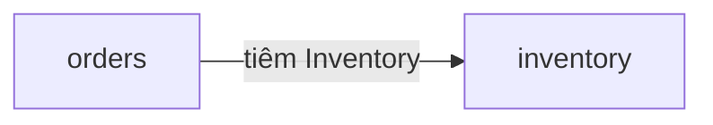

# Dependency từ Spring bean injection

Trong một ứng dụng Spring Boot, các mô-đun thường phối hợp với nhau thông qua Spring bean. Một bean thuộc mô-đun `orders` có thể cần gọi dịch vụ của mô-đun `inventory` để kiểm tra số lượng sản phẩm trước khi tạo đơn hàng. Điểm tiêm phụ thuộc (dependency injection) thể hiện quan hệ đó ngay trong mã nguồn: mô-đun `orders` cần một kiểu được cung cấp bởi `inventory`.

Spring Modulith phân tích các dependency giữa các lớp để xây dựng mô hình mô-đun. Vì vậy, kiểu được tham chiếu tại constructor, field, setter hoặc tham số phương thức `@Bean` có thể làm phát sinh quan hệ phụ thuộc giữa hai mô-đun. Dependency injection là cách phổ biến để biểu đạt quan hệ này trong ứng dụng Spring; nó không tự làm cho package nội bộ trở thành API công khai.

## 1. Ví dụ hai mô-đun phối hợp qua Spring bean

Giả sử ứng dụng có cấu trúc package:

```text
com.acme.shop
├── ShopApplication.java
├── orders
│   ├── package-info.java
│   └── OrderService.java
└── inventory
    ├── Inventory.java
    └── internal
        └── InventoryService.java
```

Mô-đun `inventory` công khai một hợp đồng trong package gốc:

```java
package com.acme.shop.inventory;

public interface Inventory {

    boolean isAvailable(String productId, int quantity);
}
```

Implementation được đặt trong package nội bộ:

```java
package com.acme.shop.inventory.internal;

import com.acme.shop.inventory.Inventory;
import org.springframework.stereotype.Service;

@Service
public class InventoryService implements Inventory {

    @Override
    public boolean isAvailable(String productId, int quantity) {
        // Đọc số lượng tồn kho từ hệ thống lưu trữ.
        return true;
    }
}
```

Mô-đun `orders` tiêm interface `Inventory` qua constructor:

```java
package com.acme.shop.orders;

import com.acme.shop.inventory.Inventory;
import org.springframework.stereotype.Service;

@Service
public class OrderService {

    private final Inventory inventory;

    public OrderService(Inventory inventory) {
        this.inventory = inventory;
    }

    public boolean canPlaceOrder(String productId, int quantity) {
        return inventory.isAvailable(productId, quantity);
    }
}
```

Quan hệ phụ thuộc đi từ mô-đun sử dụng dịch vụ sang mô-đun cung cấp hợp đồng:



Ở runtime, Spring tìm một bean triển khai `Inventory` để truyền vào constructor của `OrderService`. Trong mô hình kiến trúc, `orders` phụ thuộc vào kiểu `com.acme.shop.inventory.Inventory`. Vì kiểu này thuộc package gốc công khai của `inventory`, mô-đun tiêu thụ chỉ cần biết hợp đồng mà không cần tham chiếu `InventoryService` nội bộ.

Ví dụ giả định ứng dụng quét component từ package gốc `com.acme.shop`, nên Spring tìm thấy `InventoryService`. Nếu cấu hình component scan không bao phủ package chứa implementation, Spring có thể không tìm được bean khi khởi động; đó là vấn đề cấu hình DI ở runtime, khác với việc xác định dependency trong mô hình mô-đun.

## 2. Khai báo dependency được phép

Nếu muốn giới hạn những mô-đun mà `orders` được phép phụ thuộc, khai báo quy tắc trong `package-info.java` của mô-đun:

```java
@org.springframework.modulith.ApplicationModule(
    allowedDependencies = "inventory"
)
package com.acme.shop.orders;
```

`allowedDependencies = "inventory"` cho phép mô-đun `orders` phụ thuộc vào mô-đun `inventory`. Khi `OrderService` tham chiếu interface `Inventory`, quan hệ đó nằm trong allow-list. Nếu `orders` đã khai báo `allowedDependencies`, một dependency tới mô-đun khác không có trong danh sách sẽ bị xem là vi phạm khi kiểm tra kiến trúc.

Khai báo này chỉ điều chỉnh mô-đun đích được phép phụ thuộc. Nó không mở toàn bộ package nội bộ của `inventory` cho các mô-đun khác. Quy tắc API công khai và quy tắc dependency được phép vẫn được kiểm tra riêng.

## 3. Vì sao nên tiêm interface công khai

Hãy xem cách viết sau:

```java
package com.acme.shop.orders;

import com.acme.shop.inventory.internal.InventoryService;
import org.springframework.stereotype.Service;

@Service
public class OrderService {

    private final InventoryService inventory;

    public OrderService(InventoryService inventory) {
        this.inventory = inventory;
    }
}
```

`InventoryService` có thể được khai báo `public` theo quy tắc truy cập Java, nhưng nó vẫn nằm trong package `inventory.internal`. Việc tiêm trực tiếp kiểu này làm `orders` phụ thuộc vào chi tiết triển khai của `inventory` và vượt qua boundary của mô-đun. `ApplicationModules.verify()` có thể báo lỗi truy cập package nội bộ.

Cách sửa là tiêm `Inventory`, interface được công khai ở package gốc. Nhờ vậy, `inventory` có thể thay đổi lớp triển khai, cách truy cập cơ sở dữ liệu hoặc cơ chế cache mà không buộc `orders` phải biết các chi tiết đó.

Nếu hợp đồng được công khai qua một Named Interface nằm trong package con, mô-đun tiêu thụ cần phụ thuộc vào đúng named interface đó. Ví dụ, allow-list có thể dùng `inventory::spi` khi package `inventory.spi` đã được công khai dưới tên `spi`.

## 4. Các hình thức Spring bean injection và dependency

Spring hỗ trợ nhiều cách tiêm phụ thuộc. Về mặt thiết kế mô-đun, điểm quan trọng là kiểu thuộc mô-đun nào đang được tham chiếu tại điểm tích hợp.

| Hình thức | Ví dụ | Ý nghĩa đối với dependency |
|---|---|---|
| Constructor injection | `OrderService(Inventory inventory)` | Thể hiện rõ dependency bắt buộc trong constructor |
| Setter injection | `setInventory(Inventory inventory)` | Thể hiện dependency qua tham số setter |
| Field injection | `@Autowired Inventory inventory` | Field tham chiếu kiểu thuộc mô-đun khác |
| Tham số phương thức `@Bean` | `orderFacade(Inventory inventory)` | Configuration bean cần một bean có kiểu `Inventory` |

Ví dụ khai báo bean qua phương thức `@Bean`:

Đây là cách đăng ký thay thế cho `@Service` trên `OrderService` ở ví dụ trước. Nếu dùng cấu hình này, hãy bỏ `@Service` khỏi lớp `OrderService` để tránh đăng ký hai bean cùng loại.

```java
package com.acme.shop.orders;

import com.acme.shop.inventory.Inventory;
import org.springframework.context.annotation.Bean;
import org.springframework.context.annotation.Configuration;

@Configuration
class OrderConfiguration {

    @Bean
    OrderService orderService(Inventory inventory) {
        return new OrderService(inventory);
    }
}
```

Phương thức cấu hình cần một bean kiểu `Inventory`, nên quan hệ phụ thuộc giữa `orders` và `inventory` vẫn tồn tại. Việc chuyển từ constructor injection sang khai báo `@Bean` không xóa dependency giữa hai mô-đun.

Constructor injection thường dễ đọc và kiểm thử hơn vì dependency bắt buộc được thể hiện ngay trên constructor, đồng thời có thể giữ field ở trạng thái `final`. Dù dùng hình thức nào, hãy ưu tiên tham chiếu API công khai của mô-đun cung cấp.

## 5. Kiểm tra dependency bằng ApplicationModules

Tạo một bài kiểm tra kiến trúc để xác minh quan hệ mô-đun:

```java
package com.acme.shop;

import org.junit.jupiter.api.Test;
import org.springframework.modulith.core.ApplicationModules;

class ModularityTests {

    @Test
    void verifiesModuleDependencies() {
        ApplicationModules.of(ShopApplication.class).verify();
    }
}
```

`verify()` kiểm tra mô hình mô-đun được Spring Modulith phát hiện, bao gồm các dependency giữa mô-đun, quyền truy cập API và chu trình phụ thuộc. Khi có vi phạm, bài test thất bại và cung cấp thông tin để xác định kiểu hoặc package gây ra quan hệ không hợp lệ.

Nên giữ bài kiểm tra này trong CI để thay đổi ở constructor, field hoặc cấu hình `@Bean` không âm thầm tạo thêm dependency ngoài dự kiến. Bài kiểm tra kiến trúc cũng giúp phát hiện việc một mô-đun bắt đầu tham chiếu package nội bộ của mô-đun khác.

Lưu ý rằng `ApplicationModules.verify()` kiểm tra cấu trúc dependency từ mã nguồn và mô hình lớp. Nó không thay thế việc khởi động Spring `ApplicationContext` để xác nhận mọi bean đều được tạo thành công. Một bài kiểm tra kiến trúc có thể pass trong khi ứng dụng vẫn gặp lỗi runtime như thiếu bean, có nhiều bean không phân giải được hoặc cấu hình component scan không phù hợp. Với luồng nghiệp vụ quan trọng, hãy có thêm integration test khởi động context và gọi hành vi cần kiểm chứng.

## 6. Những trường hợp dễ tạo dependency ngoài ý muốn

**Tiêm implementation nội bộ.** Nếu constructor của bean trong `orders` nhận `InventoryService` thay vì `Inventory`, dependency đi thẳng vào package triển khai. Hãy chuyển điểm tiêm về interface công khai.

**Tham chiếu kiểu trong cấu hình.** Một lớp `@Configuration` thuộc `orders` có thể tạo dependency tới `inventory` thông qua kiểu tham số của phương thức `@Bean`. Đặt cấu hình ở mô-đun phù hợp và giữ hợp đồng được tham chiếu ở API công khai.

**Tiêm ngược giữa hai mô-đun.** Nếu `orders` tiêm bean từ `inventory` và `inventory` lại tiêm bean từ `orders`, đồ thị mô-đun hình thành chu trình. Constructor injection còn có thể khiến Spring không khởi tạo được các bean trong chu trình đó. Hãy xem lại quyền sở hữu nghiệp vụ, tách hợp đồng dùng chung vào vị trí phù hợp hoặc cân nhắc giao tiếp qua sự kiện khi phù hợp với yêu cầu xử lý.

**Dùng `@Qualifier` để chọn bean.** `@Qualifier` và `@Primary` giúp Spring chọn implementation khi có nhiều bean cùng kiểu. Chúng không xóa quan hệ phụ thuộc kiến trúc tới mô-đun sở hữu kiểu được tham chiếu và cũng không cấp quyền truy cập package nội bộ.

## 7. Quy trình thiết kế dependency qua bean injection

Khi một mô-đun cần dùng dịch vụ của mô-đun khác, hãy thực hiện theo trình tự:

1. Xác định mô-đun sở hữu nghiệp vụ và hợp đồng mà mô-đun tiêu thụ cần dùng.
2. Đặt hợp đồng trong package gốc công khai hoặc Named Interface phù hợp của mô-đun cung cấp.
3. Tạo bean triển khai hợp đồng trong package triển khai nội bộ.
4. Tiêm hợp đồng qua constructor hoặc khai báo dependency qua phương thức `@Bean`.
5. Nếu mô-đun nguồn có allow-list, thêm đúng tên mô-đun hoặc Named Interface vào `allowedDependencies`.
6. Chạy `ApplicationModules.verify()` để kiểm tra boundary và dependency graph.
7. Chạy integration test để xác nhận Spring có thể phân giải bean và luồng nghiệp vụ hoạt động.

## 8. Bài tập tự kiểm tra

Với hai mô-đun `orders` và `inventory`, hãy đánh giá các trường hợp sau:

| Trường hợp | Kết quả mong đợi | Giải thích |
|---|---|---|
| `OrderService` constructor nhận `inventory.Inventory` và `orders` cho phép `inventory` | Hợp lệ | Dependency đi qua API công khai và nằm trong allow-list |
| `OrderService` constructor nhận `inventory.internal.InventoryService` | Vi phạm boundary | Mô-đun tiêu thụ tham chiếu package nội bộ |
| `OrderConfiguration` có phương thức `@Bean` nhận tham số `Inventory` | Có dependency tới `inventory` | Kiểu tham số cấu hình vẫn thể hiện quan hệ giữa mô-đun |
| `orders` và `inventory` tiêm bean của nhau | Chu trình dependency | Hai mô-đun phụ thuộc lẫn nhau |
| Dùng `@Qualifier` để chọn một `Inventory` bean | Dependency vẫn tồn tại | Qualifier chọn bean, không thay đổi boundary |

Hãy thử thay kiểu constructor từ `Inventory` sang `InventoryService`, rồi chạy lại bài kiểm tra kiến trúc để quan sát khác biệt. Sau đó khôi phục interface công khai và chạy integration test để xác nhận Spring có thể tiêm bean triển khai. Qua bài tập, bạn cần phân biệt được dependency ở cấp mô-đun, khả năng phân giải bean ở runtime và quyền truy cập API của mô-đun cung cấp.
