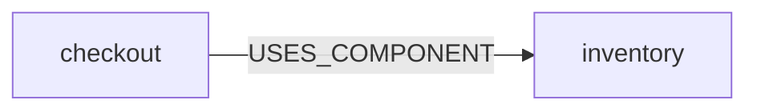
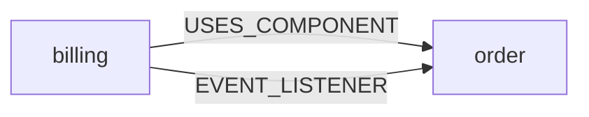

# Ý nghĩa của `DependencyType` trong module model

`DependencyType` là enum trong `org.springframework.modulith.core`, dùng để mô tả **bản chất của một phụ thuộc giữa hai `ApplicationModule`**. Nó cho biết module nguồn đang tham chiếu kiểu Java thông thường, sử dụng Spring component, tham chiếu entity hay lắng nghe event do module đích công bố.

Nhờ phân loại này, dependency graph có thêm ngữ nghĩa. Hai module có thể cùng có cạnh phụ thuộc đến một module khác nhưng phụ thuộc theo những cách khác nhau. Chẳng hạn, module `checkout` có thể gọi một Spring bean của `inventory`, trong khi module `notification` chỉ đăng ký listener cho event do `order` phát ra.

Sau bài học, bạn có thể:

- Giải thích vai trò của `DependencyType` trong mô hình phụ thuộc giữa các module.
- Phân biệt `DEFAULT`, `USES_COMPONENT`, `EVENT_LISTENER` và `ENTITY`.
- Hiểu vì sao một cặp module có thể có nhiều dependency type.
- Lọc phụ thuộc theo loại bằng `getDirectDependencies()`, `getAllDependencies()` và `withType()`.
- Đọc thông tin nguồn, đích và loại phụ thuộc qua `ApplicationModuleDependency`.

## 1. `DependencyType` mô tả cạnh, không mô tả module

Trong dependency graph, mỗi application module là một node. Quan hệ giữa hai module là cạnh có hướng. `DependencyType` gắn thêm nhãn ngữ nghĩa cho một quan hệ phụ thuộc cụ thể.

Ví dụ, nếu `checkout` sử dụng một Spring bean thuộc `inventory`, cạnh có hướng là `checkout → inventory` và loại phụ thuộc là `USES_COMPONENT`.



`DependencyType` không phải thuộc tính để chọn module kiểu `CLOSED` hay `OPEN`, cũng không phải tên của named interface. Nó phân loại quan hệ giữa source module và target module dựa trên cách source module sử dụng kiểu hoặc thành phần của target module.

Trong Spring Modulith 2.2.0, enum `DependencyType` công khai bốn hằng số: `DEFAULT`, `USES_COMPONENT`, `EVENT_LISTENER` và `ENTITY`.

## 2. Ý nghĩa của từng loại phụ thuộc

| Hằng số | Ý nghĩa | Ví dụ |
|---|---|---|
| `DEFAULT` | Phụ thuộc kiểu Java thông thường (*simple type dependency*) | `checkout` tham chiếu một kiểu hợp đồng hoặc kiểu dữ liệu trong `catalog` |
| `USES_COMPONENT` | Phụ thuộc component của Spring; module đích cần được khởi tạo để chạy module nguồn | `checkout` inject bean `InventoryManagement` của `inventory` |
| `EVENT_LISTENER` | Module nguồn khai báo listener cho event được module đích công khai; module đích không cần được khởi tạo chỉ để chạy module nguồn | `inventory` lắng nghe `OrderCompleted` do `order` phát ra |
| `ENTITY` | Module nguồn tham chiếu entity thuộc module đích | `reporting` tham chiếu entity `Customer` do `customer` sở hữu |

### `DEFAULT`: tham chiếu kiểu Java thông thường

`DEFAULT` đại diện cho phụ thuộc kiểu đơn giản. Ví dụ, module `checkout` dùng một kiểu `Money` được công khai bởi module `pricing`:

```java
package com.acme.shop.pricing;

public record Money(long amountInCents, String currency) {}
```

```java
package com.acme.shop.checkout;

import com.acme.shop.pricing.Money;

public class CheckoutQuote {

    private final Money total;

    public CheckoutQuote(Money total) {
        this.total = total;
    }
}
```

Đây là tham chiếu kiểu Java giữa hai module. `Money` không được sử dụng ở đây như một Spring bean được inject, cũng không phải event listener hay entity được phân loại riêng. Vì vậy, quan hệ được mô tả là `DEFAULT`.

### `USES_COMPONENT`: sử dụng Spring component

Khi module nguồn cần một Spring bean được cung cấp bởi module khác, Spring Modulith phân loại quan hệ đó là `USES_COMPONENT`.

```java
package com.acme.shop.inventory;

import org.springframework.stereotype.Service;

@Service
public class InventoryManagement {

    public boolean reserve(String sku, int quantity) {
        return true;
    }
}
```

```java
package com.acme.shop.checkout;

import com.acme.shop.inventory.InventoryManagement;
import org.springframework.stereotype.Service;

@Service
public class CheckoutService {

    private final InventoryManagement inventory;

    public CheckoutService(InventoryManagement inventory) {
        this.inventory = inventory;
    }
}
```

`CheckoutService` cần bean `InventoryManagement` để hoạt động. Module `checkout` do đó phụ thuộc component vào module `inventory`. Theo định nghĩa của `USES_COMPONENT`, module đích cần được bootstrap để chạy module nguồn.

### `EVENT_LISTENER`: phụ thuộc thông qua event listener

Một module có thể tích hợp với module khác bằng event thay vì inject component và gọi trực tiếp. Module phát event công khai kiểu event; module tiêu thụ khai báo listener nhận kiểu đó.

Module `order` công bố event:

```java
package com.acme.shop.order;

public record OrderCompleted(String orderId) {}
```

Module `inventory` lắng nghe event:

```java
package com.acme.shop.inventory;

import com.acme.shop.order.OrderCompleted;
import org.springframework.stereotype.Component;
import org.springframework.modulith.events.ApplicationModuleListener;

@Component
class InventoryOrderListener {

    @ApplicationModuleListener
    void on(OrderCompleted event) {
        // Cập nhật trạng thái hoặc xử lý nghiệp vụ kho
    }
}
```

Quan hệ phụ thuộc có hướng `inventory → order`: module `inventory` phụ thuộc vào event được module `order` công khai. `EVENT_LISTENER` thể hiện sự phụ thuộc qua hợp đồng event; module đích không cần được bootstrap chỉ để chạy module nguồn. `@ApplicationModuleListener` còn cung cấp cách khai báo listener bất đồng bộ và transactional theo cấu hình mặc định của Spring Modulith.

### `ENTITY`: tham chiếu entity của module khác

`ENTITY` mô tả trường hợp module nguồn tham chiếu một entity thuộc module đích. Ví dụ, module `reporting` cần tham chiếu entity `Customer` do module `customer` sở hữu để lập báo cáo.

```text
com.acme.shop.customer
└── Customer.java              <- entity do customer sở hữu

com.acme.shop.reporting
└── CustomerReport.java        <- tham chiếu Customer
```

Loại này giúp nhận diện một dạng phụ thuộc dữ liệu cụ thể. Việc tham chiếu entity xuyên module có thể làm hai module gắn chặt với mô hình lưu trữ và vòng đời dữ liệu của nhau. Khi thiết kế modular monolith, hãy cân nhắc công khai một hợp đồng truy vấn hoặc kiểu dữ liệu ổn định thay vì để module tiêu thụ phụ thuộc trực tiếp vào entity nội bộ.

Lưu ý: API enum mô tả `ENTITY` là tham chiếu entity của module khác. Tài liệu JSON của Modulith Actuator 2.2.0 liệt kê các giá trị `DEFAULT`, `USES_COMPONENT` và `EVENT_LISTENER` cho trường `dependencies[].types[]`; vì vậy, không nên giả định mọi cách xuất dependency graph đều hiển thị `ENTITY` giống nhau.

## 3. Một cặp module có thể có nhiều loại phụ thuộc

Các loại phụ thuộc không loại trừ lẫn nhau ở cấp cặp module. Một module có thể vừa sử dụng Spring component, vừa đăng ký event listener cho cùng module đích.

Ví dụ, module `billing` gọi bean `OrderQuery` của `order` và đồng thời lắng nghe `OrderCompleted` do `order` phát ra. Quan hệ giữa `billing` và `order` có thể mang cả hai loại:



Khi xuất ra JSON qua Modulith Actuator, một module có thể có một dependency entry với `target` là module đích và mảng `types` chứa nhiều giá trị. Ví dụ tài liệu Spring Modulith cho thấy module `b` phụ thuộc module `a` với `types` gồm `EVENT_LISTENER` và `USES_COMPONENT`.

Điều này có nghĩa không nên đếm mỗi cặp module là một loại phụ thuộc duy nhất. Hãy xem từng dependency type để hiểu module đang giao tiếp theo cách nào.

## 4. Đọc loại phụ thuộc bằng API

`ApplicationModuleDependency` biểu diễn một phụ thuộc cụ thể. API cung cấp các thông tin:

- `getSourceType()`: Java type tạo ra phụ thuộc.
- `getTargetType()`: Java type được tham chiếu.
- `getTargetModule()`: application module đích.
- `getDependencyType()`: loại phụ thuộc.

Bạn có thể lấy module theo tên, sau đó duyệt các phụ thuộc trực tiếp:

```java
import org.springframework.modulith.core.ApplicationModule;
import org.springframework.modulith.core.ApplicationModules;
import org.springframework.modulith.core.ApplicationModuleDependency;
import org.springframework.modulith.core.DependencyType;

class DependencyInspection {

    void inspect() {
        var modules = ApplicationModules.of(ShopApplication.class);

        ApplicationModule checkout = modules.getModuleByName("checkout")
                .orElseThrow();

        checkout.getDirectDependencies(modules).stream()
                .forEach((ApplicationModuleDependency dependency) -> System.out.printf(
                        "%s -> %s (%s)%n",
                        dependency.getSourceType().getName(),
                        dependency.getTargetType().getName(),
                        dependency.getDependencyType()
                ));
    }
}
```

Đoạn mã trên in ra type nguồn, type đích và `DependencyType` của từng phụ thuộc trực tiếp. `getDirectDependencies()` trả về `ApplicationModuleDependencies`, một tập hợp có thể duyệt bằng `stream()`.

Nếu chỉ quan tâm phụ thuộc component, truyền loại cần lọc vào phương thức:

```java
var componentDependencies = checkout.getDirectDependencies(
        modules,
        DependencyType.USES_COMPONENT
);

componentDependencies.stream().forEach(System.out::println);
```

Hoặc lấy tất cả phụ thuộc trực tiếp rồi lọc bằng `withType()`:

```java
var eventDependencies = checkout.getDirectDependencies(modules)
        .withType(DependencyType.EVENT_LISTENER);
```

`getAllDependencies()` lấy cả phụ thuộc gián tiếp; có thể truyền `DependencyType` tương tự để giới hạn loại cần xem:

```java
var allEventDependencies = checkout.getAllDependencies(
        modules,
        DependencyType.EVENT_LISTENER
);
```

Độ sâu và loại phụ thuộc là hai tiêu chí khác nhau: `getDirectDependencies()` chỉ lấy cạnh trực tiếp, còn `getAllDependencies()` bao gồm cả phụ thuộc gián tiếp. `DependencyType` lọc bản chất của các quan hệ trong tập kết quả đó.

## 5. Loại phụ thuộc trong Modulith Actuator

Nếu bật Spring Modulith Actuator, endpoint `GET /actuator/modulith` có thể cung cấp cấu trúc module dưới dạng JSON. Mỗi module có trường `dependencies`; mỗi phần tử gồm:

- `target`: tên module được phụ thuộc.
- `types`: các loại phụ thuộc giữa module nguồn và module đích.

Ví dụ rút gọn theo cấu trúc tài liệu:

```json
{
  "a": {
    "basePackage": "example.a",
    "dependencies": []
  },
  "b": {
    "basePackage": "example.b",
    "dependencies": [
      {
        "target": "a",
        "types": ["EVENT_LISTENER", "USES_COMPONENT"]
      }
    ]
  }
}
```

Đọc JSON theo hướng module nguồn đến module đích. Trong ví dụ, module `b` phụ thuộc module `a` theo hai cách: sử dụng component và lắng nghe event. Đây là một cách quan sát hữu ích khi muốn kiểm tra kiến trúc ở môi trường đang chạy.

## 6. Khi nào nên quan tâm đến từng loại?

| Loại | Câu hỏi kiến trúc cần đặt ra |
|---|---|
| `DEFAULT` | Module có đang phụ thuộc trực tiếp vào kiểu dữ liệu hoặc hợp đồng của module khác quá nhiều không? |
| `USES_COMPONENT` | Module nguồn có cần khởi tạo component của module đích không? Có thể thay một lời gọi trực tiếp bằng hợp đồng event không? |
| `EVENT_LISTENER` | Event có phải hợp đồng công khai ổn định không? Listener có cần xử lý bất đồng bộ và bảo đảm publication không bị mất không? |
| `ENTITY` | Module tiêu thụ có đang phụ thuộc vào entity và mô hình lưu trữ do module khác sở hữu không? |

Không có loại nào tự động tốt hoặc xấu. `USES_COMPONENT` có thể phù hợp khi cần truy vấn hoặc thao tác đồng bộ; `EVENT_LISTENER` hữu ích khi muốn tách rời hai luồng nghiệp vụ; `DEFAULT` có thể là một tham chiếu kiểu nhỏ, ổn định; `ENTITY` có thể là dấu hiệu hai module chia sẻ quá sâu mô hình dữ liệu. Hãy đánh giá theo ngữ cảnh nghiệp vụ và quyền sở hữu hợp đồng.

## 7. Ghi nhớ

`DependencyType` phân loại cách một application module phụ thuộc vào module khác. `DEFAULT` là tham chiếu kiểu thông thường; `USES_COMPONENT` là phụ thuộc Spring bean/component; `EVENT_LISTENER` là phụ thuộc qua listener cho event của module khác; `ENTITY` biểu thị tham chiếu entity của module đích. Một cặp module có thể có nhiều loại phụ thuộc cùng lúc. Dùng `ApplicationModule.getDirectDependencies()` hoặc `getAllDependencies()` để lấy các quan hệ, `ApplicationModuleDependencies.withType()` để lọc và `ApplicationModuleDependency.getDependencyType()` để đọc loại của từng cạnh.

## Tài liệu tham khảo

- [Spring Modulith 2.2.0 API – `DependencyType`](https://docs.spring.io/spring-modulith/docs/current/api/org/springframework/modulith/core/DependencyType.html)
- [Spring Modulith API – `ApplicationModuleDependency`](https://docs.spring.io/spring-modulith/docs/current/api/org/springframework/modulith/core/ApplicationModuleDependency.html)
- [Spring Modulith API – `ApplicationModule` và dependency methods](https://docs.spring.io/spring-modulith/docs/current/api/org/springframework/modulith/core/ApplicationModule.html)
- [Spring Modulith API – `ApplicationModuleDependencies`](https://docs.spring.io/spring-modulith/docs/current/api/org/springframework/modulith/core/ApplicationModuleDependencies.html)
- [Spring Modulith – Production-ready Features and Modulith Actuator](https://docs.spring.io/spring-modulith/reference/production-ready.html)
- [Spring Modulith – Working with Application Events](https://docs.spring.io/spring-modulith/reference/events.html)
