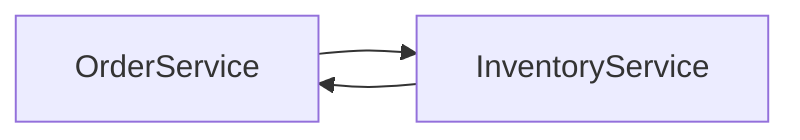

# Spring bean dependency trong ứng dụng

Trong Spring Boot, một **Spring bean dependency** xuất hiện khi một bean cần một bean khác để thực hiện công việc của mình. Spring IoC container tạo các bean, tìm bean phù hợp cho từng dependency và kết nối chúng thành đồ thị đối tượng khi khởi động ứng dụng.

Trong một modular monolith, các bean thường được tổ chức bên trong application module. Bean của module `order` có thể cần bean cung cấp khả năng kiểm tra tồn kho từ module `inventory`. Khi thiết kế quan hệ này, cần hiểu đồng thời hai góc nhìn: dependency injection quyết định bean nào được kết nối lúc chạy; ranh giới module quyết định mã của module tiêu thụ được phép tham chiếu hợp đồng nào.

Trong `SPRING_MODULITH_MODULE_MODEL`, Spring bean dependency là phần kết nối ở thời gian chạy giữa các thành phần nghiệp vụ. Bài học này trình bày cách khai báo dependency, cách Spring tìm bean phù hợp, cách tổ chức dependency qua API module và các vấn đề thường gặp khi wiring.

## 1. Spring bean và dependency là gì?

Spring bean là một đối tượng được Spring IoC container khởi tạo, cấu hình và quản lý vòng đời. Bean có thể được khai báo bằng stereotype như `@Component`, `@Service`, `@Repository`, `@Controller`, hoặc được tạo từ phương thức `@Bean` trong một lớp `@Configuration`.

Một bean có dependency khi nó cần một đối tượng khác để hoàn thành trách nhiệm. Ví dụ, `PlaceOrderService` cần `InventoryAvailability` để kiểm tra số lượng hàng trước khi đặt đơn:

```java
@Service
class PlaceOrderService {

    private final InventoryAvailability inventoryAvailability;

    PlaceOrderService(InventoryAvailability inventoryAvailability) {
        this.inventoryAvailability = inventoryAvailability;
    }
}
```

Trong ví dụ này:

- `PlaceOrderService` là bean tiêu thụ dependency.
- `InventoryAvailability` là dependency mà bean cần.
- Spring tìm một bean có kiểu phù hợp và truyền vào constructor khi tạo `PlaceOrderService`.

Bean dependency tạo thành một đồ thị kết nối ở runtime. Nếu bean A cần bean B, ta có quan hệ `A → B` theo hướng A sử dụng B.

## 2. Dependency Injection giúp Spring kết nối bean

Dependency Injection (DI) là cách một đối tượng nhận các dependency từ bên ngoài thay vì tự tạo chúng. Trong Spring, IoC container đảm nhiệm việc cung cấp dependency cho bean.

Không dùng DI, một service có thể tự tạo đối tượng cần thiết:

```java
class PlaceOrderService {

    private final InventoryAvailability inventoryAvailability =
            new DefaultInventoryAvailability();
}
```

Cách này khiến service tự quyết định implementation và cách khởi tạo. Việc thay implementation, cấu hình hoặc thay thế trong kiểm thử trở nên khó hơn.

Với DI, service khai báo điều nó cần:

```java
@Service
class PlaceOrderService {

    private final InventoryAvailability inventoryAvailability;

    PlaceOrderService(InventoryAvailability inventoryAvailability) {
        this.inventoryAvailability = inventoryAvailability;
    }
}
```

Spring chịu trách nhiệm tìm và cung cấp implementation. Service chỉ tập trung vào nghiệp vụ và hợp đồng mà nó sử dụng.

## 3. Constructor injection là lựa chọn mặc định nên dùng

Spring hỗ trợ một số cách injection: constructor, setter và field. Với dependency bắt buộc, constructor injection thường là lựa chọn rõ ràng và an toàn nhất.

```java
@Service
class PlaceOrderService {

    private final InventoryAvailability inventoryAvailability;
    private final PaymentProcessing paymentProcessing;

    PlaceOrderService(
            InventoryAvailability inventoryAvailability,
            PaymentProcessing paymentProcessing) {
        this.inventoryAvailability = inventoryAvailability;
        this.paymentProcessing = paymentProcessing;
    }
}
```

Các ưu điểm chính:

- Dependency bắt buộc được thể hiện ngay trong constructor.
- Có thể khai báo field là `final`, tránh thay đổi sau khi tạo đối tượng.
- Đối tượng không thể được tạo ở trạng thái thiếu dependency bắt buộc.
- Có thể khởi tạo service trong unit test bằng cách truyền mock hoặc fake trực tiếp.
- Dependency graph rõ ràng, dễ đọc và dễ phát hiện quan hệ vòng.

Nếu bean chỉ có một constructor, Spring tự sử dụng constructor đó để injection; thông thường không cần đặt `@Autowired` trên constructor duy nhất.

### Setter injection

Setter injection phù hợp hơn với dependency thực sự tùy chọn hoặc cần được cấu hình sau khi khởi tạo:

```java
@Component
class ReportExporter {

    private AuditWriter auditWriter;

    @Autowired(required = false)
    void setAuditWriter(AuditWriter auditWriter) {
        this.auditWriter = auditWriter;
    }
}
```

`required = false` cho phép bean vẫn được tạo khi không có `AuditWriter`; khi đó mã sử dụng phải xử lý trường hợp `auditWriter` là `null`. Nếu dependency là bắt buộc, constructor injection thường giúp thể hiện hợp đồng rõ hơn. Setter injection cho phép đối tượng tồn tại trước khi dependency được gán, vì vậy cần quản lý trạng thái đó cẩn thận.

### Field injection

Field injection có thể viết ngắn:

```java
@Service
class PlaceOrderService {

    @Autowired
    private InventoryAvailability inventoryAvailability;
}
```

Tuy nhiên, field injection che giấu dependency trong thân lớp, không hỗ trợ `final` và làm unit test cần đến reflection hoặc Spring context. Với service nghiệp vụ, nên ưu tiên constructor injection.

## 4. Đăng ký bean bằng stereotype

Spring Boot thường quét component từ package chứa lớp `@SpringBootApplication` và các package con. Vì vậy, đặt lớp ứng dụng tại package gốc giúp Spring tìm bean trong các module.

Ví dụ lớp khởi chạy:

```java
package com.example.shop;

import org.springframework.boot.SpringApplication;
import org.springframework.boot.autoconfigure.SpringBootApplication;

@SpringBootApplication
public class ShopApplication {

    public static void main(String[] args) {
        SpringApplication.run(ShopApplication.class, args);
    }
}
```

Module `inventory` cung cấp implementation:

```java
package com.example.shop.inventory.internal;

import com.example.shop.inventory.InventoryAvailability;
import org.springframework.stereotype.Service;

@Service
class DefaultInventoryAvailability implements InventoryAvailability {

    private final InventoryRepository repository;

    DefaultInventoryAvailability(InventoryRepository repository) {
        this.repository = repository;
    }

    @Override
    public boolean hasAvailableStock(String sku, int quantity) {
        return repository.availableQuantity(sku) >= quantity;
    }
}
```

`@Service` đánh dấu lớp là bean candidate. Component scan tìm lớp và đăng ký bean. Modifier package-private vẫn có thể dùng cho implementation nếu Spring có thể tạo bean; module khác không cần import lớp triển khai này.

Các stereotype phổ biến:

| Annotation | Vai trò thường gặp |
|---|---|
| `@Component` | Bean dùng chung, không thuộc stereotype chuyên biệt hơn |
| `@Service` | Thành phần xử lý nghiệp vụ hoặc điều phối ứng dụng |
| `@Repository` | Thành phần truy cập dữ liệu, có thể tham gia cơ chế chuyển đổi exception của Spring |
| `@Controller` / `@RestController` | Thành phần xử lý request web |
| `@Configuration` | Lớp khai báo cấu hình và phương thức `@Bean` |

## 5. Đăng ký bean bằng `@Bean`

Khi cần kiểm soát cách tạo đối tượng, có thể khai báo một phương thức `@Bean` trong lớp `@Configuration`:

```java
package com.example.shop.inventory.internal;

import com.example.shop.inventory.InventoryAvailability;
import org.springframework.context.annotation.Bean;
import org.springframework.context.annotation.Configuration;

@Configuration(proxyBeanMethods = false)
class InventoryConfiguration {

    @Bean
    InventoryAvailability inventoryAvailability(InventoryRepository repository) {
        return new DefaultInventoryAvailability(repository);
    }
}
```

Spring gọi phương thức factory để tạo bean. Các tham số của phương thức `@Bean` cũng là dependency injection points; container tìm bean `InventoryRepository` và truyền vào khi gọi phương thức.

Phương thức trả về interface `InventoryAvailability`, vì vậy consumer có thể phụ thuộc vào hợp đồng thay vì implementation. Chọn một cách đăng ký cho cùng một implementation: dùng stereotype trên lớp hoặc tạo bean qua `@Bean`. Đăng ký cả hai có thể tạo nhiều bean cùng cung cấp một kiểu và gây mơ hồ khi injection.

## 6. Spring tìm bean phù hợp như thế nào?

Khi tạo bean có constructor nhận một dependency, Spring tìm bean candidate tương thích với kiểu cần inject. Ví dụ:

```java
PlaceOrderService(InventoryAvailability inventoryAvailability) {
    this.inventoryAvailability = inventoryAvailability;
}
```

Spring tìm bean có thể cung cấp kiểu `InventoryAvailability`. Nếu có đúng một candidate phù hợp, container inject candidate đó.

Nếu không tìm thấy candidate cho dependency bắt buộc, quá trình tạo context thất bại với lỗi thiếu bean, thường được thể hiện qua `NoSuchBeanDefinitionException` hoặc lỗi tạo bean bao quanh nó.

Nếu có nhiều candidate cùng phù hợp, Spring không thể tự chọn một cách chắc chắn và có thể báo `NoUniqueBeanDefinitionException`. Khi đó, cần xác định candidate mặc định bằng `@Primary` hoặc chỉ rõ candidate bằng `@Qualifier`.

### Dùng `@Primary`

```java
@Service
@Primary
class StandardPaymentProcessing implements PaymentProcessing {
    // Implementation mặc định.
}

@Service
class SandboxPaymentProcessing implements PaymentProcessing {
    // Implementation dành cho sandbox.
}
```

Khi bean khác yêu cầu `PaymentProcessing` mà không có qualifier, Spring ưu tiên candidate được đánh dấu `@Primary`.

### Dùng `@Qualifier`

```java
@Service
class PaymentAuditService {

    private final PaymentProcessing paymentProcessing;

    PaymentAuditService(
            @Qualifier("sandboxPaymentProcessing")
            PaymentProcessing paymentProcessing) {
        this.paymentProcessing = paymentProcessing;
    }
}
```

`@Qualifier` giúp chọn một bean cụ thể trong số nhiều candidate. Hãy dùng qualifier khi ứng dụng thực sự cần nhiều implementation; nếu chỉ có một implementation, không cần thêm tên bean chỉ để làm cấu hình phức tạp hơn.

## 7. Bean dependency qua ranh giới application module

Trong modular monolith, bean của module tiêu thụ nên phụ thuộc vào API được module cung cấp công bố. Ví dụ, module `inventory` có interface ở package gốc:

```java
package com.example.shop.inventory;

public interface InventoryAvailability {

    boolean hasAvailableStock(String sku, int quantity);
}
```

Implementation nằm trong package nội bộ `inventory.internal`. Module `order` chỉ import interface:

```java
package com.example.shop.order.internal;

import com.example.shop.inventory.InventoryAvailability;
import org.springframework.stereotype.Service;

@Service
class PlaceOrderService {

    private final InventoryAvailability inventoryAvailability;

    PlaceOrderService(InventoryAvailability inventoryAvailability) {
        this.inventoryAvailability = inventoryAvailability;
    }
}
```

Spring có thể inject bean được đăng ký trong module `inventory`, trong khi mã nguồn của `order` chỉ phụ thuộc vào hợp đồng công khai. Module `inventory` có thể thay implementation mà không buộc `order` import lớp nội bộ mới.

Nếu module `order` dùng whitelist dependency, khai báo tại package gốc của nó:

```java
@org.springframework.modulith.ApplicationModule(
    allowedDependencies = "inventory"
)
package com.example.shop.order;
```

Nếu hợp đồng được đặt trong named interface `inventory::spi`, consumer cần khai báo đúng named interface đó:

```java
@org.springframework.modulith.ApplicationModule(
    allowedDependencies = "inventory::spi"
)
package com.example.shop.order;
```

`@NamedInterface` và `allowedDependencies` mô tả ranh giới kiến trúc. Chúng không tự đăng ký bean. Component scan hoặc cấu hình `@Bean` vẫn chịu trách nhiệm cung cấp bean thực tế cho dependency injection.

## 8. Bean dependency và module dependency không giống nhau

Hai loại quan hệ có liên quan nhưng trả lời các câu hỏi khác nhau:

| Khía cạnh | Spring bean dependency | Application module dependency |
|---|---|---|
| Phạm vi | Các đối tượng được Spring quản lý | Các package/module trong ứng dụng |
| Câu hỏi | Bean nào cần bean nào để chạy? | Module nào được phép tham chiếu module nào? |
| Cách hình thành | Constructor, setter, field hoặc tham số `@Bean` | Tham chiếu kiểu giữa package thuộc các module |
| Thời điểm quan sát | Khi Spring tạo và kết nối bean trong context | Khi Spring Modulith phân tích mô hình code |
| Công cụ liên quan | Spring IoC container, ApplicationContext | `ApplicationModules`, `ApplicationModule`, `verify()` |

Ví dụ, `PlaceOrderService` inject `InventoryAvailability`. Đây là bean dependency nếu có bean phù hợp được đăng ký. Vì interface `InventoryAvailability` nằm trong module `inventory`, mã của `order` cũng tạo module dependency `order → inventory`.

Nếu bean được tìm bằng tên chuỗi qua `ApplicationContext.getBean("...")`, quan hệ runtime có thể không thể hiện rõ qua import kiểu. Đây là một lý do nên ưu tiên constructor injection bằng interface: dependency vừa rõ với Spring vừa dễ đọc trong mô hình kiến trúc.

## 9. Dependency tùy chọn

Không phải dependency nào cũng bắt buộc. Nếu một khả năng thực sự tùy chọn, có thể dùng `Optional<T>` hoặc `ObjectProvider<T>` để biểu diễn rõ điều đó.

Ví dụ với `Optional`:

```java
@Component
class OrderNotificationService {

    private final Optional<OrderNotifier> notifier;

    OrderNotificationService(Optional<OrderNotifier> notifier) {
        this.notifier = notifier;
    }

    void notifyOrder(String orderId) {
        notifier.ifPresent(bean -> bean.notifyOrder(orderId));
    }
}
```

Ví dụ với `ObjectProvider`:

```java
@Component
class OrderNotificationService {

    private final ObjectProvider<OrderNotifier> notifierProvider;

    OrderNotificationService(ObjectProvider<OrderNotifier> notifierProvider) {
        this.notifierProvider = notifierProvider;
    }

    void notifyOrder(String orderId) {
        OrderNotifier notifier = notifierProvider.getIfAvailable();
        if (notifier != null) {
            notifier.notifyOrder(orderId);
        }
    }
}
```

`ObjectProvider` còn hỗ trợ truy vấn bean theo nhu cầu và các thao tác như `getIfAvailable()` hoặc `getIfUnique()`. Chỉ nên dùng khi dependency thực sự có thể vắng mặt hoặc cần tra cứu theo thời điểm. Nếu bean là bắt buộc, constructor injection trực tiếp giúp phát hiện cấu hình thiếu ngay khi khởi động.

## 10. Lazy dependency và thời điểm khởi tạo

Mặc định, các singleton bean thường được khởi tạo khi Spring tạo application context. `@Lazy` có thể trì hoãn việc khởi tạo bean hoặc việc resolve một dependency tới khi nó được sử dụng:

```java
@Service
class ReportService {

    private final ExpensiveReportGenerator generator;

    ReportService(@Lazy ExpensiveReportGenerator generator) {
        this.generator = generator;
    }
}
```

Trong trường hợp này, Spring có thể inject một proxy và chỉ khởi tạo target khi dependency được sử dụng. `@Lazy` hữu ích khi khởi tạo tốn kém hoặc không phải lúc nào cũng cần.

Tuy nhiên, lazy injection không loại bỏ dependency giữa hai bean và không sửa được ranh giới module không hợp lệ. Nó cũng không phải giải pháp kiến trúc cho một dependency cycle. Hãy dùng nó cho mục đích trì hoãn khởi tạo, không dùng để che giấu quan hệ phụ thuộc khó hiểu.

## 11. Circular bean dependency

Circular dependency xảy ra khi bean A cần bean B và bean B lại cần bean A:



Ví dụ:

```java
@Service
class OrderService {
    OrderService(InventoryService inventoryService) { }
}

@Service
class InventoryService {
    InventoryService(OrderService orderService) { }
}
```

Với constructor injection, Spring không thể tạo bean đầu tiên vì constructor của nó cần bean còn lại, trong khi bean còn lại lại cần bean đầu tiên. Quá trình khởi động sẽ thất bại do circular dependency.

Không nên dựa vào cơ chế giải quyết circular reference để giữ thiết kế này. Hãy xem xét:

- Tách một trách nhiệm chung sang service hoặc abstraction có chủ sở hữu rõ ràng.
- Đảo chiều dependency bằng interface phù hợp nếu một module chỉ cần gọi một khả năng được cung cấp.
- Dùng domain event hoặc application event nếu một phía chỉ cần phản ứng sau khi nghiệp vụ bên kia hoàn thành.
- Đưa điều phối quy trình vào một application service thứ ba thay vì để hai service gọi ngược lẫn nhau.

Circular bean dependency thường là dấu hiệu cần xem lại trách nhiệm của các bean và có thể phản ánh một dependency cycle ở cấp module.

## 12. Tránh Service Locator và tra cứu bean theo tên

Một bean có thể lấy dependency trực tiếp từ `ApplicationContext`:

```java
@Service
class PlaceOrderService {

    private final ApplicationContext context;

    PlaceOrderService(ApplicationContext context) {
        this.context = context;
    }

    void place(String sku) {
        InventoryAvailability inventory =
                context.getBean("inventoryAvailability", InventoryAvailability.class);
        // Sử dụng inventory.
    }
}
```

Cách này biến dependency thành tra cứu động bằng tên. Người đọc constructor không thấy `PlaceOrderService` cần `InventoryAvailability`; lỗi sai tên bean chỉ xuất hiện khi đường code thực thi; và quan hệ với module cung cấp khó nhận diện hơn.

Hãy ưu tiên khai báo dependency trực tiếp:

```java
PlaceOrderService(InventoryAvailability inventory) {
    this.inventory = inventory;
}
```

Khi cần lựa chọn implementation, sử dụng `@Qualifier`, `@Primary` hoặc một abstraction/registry có hợp đồng rõ ràng. `ApplicationContext` nên dành cho hạ tầng thực sự cần truy cập container, không nên là cách mặc định để bean lấy các collaborator nghiệp vụ.

## 13. Kiểm thử bean dependency

Có hai cấp kiểm thử hữu ích: unit test để kiểm tra logic service và Spring context test để kiểm tra wiring.

### Unit test với dependency giả

Với constructor injection, có thể tạo service trực tiếp và truyền fake hoặc mock:

```java
import org.junit.jupiter.api.Test;

import static org.junit.jupiter.api.Assertions.assertThrows;

interface InventoryAvailability {
    boolean hasAvailableStock(String sku, int quantity);
}

class StockAwareOrderService {

    private final InventoryAvailability inventoryAvailability;

    StockAwareOrderService(InventoryAvailability inventoryAvailability) {
        this.inventoryAvailability = inventoryAvailability;
    }

    void place(String sku, int quantity) {
        if (!inventoryAvailability.hasAvailableStock(sku, quantity)) {
            throw new IllegalStateException("Insufficient stock");
        }
    }
}

class PlaceOrderServiceTests {

    @Test
    void rejectsOrderWhenStockIsInsufficient() {
        InventoryAvailability inventory = (sku, quantity) -> false;
        StockAwareOrderService service = new StockAwareOrderService(inventory);

        assertThrows(
                IllegalStateException.class,
                () -> service.place("SKU-001", 2)
        );
    }
}
```

Đây là ví dụ minh họa cách thay dependency bằng implementation giả. Trong dự án thực tế, hãy dùng interface và logic nghiệp vụ phù hợp với hợp đồng của service đang kiểm thử.

### Spring context test

Để kiểm tra bean đã được đăng ký và inject thành công:

```java
import org.junit.jupiter.api.Test;
import org.springframework.beans.factory.annotation.Autowired;
import org.springframework.boot.test.context.SpringBootTest;

import static org.assertj.core.api.Assertions.assertThat;

@SpringBootTest
class InventoryWiringTests {

    @Autowired
    InventoryAvailability inventoryAvailability;

    @Test
    void providesInventoryAvailabilityBean() {
        assertThat(inventoryAvailability).isNotNull();
    }
}
```

Test này xác nhận Spring context có thể cung cấp bean theo kiểu `InventoryAvailability`. Nó kiểm tra bean registration và dependency resolution thực tế.

### Kiểm tra module boundary

`ApplicationModules.verify()` kiểm tra các quy tắc kiến trúc giữa application module:

```java
@Test
void verifiesModuleDependencies() {
    ApplicationModules.of(ShopApplication.class).verify();
}
```

Kiểm tra này bổ sung cho context test. `verify()` kiểm tra module dependency và encapsulation theo mô hình; context test kiểm tra Spring có thể tạo bean và kết nối dependency khi chạy.

## 14. Những nhầm lẫn thường gặp

| Nhầm lẫn | Cách hiểu đúng |
|---|---|
| Spring bean dependency giống application module dependency | Bean dependency là quan hệ giữa object runtime; module dependency là quan hệ kiến trúc giữa package/module. |
| `@Service` tự động tạo mọi dependency mà constructor yêu cầu | Bean phải tồn tại trong context và có candidate phù hợp để Spring inject. |
| Field injection luôn tương đương constructor injection | Cả hai đều có thể inject nhưng constructor thể hiện dependency bắt buộc rõ hơn và hỗ trợ `final`. |
| Nhiều bean cùng kiểu thì Spring luôn chọn bean đầu tiên | Cần một candidate duy nhất hoặc quy tắc chọn như `@Primary`/`@Qualifier`. |
| `@NamedInterface` đăng ký bean | Nó công bố package trong mô hình module; bean vẫn cần stereotype hoặc `@Bean`. |
| `@Lazy` loại bỏ dependency | Nó trì hoãn khởi tạo hoặc resolve target, nhưng quan hệ dependency vẫn tồn tại. |
| `ObjectProvider` nên dùng cho mọi dependency | Chỉ dùng khi dependency thực sự tùy chọn hoặc cần tra cứu theo nhu cầu. |
| `ApplicationModules.verify()` xác nhận Spring context wiring | Nó kiểm tra module architecture; cần context test để xác nhận bean registration và injection. |
| Có thể dùng `ApplicationContext.getBean()` thay constructor injection cho service | Tra cứu động che giấu dependency và làm coupling khó đọc, khó kiểm tra hơn. |

## 15. Checklist thiết kế Spring bean dependency

- [ ] Xác định bean nào sở hữu trách nhiệm nghiệp vụ và bean nào là collaborator.
- [ ] Khai báo dependency bắt buộc qua constructor.
- [ ] Dùng interface nghiệp vụ thay vì phụ thuộc implementation cụ thể khi phù hợp.
- [ ] Đăng ký bean bằng stereotype hoặc `@Bean` trong module sở hữu nó.
- [ ] Đặt component scan tại package gốc phù hợp của ứng dụng.
- [ ] Dùng `@Primary` hoặc `@Qualifier` khi có nhiều bean cùng kiểu.
- [ ] Chỉ dùng `Optional` hoặc `ObjectProvider` cho dependency thực sự tùy chọn.
- [ ] Dùng `@Lazy` cho mục đích trì hoãn khởi tạo, không để che giấu dependency cycle.
- [ ] Tránh circular dependency và service locator trong service nghiệp vụ.
- [ ] Giữ dependency liên module qua package API hoặc named interface được expose.
- [ ] Khai báo `allowedDependencies` khi dự án cần whitelist dependency module.
- [ ] Kết hợp unit test, Spring context test và `ApplicationModules.verify()`.

## 16. Kết luận

Spring bean dependency mô tả một bean cần bean khác để thực hiện công việc. Spring IoC container quản lý việc tạo bean và Dependency Injection kết nối chúng. Constructor injection giúp dependency bắt buộc được thể hiện rõ, dễ kiểm thử và dễ phân tích; `@Qualifier`, `@Primary`, `Optional` và `ObjectProvider` hỗ trợ các trường hợp chọn bean hoặc dependency tùy chọn.

Trong modular monolith, bean dependency cần tuân theo module boundary. Bean của module tiêu thụ nên phụ thuộc vào API hoặc named interface được module cung cấp công bố, trong khi implementation và bean registration thuộc trách nhiệm module sở hữu. Hãy phân biệt kiểm tra module bằng `ApplicationModules.verify()` với kiểm tra wiring bằng Spring context test để bảo vệ cả kiến trúc lẫn hoạt động runtime.

## Tài liệu tham khảo

- [Spring Framework — Dependency Injection](https://docs.spring.io/spring-framework/reference/core/beans/dependencies/factory-collaborators.html)
- [Spring Framework — Annotation-based Container Configuration](https://docs.spring.io/spring-framework/reference/core/beans/annotation-config.html)
- [Spring Framework — Java-based Container Configuration](https://docs.spring.io/spring-framework/reference/core/beans/java.html)
- [Spring Boot — Structuring Your Code](https://docs.spring.io/spring-boot/reference/using/structuring-your-code.html)
- [Spring Modulith — Fundamentals](https://docs.spring.io/spring-modulith/reference/fundamentals.html)
