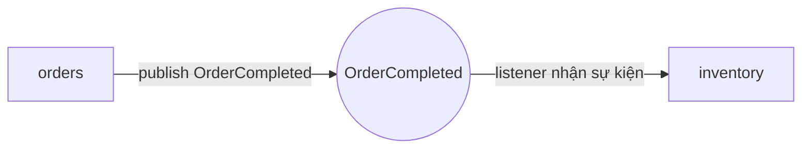
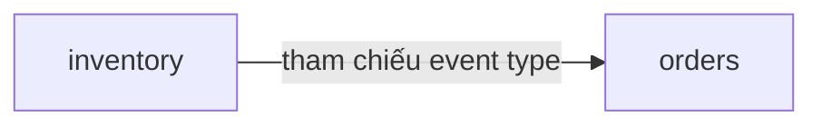
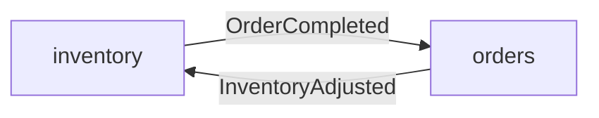

# Event publication và event listener tạo liên hệ

Các mô-đun trong một ứng dụng Spring Modulith có thể phối hợp mà không gọi trực tiếp service của nhau. Một mô-đun phát hành sự kiện nghiệp vụ khi một điều gì đó xảy ra; các mô-đun quan tâm đăng ký listener để phản ứng với sự kiện đó. Cách giao tiếp này giúp mô-đun phát sự kiện không cần biết có bao nhiêu mô-đun đang lắng nghe.

Dù không có lời gọi service trực tiếp, event listener vẫn tạo ra một quan hệ phụ thuộc kiến trúc. Mô-đun lắng nghe phải tham chiếu kiểu sự kiện do mô-đun phát hành sở hữu. Vì thế, dependency đi từ mô-đun listener tới mô-đun sở hữu event type. Hiểu đúng chiều phụ thuộc này giúp thiết kế event API rõ ràng và tránh tạo chu trình giữa các mô-đun.

## 1. Một sự kiện nghiệp vụ kết nối hai mô-đun

Giả sử ứng dụng bán hàng có hai mô-đun:

```text
com.acme.shop
├── ShopApplication.java
├── orders
│   ├── OrderService.java
│   └── events
│       └── OrderCompleted.java
└── inventory
    └── InventoryOnOrderCompleted.java
```

Khi một đơn hàng hoàn tất, mô-đun `orders` phát sự kiện `OrderCompleted`. Mô-đun `inventory` lắng nghe sự kiện để cập nhật quy trình giữ hàng hoặc số lượng tồn kho.



Luồng xử lý khi chạy có chiều từ publisher tới listener. Tuy nhiên, quan hệ phụ thuộc trong mã nguồn có chiều từ `inventory` tới `orders`, vì listener phải import kiểu `OrderCompleted`. Mô-đun `orders` chỉ gọi API phát sự kiện của Spring và không cần import lớp listener của `inventory`.

## 2. Định nghĩa event type như một hợp đồng công khai

Đặt kiểu sự kiện trong package được công khai của mô-đun `orders`. Nếu muốn quản lý các event contract thành một Named Interface riêng, đánh dấu package `events`:

```java
@org.springframework.modulith.NamedInterface("events")
package com.acme.shop.orders.events;
```

Tạo event payload:

```java
package com.acme.shop.orders.events;

import java.time.Instant;
import java.util.UUID;

public record OrderCompleted(
        UUID orderId,
        Instant completedAt
) {}
```

Event payload là hợp đồng mà các listener sử dụng. Nên chứa những dữ liệu nghiệp vụ cần thiết để consumer xử lý, chẳng hạn mã đơn hàng và thời điểm hoàn tất. Tránh đưa trực tiếp entity JPA hoặc object nội bộ có vòng đời phức tạp vào event; consumer không nên phải truy cập cấu trúc lưu trữ của publisher để hiểu sự kiện.

Nếu không cần Named Interface riêng, có thể đặt event type trực tiếp trong package gốc `com.acme.shop.orders`. Khi đó package gốc là API công khai mặc định của mô-đun. Dù chọn vị trí nào, event type phải nằm trong phần API mà mô-đun khác được phép tham chiếu.

## 3. Phát hành sự kiện từ mô-đun nguồn

Spring cung cấp `ApplicationEventPublisher` để bean phát hành application event:

```java
package com.acme.shop.orders;

import java.time.Instant;
import java.util.UUID;

import com.acme.shop.orders.events.OrderCompleted;
import org.springframework.context.ApplicationEventPublisher;
import org.springframework.stereotype.Service;

@Service
public class OrderService {

    private final ApplicationEventPublisher events;

    public OrderService(ApplicationEventPublisher events) {
        this.events = events;
    }

    public void complete(UUID orderId) {
        // Cập nhật trạng thái đơn hàng trong nghiệp vụ orders.

        events.publishEvent(new OrderCompleted(orderId, Instant.now()));
    }
}
```

`OrderService` tạo event và gửi nó tới `ApplicationEventPublisher`. Publisher không cần biết `InventoryOnOrderCompleted` tồn tại. Khi có nhiều mô-đun quan tâm tới `OrderCompleted`, mỗi mô-đun có thể đăng ký listener riêng mà không cần sửa `OrderService`.

Để giữ tính nhất quán nghiệp vụ, hãy xác định rõ thời điểm phát event. Nếu event biểu thị đơn hàng đã được lưu thành công, cần phát event trong luồng transaction phù hợp và chọn cơ chế listener bảo đảm consumer chỉ xử lý khi transaction nguồn đã commit. Không phát event `OrderCompleted` trước khi trạng thái hoàn tất thực sự được xác nhận.

## 4. Lắng nghe sự kiện ở mô-đun khác

Mô-đun `inventory` tham chiếu event contract và khai báo listener. Spring Modulith cung cấp `@ApplicationModuleListener` cho xử lý event giữa các mô-đun:

```java
package com.acme.shop.inventory;

import com.acme.shop.orders.events.OrderCompleted;
import org.springframework.stereotype.Component;
import org.springframework.modulith.events.ApplicationModuleListener;

@Component
public class InventoryOnOrderCompleted {

    @ApplicationModuleListener
    void on(OrderCompleted event) {
        // Cập nhật quy trình tồn kho theo orderId.
    }
}
```

`@ApplicationModuleListener` là cách Spring Modulith hỗ trợ listener cho giao tiếp giữa các mô-đun. Annotation này kết hợp cơ chế xử lý event theo transaction và bất đồng bộ theo cấu hình mặc định của Spring Modulith. Trong trường hợp cần hành vi đồng bộ hoặc transaction khác, hãy chọn annotation và cấu hình listener tương ứng, rồi kiểm thử rõ thời điểm thực thi.

Listener chỉ cần biết event contract. Nó không cần tham chiếu `OrderService`, repository hay entity nội bộ của `orders`. Nhờ đó, publisher và consumer trao đổi qua một hợp đồng nhỏ, ổn định.

## 5. Chiều dependency do event listener tạo ra

Trong ví dụ trên, `InventoryOnOrderCompleted` nằm trong mô-đun `inventory` nhưng tham số phương thức là `OrderCompleted`, thuộc mô-đun `orders`. Do đó, mô hình mô-đun có dependency:



Đây là chiều dependency ở cấp mã nguồn. Khi runtime phát event, dữ liệu đi từ publisher `orders` tới listener `inventory`; hai chiều này mô tả hai khía cạnh khác nhau:

| Góc nhìn | Chiều quan hệ | Lý do |
|---|---|---|
| Luồng xử lý runtime | `orders` → `inventory` | Publisher phát sự kiện và listener nhận sự kiện |
| Dependency kiến trúc | `inventory` → `orders` | Listener import event type do `orders` sở hữu |

Không nên suy luận rằng publisher phụ thuộc vào tất cả listener. Nếu `orders` chỉ phát event thông qua Spring và không tham chiếu lớp thuộc `inventory`, nó không có dependency mã nguồn trực tiếp tới mô-đun consumer.

## 6. Khai báo dependency được phép

Vì `inventory` tham chiếu event type thuộc `orders`, allow-list (nếu có) phải được khai báo ở mô-đun `inventory`.

Nếu event nằm trong package gốc công khai của `orders`, có thể khai báo:

```java
@org.springframework.modulith.ApplicationModule(
    allowedDependencies = "orders"
)
package com.acme.shop.inventory;
```

Nếu event nằm trong Named Interface `orders::events`, chỉ cho phép đúng interface đó:

```java
@org.springframework.modulith.ApplicationModule(
    allowedDependencies = "orders::events"
)
package com.acme.shop.inventory;
```

Khai báo `orders::events` thể hiện rằng `inventory` được phép tham chiếu event contract đã công khai. Nó không cấp quyền truy cập các package triển khai như `orders.internal`. Nếu `inventory` đồng thời cần API khác của `orders`, hãy cân nhắc khai báo các dependency cần thiết theo đúng phạm vi hợp đồng.

## 7. Kiểm chứng quan hệ event bằng Spring Modulith

Tạo bài kiểm tra kiến trúc ở package gốc ứng dụng:

```java
package com.acme.shop;

import org.junit.jupiter.api.Test;
import org.springframework.modulith.core.ApplicationModules;

class ModularityTests {

    @Test
    void verifiesEventBasedModuleDependencies() {
        ApplicationModules.of(ShopApplication.class).verify();
    }
}
```

Spring Modulith phân tích các module và dependency được thể hiện qua mã nguồn, bao gồm các kiểu event được tham chiếu bởi listener. Vì vậy, một listener tham chiếu event type của mô-đun khác vẫn được tính là dependency và phải tuân thủ quy tắc API cùng `allowedDependencies`.

Khi test thất bại, hãy xác định mô-đun chứa listener, mô-đun sở hữu event type và package chứa event. Nếu listener đang import một lớp nội bộ, hãy chuyển event contract sang package công khai hoặc Named Interface. Nếu dependency hợp lệ nhưng chưa được khai báo, cập nhật allow-list theo chủ đích kiến trúc.

`ApplicationModules.verify()` xác minh quan hệ kiến trúc tĩnh. Nó không chứng minh listener thực sự được gọi, xử lý thành công hoặc có thể phục hồi sau lỗi. Với hành vi runtime, hãy viết integration test phát event và xác nhận listener thực hiện kết quả mong đợi.

## 8. Phân biệt các kiểu event listener

Spring Framework và Spring Modulith cung cấp nhiều cách nhận event. Lựa chọn annotation ảnh hưởng tới thời điểm và cách thực thi listener, nhưng không thay đổi nguyên tắc dependency: listener tham chiếu event type thì phụ thuộc vào mô-đun sở hữu type đó.

| Cơ chế | Đặc điểm chính | Khi cân nhắc |
|---|---|---|
| `@EventListener` | Listener application event thông thường, thường xử lý đồng bộ trong luồng publish | Xử lý đơn giản, cần phản hồi ngay trong cùng luồng |
| `@TransactionalEventListener` | Gắn xử lý listener với phase của transaction, mặc định thường là sau commit | Consumer cần chỉ xử lý khi transaction nguồn đạt phase phù hợp |
| `@ApplicationModuleListener` | Annotation của Spring Modulith dành cho listener giữa các mô-đun, kết hợp xử lý bất đồng bộ và transaction theo cấu hình mặc định | Tách xử lý consumer khỏi luồng publisher |

Đừng coi các annotation này là cơ chế đảm bảo giao nhận giống nhau trong mọi tình huống. Với listener bất đồng bộ, cần xem xét executor, lỗi xử lý, khả năng retry và tính idempotent của consumer. Nếu cần lưu trạng thái publication để theo dõi và phát lại các event chưa được xử lý, hãy cấu hình event publication registry phù hợp với hạ tầng lưu trữ của ứng dụng.

## 9. Tránh tạo chu trình qua event contract

Giao tiếp bằng event giúp publisher không phụ thuộc vào listener, nhưng không tự động loại bỏ mọi chu trình. Ví dụ, `orders` phát `OrderCompleted` và `inventory` lắng nghe event đó. Nếu `inventory` lại phát một event có contract thuộc `inventory`, rồi listener trong `orders` tham chiếu contract đó, hai mô-đun có thể hình thành dependency hai chiều.



Hãy kiểm tra quyền sở hữu event. Một event nên được sở hữu bởi mô-đun chịu trách nhiệm về sự kiện nghiệp vụ đó. Nếu hai mô-đun cần chia sẻ một hợp đồng thực sự độc lập, có thể thiết kế một mô-đun API hoặc contract phù hợp, nhưng tránh tạo một package dùng chung tùy tiện chỉ để né dependency cycle.

Ngoài ra, không đưa callback hoặc tham chiếu tới bean của consumer vào event payload. Publisher không nên biết consumer nào xử lý event và consumer không nên điều khiển ngược publisher qua đối tượng nội bộ.

## 10. Bài tập tự kiểm tra

Với `orders` phát `OrderCompleted` và `inventory` lắng nghe, hãy đánh giá các tình huống:

| Tình huống | Dependency kiến trúc | Kết quả mong đợi |
|---|---|---|
| `inventory` listener tham chiếu event trong package gốc công khai của `orders` | `inventory` → `orders` | Hợp lệ nếu dependency được cho phép |
| Event nằm trong `orders.events`, package được đánh dấu `@NamedInterface("events")` | `inventory` → `orders::events` | Hợp lệ khi allow-list cho phép named interface |
| Listener import `orders.internal.OrderEntity` | `inventory` → package nội bộ của `orders` | Vi phạm API boundary |
| `orders` chỉ publish event và không tham chiếu `inventory` | Không có dependency trực tiếp `orders` → `inventory` | Publisher không cần biết listener |
| Hai mô-đun tham chiếu event type của nhau | Dependency hai chiều | Có nguy cơ chu trình mô-đun |

Hãy viết một integration test phát `OrderCompleted`, xác nhận listener được gọi và kiểm tra trạng thái nghiệp vụ sau khi xử lý. Sau đó chạy `ApplicationModules.verify()` để xác nhận event contract được đặt trong API công khai và dependency graph không có quan hệ ngoài dự kiến. Qua bài tập, bạn cần phân biệt rõ luồng event ở runtime với chiều dependency kiến trúc do kiểu event tạo ra.
