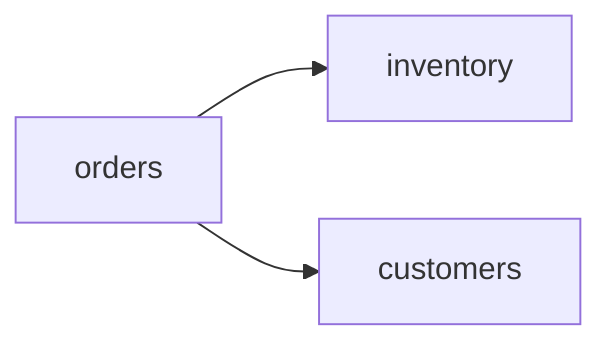
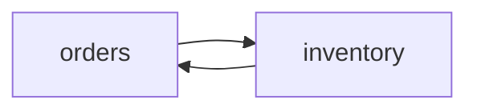
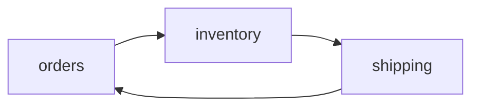
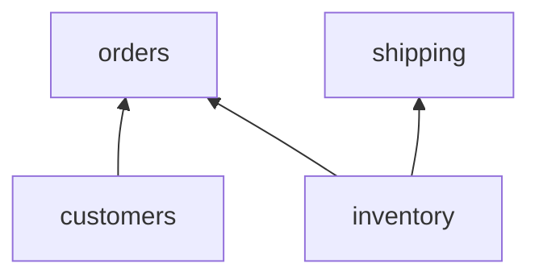
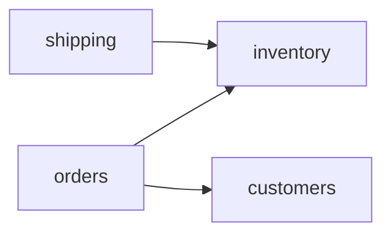
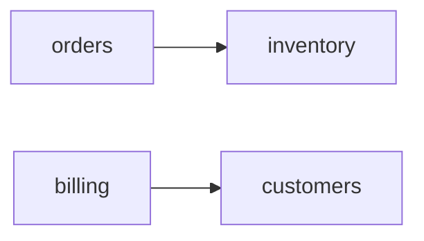

# Vì sao module graph nên là directed acyclic graph?

Một ứng dụng Spring Modulith có thể gồm nhiều mô-đun nghiệp vụ cùng chạy trong một ứng dụng Spring Boot. Mỗi mô-đun sở hữu một phần trách nhiệm và có thể sử dụng API công khai của mô-đun khác. Khi biểu diễn các quan hệ đó bằng đồ thị có hướng, ta có module graph.

Module graph nên là directed acyclic graph (DAG), tức đồ thị có hướng không chứa chu trình. Điều này có nghĩa là một mô-đun có thể phụ thuộc trực tiếp hoặc gián tiếp vào mô-đun khác, nhưng không thể đi theo các cạnh phụ thuộc rồi quay trở lại mô-đun ban đầu. Giữ đồ thị không có chu trình giúp ranh giới mô-đun dễ hiểu, thay đổi độc lập và được Spring Modulith kiểm chứng tự động.

## 1. Đọc module graph đúng chiều

Trong module graph:

- Mỗi node đại diện cho một application module.
- Một cạnh có hướng `A → B` nghĩa là mô-đun `A` phụ thuộc vào mô-đun `B`.
- Cạnh được suy ra từ quan hệ trong mã nguồn, chẳng hạn một kiểu API, một constructor parameter hoặc một event type được tham chiếu.

Ví dụ, `orders` dùng API của `inventory`:



Ở đây, `orders` cần `inventory` và `customers`; hai mô-đun được sử dụng không cần biết `orders` tồn tại. Đồ thị có thể có nhiều nhánh hoặc nhiều node độc lập. DAG không yêu cầu mọi mô-đun phải kết nối với nhau; nó chỉ yêu cầu không có đường đi có hướng nào quay lại node xuất phát.

Chiều của cạnh thể hiện quan hệ phụ thuộc trong mã nguồn, không nhất thiết là chiều của dữ liệu hoặc luồng xử lý khi ứng dụng chạy. Ví dụ, `orders` phát event và `inventory` lắng nghe event đó thì luồng xử lý runtime đi từ publisher tới listener. Nhưng listener tham chiếu event type do `orders` sở hữu, nên cạnh kiến trúc là `inventory → orders`.

## 2. Chu trình phụ thuộc là gì?

Một chu trình xuất hiện khi có thể bắt đầu tại một mô-đun, đi theo một hoặc nhiều cạnh phụ thuộc và quay lại chính mô-đun đó. Chu trình có thể trực tiếp giữa hai mô-đun hoặc gián tiếp qua nhiều mô-đun.

**Chu trình trực tiếp:**



`orders` dùng API của `inventory`, đồng thời `inventory` lại tham chiếu API của `orders`. Hai mô-đun cùng biết chi tiết của nhau và không còn có thể xem xét riêng từng mô-đun theo một chiều phụ thuộc rõ ràng.

**Chu trình gián tiếp:**



Trong ví dụ này, `orders` không phụ thuộc trực tiếp vào `shipping`, nhưng vẫn tồn tại đường đi `orders → inventory → shipping → orders`. Vì vậy, chỉ kiểm tra từng cặp mô-đun riêng lẻ là chưa đủ; cần kiểm tra toàn bộ đồ thị.

## 3. Vì sao chu trình làm suy yếu ranh giới mô-đun?

**Mô-đun khó thay đổi độc lập.** Nếu `orders` thay đổi hợp đồng mà `inventory` sử dụng, nhóm phát triển có thể phải thay đổi `inventory`. Do `inventory` lại cung cấp một hợp đồng mà `orders` đang dùng, việc sửa tiếp có thể quay lại ảnh hưởng `orders`. Một thay đổi nhỏ dễ lan qua nhiều mô-đun.

**Quyền sở hữu trách nhiệm trở nên mơ hồ.** Khi hai mô-đun cần hiểu sâu về nhau, thường có một phần nghiệp vụ hoặc hợp đồng đang được đặt sai chỗ. Ví dụ, `orders` vừa quản lý trạng thái đơn hàng vừa điều phối trực tiếp chi tiết kho; `inventory` lại cần truy vấn trạng thái nội bộ của đơn hàng. Chu trình có thể là dấu hiệu hai mô-đun chưa có hợp đồng phù hợp hoặc trách nhiệm đang bị trộn lẫn.

**Khó xác định thứ tự phụ thuộc.** Với đồ thị không có chu trình, ta có thể sắp xếp các node theo thứ tự topo: mô-đun được phụ thuộc có thể được xem xét trước mô-đun sử dụng nó. Khi có chu trình, không tồn tại thứ tự topo cho toàn bộ đồ thị. Điều này làm việc phân tích kiến trúc, chia lớp trách nhiệm và tổ chức kiểm thử trở nên khó khăn hơn.

**Kiểm thử và tái sử dụng khó hơn.** Một mô-đun có thể khó kiểm thử riêng vì phải dựng nhiều mô-đun liên quan cùng lúc. Việc trích một mô-đun sang thư viện hoặc dịch vụ khác cũng khó hơn vì các hợp đồng phụ thuộc lẫn nhau.

**Chu trình có thể kéo theo vấn đề khởi tạo bean.** Nếu các dependency kiến trúc được thực hiện bằng constructor injection hai chiều, Spring có thể không khởi tạo được các bean vì mỗi bean cần bean còn lại trước khi hoàn tất constructor. Tuy nhiên, chu trình module graph và circular bean dependency là hai khái niệm khác nhau: module graph có thể có chu trình dù không có bean cycle ở runtime, và bean cycle cũng có thể xảy ra bên trong một mô-đun duy nhất.

## 4. DAG giúp kiến trúc có thể sắp xếp và phân tầng

Với một DAG, có thể sắp xếp các mô-đun theo thứ tự topo. Nếu `orders → inventory`, `orders → customers` và `shipping → inventory`, các mô-đun nền tảng như `inventory` và `customers` có thể được xem xét trước các mô-đun sử dụng chúng.



Thứ tự topo không phải một cấu hình triển khai bắt buộc cho ứng dụng Spring Boot. Giá trị của nó là giúp nhóm nhìn thấy các tầng phụ thuộc và xác định nơi nên đặt hợp đồng. Mô-đun ở tầng dưới cung cấp API ổn định; mô-đun ở tầng trên sử dụng API đó và không buộc tầng dưới biết ngược lại về mình.

Một đồ thị có nhiều nhánh độc lập vẫn là DAG. Các mô-đun `billing` và `reporting` có thể không phụ thuộc lẫn nhau, miễn là không có đường phụ thuộc quay về node xuất phát.

## 5. Kiểm tra DAG bằng Spring Modulith

Spring Modulith cung cấp `ApplicationModules` để xây dựng mô hình mô-đun từ package của lớp ứng dụng và `verify()` để kiểm tra các quy tắc kiến trúc. Tạo một bài kiểm tra như sau:

```java
package com.acme.shop;

import org.junit.jupiter.api.Test;
import org.springframework.modulith.core.ApplicationModules;

class ModularityTests {

    @Test
    void verifiesModuleStructure() {
        ApplicationModules.of(ShopApplication.class).verify();
    }
}
```

Trong quá trình xác minh, Spring Modulith kiểm tra các dependency giữa mô-đun và phát hiện chu trình trong module graph. Nếu có chu trình hoặc một dependency vi phạm boundary khác, bài kiểm tra thất bại và báo các vi phạm để nhóm phát triển xử lý.

Nên chạy bài kiểm tra này trong CI. Một thay đổi có thể tạo chu trình mà không làm bất kỳ lớp Java nào lỗi biên dịch; kiểm tra kiến trúc giúp phát hiện vấn đề ở cấp mô-đun trước khi tích hợp thay đổi.

`allowedDependencies` có thể giới hạn mô-đun nào được phép phụ thuộc vào mô-đun nào. Khai báo này giúp diễn đạt chính sách phụ thuộc, nhưng không phải cách hợp lệ để che một chu trình. Nếu thêm allow-list rộng chỉ để làm cho kiểm tra qua, quan hệ hai chiều vẫn còn và ranh giới vẫn khó duy trì.

## 6. Cách đọc và xử lý lỗi chu trình

Khi `verify()` báo chu trình, hãy đọc đường đi được báo và xác định từng cạnh đến từ đâu. Một cạnh có thể xuất phát từ:

- Constructor, field hoặc setter tham chiếu kiểu thuộc mô-đun khác.
- Phương thức cấu hình `@Bean` có tham số thuộc mô-đun khác.
- Listener tham chiếu event type do mô-đun khác sở hữu.
- Một lớp hoặc interface được đặt trong package không phù hợp với quyền sở hữu nghiệp vụ.

Ví dụ, nếu đường đi là `orders → inventory → shipping → orders`, hãy tìm từng tham chiếu mã nguồn tạo ra ba cạnh. Sau đó xác định hợp đồng nào cần được di chuyển hoặc thay đổi. Đừng chỉ nhìn vào cạnh cuối cùng; bỏ một cạnh có thể làm mất chu trình nhưng cũng có thể che một thiết kế không rõ quyền sở hữu.

## 7. Các cách tái cấu trúc để loại bỏ chu trình

**Đưa hợp đồng về mô-đun sở hữu đúng nghiệp vụ.** Nếu `inventory` cần thông tin về đơn hàng, hãy xác định chính xác thông tin nào thuộc hợp đồng công khai của `orders`. Tạo API hoặc DTO ổn định trong phần công khai và tránh để `inventory` truy cập entity hoặc repository nội bộ.

**Dùng event cho thông báo một chiều.** Nếu `orders` cần thông báo rằng đơn hàng đã hoàn tất để `inventory` phản ứng, `orders` có thể phát `OrderCompleted`. Listener ở `inventory` tham chiếu event type của `orders`, tạo cạnh `inventory → orders`; publisher không cần phụ thuộc ngược vào listener. Cách này phù hợp khi consumer phản ứng với sự kiện đã xảy ra và không cần publisher gọi đồng bộ một dịch vụ của consumer.

**Tách hợp đồng thực sự dùng chung.** Nếu hai mô-đun cần cùng một khái niệm ổn định nhưng khái niệm đó không thuộc trách nhiệm riêng của mô-đun nào, cân nhắc một mô-đun contract nhỏ. Khi đó, cả hai mô-đun phụ thuộc vào contract module thay vì phụ thuộc lẫn nhau. Chỉ tạo mô-đun này khi nó có ý nghĩa nghiệp vụ rõ ràng; tránh biến nó thành nơi chứa mọi lớp dùng chung.

**Đưa điều phối lên mô-đun ứng dụng phù hợp.** Nếu một use case cần gọi cả `orders` và `inventory`, có thể đặt điều phối trong một application service ở tầng cao hơn. Service điều phối phụ thuộc vào các API cần thiết; các mô-đun nghiệp vụ không cần gọi ngược lẫn nhau.

**Đảo chiều phụ thuộc qua abstraction khi phù hợp.** Nếu một mô-đun cần một khả năng do mô-đun khác thực thi, hãy đặt port hoặc interface ở nơi sở hữu hợp đồng phù hợp, rồi để implementation phụ thuộc vào abstraction đó. Cần xem xét kỹ quyền sở hữu interface để việc đảo chiều thực sự loại bỏ cạnh ngược trong module graph.

## 8. Những điều không nên nhầm lẫn

| Khái niệm | Ý nghĩa | Có đồng nghĩa với DAG không? |
|---|---|---|
| Không có circular bean dependency | Spring không gặp vòng khởi tạo bean | Không. Module graph vẫn có thể có chu trình qua các kiểu hoặc event contract |
| Không có lời gọi service hai chiều | Các service không gọi trực tiếp lẫn nhau | Không. Dependency có thể hình thành qua interface, cấu hình hoặc listener |
| Dùng event thay lời gọi trực tiếp | Publisher phát thông báo và listener phản ứng | Không tự động. Listener vẫn phụ thuộc vào event type; nhiều event contract có thể tạo chu trình |
| Có `allowedDependencies` | Giới hạn các dependency được phép | Không. Allow-list không làm biến mất chu trình thực tế |
| Module graph là DAG | Không có chu trình có hướng trong toàn bộ graph | Có. Đây là thuộc tính của toàn đồ thị |

## 9. Bài tập tự kiểm tra

Xét ba đồ thị sau. Hãy xác định đồ thị nào là DAG và giải thích vì sao.

**Đồ thị A:**



**Đồ thị B:**


**Đồ thị C:**



Kết quả mong đợi:

| Đồ thị | Là DAG? | Giải thích |
|---|---|---|
| A | Có | Các cạnh đều đi một chiều, không có đường quay lại node xuất phát |
| B | Không | Có chu trình `orders → inventory → shipping → orders` |
| C | Có | Hai nhánh độc lập và không có chu trình |

Tiếp theo, hãy tạo một dependency cycle có chủ đích trong một nhánh thử nghiệm, chạy `ApplicationModules.of(ShopApplication.class).verify()` để quan sát lỗi, rồi tái cấu trúc theo một trong các cách ở trên. Chạy lại kiểm tra để xác nhận module graph đã trở thành DAG và các API công khai vẫn phản ánh đúng quyền sở hữu nghiệp vụ.
