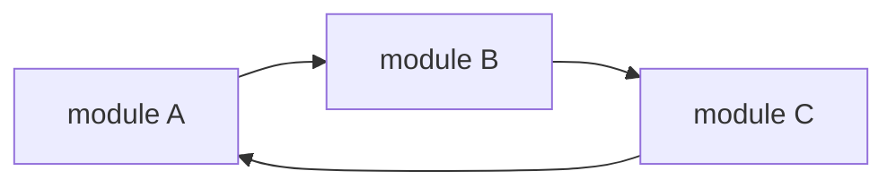
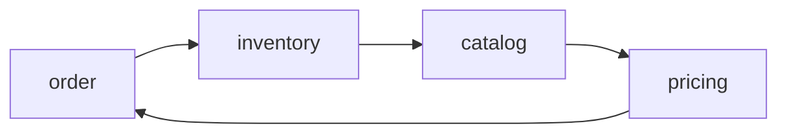
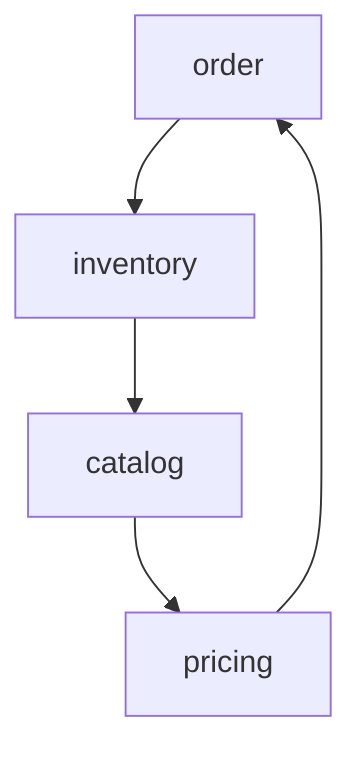
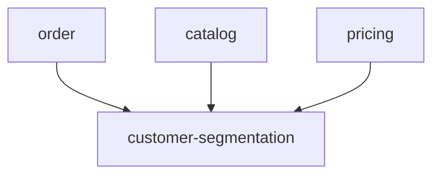

# Chu kỳ dài qua ba hoặc nhiều module

Trong một modular monolith, mỗi application module nên phụ thuộc theo những hướng có chủ đích. Một chu kỳ phụ thuộc xuất hiện khi có thể đi theo các dependency từ một module, qua một hoặc nhiều module khác, rồi quay trở lại module ban đầu. Chu kỳ có thể chỉ gồm hai module, nhưng cũng có thể kéo dài qua ba, bốn hoặc nhiều module trước khi khép kín.

Chu kỳ dài thường khó nhận ra khi đọc từng module riêng lẻ. `order` có thể chỉ biết `inventory`, `inventory` chỉ biết `catalog`, `catalog` chỉ biết `pricing`, còn `pricing` lại tham chiếu ngược `order`. Mỗi quan hệ riêng có vẻ hợp lý, nhưng toàn bộ đồ thị tạo thành một vòng. Khi đó, các module không còn độc lập theo hướng phụ thuộc đã thiết kế.

Trong `SPRING_MODULITH_MODULE_MODEL`, việc hiểu chu kỳ dài giúp nhận diện coupling gián tiếp, xác định cạnh cần loại bỏ và giữ đồ thị module không có chu trình. Bài học này tập trung vào chu kỳ qua ít nhất ba module, cách Spring Modulith phát hiện và cách tái cấu trúc để phá vòng.

## 1. Chu kỳ phụ thuộc là gì?

Dependency giữa application module được biểu diễn bằng đồ thị có hướng. Nếu mã của module `A` tham chiếu một kiểu thuộc module `B`, ta biểu diễn cạnh `A → B`: `A` sử dụng `B`.

Một chu kỳ tồn tại khi bắt đầu từ một module, đi theo hướng các cạnh và quay lại module đó. Ví dụ:



Đường đi `A → B → C → A` là một chu kỳ gồm ba module. Chu kỳ không yêu cầu mỗi module phải phụ thuộc trực tiếp vào tất cả module còn lại; chỉ cần tồn tại một đường đi có hướng quay về điểm xuất phát.

Một chuỗi như `A → B → C` chưa phải chu kỳ nếu không có cạnh hoặc đường đi nào từ `C` quay lại `A`. Chuỗi đó chỉ là một đường phụ thuộc một chiều.

## 2. Chu kỳ dài qua bốn module

Xét ví dụ trong một hệ thống bán hàng:

- `order` cần kiểm tra tồn kho trước khi tạo đơn.
- `inventory` cần thông tin sản phẩm từ `catalog`.
- `catalog` cần chính sách giá từ `pricing`.
- `pricing` lại truy vấn ngược ngữ cảnh đơn hàng từ `order`.

Đồ thị phụ thuộc:



Chu kỳ là:

```text
order → inventory → catalog → pricing → order
```

Chu kỳ này có bốn module khác nhau. Không có cặp module nào nhất thiết phải tham chiếu trực tiếp hai chiều; vòng chỉ xuất hiện khi ghép các quan hệ lại với nhau.

### Ví dụ tham chiếu tạo ra từng cạnh

Module `order` sử dụng API tồn kho:

```java
package com.example.shop.order.internal;

import com.example.shop.inventory.InventoryAvailability;

class PlaceOrderService {

    private final InventoryAvailability inventory;

    PlaceOrderService(InventoryAvailability inventory) {
        this.inventory = inventory;
    }
}
```

Module `inventory` sử dụng API tra cứu sản phẩm:

```java
package com.example.shop.inventory.internal;

import com.example.shop.catalog.ProductCatalog;

class InventoryPolicy {

    private final ProductCatalog catalog;

    InventoryPolicy(ProductCatalog catalog) {
        this.catalog = catalog;
    }
}
```

Module `catalog` sử dụng chính sách giá:

```java
package com.example.shop.catalog.internal;

import com.example.shop.pricing.PricePolicy;

class ProductCatalogService {

    private final PricePolicy pricePolicy;

    ProductCatalogService(PricePolicy pricePolicy) {
        this.pricePolicy = pricePolicy;
    }
}
```

Module `pricing` tham chiếu ngược hợp đồng ngữ cảnh đơn hàng:

```java
package com.example.shop.pricing.internal;

import com.example.shop.order.OrderContextProvider;

class DefaultPricePolicy implements PricePolicy {

    private final OrderContextProvider orderContextProvider;

    DefaultPricePolicy(OrderContextProvider orderContextProvider) {
        this.orderContextProvider = orderContextProvider;
    }
}
```

Các đoạn mã minh họa những tham chiếu kiểu làm phát sinh cạnh giữa module. Khi phân tích codebase thực tế, cần lần theo kiểu được import và package sở hữu kiểu đó để xác định cạnh chính xác.

## 3. Vì sao chu kỳ dài khó phát hiện?

Với chu kỳ hai module, quan hệ phụ thuộc ngược thường dễ nhìn thấy khi xem hai package. Với chu kỳ dài, mỗi module có thể chỉ biết một module kế tiếp:



Người phát triển `order` có thể chỉ thấy dependency tới `inventory`. Người phát triển `inventory` chỉ thấy dependency tới `catalog`. Nếu không xem toàn bộ đồ thị, cạnh cuối `pricing → order` có thể bị bỏ sót.

Chu kỳ dài thường xuất hiện khi:

- Một module gọi ngược module đã khởi tạo luồng nghiệp vụ.
- Một module dùng kiểu dữ liệu hoặc service của module khác chỉ để lấy thêm ngữ cảnh.
- Các module chia sẻ trách nhiệm nghiệp vụ nhưng chưa xác định rõ module sở hữu khái niệm chung.
- Một service điều phối bị đặt trong module không sở hữu quy trình đó.
- Các thay đổi qua nhiều lần refactor tạo ra dependency mới mà không đánh giá toàn bộ đồ thị.

## 4. Chu kỳ module khác chu kỳ Spring bean

Không nên nhầm chu kỳ dependency ở cấp application module với circular bean dependency ở cấp Spring container.

| Khía cạnh | Chu kỳ application module | Circular bean dependency |
|---|---|---|
| Đối tượng | Các module/package | Các Spring bean |
| Quan hệ | Module A tham chiếu kiểu thuộc B | Bean A cần bean B và ngược lại |
| Phạm vi | Đồ thị kiến trúc toàn ứng dụng | Đồ thị object được Spring tạo và kết nối |
| Ví dụ | `order → inventory → catalog → order` | `OrderService ↔ InventoryService` |
| Công cụ phát hiện | `ApplicationModules.verify()` | Spring ApplicationContext startup và bean creation |

Một chu kỳ module có thể tồn tại ngay cả khi chưa có bean nào được tạo hoặc inject theo vòng. Ví dụ, một kiểu DTO trong `pricing` tham chiếu kiểu thuộc `order` đã có thể tạo cạnh kiến trúc, dù không có hai Spring service inject lẫn nhau.

Ngược lại, circular bean dependency có thể xảy ra bên trong cùng một module mà không tạo chu kỳ giữa các application module. Vì vậy, cần kiểm tra cả hai cấp khi gặp vấn đề.

## 5. Tác động của chu kỳ qua nhiều module

Chu kỳ làm suy yếu tính độc lập của các module và khiến thay đổi khó dự đoán hơn.

**Khó thay đổi độc lập.** Thay đổi hợp đồng ở một module có thể buộc các module khác trong vòng phải thay đổi theo. Một module không còn dễ được tái cấu trúc mà không xem xét các module còn lại.

**Trách nhiệm nghiệp vụ bị đan xen.** Nếu `pricing` cần truy vấn `order` để quyết định giá, còn `order` lại phụ thuộc vào các khả năng ở chuỗi `inventory`, `catalog`, `pricing`, ranh giới sở hữu quyết định giá và ngữ cảnh đơn hàng có thể chưa rõ.

**Khó kiểm thử riêng.** Các module trong vòng có xu hướng cần nhiều collaborator hoặc test fixture hơn. Unit test có thể phải dựng một phần lớn đồ thị để mô phỏng một hành vi tưởng như cục bộ.

**Khó tách module hoặc triển khai độc lập trong tương lai.** Chu kỳ thể hiện rằng các module đang phụ thuộc lẫn nhau theo nhiều hướng. Việc tách một module ra khỏi ứng dụng sẽ cần xử lý các hợp đồng vòng đó.

**Tăng rủi ro thay đổi dây chuyền.** Một thay đổi nhỏ ở cạnh cuối có thể làm thay đổi khả năng biên dịch hoặc quy tắc kiến trúc của module ở đầu chuỗi.

## 6. Spring Modulith phát hiện chu kỳ như thế nào?

Spring Modulith xây dựng mô hình application module từ cấu trúc package và các tham chiếu giữa kiểu Java. Phương thức `ApplicationModules.verify()` kiểm tra các quy tắc kiến trúc, trong đó có việc các module không tạo thành dependency cycle.

Ví dụ một bài kiểm thử kiến trúc:

```java
import org.junit.jupiter.api.Test;
import org.springframework.modulith.core.ApplicationModules;

class ModularityTests {

    @Test
    void verifiesAcyclicModuleDependencies() {
        ApplicationModules.of(ShopApplication.class).verify();
    }
}
```

Nếu mô hình có chu kỳ, quá trình verify báo vi phạm kiến trúc. Nội dung báo lỗi có thể chỉ ra các module hoặc dependency liên quan để nhóm lần theo đường đi khép kín. Cách trình bày cụ thể phụ thuộc phiên bản Spring Modulith và loại vi phạm được phát hiện.

Điều quan trọng là chạy kiểm tra trên toàn bộ application module. Chỉ kiểm tra riêng `order` hoặc `inventory` không đủ để nhận ra một vòng khép kín qua nhiều module.

## 7. Cách lần theo một chu kỳ dài

Khi `verify()` báo dependency cycle, hãy phân tích theo đường đi thay vì sửa ngẫu nhiên từng import.

1. **Ghi lại các module trong thông báo.** Xác định module bắt đầu, các module trung gian và module quay lại điểm đầu.
2. **Vẽ đồ thị có hướng.** Với mỗi cạnh `A → B`, ghi rõ kiểu hoặc hợp đồng trong `B` mà `A` đang sử dụng.
3. **Phân biệt cạnh trực tiếp và đường bắc cầu.** Một module có thể chỉ phụ thuộc trực tiếp module kế tiếp nhưng vẫn nằm trong chu kỳ dài.
4. **Xác định cạnh ngược ít hợp lý nhất.** Hỏi module nào đang biết quá nhiều về trách nhiệm của module khác.
5. **Xác định chủ sở hữu hợp đồng.** Kiểu dữ liệu hoặc capability đang bị tham chiếu có thuộc đúng module nghiệp vụ không?
6. **Chọn cách đảo hướng hoặc loại bỏ cạnh.** Di chuyển hợp đồng, truyền dữ liệu qua API, tách trách nhiệm hoặc dùng sự kiện khi phù hợp.
7. **Chạy lại kiểm tra toàn ứng dụng.** Xác nhận chu kỳ đã biến mất và không tạo ra chu kỳ khác.

Ví dụ, với vòng `order → inventory → catalog → pricing → order`, hãy xem `pricing` có thực sự cần truy vấn `OrderContextProvider` không. Có thể `order` nên cung cấp dữ liệu ngữ cảnh qua request tới API của `pricing`, thay vì `pricing` gọi ngược `order`.

## 8. Cách phá chu kỳ: đảo chiều dependency qua API

Một cách thường gặp là để module khởi tạo quy trình truyền dữ liệu cần thiết vào module cung cấp khả năng, thay vì để module cung cấp truy vấn ngược.

Trước khi tái cấu trúc:

```text
order → inventory → catalog → pricing → order
```

Giả sử `pricing` cần `OrderContextProvider` chỉ để biết khách hàng, loại đơn và thời điểm áp dụng giá. Thay vì truy vấn ngược, định nghĩa request thuộc API của `pricing`:

```java
package com.example.shop.pricing;

public record PricingRequest(
        String customerId,
        String orderType,
        java.time.Instant requestedAt) {
}

public interface PriceCalculator {

    Money calculate(PricingRequest request);
}
```

Module `order` tạo request từ dữ liệu mà nó sở hữu rồi gọi API `PriceCalculator`:

```java
package com.example.shop.order.internal;

import com.example.shop.pricing.PriceCalculator;
import com.example.shop.pricing.PricingRequest;

class PlaceOrderService {

    private final PriceCalculator priceCalculator;

    PlaceOrderService(PriceCalculator priceCalculator) {
        this.priceCalculator = priceCalculator;
    }

    Money calculateOrderPrice(Order order) {
        var request = new PricingRequest(
                order.customerId(),
                order.type(),
                order.createdAt());

        return priceCalculator.calculate(request);
    }
}
```

`pricing` chỉ xử lý dữ liệu đầu vào theo hợp đồng của chính nó; nó không còn cần import kiểu từ `order`. Cạnh `pricing → order` được loại bỏ. Trong ví dụ này, `order` có thể có thêm direct dependency tới `pricing`; điều cần thiết là đồ thị không còn đường quay từ `pricing` về `order`.

Đây là một dạng đảo chiều dependency: module sở hữu luồng nghiệp vụ thu thập ngữ cảnh và truyền dữ liệu cho module cung cấp capability.

## 9. Cách phá chu kỳ: đưa hợp đồng về đúng module sở hữu

Đôi khi hai module cùng cần một khái niệm nhưng khái niệm đó không thuộc riêng module nào trong vòng. Có thể đưa hợp đồng vào một module có trách nhiệm sở hữu rõ ràng, rồi để các bên phụ thuộc một chiều vào module đó.

Ví dụ, nếu `order`, `catalog` và `pricing` cùng cần một khái niệm `CustomerSegment`, hãy xác định module nào thực sự sở hữu phân loại khách hàng. Nếu đó là trách nhiệm độc lập, có thể tạo module `customer-segmentation`:



Đồ thị trở thành các cạnh hướng về module sở hữu hợp đồng. Module `customer-segmentation` không nên phụ thuộc ngược vào các consumer của nó.

Không nên tạo một package `common` hoặc module `shared` chỉ để chuyển các kiểu qua đó mà không có chủ sở hữu nghiệp vụ. Một module dùng chung thiếu trách nhiệm rõ ràng dễ trở thành nơi chứa mọi thứ và tạo coupling mới.

## 10. Cách phá chu kỳ: dùng sự kiện đúng chiều

Khi một module cần thông báo rằng một sự kiện nghiệp vụ đã xảy ra, module đó có thể công bố event và để module khác lắng nghe. Module phát sự kiện không cần gọi trực tiếp listener.

Ví dụ, `pricing` phát sự kiện khi chính sách giá được tính lại:

```java
package com.example.shop.pricing;

public record PricePolicyRecalculated(
        String policyId,
        java.time.Instant occurredAt) {
}
```

Module `pricing` công bố sự kiện bằng cơ chế event publication của Spring; module `order` có thể lắng nghe và cập nhật projection hoặc xử lý hành động tiếp theo:

```java
package com.example.shop.order.internal;

import com.example.shop.pricing.PricePolicyRecalculated;
import org.springframework.modulith.events.ApplicationModuleListener;
import org.springframework.stereotype.Component;

@Component
class PricePolicyListener {

    @ApplicationModuleListener
    void on(PricePolicyRecalculated event) {
        // Cập nhật dữ liệu phục vụ đơn hàng.
    }
}
```

Trong hướng này, `pricing` sở hữu event type và phát sự kiện; `order` phụ thuộc vào event contract của `pricing`. Publisher không cần tham chiếu ngược tới listener. Điều đó có thể loại bỏ một cạnh ngược nếu cạnh đó trước đây chỉ tồn tại để module phát sự kiện gọi trực tiếp module nhận.

Sự kiện không tự động phá mọi chu kỳ. Listener vẫn cần tham chiếu kiểu event, nên module listener có dependency tới module sở hữu event. Nếu event type được đặt trong module đang tạo cạnh ngược, chu kỳ có thể vẫn tồn tại. Hãy đặt event theo module sở hữu sự kiện và kiểm tra lại đồ thị sau khi chuyển giao tiếp.

## 11. Những thay đổi không tự phá được chu kỳ

Một số cấu hình thay đổi cách expose API hoặc kiểm tra dependency, nhưng không loại bỏ cạnh trong đồ thị:

| Thay đổi | Vì sao chưa phá chu kỳ? |
|---|---|
| Đánh dấu module `OPEN` | Mở rộng package được phép truy cập; các tham chiếu giữa module vẫn tồn tại. |
| Thêm `@NamedInterface` | Công bố một package con; không loại bỏ tham chiếu từ module nguồn tới module đích. |
| Nới `allowedDependencies` | Cho phép một dependency; không thay đổi hướng hoặc xóa cạnh. |
| Chuyển implementation sang package `internal` | Đổi vị trí package không loại bỏ tham chiếu nếu module khác vẫn import kiểu đó. |
| Dùng `@Lazy` cho bean | Trì hoãn khởi tạo bean; không thay đổi module dependency trong code. |
| Tạo interface nhưng đặt interface trong module đang phụ thuộc ngược | Kiểu hợp đồng vẫn thuộc module đó, nên cạnh kiến trúc vẫn tồn tại. |

Muốn phá chu kỳ, cần thay đổi quyền sở hữu hợp đồng hoặc hướng giao tiếp để ít nhất một cạnh trong vòng không còn tồn tại.

## 12. Kiểm tra lại sau tái cấu trúc

Sau khi loại bỏ một cạnh, hãy chạy kiểm tra toàn bộ module:

```java
import org.junit.jupiter.api.Test;
import org.springframework.modulith.core.ApplicationModules;

class ModularityTests {

    @Test
    void verifiesAcyclicModuleDependencies() {
        ApplicationModules.of(ShopApplication.class).verify();
    }
}
```

Sau đó, kiểm tra cả hành vi runtime:

- Chạy unit test của các module đã thay đổi.
- Kiểm tra Spring context có thể tạo bean và inject dependency.
- Kiểm thử luồng nghiệp vụ đi qua các module liên quan.
- Nếu chuyển sang event, kiểm tra event publication, listener và xử lý lặp an toàn theo thiết kế của ứng dụng.

Một lần `verify()` thành công cho biết mô hình module không còn vi phạm chu kỳ mà Spring Modulith kiểm tra. Nó không thay thế kiểm thử nghiệp vụ hoặc kiểm thử wiring của Spring.

## 13. Những nhầm lẫn thường gặp

| Nhầm lẫn | Cách hiểu đúng |
|---|---|
| Chu kỳ dài chỉ là nhiều dependency nối tiếp | Chỉ là chu kỳ khi đường đi có hướng quay về module bắt đầu. |
| Chu kỳ phải có cặp module phụ thuộc hai chiều | Vòng có thể đi qua ba hoặc nhiều module mà không có cặp cạnh ngược trực tiếp. |
| Chu kỳ module đồng nghĩa circular bean dependency | Một bên là đồ thị package/module; bên kia là đồ thị Spring bean runtime. |
| Chỉ cần kiểm tra từng module riêng lẻ | Chu kỳ chỉ lộ ra khi xem đường đi trên toàn bộ đồ thị module. |
| `OPEN` hoặc `@NamedInterface` sửa được cycle | Chúng thay đổi phạm vi expose, không xóa dependency edge. |
| Dùng event là chắc chắn hết chu kỳ | Event chỉ giúp nếu event contract và hướng phụ thuộc được đặt đúng; consumer vẫn tham chiếu event type. |
| Module `shared` luôn là cách tốt để phá vòng | Chỉ tách hợp đồng khi module mới có trách nhiệm và quyền sở hữu nghiệp vụ rõ ràng. |
| `verify()` thành công nghĩa mọi luồng runtime đều đúng | Cần thêm unit test, context test và kiểm thử nghiệp vụ. |

## 14. Checklist xử lý chu kỳ qua nhiều module

- [ ] Chạy `ApplicationModules.of(...).verify()` trên toàn bộ ứng dụng.
- [ ] Ghi lại chu kỳ và thứ tự các module trong vòng.
- [ ] Xác định các kiểu hoặc hợp đồng tạo ra từng cạnh.
- [ ] Phân biệt dependency trực tiếp với đường phụ thuộc bắc cầu.
- [ ] Xác định cạnh ngược không phù hợp với quyền sở hữu nghiệp vụ.
- [ ] Xem xét truyền dữ liệu qua API thay vì truy vấn ngược.
- [ ] Đưa hợp đồng dùng chung về module thực sự sở hữu khái niệm đó.
- [ ] Dùng event khi quan hệ phù hợp với giao tiếp bất đồng bộ và đặt event contract đúng module.
- [ ] Không dùng `OPEN`, `@NamedInterface`, `@Lazy` hoặc whitelist rộng để che chu kỳ.
- [ ] Chạy lại `verify()` và kiểm thử Spring context.
- [ ] Kiểm thử các luồng nghiệp vụ đi qua các module đã thay đổi.

## 15. Kết luận

Chu kỳ dài qua ba hoặc nhiều module xuất hiện khi các dependency có hướng tạo thành một đường đi quay về module ban đầu, ví dụ `order → inventory → catalog → pricing → order`. Mỗi cạnh riêng có thể trông hợp lý, nhưng tổng thể tạo coupling vòng, làm giảm khả năng thay đổi và kiểm thử độc lập.

Spring Modulith giúp phát hiện chu kỳ qua `ApplicationModules.verify()`. Để xử lý, hãy lần theo từng cạnh, xác định hợp đồng đang bị sở hữu sai chỗ và thay đổi hướng giao tiếp: truyền dữ liệu qua API, đưa hợp đồng về module sở hữu thực sự hoặc dùng event với chiều phụ thuộc phù hợp. Các cấu hình expose như `OPEN` hay `@NamedInterface` không tự loại bỏ cạnh. Sau khi tái cấu trúc, chạy lại kiểm tra kiến trúc và kiểm thử runtime để xác nhận đồ thị đã không còn chu trình.

## Tài liệu tham khảo

- [Spring Modulith — Fundamentals: Application Module Dependencies](https://docs.spring.io/spring-modulith/reference/fundamentals.html)
- [Spring Modulith — Verifying Application Module Structure](https://docs.spring.io/spring-modulith/reference/verification.html)
- [Spring Modulith — Events](https://docs.spring.io/spring-modulith/reference/events.html)
- [Spring Modulith — `ApplicationModules` API](https://docs.spring.io/spring-modulith/docs/current/api/org/springframework/modulith/core/ApplicationModules.html)
