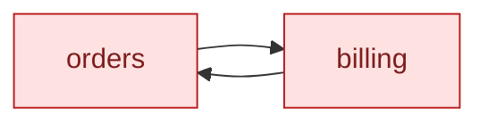
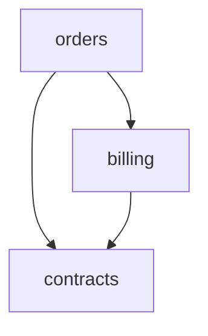
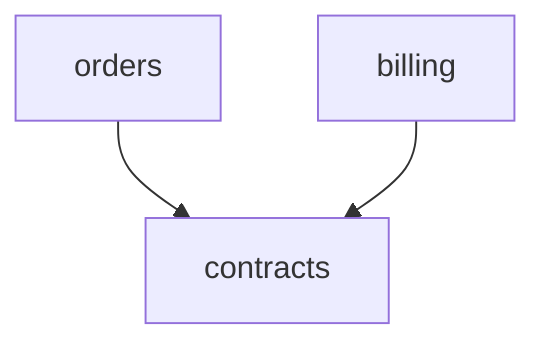

# Chu kỳ do interface dùng chung

Một interface được nhiều application module sử dụng có thể trở thành điểm tạo coupling nếu nó được đặt trong module không phù hợp. Bản thân việc hai module cùng dùng một interface không tự động tạo ra chu kỳ. Chu kỳ xuất hiện khi vị trí sở hữu interface tạo một hướng phụ thuộc, trong khi module sở hữu lại phụ thuộc ngược vào service hoặc kiểu dữ liệu của consumer. Khi đó, đồ thị module có thể hình thành đường đi khép kín như `orders → billing → orders`.

Spring Modulith yêu cầu dependency giữa các application module tạo thành directed acyclic graph (DAG). Vì vậy, khi `ApplicationModules.verify()` báo cycle, cần xem xét cả vị trí của hợp đồng dùng chung và hướng phụ thuộc nghiệp vụ. Một cách xử lý thường gặp là đưa hợp đồng ổn định, tối thiểu vào module trung lập mà các module cùng phụ thuộc; cách khác là đổi giao tiếp trực tiếp thành event nếu nghiệp vụ cho phép xử lý bất đồng bộ.

Trong phạm vi **SPRING_MODULITH_MODULE_MODEL**, bài học này tập trung vào việc nhận diện chu kỳ do interface dùng chung, xác định module thực sự sở hữu hợp đồng và tái cấu trúc dependency để bảo vệ ranh giới API trong modular monolith.

## 1. Interface dùng chung không tự động là chu kỳ

Một interface có thể được nhiều module tham chiếu mà đồ thị vẫn không có chu kỳ. Ví dụ, hai module cùng phụ thuộc vào một module hợp đồng:

```text
orders ──────────┐
                 ├────> contracts
billing ─────────┘
```

Đây là đồ thị có hướng không chu trình nếu `contracts` không phụ thuộc ngược vào `orders` hoặc `billing`. Vấn đề không nằm ở số lượng module sử dụng interface, mà nằm ở vị trí đặt interface và các dependency khác xung quanh nó.

Một interface dùng chung trở thành nguồn gây chu kỳ khi:

- Interface được đặt trong module `orders` vì ban đầu chỉ `orders` cần nó.
- Module `billing` bắt đầu sử dụng interface đó, tạo dependency `billing → orders`.
- Sau đó `orders` gọi API hoặc inject service của `billing`, tạo dependency `orders → billing`.

Hai cạnh tạo thành chu kỳ trực tiếp. Với hệ thống lớn, chu kỳ cũng có thể gián tiếp qua nhiều module, chẳng hạn `orders → billing → customers → orders`.

## 2. Ví dụ chu kỳ do hợp đồng đặt sai module

Giả sử `orders` và `billing` cùng cần biết định danh khách hàng. Nhóm ban đầu đặt interface `CustomerIdentity` trong module `orders`:

```java
package com.acme.shop.orders;

import java.util.UUID;

public interface CustomerIdentity {

    UUID customerId();
}
```

Module `billing` sử dụng interface đó trong hợp đồng tính phí:

```java
package com.acme.shop.billing;

import com.acme.shop.orders.CustomerIdentity;
import java.math.BigDecimal;

public interface BillingService {

    void charge(String orderId, CustomerIdentity customer, BigDecimal amount);
}
```

Điều này tạo dependency `billing → orders`, vì code trong `billing` tham chiếu kiểu thuộc module `orders`.

Sau đó, `OrderPlacement` trong `orders` inject `BillingService` để thực hiện thanh toán:

```java
package com.acme.shop.orders;

import com.acme.shop.billing.BillingService;
import org.springframework.stereotype.Service;

@Service
public class OrderPlacement {

    private final BillingService billingService;

    public OrderPlacement(BillingService billingService) {
        this.billingService = billingService;
    }
}
```

Lúc này `orders` phụ thuộc vào `billing`. Đồ thị module trở thành:



`CustomerIdentity` là một hợp đồng dùng chung nhưng lại nằm trong module `orders`. Module `billing` phải phụ thuộc vào module `orders` đang sở hữu kiểu đó. Trong khi đó, `orders` cần `billing` để hoàn tất use case. Hai hướng phụ thuộc tạo thành chu kỳ.

Một interface dùng chung chỉ tạo ra một cạnh theo hướng tới module sở hữu. Để có chu kỳ, phải tồn tại thêm đường phụ thuộc ngược, trực tiếp hoặc gián tiếp. Phân biệt hai điều này giúp tránh kết luận rằng cứ chia sẻ interface là sai.

## 3. Đọc lỗi verification để tìm đường đi khép kín

Đưa kiểm tra cấu trúc vào test:

```java
import org.junit.jupiter.api.Test;
import org.springframework.modulith.core.ApplicationModules;

class ModularityTests {

    @Test
    void verifiesApplicationModuleStructure() {
        ApplicationModules.of(ShopApplication.class).verify();
    }
}
```

Khi có chu kỳ, `verify()` báo vi phạm kiến trúc. Thông báo cụ thể có thể liệt kê các module và dependency tạo thành vòng. Hãy đọc toàn bộ đường đi thay vì chỉ nhìn cạnh cuối cùng:

1. Xác định module bắt đầu và module kết thúc của chu kỳ.
2. Tìm type, interface, Spring bean hoặc event listener tạo ra từng cạnh.
3. Xác định module nào đang sở hữu hợp đồng được nhiều bên sử dụng.
4. Kiểm tra module sở hữu hợp đồng có thực sự cần phụ thuộc vào một consumer hay không.
5. Xem xét chuyển hợp đồng sang module trung lập, đổi chiều phụ thuộc hoặc dùng event.

Có thể lấy các vi phạm để hiển thị hoặc xử lý riêng bằng `detectViolations()`:

```java
var violations = ApplicationModules.of(ShopApplication.class)
    .detectViolations();

System.out.println(violations);
```

`detectViolations()` giúp quan sát các vấn đề trước khi gọi `throwIfPresent()` hoặc trước khi quyết định cách xử lý. Trong kiểm thử kiến trúc chính thức, vẫn nên để các vi phạm không được chấp nhận làm test thất bại.

## 4. Cách sửa phổ biến: tách hợp đồng vào module trung lập

Nếu `CustomerIdentity` là một khái niệm ổn định mà nhiều module cần sử dụng, hãy chuyển nó ra một module hợp đồng riêng, ví dụ `contracts`:

```text
com.acme.shop
├── ShopApplication.java
├── contracts
│   └── api
│       ├── package-info.java
│       └── CustomerIdentity.java
├── orders
│   └── OrderPlacement.java
└── billing
    └── BillingService.java
```

Interface được chuyển sang package của `contracts`:

```java
package com.acme.shop.contracts.api;

import java.util.UUID;

public interface CustomerIdentity {

    UUID customerId();
}
```

Module `billing` tham chiếu hợp đồng trung lập:

```java
package com.acme.shop.billing;

import com.acme.shop.contracts.api.CustomerIdentity;
import java.math.BigDecimal;

public interface BillingService {

    void charge(String orderId, CustomerIdentity customer, BigDecimal amount);
}
```

Module `orders` cũng dùng cùng hợp đồng và gọi API của `billing`:

```java
package com.acme.shop.orders;

import com.acme.shop.billing.BillingService;
import com.acme.shop.contracts.api.CustomerIdentity;
import java.math.BigDecimal;
import org.springframework.stereotype.Service;

@Service
public class OrderPlacement {

    private final BillingService billingService;

    public OrderPlacement(BillingService billingService) {
        this.billingService = billingService;
    }

    public void charge(String orderId, CustomerIdentity customer, BigDecimal total) {
        billingService.charge(orderId, customer, total);
    }
}
```

Sau khi chuyển hợp đồng, `billing` không còn tham chiếu package `orders`. Đồ thị trở thành:



Đồ thị này không có chu kỳ: `orders` phụ thuộc vào `billing` và `contracts`; `billing` phụ thuộc vào `contracts`; `contracts` không phụ thuộc vào hai module còn lại.

## 5. Khai báo API và allowedDependencies sau khi tách

Nếu `contracts` chỉ công khai interface ở package gốc, các module consumer có thể phụ thuộc vào module đó. Nếu muốn tạo named interface riêng, đánh dấu package API:

```java
@org.springframework.modulith.NamedInterface("api")
package com.acme.shop.contracts.api;
```

Khi đó, khai báo dependency tường minh trong package metadata của `orders`:

```java
@org.springframework.modulith.ApplicationModule(
    allowedDependencies = {
        "billing",
        "contracts::api"
    }
)
package com.acme.shop.orders;
```

Và trong `billing`:

```java
@org.springframework.modulith.ApplicationModule(
    allowedDependencies = "contracts::api"
)
package com.acme.shop.billing;
```

Ví dụ giả định `BillingService` được công khai qua named interface `api` của `billing`, còn `CustomerIdentity` nằm trong `contracts.api`. Hãy thay tên module và interface theo cấu trúc thực tế. `allowedDependencies` giới hạn các dependency hợp lệ; nó không tự sửa chu kỳ. Đồ thị phải được tái cấu trúc trước khi quy tắc allowlist có thể xác nhận nó.

## 6. Chọn đúng nơi sở hữu interface dùng chung

Không nên chuyển mọi interface vào một package `common` hoặc module `shared` chỉ để làm verification pass. Hãy xác định ý nghĩa của hợp đồng và chọn nơi sở hữu phù hợp:

| Loại hợp đồng | Nơi nên cân nhắc đặt | Lý do |
|---|---|---|
| Value type hoặc identifier được nhiều module dùng | Module `contracts`/`shared-kernel` có phạm vi nhỏ | Không phụ thuộc vào một module consumer cụ thể |
| API truy vấn hoặc thao tác của một năng lực nghiệp vụ | Module sở hữu năng lực đó | Bảo vệ quyền sở hữu quy tắc và dữ liệu |
| Interface chỉ là chi tiết triển khai của một module | Package nội bộ của module đó | Không tạo hợp đồng công khai ngoài ý muốn |
| Port mô tả khả năng mà module gọi cần | Có thể đặt ở phía consumer hoặc module contract trung lập | Giúp đảo chiều phụ thuộc về abstraction |
| Event mô tả điều đã xảy ra trong một module | Module phát event sở hữu event type | Consumer phụ thuộc vào event contract của producer |

Một module `contracts` nên chứa những hợp đồng nhỏ, ổn định và ít thay đổi. Tránh đưa service implementation, repository, entity persistence hoặc helper tiện ích chung vào đó. Nếu `contracts` bắt đầu phụ thuộc vào `orders` hoặc `billing`, chu kỳ có thể xuất hiện trở lại.

## 7. Lựa chọn khác: đảo chiều phụ thuộc bằng port

Trong một số thiết kế, module gọi không cần biết module triển khai cụ thể. Nó chỉ cần một port mô tả khả năng cần dùng. Interface có thể được đặt trong module hợp đồng hoặc phía module gọi, còn adapter của module cung cấp triển khai interface đó.

Ví dụ, một module `orders` cần gửi yêu cầu thanh toán nhưng không cần phụ thuộc trực tiếp vào `billing`:

```java
package com.acme.shop.contracts;

import java.math.BigDecimal;

public interface PaymentPort {

    PaymentResult charge(PaymentRequest request);
}
```

Đặt hai kiểu dữ liệu được trao đổi trong các file riêng cùng package `contracts`:

```java
public record PaymentRequest(String orderId, BigDecimal amount) {}
```

```java
public record PaymentResult(boolean accepted) {}
```

Module `billing` triển khai port:

```java
package com.acme.shop.billing.internal;

import com.acme.shop.contracts.PaymentPort;
import com.acme.shop.contracts.PaymentRequest;
import com.acme.shop.contracts.PaymentResult;
import org.springframework.stereotype.Component;

@Component
class BillingPaymentAdapter implements PaymentPort {

    @Override
    public PaymentResult charge(PaymentRequest request) {
        // Thực hiện quy trình thanh toán của module billing.
        return new PaymentResult(true);
    }
}
```

Module `orders` chỉ phụ thuộc vào `PaymentPort` trong `contracts`. Module `billing` cũng phụ thuộc vào `contracts` để triển khai port. Đồ thị kiến trúc thể hiện các phụ thuộc mã nguồn hướng về abstraction chung:



Spring dependency injection có thể nối `PaymentPort` với bean triển khai ở runtime. Điều đó không đòi hỏi source code của `orders` tham chiếu trực tiếp class `BillingPaymentAdapter`. Hãy giữ implementation ở package nội bộ và kiểm tra đồ thị thực tế bằng Spring Modulith sau khi cấu hình bean.

Trong `orders`, consumer chỉ inject port:

```java
package com.acme.shop.orders;

import com.acme.shop.contracts.PaymentPort;
import com.acme.shop.contracts.PaymentRequest;
import com.acme.shop.contracts.PaymentResult;
import java.math.BigDecimal;
import org.springframework.stereotype.Service;

@Service
class OrderPayment {

    private final PaymentPort paymentPort;

    OrderPayment(PaymentPort paymentPort) {
        this.paymentPort = paymentPort;
    }

    PaymentResult pay(String orderId, BigDecimal amount) {
        return paymentPort.charge(new PaymentRequest(orderId, amount));
    }
}
```

Port phù hợp khi module gọi cần một khả năng trừu tượng và muốn tránh biết module triển khai. Nếu consumer cần nhiều chức năng cụ thể của `billing`, một dependency một chiều tới API công khai của `billing` có thể đơn giản và dễ hiểu hơn. Không cần tạo abstraction cho mọi lời gọi.

## 8. Lựa chọn khác: dùng application event để bỏ dependency gọi trực tiếp

Nếu module phát không cần kết quả đồng bộ từ module nhận, event có thể làm giảm dependency trực tiếp. Ví dụ, `orders` phát `OrderPlaced`; `billing` lắng nghe event để bắt đầu quy trình lập hóa đơn hoặc thanh toán.

Event type thuộc module phát:

```java
package com.acme.shop.orders;

import java.math.BigDecimal;
import java.util.UUID;

public record OrderPlaced(
    UUID orderId,
    UUID customerId,
    BigDecimal total
) {}
```

Module `orders` công bố event sau khi đơn được tạo:

```java
import org.springframework.context.ApplicationEventPublisher;
import org.springframework.stereotype.Service;

@Service
class OrderService {

    private final ApplicationEventPublisher events;

    OrderService(ApplicationEventPublisher events) {
        this.events = events;
    }

    void publishOrderPlaced(OrderPlaced event) {
        events.publishEvent(event);
    }
}
```

Module `billing` lắng nghe event:

```java
package com.acme.shop.billing;

import com.acme.shop.orders.OrderPlaced;
import org.springframework.modulith.events.ApplicationModuleListener;
import org.springframework.stereotype.Component;

@Component
class OrderPlacedHandler {

    @ApplicationModuleListener
    void on(OrderPlaced event) {
        // Tạo yêu cầu thanh toán hoặc hóa đơn.
    }
}
```

Đồ thị phụ thuộc là:

```text
billing ───────> orders
```

Module `billing` phụ thuộc vào event contract do `orders` phát. Module `orders` không cần phụ thuộc vào `billing` chỉ để thông báo rằng đơn đã được tạo. Không còn cạnh `orders → billing`, nên chu kỳ được phá vỡ.

Event không phải giải pháp thay thế cho mọi lời gọi. Nếu `orders` phải nhận kết quả thanh toán ngay để quyết định có xác nhận đơn hay không, cần thiết kế API/port đồng bộ hoặc một quy trình điều phối phù hợp. Với event bất đồng bộ, phải làm rõ xử lý lỗi, retry, idempotency, transaction và trạng thái nghiệp vụ trung gian.

## 9. Kiểm chứng đồ thị sau khi tái cấu trúc

Sau khi di chuyển interface, đổi API hoặc chuyển sang event, tạo lại mô hình và chạy verification:

```java
import org.junit.jupiter.api.Test;
import org.springframework.modulith.core.ApplicationModules;

class ModularityTests {

    @Test
    void verifiesAcyclicModuleDependencies() {
        ApplicationModules.of(ShopApplication.class).verify();
    }
}
```

Ngoài việc để `verify()` chạy qua, nên ghi lại các dependency trực tiếp của những module liên quan để xác nhận hướng đi đã đúng:

```java
import org.springframework.modulith.core.ApplicationModule;
import org.springframework.modulith.core.ApplicationModules;

ApplicationModules modules = ApplicationModules.of(ShopApplication.class);

ApplicationModule orders = modules.getModuleByName("orders").orElseThrow();

orders.getDirectDependencies(modules)
    .uniqueModules()
    .forEach(module -> System.out.println(module.getIdentifier()));
```

`getDirectDependencies(modules)` trả về các dependency trực tiếp dưới dạng `ApplicationModuleDependencies`; `uniqueModules()` chuyển chúng thành stream các module đích không trùng lặp. Mục tiêu của kiểm tra là xác nhận `orders` không còn phụ thuộc ngược vào một module chỉ vì hợp đồng dùng chung bị đặt sai chỗ.

Nên bổ sung assertion cho các hợp đồng đã di chuyển, chẳng hạn:

```java
assertThat(modules.getModuleByName("contracts")).isPresent();
assertThat(modules.getModuleByName("orders")).isPresent();
assertThat(modules.getModuleByName("billing")).isPresent();
```

Các assertion này chỉ xác nhận module tồn tại. `verify()` mới kiểm tra dependency graph, quyền truy cập API và các ràng buộc kiến trúc được bật.

## 10. Quy trình xử lý chu kỳ do interface dùng chung

Khi phát hiện chu kỳ, hãy thực hiện theo thứ tự:

1. **Đọc toàn bộ chu kỳ.** Ghi lại các module và dependency tạo thành vòng, bao gồm cả dependency gián tiếp.
2. **Tìm interface chung.** Xác định kiểu nào được nhiều module sử dụng và module nào đang sở hữu nó.
3. **Xác định trách nhiệm của hợp đồng.** Phân biệt value type, port, API nghiệp vụ, persistence type và event contract.
4. **Chọn hướng phụ thuộc.** Đưa hợp đồng ổn định vào module trung lập, đảo chiều qua port hoặc dùng event nếu phù hợp với nghiệp vụ.
5. **Giữ module hợp đồng độc lập.** Không để module trung lập tham chiếu ngược tới consumer hoặc implementation.
6. **Cập nhật package và API.** Di chuyển type, sửa import, named interface và `allowedDependencies`.
7. **Chuyển consumer.** Thay tham chiếu tới type cũ bằng hợp đồng mới; loại bỏ dependency ngược không còn cần thiết.
8. **Kiểm thử hành vi.** Xác nhận Spring bean wiring, transaction và event flow vẫn hoạt động.
9. **Chạy `ApplicationModules.verify()`.** Xác nhận đồ thị mới là DAG và không có truy cập package nội bộ trái phép.
10. **Rà soát module trung lập.** Đảm bảo `contracts` hoặc `shared-kernel` chỉ chứa abstraction ổn định, không trở thành nơi gom mọi class dùng chung.

## 11. Những ngộ nhận thường gặp

- **“Một interface được hai module dùng là tự tạo cycle.”** Không đúng. Cycle chỉ tồn tại khi có đường phụ thuộc khép kín; hai module cùng phụ thuộc vào module thứ ba vẫn tạo DAG.
- **“Chuyển interface sang shared là luôn đúng.”** Chỉ chuyển hợp đồng thật sự trung lập và ổn định; không chuyển implementation hoặc domain object chỉ để né verification.
- **“Thêm `allowedDependencies` sẽ xóa cycle.”** Allowlist chỉ giới hạn dependency được phép; nó không thay đổi hướng dependency đã có.
- **“Đổi tên package là đủ.”** Nếu module ownership và dependency không đổi, chu kỳ vẫn tồn tại.
- **“Event luôn tốt hơn interface.”** Event giảm phụ thuộc gọi trực tiếp nhưng thêm yêu cầu về nhất quán, retry và xử lý bất đồng bộ.
- **“Có thể bỏ qua lỗi cycle nếu ứng dụng vẫn chạy.”** Code có thể chạy nhờ Spring wiring, nhưng cấu trúc module không còn là DAG và khó kiểm soát thay đổi hoặc thứ tự khởi tạo theo dependency.
- **“Module contracts có thể phụ thuộc vào các module nghiệp vụ.”** Khi module hợp đồng phụ thuộc ngược, nó có thể tạo chu kỳ mới và mất vai trò trung lập.

## Kết luận

Chu kỳ do interface dùng chung thường xuất hiện khi hợp đồng được đặt trong một module consumer, khiến module khác phụ thuộc vào nó, trong khi module ban đầu lại gọi ngược service của consumer. Hãy xác định module sở hữu đúng của abstraction, tách hợp đồng ổn định vào module trung lập hoặc đảo chiều dependency bằng port; dùng event khi nghiệp vụ cho phép giao tiếp bất đồng bộ. Sau khi tái cấu trúc, cập nhật API và `allowedDependencies`, kiểm thử wiring/hành vi rồi chạy `ApplicationModules.verify()` để bảo đảm dependency graph trở lại dạng DAG.

## Tài liệu tham khảo

- [Spring Modulith — Verifying Application Module Structure](https://docs.spring.io/spring-modulith/reference/verification.html)
- [Spring Modulith — Fundamentals: Application Modules and Named Interfaces](https://docs.spring.io/spring-modulith/reference/fundamentals.html)
- [Spring Modulith — Working with Application Events](https://docs.spring.io/spring-modulith/reference/events.html)
- [Javadoc: ApplicationModule](https://docs.spring.io/spring-modulith/docs/current/api/org/springframework/modulith/core/ApplicationModule.html)
- [Javadoc: ApplicationModuleDependencies](https://docs.spring.io/spring-modulith/docs/current/api/org/springframework/modulith/core/ApplicationModuleDependencies.html)
