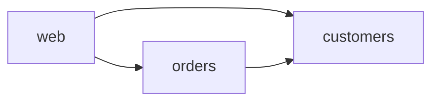
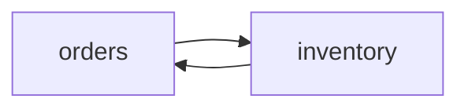
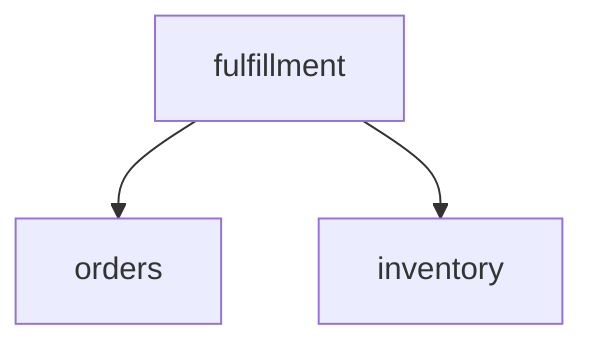
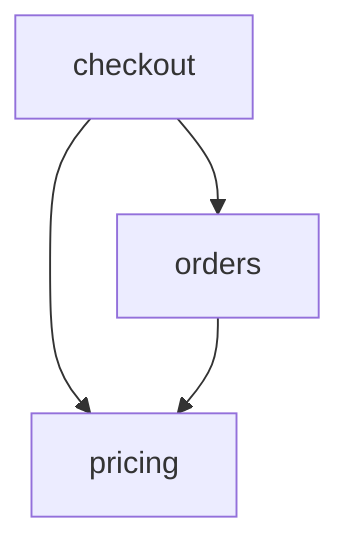
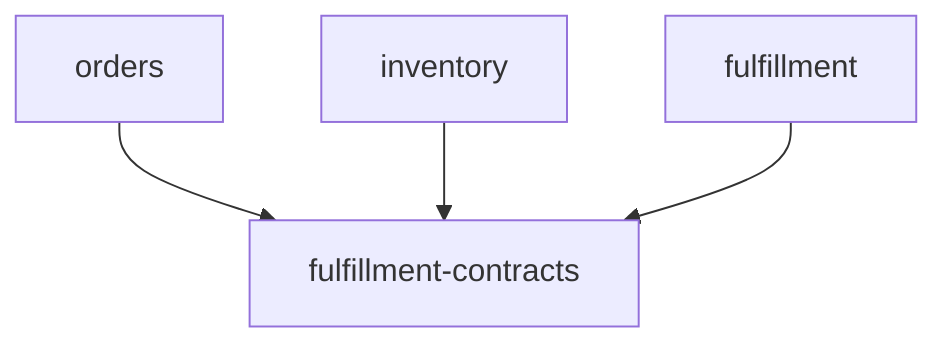

# Chia module khi phát hiện vòng phụ thuộc

Đồ thị phụ thuộc giữa các application module cần có hướng và không có chu trình. Khi module A phụ thuộc vào B, còn B lại phụ thuộc vào A, hai module đã mất khả năng thay đổi và kiểm tra độc lập. Spring Modulith phát hiện loại vòng phụ thuộc này khi xác minh mô hình module. Cách xử lý bền vững là tìm lại trách nhiệm và hướng phụ thuộc trong miền nghiệp vụ, sau đó tách hoặc tổ chức lại module sao cho mỗi module có quyền sở hữu rõ ràng.

Chia module không có nghĩa là tách package theo số lượng class hoặc tạo thêm module trung gian để làm cho kiểm tra qua. Trước khi thay đổi cấu trúc, cần hiểu vì sao hai phần mã cần gọi nhau, dữ liệu nào thuộc về ai và phần nào thực sự điều phối quy trình. Bài học này trình bày cách đọc vòng phụ thuộc, chọn điểm tách và kiểm chứng đồ thị sau khi tái cấu trúc.

## Mục tiêu

Sau bài học, bạn có thể:

- Đọc đồ thị phụ thuộc module và xác định một chu trình như `A → B → A`.
- Dùng kiểm tra Spring Modulith để phát hiện chu trình trong kiến trúc.
- Phân biệt vòng phụ thuộc do sai quyền sở hữu, do điều phối quy trình và do chia module chưa hợp lý.
- Chọn cách tách module, chuyển trách nhiệm, công bố API hoặc dùng sự kiện phù hợp.
- Giữ module mới có trách nhiệm gắn kết và không tạo thêm chu trình khác.
- Bổ sung kiểm thử kiến trúc để ngăn vòng phụ thuộc quay trở lại.

## Đồ thị phụ thuộc module là gì?

Mỗi application module là một nút trong đồ thị. Một cạnh có hướng từ module A đến module B biểu thị mã của A phụ thuộc vào một type hoặc API do B cung cấp. Trong bài này, ký hiệu `A → B` có nghĩa là **A phụ thuộc vào B**.

Một đồ thị không có chu trình nếu không tồn tại đường đi có hướng bắt đầu từ một module và quay lại chính module đó. Ví dụ:



Đồ thị trên không có chu trình. `web` có thể gọi `orders` và `customers`; `orders` có thể dùng API của `customers`. Không có đường đi có hướng quay ngược về `web` hoặc `orders`.

Ngược lại, đồ thị sau có chu trình:



`orders` gọi chức năng của `inventory`, đồng thời `inventory` tham chiếu vào type hoặc API của `orders`. Vòng phụ thuộc khiến việc hiểu, kiểm thử và thay đổi hai module khó hơn vì thay đổi ở một phía có thể buộc phía còn lại thay đổi theo.

## Phát hiện chu trình bằng Spring Modulith

Spring Modulith xây dựng mô hình module từ package của ứng dụng. Kiểm tra kiến trúc thường được đặt trong một bài test để chạy tự động cùng CI:

```java
import org.junit.jupiter.api.Test;
import org.springframework.modulith.core.ApplicationModules;

class ModularityTests {

    @Test
    void verifiesApplicationModuleStructure() {
        ApplicationModules.of(Application.class).verify();
    }
}
```

`verify()` kiểm tra các quy tắc của mô hình module, trong đó có yêu cầu đồ thị phụ thuộc module không có chu trình. Khi có vi phạm, thông báo thường chỉ ra các module và dependency liên quan. Hãy dùng thông tin đó để lần về type tạo ra cạnh phụ thuộc; đừng chỉ nhìn tên hai module trong thông báo rồi đoán nơi cần sửa.

Một dependency có thể phát sinh vì nhiều lý do: import một class, gọi service, tham chiếu interface, dùng event type hoặc truy cập API công khai của module khác. Điều cần tìm là **cạnh kiến trúc thực tế** được tạo ra bởi tham chiếu trong mã nguồn. Việc đổi tên class hay thêm một package trung gian không tự làm biến mất cạnh đó.

Nên chạy kiểm tra trên mô hình ứng dụng và cấu hình detection thực tế của dự án. Nếu test dùng một package root khác với ứng dụng hoặc một detection strategy khác production, kết quả có thể không phản ánh đồ thị mà nhóm đang vận hành.

## Vì sao vòng phụ thuộc xuất hiện?

Một chu trình thường là dấu hiệu cho thấy ranh giới trách nhiệm hoặc hướng điều phối chưa rõ. Một số nguyên nhân phổ biến:

**Hai module cùng sở hữu một phần nghiệp vụ.** Ví dụ, `orders` lưu trạng thái đơn hàng nhưng `customers` lại chứa logic cập nhật trạng thái đơn hàng. Hai module cần truy cập lẫn nhau vì trách nhiệm bị chia sai.

**Module gọi trực tiếp implementation của nhau.** `orders` gọi `InventoryRepository`, còn `inventory` lại gọi `OrderRepository`. Hai module đang biết quá nhiều về cách lưu trữ của nhau, thay vì giao tiếp qua hợp đồng nghiệp vụ.

**Quy trình điều phối nằm rải rác.** Một quy trình như đặt hàng, giữ tồn kho và xác nhận thanh toán được triển khai một phần trong `orders`, một phần trong `inventory`, một phần trong `payments`. Mỗi module gọi ngược lại module khác để tiếp tục quy trình.

**Module gom quá nhiều trách nhiệm.** Một module lớn có thể chứa các capability có vòng đời và chủ sở hữu khác nhau. Khi tách module không theo ranh giới nghiệp vụ, các phần mới tiếp tục tham chiếu lẫn nhau.

**Dùng chung type hoặc event không có chủ sở hữu rõ ràng.** Các module cùng import model, enum hoặc event từ một module nghiệp vụ khác. Nếu module đó cũng phụ thuộc ngược lại, chu trình hình thành.

## Phân tích chu trình trước khi chia module

Trước khi chỉnh sửa package, hãy lập danh sách cạnh tạo thành chu trình và tìm type chịu trách nhiệm cho từng cạnh. Ví dụ:

| Cạnh | Dấu vết cần tìm | Câu hỏi cần trả lời |
|---|---|---|
| `orders → inventory` | `OrderService` gọi `InventoryService` | Orders cần một kết quả nghiệp vụ hay đang thao tác trực tiếp với kho? |
| `inventory → orders` | `InventoryService` gọi `OrderRepository` | Inventory thực sự cần dữ liệu đơn hàng nào và ai sở hữu dữ liệu đó? |

Tiếp theo, phân loại từng lời gọi:

- **Truy vấn:** module cần đọc một thông tin do module khác sở hữu.
- **Lệnh:** module yêu cầu module khác thực hiện một hành động nghiệp vụ.
- **Thông báo sự kiện:** module thông báo một sự kiện đã xảy ra để bên quan tâm phản ứng.
- **Điều phối:** một thành phần quản lý thứ tự các bước thuộc nhiều module.
- **Truy cập dữ liệu nội bộ:** module truy cập repository, entity hoặc bảng dữ liệu của module khác.

Phân loại này giúp chọn cách sửa phù hợp. Một truy vấn đồng bộ có thể cần API một chiều. Một quy trình nhiều bước có thể cần module điều phối. Một thông báo không yêu cầu phản hồi đồng bộ có thể phù hợp với event. Truy cập trực tiếp dữ liệu nội bộ thường cần xem lại quyền sở hữu dữ liệu.

Đừng vội tạo module mới chỉ vì đồ thị có chu trình. Trước hết hãy xác định module nào nên sở hữu hành vi và dữ liệu. Có trường hợp chỉ cần chuyển một service hoặc repository về đúng module; có trường hợp cần tách một capability; cũng có trường hợp nên đưa phần điều phối ra một module riêng.

## Các cách tái cấu trúc để phá chu trình

### Chuyển hành vi về module sở hữu

Nếu một module đang thực hiện logic thuộc về module khác, chuyển logic về nơi sở hữu dữ liệu và quy tắc nghiệp vụ đó. Module còn lại chỉ gọi API công khai.

Ví dụ, nếu `orders` đang gọi `InventoryRepository` để tự quyết định số lượng tồn, hãy chuyển quy tắc kiểm tra và giữ hàng về `inventory`. `orders` chỉ yêu cầu một thao tác nghiệp vụ như `reserveStock`. Đồng thời, `inventory` không nên gọi `OrderRepository` để sửa trạng thái đơn hàng; việc cập nhật trạng thái cần được thực hiện qua hợp đồng hoặc quy trình điều phối đã xác định.

Chuyển hành vi đúng chủ sở hữu thường làm đồ thị đơn giản hơn mà không cần tăng số module.

### Tạo module điều phối quy trình

Khi hai module cần tham gia cùng một use case, có thể đặt phần điều phối trong một module ứng dụng riêng. Module điều phối phụ thuộc vào các module nghiệp vụ; các module nghiệp vụ không phụ thuộc ngược lại vào module điều phối hoặc vào nhau.

Ví dụ, quy trình `fulfillment` cần tạo đơn hàng và giữ tồn kho:



`fulfillment` gọi API của `orders` và `inventory` theo đúng thứ tự của use case. `orders` và `inventory` không gọi trực tiếp nhau. Đồ thị vẫn có thể thực hiện quy trình nghiệp vụ mà không có chu trình.

Module điều phối nên chứa logic của quy trình liên module: thứ tự gọi, xử lý kết quả, chính sách thử lại hoặc phản ứng khi một bước thất bại. Nó không nên trở thành nơi gom toàn bộ domain logic của các module khác. Mỗi module nghiệp vụ vẫn tự bảo vệ invariant và dữ liệu của mình.

### Dùng event cho giao tiếp một chiều

Nếu một module chỉ cần thông báo rằng một sự kiện nghiệp vụ đã xảy ra, module đó có thể phát event và module khác lắng nghe. Ví dụ, `orders` phát `OrderSubmitted`; `inventory` lắng nghe để tạo yêu cầu giữ hàng.

```java
package com.acme.orders.events;

import java.util.UUID;

public record OrderSubmitted(UUID orderId) {}
```

Đặt event trong named interface mà module `orders` công bố, chẳng hạn package `com.acme.orders.events`:

```java
@org.springframework.modulith.NamedInterface("events")
package com.acme.orders.events;
```

Module `orders` phát event bằng Spring `ApplicationEventPublisher`:

```java
publisher.publishEvent(new OrderSubmitted(orderId));
```

Module `inventory` xử lý event:

```java
import org.springframework.modulith.events.ApplicationModuleListener;
import org.springframework.stereotype.Component;

@Component
class InventoryOnOrderSubmitted {

    @ApplicationModuleListener
    void on(OrderSubmitted event) {
        // Tạo yêu cầu giữ hàng trong module inventory.
    }
}
```

Trong ví dụ này, `inventory` phụ thuộc vào named interface `orders::events` để tham chiếu `OrderSubmitted`; `orders` không cần tham chiếu vào `inventory`. Hướng phụ thuộc vẫn là một chiều.

Event không tự động giải quyết mọi chu trình. Nếu `orders` import event do `inventory` sở hữu, đồng thời `inventory` import event do `orders` sở hữu, hai cạnh ngược chiều vẫn tồn tại. Với trao đổi hai chiều, hãy cân nhắc một hợp đồng event trung lập, có chủ sở hữu rõ ràng, hoặc một module điều phối. Module chứa hợp đồng chỉ nên chứa các type ổn định cần thiết và không phụ thuộc ngược vào các module sử dụng nó.

Chỉ dùng event khi ngữ nghĩa nghiệp vụ cho phép xử lý bất đồng bộ hoặc tách rời người phát và người nhận. Nếu use case cần kết quả ngay trong cùng lời gọi, một API đồng bộ một chiều hoặc module điều phối có thể dễ hiểu hơn.

### Trích xuất một capability có chủ sở hữu độc lập

Nếu một module đang chứa hai capability có trách nhiệm và vòng đời khác nhau, hãy tách phần có ranh giới nghiệp vụ rõ ràng thành module riêng. Ví dụ, `orders` đang chứa cả chính sách định giá và quản lý vòng đời đơn hàng. Nếu pricing có quy tắc, dữ liệu và API riêng, có thể tách thành module `pricing`.



Ở đây `orders` dùng API định giá của `pricing`, còn `checkout` điều phối use case. `pricing` không cần phụ thuộc vào `orders`. Khi tách, hãy di chuyển cả dữ liệu và hành vi thuộc capability mới, đồng thời công bố API cần thiết. Nếu chỉ chuyển một số class nhưng vẫn để module mới gọi ngược về module cũ để hoàn tất cùng một quy tắc, chu trình có thể chỉ đổi hình thức.

Module mới cần có lý do tồn tại: trách nhiệm nghiệp vụ nhất quán, quyền sở hữu dữ liệu rõ và hợp đồng sử dụng có thể giải thích. Một module chỉ chứa vài DTO hoặc một interface được tạo ra để né kiểm tra thường làm kiến trúc khó hiểu hơn.

### Trích xuất hợp đồng dùng chung

Khi nhiều module cần trao đổi cùng một loại message hoặc value object ổn định, có thể tạo module hợp đồng trung lập. Các module sử dụng hợp đồng cùng phụ thuộc vào module này:



Module hợp đồng không được phụ thuộc ngược vào `orders`, `inventory` hoặc `fulfillment`. Nó nên chứa những type nhỏ, ổn định và không kéo theo implementation. Nếu hợp đồng chứa logic nghiệp vụ hoặc repository của một module cụ thể, nó đã trở thành một module nghiệp vụ trá hình và có thể tạo chu trình mới.

Không phải mọi DTO đều cần một module riêng. Chỉ trích xuất hợp đồng khi có nhiều bên thực sự cần cùng một mô hình và quyền sở hữu của nó được thống nhất.

## Ví dụ hoàn chỉnh: phá vòng `orders ↔ inventory`

Giả sử ứng dụng ban đầu có hai module:

- `orders` tạo đơn hàng và gọi `InventoryService.reserve(…)`.
- `inventory` giữ hàng nhưng lại gọi `OrderRepository.findById(…)` để đọc thông tin đơn và gọi `OrderService.markReserved(…)` để cập nhật trạng thái.

Đồ thị có hai cạnh ngược chiều. Đầu tiên, xác định dữ liệu và hành vi thuộc quyền sở hữu của từng module:

| Trách nhiệm | Module sở hữu |
|---|---|
| Tạo đơn hàng, tổng tiền, trạng thái đơn | `orders` |
| Số lượng tồn, chính sách giữ hàng, trạng thái reservation | `inventory` |
| Thứ tự tạo đơn, yêu cầu giữ hàng và phản ứng khi kết quả thay đổi | `fulfillment` hoặc quy trình sự kiện |

Nếu use case cần điều phối đồng bộ, tạo `fulfillment` phụ thuộc vào API của hai module. `orders` không gọi `inventory`; `inventory` không truy cập repository của `orders`. Nếu quy trình phù hợp với xử lý sự kiện, `orders` có thể phát `OrderSubmitted` và `inventory` lắng nghe. Khi cần thông báo kết quả ngược lại, hãy đặt event contract ở một module trung lập hoặc để module điều phối tiếp nhận kết quả rồi gọi API cập nhật trạng thái của `orders`.

Đồ thị sau khi chọn module điều phối:


Việc tách này chỉ hoàn chỉnh khi `OrderRepository` và `OrderService` không còn được `inventory` tham chiếu trực tiếp, đồng thời `orders` không còn gọi `InventoryService`. Kiểm tra lại các import, constructor injection, event type và package API để xác nhận không còn cạnh ngược.

## Cách xác nhận module mới có boundary tốt

Sau khi chia module, hãy kiểm tra cả cấu trúc lẫn ý nghĩa của nó:

1. Mỗi module có một trách nhiệm nghiệp vụ có thể diễn đạt rõ ràng.
2. Dữ liệu và invariant được quản lý bởi module sở hữu.
3. Module khác chỉ dùng API công khai hoặc named interface đã công bố.
4. Module điều phối quản lý quy trình liên module, không chiếm quyền sở hữu domain logic.
5. Module hợp đồng dùng chung không phụ thuộc vào các module tiêu thụ hợp đồng.
6. Event phản ánh sự kiện nghiệp vụ đã xảy ra; consumer không cần gọi ngược publisher chỉ để hoàn tất một giao dịch mà đáng ra thuộc một nơi điều phối.
7. Các module không phụ thuộc vào chi tiết persistence hoặc package `internal` của nhau.

Nếu một module mới chỉ chuyển cạnh phụ thuộc thành nhiều cạnh khác, hoặc cần nhiều ngoại lệ trong `allowedDependencies`, hãy xem lại cách phân chia. Mục tiêu là một đồ thị phản ánh đúng quyền sở hữu và cách giao tiếp, chứ không chỉ một đồ thị vượt qua kiểm tra.

## Kiểm chứng bằng test và tài liệu kiến trúc

Giữ test `ApplicationModules.of(Application.class).verify()` trong bộ kiểm thử kiến trúc và chạy nó trong CI. Khi một thay đổi tạo cạnh mới làm phát sinh chu trình, test cần thất bại ngay trong pull request.

Ngoài kiểm tra tự động, hãy tạo hoặc cập nhật sơ đồ module sau khi tái cấu trúc. Sơ đồ cần thể hiện module, named interface quan trọng và hướng phụ thuộc. Đọc sơ đồ từ góc nhìn use case: module nào điều phối, module nào sở hữu dữ liệu, và module nào chỉ phản ứng với event?

`allowedDependencies` có thể giới hạn những module mà một module được phép phụ thuộc. Đây là cách ghi lại quy tắc kiến trúc sau khi đã xác định hướng phụ thuộc đúng. Nó không tự phá chu trình; nếu hai module vẫn tham chiếu lẫn nhau, cần thay đổi source code và boundary trước khi điều chỉnh allowlist.

## Những cách chia module dễ gây vấn đề

| Cách làm | Vấn đề | Hướng xử lý |
|---|---|---|
| Tách mỗi package con thành một module | Module quá nhỏ, nhiều dependency và khó hiểu trách nhiệm | Chia theo capability và quyền sở hữu nghiệp vụ |
| Tạo `common` để chuyển mọi type dùng chung vào đó | `common` trở thành nơi chứa logic không có chủ sở hữu | Chỉ trích xuất hợp đồng hoặc capability thực sự dùng chung |
| Tạo module `bridge` chỉ để import hai module đang có chu trình | Bridge có thể chỉ che giấu dependency, không thay đổi hướng gọi | Đưa orchestration vào module sở hữu use case và loại bỏ cạnh ngược |
| Dùng event hai chiều nhưng mỗi bên import event của bên kia | Đồ thị compile-time vẫn có thể tạo chu trình | Dùng hợp đồng trung lập hoặc module điều phối |
| Chuyển interface sang package API nhưng vẫn giữ implementation phụ thuộc ngược | Cạnh phụ thuộc vẫn tồn tại qua type implementation | Xem lại dependency inversion và nơi đặt port |
| Nới `allowedDependencies` để cho phép cả hai chiều | Quy tắc không còn bảo vệ được đồ thị acyclic | Thay đổi boundary và giữ dependency một chiều |

## Bài tập tự đánh giá

Một ứng dụng có ba module `orders`, `inventory` và `payments`. Đồ thị hiện tại là:

```text
orders    → inventory
inventory → orders
orders    → payments
payments  → orders
```

`orders` gọi `inventory` để giữ hàng và gọi `payments` để thu tiền. `inventory` truy cập `OrderRepository` để lấy địa chỉ giao hàng. `payments` gọi `OrderService` để đổi trạng thái đơn sau khi thu tiền.

Hãy trả lời:

1. Những dữ liệu và invariant nào thuộc về `orders`, `inventory` và `payments`?
2. Vì sao `inventory` và `payments` không nên truy cập `OrderRepository` hoặc gọi `OrderService` để tự điều phối trạng thái?
3. Có thể tạo module `checkout` hoặc `fulfillment` để điều phối các bước nào?
4. Event nào có thể được phát từ `orders` để các module khác phản ứng mà không tạo dependency ngược?
5. Nếu cần gửi kết quả thanh toán về cho `orders`, nên dùng event contract trung lập hay module điều phối? Điều gì quyết định lựa chọn?
6. Bạn sẽ kiểm tra điều gì trong `ApplicationModules.verify()` và sơ đồ module sau khi tái cấu trúc?

Một hướng giải quyết có thể là để `orders` sở hữu đơn hàng và phát các event nghiệp vụ; `inventory` sở hữu reservation; `payments` sở hữu giao dịch thanh toán; module `checkout` điều phối use case và tiếp nhận kết quả từ các bước. Nếu dùng event hai chiều, các event cần có hợp đồng trung lập hoặc được điều phối qua một bên thứ ba để tránh import event type ngược chiều. Thiết kế cuối cùng phải giữ quyền sở hữu dữ liệu rõ ràng và đồ thị phụ thuộc không có chu trình.

## Kết luận

Vòng phụ thuộc là tín hiệu để xem lại quyền sở hữu nghiệp vụ, hướng gọi và vị trí của logic điều phối. Hãy lần theo từng cạnh, xác định dữ liệu và hành vi thuộc module nào, rồi chọn chuyển trách nhiệm, tạo module điều phối, dùng event một chiều hoặc trích xuất hợp đồng có chủ sở hữu rõ ràng. Chỉ khi source code phản ánh đúng hướng phụ thuộc mới, `ApplicationModules.verify()` mới trở thành hàng rào kiến trúc đáng tin cậy.

## Tài liệu tham khảo

- [Spring Modulith Reference — Application Modules and Verification](https://docs.spring.io/spring-modulith/reference/fundamentals.html)
- [Spring Modulith Reference — Events](https://docs.spring.io/spring-modulith/reference/events.html)
- [Spring Modulith API — `ApplicationModules`](https://docs.spring.io/spring-modulith/docs/current/api/org/springframework/modulith/core/ApplicationModules.html)
- [Spring Modulith API — `ApplicationModuleListener`](https://docs.spring.io/spring-modulith/docs/current/api/org/springframework/modulith/events/ApplicationModuleListener.html)
