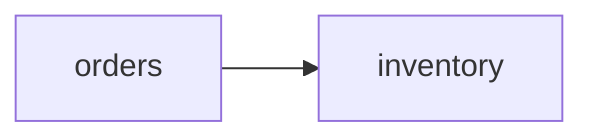
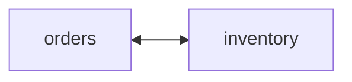
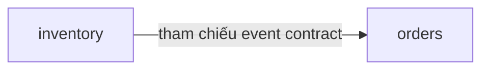
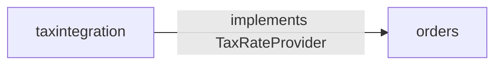

# Đảo chiều dependency bằng event hoặc port

Một chu trình trong module graph thường xuất hiện khi hai mô-đun cần gọi hoặc tham chiếu lẫn nhau. Cách xử lý hiệu quả là xem lại chiều phụ thuộc: mô-đun nào sở hữu hợp đồng, mô-đun nào cần sử dụng hợp đồng đó, và có thật sự cần một lời gọi trực tiếp hay chỉ cần thông báo một sự kiện?

Trong Spring Modulith, có hai kỹ thuật thường dùng để làm rõ chiều phụ thuộc. Event giúp mô-đun phát thông báo mà không cần biết listener. Port (interface được mô-đun sở hữu nhu cầu khai báo) cho phép mô-đun gọi một khả năng thông qua abstraction, trong khi implementation nằm ở mô-đun adapter. Cả hai kỹ thuật đều có thể giúp module graph trở thành DAG nếu hợp đồng được đặt đúng nơi và không tạo thêm cạnh ngược.

## 1. Bắt đầu từ chiều dependency trong module graph

Một cạnh `A → B` nghĩa là mã nguồn trong mô-đun `A` tham chiếu kiểu hoặc API thuộc mô-đun `B`. Đây là chiều phụ thuộc kiến trúc; nó có thể khác với chiều lời gọi khi ứng dụng chạy.

Giả sử `orders` cần thông tin từ `inventory` bằng cách gọi trực tiếp service:



Nếu `inventory` đồng thời tham chiếu một lớp nghiệp vụ của `orders`, đồ thị sẽ có chu trình:



Trước khi sửa code, hãy xác định quan hệ nào là thông báo một chiều và quan hệ nào thật sự cần trả kết quả. Event phù hợp khi một mô-đun thông báo điều gì đã xảy ra. Port phù hợp khi mô-đun cần gọi một khả năng và nhận kết quả, nhưng muốn giữ hợp đồng thuộc về chính mô-đun sử dụng khả năng đó.

## 2. Dùng event để publisher không phụ thuộc vào listener

Giả sử khi đơn hàng hoàn tất, `orders` cần thông báo để `inventory` cập nhật quy trình giữ hàng. Nếu `orders` gọi trực tiếp `InventoryService`, mã nguồn tạo cạnh `orders → inventory`. Thay vào đó, `orders` có thể sở hữu event contract `OrderCompleted` và phát sự kiện qua Spring.

Đặt event trong Named Interface của mô-đun `orders`:

```java
@org.springframework.modulith.NamedInterface("events")
package com.acme.shop.orders.events;
```

```java
package com.acme.shop.orders.events;

import java.time.Instant;
import java.util.UUID;

public record OrderCompleted(UUID orderId, Instant completedAt) {}
```

Publisher chỉ cần `ApplicationEventPublisher`:

```java
package com.acme.shop.orders;

import java.time.Instant;
import java.util.UUID;

import com.acme.shop.orders.events.OrderCompleted;
import org.springframework.context.ApplicationEventPublisher;
import org.springframework.stereotype.Service;
import org.springframework.transaction.annotation.Transactional;

@Service
public class OrderService {

    private final ApplicationEventPublisher events;

    public OrderService(ApplicationEventPublisher events) {
        this.events = events;
    }

    @Transactional
    public void complete(UUID orderId) {
        // Cập nhật trạng thái đơn hàng trong transaction hiện tại.
        events.publishEvent(new OrderCompleted(orderId, Instant.now()));
    }
}
```

Listener thuộc `inventory` tham chiếu event contract:

```java
package com.acme.shop.inventory;

import com.acme.shop.orders.events.OrderCompleted;
import org.springframework.modulith.events.ApplicationModuleListener;
import org.springframework.stereotype.Component;

@Component
public class InventoryOnOrderCompleted {

    @ApplicationModuleListener
    void on(OrderCompleted event) {
        // Cập nhật quy trình giữ hàng theo event.orderId().
    }
}
```

Vì listener cần import `OrderCompleted`, cạnh kiến trúc là `inventory → orders`. `orders` không tham chiếu `InventoryOnOrderCompleted`, nên không có cạnh ngược chỉ vì event được phát:



Luồng runtime vẫn là publisher `orders` phát sự kiện và listener `inventory` xử lý nó. Chiều runtime không làm thay đổi chiều dependency của mã nguồn.

Nếu dùng Named Interface `orders::events`, có thể giới hạn dependency ở package của `inventory`:

```java
@org.springframework.modulith.ApplicationModule(
    allowedDependencies = "orders::events"
)
package com.acme.shop.inventory;
```

Event nên mô tả một sự việc đã xảy ra và mang dữ liệu đủ để consumer xử lý. Không đưa bean, callback hoặc entity nội bộ vào payload. Nếu listener cần chạy sau khi transaction nguồn commit, hãy dùng cơ chế listener transaction phù hợp; `@ApplicationModuleListener` cung cấp cách xử lý event giữa mô-đun với hành vi bất đồng bộ và transaction theo cấu hình của Spring Modulith. Nếu cần theo dõi trạng thái publication và xử lý lại event khi gặp lỗi, hãy cấu hình event publication registry và kiểm thử khả năng phục hồi.

Event phù hợp cho thông báo một chiều. Nếu publisher cần câu trả lời ngay để quyết định có tiếp tục nghiệp vụ hay không, event bất đồng bộ thường không phải lựa chọn phù hợp; hãy xem xét port hoặc API đồng bộ.

## 3. Dùng port để mô-đun sở hữu nhu cầu

Giả sử `orders` cần tính thuế khi tạo đơn hàng. Một cách đơn giản là để `orders` gọi trực tiếp `TaxService` trong mô-đun `taxintegration`. Cách đó tạo cạnh `orders → taxintegration`. Nếu `taxintegration` cũng cần tham chiếu API của `orders`, module graph có thể hình thành chu trình.

Thay vào đó, `orders` khai báo interface mô tả khả năng mà nó cần: `TaxRateProvider`. Đây là port thuộc về mô-đun `orders`. Adapter ở mô-đun `taxintegration` triển khai interface này và chứa chi tiết giao tiếp với hệ thống thuế.

Đặt port trong Named Interface `orders::ports`:

```java
@org.springframework.modulith.NamedInterface("ports")
package com.acme.shop.orders.ports;
```

```java
package com.acme.shop.orders.ports;

import java.math.BigDecimal;

public interface TaxRateProvider {

    BigDecimal rateFor(String countryCode);
}
```

Mô-đun `orders` sử dụng port như một dependency nội bộ của chính nó:

```java
package com.acme.shop.orders;

import java.math.BigDecimal;

import com.acme.shop.orders.ports.TaxRateProvider;
import org.springframework.stereotype.Service;

@Service
public class OrderPricingService {

    private final TaxRateProvider taxRateProvider;

    public OrderPricingService(TaxRateProvider taxRateProvider) {
        this.taxRateProvider = taxRateProvider;
    }

    public BigDecimal taxFor(String countryCode, BigDecimal netAmount) {
        return netAmount.multiply(taxRateProvider.rateFor(countryCode));
    }
}
```

Adapter trong `taxintegration` triển khai port. Ví dụ dưới đây giả định `TaxRateClient` là client nội bộ của adapter để gọi hệ thống thuế bên ngoài:

```java
package com.acme.shop.taxintegration;

import java.math.BigDecimal;

import com.acme.shop.orders.ports.TaxRateProvider;
import org.springframework.stereotype.Component;

@Component
public class RemoteTaxRateAdapter implements TaxRateProvider {

    private final TaxRateClient client;

    public RemoteTaxRateAdapter(TaxRateClient client) {
        this.client = client;
    }

    @Override
    public BigDecimal rateFor(String countryCode) {
        return client.fetchRate(countryCode);
    }
}
```

Mô-đun adapter khai báo rằng nó chỉ phụ thuộc vào port được công khai:

```java
@org.springframework.modulith.ApplicationModule(
    allowedDependencies = "orders::ports"
)
package com.acme.shop.taxintegration;
```

Đồ thị kiến trúc chỉ có cạnh từ adapter tới mô-đun sở hữu port:



Khi chạy, `OrderPricingService` gọi phương thức trên `TaxRateProvider`; Spring tiêm bean `RemoteTaxRateAdapter` làm implementation. Nhưng mã nguồn của `orders` chỉ biết interface trong module của mình, không import `RemoteTaxRateAdapter`. Vì thế, lời gọi runtime đi từ `orders` sang adapter, trong khi dependency kiến trúc đi từ `taxintegration` về `orders`.

Đây là dependency inversion: mô-đun nghiệp vụ định nghĩa abstraction mà nó cần; adapter phụ thuộc vào abstraction đó và cung cấp implementation. Trong ứng dụng Spring Boot, component scan hoặc cấu hình bean phải đăng ký adapter để Spring phân giải port. `ApplicationModules.verify()` kiểm tra quan hệ mô-đun, còn integration test cần xác nhận bean implementation thực sự được tiêm và hoạt động.

## 4. Chọn event hay port?

Hai kỹ thuật có mục đích khác nhau. Chọn dựa trên cách nghiệp vụ cần giao tiếp:

| Tiêu chí | Event | Port |
|---|---|---|
| Ý nghĩa | Thông báo một sự kiện đã xảy ra | Yêu cầu một khả năng hoặc kết quả |
| Mô-đun sở hữu hợp đồng | Mô-đun phát sự kiện | Mô-đun cần khả năng đó |
| Dependency tĩnh điển hình | Listener → module sở hữu event | Adapter → module sở hữu port |
| Luồng runtime | Publisher phát, listener xử lý | Consumer gọi interface, adapter thực thi |
| Kết quả trả về ngay | Không phải mục tiêu chính | Có thể trả kết quả đồng bộ |
| Ví dụ | `OrderCompleted` để inventory cập nhật | `TaxRateProvider` để orders tính thuế |

Hãy dùng event khi consumer chỉ cần phản ứng với sự kiện và publisher không cần biết kết quả xử lý của consumer. Hãy dùng port khi use case cần gọi một khả năng, truyền tham số và nhận kết quả theo hợp đồng rõ ràng.

Không nên dùng event để thay một truy vấn đồng bộ cần kết quả ngay. Ngược lại, cũng không nên tạo port và adapter chỉ để thông báo cho một mô-đun rằng sự kiện đã xảy ra nếu listener event đã đáp ứng yêu cầu. Mỗi abstraction bổ sung đều cần có chủ sở hữu và mục đích nghiệp vụ rõ ràng.

## 5. Những điều kiện để module graph vẫn là DAG

Đảo chiều một cạnh chỉ có ích khi không tạo ra cạnh ngược ở nơi khác. Trước khi hoàn tất refactor, hãy kiểm tra các điều kiện:

1. Event contract được đặt trong API công khai hoặc Named Interface của mô-đun publisher.
2. Listener chỉ tham chiếu event contract, không truy cập service, repository hoặc entity nội bộ của publisher.
3. Port được đặt trong mô-đun sở hữu nhu cầu; adapter phụ thuộc vào port đó.
4. Mô-đun sở hữu port không import implementation hoặc package của adapter.
5. `allowedDependencies` chỉ cho phép Named Interface hoặc mô-đun thực sự cần dùng.
6. Toàn bộ module graph không có đường phụ thuộc quay lại node ban đầu.

Một lỗi thường gặp là đặt interface trong module adapter rồi để module nghiệp vụ import interface đó. Khi ấy dependency vẫn đi từ nghiệp vụ tới adapter, nên chưa đạt mục tiêu đảo chiều. Một lỗi khác là port được đặt đúng trong `orders`, nhưng `orders` lại import một class cấu hình từ `taxintegration`; cạnh ngược này có thể tái tạo chu trình.

## 6. Kiểm chứng bằng Spring Modulith

Sau khi thay đổi event hoặc port, tạo bài kiểm tra kiến trúc:

```java
package com.acme.shop;

import org.junit.jupiter.api.Test;
import org.springframework.modulith.core.ApplicationModules;

class ModularityTests {

    @Test
    void verifiesAcyclicModuleDependencies() {
        ApplicationModules.of(ShopApplication.class).verify();
    }
}
```

`verify()` kiểm tra dependency graph và các quy tắc boundary, bao gồm quyền truy cập API và chu trình mô-đun. Nếu test thất bại, đọc đường đi của chu trình, xác định từng cạnh được tạo ra bởi kiểu nào hoặc package nào, rồi kiểm tra xem hợp đồng có được đặt đúng module sở hữu không.

Với event, bổ sung integration test phát event và xác nhận listener xử lý đúng. Với port, bổ sung integration test khởi động Spring context và xác nhận adapter được tiêm vào service. Hai loại kiểm tra bổ sung cho nhau: kiểm tra kiến trúc xác nhận chiều phụ thuộc, integration test xác nhận wiring và hành vi runtime.

## 7. Bài tập tự kiểm tra

Với `orders`, `inventory` và `taxintegration`, hãy đánh giá các tình huống:

| Tình huống | Cạnh kiến trúc | Kết quả |
|---|---|---|
| `orders` publish `OrderCompleted`; listener ở `inventory` tham chiếu event contract của `orders` | `inventory → orders` | Không tạo cạnh `orders → inventory` chỉ từ việc publish |
| `orders` tiêm trực tiếp `InventoryService` và `inventory` tham chiếu `OrderService` | `orders ↔ inventory` | Có chu trình |
| `orders` khai báo `TaxRateProvider`; adapter ở `taxintegration` triển khai port | `taxintegration → orders` | Dependency được đảo chiều qua abstraction |
| Interface `TaxRateProvider` đặt trong `taxintegration`, `orders` import interface đó | `orders → taxintegration` | Chưa đảo chiều dependency |
| Adapter triển khai port nhưng `orders` cũng import class adapter | `taxintegration → orders` và `orders → taxintegration` | Chu trình được tạo lại |

Hãy chọn một quan hệ trực tiếp giữa hai mô-đun trong ứng dụng mẫu. Nếu đó là thông báo một chiều, chuyển sang event; nếu đó là yêu cầu cần kết quả, thử chuyển sang port. Sau đó vẽ lại module graph, kiểm tra chiều cạnh, chạy `ApplicationModules.verify()` và viết integration test phù hợp. Mục tiêu là giữ được hợp đồng ở đúng module sở hữu và tạo ra một đồ thị không có chu trình.
