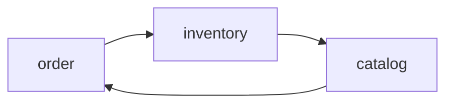
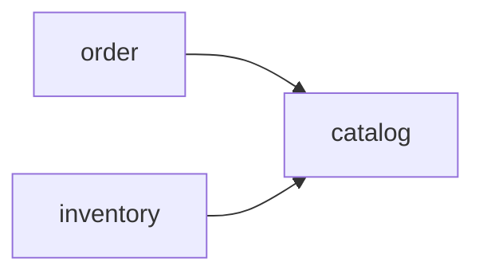
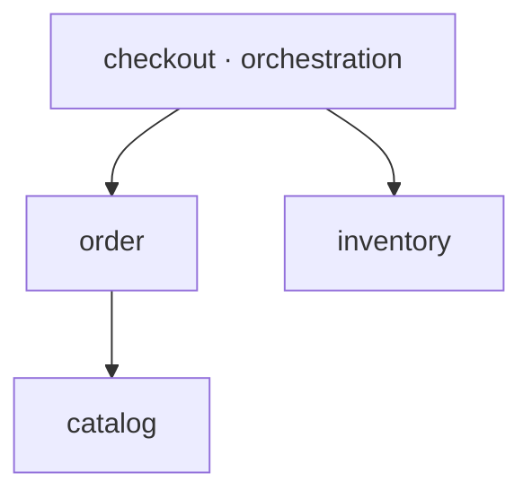

# Không phá chu kỳ bằng cách mở toàn bộ module

Khi `ApplicationModules.verify()` phát hiện chu trình phụ thuộc, đổi các module liên quan sang kiểu `OPEN` có thể khiến kiểm tra chu trình không còn báo lỗi. Tuy nhiên, chu trình trong mã nguồn vẫn tồn tại. Spring Modulith loại các open module khỏi thuật toán phát hiện chu trình; đồng thời, kiểu `OPEN` làm lộ các kiểu ở package con và cho phép module khác truy cập phần nội bộ của module đó.

Vì vậy, mở toàn bộ module chỉ làm giảm khả năng kiểm soát ranh giới và làm mất một phần giá trị của kiểm tra kiến trúc. Cách xử lý đúng là xác định hướng phụ thuộc nghiệp vụ, loại bỏ quan hệ ngược và thiết kế lại hợp đồng giao tiếp để dependency graph trở thành đồ thị có hướng không chu trình (DAG).

Sau bài học, bạn có thể:

- Giải thích vì sao `OPEN` module bị loại khỏi cycle detection.
- Nhận biết khác biệt giữa sửa chu trình và làm cho công cụ không còn phát hiện chu trình.
- Đánh giá rủi ro khi mở nhiều module hoặc mở toàn bộ module.
- Chọn hướng phụ thuộc dựa trên quyền sở hữu nghiệp vụ.
- Dùng API, event contract, dependency inversion hoặc module orchestration để loại bỏ cạnh ngược.
- Xác minh lại đồ thị sau khi tái cấu trúc.

## 1. Chu trình là vấn đề kiến trúc cần giải quyết

Một dependency graph có chu trình khi có thể đi theo các cạnh phụ thuộc và quay lại module ban đầu. Ví dụ:



Đồ thị có ba quan hệ:

- `order` cần API của `inventory` để giữ hàng.
- `inventory` cần API của `catalog` để kiểm tra sản phẩm.
- `catalog` lại tham chiếu `order` để biết sản phẩm đã được đặt hay chưa.

Ba cạnh tạo thành chu trình `order → inventory → catalog → order`. Các module không còn có thứ tự phụ thuộc rõ ràng. Một thay đổi trong hợp đồng của một module có thể buộc các module còn lại thay đổi theo; việc khởi tạo theo thứ tự phụ thuộc cũng khó xác định.

Spring Modulith yêu cầu các module kiểu `CLOSED` không tham gia chu trình. `ApplicationModules.verify()` kiểm tra dependency graph để bảo đảm các quan hệ phụ thuộc ở cấp module tạo thành DAG. Khi có chu trình, lỗi xác minh là tín hiệu cho thấy cần xem lại ranh giới và hướng phụ thuộc.

## 2. `OPEN` thay đổi điều gì trong kiểm tra?

Bạn có thể khai báo module kiểu `OPEN` trong `package-info.java`:

```java
@org.springframework.modulith.ApplicationModule(
        type = org.springframework.modulith.ApplicationModule.Type.OPEN
)
package com.acme.shop.inventory;
```

Open module có hai đặc điểm quan trọng:

1. Các kiểu trong package gốc và package con được đưa vào unnamed named interface, trừ các kiểu đã được gán rõ ràng vào named interface khác. Do đó, module khác có thể truy cập các kiểu nằm trong những package vốn thường được dùng làm nội bộ.
2. Open module bị loại khỏi thuật toán phát hiện chu trình.

Đặc điểm thứ hai là lý do việc đổi tất cả module sang `OPEN` có thể làm cho một bài kiểm tra chu trình không còn báo lỗi. Thuật toán không còn xét các open module như những node cần tham gia kiểm tra chu trình. Việc này không xóa các tham chiếu Java, không thay đổi luồng gọi và cũng không làm cho dependency graph thực tế trở thành DAG.

So sánh hai trạng thái:

| Trạng thái | Quyền truy cập package | Cycle detection |
|---|---|---|
| `CLOSED` | Chỉ API package gốc và named interface được công khai | Module phải không tham gia chu trình |
| `OPEN` | Các package con cũng được đưa vào unnamed interface; truy cập nội bộ được mở rộng | Module bị loại khỏi thuật toán phát hiện chu trình |

Nếu cả `order`, `inventory` và `catalog` đều được khai báo `OPEN`, kiểm tra chu trình không còn chứng minh được rằng nhóm module đó tạo thành DAG. Kết quả `verify()` không báo lỗi chu trình trong trường hợp này không thể được xem là bằng chứng chu trình đã được sửa.

## 3. Vì sao mở toàn bộ module là một cách xử lý sai?

### Mất ranh giới API

Khi mở module, package `internal`, `persistence`, `repository` hoặc các package triển khai khác cũng được đưa vào unnamed interface nếu không được gán vào named interface riêng. Module tiêu thụ có thể bắt đầu import trực tiếp các lớp triển khai đó.

Ví dụ, `checkout` có thể phụ thuộc vào `inventory.internal.DefaultStockRepository` thay vì hợp đồng `InventoryManagement`. Khi repository thay đổi, module `checkout` cũng có nguy cơ phải sửa theo. Một chi tiết triển khai đã trở thành phụ thuộc liên module.

### Che khuất chu trình

Nếu các module trong chu trình đều là `OPEN`, chúng bị loại khỏi cycle detection. Bài kiểm tra không còn bảo vệ được quy tắc DAG cho phần đồ thị đó. Chu trình vẫn có thể gây khó khăn khi thay đổi code, tổ chức test, khởi tạo module hoặc xác định quyền sở hữu nghiệp vụ.

### Làm phụ thuộc mới xuất hiện dễ dàng hơn

Khi mọi package đều có thể được truy cập, lập trình viên dễ chọn lớp đang có sẵn trong module khác thay vì thiết kế một hợp đồng công khai ổn định. Số lượng tham chiếu chéo có thể tăng dần mà không có ranh giới rõ ràng.

### Làm cho việc đóng module về sau khó hơn

Một khi nhiều module đã phụ thuộc vào các package nội bộ của module `OPEN`, chuyển module đó về `CLOSED` có thể tạo ra hàng loạt vi phạm. Nhóm phải tìm và thay thế các tham chiếu nội bộ đã trở thành một phần của codebase.

Spring Modulith chủ yếu cung cấp `OPEN` để hỗ trợ đưa các codebase cũ vào quá trình modular hóa từng bước. Trong ứng dụng đã có ranh giới module rõ ràng, mở toàn bộ module thường là dấu hiệu cấu trúc package hoặc quyền sở hữu hợp đồng cần được xem xét lại.

## 4. Chọn hướng phụ thuộc theo quyền sở hữu nghiệp vụ

Trước khi sửa code, hãy hỏi module nào có thể tồn tại độc lập và module nào đang sử dụng năng lực của module kia. Hãy để module sở hữu khái niệm nghiệp vụ cung cấp API hoặc event contract cho module tiêu thụ.

Ví dụ, `catalog` có thể tồn tại mà không cần biết quy trình đặt hàng. `order` cần thông tin và khả năng thay đổi trạng thái sản phẩm để hoàn tất nghiệp vụ đặt hàng. Hướng hợp lý là `order → catalog`.



Nếu `catalog` cần biết sản phẩm đã được bán, hãy thiết kế thao tác hoặc hợp đồng do `catalog` sở hữu. `order` gọi API đó hoặc phát một sự kiện theo contract của `catalog`. `catalog` không cần import `OrderCompleted` để hiểu quy trình đặt hàng.

## 5. Các cách loại bỏ cạnh ngược

### Giữ một hướng gọi qua API công khai

Nếu `order` đã phụ thuộc vào `catalog`, hãy để `order` gọi API của `catalog` khi cần cập nhật trạng thái sản phẩm. `catalog` chỉ cung cấp năng lực nghiệp vụ như `markSold`, không cần biết thao tác đó được kích hoạt bởi use case đặt hàng nào.

```java
package com.acme.shop.catalog;

public interface ProductManagement {

    void markSold(String productId);
}
```

```java
package com.acme.shop.order;

import com.acme.shop.catalog.ProductManagement;
import org.springframework.stereotype.Service;

@Service
class CompleteOrderService {

    private final ProductManagement products;

    CompleteOrderService(ProductManagement products) {
        this.products = products;
    }

    void complete(String productId) {
        products.markSold(productId);
    }
}
```

Quan hệ compile-time là `order → catalog`. `catalog` không cần phụ thuộc ngược vào `order` để thực hiện thay đổi trạng thái của sản phẩm.

### Đặt event contract ở module sở hữu khái niệm

Event cũng tạo ra quan hệ phụ thuộc. Nếu `catalog` import `OrderCompleted` do `order` sở hữu để đăng ký listener, đồ thị có cạnh `catalog → order`. Khi `order` đồng thời gọi API `catalog`, chu trình vẫn tồn tại.

Thay vào đó, hãy để module sở hữu khái niệm sản phẩm định nghĩa event contract hoặc abstraction mà module khác có thể phát. Ví dụ, `catalog` công khai một contract `ProductSold`; `order` phụ thuộc vào contract đó và phát sự kiện phù hợp. Listener trong `catalog` chỉ tham chiếu kiểu contract thuộc chính module `catalog`.

```java
package com.acme.shop.catalog;

public interface ProductSold {

    String productId();
}
```

```java
package com.acme.shop.order;

import com.acme.shop.catalog.ProductSold;

public record OrderProductSold(String productId) implements ProductSold {
}
```

```java
package com.acme.shop.catalog;

import org.springframework.modulith.events.ApplicationModuleListener;
import org.springframework.stereotype.Component;

@Component
class ProductSoldListener {

    @ApplicationModuleListener
    void on(ProductSold event) {
        // Chuyển trạng thái sản phẩm sang SOLD
    }
}
```

Trong ví dụ, `order` phụ thuộc vào contract do `catalog` sở hữu. `catalog` không cần tham chiếu kiểu `OrderProductSold` hay package `order`. Event được dispatch theo kiểu contract mà listener chấp nhận. Hãy kiểm tra lại thiết kế event, transaction và publication bằng module integration test.

### Đảo chiều phụ thuộc bằng port do module tiêu thụ sở hữu

Khi một module cần một năng lực nhưng không nên phụ thuộc compile-time vào module cung cấp implementation, module tiêu thụ có thể định nghĩa port. Module cung cấp implementation sẽ phụ thuộc vào abstraction đó.

Ví dụ, `order` định nghĩa port giữ hàng:

```java
package com.acme.shop.order;

public interface StockReservation {

    boolean reserve(String sku, int quantity);
}
```

Module `inventory` triển khai port:

```java
package com.acme.shop.inventory;

import com.acme.shop.order.StockReservation;
import org.springframework.stereotype.Component;

@Component
class InventoryStockReservation implements StockReservation {

    @Override
    public boolean reserve(String sku, int quantity) {
        // Kiểm tra và giữ hàng trong module inventory
        return true;
    }
}
```

`OrderService` chỉ phụ thuộc vào interface thuộc module `order`. Quan hệ compile-time đi từ `inventory → order` vì implementation trong `inventory` import port của `order`. Spring có thể inject implementation vào port tại runtime. Cách này phù hợp khi module tiêu thụ thực sự sở hữu abstraction và module cung cấp có thể thực hiện abstraction đó mà không cần biết quy trình gọi.

### Đưa orchestration vào module use case

Nếu hai module không nên gọi trực tiếp lẫn nhau, hãy xem liệu một module điều phối use case có thể phụ thuộc vào cả hai hay không. Ví dụ, `checkout` gọi API của `order` và `inventory`; hai module nghiệp vụ không cần import nhau.



Module điều phối giữ trình tự của use case. Các module nghiệp vụ tập trung vào năng lực và dữ liệu do mình sở hữu.

### Tách hoặc hợp nhất module khi ranh giới chưa đúng

Nếu hai nhóm chức năng luôn cần truy cập sâu vào nhau và thường xuyên thay đổi cùng nhau, có thể chúng chưa phải hai module độc lập. Hãy xem lại ranh giới nghiệp vụ, phân chia trách nhiệm hoặc hợp nhất chúng thành một module có nội bộ rõ ràng.

Chỉ tạo shared module khi có một khái niệm hoặc hợp đồng thực sự dùng chung và có quyền sở hữu độc lập. Tránh chuyển mọi kiểu đang gây chu trình vào một package `common` chỉ để làm mất các cạnh trên sơ đồ.

## 6. Quy trình xử lý chu trình mà không mở module

Khi `verify()` báo chu trình, hãy thực hiện theo trình tự:

1. Đọc thông báo để ghi lại các module và đường cạnh tạo thành chu trình.
2. Xác định type hoặc hợp đồng tạo ra từng cạnh bằng dependency model và mã nguồn.
3. Xác định module nào sở hữu khái niệm nghiệp vụ và module nào chỉ tiêu thụ năng lực đó.
4. Chọn cách sửa: giữ một hướng API, đặt event contract đúng module, đảo chiều qua port, thêm orchestration module, hoặc điều chỉnh ranh giới.
5. Xóa tham chiếu ngược trong code và cập nhật các contract liên quan.
6. Giữ module ở kiểu `CLOSED` nếu không có yêu cầu rõ ràng phải mở.
7. Chạy lại `ApplicationModules.of(ShopApplication.class).verify()` và kiểm tra các module liên quan.
8. Bổ sung test cho luồng nghiệp vụ để bảo đảm thay đổi dependency direction không làm sai hành vi.

Ví dụ architecture test:

```java
import org.junit.jupiter.api.Test;
import org.springframework.modulith.core.ApplicationModules;

class ModularityTests {

    @Test
    void verifiesApplicationModuleStructure() {
        ApplicationModules.of(ShopApplication.class).verify();
    }
}
```

Sau khi sửa, cần xác nhận cả hai điều: `verify()` không còn phát hiện chu trình và các module chỉ truy cập API được phép. Một kết quả thành công khi các module vẫn là `OPEN` không chứng minh được DAG cho những module đã bị loại khỏi cycle detection.

## 7. Khi nào có thể giữ một module `OPEN`?

Có thể giữ một module `OPEN` trong giai đoạn chuyển đổi codebase cũ khi nhiều module đang phụ thuộc vào package con và việc đóng ngay sẽ tạo ra quá nhiều thay đổi. Khi đó, hãy giới hạn phạm vi và thời gian sử dụng:

- Mở đúng module đang cần chuyển đổi, không mở toàn bộ ứng dụng.
- Ghi nhận những package nội bộ đang được module khác sử dụng.
- Tạo API hoặc named interface cho các hợp đồng ổn định.
- Chuyển dần consumer khỏi package triển khai.
- Đóng module lại khi các tham chiếu nội bộ đã được xử lý.
- Duy trì kiểm tra chu trình cho các module `CLOSED` còn lại.

Nếu cần theo dõi tiến độ, hãy coi việc chuyển `OPEN` về `CLOSED` là một mục công việc kiến trúc có tiêu chí hoàn thành rõ ràng. Không nên xem trạng thái `OPEN` là cách xử lý vĩnh viễn cho một chu trình chưa được giải quyết.

## 8. Ghi nhớ

`OPEN` module không sửa dependency cycle. Nó mở rộng phần API có thể truy cập và bị loại khỏi thuật toán cycle detection. Mở toàn bộ module vì vậy có thể khiến `verify()` không còn phát hiện chu trình trong phần đồ thị đó, đồng thời làm lộ package nội bộ và tăng coupling. Hãy xác định hướng phụ thuộc theo quyền sở hữu nghiệp vụ, loại bỏ cạnh ngược bằng API, event contract, dependency inversion hoặc orchestration, rồi giữ các module ở trạng thái `CLOSED` để cycle detection tiếp tục bảo vệ kiến trúc. Chỉ dùng `OPEN` như một bước chuyển tiếp có phạm vi rõ ràng khi modular hóa codebase cũ.

## Tài liệu tham khảo

- [Spring Modulith Fundamentals – Open Application Modules](https://docs.spring.io/spring-modulith/reference/fundamentals.html)
- [Spring Modulith API 2.2.0 – `ApplicationModule.Type`](https://docs.spring.io/spring-modulith/docs/current/api/org/springframework/modulith/ApplicationModule.Type.html)
- [Spring Modulith – Verifying Application Module Structure](https://docs.spring.io/spring-modulith/reference/verification.html)
- [Spring Modulith – Working with Application Events](https://docs.spring.io/spring-modulith/reference/events.html)
- [Spring Modulith discussion – Circular dependencies, events and aggregate associations](https://github.com/spring-projects/spring-modulith/discussions/493)
