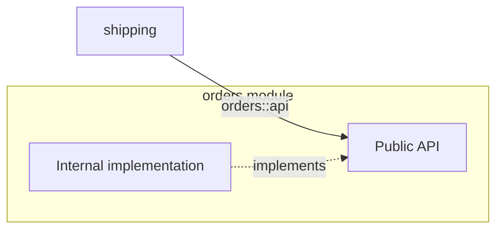

# Trả về kiểu internal trong API public có rủi ro gì?

Một mô-đun có thể công khai service hoặc interface trong package API nhưng lại để phương thức trả về một kiểu nằm trong package `internal`. Mã nguồn vẫn có thể biên dịch nếu kiểu đó có modifier `public`, nhưng hợp đồng công khai đã để lộ chi tiết triển khai. Mô-đun tiêu thụ có thể bắt đầu sử dụng kiểu nội bộ đó, khiến ranh giới mà Spring Modulith bảo vệ bị suy yếu.

Trong Spring Modulith, modifier `public` của Java và trạng thái API công khai của một package là hai khái niệm khác nhau. Package gốc của mô-đun là API công khai mặc định; package con thường là nội bộ trừ khi được công khai có chủ đích, chẳng hạn bằng `@NamedInterface`. Vì vậy, một kiểu `public` trong `orders.internal` vẫn là kiểu nội bộ theo mô hình mô-đun.

## 1. Rủi ro bắt đầu từ chữ ký phương thức

Giả sử mô-đun `orders` công khai interface `OrderLookup`, nhưng phương thức lại trả về `OrderView` nằm trong package nội bộ:

```java
package com.acme.shop.orders;

import java.util.Optional;
import java.util.UUID;

import com.acme.shop.orders.internal.OrderView;

public interface OrderLookup {

    Optional<OrderView> findById(UUID orderId);
}
```

Kiểu `OrderView` được khai báo `public` để có thể xuất hiện trong chữ ký:

```java
package com.acme.shop.orders.internal;

import java.util.UUID;

public record OrderView(
        UUID orderId,
        String status,
        String shippingAddress
) {}
```

Vấn đề không nằm ở việc Java cho phép khai báo như vậy. Vấn đề là API của `orders` đã phụ thuộc vào một kiểu thuộc package triển khai nội bộ và buộc consumer phải hiểu kiểu đó nếu muốn sử dụng kết quả. Khi một mô-đun khác import hoặc thao tác với `OrderView`, nó tạo dependency tới package nội bộ của `orders`, vi phạm boundary của mô-đun.

Chỉ đổi modifier của `OrderView` từ `public` thành package-private cũng không giải quyết được thiết kế. Khi đó, kiểu nội bộ không thể được sử dụng bình thường từ mô-đun khác, nhưng API công khai vẫn có chữ ký không phù hợp và consumer không thể làm việc với kết quả theo cách rõ ràng. Cần thay đổi hợp đồng trả về, không chỉ thay đổi modifier.

## 2. Những vị trí khác có thể làm rò rỉ kiểu internal

Kiểu nội bộ có thể xuất hiện trong nhiều phần của hợp đồng công khai, không chỉ kiểu trả về trực tiếp:

| Vị trí trong API | Ví dụ rò rỉ | Hệ quả |
|---|---|---|
| Kiểu trả về | `OrderView findById(UUID id)` | Consumer cần biết kiểu nội bộ để đọc kết quả |
| Generic type | `List<OrderEntity> findAll()` | Kiểu nội bộ vẫn xuất hiện trong hợp đồng collection |
| Wrapper | `Optional<OrderView>` hoặc `Page<OrderEntity>` | Wrapper không che giấu dependency tới kiểu phần tử |
| Tham số đầu vào | `void update(OrderInternalCommand command)` | Consumer phải tạo hoặc tham chiếu kiểu nội bộ |
| Checked exception | `throws InternalOrderException` | Kiểu lỗi nội bộ trở thành một phần chữ ký được công khai |
| Kiểu cha hoặc interface | Public API kế thừa `InternalOrderOperations` | Hợp đồng công khai phụ thuộc vào abstraction nội bộ |

Các kiểu lồng nhau như `Map<String, OrderEntity>`, `Optional<OrderView>` hoặc `List<OrderView>` vẫn có thể làm lộ kiểu nội bộ. Việc đặt kiểu đó bên trong generic, wrapper hoặc collection không biến nó thành API công khai.

Hãy xem xét toàn bộ chữ ký của public API: tham số, kiểu trả về, generic type, exception, kiểu cha, interface được triển khai và các kiểu công khai khác mà consumer cần tham chiếu. Một phương thức có vẻ nhỏ vẫn có thể tạo ra một hợp đồng phụ thuộc rất rộng.

## 3. Vì sao rò rỉ kiểu internal gây khó khăn?

**Consumer bị gắn với chi tiết triển khai.** Khi consumer sử dụng `OrderView`, nó có thể bắt đầu dựa vào tên field, cấu trúc record hoặc cách biểu diễn trạng thái hiện tại. Nếu `orders` thay đổi cách đọc dữ liệu hoặc thay `OrderView` bằng một projection khác, consumer phải sửa theo.

**Mô-đun mất quyền tự do refactor.** Package `internal` thường chứa entity, repository projection, persistence model hoặc đối tượng phục vụ một use case cụ thể. Khi các kiểu đó xuất hiện trong API, thay đổi nội bộ có thể trở thành thay đổi hợp đồng với mọi consumer.

**Boundary bị vượt qua gián tiếp.** Một consumer có thể bắt đầu gọi phương thức, đọc thuộc tính hoặc truyền tiếp kiểu nội bộ sang mô-đun thứ ba. Dependency không còn dừng ở API được công khai mà lan sang package triển khai.

**Chi tiết persistence có thể thoát ra ngoài.** Nếu API trả về JPA entity, consumer có thể phụ thuộc vào quan hệ lazy, proxy, trạng thái persistence context hoặc cấu trúc bảng. Điều đó làm cho cách lưu trữ trở thành một phần của hợp đồng nghiệp vụ.

**Rủi ro serialization và bảo mật tăng lên.** Entity hoặc internal view có thể chứa field không dành cho consumer, quan hệ hai chiều, dữ liệu nhạy cảm hoặc cấu trúc không phù hợp để serialize. Một DTO công khai được thiết kế rõ ràng giúp kiểm soát chính xác dữ liệu được phép trao đổi.

## 4. Phân biệt public trong Java và public trong Spring Modulith

Xét các kiểu sau:

```text
com.acme.shop.orders
├── OrderLookup.java              <- package API mặc định
└── internal
    ├── OrderView.java            <- package nội bộ
    └── OrderRepository.java      <- package nội bộ
```

`OrderView` có thể khai báo `public` theo Java để nhiều lớp trong ứng dụng có thể tham chiếu về mặt ngôn ngữ. Nhưng package `com.acme.shop.orders.internal` vẫn là package nội bộ theo quy ước mô-đun.

Spring Modulith kiểm tra quan hệ giữa các mô-đun dựa trên package và dependency trong mã nguồn. Nếu consumer truy cập kiểu nội bộ, kiểm tra kiến trúc có thể báo vi phạm quyền truy cập package. `ApplicationModules.verify()` giúp phát hiện những quan hệ không được phép trong module graph.

Một public API tốt chỉ tham chiếu kiểu thuộc package công khai của chính mô-đun hoặc các kiểu từ dependency đã được cho phép. Nếu một package con thực sự là hợp đồng cần chia sẻ, hãy công khai nó bằng Named Interface và quản lý dependency rõ ràng. Không đánh dấu `internal` thành Named Interface chỉ để hợp thức hóa việc trả kiểu triển khai ra ngoài.

## 5. Thiết kế lại bằng DTO thuộc public API

Thay vì trả `OrderView` từ package nội bộ, tạo một DTO ổn định trong Named Interface `orders::api`:

```java
@org.springframework.modulith.NamedInterface("api")
package com.acme.shop.orders.api;
```

DTO công khai chỉ chứa dữ liệu consumer cần:

```java
package com.acme.shop.orders.api;

import java.util.UUID;

public record OrderSummary(
        UUID orderId,
        String status,
        String shippingAddress
) {}
```

Interface công khai trả về DTO đó:

```java
package com.acme.shop.orders.api;

import java.util.Optional;
import java.util.UUID;

public interface OrderLookup {

    Optional<OrderSummary> findById(UUID orderId);
}
```

Implementation có thể sử dụng entity hoặc projection nội bộ, sau đó chuyển đổi thành DTO trước khi trả kết quả:

```java
package com.acme.shop.orders.internal;

import java.util.Optional;
import java.util.UUID;

import com.acme.shop.orders.api.OrderLookup;
import com.acme.shop.orders.api.OrderSummary;
import org.springframework.stereotype.Service;

@Service
class OrderLookupService implements OrderLookup {

    private final OrderRepository repository;

    OrderLookupService(OrderRepository repository) {
        this.repository = repository;
    }

    @Override
    public Optional<OrderSummary> findById(UUID orderId) {
        return repository.findById(orderId)
                .map(order -> new OrderSummary(
                        order.getId(),
                        order.getStatus().name(),
                        order.getShippingAddress()
                ));
    }
}
```

Consumer chỉ phụ thuộc vào Named Interface `orders::api`:

```java
@org.springframework.modulith.ApplicationModule(
    allowedDependencies = "orders::api"
)
package com.acme.shop.shipping;
```

```java
package com.acme.shop.shipping;

import java.util.UUID;

import com.acme.shop.orders.api.OrderLookup;
import org.springframework.stereotype.Service;

@Service
public class ShippingService {

    private final OrderLookup orderLookup;

    public ShippingService(OrderLookup orderLookup) {
        this.orderLookup = orderLookup;
    }

    public void prepareShipment(UUID orderId) {
        orderLookup.findById(orderId).ifPresent(summary -> {
            // Dùng status và shippingAddress để chuẩn bị giao hàng.
        });
    }
}
```

Đồ thị dependency thể hiện `shipping` phụ thuộc vào hợp đồng công khai của `orders`:



`OrderLookupService` và `OrderRepository` có thể thay đổi bên trong `orders` mà không làm thay đổi kiểu mà `shipping` sử dụng. DTO công khai cũng cho phép mô-đun sở hữu quyết định field nào được chia sẻ.

## 6. Khi nào nên dùng Named Interface?

Nếu một mô-đun chỉ có một API nhỏ, package gốc có thể đủ để làm public API. Named Interface hữu ích khi mô-đun có nhiều nhóm hợp đồng với consumer khác nhau, ví dụ:

```text
com.acme.shop.orders
├── api
│   ├── OrderLookup.java
│   └── OrderSummary.java
├── events
│   └── OrderCompleted.java
└── internal
    ├── OrderEntity.java
    └── OrderRepository.java
```

Có thể công khai từng package hợp đồng bằng tên riêng:

```java
@org.springframework.modulith.NamedInterface("api")
package com.acme.shop.orders.api;
```

```java
@org.springframework.modulith.NamedInterface("events")
package com.acme.shop.orders.events;
```

Consumer chỉ cần API tra cứu có thể khai báo `allowedDependencies = "orders::api"`; consumer chỉ nhận event có thể dùng `orders::events`. Cách này giúp kiểm soát phạm vi hợp đồng và giữ package `internal` ở trạng thái nội bộ.

## 7. Kiểm chứng public API không rò rỉ internal type

Tạo bài kiểm tra kiến trúc để xác minh các quy tắc module:

```java
package com.acme.shop;

import org.junit.jupiter.api.Test;
import org.springframework.modulith.core.ApplicationModules;

class ModularityTests {

    @Test
    void verifiesModuleBoundaries() {
        ApplicationModules.of(ShopApplication.class).verify();
    }
}
```

Khi consumer tham chiếu một kiểu trong package nội bộ của mô-đun khác, `verify()` có thể phát hiện vi phạm dependency hoặc quyền truy cập package. Đọc thông báo để xác định consumer nào đang phụ thuộc vào package nội bộ, rồi lần ngược về chữ ký API đã làm lộ kiểu đó.

Ngoài kiểm tra kiến trúc, hãy review public API theo một danh sách ngắn:

1. Kiểu trả về và mọi generic type có thuộc package công khai không?
2. Kiểu tham số, exception và interface cha có vô tình tham chiếu `internal` không?
3. DTO có chỉ chứa dữ liệu mà consumer cần không?
4. API có làm lộ entity, repository projection hoặc framework detail không cần thiết không?
5. Consumer có thể sử dụng hợp đồng mà không import package nội bộ không?

`ApplicationModules.verify()` kiểm tra boundary trong mô hình mã nguồn. Nó không tự đánh giá DTO có lộ dữ liệu nghiệp vụ không cần thiết hay API có ổn định về mặt sản phẩm không. Những điểm này vẫn cần được review và kiểm thử ở tầng hợp đồng.

## 8. Quy trình xử lý khi phát hiện internal type trong API

Khi tìm thấy kiểu nội bộ trong public API, hãy xử lý theo trình tự:

1. Xác định kiểu nội bộ đang xuất hiện ở vị trí nào: return type, parameter, generic, exception hay kiểu cha.
2. Tìm các consumer đang sử dụng kiểu đó và xác định chính xác dữ liệu hoặc hành vi họ cần.
3. Thiết kế DTO hoặc interface công khai chỉ chứa hợp đồng cần thiết.
4. Chuyển đổi kiểu nội bộ sang DTO trong implementation của mô-đun sở hữu.
5. Cập nhật consumer để chỉ import package API hoặc Named Interface.
6. Thu hẹp `allowedDependencies` theo đúng named interface mà consumer sử dụng.
7. Chạy `ApplicationModules.verify()` và test hợp đồng để xác nhận boundary cùng hành vi vẫn đúng.

Nếu API đã được nhiều consumer sử dụng, hãy quản lý việc thay đổi hợp đồng theo phiên bản hoặc giai đoạn chuyển tiếp phù hợp. Không xóa kiểu cũ trước khi xác định các consumer cần được di chuyển.

## 9. Bài tập tự kiểm tra

Với mô-đun `orders`, hãy đánh giá các chữ ký sau:

| Chữ ký API | Đánh giá | Lý do |
|---|---|---|
| `Optional<OrderSummary> findById(UUID id)` với `OrderSummary` trong `orders::api` | Phù hợp | Kiểu trả về thuộc API được công khai |
| `Optional<OrderView> findById(UUID id)` với `OrderView` trong `orders.internal` | Rò rỉ internal type | Consumer phải biết kiểu nội bộ để dùng kết quả |
| `List<OrderEntity> findAll()` với `OrderEntity` là JPA entity nội bộ | Rủi ro cao | Lộ kiểu persistence và cấu trúc dữ liệu nội bộ |
| `void update(InternalOrderCommand command)` | Rò rỉ qua tham số | Consumer phải tạo kiểu command nội bộ |
| `Optional<OrderSummary> findById(UUID id)` và implementation map entity sang DTO | Phù hợp | Chi tiết lưu trữ được giữ trong mô-đun sở hữu |

Hãy tìm một public method trong ví dụ của bạn có trả về kiểu từ package con. Xác định package đó đã được công khai hay vẫn là internal, sau đó thiết kế lại chữ ký để chỉ dùng hợp đồng ổn định. Cuối cùng, chạy `ApplicationModules.verify()` và kiểm tra consumer không còn import kiểu nội bộ.
