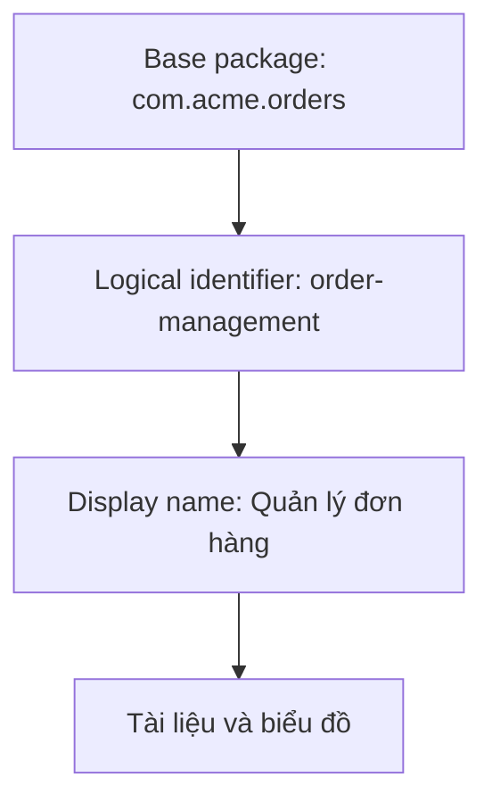

# Identifier trong tài liệu và biểu đồ

Trong Spring Modulith, một application module có tên logic để các thành phần kiến trúc tham chiếu đến nó và có tên hiển thị để con người đọc tài liệu. Hai giá trị này phục vụ những mục đích khác nhau. `id` là định danh logic của module; `displayName` là nhãn dễ đọc dùng cho hiển thị và tài liệu.

Phân biệt rõ hai giá trị giúp nhóm giữ tham chiếu kiến trúc ổn định khi package thay đổi, đồng thời tạo ra sơ đồ có tên nghiệp vụ dễ hiểu. Bài học này trình bày cách đặt identifier bằng `@ApplicationModule`, cách Spring Modulith tạo tên mặc định, cách sử dụng identifier trong dependency và cách sinh tài liệu, biểu đồ bằng `Documenter`.

## Mục tiêu

Sau bài học, bạn có thể:

- Phân biệt logical identifier với display name của application module.
- Giải thích cách Spring Modulith tạo tên module mặc định từ package.
- Khai báo `id` và `displayName` trong `@ApplicationModule`.
- Dùng identifier trong `allowedDependencies` và cấu hình module dùng chung.
- Tránh trùng tên khi một ứng dụng có nhiều package root.
- Sinh component diagram, sơ đồ PlantUML và module canvas bằng `Documenter`.
- Duy trì tên module nhất quán giữa mã nguồn, cấu hình và tài liệu kiến trúc.

## Ba khái niệm cần phân biệt

Một module có thể được nhận diện qua package, được tham chiếu bằng identifier và được trình bày bằng display name.

| Khái niệm | Ý nghĩa | Ví dụ |
|---|---|---|
| Base package | Package gốc xác định phạm vi mã nguồn của module | `com.acme.orders` |
| Module identifier (`id`) | Tên logic dùng để nhận diện và tham chiếu module | `order-management` |
| Display name | Tên thân thiện cho người đọc trong tài liệu và giao diện hiển thị | `Quản lý đơn hàng` |

Quan hệ giữa ba khái niệm:



Base package xác định module nằm ở đâu trong codebase. Identifier giúp Spring Modulith và cấu hình kiến trúc tham chiếu module một cách logic. Display name giúp người đọc hiểu vai trò của module mà không cần suy luận từ tên package.

## Identifier mặc định được tạo như thế nào?

Với cấu trúc package mặc định, Spring Modulith phát hiện module từ các package con của package ứng dụng. Identifier mặc định được lấy từ phần tên package nằm dưới package root của Modulith.

Ví dụ, nếu package root là `com.acme`:

```text
com.acme
├── orders
├── inventory
└── customer
```

Các identifier mặc định tương ứng là `orders`, `inventory` và `customer`.

Nếu module nằm sâu hơn, phần tên module có thể gồm nhiều segment. Ví dụ, khi quét từ `com.acme`, module ở `com.acme.sales.orders` có tên mặc định `sales.orders`.

Khi không cần tên logic riêng, dùng tên mặc định giúp giảm metadata phải duy trì. Tuy nhiên, tên mặc định gắn với cấu trúc package. Nếu đổi package hoặc chuyển module sang namespace khác, identifier mặc định có thể thay đổi theo.

## Đặt identifier và display name bằng `@ApplicationModule`

Bạn có thể tùy chỉnh metadata ở `package-info.java` của module:

```java
@org.springframework.modulith.ApplicationModule(
    id = "order-management",
    displayName = "Quản lý đơn hàng"
)
package com.acme.orders;
```

Trong ví dụ này:

- `id = "order-management"` là tên logic được dùng khi tham chiếu module.
- `displayName = "Quản lý đơn hàng"` là tên thân thiện cho tài liệu và hiển thị.
- `com.acme.orders` vẫn là base package của module.

Đặt `id` tường minh hữu ích khi muốn giữ tên logic ổn định qua một lần đổi package. Việc đổi `com.acme.orders` thành `com.acme.sales.order` không bắt buộc phải đổi `order-management` nếu nhóm giữ nguyên annotation và module vẫn đại diện cho cùng capability.

`id` không thay thế quy tắc phát hiện module và không đổi package chứa mã nguồn. Nó chỉ định danh module đã được phát hiện. `displayName` cũng không thay đổi dependency rule; nó chỉ thay đổi cách module được mô tả với người đọc.

## Dùng identifier trong cấu hình dependency

Các module khác có thể dùng logical identifier trong `allowedDependencies`. Ví dụ, module `shipping` cần sử dụng API của `order-management`:

```java
@org.springframework.modulith.ApplicationModule(
    allowedDependencies = "order-management"
)
package com.acme.shipping;
```

Nếu dependency chỉ được phép đi qua một named interface, thêm tên interface sau dấu phân cách `::`:

```java
@org.springframework.modulith.ApplicationModule(
    allowedDependencies = "order-management :: events"
)
package com.acme.shipping;
```

Trong trường hợp này, `order-management` là module identifier; `events` là tên named interface mà module công bố. Dấu `::` phân cách tên module và tên named interface. Vì vậy, giá trị `@ApplicationModule(id = ...)` không được chứa chuỗi `::`.

Identifier cũng được dùng trong cấu hình `sharedModules` của `@Modulithic` hoặc `@Modulith` để khai báo module luôn được đưa vào bootstrap. Khi đổi identifier, hãy tìm và cập nhật các tham chiếu logic tương ứng, chẳng hạn `allowedDependencies` và `sharedModules`.

Đừng dùng `displayName` trong `allowedDependencies`. Tên hiển thị có thể chứa dấu cách, chữ hoa hoặc được dịch sang ngôn ngữ khác; nó không phải khóa tham chiếu module.

## Quy tắc đặt identifier dễ duy trì

Identifier nên ngắn, ổn định và có ý nghĩa trong phạm vi kiến trúc. Một số quy tắc thực tế:

- Ưu tiên chữ thường và dấu gạch ngang hoặc quy ước tên nhất quán của dự án, ví dụ `order-management`, `inventory`.
- Tránh đưa tên nhóm, tên cá nhân, phiên bản hoặc công nghệ triển khai vào identifier nếu chúng không phải một phần của danh tính nghiệp vụ.
- Không chứa `::`, vì ký hiệu này dành cho cú pháp tham chiếu named interface.
- Đảm bảo các identifier không xung đột trong cùng mô hình Modulith.
- Chỉ đổi identifier khi ý nghĩa logic của module thực sự thay đổi hoặc nhóm chủ động thực hiện một lần đổi tên có kiểm soát.

Ví dụ, `order-management` thường ổn định hơn `order-service-v2` nếu module vẫn chịu trách nhiệm về vòng đời đơn hàng. Tên như `jpa-orders` lại gắn định danh module với một lựa chọn persistence có thể thay đổi.

Identifier không nhất thiết phải trùng tên package. Tuy nhiên, nếu tên package và identifier khác nhau quá xa, hãy ghi lại quy ước trong tài liệu để thành viên mới có thể tra cứu dễ dàng.

## Khi có nhiều package root

Một ứng dụng có thể dùng `@Modulithic(additionalPackages = …)` để phát hiện module từ nhiều package root. Khi đó, hai root khác nhau có thể cùng có package con `common`, `api` hoặc `orders`. Tên module mặc định cục bộ có thể bị trùng.

Bạn có thể yêu cầu Spring Modulith dùng tên module đầy đủ bằng `useFullyQualifiedModuleNames = true`:

```java
@SpringBootApplication
@org.springframework.modulith.Modulithic(
    additionalPackages = "com.acme.integration",
    useFullyQualifiedModuleNames = true
)
class Application {}
```

Với thiết lập này, tên mặc định sử dụng package đầy đủ thay vì chỉ phần tên cục bộ dưới từng root. Cách này hữu ích khi các package root bổ sung có những module trùng tên cục bộ.

Nếu muốn tên logic ngắn và ổn định, có thể đặt `id` tường minh cho từng module, miễn là identifier không xung đột. Hãy thống nhất một chiến lược cho toàn ứng dụng; tránh để một số module dùng tên package đầy đủ, một số dùng tên cục bộ và một số dùng tên nghiệp vụ mà không có quy ước.

## Phân biệt `id` và `displayName` trong mã nguồn

Spring Modulith cung cấp `ApplicationModule.getIdentifier()` để lấy logical identifier và `ApplicationModule.getDisplayName()` để lấy tên hiển thị. Có thể xem hai giá trị cùng base package khi duyệt mô hình:

```java
import org.springframework.modulith.core.ApplicationModules;

var modules = ApplicationModules.of(Application.class);

modules.forEach(module -> System.out.printf(
    "id=%s, displayName=%s, package=%s%n",
    module.getIdentifier(),
    module.getDisplayName(),
    module.getBasePackage().getName()
));
```

`ApplicationModuleIdentifier` là kiểu giá trị biểu diễn identifier logic. API `ApplicationModule.getIdentifier()` có từ Spring Modulith 1.3. Khi tích hợp với phiên bản cũ hơn, hãy kiểm tra API của đúng phiên bản thay vì giả định mọi method hiện hành đều có sẵn.

## Sinh tài liệu và biểu đồ bằng `Documenter`

Spring Modulith cung cấp `Documenter` để tạo tài liệu từ mô hình `ApplicationModules`. `writeDocumentation()` tạo:

- Biểu đồ component tổng quan cho toàn bộ application module.
- Biểu đồ component riêng cho từng module, thể hiện các module liên quan theo cấu hình mặc định.
- Module Canvas cho từng module.

Ví dụ:

```java
import org.springframework.modulith.core.ApplicationModules;
import org.springframework.modulith.docs.Documenter;

class ModuleDocumentation {

    void generate() {
        var modules = ApplicationModules.of(Application.class);

        new Documenter(modules).writeDocumentation();
    }
}
```

`Documenter` thuộc artifact `spring-modulith-docs`, thường được khai báo ở test scope vì việc sinh tài liệu là một phần của quy trình build hoặc kiểm tra kiến trúc. Constructor mặc định ghi kết quả vào thư mục `spring-modulith-docs`.

Để sinh riêng biểu đồ PlantUML tổng quan:

```java
new Documenter(ApplicationModules.of(Application.class))
    .writeModulesAsPlantUml();
```

Để sinh các biểu đồ riêng cho từng module:

```java
new Documenter(ApplicationModules.of(Application.class))
    .writeIndividualModulesAsPlantUml();
```

Tên hiển thị được cấu hình bằng `@ApplicationModule(displayName = …)` để tài liệu dễ đọc hơn. Nếu không khai báo display name, `Documenter.DiagramOptions` còn cho phép tùy chỉnh tên hiển thị mặc định cho biểu đồ:

```java
var options = Documenter.DiagramOptions.defaults()
    .withDefaultDisplayName(module -> module.getIdentifier().toString());

new Documenter(ApplicationModules.of(Application.class))
    .writeModulesAsPlantUml(options);
```

`withDefaultDisplayName(…)` cung cấp cách đặt nhãn mặc định cho module khi sinh diagram. Nếu module đã có `displayName`, metadata đó là nơi phù hợp để duy trì tên nghiệp vụ nhất quán giữa các loại tài liệu.

## Ví dụ: đồng bộ tên giữa package, identifier và tài liệu

Giả sử ứng dụng bán hàng có cấu trúc:

```text
com.acme
├── Application.java
├── orders
│   ├── package-info.java
│   └── internal
├── inventory
│   ├── package-info.java
│   └── internal
└── shipping
    ├── package-info.java
    └── internal
```

Metadata của `orders`:

```java
@ApplicationModule(
    id = "order-management",
    displayName = "Quản lý đơn hàng"
)
package com.acme.orders;
```

Metadata của `inventory`:

```java
@ApplicationModule(
    id = "inventory",
    displayName = "Quản lý tồn kho"
)
package com.acme.inventory;
```

Metadata của `shipping`:

```java
@ApplicationModule(
    id = "shipping",
    displayName = "Giao nhận"
)
package com.acme.shipping;
```

`shipping` khai báo dependency bằng identifier:

```java
@ApplicationModule(
    id = "shipping",
    displayName = "Giao nhận",
    allowedDependencies = { "order-management", "inventory" }
)
package com.acme.shipping;
```

Trong cấu hình này, `order-management` là khóa logic để tham chiếu module đơn hàng; `Quản lý đơn hàng` là nhãn xuất hiện trong tài liệu. Nếu package `com.acme.orders` được chuyển sang `com.acme.sales.orders` nhưng identifier vẫn giữ nguyên, các module tiêu thụ không phải đổi dependency chỉ vì package refactor. Nhóm vẫn cần chạy kiểm tra kiến trúc để xác nhận module được phát hiện đúng.

Khi sinh component diagram, người đọc có thể nhìn thấy các nhãn nghiệp vụ `Quản lý đơn hàng`, `Quản lý tồn kho` và `Giao nhận`, trong khi mã nguồn và cấu hình tiếp tục dùng identifier ổn định.

## Kiểm tra tính nhất quán của identifier và tài liệu

Trước khi đưa metadata vào nhánh chính, hãy rà soát:

1. Mỗi module có identifier duy nhất trong mô hình ứng dụng.
2. Identifier không chứa `::` và không thay đổi chỉ vì một lần đổi tên hiển thị.
3. `allowedDependencies` và `sharedModules` tham chiếu đúng identifier, không dùng display name.
4. `displayName` ngắn, có ý nghĩa nghiệp vụ và nhất quán giữa các module.
5. Nếu có nhiều package root, chiến lược tên cục bộ, tên đầy đủ hoặc identifier tường minh đã được thống nhất.
6. Tài liệu và biểu đồ được sinh từ cùng cấu hình `ApplicationModules` mà test kiến trúc sử dụng.
7. Khi đổi identifier, nhóm cập nhật tất cả tham chiếu và kiểm tra các cấu hình module liên quan.

Nên sinh lại tài liệu sau khi thay đổi `id`, `displayName`, base package hoặc dependency. Nếu biểu đồ được commit vào repository, hãy cập nhật cùng thay đổi kiến trúc để tài liệu không mô tả một mô hình cũ.

## Những lỗi thường gặp

| Lỗi | Hậu quả | Cách xử lý |
|---|---|---|
| Dùng `displayName` trong `allowedDependencies` | Spring Modulith không tìm module theo nhãn hiển thị đó | Dùng logical identifier |
| Đổi `id` tùy tiện | Các tham chiếu dependency và cấu hình shared module có thể bị lỗi | Coi identifier là khóa kiến trúc ổn định |
| Đưa `::` vào `id` | Xung đột với cú pháp tham chiếu named interface | Dùng identifier không chứa dấu phân cách này |
| Dùng package đầy đủ ở một số nơi và tên cục bộ ở nơi khác | Cấu hình khó đọc và dễ tham chiếu sai | Thống nhất `useFullyQualifiedModuleNames` hoặc đặt id tường minh |
| Đặt display name theo công nghệ như `JPA Orders` | Tài liệu nhanh chóng lỗi thời khi implementation thay đổi | Đặt tên theo capability nghiệp vụ |
| Không sinh lại diagram sau khi đổi metadata | Sơ đồ và source code mô tả hai trạng thái khác nhau | Đưa bước sinh tài liệu vào quy trình build phù hợp |

## Bài tập tự đánh giá

Một ứng dụng có hai package root: `com.acme.sales` và `com.acme.support`. Cả hai đều có module con tên `common`. Nhóm muốn tên module trong tài liệu là `Bán hàng dùng chung` và `Hỗ trợ dùng chung`, nhưng các module khác cần tham chiếu chúng bằng tên logic ngắn, ổn định.

Hãy đề xuất:

1. Identifier và display name cho hai module `common`.
2. Cách tránh xung đột tên mặc định giữa hai package root.
3. Cách khai báo dependency từ module khác đến một trong hai module.
4. Vì sao không nên dùng display name tiếng Việt trong `allowedDependencies`?
5. Cách sinh lại component diagram và module canvas sau khi thay đổi metadata.

Một hướng thiết kế là đặt hai identifier khác nhau, chẳng hạn `sales-common` và `support-common`, cùng display name tương ứng. Nếu muốn giữ tên mặc định đầy đủ theo package, có thể bật `useFullyQualifiedModuleNames = true`. Các module tiêu thụ tham chiếu identifier logic đã thống nhất; `Documenter` dùng display name để tạo tài liệu dễ đọc.

## Kết luận

Identifier là tên logic để tham chiếu application module; display name là nhãn dành cho con người. Đặt identifier ổn định bằng `@ApplicationModule(id = …)`, mô tả module bằng `displayName`, thống nhất cách đặt tên khi có nhiều package root và sinh tài liệu từ cùng mô hình `ApplicationModules`. Nhờ đó, cấu hình dependency vẫn rõ ràng và biểu đồ kiến trúc phản ánh đúng ngôn ngữ nghiệp vụ của hệ thống.

## Tài liệu tham khảo

- [Spring Modulith Reference — Fundamentals](https://docs.spring.io/spring-modulith/reference/fundamentals.html)
- [Spring Modulith API — `ApplicationModule`](https://docs.spring.io/spring-modulith/docs/current/api/org/springframework/modulith/ApplicationModule.html)
- [Spring Modulith API — `ApplicationModuleIdentifier`](https://docs.spring.io/spring-modulith/docs/current/api/org/springframework/modulith/core/ApplicationModuleIdentifier.html)
- [Spring Modulith API — `ApplicationModuleSource`](https://docs.spring.io/spring-modulith/docs/current/api/org/springframework/modulith/core/ApplicationModuleSource.html)
- [Spring Modulith API — `Documenter`](https://docs.spring.io/spring-modulith/docs/current/api/org/springframework/modulith/docs/Documenter.html)
- [Spring Modulith API — `Modulithic`](https://docs.spring.io/spring-modulith/docs/current/api/org/springframework/modulith/Modulithic.html)
