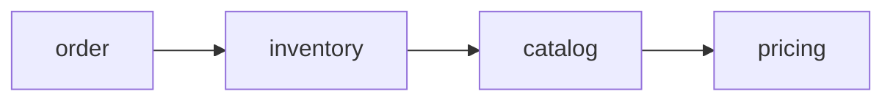

# `allowedDependencies` trong annotation

Spring Modulith cho phép mỗi application module khai báo rõ những module hoặc named interface mà nó được phép phụ thuộc. Thuộc tính `allowedDependencies` của `@ApplicationModule` tạo ra whitelist này. Khi một module đã khai báo whitelist, các tham chiếu trực tiếp trong mã nguồn phải nằm trong phạm vi được cho phép; `ApplicationModules.verify()` sẽ phát hiện dependency không phù hợp.

`allowedDependencies` được khai báo tại module tiêu thụ (consumer), thường trong `package-info.java` của package gốc. Giá trị có thể là identifier của module cung cấp, identifier kèm tên named interface theo cú pháp `module::interface`, hoặc wildcard để cho phép nhiều named interface. Cấu hình này kiểm soát dependency ở cấp kiến trúc; nó không tự đăng ký Spring bean và cũng không tự expose package nội bộ của module cung cấp.

Trong `SPRING_MODULITH_MODULE_MODEL`, thuộc tính này giúp thể hiện rõ module nào được phép sử dụng hợp đồng nào, giữ dependency có chủ đích và hỗ trợ kiểm chứng kiến trúc modular monolith.

## 1. `allowedDependencies` giải quyết vấn đề gì?

Giả sử ứng dụng bán hàng có các module `order`, `inventory`, `payment`, `catalog` và `customer`. Nếu không có quy tắc rõ ràng, mã trong `order` có thể dần tham chiếu tới nhiều module khác nhau. Theo thời gian, module này có thể biết quá nhiều về cách lưu trữ, định giá, khách hàng và xử lý thanh toán.

Whitelist giúp ghi lại những quan hệ được chấp nhận. Ví dụ, module `order` chỉ cần dùng API của `inventory` và `payment`:

```java
@org.springframework.modulith.ApplicationModule(
    allowedDependencies = { "inventory", "payment" }
)
package com.example.shop.order;
```

Khai báo trên có nghĩa là mã thuộc module `order` được phép tạo dependency trực tiếp tới module `inventory` và `payment`, theo các bề mặt API mà provider công bố. Nếu `order` tham chiếu trực tiếp `catalog` hoặc `customer`, dependency đó không nằm trong whitelist và sẽ bị kiểm tra kiến trúc báo vi phạm.

Whitelist trả lời câu hỏi: **module hiện tại được phép phụ thuộc trực tiếp vào module hoặc nhóm API nào?** Nó không phải danh sách tất cả module có mặt trong ứng dụng và cũng không phải danh sách bean mà Spring sẽ inject.

## 2. Đặt annotation tại module tiêu thụ

`@ApplicationModule` thường được đặt trong `package-info.java` của package gốc module. Ví dụ, `order` là consumer nên whitelist được đặt tại:

```text
src/main/java/com/example/shop/order/package-info.java
```

Nội dung:

```java
@org.springframework.modulith.ApplicationModule(
    allowedDependencies = { "inventory", "payment" }
)
package com.example.shop.order;
```

Module cung cấp `inventory` và `payment` không cần khai báo rằng `order` được phép sử dụng chúng. Quyền cho phép được khai báo ở phía consumer, nơi chịu trách nhiệm về các dependency mà nó tạo ra.

Nếu module `payment` cũng cần khai báo whitelist riêng, nó có thể có `package-info.java` của chính nó:

```java
@org.springframework.modulith.ApplicationModule(
    allowedDependencies = "customer"
)
package com.example.shop.payment;
```

Mỗi module quản lý danh sách dependency của chính mình. Whitelist của `order` không tự áp dụng cho `payment` và ngược lại.

## 3. Giá trị dependency dùng module identifier

Các phần tử trong `allowedDependencies` tham chiếu logical identifier của application module, không phải tên lớp triển khai và không nhất thiết là tên package đầy đủ.

Với cấu trúc:

```text
com.example.shop
├── inventory
├── order
└── payment
```

Các identifier mặc định lần lượt là `inventory`, `order` và `payment`. Vì vậy, consumer có thể khai báo:

```java
@org.springframework.modulith.ApplicationModule(
    allowedDependencies = "inventory"
)
package com.example.shop.order;
```

Nếu provider có identifier tường minh bằng `@ApplicationModule(id = "stock")`, consumer cần dùng identifier đó:

```java
@org.springframework.modulith.ApplicationModule(
    allowedDependencies = "stock"
)
package com.example.shop.order;
```

Tên package đầy đủ `com.example.shop.inventory` không thay thế cho identifier `inventory` trong whitelist. Hãy kiểm tra identifier của module cung cấp khi cấu hình dependency, đặc biệt sau khi đổi package hoặc đặt `id` tường minh.

## 4. Cho phép phụ thuộc vào API package gốc

Giá trị đơn giản như `inventory` cho phép consumer phụ thuộc vào API package gốc của module `inventory`.

Ví dụ provider công bố interface tại package gốc:

```java
package com.example.shop.inventory;

public interface InventoryAvailability {

    boolean hasAvailableStock(String sku, int quantity);
}
```

Consumer khai báo:

```java
@org.springframework.modulith.ApplicationModule(
    allowedDependencies = "inventory"
)
package com.example.shop.order;
```

Sau đó mã của `order` có thể tham chiếu hợp đồng `InventoryAvailability`:

```java
package com.example.shop.order.internal;

import com.example.shop.inventory.InventoryAvailability;

class PlaceOrderService {

    private final InventoryAvailability inventory;

    PlaceOrderService(InventoryAvailability inventory) {
        this.inventory = inventory;
    }
}
```

`order` phụ thuộc vào API được công bố của `inventory`, không cần import implementation hoặc repository nội bộ của provider.

## 5. Cho phép phụ thuộc vào Named Interface

Một module có thể expose package con như một named interface bằng `@NamedInterface`. Khi consumer chỉ cần nhóm API đó, có thể giới hạn whitelist theo cú pháp `module::named-interface`.

Ví dụ provider `inventory` có package `spi`:

```java
@org.springframework.modulith.NamedInterface("spi")
package com.example.shop.inventory.spi;
```

Trong package đó có hợp đồng:

```java
package com.example.shop.inventory.spi;

public interface StockReservation {

    boolean reserve(String sku, int quantity);
}
```

Consumer `order` khai báo:

```java
@org.springframework.modulith.ApplicationModule(
    allowedDependencies = "inventory::spi"
)
package com.example.shop.order;
```

Giá trị `inventory::spi` gồm hai phần:

- `inventory`: identifier của module cung cấp.
- `spi`: tên named interface được expose trong module đó.

Với whitelist này, `order` được phép tham chiếu các kiểu thuộc named interface `spi`. Package nội bộ khác của `inventory` vẫn không được tự động mở chỉ vì `order` đã khai báo dependency tới `inventory::spi`.

## 6. Kết hợp API package gốc và Named Interface

Nếu consumer cần cả API package gốc và một named interface, hãy khai báo cả hai:

```java
@org.springframework.modulith.ApplicationModule(
    allowedDependencies = {
        "inventory",
        "inventory::spi"
    }
)
package com.example.shop.order;
```

Khi đó, `order` được phép tham chiếu API package gốc và named interface `spi` của `inventory`.

Không nên cho rằng chỉ khai báo `inventory` là mặc nhiên mở mọi package con đã expose. Nếu consumer cần named interface cụ thể, hãy thể hiện đúng phạm vi đó trong whitelist. Cách khai báo tường minh giúp reviewer biết module thực sự sử dụng nhóm API nào.

## 7. Wildcard `*` và `**`

Khi consumer cần nhiều named interface của cùng một provider, Spring Modulith hỗ trợ wildcard trong phần sau dấu `::`.

### `module::*` — tất cả Named Interface

```java
@org.springframework.modulith.ApplicationModule(
    allowedDependencies = "inventory::*"
)
package com.example.shop.order;
```

`inventory::*` cho phép consumer phụ thuộc vào tất cả named interface được khai báo của module `inventory`. Wildcard này không bao gồm API package gốc.

Ví dụ, nếu `inventory` công bố `spi`, `reporting` và `events`, consumer có thể tham chiếu các nhóm API đó mà không cần liệt kê từng tên.

### `module::**` — API package gốc và mọi Named Interface

```java
@org.springframework.modulith.ApplicationModule(
    allowedDependencies = "inventory::**"
)
package com.example.shop.order;
```

`inventory::**` bao gồm API package gốc cùng tất cả named interface được công bố của module `inventory`.

### Bảng so sánh phạm vi

| Giá trị | API package gốc | Named Interface |
|---|---:|---:|
| `"inventory"` | Có | Không |
| `"inventory::spi"` | Không | Chỉ `spi` |
| `"inventory::*"` | Không | Tất cả named interface |
| `{ "inventory", "inventory::*" }` | Có | Tất cả named interface |
| `"inventory::**"` | Có | Tất cả named interface |

`*` và `**` không có nghĩa là cho phép mọi module trong ứng dụng. Chúng chỉ mở rộng phạm vi API của module có identifier đứng trước `::`.

## 8. Khai báo nhiều dependency

`allowedDependencies` là một mảng chuỗi, vì vậy có thể liệt kê nhiều module và named interface với phạm vi khác nhau:

```java
@org.springframework.modulith.ApplicationModule(
    allowedDependencies = {
        "inventory",
        "payment::processing",
        "customer::api",
        "catalog::*"
    }
)
package com.example.shop.order;
```

Trong ví dụ:

- `order` được phép sử dụng API package gốc của `inventory`.
- `order` chỉ được phép sử dụng named interface `processing` của `payment`.
- `order` chỉ được phép sử dụng named interface `api` của `customer`.
- `order` được phép sử dụng tất cả named interface của `catalog`, không bao gồm package gốc.

Nếu cần cả package gốc và named interfaces của `catalog`, thay `catalog::*` bằng `catalog::**`.

Khi danh sách dài, hãy nhóm theo trách nhiệm và giữ tên interface có ý nghĩa. Một whitelist quá rộng làm giảm khả năng phát hiện coupling không cần thiết.

## 9. `allowedDependencies` chỉ áp dụng cho dependency trực tiếp

Whitelist mô tả các dependency trực tiếp mà module tiêu thụ được phép tạo. Nó không yêu cầu liệt kê toàn bộ module có thể đi tới qua các module trung gian.

Giả sử đồ thị:



Nếu `order` chỉ tham chiếu API của `inventory`, whitelist của `order` có thể chỉ cần:

```java
@org.springframework.modulith.ApplicationModule(
    allowedDependencies = "inventory"
)
package com.example.shop.order;
```

`catalog` và `pricing` là dependency bắc cầu qua `inventory`; chúng không cần được thêm vào whitelist của `order` chỉ vì xuất hiện ở xa hơn trong đồ thị.

Nếu mã của `order` bắt đầu import trực tiếp một kiểu từ `catalog`, lúc đó phát sinh cạnh trực tiếp `order → catalog`. Dependency mới phải được đánh giá theo ý định kiến trúc và whitelist của `order`.

Một dependency bắc cầu cũng không tự cấp quyền import trực tiếp. Nếu `order` cần dùng API của `catalog`, hãy khai báo dependency trực tiếp có chủ đích và sử dụng package API được công bố của `catalog`.

## 10. Không khai báo whitelist và danh sách rỗng

`allowedDependencies` là thuộc tính tùy chọn. Khi không khai báo whitelist, Spring Modulith không áp dụng giới hạn dependency tường minh từ thuộc tính này; các quy tắc module khác như encapsulation và kiểm tra dependency cycle vẫn có hiệu lực.

Để thuộc tính ở mặc định hoặc khai báo mảng rỗng `allowedDependencies = {}` đều không tạo ra whitelist cấm mọi dependency. Mảng rỗng là giá trị mặc định của annotation và có nghĩa là không đặt giới hạn dependency tường minh bằng thuộc tính này.

Điều này có nghĩa là:

- Không khai báo `allowedDependencies` không đồng nghĩa module không được phụ thuộc vào module nào.
- Whitelist chỉ có tác dụng giới hạn khi nhóm chủ động khai báo các dependency được phép.
- Việc bỏ trống whitelist không làm package nội bộ của module khác tự trở thành API.
- `allowedDependencies` không thay thế các kiểm tra về dependency cycle hoặc module encapsulation.

Nếu mục tiêu là quản lý dependency chặt chẽ, hãy khai báo whitelist cụ thể và kiểm tra bằng `ApplicationModules.verify()`. Đừng dựa vào việc bỏ thuộc tính để thể hiện rằng module không có dependency.

## 11. Whitelist không thay thế API exposure

Đây là điểm quan trọng nhất khi sử dụng `allowedDependencies`: **được phép phụ thuộc vào một module không đồng nghĩa được phép truy cập mọi package của module đó**.

Giả sử module `inventory` có cấu trúc:

```text
com.example.shop.inventory
├── InventoryAvailability.java
├── spi
│   ├── package-info.java       // @NamedInterface("spi")
│   └── StockReservation.java
└── internal
    └── InventoryRepository.java
```

Module `order` khai báo:

```java
@org.springframework.modulith.ApplicationModule(
    allowedDependencies = "inventory"
)
package com.example.shop.order;
```

Khai báo này cho phép dependency tới API package gốc của `inventory`. Nó không tự expose `inventory.internal` và cũng không tự cấp quyền sử dụng named interface `spi` theo whitelist cụ thể này.

Muốn dùng `StockReservation`, consumer cần khai báo `inventory::spi` và provider phải expose package `spi` bằng `@NamedInterface`. Muốn truy cập toàn bộ package của một open module, cần hiểu riêng cấu hình `ApplicationModule.Type.OPEN`; không dùng whitelist như cách thay thế cho quyết định expose của provider.

Hai lớp kiểm soát cần được xem cùng nhau:

1. **Provider quyết định package nào được công bố:** package gốc, named interface hoặc toàn bộ package trong open module.
2. **Consumer quyết định dependency nào được cho phép:** `allowedDependencies` trên module tiêu thụ.

## 12. `allowedDependencies` không tạo Spring bean dependency

Khai báo:

```java
@org.springframework.modulith.ApplicationModule(
    allowedDependencies = "inventory"
)
package com.example.shop.order;
```

không làm Spring tự tìm hoặc inject một bean từ module `inventory`. Nó chỉ mô tả quy tắc kiến trúc cho module `order`.

Để bean dependency hoạt động, provider vẫn phải đăng ký bean bằng stereotype hoặc `@Bean`, còn consumer phải khai báo constructor injection hoặc một injection point phù hợp:

```java
@Service
class PlaceOrderService {

    private final InventoryAvailability inventory;

    PlaceOrderService(InventoryAvailability inventory) {
        this.inventory = inventory;
    }
}
```

Spring IoC container xử lý bean registration và dependency injection. Spring Modulith kiểm tra mã nguồn có tuân thủ ranh giới module hay không. Hai cơ chế bổ sung cho nhau nhưng không thay thế nhau.

## 13. Kiểm tra whitelist bằng `ApplicationModules.verify()`

Đưa kiểm tra kiến trúc vào test suite:

```java
import org.junit.jupiter.api.Test;
import org.springframework.modulith.core.ApplicationModules;

class ModularityTests {

    @Test
    void verifiesAllowedModuleDependencies() {
        ApplicationModules.of(ShopApplication.class).verify();
    }
}
```

Ví dụ, nếu `order` chỉ cho phép `inventory` nhưng mã của nó import trực tiếp `com.example.shop.catalog.ProductCatalog`, `verify()` sẽ phát hiện dependency `order → catalog` không nằm trong whitelist.

Nếu `order` import `inventory.internal.InventoryRepository`, kiểm tra có thể báo vi phạm encapsulation ngay cả khi `inventory` đã nằm trong `allowedDependencies`, vì package nội bộ chưa được provider expose.

Khi test thất bại, hãy đọc lỗi theo hai câu hỏi riêng:

1. **Dependency có được cho phép không?** Kiểm tra identifier hoặc named interface trong `allowedDependencies`.
2. **Kiểu được tham chiếu có thuộc API được expose không?** Kiểm tra package gốc, `@NamedInterface` hoặc kiểu module `OPEN`.

Không nên mở rộng whitelist hoặc chuyển module thành open chỉ để làm cho test xanh nếu dependency thực tế không thuộc ý định thiết kế.

## 14. Quy trình thiết kế whitelist

Khi thêm hoặc chỉnh `allowedDependencies`, thực hiện theo trình tự:

1. **Xác định consumer.** Tìm module chứa mã nguồn tạo dependency.
2. **Xác định provider.** Tìm module sở hữu kiểu hoặc hợp đồng được tham chiếu.
3. **Chọn bề mặt API cần dùng.** API package gốc hay một named interface cụ thể?
4. **Ghi identifier đúng.** Dùng logical identifier, không dùng tên lớp triển khai hoặc package đầy đủ.
5. **Khai báo phạm vi nhỏ nhất.** Chọn module, `module::interface`, `module::*` hoặc `module::**` theo nhu cầu thực tế.
6. **Kiểm tra dependency trực tiếp.** Không thêm module chỉ vì nó nằm trong đường phụ thuộc bắc cầu.
7. **Chạy `ApplicationModules.verify()`.** Xác nhận dependency và encapsulation phù hợp.
8. **Review khi API thay đổi.** Khi provider thêm named interface hoặc đổi identifier, đánh giá lại whitelist của consumer.

## 15. Những nhầm lẫn thường gặp

| Nhầm lẫn | Cách hiểu đúng |
|---|---|
| `allowedDependencies` khai báo ở module cung cấp | Nó được khai báo ở module tiêu thụ, nơi tạo dependency. |
| Giá trị là tên package đầy đủ | Giá trị tham chiếu module identifier, ví dụ `inventory`. |
| `inventory` cho phép mọi package con | Nó cho phép dependency tới API package gốc; package con cần được expose riêng hoặc provider phải open. |
| `inventory::spi` tạo named interface | Provider phải khai báo named interface bằng `@NamedInterface`; consumer chỉ tham chiếu tên đó. |
| `inventory::*` bao gồm API package gốc | `*` chỉ bao gồm named interfaces; `**` bao gồm cả package gốc. |
| Phải liệt kê dependency bắc cầu | Whitelist tập trung vào dependency trực tiếp của module. |
| Không khai báo whitelist nghĩa là cấm mọi dependency | Không khai báo nghĩa là không áp dụng whitelist tường minh từ thuộc tính này. |
| Whitelist tự đăng ký Spring bean | Bean vẫn cần được đăng ký và inject bằng Spring. |
| Whitelist cho phép truy cập internal package | Provider vẫn phải expose package; whitelist không thay thế encapsulation. |

## 16. Checklist sử dụng `allowedDependencies`

- [ ] Xác định module consumer cần khai báo whitelist.
- [ ] Đặt `@ApplicationModule` trong `package-info.java` của package gốc consumer.
- [ ] Dùng module identifier của provider.
- [ ] Dùng `module` khi cần API package gốc.
- [ ] Dùng `module::named-interface` khi chỉ cần một named interface.
- [ ] Dùng `module::*` khi cần mọi named interface nhưng không cần package gốc.
- [ ] Dùng `module::**` khi cần cả package gốc và mọi named interface.
- [ ] Liệt kê nhiều dependency trong mảng khi cần nhiều phạm vi khác nhau.
- [ ] Chỉ khai báo dependency trực tiếp mà consumer thực sự sử dụng.
- [ ] Xác nhận provider đã expose package cần thiết.
- [ ] Không nhầm whitelist với bean registration hoặc component scan.
- [ ] Chạy `ApplicationModules.verify()` để kiểm tra dependency và encapsulation.

## 17. Kết luận

`allowedDependencies` của `@ApplicationModule` cho phép module tiêu thụ khai báo whitelist các module hoặc named interface mà nó được phép phụ thuộc trực tiếp. Giá trị có thể là module identifier, `module::named-interface`, wildcard `module::*` hoặc `module::**`. `*` bao phủ các named interface; `**` bao gồm cả API package gốc và mọi named interface.

Whitelist cần được đặt ở package gốc của consumer và tham chiếu đúng identifier của provider. Nó không liệt kê dependency bắc cầu, không tự tạo dependency, không đăng ký bean và không mở package nội bộ. Provider vẫn quyết định API nào được expose; consumer quyết định dependency nào được phép. Kết hợp hai quyết định này với `ApplicationModules.verify()` giúp giữ đồ thị module rõ ràng và ngăn coupling ngoài ý muốn.

## Tài liệu tham khảo

- [Spring Modulith — Fundamentals: Explicit Application Module Dependencies](https://docs.spring.io/spring-modulith/reference/fundamentals.html)
- [Spring Modulith — `@ApplicationModule` API](https://docs.spring.io/spring-modulith/docs/current/api/org/springframework/modulith/ApplicationModule.html)
- [Spring Modulith — `@NamedInterface` API](https://docs.spring.io/spring-modulith/docs/current/api/org/springframework/modulith/NamedInterface.html)
- [Spring Modulith — Verifying Application Module Structure](https://docs.spring.io/spring-modulith/reference/verification.html)
