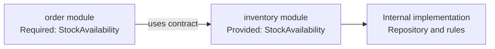
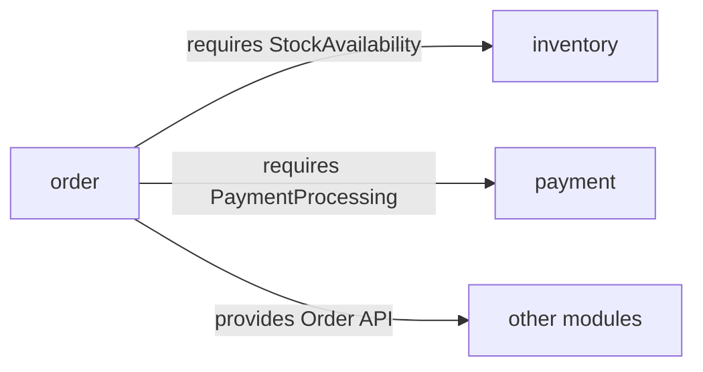

# Provided interface và required interface

Trong một modular monolith, mỗi application module có thể cung cấp chức năng cho module khác và đồng thời cần sử dụng chức năng do module khác sở hữu. Hai góc nhìn này thường được mô tả bằng **provided interface** (giao diện được cung cấp) và **required interface** (giao diện được yêu cầu). Phân biệt được chúng giúp xác định module nào sở hữu một hợp đồng, module nào đang sử dụng hợp đồng đó và phụ thuộc cần được kiểm soát ra sao.

Trong Spring Modulith, mô hình module được xây dựng từ package. API mà module cung cấp được thể hiện qua package gốc và các named interface được công bố. Các phụ thuộc mà module cần được nhận diện từ việc sử dụng kiểu của module khác và có thể giới hạn bằng `@ApplicationModule(allowedDependencies = ...)`. Spring Modulith không yêu cầu tạo một annotation riêng tên `@ProvidedInterface` hoặc `@RequiredInterface`; đây là hai khái niệm kiến trúc để đọc quan hệ giữa bên cung cấp và bên sử dụng.

## 1. Hai khái niệm nhìn từ hai phía

**Provided interface** là hợp đồng mà một module công bố để module khác có thể sử dụng. Hợp đồng mô tả những thao tác hoặc dữ liệu mà module cung cấp, còn cách thực hiện thuộc quyền sở hữu của module cung cấp.

**Required interface** là hợp đồng mà một module cần sử dụng để hoàn thành trách nhiệm của nó. Module sử dụng phụ thuộc vào khả năng được mô tả bởi hợp đồng đó. Trong trường hợp thông thường, required interface ở phía người dùng chính là provided interface do module khác công bố.

Ví dụ, module `inventory` chịu trách nhiệm quản lý tồn kho và cung cấp khả năng kiểm tra số lượng còn có thể bán. Module `order` cần khả năng đó trước khi xác nhận đơn hàng:



Trong sơ đồ này:

- `inventory` là bên cung cấp. Nó định nghĩa hợp đồng `StockAvailability` và chịu trách nhiệm thực hiện hợp đồng đó.
- `order` là bên sử dụng. Nó cần `StockAvailability` để kiểm tra tồn kho khi xử lý đơn hàng.
- `order` phụ thuộc vào hợp đồng được công bố, không cần phụ thuộc vào lớp triển khai hay repository của `inventory`.

Một module có thể vừa cung cấp vừa yêu cầu giao diện. Chẳng hạn, `order` cung cấp API tạo đơn hàng cho module khác, đồng thời yêu cầu `inventory` kiểm tra tồn kho và yêu cầu `payment` xử lý thanh toán. Vì vậy, provided và required mô tả vai trò trong từng quan hệ phụ thuộc, không phải nhãn cố định của toàn bộ module.

## 2. Provided interface trong Spring Modulith

Spring Modulith xác định API công khai của một application module theo cấu trúc package. Theo quy ước mặc định, các kiểu nằm trực tiếp trong package gốc của module được công bố. Các package con không tự động trở thành API công khai; chúng được xem là phần nội bộ, trừ khi được công bố rõ ràng bằng named interface hoặc module được cấu hình theo kiểu mở.

Giả sử package gốc ứng dụng là `com.example.shop`, module tồn kho có cấu trúc:

```text
com.example.shop.inventory
├── StockAvailability.java
├── StockItem.java
└── internal
    ├── DefaultStockAvailability.java
    └── StockRepository.java
```

`StockAvailability` nằm trực tiếp trong package gốc `com.example.shop.inventory`, vì vậy đây là một kiểu thuộc API được cung cấp của module `inventory`:

```java
package com.example.shop.inventory;

public interface StockAvailability {

    boolean isAvailable(String sku, int quantity);
}
```

Interface mô tả khả năng nghiệp vụ mà bên ngoài cần biết: kiểm tra một mã hàng có đủ số lượng hay không. Nó không để lộ cách truy vấn cơ sở dữ liệu, cấu trúc bảng hoặc thuật toán tính tồn kho.

Phần triển khai nằm trong package con `internal`:

```java
package com.example.shop.inventory.internal;

import com.example.shop.inventory.StockAvailability;
import org.springframework.stereotype.Service;

@Service
class DefaultStockAvailability implements StockAvailability {

    private final StockRepository repository;

    DefaultStockAvailability(StockRepository repository) {
        this.repository = repository;
    }

    @Override
    public boolean isAvailable(String sku, int quantity) {
        return repository.availableQuantity(sku) >= quantity;
    }
}
```

Module `inventory` có thể thay `DefaultStockAvailability`, đổi cách truy vấn hoặc thay repository mà không buộc module `order` thay đổi, miễn là hợp đồng `StockAvailability` vẫn giữ nguyên ý nghĩa và cách sử dụng.

### Khi nào cần named interface?

Package gốc phù hợp với API chính của module. Nếu module cần công bố thêm các nhóm hợp đồng có mục đích riêng, bạn có thể đặt chúng trong package con và đánh dấu package đó bằng `@NamedInterface`.

Ví dụ, module `inventory` có một nhóm hợp đồng dành cho các tích hợp mở rộng:

```java
@org.springframework.modulith.NamedInterface("stock-api")
package com.example.shop.inventory.stock;
```

Các kiểu trong `com.example.shop.inventory.stock` khi đó thuộc named interface có tên `stock-api`. Module khác có thể phụ thuộc có chủ đích vào nhóm hợp đồng này. Tên named interface nên diễn đạt vai trò của nhóm API, chẳng hạn `stock-api`, `reporting` hoặc `spi`, thay vì dùng tên chung chung không thể hiện mục đích.

Named interface cho phép module cung cấp nhiều bề mặt API với phạm vi khác nhau. Việc công bố một package con không làm tất cả package con khác trở thành công khai.

## 3. Required interface từ góc nhìn module sử dụng

Module sử dụng cần biết hợp đồng mà nó phụ thuộc. Ví dụ, `order` kiểm tra tồn kho trước khi tạo đơn hàng. Lớp dịch vụ của `order` chỉ tham chiếu interface `StockAvailability`:

```java
package com.example.shop.order.internal;

import com.example.shop.inventory.StockAvailability;
import org.springframework.stereotype.Service;

@Service
class PlaceOrderService {

    private final StockAvailability stockAvailability;

    PlaceOrderService(StockAvailability stockAvailability) {
        this.stockAvailability = stockAvailability;
    }

    void place(String sku, int quantity) {
        if (!stockAvailability.isAvailable(sku, quantity)) {
            throw new IllegalStateException("Insufficient stock");
        }

        // Tiếp tục xử lý việc tạo đơn hàng.
    }
}
```

Ở đây, `order` đang yêu cầu khả năng kiểm tra tồn kho. Required interface của `order` được thể hiện trong mã bằng hợp đồng mà nó tham chiếu. Module `order` không cần biết Spring sẽ tạo bean từ lớp `DefaultStockAvailability` như thế nào; việc cấu hình và cung cấp bean thuộc trách nhiệm của ứng dụng và module `inventory`.

Điểm cần phân biệt là **required interface không đồng nghĩa với một interface Java do module sử dụng nhất thiết phải tự khai báo**. Trong ví dụ trên, interface được định nghĩa và sở hữu bởi module cung cấp `inventory`. Module `order` sử dụng nó như một dependency. Trong một thiết kế theo hướng ports-and-adapters, module tiêu thụ cũng có thể định nghĩa một port thuộc quyền sở hữu của mình rồi yêu cầu adapter bên ngoài triển khai port đó. Đó là một lựa chọn thiết kế khác; khi áp dụng cần xem xét hướng phụ thuộc package và quyền sở hữu hợp đồng.

## 4. Khai báo giới hạn phụ thuộc bằng `allowedDependencies`

Spring Modulith phân tích mô hình module và phát hiện các phụ thuộc giữa chúng. Nếu một lớp trong `order` tham chiếu đến kiểu được cung cấp bởi `inventory`, mô hình ghi nhận quan hệ phụ thuộc từ `order` đến `inventory`.

Bạn có thể giới hạn module mà `order` được phép phụ thuộc bằng `@ApplicationModule` trong `package-info.java` của package gốc `order`:

```java
@org.springframework.modulith.ApplicationModule(
    allowedDependencies = "inventory"
)
package com.example.shop.order;
```

`allowedDependencies` là danh sách cho phép các module mà module hiện tại được phụ thuộc. Khai báo này diễn đạt chính sách kiến trúc ở phía module sử dụng. Nó không tạo ra provided interface; API được cung cấp vẫn được xác định từ package gốc và các named interface của module đích.

Khi một module chỉ cần một named interface cụ thể, có thể ghi rõ module và tên giao diện theo cú pháp `module::named-interface`. Ví dụ, nếu `StockAvailability` được đặt trong package named interface `stock-api` của `inventory`, module `order` có thể khai báo:

```java
@org.springframework.modulith.ApplicationModule(
    allowedDependencies = "inventory::stock-api"
)
package com.example.shop.order;
```

Trong trường hợp này, module `order` khai báo phụ thuộc vào named interface `stock-api` của `inventory`. Cách khai báo này giúp hợp đồng mà module sử dụng được giới hạn rõ hơn so với việc cho phép phụ thuộc vào mọi giao diện công khai của module đích.

Nếu không khai báo danh sách `allowedDependencies`, các quy tắc phụ thuộc mặc định của Spring Modulith vẫn áp dụng. Khi dự án cần whitelist các phụ thuộc, hãy khai báo danh sách và cập nhật nó cùng với thay đổi kiến trúc có chủ đích. Không thêm một module vào danh sách chỉ để làm kiểm thử qua mà chưa xem xét lý do phát sinh phụ thuộc.

## 5. Đọc một quan hệ provided/required hoàn chỉnh

Một quan hệ đơn giản giữa hai module có thể được đọc theo ba câu hỏi:

1. **Ai sở hữu hợp đồng?** Module cung cấp định nghĩa và duy trì ý nghĩa của API. Trong ví dụ, `inventory` sở hữu `StockAvailability`.
2. **Ai cần hợp đồng?** Module tiêu thụ sử dụng API để thực hiện trách nhiệm của mình. Trong ví dụ, `order` cần kiểm tra tồn kho.
3. **Phụ thuộc được cho phép ở mức nào?** Quy tắc của module sử dụng xác định module hoặc named interface mà nó được phép tham chiếu. Trong ví dụ, `order` cho phép phụ thuộc vào `inventory` hoặc cụ thể hơn là `inventory::stock-api`.

| Thành phần | Bên cung cấp (`inventory`) | Bên sử dụng (`order`) |
|---|---|---|
| Vai trò | Cung cấp khả năng kiểm tra tồn kho | Yêu cầu khả năng kiểm tra tồn kho |
| Hợp đồng | Định nghĩa `StockAvailability` | Tham chiếu và gọi `StockAvailability` |
| Vị trí trong package | Package gốc hoặc named interface được công bố | Package nội bộ của `order` có thể sử dụng API đã công bố |
| Triển khai | `DefaultStockAvailability` và repository nội bộ | `PlaceOrderService` điều phối nghiệp vụ đơn hàng |
| Quy tắc phụ thuộc | Duy trì API ổn định và quyền sở hữu hợp đồng | Khai báo module/named interface được phép trong `allowedDependencies` khi áp dụng whitelist |

Mô hình tổng thể có thể có nhiều quan hệ cùng lúc:



Trong sơ đồ, `order` là bên sử dụng của `inventory` và `payment`, nhưng lại là bên cung cấp API cho các module khác. Khi đọc sơ đồ phụ thuộc, hãy xem từng mũi tên theo hướng module tiêu thụ đến module cung cấp: module ở đầu mũi tên đang cần hợp đồng do module ở cuối mũi tên công bố.

## 6. Giữ hợp đồng ổn định và giới hạn bề mặt API

Một provided interface là cam kết giữa module cung cấp và các module sử dụng. Nếu thay đổi chữ ký phương thức, kiểu dữ liệu hoặc ý nghĩa nghiệp vụ của hợp đồng, các module tiêu thụ có thể phải thay đổi theo. Vì vậy, API công khai nên chỉ chứa những khả năng thật sự cần chia sẻ.

Một số nguyên tắc thiết kế hữu ích:

- **Công bố hợp đồng có ý nghĩa nghiệp vụ.** `StockAvailability` thể hiện khả năng kiểm tra hàng tồn; nó dễ hiểu hơn việc để module khác gọi trực tiếp một repository hoặc một lớp truy vấn dữ liệu.
- **Ẩn chi tiết triển khai.** Repository, entity nội bộ, thuật toán và lớp điều phối riêng của module nên ở package con không được công bố.
- **Chỉ tạo named interface khi có nhóm người dùng hoặc mục đích rõ ràng.** Mỗi named interface làm rõ một phần API mà module khác được phép sử dụng.
- **Giới hạn dependency ở phía người dùng.** Dùng `allowedDependencies` để thể hiện các quan hệ hợp lệ và cân nhắc cú pháp `module::named-interface` khi chỉ cần một nhóm API.
- **Tránh phụ thuộc vòng.** Nếu `order` cần `inventory` và `inventory` cũng cần trực tiếp `order`, hãy xem lại quyền sở hữu hợp đồng hoặc cân nhắc một cơ chế giao tiếp khác như sự kiện nghiệp vụ.
- **Không dùng kiểu nội bộ làm hợp đồng liên module.** Nếu module khác cần một kiểu, hãy đưa kiểu đó vào API được công bố hoặc thiết kế lại ranh giới để chủ sở hữu hợp đồng rõ ràng.

Java có thể cho phép import một lớp `public` từ package nội bộ, nhưng khả năng truy cập của ngôn ngữ không đồng nghĩa với việc Spring Modulith xem kiểu đó là API hợp lệ. Hãy thiết kế theo ranh giới module và để công cụ kiểm tra các vi phạm.

## 7. Kiểm chứng quan hệ phụ thuộc

Sau khi tổ chức package, có thể dùng `ApplicationModules` để kiểm tra mô hình module. Một bài kiểm thử kiến trúc cơ bản:

```java
import org.junit.jupiter.api.Test;
import org.springframework.modulith.core.ApplicationModules;

class ModularityTests {

    @Test
    void verifiesModuleDependencies() {
        ApplicationModules.of(ShopApplication.class).verify();
    }
}
```

`verify()` kiểm tra các quy tắc kiến trúc mà Spring Modulith nhận diện được, bao gồm việc truy cập package không được công bố và các phụ thuộc không phù hợp với cấu hình module. Nếu `order` tham chiếu một lớp nằm trong package nội bộ của `inventory`, hoặc tạo phụ thuộc không được cho phép, kiểm thử có thể báo lỗi tương ứng.

Khi kiểm thử thất bại, hãy lần lượt kiểm tra:

1. Kiểu được tham chiếu có thực sự cần là hợp đồng liên module không?
2. Kiểu đó có nằm trong package gốc hoặc named interface đã công bố của module sở hữu không?
3. Module tiêu thụ đã khai báo phụ thuộc phù hợp trong `allowedDependencies` chưa, nếu dự án đang sử dụng whitelist?
4. Có thể thay phụ thuộc trực tiếp bằng một hợp đồng nhỏ hơn hoặc một sự kiện nghiệp vụ không?

Không nên khắc phục lỗi bằng cách mở toàn bộ module hoặc đưa mọi package vào API. Trước tiên, xác định đúng hợp đồng cần chia sẻ và công bố đúng phạm vi.

## 8. Những nhầm lẫn thường gặp

| Nhầm lẫn | Cách hiểu đúng |
|---|---|
| Provided interface và required interface là hai annotation bắt buộc của Spring Modulith | Đây là hai vai trò kiến trúc. Spring Modulith biểu diễn API qua package gốc/named interface và phụ thuộc qua mô hình module cùng `allowedDependencies`. |
| Module sử dụng phải sở hữu interface Java mà nó gọi | Trong quan hệ thông thường, module cung cấp có thể sở hữu interface và module sử dụng tham chiếu nó. Mô hình ports-and-adapters có thể chọn quyền sở hữu khác. |
| Lớp `public` ở bất kỳ package nào cũng là provided interface | Package nội bộ không tự trở thành API chỉ vì lớp có modifier `public`. |
| `allowedDependencies` tạo ra API cho module đích | Thuộc tính này giới hạn các phụ thuộc được phép ở phía module sử dụng; API được công bố ở phía module cung cấp. |
| Công bố một named interface làm công khai tất cả package con | Chỉ package được đánh dấu và các kiểu thuộc named interface đó được công bố theo cấu hình tương ứng. |
| Module có một vai trò cố định là provider hoặc consumer | Một module có thể cung cấp API cho module này và sử dụng API của module khác. |

## 9. Checklist thiết kế provided và required interface

- [ ] Xác định module sở hữu trách nhiệm nghiệp vụ và hợp đồng được cung cấp.
- [ ] Đặt API ở package gốc hoặc công bố package con bằng `@NamedInterface`.
- [ ] Giữ lớp triển khai và repository trong package nội bộ.
- [ ] Xác định rõ module nào cần sử dụng hợp đồng và vì mục đích gì.
- [ ] Khai báo `allowedDependencies` phù hợp với chính sách phụ thuộc của dự án.
- [ ] Dùng `module::named-interface` khi cần giới hạn dependency vào một named interface cụ thể.
- [ ] Kiểm tra mô hình bằng `ApplicationModules.of(...).verify()`.
- [ ] Xem xét lại phụ thuộc vòng và các hợp đồng bị công bố quá rộng.

## 10. Kết luận

Provided interface mô tả hợp đồng mà một application module cung cấp; required interface mô tả hợp đồng mà module khác cần sử dụng. Trong Spring Modulith, phía cung cấp được thể hiện qua API ở package gốc hoặc named interface, còn phía sử dụng thể hiện qua các phụ thuộc được phát hiện và giới hạn bằng `@ApplicationModule(allowedDependencies = ...)`.

Khi xác định rõ quyền sở hữu hợp đồng, chỉ công bố API cần thiết và kiểm tra các phụ thuộc bằng `ApplicationModules.verify()`, mỗi module có thể phối hợp với module khác mà vẫn giữ được ranh giới nghiệp vụ và khả năng thay đổi phần triển khai bên trong.
