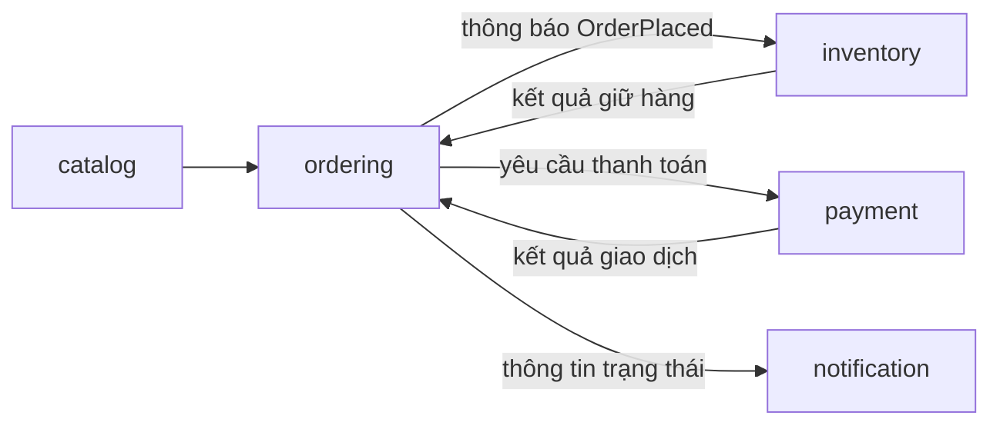

# Đọc module như một đơn vị trách nhiệm nghiệp vụ

Trong Spring Modulith, một **application module** là một phần của ứng dụng được tổ chức quanh một trách nhiệm nghiệp vụ có ý nghĩa. Module gom các hành vi, quy tắc và dữ liệu cần thiết để thực hiện trách nhiệm đó; đồng thời xác định hợp đồng mà phần còn lại của ứng dụng được phép sử dụng.

Ví dụ, một hệ thống bán hàng có thể có các module `catalog`, `ordering`, `inventory`, `payment` và `notification`. Mỗi module đảm nhiệm một năng lực riêng: quản lý sản phẩm, xử lý đơn hàng, quản lý tồn kho, xử lý thanh toán và gửi thông báo. Cách chia này giúp ta đọc cấu trúc ứng dụng theo ngôn ngữ nghiệp vụ, hiểu ai sở hữu quyết định nào và dự đoán nơi cần thay đổi khi một yêu cầu mới xuất hiện.

## 1. Module trả lời câu hỏi “phần này chịu trách nhiệm về điều gì?”

Một module không chỉ là một thư mục chứa các lớp liên quan. Nó là ranh giới để gom những phần thường xuyên thay đổi cùng nhau vì cùng phục vụ một mục tiêu nghiệp vụ. Khi đọc một module, ta cần nhận ra:

- Năng lực nghiệp vụ mà module cung cấp.
- Các quy tắc và quyết định nghiệp vụ mà module sở hữu.
- Dữ liệu mà module chịu trách nhiệm duy trì tính đúng đắn.
- Hợp đồng mà module công khai cho các phần khác sử dụng.
- Những module mà nó cần phối hợp để hoàn thành công việc.

Ví dụ, `ordering` sở hữu vòng đời đơn hàng: tạo đơn, xác nhận, hủy và theo dõi trạng thái. Nó có thể cần thông tin sản phẩm từ `catalog`, nhưng không nên tự quản lý số lượng tồn kho hoặc chi tiết kết nối cổng thanh toán. Những quyết định đó thuộc về `inventory` và `payment`.

Một module có thể chứa nhiều lớp, nhiều package con, nhiều service và nhiều kiểu dữ liệu. Nó cũng có thể xử lý nhiều use case miễn là chúng cùng thuộc một trách nhiệm nghiệp vụ mạch lạc. Vì vậy, “một module, một trách nhiệm” không có nghĩa là “một module, một class”, “một module, một bảng dữ liệu” hay “một module, một API endpoint”.

## 2. Nhận diện module từ cấu trúc ứng dụng

Spring Modulith xây dựng application module model dựa trên package của ứng dụng. Với cách phát hiện mặc định, các package con trực tiếp của package gốc ứng dụng được xem là các application module.

Giả sử lớp khởi động nằm trong `com.acme.shop`, cấu trúc có thể được tổ chức như sau:

```text
com.acme.shop
├── ShopApplication.java
├── catalog
│   ├── CatalogManagement.java
│   └── internal
│       ├── ProductRepository.java
│       └── ProductCatalogService.java
├── ordering
│   ├── OrderManagement.java
│   ├── OrderPlaced.java
│   └── internal
│       ├── OrderRepository.java
│       └── OrderService.java
├── inventory
│   ├── InventoryManagement.java
│   └── internal
│       └── StockReservationService.java
├── payment
│   └── internal
│       └── PaymentService.java
└── notification
    └── internal
        └── NotificationService.java
```

Ở đây, `catalog`, `ordering`, `inventory`, `payment` và `notification` là năm module. Các package con như `ordering.internal` là nơi đặt chi tiết triển khai của module tương ứng.

Theo quy ước mặc định, package gốc của module là phần được công khai. Các package con được xem là nội bộ, trừ khi một package con được mở ra rõ ràng dưới dạng named interface. Do đó, một lớp nằm trong `ordering.internal` không trở thành API chỉ vì nó được khai báo `public` trong Java.

Điều này giúp người đọc phân biệt hai câu hỏi:

- **Cấu trúc nghiệp vụ:** lớp này thuộc module nào?
- **Hợp đồng kiến trúc:** module khác được phép sử dụng lớp này hay không?

Package cho biết vị trí và quyền sở hữu; mô hình module của Spring Modulith giúp diễn đạt và kiểm tra ranh giới sử dụng.

## 3. Đọc trách nhiệm qua quyền sở hữu nghiệp vụ

Để hiểu một module, hãy tìm những quyết định mà module đó chịu trách nhiệm. Trong hệ thống bán hàng, có thể lập bản đồ trách nhiệm như sau:

| Module | Trách nhiệm sở hữu | Những việc không nên sở hữu |
|---|---|---|
| `catalog` | Thông tin sản phẩm, mã hàng, mô tả và trạng thái kinh doanh của sản phẩm | Vòng đời đơn hàng, số lượng hàng đang giữ, trạng thái thanh toán |
| `ordering` | Tạo đơn, xác nhận đơn, hủy đơn và trạng thái đơn hàng | Tính tồn kho thực tế, gọi trực tiếp cổng thanh toán, gửi email |
| `inventory` | Số lượng có thể bán, nhập xuất kho và giữ hàng | Quy tắc chuyển trạng thái đơn hàng, nội dung email |
| `payment` | Yêu cầu thanh toán, kết quả giao dịch và trạng thái thanh toán | Quyết định đơn hàng được giao hay bị hủy |
| `notification` | Mẫu thông báo, kênh gửi và trạng thái gửi | Quyết định nghiệp vụ về đơn hàng, tồn kho hoặc thanh toán |

Ranh giới này giúp xác định nơi đặt quy tắc. Chẳng hạn, quy tắc “không cho hủy đơn đã giao” thuộc `ordering`, vì nó quyết định vòng đời đơn hàng. Quy tắc “không giữ vượt quá số lượng có thể bán” thuộc `inventory`, vì module này sở hữu dữ liệu và quyết định về tồn kho.

Một module khác có thể yêu cầu module sở hữu thực hiện một thao tác hoặc nhận thông tin qua hợp đồng công khai. Nhưng nó không nên tự đọc bảng dữ liệu, gọi repository nội bộ hoặc tự sửa trạng thái thuộc quyền sở hữu của module kia. Nếu nhiều module cùng cập nhật một dữ liệu nghiệp vụ, trách nhiệm trở nên mơ hồ và các quy tắc dễ bị thực thi không nhất quán.

### Module không đồng nghĩa với bảng dữ liệu hay aggregate

Một module có thể chứa nhiều aggregate hoặc nhiều bảng phục vụ cùng một năng lực. Ngược lại, một quy trình nghiệp vụ có thể đi qua nhiều module. Ví dụ, đặt hàng có thể phối hợp `ordering`, `inventory` và `payment`, nhưng điều đó không có nghĩa các module phải gộp thành một module lớn.

Điều cần giữ là quyền sở hữu rõ ràng: `ordering` quyết định trạng thái đơn hàng; `inventory` quyết định trạng thái giữ hàng; `payment` quyết định trạng thái giao dịch. Quy trình tổng thể phối hợp các quyết định đó qua những hợp đồng đã xác định.

## 4. Module có API để phần khác sử dụng

Một module cần công khai đủ chức năng để module khác phối hợp mà không phải biết chi tiết triển khai. Ví dụ, `ordering` có thể công khai một API:

```java
package com.acme.shop.ordering;

public interface OrderManagement {

    OrderId placeOrder(PlaceOrderCommand command);

    OrderDetails findOrder(OrderId orderId);
}
```

`OrderManagement` thể hiện những khả năng mà module `ordering` cung cấp. Phần triển khai có thể nằm trong `ordering.internal`, nơi chứa service, repository và các lớp hỗ trợ.

```text
ordering
├── OrderManagement.java       // API công khai
├── OrderId.java               // Kiểu dữ liệu hợp đồng
├── PlaceOrderCommand.java     // Yêu cầu công khai
├── OrderDetails.java          // Kết quả công khai
└── internal
    ├── OrderService.java      // Điều phối nghiệp vụ
    ├── OrderRepository.java   // Truy cập dữ liệu
    └── OrderEntity.java       // Mô hình lưu trữ
```

API công khai nên phản ánh ngôn ngữ nghiệp vụ và những thao tác thực sự cần thiết. Không nên phơi bày repository hoặc entity chỉ để module khác tiện truy cập. Khi module sở hữu thay đổi cách lưu dữ liệu, hợp đồng nghiệp vụ ổn định sẽ giúp các module gọi nó ít bị ảnh hưởng.

Nếu module cần cung cấp thêm một nhóm giao diện từ package con, Spring Modulith hỗ trợ named interface. Đây là cách công khai có chủ đích một phần của module mà vẫn giữ các package con còn lại ở trạng thái nội bộ.

## 5. Quan hệ phụ thuộc phản ánh cách các trách nhiệm phối hợp

Khi một module sử dụng API của module khác, quan hệ phụ thuộc cần có lý do nghiệp vụ rõ ràng. Ví dụ, `ordering` có thể hỏi `catalog` về thông tin sản phẩm khi tạo đơn. `inventory` có thể nhận thông tin đơn đã được tạo để giữ hàng. `notification` có thể phản ứng khi một nghiệp vụ hoàn tất để gửi thông báo.

Sơ đồ dưới đây minh họa một cách tổ chức có thể có; nó không áp đặt rằng mọi hệ thống bán hàng đều phải có đúng các module hoặc quan hệ này.



Sơ đồ nghiệp vụ có thể mô tả các luồng phối hợp theo cả hai chiều. Khi chuyển thành phụ thuộc mã nguồn, cần xem xét kiểu dữ liệu và API nào được tham chiếu. Ví dụ, một listener ở `inventory` tham chiếu kiểu event do `ordering` công khai thì vẫn có phụ thuộc mã nguồn vào hợp đồng đó.

Một module tốt có số lượng phụ thuộc vừa đủ để hoàn thành trách nhiệm. Nếu nó phải truy cập nhiều module khác để thực hiện hầu hết mọi thao tác, có thể trách nhiệm đã được chia chưa hợp lý, hoặc một phần nghiệp vụ đang nằm sai nơi.

### Tránh chia module theo tầng kỹ thuật

Một cấu trúc như sau thường không thể hiện rõ quyền sở hữu nghiệp vụ:

```text
com.acme.shop
├── controller
├── service
├── repository
└── entity
```

Trong cách chia này, chức năng đơn hàng, sản phẩm và thanh toán có thể bị phân tán qua tất cả các package. Khi thay đổi một use case, lập trình viên phải đi qua nhiều tầng dùng chung; các tầng cũng dễ phụ thuộc chéo vào nhau.

Với modular monolith, nên nhóm theo năng lực nghiệp vụ trước, rồi tổ chức các tầng kỹ thuật bên trong từng module:

```text
com.acme.shop
├── ordering
│   ├── OrderManagement.java
│   └── internal
│       ├── web
│       ├── application
│       └── persistence
├── catalog
│   ├── CatalogManagement.java
│   └── internal
│       ├── web
│       ├── application
│       └── persistence
└── payment
    └── internal
        ├── application
        └── persistence
```

Các tên package con chỉ là ví dụ tổ chức nội bộ. Điểm cốt lõi là toàn bộ hành vi và dữ liệu thuộc một trách nhiệm nghiệp vụ có thể được tìm thấy trong cùng module.

## 6. Khi nào nên tách hoặc gộp module?

Ranh giới module là một quyết định thiết kế có thể điều chỉnh khi hiểu biết về nghiệp vụ tăng lên. Không nên tách module chỉ vì package có nhiều class, cũng không nên gộp chúng chỉ để giảm số package.

**Dấu hiệu nên tách:**

- Một module đang sở hữu hai nhóm quy tắc nghiệp vụ ít liên quan và thường thay đổi độc lập.
- Một phần của module có dữ liệu, vòng đời và API riêng, đồng thời nhiều chức năng khác cần sử dụng nó.
- Mỗi thay đổi cho một năng lực thường kéo theo sửa nhiều phần không liên quan trong cùng module.
- Có thể xác định hợp đồng giữa hai phần mà không làm lộ chi tiết triển khai.

**Dấu hiệu nên gộp:**

- Hai module luôn phải thay đổi cùng nhau để thực hiện một quy tắc nghiệp vụ.
- Ranh giới giữa chúng không có ý nghĩa với người hiểu nghiệp vụ.
- Chúng liên tục gọi qua lại hoặc cần truy cập dữ liệu nội bộ của nhau để hoàn thành một thao tác.
- Hợp đồng giữa chúng chỉ là lớp chuyển tiếp nhân tạo, không tạo ra quyền sở hữu rõ ràng.

Trước khi tách, hãy xác định trách nhiệm mới, dữ liệu được sở hữu, API cần công khai và hướng phụ thuộc. Trước khi gộp, hãy kiểm tra xem hai phần có thực sự cùng phục vụ một năng lực hay chỉ đang phụ thuộc nhau do thiết kế hiện tại chưa tốt.

## 7. Mô tả module bằng một bản ghi trách nhiệm

Khi bắt đầu thiết kế hoặc review một module, có thể ghi lại các thông tin sau. Bản ghi này giúp nhóm thống nhất cách hiểu trước khi tranh luận về package hay class cụ thể.

| Nội dung | Câu hỏi cần trả lời | Ví dụ với `ordering` |
|---|---|---|
| Mục đích | Module tồn tại để cung cấp năng lực nào? | Quản lý vòng đời đơn hàng |
| Quyết định sở hữu | Quy tắc nghiệp vụ nào thuộc module? | Đơn được tạo, xác nhận hoặc hủy khi nào? |
| Dữ liệu sở hữu | Module chịu trách nhiệm duy trì trạng thái nào? | Đơn hàng, dòng hàng và trạng thái đơn |
| API công khai | Module cung cấp thao tác hoặc thông tin nào? | Đặt đơn và tra cứu đơn |
| Hợp đồng phát ra | Module thông báo kết quả nghiệp vụ nào? | Đơn hàng đã được tạo hoặc hủy |
| Phụ thuộc | Module cần hợp tác với năng lực nào? | Catalog, inventory và payment |
| Phần nội bộ | Chi tiết nào phải được giữ bên trong? | Repository, entity và service triển khai |

Không cần tạo một tài liệu dài cho mỗi module. Chỉ cần đủ rõ để người đọc biết module chịu trách nhiệm về điều gì, nơi nào là nguồn quyết định và cách phần khác được phép phối hợp.

## 8. Kiểm tra module model bằng Spring Modulith

Spring Modulith cung cấp `ApplicationModules` để tạo mô hình module từ lớp khởi động của ứng dụng. Ta có thể duyệt qua các module đã được phát hiện và kiểm tra các ranh giới:

```java
import com.acme.shop.ShopApplication;
import org.springframework.modulith.core.ApplicationModules;

class ModuleModelInspection {

    void inspect() {
        var modules = ApplicationModules.of(ShopApplication.class);

        modules.forEach(System.out::println);
        modules.verify();
    }
}
```

`ApplicationModules.of(...)` xây dựng mô hình từ package gốc của ứng dụng. Việc duyệt mô hình giúp quan sát các module mà Spring Modulith nhận diện; `verify()` kiểm tra các quy tắc cấu trúc và phụ thuộc theo mô hình đó, chẳng hạn truy cập package nội bộ hoặc vòng phụ thuộc giữa module.

Có thể khai báo giới hạn phụ thuộc trên `package-info.java` của một module. Ví dụ, nếu `ordering` chỉ được phép phụ thuộc trực tiếp vào `catalog`, có thể diễn đạt quy tắc như sau:

```java
@org.springframework.modulith.ApplicationModule(
        allowedDependencies = "catalog"
)
package com.acme.shop.ordering;
```

Khai báo này làm rõ quan hệ được chấp nhận trong module model. Khi mã nguồn tạo ra một phụ thuộc ngoài danh sách cho phép, kiểm tra kiến trúc có thể phát hiện vấn đề để nhóm xem xét.

Kiểm tra module model không thể tự quyết định ranh giới nghiệp vụ đã đúng hay chưa. Một cấu trúc package hoàn toàn có thể vượt qua kiểm tra kỹ thuật nhưng vẫn chia trách nhiệm sai. Vì vậy, cần kết hợp kiểm tra tự động với việc review xem tên module, dữ liệu sở hữu, quy tắc nghiệp vụ và hợp đồng công khai có phản ánh đúng cách doanh nghiệp vận hành hay không.

## 9. Checklist đọc một module trong codebase

Khi mở một module Spring Modulith mới hoặc review module hiện có, hãy tự trả lời:

1. Tên module có diễn đạt một năng lực nghiệp vụ dễ hiểu không?
2. Module chịu trách nhiệm về những quyết định và quy tắc nào?
3. Dữ liệu nào là nguồn sự thật do module này sở hữu?
4. API công khai có thể hiện đúng các khả năng mà module cung cấp không?
5. Những lớp nào là chi tiết nội bộ và có đang bị module khác truy cập không?
6. Các phụ thuộc có lý do nghiệp vụ rõ ràng và có hướng hợp lý không?
7. Module có đang trộn các trách nhiệm thường thay đổi độc lập không?
8. `ApplicationModules.verify()` có kiểm tra được các quy tắc phụ thuộc đã định nghĩa không?

Khi đọc ứng dụng theo các câu hỏi này, ta có thể nhìn thấy hệ thống như một tập hợp năng lực nghiệp vụ hợp tác với nhau. Mỗi module sở hữu một phần công việc và dữ liệu rõ ràng; các module khác phối hợp qua hợp đồng công khai. Đó là nền tảng để modular monolith giữ được cấu trúc dễ hiểu và có thể kiểm chứng khi số lượng chức năng tăng lên.
