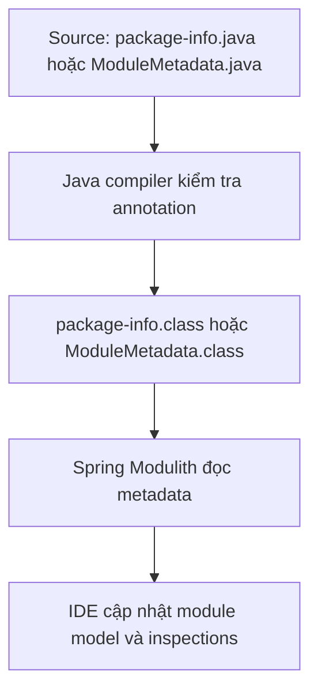

# Kiểm tra compiler và IDE nhận annotation

Khi khai báo metadata cho application module, cần phân biệt ba việc: Java compiler có chấp nhận annotation hay không, Spring Modulith có đọc được metadata từ bytecode hay không, và IDE có cập nhật mô hình module để hỗ trợ người phát triển hay không. Ba việc này liên quan với nhau nhưng không phải cùng một cơ chế.

Một điểm dễ nhầm là `@PackageInfo` không đặt trực tiếp trước câu lệnh `package`. Annotation này có `@Target(TYPE)` và `@Retention(RUNTIME)`: nó đánh dấu một class như lựa chọn thay thế cho `package-info.java` của Java. Vì vậy, compiler chỉ chấp nhận nó trên một type. Bài học này hướng dẫn cách viết đúng, cách kiểm tra từng tầng và cách xử lý khi IDE chưa nhận ra metadata.

## Mục tiêu

Sau bài học, bạn có thể:

- Phân biệt kiểm tra annotation của Java compiler với kiểm tra kiến trúc của Spring Modulith.
- Đọc `@Target` và `@Retention` để biết annotation được phép đặt ở đâu và được giữ đến giai đoạn nào.
- Dùng `@PackageInfo` trên một type metadata thay cho `package-info.java`.
- Chọn đúng cách khai báo package metadata cho Java và các ngôn ngữ không hỗ trợ `package-info.java`.
- Xác minh metadata đã xuất hiện trong bytecode và được Spring Modulith đọc.
- Làm mới mô hình module trong IntelliJ IDEA hoặc Spring Tools khi metadata chưa cập nhật.
- Phân loại lỗi compiler, lỗi cấu hình dependency, lỗi kiểm tra kiến trúc và lỗi cache của IDE.

## Ba tầng nhận diện annotation

Khi bạn thêm annotation vào mã nguồn, kết quả được kiểm tra qua các tầng sau:

| Tầng | Thành phần | Câu hỏi cần trả lời |
|---|---|---|
| Source và compile | Java compiler | Annotation có tồn tại trên compile classpath, đúng target và đúng giá trị thuộc tính không? |
| Bytecode và mô hình | Spring Modulith | Metadata có được giữ trong class file và có được đọc vào `ApplicationModules` không? |
| Trải nghiệm phát triển | IDE hoặc language server | IDE đã tải đúng dependency, build output và mô hình module mới nhất chưa? |



Nếu compiler báo lỗi, cần sửa source hoặc classpath trước. Nếu compile thành công nhưng Spring Modulith không thấy metadata, cần kiểm tra bytecode và phạm vi quét. Nếu mô hình Spring Modulith đã đúng nhưng IDE vẫn hiển thị trạng thái cũ, hãy làm mới project hoặc metadata của IDE.

## Đọc `@Target` và `@Retention`

Annotation Java có metadata mô tả nơi được phép sử dụng và thời gian lưu giữ. Hai meta-annotation thường cần kiểm tra là:

- `@Target`: giới hạn vị trí có thể đặt annotation, ví dụ `TYPE`, `PACKAGE`, `METHOD` hoặc `FIELD`.
- `@Retention`: quy định annotation được giữ ở source, trong bytecode hay có thể đọc lúc runtime.

Spring Modulith khai báo `@PackageInfo` với:

```java
@Target(ElementType.TYPE)
@Retention(RetentionPolicy.RUNTIME)
public @interface PackageInfo {}
```

Điều này có hai hệ quả:

1. `@PackageInfo` phải gắn với một type như class hoặc interface. Nó không thể gắn trực tiếp với package declaration.
2. Annotation được giữ trong bytecode và có thể được đọc bằng reflection hoặc công cụ phân tích lúc runtime.

Nếu đặt `@PackageInfo` trước dòng `package`, compiler sẽ báo lỗi vì `TYPE` không bao gồm `PACKAGE`. Đây là lỗi target của annotation, không phải lỗi cấu hình Spring Modulith.

## Hai cách khai báo metadata package

### Dùng `package-info.java`

Java hỗ trợ `package-info.java` để đặt Javadoc và annotation có target `PACKAGE` ở cấp package. Đây là cách tự nhiên khi dự án viết Java:

```java
@org.springframework.modulith.ApplicationModule(
    id = "orders",
    displayName = "Quản lý đơn hàng"
)
package com.acme.orders;
```

Một named interface có thể được khai báo tương tự:

```java
@org.springframework.modulith.NamedInterface("spi")
package com.acme.orders.spi;
```

Ở cách này, annotation đặt trực tiếp lên package declaration. Không cần thêm `@PackageInfo` vào file `package-info.java` của Java chỉ để đánh dấu package.

### Dùng một type thay thế `package-info.java`

`@PackageInfo` cho phép đánh dấu một type như nguồn metadata thay thế cho `package-info.java`. Cách này hữu ích với Kotlin hoặc trong trường hợp không thể khai báo metadata theo cơ chế package-info của Java.

Ví dụ, metadata module được đặt trên một class trong package gốc:

```java
package com.acme.orders;

import org.springframework.modulith.ApplicationModule;
import org.springframework.modulith.PackageInfo;

@PackageInfo
@ApplicationModule(
    id = "orders",
    displayName = "Quản lý đơn hàng"
)
class ModuleMetadata {}
```

Spring Modulith xem type được đánh dấu `@PackageInfo` như một nguồn thay thế khi tra cứu annotation của package chứa type đó. `@PackageInfo` không tự tạo application module; metadata `@ApplicationModule` mới mô tả module trong ví dụ này.

Đối với named interface, có thể dùng một type metadata trong package cần công bố:

```java
package com.acme.orders.spi;

import org.springframework.modulith.NamedInterface;
import org.springframework.modulith.PackageInfo;

@PackageInfo
@NamedInterface("spi")
class SpiMetadata {}
```

`@PackageInfo` cho Spring Modulith biết cần xét type này khi tra metadata package. `@NamedInterface("spi")` xác định package là API được công bố với tên `spi`.

Hai cách khai báo có mục đích tương đương ở cấp metadata package, nhưng cú pháp và vị trí annotation khác nhau. Chọn cách phù hợp với ngôn ngữ và quy ước của dự án; tránh khai báo hai nguồn metadata mâu thuẫn cho cùng một package.

## Kiểm tra Java compiler có nhận annotation

Compiler cần tìm được annotation type trên compile classpath. Với Spring Modulith, annotation `@PackageInfo` thuộc artifact `spring-modulith-core` và có từ Spring Modulith 1.2.

Ví dụ Gradle:

```groovy
dependencies {
    implementation("org.springframework.modulith:spring-modulith-core")
}
```

Ví dụ Maven:

```xml
<dependency>
    <groupId>org.springframework.modulith</groupId>
    <artifactId>spring-modulith-core</artifactId>
</dependency>
```

Trong dự án Spring Boot dùng BOM hoặc dependency management của Spring Modulith, hãy để dependency version được quản lý tập trung theo phiên bản dự án. Nếu chỉ sử dụng `ApplicationModules` trong test, dependency có thể được khai báo ở test scope theo cấu hình dự án; nhưng mã nguồn production có sử dụng `@PackageInfo` thì artifact chứa annotation phải có trên compile classpath của source set đó.

Một ví dụ class metadata tối thiểu:

```java
package com.acme.orders;

import org.springframework.modulith.PackageInfo;

@PackageInfo
class ModuleMetadata {}
```

Khi compile, compiler kiểm tra:

- Import `org.springframework.modulith.PackageInfo` có phân giải được không.
- Annotation có được dùng trên type đúng target không.
- Cú pháp Java và giá trị thuộc tính có hợp lệ không.

Compiler không tự xác minh rằng `orders` có ranh giới nghiệp vụ tốt, named interface được dùng đúng hoặc module khác không truy cập implementation trái phép. Đó là trách nhiệm của kiểm tra kiến trúc Spring Modulith.

## Kiểm tra bytecode đã giữ metadata

Vì `@PackageInfo` dùng `RetentionPolicy.RUNTIME`, annotation phải hiện diện trong file `.class` sau khi compile. Với class metadata ở trên, kiểm tra output tương ứng, ví dụ:

```text
build/classes/java/main/com/acme/orders/ModuleMetadata.class
```

Với `package-info.java`, file biên dịch thường có dạng:

```text
build/classes/java/main/com/acme/orders/package-info.class
```

Có thể dùng `javap` để xem annotation được ghi vào bytecode:

```bash
javap -v build/classes/java/main/com/acme/orders/ModuleMetadata.class
```

Trong kết quả, tìm `org.springframework.modulith.PackageInfo` ở phần runtime-visible annotations. Nếu annotation không có trong class file, kiểm tra lại source set, compiler output và cấu hình build.

Lưu ý: `package-info.class` và `ModuleMetadata.class` là hai hình thức bytecode khác nhau. Khi dùng class thay thế, cần kiểm tra đúng class metadata thay vì chỉ tìm `package-info.class`.

## Kiểm tra Spring Modulith đọc được metadata

Sau khi compile, tạo mô hình module từ đúng lớp ứng dụng:

```java
var modules = ApplicationModules.of(Application.class);
modules.forEach(System.out::println);
```

Đầu ra giúp kiểm tra module base package, logical name, các Spring bean và visibility. Nếu metadata được dùng để khai báo `@ApplicationModule`, hãy xác nhận module xuất hiện với tên và cấu hình mong đợi. Nếu metadata công bố named interface, hãy xác nhận type thuộc package đó được đưa vào API của module.

Giữ kiểm thử kiến trúc trong dự án:

```java
import org.junit.jupiter.api.Test;
import org.springframework.modulith.core.ApplicationModules;

class ModularityTests {

    @Test
    void verifiesModuleStructure() {
        ApplicationModules.of(Application.class).verify();
    }
}
```

`verify()` kiểm tra các quy tắc module và dependency trên mô hình đã được tạo. Nó là bằng chứng kiến trúc mạnh hơn việc compiler chỉ chấp nhận annotation, nhưng cũng không thay thế việc xem metadata thực tế khi cần chẩn đoán.

## IDE nhận metadata như thế nào?

IDE thường kết hợp source analysis, dependency model, bytecode và plugin hoặc language server để cung cấp hỗ trợ Spring Modulith. Vì vậy, compiler build thành công là điều kiện quan trọng nhưng không đảm bảo mọi view trong IDE cập nhật ngay lập tức.

### IntelliJ IDEA

IntelliJ IDEA có hỗ trợ Spring Modulith thông qua plugin Spring Modulith. Plugin cung cấp logical structure, module view, inspections và quick-fixes để nhận diện dependency đi vào phần nội bộ của module.

Một số điểm cần nhớ:

- Kiểm tra plugin Spring Modulith đã được bật trong Settings → Plugins.
- Đảm bảo project đã import đúng Maven hoặc Gradle model và có dependency `spring-modulith-core`.
- Dùng Project hoặc Structure view để xem danh sách module, identifier, allowed dependencies và named interfaces.
- Inspections có thể gạch chân một tham chiếu vi phạm boundary. Cảnh báo IDE không đồng nghĩa Java compiler sẽ từ chối compile.
- Kiểm tra kiến trúc vẫn cần chạy qua test Spring Modulith. Từ Spring Modulith 2.0, có thể bật strict runtime verification bằng `spring.modulith.runtime.verification-enabled=true` khi ứng dụng sử dụng artifact `spring-modulith-runtime`.

Nếu source đã thay đổi nhưng module view chưa cập nhật, hãy reload Maven/Gradle project, build lại project và chờ IDE hoàn tất indexing. Sau đó mở lại module view hoặc chạy lại inspection.

### Spring Tools trong Eclipse hoặc VS Code

Spring Tools tạo module metadata dựa trên các class đã biên dịch. Công cụ dùng `ApplicationModulesExporter` với classpath của project để lấy cùng cách sắp xếp module mà Spring Modulith sử dụng.

Điều này có nghĩa:

- Project cần được build để có các file `.class`.
- Thay đổi `package-info.java` cần tạo lại `package-info.class` trước khi tooling thấy metadata mới.
- Spring Tools theo dõi output folder và cập nhật metadata trong nền khi class file thay đổi.
- Nếu mô hình hiển thị rỗng hoặc cũ, build lại project rồi yêu cầu refresh Modulith metadata nếu cần.

Trong Eclipse, có thể dùng thao tác **Spring → Refresh Modulith Metadata** từ project hoặc file build. Trong VS Code, kiểm tra Java project đã import và build hoàn tất; nếu tính năng tracking bị tắt, bật lại setting theo hướng dẫn Spring Tools.

## Compiler và IDE có thể cho kết quả khác nhau

| Tình huống | Compiler | Spring Modulith test | IDE |
|---|---|---|---|
| Thiếu dependency chứa `@PackageInfo` | Báo không tìm thấy annotation type | Không thể chạy nếu source không compile | Có thể gạch đỏ import hoặc báo thiếu dependency |
| Đặt `@PackageInfo` trên package declaration | Báo sai annotation target | Chưa tới bước kiểm tra | Thường hiển thị lỗi target ngay trong editor |
| Đặt annotation đúng target nhưng module dependency sai | Compile có thể thành công | `verify()` báo vi phạm kiến trúc | Inspection có thể cảnh báo tham chiếu sai |
| Bytecode đã mới nhưng IDE dùng cache cũ | Compile thành công | Test chạy trên class output mới sẽ thấy metadata | View có thể chưa cập nhật cho đến khi refresh |
| IDE cảnh báo nhưng build/test không thất bại | Compile có thể vẫn thành công | Kết quả phụ thuộc test và runtime verification | Inspection đang cung cấp cảnh báo riêng |

Điểm quan trọng là không dùng một dấu hiệu để kết luận cả ba tầng đã đúng. Compiler xác nhận cú pháp và target; Spring Modulith xác nhận mô hình kiến trúc; IDE hỗ trợ phát hiện sớm và điều hướng trong quá trình phát triển.

## Quy trình chẩn đoán khi IDE không nhận annotation

Thực hiện theo thứ tự để xác định chính xác tầng gặp lỗi:

1. **Kiểm tra import.** Đảm bảo annotation đến từ `org.springframework.modulith.PackageInfo`, không phải một class trùng tên do dự án tự tạo.
2. **Kiểm tra dependency.** Xác nhận `spring-modulith-core` có trên compile classpath của source set chứa metadata và phiên bản hỗ trợ annotation.
3. **Kiểm tra target.** `@PackageInfo` phải đặt trên class hoặc type; không đặt trực tiếp trên package declaration.
4. **Build project.** Xác nhận compiler tạo class file cho `ModuleMetadata` hoặc `package-info.java`.
5. **Kiểm tra bytecode.** Dùng `javap -v` hoặc công cụ tương đương để xác nhận runtime-visible annotation.
6. **Kiểm tra mô hình.** Dùng `ApplicationModules.of(Application.class)` để xem Spring Modulith có nhận metadata không.
7. **Làm mới IDE.** Reload build model, rebuild và refresh Modulith metadata hoặc indexing.
8. **Chạy test kiến trúc.** Xác nhận module, named interface và dependency rule thực sự đúng.

Nếu compiler thành công nhưng `ApplicationModules` không thấy metadata, hãy kiểm tra package của class metadata có đúng package cần mô tả và package đó có nằm trong phạm vi module scan hay không. Nếu mô hình đúng nhưng IDE sai, tập trung vào class output và cache của IDE.

## Những lỗi thường gặp

| Lỗi | Dấu hiệu | Cách xử lý |
|---|---|---|
| Đặt `@PackageInfo` trước `package` | Compiler báo annotation không áp dụng được cho package | Đặt annotation trên một class metadata |
| Không có `spring-modulith-core` trên compile classpath | Import `PackageInfo` không phân giải | Thêm đúng dependency và reload build model |
| Dùng phiên bản Spring Modulith trước 1.2 | Không tìm thấy annotation trong artifact | Dùng phiên bản hỗ trợ hoặc cách package-info native |
| Chờ IDE cập nhật mà chưa build | Module view rỗng hoặc cũ | Build để tạo class file rồi refresh metadata |
| Nhầm cảnh báo IDE với lỗi compiler | Editor báo lỗi nhưng build có thể vẫn thành công | Chạy compiler và Modulith test để phân loại |
| Annotation được compile nhưng đặt sai package | Spring Modulith không gắn metadata vào module mong muốn | Kiểm tra package declaration và vị trí class metadata |
| Chỉ nhìn `package-info.class` khi dùng class thay thế | Không thấy file dù metadata đã nằm trong `ModuleMetadata.class` | Kiểm tra đúng class file được đánh dấu `@PackageInfo` |

## Bài tập tự đánh giá

Một nhóm viết Kotlin và cần khai báo `allowedDependencies = "orders :: spi"` cho module `shipping`. Nhóm tạo class `ModuleMetadata` nhưng compiler báo lỗi import `PackageInfo`; sau khi thêm dependency, compile thành công nhưng IntelliJ vẫn hiển thị module view cũ.

Hãy trả lời:

1. Vì sao Kotlin dùng type metadata thay cho `package-info.java`?
2. `@PackageInfo` có `@Target` và `@Retention` nào, và điều đó ảnh hưởng ra sao đến vị trí khai báo?
3. `ModuleMetadata` cần những annotation nào để khai báo dependency của `shipping`?
4. Vì sao compile thành công chưa chứng minh dependency `orders :: spi` hợp lệ?
5. Bạn sẽ làm gì để IntelliJ cập nhật module view và xác minh kiến trúc?

Một cách khai báo metadata cho module tiêu thụ là:

```kotlin
package com.acme.shipping

import org.springframework.modulith.ApplicationModule
import org.springframework.modulith.PackageInfo

@PackageInfo
@ApplicationModule(allowedDependencies = ["orders :: spi"])
class ModuleMetadata
```

Sau khi compile, kiểm tra class metadata có annotation trong bytecode, reload project và build lại để IDE cập nhật mô hình. Cuối cùng chạy `ApplicationModules.of(Application.class).verify()` trong test kiến trúc. Nếu module `orders` chưa công bố named interface `spi`, test sẽ phát hiện dependency không hợp lệ dù compiler đã chấp nhận annotation.

## Kết luận

Java compiler, Spring Modulith và IDE kiểm tra metadata ở các tầng khác nhau. `@PackageInfo` là annotation có target `TYPE` và retention `RUNTIME`, dùng để đánh dấu một type thay thế cho `package-info.java`; không đặt nó trực tiếp trên package declaration. Hãy xác nhận dependency và target khi compile, kiểm tra bytecode và module model sau build, rồi làm mới IDE nếu view chưa cập nhật. Cách kiểm tra theo từng tầng giúp tìm đúng nguyên nhân thay vì nhầm cảnh báo editor với lỗi kiến trúc.

## Tài liệu tham khảo

- [Spring Modulith Reference — Fundamentals](https://docs.spring.io/spring-modulith/reference/fundamentals.html)
- [Spring Modulith API — `PackageInfo`](https://docs.spring.io/spring-modulith/docs/current/api/org/springframework/modulith/PackageInfo.html)
- [IntelliJ IDEA Documentation — Spring Modulith](https://www.jetbrains.com/help/idea/spring-modulith.html)
- [Spring Tools — Spring Modulith Support](https://github.com/spring-projects/spring-tools/wiki/Spring-Modulith-Support)
- [Java Language Specification — Annotations](https://docs.oracle.com/javase/specs/jls/se21/html/jls-9.html#jls-9.6)
