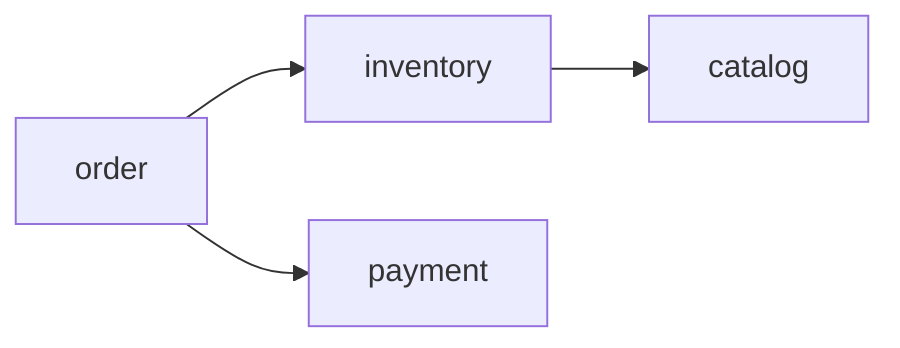
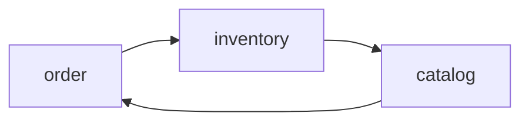
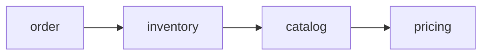

# `ApplicationModules.verify()` kiểm tra những gì?

Spring Modulith cung cấp `ApplicationModules.verify()` để kiểm tra các quy tắc kiến trúc của application module trong một ứng dụng Spring Boot. Phương thức này phân tích mô hình module đã được phát hiện từ package và các tham chiếu kiểu Java, sau đó kiểm tra những dependency có vi phạm ranh giới module hay không.

Các kiểm tra cốt lõi tập trung vào ba nhóm: dependency cycle giữa các module, truy cập package nội bộ của module khác và dependency không nằm trong whitelist `allowedDependencies` khi module khai báo whitelist. Nhờ đó, nhóm phát triển có thể biến các quyết định về ranh giới nghiệp vụ, API công khai và hướng phụ thuộc thành kiểm tra tự động trong test suite.

Trong `SPRING_MODULITH_MODULE_MODEL`, `ApplicationModules.verify()` là bước xác minh cấu trúc modular monolith. Nó kiểm tra mô hình kiến trúc tĩnh của ứng dụng; các kiểm thử Spring context và kiểm thử nghiệp vụ vẫn cần thiết để xác nhận hành vi lúc chạy.

## 1. `ApplicationModules` tạo mô hình trước khi verify

`ApplicationModules` đại diện cho mô hình các application module được phát hiện trong một ứng dụng. Bạn thường tạo mô hình từ lớp khởi chạy Spring Boot:

```java
import org.springframework.modulith.core.ApplicationModules;

ApplicationModules modules = ApplicationModules.of(ShopApplication.class);
```

Lớp `ShopApplication` cung cấp điểm bắt đầu để Spring Modulith xác định root package và phân tích các package thuộc ứng dụng. Detection strategy đang cấu hình quyết định package nào được nhận diện thành application module, ví dụ `direct-sub-packages` hoặc `explicitly-annotated`.

Sau khi tạo mô hình, có thể xem danh sách module:

```java
modules.forEach(System.out::println);
```

Sau đó gọi:

```java
modules.verify();
```

`verify()` kiểm tra các quy tắc trên mô hình đã tạo. Vì vậy, kết quả phụ thuộc vào root package, classpath được phân tích, detection strategy, package metadata và các tùy chọn loại trừ đã sử dụng khi tạo `ApplicationModules`.

## 2. Ba nhóm quy tắc chính

Với cấu hình module thông thường, `ApplicationModules.verify()` kiểm tra những vấn đề kiến trúc quan trọng sau:

| Nhóm kiểm tra | Câu hỏi được kiểm tra | Ví dụ vi phạm |
|---|---|---|
| Acyclic dependencies | Các module có tạo thành chu kỳ phụ thuộc không? | `order → inventory → catalog → order` |
| Module encapsulation | Module có truy cập package nội bộ chưa được expose của module khác không? | `order` import `inventory.internal.InventoryRepository` trong khi `inventory` đóng |
| Allowed dependencies | Dependency trực tiếp có nằm trong `allowedDependencies` đã khai báo không? | `order` chỉ cho phép `inventory` nhưng tham chiếu trực tiếp `payment` |

Các nhóm này bổ sung cho nhau. Một dependency có thể không tạo chu kỳ nhưng vẫn truy cập internal package. Một dependency có thể đi qua API công khai nhưng vẫn không nằm trong whitelist của consumer. `verify()` giúp phát hiện từng loại vi phạm trên cùng một mô hình.

## 3. Kiểm tra dependency cycle giữa các module

Đồ thị dependency giữa các application module là đồ thị có hướng. Nếu mã thuộc module `A` tham chiếu kiểu của module `B`, ta biểu diễn cạnh `A → B`.

Một đồ thị không có chu kỳ cho phép lần theo dependency mà không quay lại module bắt đầu. Ví dụ:



Đồ thị này không có đường đi quay lại module xuất phát, nên không tạo dependency cycle.

Ngược lại:



Chuỗi `order → inventory → catalog → order` là một chu kỳ. Chu kỳ có thể gồm hai module hoặc kéo dài qua nhiều module. `verify()` kiểm tra đồ thị module và báo lỗi nếu phát hiện dependency cycle.

Chu kỳ ở đây là quan hệ giữa application module, không nhất thiết là circular dependency giữa hai Spring bean. Ví dụ, một kiểu DTO trong `catalog` tham chiếu kiểu thuộc `order` cũng có thể tạo cạnh kiến trúc, dù không có service nào inject ngược nhau.

## 4. Kiểm tra truy cập package nội bộ

Một application module mặc định là closed. Package gốc của module là API package mặc định; package con chưa được công bố thuộc phần nội bộ.

Ví dụ module `inventory`:

```text
com.example.shop.inventory
├── InventoryAvailability.java
└── internal
    ├── DefaultInventoryAvailability.java
    └── InventoryRepository.java
```

Module `order` nên tham chiếu `InventoryAvailability` ở package gốc. Nếu nó import trực tiếp `InventoryRepository` từ `inventory.internal`, `verify()` sẽ phát hiện truy cập package nội bộ khi `inventory` là closed và package đó chưa được expose.

```java
package com.example.shop.order.internal;

import com.example.shop.inventory.internal.InventoryRepository;

class PlaceOrderService {

    private final InventoryRepository repository;

    PlaceOrderService(InventoryRepository repository) {
        this.repository = repository;
    }
}
```

Lớp `InventoryRepository` có thể được khai báo `public` và Java compiler vẫn cho phép import. Tuy nhiên, Java visibility không thay thế encapsulation của Spring Modulith. Một kiểu `public` trong package nội bộ vẫn không tự động trở thành public API của module.

Quy tắc này áp dụng cho mọi package con chưa được expose, không chỉ package có tên `internal`. Các package như `persistence`, `repository`, `application` hoặc `adapter` cũng là nội bộ nếu nằm dưới module closed và không có metadata công bố.

## 5. Named Interface được tính là API được expose

Nếu module cần chia sẻ một package con, có thể công bố package đó bằng `@NamedInterface`.

Provider `inventory` đánh dấu package `spi`:

```java
@org.springframework.modulith.NamedInterface("spi")
package com.example.shop.inventory.spi;
```

Kiểu được chia sẻ nằm trong package này:

```java
package com.example.shop.inventory.spi;

public interface StockReservation {

    boolean reserve(String sku, int quantity);
}
```

Module consumer có thể tham chiếu named interface đó. Nếu dùng whitelist, khai báo:

```java
@org.springframework.modulith.ApplicationModule(
    allowedDependencies = "inventory::spi"
)
package com.example.shop.order;
```

Khi provider đã công bố `spi`, dependency tới các kiểu thuộc named interface này không bị xem là truy cập package nội bộ. Các package con khác chưa được công bố vẫn được bảo vệ.

`@NamedInterface` không tạo application module mới. Nó mở một bề mặt API có tên bên trong module provider.

## 6. Kiểm tra `allowedDependencies`

Module có thể khai báo whitelist để giới hạn những module hoặc named interface mà nó được phép phụ thuộc trực tiếp. Whitelist được đặt ở phía consumer trong `@ApplicationModule`.

Ví dụ `order` chỉ được phép sử dụng API package gốc của `inventory` và named interface `processing` của `payment`:

```java
@org.springframework.modulith.ApplicationModule(
    allowedDependencies = {
        "inventory",
        "payment::processing"
    }
)
package com.example.shop.order;
```

Nếu mã của `order` tạo dependency trực tiếp tới `catalog`, dependency đó không nằm trong whitelist và sẽ bị kiểm tra báo vi phạm.

Một số cú pháp thường dùng:

| Giá trị | Phạm vi được cho phép |
|---|---|
| `"inventory"` | API package gốc của module `inventory` |
| `"inventory::spi"` | Named interface `spi` của `inventory` |
| `"inventory::*"` | Tất cả named interface của `inventory`, không gồm API package gốc |
| `"inventory::**"` | API package gốc và tất cả named interface của `inventory` |

Nếu module không khai báo `allowedDependencies`, thuộc tính này không tạo whitelist tường minh để giới hạn dependency. Các quy tắc khác như encapsulation và dependency cycle vẫn được kiểm tra.

## 7. Dependency bắc cầu không phải dependency trực tiếp

Giả sử đồ thị:



Nếu `order` chỉ tham chiếu trực tiếp `inventory`, thì `catalog` và `pricing` là dependency bắc cầu qua các module trung gian. Whitelist của `order` không cần liệt kê `catalog` và `pricing` chỉ vì chúng xuất hiện trong đường đi gián tiếp.

Nếu mã `order` bắt đầu tham chiếu trực tiếp kiểu thuộc `catalog`, đồ thị có thêm cạnh `order → catalog`. Dependency mới phải được đánh giá theo whitelist và ý định kiến trúc của `order`.

Điều này giúp `allowedDependencies` phản ánh các quan hệ trực tiếp mà module thực sự sử dụng. Nó không phải danh sách mọi module có thể đi tới từ module hiện tại.

## 8. Viết kiểm thử kiến trúc với `ApplicationModules.verify()`

Thông thường, gọi `verify()` trong một JUnit test để mỗi lần chạy test suite đều kiểm tra ranh giới module:

```java
import org.junit.jupiter.api.Test;
import org.springframework.modulith.core.ApplicationModules;

class ModularityTests {

    @Test
    void verifiesApplicationModuleStructure() {
        ApplicationModules.of(ShopApplication.class).verify();
    }
}
```

Nếu mô hình vi phạm một hoặc nhiều quy tắc, lời gọi `verify()` làm test thất bại và báo các vi phạm kiến trúc được phát hiện. Hãy xem thông báo lỗi để xác định module nguồn, module đích và kiểu hoặc package gây ra dependency.

Có thể đặt test này trong test source set của ứng dụng. Vì đây là kiểm tra mô hình code, nó thường không cần khởi động toàn bộ Spring `ApplicationContext`.

### Tổ chức test dùng chung

Nếu có nhiều test cần cùng mô hình, có thể tạo một helper:

```java
final class ModuleArchitecture {

    private ModuleArchitecture() {
    }

    static ApplicationModules modules() {
        return ApplicationModules.of(ShopApplication.class);
    }
}
```

Test vẫn gọi:

```java
@Test
void verifiesModuleStructure() {
    ModuleArchitecture.modules().verify();
}
```

Hãy dùng cùng một root application class và cùng cấu hình detection/exclusion có chủ đích. Nếu các test vô tình phân tích những root package hoặc phạm vi classpath khác nhau, chúng có thể kiểm tra các mô hình khác nhau.

## 9. Đọc và xử lý lỗi verification

Khi `verify()` thất bại, không nên vội thêm `OPEN`, mở rộng whitelist hoặc loại trừ package. Trước hết, xác định loại vi phạm.

| Dấu hiệu | Câu hỏi cần kiểm tra | Hướng xử lý thường gặp |
|---|---|---|
| Dependency cycle | Đường đi nào quay lại module ban đầu? | Loại bỏ cạnh ngược, chuyển hợp đồng về đúng module sở hữu hoặc dùng event phù hợp |
| Access to internal package | Consumer đang tham chiếu package con nào của provider? | Chuyển sang API package gốc hoặc expose đúng package bằng `@NamedInterface` |
| Dependency not allowed | Consumer tạo dependency trực tiếp tới module nào ngoài whitelist? | Xem dependency có chủ đích không; nếu có, khai báo đúng module/interface được phép |
| Named interface không khớp | Provider đã đánh dấu đúng package và tên interface chưa? | Kiểm tra `package-info.java`, tên `@NamedInterface` và identifier module |

Khi có nhiều lỗi, hãy sửa theo nguyên nhân kiến trúc. Một thay đổi có thể làm mất nhiều vi phạm cùng lúc, nhưng cũng có thể làm lộ ra dependency khác trước đó bị che bởi lỗi đầu tiên.

## 10. Những gì `verify()` không kiểm tra

`ApplicationModules.verify()` là kiểm tra kiến trúc tĩnh ở cấp application module. Nó không thay thế toàn bộ các loại test khác.

| Nội dung | `ApplicationModules.verify()` có xác nhận không? | Kiểm tra phù hợp |
|---|---:|---|
| Dependency cycle giữa application module | Có | `ApplicationModules.verify()` |
| Truy cập package nội bộ trái quy tắc | Có | `ApplicationModules.verify()` |
| Dependency không nằm trong whitelist đã khai báo | Có | `ApplicationModules.verify()` |
| Spring bean được component scan và đăng ký thành công | Không | Spring context test |
| Constructor injection tìm được bean phù hợp lúc chạy | Không | `@SpringBootTest` hoặc context test |
| Business rule cho kết quả đúng | Không | Unit test hoặc integration test nghiệp vụ |
| Repository truy cập database đúng | Không | Persistence/integration test |
| HTTP endpoint hoạt động đúng | Không | Web integration test |
| Dependency thư viện Maven/Gradle được phân giải đúng | Không | Build tool và dependency checks |

Ví dụ, `verify()` có thể chấp nhận một dependency kiến trúc hợp lệ tới interface `InventoryAvailability`, nhưng Spring context vẫn có thể khởi động thất bại nếu không có bean nào implement interface đó. Ngược lại, Spring có thể inject bean thành công dù module consumer đang import một internal package trái quy tắc; context test không thay thế module verification.

## 11. Phạm vi mô hình ảnh hưởng tới kết quả

`verify()` chỉ kiểm tra các module và kiểu Java có mặt trong mô hình `ApplicationModules` đã tạo. Do đó, cần thiết lập đúng phạm vi phân tích:

- **Root application class:** chọn lớp ứng dụng đúng để xác định root package.
- **Detection strategy:** dùng chiến lược phù hợp với cách tổ chức package, ví dụ `direct-sub-packages` hoặc `explicitly-annotated`.
- **Package metadata:** bảo đảm `@ApplicationModule` và `@NamedInterface` được khai báo đúng package và được biên dịch.
- **Classpath:** các lớp cần kiểm tra phải hiện diện trong phạm vi classpath được phân tích.
- **Ignored predicate:** nếu truyền predicate loại trừ class/package vào `ApplicationModules.of(...)`, các kiểu khớp predicate không tham gia inspection.

Nếu một package không được phát hiện thành module hoặc một kiểu bị loại trừ khỏi inspection, `verify()` không thể bảo đảm các quan hệ bên trong phạm vi đó. Vì vậy, đừng xem test xanh là bằng chứng rằng mọi source file trong repository đã được kiểm tra; hãy xác nhận mô hình bao phủ đúng phần ứng dụng cần bảo vệ.

## 12. Phân biệt verification với các cơ chế khác

Một số annotation và công cụ có tên hoặc mục đích gần nhau nhưng giải quyết vấn đề khác:

| Cơ chế | Vai trò |
|---|---|
| `ApplicationModules.of(...).verify()` | Kiểm tra cấu trúc và dependency giữa application module |
| `@ApplicationModule` | Khai báo metadata, kiểu module và dependency được phép |
| `@NamedInterface` | Công bố package con như một nhóm API có tên |
| `@SpringBootTest` | Khởi tạo Spring context để kiểm tra bean wiring và cấu hình runtime |
| ArchUnit rules | Tự định nghĩa các quy tắc kiến trúc bổ sung ngoài các quy tắc module có sẵn |

`ApplicationModules.verify()` được xây dựng trên phân tích kiến trúc của Spring Modulith và ArchUnit. Nếu dự án cần quy tắc riêng, có thể bổ sung ArchUnit test riêng; không nên giả định `verify()` tự động hiểu mọi quy ước nội bộ mà nhóm chưa mô hình hóa.

## 13. Ví dụ test kiến trúc kết hợp

Một test suite có thể đặt module verification cạnh các test khác:

```java
import org.junit.jupiter.api.Test;
import org.springframework.modulith.core.ApplicationModules;

class ArchitectureTests {

    @Test
    void applicationModulesRespectTheirBoundaries() {
        ApplicationModules.of(ShopApplication.class).verify();
    }
}
```

Sau test kiến trúc, nhóm có thể bổ sung context test cho luồng tích hợp giữa các module:

```java
import org.junit.jupiter.api.Test;
import org.springframework.boot.test.context.SpringBootTest;

@SpringBootTest
class ApplicationContextTests {

    @Test
    void applicationContextStarts() {
        // Context phải được tạo thành công trước khi test chạy.
    }
}
```

Hai test này có mục tiêu khác nhau: test đầu kiểm tra quan hệ module; test sau kiểm tra ứng dụng có thể khởi động với bean configuration hiện tại. Các test nghiệp vụ vẫn cần kiểm tra kết quả xử lý thực tế.

## 14. Những nhầm lẫn thường gặp

| Nhầm lẫn | Cách hiểu đúng |
|---|---|
| `verify()` chỉ kiểm tra dependency cycle | Nó còn kiểm tra truy cập internal package và dependency không được cho phép khi có whitelist. |
| Chỉ cần code biên dịch là module boundary hợp lệ | Java compiler không kiểm tra đầy đủ quy tắc encapsulation của Spring Modulith. |
| Lớp `public` trong package con luôn là public API | Package con chưa expose vẫn là internal của closed module. |
| Có `allowedDependencies` nghĩa là được import mọi package của provider | Whitelist và API exposure là hai điều kiện riêng. |
| Dependency bắc cầu phải được liệt kê trong whitelist | Whitelist tập trung vào dependency trực tiếp của module consumer. |
| `verify()` khởi động Spring context | Đây là kiểm tra mô hình kiến trúc; dùng context test để kiểm tra bean wiring. |
| Test verify xanh chứng minh nghiệp vụ đúng | Cần unit test và integration test cho business behavior. |
| `verify()` kiểm tra mọi source file trong repository | Nó chỉ kiểm tra mô hình và phạm vi classpath được tạo; detection/exclusion ảnh hưởng phạm vi đó. |
| Chuyển module thành `OPEN` là cách sửa mọi lỗi | Open thay đổi encapsulation; nó không sửa dependency cycle hoặc mọi vi phạm whitelist. |

## 15. Checklist đưa `ApplicationModules.verify()` vào dự án

- [ ] Chọn đúng lớp ứng dụng làm root cho mô hình.
- [ ] Xác nhận detection strategy nhận diện đúng các application module.
- [ ] Kiểm tra package metadata của module và named interface.
- [ ] Xem lại các ignored predicate nếu có loại trừ class/package.
- [ ] Tạo một JUnit test gọi `ApplicationModules.of(...).verify()`.
- [ ] Xác nhận không có dependency cycle giữa các module.
- [ ] Xác nhận module không truy cập package nội bộ chưa expose của provider.
- [ ] Xác nhận dependency trực tiếp tuân thủ `allowedDependencies` khi đã khai báo.
- [ ] Sửa nguyên nhân kiến trúc thay vì nới quy tắc chỉ để test qua.
- [ ] Bổ sung Spring context test để kiểm tra bean registration và injection.
- [ ] Bổ sung unit/integration test cho business behavior và persistence khi cần.
- [ ] Chạy kiểm tra trên phạm vi module đầy đủ trong CI.

## 16. Kết luận

`ApplicationModules.verify()` kiểm tra các quy tắc kiến trúc cốt lõi của mô hình application module: dependency giữa các module không tạo chu kỳ, module không truy cập package nội bộ chưa được expose của module khác và dependency trực tiếp tuân thủ `allowedDependencies` khi whitelist được khai báo.

Để kết quả đáng tin cậy, cần tạo mô hình từ đúng root application class, dùng detection strategy phù hợp và bảo đảm package metadata cùng classpath bao phủ phần code cần kiểm tra. Hãy đưa `verify()` vào test suite để bảo vệ ranh giới module qua các lần thay đổi. Đồng thời, dùng Spring context test và kiểm thử nghiệp vụ để xác nhận bean wiring, cấu hình runtime và hành vi ứng dụng — những điều mà kiểm tra kiến trúc tĩnh không thay thế được.

## Tài liệu tham khảo

- [Spring Modulith — Verifying Application Module Structure](https://docs.spring.io/spring-modulith/reference/verification.html)
- [Spring Modulith — Fundamentals: Application Modules](https://docs.spring.io/spring-modulith/reference/fundamentals.html)
- [Spring Modulith — `ApplicationModules` API](https://docs.spring.io/spring-modulith/docs/current/api/org/springframework/modulith/core/ApplicationModules.html)
- [Spring Modulith — `ApplicationModule` API](https://docs.spring.io/spring-modulith/docs/current/api/org/springframework/modulith/ApplicationModule.html)
