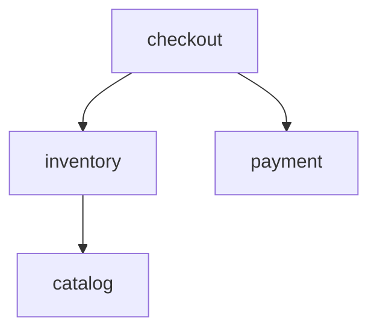
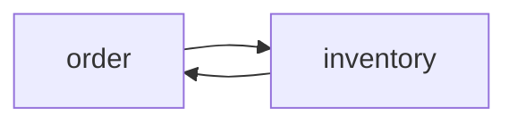
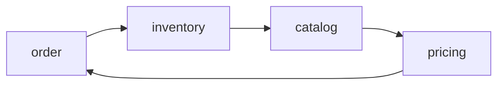
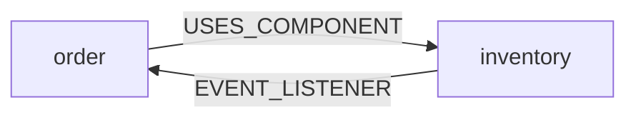
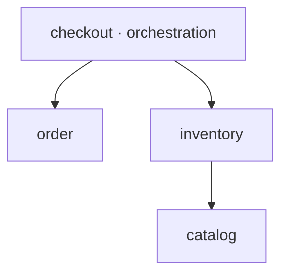

# Không có cycle ở cấp module

Một application module nên phụ thuộc vào các module khác theo một hướng rõ ràng. Khi biểu diễn các quan hệ đó thành dependency graph, đồ thị không được có chu trình. Spring Modulith kiểm tra quy tắc này khi gọi `ApplicationModules.verify()`: các module đóng phải tạo thành đồ thị có hướng không chu trình (DAG).

Chu trình có thể trực tiếp, chẳng hạn `order → inventory → order`, hoặc gián tiếp qua nhiều module, chẳng hạn `order → inventory → catalog → order`. Dù đường đi có bao nhiêu cạnh, nếu có thể quay lại module xuất phát thì đồ thị có cycle. Loại bỏ chu trình giúp các ranh giới nghiệp vụ có hướng phụ thuộc ổn định, dễ hiểu và dễ thay đổi hơn.

Sau bài học, bạn có thể:

- Giải thích quy tắc acyclic dependency graph ở cấp application module.
- Nhận diện chu trình trực tiếp và chu trình gián tiếp.
- Phân biệt cycle giữa module với quan hệ vòng giữa các lớp bên trong một module.
- Dùng `ApplicationModules.verify()` để phát hiện vi phạm.
- Truy nguyên các cạnh tạo chu trình và chọn cách tái cấu trúc phù hợp.
- Hiểu vì sao chuyển module sang `OPEN` không phải cách sửa cycle.

## 1. Dependency graph ở cấp module phải là DAG

Spring Modulith xem mỗi application module là một node. Nếu module A sử dụng API được module B công khai, đồ thị có cạnh có hướng `A → B`. Hướng cạnh đi từ module tiêu thụ đến module cung cấp.

Một đồ thị không có chu trình được gọi là directed acyclic graph (DAG). DAG cho phép xác định thứ tự phụ thuộc: module cung cấp có thể được xem xét trước module tiêu thụ. Điều này hỗ trợ việc hiểu cấu trúc, kiểm soát thay đổi và tổ chức các module độc lập.

Ví dụ, `checkout` sử dụng `inventory` và `payment`; `inventory` sử dụng `catalog`:



Đồ thị này không có đường nào quay lại node ban đầu. `checkout` có thể phụ thuộc vào `inventory` và `payment`; `inventory` phụ thuộc vào `catalog`. `catalog` và `payment` không cần phụ thuộc ngược vào `checkout`.

Một module có thể có nhiều dependency trực tiếp và gián tiếp. Điều đó không vi phạm quy tắc DAG miễn là không tồn tại đường đi quay trở lại module nguồn.

## 2. Nhận diện chu trình trực tiếp và gián tiếp

Chu trình trực tiếp xuất hiện khi hai module phụ thuộc lẫn nhau:



Hai cạnh `order → inventory` và `inventory → order` tạo thành cycle. Một module cần API của module kia và module kia cũng cần API ngược lại. Hai ranh giới không còn độc lập theo hướng phụ thuộc.

Chu trình gián tiếp có thể đi qua nhiều module:



Trong ví dụ này, không có cặp module nào nhất thiết phụ thuộc trực tiếp lẫn nhau. Tuy nhiên, đường `order → inventory → catalog → pricing → order` vẫn quay lại `order`, nên toàn bộ đồ thị có cycle.

Khi xem một sơ đồ, đừng chỉ tìm hai mũi tên ngược chiều giữa cùng một cặp node. Hãy lần theo cả những đường đi dài hơn. Chỉ cần một đường có thể quay lại node xuất phát là đủ để tạo chu trình.

## 3. Cycle ở cấp module khác cycle bên trong module

Quy tắc acyclic của Spring Modulith áp dụng cho dependency graph giữa các application module. Nó không phải quy tắc cấm mọi quan hệ gọi vòng giữa các lớp trong toàn bộ codebase.

Ví dụ, hai lớp cùng nằm trong module `order` có thể tham chiếu nhau:

```text
com.acme.shop.order
├── OrderService.java
└── OrderPolicy.java
```

Nếu `OrderService` sử dụng `OrderPolicy` và `OrderPolicy` cũng sử dụng một abstraction thuộc cùng module `order`, đây là quan hệ nội bộ. Nó không tạo cycle giữa hai application module vì cả hai type đều thuộc một node `order`.

Ngược lại, nếu `OrderService` tham chiếu `InventoryManagement` của module `inventory`, còn một type trong `inventory` tham chiếu API của `order`, module graph có cycle `order ↔ inventory`.

Phân biệt này giúp đọc đúng thông báo verification. Một module vẫn có thể có code nội bộ cần tái cấu trúc vì coupling giữa các lớp, nhưng đó là vấn đề khác với quy tắc không có cycle giữa application module.

## 4. `ApplicationModules.verify()` kiểm tra cycle

Tạo module model từ lớp Spring Boot chính và gọi `verify()`:

```java
import org.springframework.modulith.core.ApplicationModules;

class ModularityTests {

    void verifiesApplicationStructure() {
        ApplicationModules.of(ShopApplication.class).verify();
    }
}
```

Trong dự án, đặt lời gọi này trong một bài kiểm tra JUnit để kiểm tra kiến trúc cùng bộ test tự động:

```java
import com.acme.shop.ShopApplication;
import org.junit.jupiter.api.Test;
import org.springframework.modulith.core.ApplicationModules;

class ModularityTests {

    @Test
    void verifiesApplicationModuleStructure() {
        ApplicationModules.of(ShopApplication.class).verify();
    }
}
```

`verify()` kiểm tra module arrangement, bao gồm các quy tắc phụ thuộc và việc không có chu trình ở cấp module. Nếu phát hiện vi phạm, phương thức ném exception chứa thông tin về các vấn đề kiến trúc. Bài test sẽ thất bại và cung cấp điểm bắt đầu để điều tra.

Bạn cũng có thể tạo mô hình và in từng module để quan sát trước khi xác minh:

```java
var modules = ApplicationModules.of(ShopApplication.class);
modules.forEach(System.out::println);
modules.verify();
```

Đầu ra giúp đối chiếu logical name và package cơ sở của module với cấu trúc mà nhóm mong đợi. Khi cần xác định cạnh cụ thể, hãy xem type nguồn và type đích được nêu trong dependency information hoặc thông báo vi phạm, sau đó tìm các import, constructor injection, event listener và tham chiếu entity tạo ra cạnh đó.

## 5. Vì sao chu trình làm ranh giới module yếu đi?

Chu trình khiến module khó thay đổi độc lập. Nếu `order` và `inventory` phụ thuộc ngược nhau, thay đổi hợp đồng của một bên có thể buộc bên kia cập nhật. Khi chu trình dài hơn, tác động có thể lan qua nhiều module.

Một số hệ quả thường gặp:

- **Khó xác định quyền sở hữu:** cả hai module đều cần hiểu chi tiết của nhau để hoàn thành nghiệp vụ.
- **Thay đổi lan rộng:** thay đổi type hoặc contract ở một module ảnh hưởng đến nhiều module trong chu trình.
- **Khó kiểm thử độc lập:** test một module có thể phải kéo theo nhiều module khác để thỏa mãn các phụ thuộc.
- **Khó tái sử dụng:** module không thể được đưa sang ứng dụng khác nếu phải kéo theo toàn bộ vòng phụ thuộc.
- **Khó xác định thứ tự khởi tạo:** không tồn tại thứ tự topo cho một đồ thị có cycle.

Không phải mọi quan hệ nghiệp vụ hai chiều đều bắt buộc tạo phụ thuộc code hai chiều. Ví dụ, `order` có thể cần biết kết quả giữ hàng của `inventory`, nhưng `inventory` không cần biết toàn bộ quy trình đặt hàng. Hãy biểu diễn quan hệ nghiệp vụ bằng API hoặc event contract do module sở hữu khái niệm cung cấp.

## 6. Truy nguyên cạnh tạo cycle

Khi verification báo chu trình, hãy chuyển thông tin từ đồ thị về code. Với mỗi cạnh `A → B`, tìm type trong module A tham chiếu API của B.

Các nguồn cạnh thường gặp:

| Nguồn phụ thuộc | Ví dụ cần tìm |
|---|---|
| Type reference | Import type công khai từ package module khác |
| Spring component | Constructor hoặc field injection bean thuộc module khác |
| Event listener | Listener trong A nhận event type được module B công khai, tạo cạnh `A → B` |
| Entity reference | Type trong A tham chiếu entity do B sở hữu |
| Named interface | Import type thuộc package API con của module khác |

Ví dụ, nếu module `order` inject `InventoryManagement` và module `inventory` lắng nghe `OrderCompleted` từ `order`, dependency graph có thể là:



Việc dùng event không tự động loại bỏ cycle. Listener trong `inventory` vẫn phải tham chiếu kiểu event được công khai bởi `order`, nên vẫn có cạnh `inventory → order`. Nếu `order` đồng thời gọi component của `inventory`, hai cạnh tạo thành cycle.

Khi điều tra, hãy xem cả các loại dependency. Đừng chỉ tìm `import` trực tiếp trong service; quan hệ có thể đến từ event listener, entity hoặc component injection.

## 7. Các cách tái cấu trúc để loại bỏ cycle

### Giữ một hướng gọi qua API công khai

Nếu `order` là module điều phối nghiệp vụ đặt hàng và cần năng lực giữ hàng, hãy để `order` phụ thuộc `inventory`. `inventory` công khai hợp đồng giữ hàng; nó không cần tham chiếu `order`.

```java
package com.acme.shop.inventory;

public interface InventoryManagement {

    boolean reserve(String sku, int quantity);
}
```

```java
package com.acme.shop.order;

import com.acme.shop.inventory.InventoryManagement;
import org.springframework.stereotype.Service;

@Service
class PlaceOrderService {

    private final InventoryManagement inventory;

    PlaceOrderService(InventoryManagement inventory) {
        this.inventory = inventory;
    }

    void place(String sku, int quantity) {
        inventory.reserve(sku, quantity);
    }
}
```

Đồ thị có một cạnh `order → inventory`. `inventory` tập trung vào quy tắc tồn kho và không cần biết use case nào đã yêu cầu giữ hàng.

### Dùng event để tách luồng, nhưng giữ hướng contract rõ ràng

Nếu `inventory` cần phản ứng khi đơn hàng hoàn tất, module `order` có thể công bố event `OrderCompleted`; module `inventory` lắng nghe event. Khi đó, `inventory → order` là phụ thuộc qua event type. Nếu `order` cũng gọi `inventory`, cycle vẫn còn.

Để giữ DAG, hãy chọn một chiều giao tiếp. Ví dụ, `order` có thể phát một event contract do `order` sở hữu và `inventory` lắng nghe; `order` không đồng thời phụ thuộc vào một API ngược của `inventory` nếu việc đó tạo cạnh quay lại. Nếu cần kết quả đồng bộ trước khi hoàn tất use case, có thể giữ lời gọi API một chiều và chuyển thông báo hậu xử lý sang một module khác không tạo đường quay lại.

Event làm giảm sự phụ thuộc vào lời gọi đồng bộ, nhưng dependency graph vẫn phải được đọc theo kiểu event mà listener tham chiếu.

### Đảo chiều phụ thuộc bằng port

Nếu abstraction thuộc về module tiêu thụ, hãy để module đó sở hữu interface và để module cung cấp triển khai interface. Ví dụ, `order` định nghĩa `StockReservation`; `inventory` triển khai interface này. Mã trong `inventory` phụ thuộc compile-time vào abstraction của `order`, còn `order` không cần import implementation của `inventory`.

```java
package com.acme.shop.order;

public interface StockReservation {

    boolean reserve(String sku, int quantity);
}
```

```java
package com.acme.shop.inventory;

import com.acme.shop.order.StockReservation;
import org.springframework.stereotype.Component;

@Component
class InventoryStockReservation implements StockReservation {

    @Override
    public boolean reserve(String sku, int quantity) {
        // Quy tắc giữ hàng do inventory sở hữu
        return true;
    }
}
```

Đây là dependency inversion. Cần bảo đảm port thể hiện nhu cầu của module tiêu thụ và không làm rò rỉ chi tiết nội bộ của module cung cấp.

### Đưa điều phối vào module use case

Nếu hai module nghiệp vụ cần phối hợp nhưng không nên phụ thuộc lẫn nhau, tạo một module orchestration phụ thuộc vào cả hai:



Module điều phối gọi API của các module nghiệp vụ theo thứ tự cần thiết. Các module nghiệp vụ không phải import lẫn nhau để điều khiển toàn bộ use case.

### Sửa lại ranh giới hoặc hợp nhất module

Nếu hai phần nghiệp vụ luôn cần truy cập sâu vào nhau, có thể ranh giới module đang đặt sai. Hãy xem xét chuyển chức năng về module sở hữu đúng dữ liệu, tách một capability độc lập hoặc hợp nhất hai module nếu chúng thực chất không thể thay đổi riêng biệt.

Tránh tạo package `common` hoặc shared module chỉ để chuyển một type ra ngoài và làm mất cycle trên sơ đồ. Shared contract cần có khái niệm rõ ràng, người sở hữu và vòng đời ổn định.

## 8. Không dùng `OPEN` để làm biến mất cycle

Module `OPEN` có semantics truy cập rộng hơn và bị loại khỏi thuật toán phát hiện chu trình. Vì vậy, đổi các module trong cycle sang `OPEN` có thể làm `verify()` không còn báo cycle, nhưng các cạnh phụ thuộc trong code vẫn còn.

Khi một module mở, các kiểu trong package gốc và package con chưa được gán vào named interface riêng được đưa vào unnamed interface. Module khác có thể truy cập các kiểu nằm trong package thường được dùng làm nội bộ. Điều này làm tăng coupling và khiến việc đóng module về sau khó hơn.

| Cách làm | Kết quả |
|---|---|
| Tái cấu trúc và loại bỏ cạnh quay lại | Chu trình thực sự được loại khỏi dependency graph |
| Đổi module thành `OPEN` | Module bị loại khỏi cycle detection; chu trình code có thể vẫn còn |
| Chỉ thêm `allowedDependencies` | Giới hạn phụ thuộc được phép; không tự xóa cạnh hoặc phá cycle |
| Chỉ đánh dấu `@NamedInterface` | Làm rõ API được công khai; không tự thay đổi hướng phụ thuộc |

`OPEN` có thể hữu ích như bước chuyển tiếp khi modular hóa codebase cũ. Hãy giới hạn phạm vi, ghi nhận các package đang bị truy cập và có kế hoạch đưa module về `CLOSED`. Không dùng trạng thái mở để thay thế việc giải quyết chu trình.

## 9. Quy trình xác minh không có cycle

Áp dụng quy trình sau khi thiết kế module mới hoặc xử lý lỗi verification:

1. Tạo module model bằng đúng lớp Spring Boot chính.
2. Chạy `ApplicationModules.verify()` để nhận diện cycle và các vi phạm liên quan.
3. Ghi lại chuỗi module tạo cycle, theo hướng từ module phụ thuộc đến module được phụ thuộc.
4. Truy tìm type hoặc hợp đồng tạo ra từng cạnh.
5. Xác định module sở hữu khái niệm nghiệp vụ và chiều phụ thuộc hợp lý.
6. Chọn một cách tái cấu trúc: API một chiều, event contract, port, orchestration hoặc điều chỉnh ranh giới.
7. Giữ các module ở trạng thái `CLOSED` nếu không có lý do cụ thể để mở.
8. Chạy lại architecture test và kiểm thử luồng nghiệp vụ bị ảnh hưởng.

Ví dụ bài kiểm tra kiến trúc:

```java
import com.acme.shop.ShopApplication;
import org.junit.jupiter.api.Test;
import org.springframework.modulith.core.ApplicationModules;

class ModularityTests {

    @Test
    void applicationModulesAreAcyclic() {
        ApplicationModules.of(ShopApplication.class).verify();
    }
}
```

Giữ bài test trong CI để mọi thay đổi thêm một phụ thuộc ngược đều được phát hiện sớm. Sau khi test thành công, hãy kiểm tra lại cấu hình detection strategy và module type để chắc chắn các module nghiệp vụ cần kiểm tra thực sự được đưa vào cycle detection.

## 10. Bài tập thực hành

Một ứng dụng có ba module:

```text
order
inventory
catalog
```

Các quan hệ hiện tại:

- `order` inject `InventoryManagement` từ `inventory`.
- `inventory` dùng `ProductCatalog` từ `catalog`.
- `catalog` lắng nghe `OrderCompleted` được khai báo trong `order`.

Hãy thực hiện:

1. Vẽ dependency graph và chỉ ra chu trình.
2. Xác định type hoặc contract tạo ra từng cạnh.
3. Giải thích vì sao event listener vẫn tạo phụ thuộc `catalog → order`.
4. Đề xuất cách đặt event contract hoặc thay đổi luồng gọi để dependency graph không còn đường quay lại.
5. Viết architecture test dùng `ApplicationModules.of(ShopApplication.class).verify()`.
6. Giữ các module ở trạng thái `CLOSED` và giải thích lý do.

Kết quả cần đạt là một DAG phản ánh đúng quyền sở hữu nghiệp vụ, đồng thời luồng đặt hàng và cập nhật catalog vẫn hoạt động theo yêu cầu.

## 11. Ghi nhớ

Dependency graph ở cấp application module phải không có chu trình. Cycle có thể trực tiếp hoặc gián tiếp; chỉ cần một đường đi quay lại module xuất phát là vi phạm quy tắc DAG. `ApplicationModules.verify()` kiểm tra quy tắc này cùng các quy tắc module khác. Hãy truy nguyên từng cạnh đến type, component, event listener hoặc entity tạo ra nó rồi tái cấu trúc theo hướng phụ thuộc một chiều. `OPEN`, `allowedDependencies` và `@NamedInterface` không tự xóa chu trình. Giữ module đóng và chạy architecture test trong CI để bảo vệ ranh giới theo thời gian.

## Tài liệu tham khảo

- [Spring Modulith Fundamentals – Application Modules](https://docs.spring.io/spring-modulith/reference/fundamentals.html)
- [Spring Modulith – Verifying Application Module Structure](https://docs.spring.io/spring-modulith/reference/verification.html)
- [Spring Modulith – Open Application Modules](https://docs.spring.io/spring-modulith/reference/fundamentals.html)
- [Spring Modulith – Application Events](https://docs.spring.io/spring-modulith/reference/events.html)
