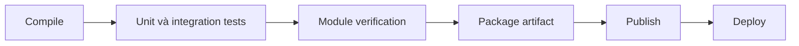

# `throwIfPresent()` và thời điểm làm pipeline thất bại

Spring Modulith có thể phát hiện nhiều vi phạm kiến trúc trong cùng một lần kiểm tra. Để kiểm soát cách xử lý kết quả, API cung cấp `ApplicationModules.detectViolations()` và kiểu kết quả `Violations`. Phương thức `throwIfPresent()` ném chính đối tượng `Violations` nếu vẫn còn ít nhất một vi phạm.

Điểm quan trọng là phát hiện vi phạm và làm build thất bại là hai bước riêng. `detectViolations()` thu thập kết quả; `filter()` cho phép giữ lại những vi phạm cần xử lý; `throwIfPresent()` biến kết quả còn lại thành exception. Khi lời gọi này nằm trong một bài test được CI thực thi và exception không bị nuốt, test thất bại và pipeline có thể dừng trước khi đóng gói hoặc triển khai artifact.

## Mục tiêu

Sau bài học, bạn có thể:

- Giải thích vai trò của `ApplicationModules.detectViolations()` và `Violations.throwIfPresent()`.
- Phân biệt `verify()` với `detectViolations()`.
- Đọc danh sách thông báo bằng `getMessages()` và kiểm tra kết quả bằng `hasViolations()`.
- Dùng `filter()` để áp dụng ngoại lệ chuyển đổi có kiểm soát.
- Đặt kiểm tra kiến trúc ở đúng giai đoạn để pull request hoặc CI thất bại khi còn vi phạm.
- Phân biệt chế độ báo cáo, chế độ chặn build và kiểm tra lúc ứng dụng khởi động.
- Tránh vô tình làm pipeline xanh bằng cách bắt hoặc bỏ qua exception.

## Kết quả kiểm tra kiến trúc được biểu diễn như thế nào?

`ApplicationModules` mô hình hóa các application module và thực hiện những kiểm tra kiến trúc được cấu hình. Các quy tắc mặc định bao gồm:

- Đồ thị dependency giữa các module không có chu trình.
- Module chỉ truy cập type của module khác thông qua package API được công bố; truy cập package nội bộ bị từ chối, trừ trường hợp module mở.
- Nếu khai báo `allowedDependencies`, module chỉ được phụ thuộc vào những module hoặc named interface được cho phép.
- Nếu jMolecules ArchUnit có trên classpath, các quy tắc kiến trúc bổ sung tương ứng cũng có thể được thực hiện.

Khi phát hiện vi phạm, Spring Modulith cần cung cấp thông tin để nhóm xác định module, package hoặc dependency gây ra vấn đề. API có hai cách sử dụng chính:

```java
ApplicationModules.of(Application.class).verify();
```

`verify()` thực hiện các kiểm tra và ném exception nếu phát hiện vi phạm. Đây là cách ngắn gọn khi mọi vi phạm đều phải làm test thất bại.

Khi cần xem, lọc hoặc xử lý kết quả trước khi quyết định thất bại, dùng:

```java
var violations = ApplicationModules.of(Application.class)
    .detectViolations();

violations.throwIfPresent();
```

`detectViolations()` trả về một đối tượng `Violations`, kể cả khi không có vi phạm. Đối tượng này chứa các lỗi kiến trúc đã phát hiện và cho phép xử lý kết quả trước khi ném exception.

## `throwIfPresent()` thực hiện điều gì?

`Violations` là một kiểu kết quả kế thừa `RuntimeException`. Nó vừa lưu tập vi phạm, vừa có thể được ném ra như một exception. Phương thức:

```java
violations.throwIfPresent();
```

có hành vi:

- Nếu không có vi phạm, phương thức kết thúc bình thường.
- Nếu còn ít nhất một vi phạm, phương thức ném chính đối tượng `Violations`.
- Exception mang thông tin tổng hợp để test framework và log hiển thị nguyên nhân thất bại.

Vì đây là unchecked exception, không cần khai báo `throws` trong chữ ký method. Tuy nhiên, nếu lời gọi nằm trong test, exception cần được để lan ra ngoài để JUnit đánh dấu test thất bại.

## Phân biệt `verify()` và `detectViolations()`

Hai phương thức đều chạy các quy tắc verification nhưng phục vụ hai kiểu điều khiển khác nhau:

| API | Kết quả | Hành vi khi có vi phạm | Khi phù hợp |
|---|---|---|---|
| `verify()` | Trả về `ApplicationModules` nếu thành công | Ném exception ngay | Mọi vi phạm đều phải chặn |
| `detectViolations()` | Trả về `Violations` | Không tự ném chỉ vì phát hiện; caller quyết định | Cần xem thông báo, lọc hoặc báo cáo |
| `Violations.throwIfPresent()` | `void` | Ném `Violations` nếu kết quả còn vi phạm | Chốt quyết định fail sau khi xử lý |

Một điểm khác biệt trong API là `verify()` chỉ thực hiện các verification nếu chúng chưa được chạy trước đó trên instance tương ứng. `detectViolations()` luôn thực hiện lại các verification mỗi lần được gọi. Điều này hữu ích khi cần chủ động lấy kết quả mới trong một luồng xử lý.

Nếu không cần lọc hoặc thu thập kết quả riêng, `verify()` là lựa chọn đơn giản. `detectViolations()` kết hợp `throwIfPresent()` hữu ích khi nhóm cần kiểm soát chính xác vi phạm nào được chấp nhận tạm thời trước khi quyết định fail.

## Đọc thông báo trước khi làm test thất bại

`Violations` cung cấp các phương thức để kiểm tra kết quả:

- `hasViolations()` trả về `true` nếu còn vi phạm.
- `getMessages()` trả về danh sách thông báo của tất cả vi phạm.
- `getMessage()` trả về thông báo tổng hợp của exception.
- `filter(Predicate<Violation>)` tạo một `Violations` mới chỉ chứa những vi phạm thỏa predicate.

Ví dụ, in toàn bộ thông báo trước khi ném exception:

```java
var violations = ApplicationModules.of(Application.class)
    .detectViolations();

if (violations.hasViolations()) {
    violations.getMessages().forEach(System.err::println);
}

violations.throwIfPresent();
```

Đoạn code này vẫn làm test thất bại nếu có vi phạm. Việc in thông báo chỉ giúp log CI thể hiện rõ nguyên nhân; nó không thay đổi quyết định chặn build.

Nếu cần báo cáo nhưng chưa muốn chặn, có thể chỉ gọi `detectViolations()` và xuất `getMessages()` ra log hoặc report mà chưa gọi `throwIfPresent()`. Cần ghi rõ đây là chế độ quan sát; pipeline vẫn có thể xanh dù kiến trúc còn vi phạm.

## Lọc vi phạm trong giai đoạn chuyển đổi

Trong một codebase cũ, nhóm có thể cần thời gian xử lý một số dependency đã tồn tại. `filter()` cho phép giữ lại các vi phạm cần tiếp tục làm test thất bại và loại khỏi kết quả những ngoại lệ đã được chấp nhận tạm thời.

Ví dụ minh họa:

```java
var violations = ApplicationModules.of(Application.class)
    .detectViolations()
    .filter(violation -> !violation.hasMessageContaining(
        "known legacy dependency during migration"
    ));

violations.throwIfPresent();
```

Predicate trên giữ lại các vi phạm không chứa thông điệp ngoại lệ đã định danh. Nếu chỉ còn các vi phạm thuộc diện được chấp nhận tạm thời, `throwIfPresent()` kết thúc bình thường. Những vi phạm khác vẫn làm test thất bại.

Đây là cơ chế chuyển đổi, không phải cách bỏ qua kiểm tra lâu dài. Lọc dựa trên nội dung thông báo có thể nhạy với thay đổi câu chữ giữa các phiên bản. Hãy giới hạn điều kiện thật hẹp, ghi lý do, người phụ trách và thời hạn gỡ bỏ. Không lọc theo từ khóa rộng như tên package chung hoặc tên module vì có thể che cả lỗi mới.

Khi có thể, hãy sửa boundary và xóa ngoại lệ sớm. Nếu nhóm không thể giải thích chính xác một vi phạm được lọc đại diện cho điều gì, không nên đưa nó vào allowlist.

## Đặt `throwIfPresent()` trong bài test kiến trúc

Một cách phổ biến là tạo test riêng cho cấu trúc module:

```java
import org.junit.jupiter.api.Test;
import org.springframework.modulith.core.ApplicationModules;

class ModuleVerificationTests {

    @Test
    void failsWhenArchitecturalViolationsRemain() {
        ApplicationModules.of(Application.class)
            .detectViolations()
            .throwIfPresent();
    }
}
```

Khi không có vi phạm, test kết thúc thành công. Khi còn vi phạm, `throwIfPresent()` ném `Violations`; JUnit ghi nhận test thất bại và build tool trả về mã thoát khác 0 nếu test task được thực thi.

Nếu không cần xử lý kết quả, test có thể ngắn hơn:

```java
@Test
void verifiesModuleStructure() {
    ApplicationModules.of(Application.class).verify();
}
```

Hai cách đều phù hợp để đặt hàng rào kiến trúc trong CI. Chọn cách thứ nhất khi cần lọc ngoại lệ hoặc in thông báo có chủ đích; chọn cách thứ hai khi toàn bộ vi phạm đều phải bị từ chối.

## Thời điểm nào nên làm pipeline thất bại?

Với kiểm tra boundary giữa các module, thời điểm phù hợp thường là giai đoạn test/verification của pull request, trước khi artifact được phát hành hoặc triển khai.



Trong thực tế, bài test kiến trúc có thể chạy cùng test suite ở bước `Tests`. Sơ đồ nhấn mạnh vị trí logic của gate: CI cần chạy test trước khi cho phép các bước phát hành tiếp tục.

Ví dụ với Gradle:

```bash
./gradlew check
```

Với Java plugin tiêu chuẩn, task `check` phụ thuộc vào `test` và các verification task được cấu hình. Đảm bảo test kiến trúc nằm trong source set/task được chạy bởi `check`.

Ví dụ với Maven:

```bash
mvn verify
```

Lifecycle `verify` đi qua các phase trước đó, trong đó có `test`. Hãy kiểm tra cấu hình Surefire/Failsafe và profile để chắc chắn bài test kiến trúc không bị bỏ qua.

Pipeline chỉ thất bại nếu tất cả điều kiện sau được thỏa mãn:

1. Bài test chứa lời gọi `verify()` hoặc `throwIfPresent()` thực sự được chạy.
2. Kết quả còn ít nhất một vi phạm sau khi áp dụng filter.
3. Exception không bị bắt rồi bỏ qua.
4. Build task hoặc CI job coi test thất bại là lỗi chặn, không cấu hình cho phép failure.
5. Các bước package, publish và deploy phụ thuộc vào job verification thành công.

Nếu test được đánh dấu disabled, task bị skip, profile không chạy test hoặc CI cho phép job failure, vi phạm có thể không chặn được pipeline dù code test đã đúng.

## Ví dụ: phân biệt report-only và blocking gate

Giả sử nhóm đang chuyển module `orders` và `inventory` sang dependency một chiều. Nhóm muốn ghi nhận mọi vi phạm trong vài pull request đầu để ước lượng công việc, sau đó chuyển sang chế độ chặn.

**Giai đoạn báo cáo:**

```java
@Test
void reportsCurrentArchitectureViolations() {
    var violations = ApplicationModules.of(Application.class)
        .detectViolations();

    violations.getMessages().forEach(System.err::println);
}
```

Test này không thất bại chỉ vì có vi phạm, vì không gọi `throwIfPresent()` và không có assertion yêu cầu kết quả rỗng. Nó phù hợp để khảo sát hiện trạng nhưng không phải gate.

**Giai đoạn chặn:**

```java
@Test
void blocksNewArchitectureViolations() {
    ApplicationModules.of(Application.class)
        .detectViolations()
        .throwIfPresent();
}
```

Khi chuyển sang gate, mọi vi phạm còn lại đều làm test thất bại. Nếu cần giữ một baseline tạm thời, chỉ lọc đúng các vi phạm đã được review và theo dõi riêng số lượng còn lại.

Không nên viết test chỉ kiểm tra rằng `detectViolations()` trả về một object khác `null`. API luôn trả về `Violations`; assertion đó không chứng minh kiến trúc hợp lệ.

## Đừng nuốt exception

Đoạn code sau làm mất tác dụng chặn pipeline:

```java
try {
    ApplicationModules.of(Application.class)
        .detectViolations()
        .throwIfPresent();
} catch (RuntimeException exception) {
    System.err.println(exception.getMessage());
    // Test tiếp tục và có thể thành công.
}
```

Nếu mục tiêu là làm test thất bại, không bắt exception rồi chỉ ghi log. Nếu cần bổ sung thông tin, hãy ghi log trước khi gọi `throwIfPresent()` hoặc ném lại exception sau khi xử lý.

Một trường hợp khác là dùng `assertThrows(Violations.class, …)` trong bài test gate. Assertion này có ý nghĩa khi đang kiểm thử chính hành vi phát hiện vi phạm; nhưng trong test bảo vệ kiến trúc của ứng dụng, nó sẽ đánh dấu test thành công khi có vi phạm. Hãy chọn assertion theo mục đích của test.

## Kiểm tra lúc ứng dụng khởi động có thay thế CI gate không?

Spring Modulith có hỗ trợ runtime verification qua artifact `spring-modulith-runtime`. Cấu hình `spring.modulith.runtime.verification-enabled` có thể bật việc xác minh khi ứng dụng khởi động ở những phiên bản hỗ trợ.

Kiểm tra lúc khởi động giúp phát hiện cấu trúc sai trong môi trường chạy, nhưng không thay thế bài test kiến trúc trong CI. Nếu chỉ chờ ứng dụng khởi động ở staging hoặc production mới phát hiện vi phạm, nhóm đã để lỗi đi qua các bước build và phát hành trước đó.

Hãy dùng CI test làm gate chính. Runtime verification là lớp bảo vệ bổ sung khi phù hợp với cấu hình và phiên bản Spring Modulith của ứng dụng.

## Checklist thiết kế gate kiến trúc

Trước khi yêu cầu pipeline chặn khi có vi phạm, hãy kiểm tra:

- [ ] Test dùng đúng `Application.class` hoặc package root của ứng dụng.
- [ ] Test sử dụng cùng module detection và metadata với ứng dụng.
- [ ] Nếu dùng `detectViolations()`, kết quả được xử lý rõ ràng.
- [ ] `throwIfPresent()` được gọi sau bước filter và không bị catch rồi bỏ qua.
- [ ] Mọi ngoại lệ tạm thời có lý do, phạm vi, owner và điều kiện gỡ bỏ.
- [ ] Task test kiến trúc được nối vào `check`, `verify` hoặc job CI bắt buộc.
- [ ] CI không skip test và không cho phép job verification thất bại.
- [ ] Package, publish và deploy chỉ chạy sau khi gate thành công.
- [ ] Log hiển thị đủ thông báo để người phát triển xác định vi phạm.

## Bài tập tự đánh giá

Một dự án có test sau:

```java
@Test
void checksModules() {
    var violations = ApplicationModules.of(Application.class)
        .detectViolations();

    violations.getMessages().forEach(System.err::println);
}
```

Pipeline vẫn xanh dù log có ba vi phạm. Nhóm muốn chỉ bỏ qua một dependency legacy đã được chấp nhận trong thời gian chuyển đổi, còn hai vi phạm mới phải làm pull request thất bại.

Hãy trả lời:

1. Vì sao test hiện tại không thất bại dù `detectViolations()` tìm thấy ba vi phạm?
2. Phương thức nào biến các vi phạm còn lại thành exception?
3. `filter()` cần giữ lại những vi phạm nào để chỉ bỏ qua dependency legacy?
4. Vì sao không nên lọc theo một từ khóa package quá rộng?
5. Cần cấu hình điều gì trong Gradle/Maven và CI để test thực sự chặn bước package hoặc deploy?

Một cách triển khai minh họa:

```java
@Test
void blocksAllViolationsExceptApprovedLegacyDependency() {
    ApplicationModules.of(Application.class)
        .detectViolations()
        .filter(violation -> !violation.hasMessageContaining(
            "approved legacy dependency"
        ))
        .throwIfPresent();
}
```

Predicate giữ lại hai vi phạm không khớp ngoại lệ, vì vậy `throwIfPresent()` ném exception và test thất bại. Khi dependency legacy được sửa, xóa điều kiện lọc để gate kiểm tra toàn bộ kiến trúc.

## Kết luận

`detectViolations()` thu thập kết quả verification; `filter()` cho phép giới hạn tập vi phạm còn hiệu lực; `throwIfPresent()` ném `Violations` khi kết quả vẫn không rỗng. Đặt lời gọi này trong test được CI bắt buộc chạy để làm pull request thất bại trước khi đóng gói hoặc triển khai. Nếu chỉ báo cáo mà không ném exception, pipeline sẽ không tự động bị chặn. Hãy giới hạn mọi ngoại lệ chuyển đổi, không nuốt exception và giữ gate kiến trúc trong quy trình build thường xuyên.

## Tài liệu tham khảo

- [Spring Modulith Reference — Verifying Application Module Structure](https://docs.spring.io/spring-modulith/reference/verification.html)
- [Spring Modulith API — `ApplicationModules`](https://docs.spring.io/spring-modulith/docs/current/api/org/springframework/modulith/core/ApplicationModules.html)
- [Spring Modulith API — `Violations`](https://docs.spring.io/spring-modulith/docs/current/api/org/springframework/modulith/core/Violations.html)
- [Spring Modulith API — `Violation`](https://docs.spring.io/spring-modulith/docs/current/api/org/springframework/modulith/core/Violation.html)
