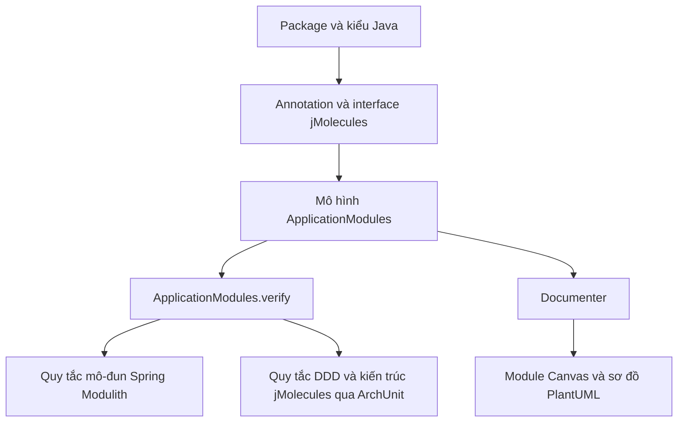

# Kiến trúc bổ sung

## Spring Modulith tích hợp jMolecules ở mức nào?

Spring Modulith có thể đọc và tận dụng các khái niệm mà **jMolecules** biểu đạt trong mã nguồn. Sự kết hợp này giúp mô hình mô-đun thể hiện rõ hơn ngôn ngữ DDD, đồng thời cho phép kiểm tra một số quy tắc kiến trúc bằng ArchUnit.

Mức tích hợp tập trung vào ba việc: nhận diện mô-đun từ annotation jMolecules, bổ sung thông tin DDD khi phân tích và sinh tài liệu mô-đun, và chạy các quy tắc kiến trúc jMolecules trong quá trình kiểm chứng. Đây là tích hợp tùy chọn dựa trên thư viện có mặt trong classpath; Spring Modulith không tự biến một lớp Java thành aggregate, repository hay cơ chế xử lý sự kiện chỉ vì lớp đó mang annotation.

### 1. jMolecules bổ sung ngôn ngữ kiến trúc cho mã nguồn

jMolecules cung cấp annotation và interface để biểu đạt vai trò của các thành phần phần mềm bằng thuật ngữ kiến trúc. Với DDD, mã nguồn có thể đánh dấu aggregate root, entity, value object, repository và domain service. Với kiến trúc, mã nguồn có thể biểu đạt các lớp Layered, các vòng Onion, hoặc port và adapter của Hexagonal Architecture. Thư viện sự kiện của jMolecules còn cung cấp `@DomainEvent` và `@DomainEventHandler`.

Ví dụ, một mô hình đơn hàng có thể dùng annotation để làm rõ vai trò của từng kiểu:

```java
import org.jmolecules.ddd.annotation.AggregateRoot;
import org.jmolecules.ddd.annotation.Entity;
import org.jmolecules.ddd.annotation.ValueObject;

@AggregateRoot
public class Order {
    // Hành vi và trạng thái của đơn hàng.
}

@Entity
public class OrderLine {
    // Một entity thuộc vòng đời của Order.
}

@ValueObject
public record Money(long amount, String currency) {}
```

Các annotation này bổ sung ý nghĩa cho mã nguồn và cung cấp metadata để công cụ phân tích. Chúng không thay thế thiết kế hành vi, bất biến của aggregate, hay cấu hình persistence của ứng dụng.

### 2. Nhận diện application module bằng `@Module`

Theo mặc định, Spring Modulith suy ra application module từ cấu trúc package: các package con trực tiếp của package chứa lớp `@SpringBootApplication` được xem là những mô-đun. Khi muốn chỉ nhận diện những package được đánh dấu tường minh, có thể chọn chiến lược `explicitly-annotated`.

Chiến lược này nhận diện package được đánh dấu bằng annotation `@ApplicationModule` của Spring Modulith hoặc `@Module` của jMolecules. Ví dụ với `@Module`:

```java
// src/main/java/com/acme/orders/package-info.java
@org.jmolecules.ddd.annotation.Module
package com.acme.orders;
```

Khai báo chiến lược trong `application.yml`:

```yaml
spring:
  modulith:
    detection-strategy: explicitly-annotated
```

Hoặc dùng dạng properties:

```properties
spring.modulith.detection-strategy=explicitly-annotated
```

Khi bật chiến lược này, chỉ những package được đánh dấu phù hợp mới được đưa vào quá trình phát hiện mô-đun. Vì vậy, cần rà soát các package dự kiến là mô-đun và đánh dấu chúng đầy đủ. Nếu ứng dụng đang dùng `@ApplicationModule`, có thể tiếp tục dùng annotation đó; không cần thêm `@Module` chỉ để có hai annotation cùng biểu đạt một ranh giới.

Lưu ý với dự án Kotlin: `kmolecules-ddd` không cung cấp annotation Java `org.jmolecules.ddd.annotation.Module`. Nếu dùng chiến lược `explicitly-annotated`, có thể đánh dấu mô-đun bằng `@ApplicationModule` của Spring Modulith trên một kiểu trong package gốc, hoặc cung cấp `ApplicationModuleDetectionStrategy` phù hợp.

`@Module` giúp Spring Modulith nhận diện package như một mô-đun. Những quy tắc riêng của Spring Modulith về API công khai, named interface và phụ thuộc giữa các mô-đun vẫn được cấu hình bằng các cơ chế tương ứng của Spring Modulith, chẳng hạn `@NamedInterface` và `@ApplicationModule(allowedDependencies = ...)`.

### 3. Bổ sung thông tin DDD vào mô hình và tài liệu

Khi phân tích application module, Spring Modulith có thể nhận biết các stereotype jMolecules bên cạnh stereotype chuẩn của Spring. Thông tin này được dùng trong Application Module Canvas do `Documenter` sinh ra.

Một canvas có thể thể hiện:

- Các Spring bean được công khai, được nhóm theo vai trò như service hoặc repository. Những vai trò này có thể đến từ annotation Spring hoặc stereotype jMolecules.
- Aggregate root được công khai. Spring Modulith có thể nhận diện entity có repository tương ứng hoặc kiểu được khai báo rõ là aggregate bằng jMolecules.
- Domain event do mô-đun phát hành. Kiểu sự kiện cần được đánh dấu bằng `@DomainEvent` hoặc triển khai interface `DomainEvent` của jMolecules.
- Các sự kiện mà mô-đun lắng nghe. Spring Modulith nhận diện listener dùng `@EventListener`, `@TransactionalEventListener`, `@DomainEventHandler` hoặc `ApplicationListener`.
- Các configuration property được công khai, nếu ứng dụng cung cấp metadata cần thiết từ Spring Boot configuration processor.

Ví dụ khai báo domain event:

```java
import org.jmolecules.event.annotation.DomainEvent;

import java.util.UUID;

@DomainEvent
public record OrderPlaced(UUID orderId) {}
```

Sau đó có thể sinh tài liệu mô-đun:

```java
import org.springframework.modulith.core.ApplicationModules;
import org.springframework.modulith.docs.Documenter;

class ModuleDocumentation {

    void generate() {
        var modules = ApplicationModules.of(Application.class);

        new Documenter(modules)
            .writeModuleCanvases()
            .writeModulesAsPlantUml();
    }
}
```

Canvas giúp người đọc hiểu mô-đun đang công khai service, aggregate và sự kiện nào. Sơ đồ PlantUML thể hiện các mô-đun và quan hệ phụ thuộc giữa chúng. jMolecules cung cấp ngữ nghĩa cho các thành phần; Spring Modulith tổng hợp thông tin đó vào mô hình application module.

### 4. Kiểm tra quy tắc jMolecules qua ArchUnit

Spring Modulith có thể tích hợp với thư viện `jmolecules-archunit`. Khi thư viện này hiện diện trên classpath, các cấu hình kiểm chứng mặc định của Spring Modulith sẽ bổ sung những quy tắc DDD và kiến trúc do jMolecules cung cấp.

Trong Gradle, một cấu hình thường gặp là đặt annotation DDD và annotation sự kiện trong dependencies của mã nguồn chính, còn bộ quy tắc ArchUnit trong dependencies kiểm thử:

```kotlin
dependencies {
    implementation("org.jmolecules:jmolecules-ddd:<ddd-version>")
    implementation("org.jmolecules:jmolecules-events:<events-version>")

    testImplementation(
        "org.jmolecules.integrations:jmolecules-archunit:<archunit-version>"
    )
}
```

Thay các placeholder bằng phiên bản tương thích với phiên bản Spring Modulith và các module jMolecules đang sử dụng. Chỉ thêm `jmolecules-events` nếu mã nguồn dùng abstraction về domain event; các annotation cho Layered, Onion hoặc Hexagonal Architecture cũng cần module annotation tương ứng của jMolecules.

Có thể chạy kiểm chứng trong một bài test:

```java
import org.junit.jupiter.api.Test;
import org.springframework.modulith.core.ApplicationModules;

class ModularityTests {

    @Test
    void verifiesApplicationModules() {
        ApplicationModules.of(Application.class).verify();
    }
}
```

Lệnh `verify()` kiểm tra các quy tắc mô-đun của Spring Modulith, gồm:

1. Đồ thị phụ thuộc giữa các application module không có chu trình.
2. Mô-đun chỉ truy cập API package hoặc named interface được công khai của mô-đun khác, theo cấu hình tương ứng.
3. Nếu khai báo `allowedDependencies`, mô-đun chỉ phụ thuộc vào những mô-đun hoặc named interface được cho phép.

Khi `jmolecules-archunit` có mặt, các quy tắc DDD và kiến trúc jMolecules phù hợp với classpath cũng được chạy. Vi phạm sẽ làm `verify()` ném exception, nhờ đó bài test có thể làm build thất bại và ngăn thay đổi phá vỡ quy tắc kiến trúc.

Nếu muốn bổ sung một quy tắc cụ thể, chẳng hạn kiểm tra Hexagonal Architecture, có thể kết hợp quy tắc đó với các quy tắc mặc định:

```java
import org.jmolecules.archunit.JMoleculesArchitectureRules;
import org.springframework.modulith.core.ApplicationModules;
import org.springframework.modulith.core.VerificationOptions;

var options = VerificationOptions.defaults()
    .andAdditionalVerifications(
        JMoleculesArchitectureRules.ensureHexagonal());

ApplicationModules.of(Application.class).verify(options);
```

`VerificationOptions.defaults()` giữ cấu hình kiểm chứng mặc định, bao gồm phần tích hợp jMolecules nếu dependency cần thiết hiện diện. `andAdditionalVerifications(…)` thêm quy tắc tùy chỉnh vào tập quy tắc đó. Khi cần thu thập và xử lý vi phạm trước khi quyết định ném exception, có thể dùng `ApplicationModules.detectViolations()` thay cho `verify()`.

### 5. Luồng tích hợp tổng thể



Trong luồng này, jMolecules cung cấp vocabulary và metadata. Spring Modulith đọc metadata đó để nhận diện, mô tả và kiểm tra cấu trúc ứng dụng. ArchUnit thực hiện các phép kiểm tra tĩnh trên cấu trúc và quan hệ phụ thuộc của mã nguồn.

### 6. Giới hạn cần hiểu đúng

| Thành phần | Spring Modulith có thể tận dụng | Điều không nên suy diễn |
|---|---|---|
| `@Module` | Nhận diện package là application module khi dùng chiến lược `explicitly-annotated` | Tự khai báo toàn bộ API công khai hoặc whitelist phụ thuộc |
| Annotation DDD | Nhận diện stereotype và đưa thông tin aggregate, service, repository vào mô hình/tài liệu | Tự tạo persistence mapping, repository implementation hoặc bảo đảm bất biến nghiệp vụ |
| Annotation sự kiện | Nhận diện domain event và handler khi lập tài liệu mô-đun | Tự động bảo đảm event được phát hành, lưu trữ hoặc xử lý thành công |
| `jmolecules-archunit` | Chạy các quy tắc kiến trúc và DDD phù hợp trong quá trình kiểm chứng | Kiểm tra được mọi quyết định thiết kế hoặc mọi quy tắc nghiệp vụ chưa được biểu đạt thành rule |

Một annotation chỉ mô tả ý định kiến trúc. Ví dụ, `@AggregateRoot` giúp công cụ hiểu vai trò của `Order`, nhưng lập trình viên vẫn phải thiết kế các phương thức thay đổi trạng thái và bảo vệ invariant. Tương tự, `@DomainEvent` đánh dấu một kiểu sự kiện; cơ chế phát hành, giao dịch, lưu publication và retry vẫn thuộc trách nhiệm của phần triển khai sự kiện trong ứng dụng.

Vì vậy, nên kết hợp các lớp công cụ theo đúng vai trò: dùng jMolecules để biểu đạt thuật ngữ DDD và phong cách kiến trúc; dùng Spring Modulith để quản lý ranh giới, API và phụ thuộc giữa các application module; dùng ArchUnit để biến các quy tắc đã chọn thành kiểm tra tự động. Với named interface và allowed dependencies, tiếp tục khai báo bằng API Spring Modulith để kiểm soát chính xác hợp đồng giữa các mô-đun.

### 7. Khi nào nên dùng tích hợp này?

Tích hợp đặc biệt hữu ích khi nhóm muốn đưa DDD hoặc Hexagonal Architecture vào một modular monolith đang phát triển:

- Dự án đã có các lớp domain nhưng vai trò aggregate, entity và value object chưa được thể hiện nhất quán.
- Nhóm muốn xem aggregate root, service và domain event của từng mô-đun trong tài liệu kiến trúc.
- Nhóm muốn kiểm tra các quy tắc DDD hoặc hướng phụ thuộc ngay trong test suite và CI.
- Dự án cần nhận diện mô-đun từ package được đánh dấu rõ ràng thay vì dựa hoàn toàn vào quy ước package.

Không cần đưa tất cả annotation jMolecules vào dự án ngay từ đầu. Hãy bắt đầu với những khái niệm đang được nhóm sử dụng, bổ sung kiểm tra cho quy tắc có giá trị thực tế, rồi mở rộng khi mô hình đã ổn định. Một bộ quy tắc nhỏ, rõ và được nhóm hiểu sẽ hữu ích hơn nhiều annotation mà không có kiểm tra hoặc quy ước sử dụng.

### Tài liệu tham khảo

- [Spring Modulith — Verifying Application Module Structure](https://docs.spring.io/spring-modulith/reference/verification.html)
- [Spring Modulith — Fundamentals và nhận diện application module](https://docs.spring.io/spring-modulith/reference/fundamentals.html)
- [Spring Modulith — Documenting Application Modules](https://docs.spring.io/spring-modulith/reference/documentation.html)
- [jMolecules — Architectural abstractions for Java](https://github.com/xmolecules/jmolecules)
- [jMolecules ArchUnit integration](https://github.com/xmolecules/jmolecules-integrations/tree/main/jmolecules-archunit)
