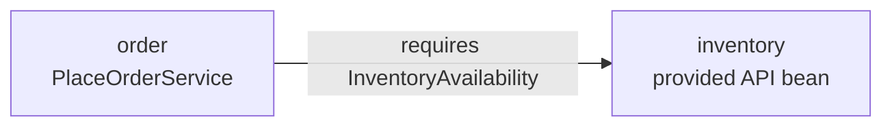

# Bean được module cung cấp được nhận diện ra sao?

Trong Spring Modulith, một application module có thể cung cấp API cho các module khác thông qua Spring bean và application event do module phát hành. Khi xây dựng mô hình, Spring Modulith phân tích cấu trúc package và các kiểu Java để nhận diện những Spring component thuộc từng module, sau đó xác định bean nào nằm trên bề mặt API được công bố và bean nào chỉ phục vụ triển khai nội bộ.

Một bean không trở thành API chỉ vì nó có annotation `@Service` hoặc modifier `public`. Vị trí package và các interface được expose mới quyết định bean có được xem là API bean hay không. Theo API của Spring Modulith, một `SpringBean` được xem là API bean nếu kiểu bean là kiểu `public` trong API package của module hoặc bean triển khai một API interface đã được expose. Vì vậy, implementation có thể nằm trong package `internal` nhưng vẫn cung cấp hợp đồng công khai thông qua interface mà module công bố.

Trong `SPRING_MODULITH_MODULE_MODEL`, cách nhận diện này giúp phân biệt provided interface (API module cung cấp) với internal implementation và required interface (API module đang sử dụng từ module khác). Bài học giải thích cách Spring Modulith xây dựng mô hình bean, cách đọc kết quả và cách tổ chức bean để giữ ranh giới module rõ ràng.

## 1. Application module cung cấp những gì?

Một application module trong Spring Boot có ba phần liên quan với nhau:

1. **Provided interface:** API module cung cấp cho module khác. API này có thể được thực hiện bởi các Spring bean instance và application event do module phát hành.
2. **Internal implementation:** các thành phần triển khai chỉ phục vụ bên trong module, không được module khác truy cập trực tiếp.
3. **Required interface:** những API module sử dụng từ module khác, thường thể hiện qua Spring bean dependency, application event mà module lắng nghe và configuration properties được công bố.

Ví dụ trong ứng dụng bán hàng:

```text
com.example.shop
├── ShopApplication.java
├── inventory
│   ├── InventoryAvailability.java       // API do inventory cung cấp
│   ├── InventoryManagement.java         // Spring bean cung cấp API
│   └── internal
│       ├── DefaultInventoryAvailability.java
│       └── InventoryRepository.java
└── order
    └── internal
        └── PlaceOrderService.java       // sử dụng API inventory
```

Module `inventory` cung cấp khả năng kiểm tra tồn kho. Module `order` sử dụng khả năng đó thông qua hợp đồng `InventoryAvailability`. `InventoryRepository` và cách tính số lượng tồn kho là chi tiết triển khai bên trong `inventory`.

## 2. Spring Modulith xây dựng mô hình từ codebase

`ApplicationModules` phân tích codebase để tạo một mô hình application module trong bộ nhớ. Có thể bắt đầu từ lớp ứng dụng Spring Boot:

```java
import org.springframework.modulith.core.ApplicationModules;

ApplicationModules modules = ApplicationModules.of(ShopApplication.class);
```

Các module được nhận diện dựa trên package structure và cấu hình detection strategy. Mặc định, mỗi package con trực tiếp của package chứa `@SpringBootApplication` được xem là một application module. Các lựa chọn như `explicitly-annotated`, nested module, named interface và open module làm thay đổi cách phân loại package hoặc phạm vi API được expose.

Mô hình có thể được in ra để quan sát:

```java
modules.forEach(System.out::println);
```

Ví dụ kết quả rút gọn:

```text
## com.example.shop.inventory ##
> Logical name: inventory
> Base package: com.example.shop.inventory
> Spring beans:
  + ...InventoryManagement
  + ...DefaultInventoryAvailability
  o ...InventoryRepository

## com.example.shop.order ##
> Logical name: order
> Base package: com.example.shop.order
> Spring beans:
  + ...PlaceOrderService
  o ...OrderAuditListener
```

Danh sách thể hiện các Spring component mà mô hình nhận diện được trong từng module và trạng thái visibility tương ứng. Dấu `+` biểu thị bean thuộc API được expose; dấu `o` biểu thị component nội bộ. Hãy xem đây là cách trình bày mô hình module, không phải danh sách bean instance đã được tạo trong một Spring `ApplicationContext` đang chạy.

## 3. Bean được nhận diện từ Spring component stereotype

Spring Modulith nhận diện các Spring component thông qua những stereotype của Spring và các component stereotype được jMolecules cung cấp khi thư viện tương ứng hiện diện.

Các stereotype Spring thường gặp:

| Annotation | Vai trò thường gặp |
|---|---|
| `@Component` | Component tổng quát được Spring quản lý |
| `@Service` | Thành phần xử lý nghiệp vụ hoặc application service |
| `@Repository` | Thành phần truy cập dữ liệu |
| `@Controller` | Thành phần xử lý request web |
| `@RestController` | Controller trả dữ liệu qua HTTP response body |

Ví dụ một service trong package gốc của module:

```java
package com.example.shop.inventory;

import org.springframework.stereotype.Service;

@Service
public class InventoryManagement {

    public boolean hasAvailableStock(String sku, int quantity) {
        // Xử lý nghiệp vụ kiểm tra tồn kho.
        return true;
    }
}
```

`@Service` giúp Spring nhận diện lớp như một component candidate. Vì lớp nằm trong API package mặc định của module `inventory` và có kiểu `public`, Spring Modulith có thể xem bean này là API bean được module cung cấp.

Một component trong package nội bộ:

```java
package com.example.shop.inventory.internal;

import org.springframework.stereotype.Component;

@Component
class StockReservationPolicy {

    boolean canReserve(int available, int requested) {
        return available >= requested;
    }
}
```

Component này thuộc module `inventory`, nhưng package `internal` chưa được expose. Vì vậy nó là thành phần triển khai nội bộ, không phải API bean để module khác tham chiếu trực tiếp.

## 4. Vị trí package quyết định bean có thuộc API hay không

Trong một simple application module không có package con, các kiểu `public` trong package module tạo thành API của module. Khi module có các package con, package gốc được xem là API package mặc định, còn các package con được xem là nội bộ trừ khi được expose rõ ràng.

Ví dụ:

```text
com.example.shop.inventory
├── InventoryManagement.java       // API package
├── InventoryAvailability.java     // API package
├── application
│   └── RecalculateStockService.java
├── domain
│   └── StockItem.java
└── internal
    └── InventoryRepository.java
```

Các package `application`, `domain` và `internal` đều là package con. Nếu chưa được công bố, các kiểu trong đó vẫn thuộc phần nội bộ của module `inventory`.

Điều này áp dụng ngay cả khi lớp trong package con có modifier `public`. Java `public` chỉ cho phép mã ở package khác truy cập theo quy tắc ngôn ngữ; nó không tự biến package con thành API module trong Spring Modulith.

## 5. Phân loại API bean và internal bean

Spring Modulith biểu diễn component được nhận diện bằng kiểu `SpringBean`. Một bean được xem là API bean khi thỏa mãn một trong hai điều kiện chính:

- Kiểu bean là `public` và nằm trong API package được expose của module.
- Bean triển khai một API interface được expose bởi module.

Các trường hợp thường gặp:

| Kiểu bean | Vị trí/quan hệ | Phân loại |
|---|---|---|
| `InventoryManagement` | Kiểu `public` trong package gốc `inventory` | API bean |
| `DefaultInventoryAvailability` | Nằm trong `inventory.internal`, không triển khai API interface được expose | Internal bean |
| `DefaultInventoryAvailability` | Nằm trong `inventory.internal`, triển khai `InventoryAvailability` được expose ở package gốc | API bean theo interface được triển khai |
| `InventoryRepository` | Nằm trong `inventory.internal`, chỉ phục vụ implementation | Internal bean |
| `StockReservationAdapter` | Nằm trong package `inventory.spi` đã được expose bằng `@NamedInterface` | Bean thuộc named interface được expose nếu component type được nhận diện |

Điểm đáng chú ý là package của implementation không nhất thiết phải là package API. Module có thể giữ implementation trong package nội bộ, nhưng công bố một interface ổn định để consumer sử dụng. Spring Modulith nhận diện bean triển khai interface API đó là API bean.

## 6. Expose interface, giữ implementation trong package nội bộ

Đây là cách tổ chức thường phù hợp với modular monolith. Đặt interface trong package gốc của provider:

```java
package com.example.shop.inventory;

public interface InventoryAvailability {

    boolean hasAvailableStock(String sku, int quantity);
}
```

Implementation được đặt trong package nội bộ:

```java
package com.example.shop.inventory.internal;

import com.example.shop.inventory.InventoryAvailability;
import org.springframework.stereotype.Service;

@Service
class DefaultInventoryAvailability implements InventoryAvailability {

    private final InventoryRepository repository;

    DefaultInventoryAvailability(InventoryRepository repository) {
        this.repository = repository;
    }

    @Override
    public boolean hasAvailableStock(String sku, int quantity) {
        return repository.availableQuantity(sku) >= quantity;
    }
}
```

Ở đây:

- `InventoryAvailability` là hợp đồng công khai trong API package.
- `DefaultInventoryAvailability` là Spring component triển khai hợp đồng.
- `InventoryRepository` là chi tiết truy cập dữ liệu nội bộ.
- Bean implementation có thể được phân loại là API bean vì nó triển khai interface API đã expose.

Module `order` chỉ cần tham chiếu interface:

```java
package com.example.shop.order.internal;

import com.example.shop.inventory.InventoryAvailability;
import org.springframework.stereotype.Service;

@Service
class PlaceOrderService {

    private final InventoryAvailability inventory;

    PlaceOrderService(InventoryAvailability inventory) {
        this.inventory = inventory;
    }
}
```

Spring IoC container tìm bean tương thích với `InventoryAvailability` và inject vào constructor. Mã của `order` không cần import `DefaultInventoryAvailability` hoặc `InventoryRepository`.

## 7. Named Interface cũng có thể chứa bean được module cung cấp

Ngoài package gốc, module có thể công bố thêm một package con bằng `@NamedInterface`. Các Spring component nằm trong package được expose này có thể trở thành một phần API của module.

Ví dụ package `spi` của module `inventory`:

```java
@org.springframework.modulith.NamedInterface("spi")
package com.example.shop.inventory.spi;
```

Một component cung cấp SPI:

```java
package com.example.shop.inventory.spi;

import org.springframework.stereotype.Service;

@Service
public class StockReservationService {

    public boolean reserve(String sku, int quantity) {
        // Tích hợp quy trình đặt trước tồn kho.
        return true;
    }
}
```

Module khác có thể tham chiếu bean type này qua named interface `inventory::spi`, nếu consumer khai báo whitelist tương ứng:

```java
@org.springframework.modulith.ApplicationModule(
    allowedDependencies = "inventory::spi"
)
package com.example.shop.order;
```

Named interface vẫn thuộc module `inventory`, không phải một application module độc lập. Các package con chưa được đánh dấu như `inventory.internal` vẫn là internal.

## 8. Bean trong module không đồng nghĩa bean được cung cấp ra ngoài

Một module có thể chứa nhiều Spring component để thực hiện công việc nội bộ. Chỉ những bean nằm trên bề mặt API được expose mới được xem là API bean của module.

Ví dụ:

```text
com.example.shop.inventory
├── InventoryAvailability.java           // API interface
├── InventoryManagement.java              // API service
├── spi
│   ├── package-info.java                 // @NamedInterface("spi")
│   └── StockReservationService.java      // API component
└── internal
    ├── DefaultInventoryAvailability.java // implementation
    ├── InventoryRepository.java          // internal component
    └── StockReservationPolicy.java       // internal component
```

Có thể hiểu các thành phần như sau:

| Thành phần | Thuộc module? | Được module khác tham chiếu? |
|---|---:|---:|
| `InventoryAvailability` | Có | Có, qua API package |
| `InventoryManagement` | Có | Có, nếu là kiểu API được expose |
| `StockReservationService` | Có | Có, qua named interface `spi` |
| `DefaultInventoryAvailability` | Có | Không cần tham chiếu trực tiếp; consumer dùng interface |
| `InventoryRepository` | Có | Không, vẫn là internal |
| `StockReservationPolicy` | Có | Không, vẫn là internal |

Vì vậy, không nên đọc danh sách Spring bean của module rồi kết luận tất cả bean đều là API. Cần xem trạng thái exposure của từng bean.

## 9. Kiểm tra bean được nhận diện bằng `ApplicationModules`

Có thể lấy module theo logical name và đọc danh sách `SpringBean` của nó:

```java
import org.springframework.modulith.core.ApplicationModule;
import org.springframework.modulith.core.ApplicationModules;
import org.springframework.modulith.core.SpringBean;

ApplicationModules modules = ApplicationModules.of(ShopApplication.class);

ApplicationModule inventory = modules.getModuleByName("inventory")
        .orElseThrow(() -> new IllegalStateException("inventory module not found"));

for (SpringBean bean : inventory.getSpringBeans()) {
    System.out.printf(
            "%s | API bean: %s%n",
            bean.getFullyQualifiedTypeName(),
            bean.isApiBean()
    );
}
```

Hai thông tin quan trọng:

- `getSpringBeans()` trả về các Spring bean type mà mô hình nhận diện trong module.
- `isApiBean()` cho biết bean có được xem là API bean hay không.

`SpringBean` cũng cung cấp `getType()` để lấy kiểu `JavaClass` tương ứng và `getFullyQualifiedTypeName()` để lấy tên đầy đủ của kiểu bean. Các API này hữu ích khi viết công cụ báo cáo hoặc kiểm tra cấu trúc module.

### Kiểm tra một kiểu có thuộc module không

```java
boolean contained = inventory.contains(InventoryAvailability.class);
boolean exposed = inventory.isExposed(InventoryAvailability.class);

System.out.println("Contained: " + contained);
System.out.println("Exposed: " + exposed);
```

`contains(...)` kiểm tra kiểu có thuộc module hay không. `isExposed(...)` kiểm tra kiểu có nằm trong một named interface được module expose hay không. Hai câu hỏi này khác nhau: một kiểu có thể thuộc module nhưng vẫn là internal.

## 10. Đọc kết quả `modules.forEach(System.out::println)`

Khi in toàn bộ mô hình:

```java
ApplicationModules modules = ApplicationModules.of(ShopApplication.class);
modules.forEach(System.out::println);
```

Spring Modulith hiển thị logical name, base package và các Spring bean được nhận diện. Phần bean thể hiện visibility của component:

- `+`: component được xem là API bean của module.
- `o`: component nội bộ của module.

Ví dụ:

```text
## com.example.shop.inventory ##
> Logical name: inventory
> Base package: com.example.shop.inventory
> Spring beans:
  + ...InventoryManagement
  + ...DefaultInventoryAvailability
  o ...InventoryRepository
```

`DefaultInventoryAvailability` có thể được hiển thị như API bean dù implementation nằm trong package nội bộ, nếu nó triển khai interface API được expose. `InventoryRepository` vẫn là internal vì không thuộc bề mặt API.

Kết quả này giúp quan sát module model mà không cần đọc từng file riêng lẻ. Khi một bean xuất hiện với visibility không như mong đợi, hãy kiểm tra package của kiểu bean và các interface mà nó triển khai.

## 11. Phân biệt bean discovery với Spring bean registration

Spring Modulith xây dựng module model từ codebase và package metadata. Spring IoC container chịu trách nhiệm tạo bean instance và quản lý dependency injection lúc ứng dụng chạy. Hai cơ chế liên quan nhưng trả lời hai câu hỏi khác nhau.

| Khía cạnh | Spring Modulith module model | Spring IoC container |
|---|---|---|
| Mục tiêu | Xác định bean type thuộc module nào và bean nào được expose | Tạo, cấu hình và quản lý bean instance |
| Nguồn thông tin | Package, kiểu Java, stereotype và module metadata | Component scan, `@Bean`, import/configuration và điều kiện runtime |
| Kết quả | Mô hình module và visibility API/internal | Các bean instance trong `ApplicationContext` |
| Câu hỏi | Module có cung cấp bean type này qua API không? | Bean có được đăng ký và inject thành công lúc chạy không? |

Ví dụ, một lớp `@Service` có thể được nhận diện trong module model nhưng vẫn không được tạo trong một Spring context cụ thể nếu bị điều kiện cấu hình, profile hoặc component scan loại khỏi context đó. Ngược lại, một bean được tạo bằng phương thức `@Bean` có thể tồn tại trong context dù việc phân loại component trong module model cần được xem xét theo kiểu và metadata mà Spring Modulith nhận diện.

Vì vậy, không dùng danh sách `SpringBean` trong module model như bằng chứng rằng mọi bean đã được khởi tạo thành công. Dùng Spring context test để xác nhận registration và injection thực tế.

## 12. Vai trò của `@Bean` và factory method

Spring cho phép tạo bean qua phương thức `@Bean` trong `@Configuration`:

```java
import org.springframework.context.annotation.Bean;
import org.springframework.context.annotation.Configuration;

@Configuration(proxyBeanMethods = false)
class InventoryConfiguration {

    @Bean
    InventoryAvailability inventoryAvailability(InventoryRepository repository) {
        return new DefaultInventoryAvailability(repository);
    }
}
```

Phương thức `@Bean` đăng ký một bean với Spring container. Tuy nhiên, `@Bean` là annotation trên factory method, còn các API mô hình Spring Modulith mô tả Spring bean theo bean type và component stereotype. Khi dùng factory method, hãy thiết kế kiểu trả về và package API rõ ràng, sau đó kiểm tra module model bằng `ApplicationModules` ở đúng phiên bản thư viện dự án.

Nếu mục tiêu là thể hiện một provided interface ổn định, cách dễ quan sát nhất thường là đặt hợp đồng trong API package hoặc named interface và để implementation bean triển khai hợp đồng đó. Dù bean được tạo bằng stereotype hay factory method, consumer vẫn nên phụ thuộc vào kiểu API được expose thay vì implementation nội bộ.

## 13. Bean dependency tạo thành Required Interface

Khi một bean trong module `order` inject một API bean của `inventory`, quan hệ đó thể hiện required interface của `order`.

Ví dụ:

```java
package com.example.shop.order.internal;

import com.example.shop.inventory.InventoryAvailability;
import org.springframework.stereotype.Service;

@Service
class PlaceOrderService {

    private final InventoryAvailability inventory;

    PlaceOrderService(InventoryAvailability inventory) {
        this.inventory = inventory;
    }
}
```

`order` yêu cầu khả năng `InventoryAvailability` từ module `inventory`. Spring inject bean implementation khi tạo context; Spring Modulith phân tích tham chiếu kiểu để nhận diện dependency ở cấp module.

Hướng dependency được đọc từ consumer tới provider:



Nếu `PlaceOrderService` import trực tiếp `inventory.internal.InventoryRepository`, dependency vẫn hướng từ `order` tới `inventory`, nhưng reference vi phạm encapsulation vì provider chưa expose package `internal`.

## 14. Các yếu tố khác không quyết định API visibility

Một số annotation và cơ chế Spring thường bị nhầm với việc công bố API module:

| Cơ chế | Tác dụng | Có tự expose bean qua module boundary không? |
|---|---|---:|
| `@Service` | Đánh dấu Spring component candidate | Không; package/type vẫn quyết định exposure |
| `@Component` | Đánh dấu component tổng quát | Không; package/type vẫn quyết định exposure |
| Java `public` | Cho phép truy cập kiểu theo Java visibility | Không; package con vẫn có thể là internal |
| `@Primary` | Chọn bean ưu tiên khi có nhiều candidate | Không |
| `@Qualifier` | Chỉ định bean candidate cần inject | Không |
| `@Bean` | Đăng ký bean qua factory method | Không tự thay thế module API metadata |
| `@NamedInterface` | Công bố package con như nhóm API có tên | Có, đối với các kiểu thuộc package được expose |
| `@ApplicationModule(type = OPEN)` | Mở rộng phạm vi expose của module | Có, theo quy tắc open module |

`@Service` giúp nhận diện component, còn `@NamedInterface` hoặc vị trí API package xác định bề mặt module được cung cấp. Hai vai trò này cần được phân biệt.

## 15. Kiểm tra cả module model và Spring context

Để xác nhận kiến trúc module, dùng:

```java
import org.junit.jupiter.api.Test;
import org.springframework.modulith.core.ApplicationModules;

class ModularityTests {

    @Test
    void verifiesModuleStructure() {
        ApplicationModules.of(ShopApplication.class).verify();
    }
}
```

`verify()` kiểm tra dependency cycle, truy cập package nội bộ và dependency không được phép khi module khai báo whitelist. Nó kiểm tra mô hình cấu trúc, không khởi tạo toàn bộ Spring context.

Để xác nhận bean API thực sự được đăng ký và có thể inject, dùng context test:

```java
import com.example.shop.inventory.InventoryAvailability;
import org.junit.jupiter.api.Test;
import org.springframework.beans.factory.annotation.Autowired;
import org.springframework.boot.test.context.SpringBootTest;

import static org.assertj.core.api.Assertions.assertThat;

@SpringBootTest
class InventoryBeanTests {

    @Autowired
    InventoryAvailability inventoryAvailability;

    @Test
    void exposesInventoryAvailabilityBean() {
        assertThat(inventoryAvailability).isNotNull();
    }
}
```

Test thứ nhất bảo vệ module boundary. Test thứ hai xác nhận Spring context có thể cung cấp bean tương thích với API interface. Hai kiểm tra bổ sung cho nhau.

## 16. Tạo Application Module Canvas để quan sát bean

Spring Modulith có thể tạo tài liệu Application Module Canvas, trong đó các Spring bean được nhóm theo stereotype và chỉ ra những bean được expose bởi module.

Ví dụ:

```java
import org.junit.jupiter.api.Test;
import org.springframework.modulith.core.ApplicationModules;
import org.springframework.modulith.docs.Documenter;

class ModuleDocumentationTests {

    @Test
    void writesModuleCanvases() {
        ApplicationModules modules = ApplicationModules.of(ShopApplication.class);

        new Documenter(modules).writeModuleCanvases();
    }
}
```

Canvas giúp nhóm xem base package, các Spring component được expose theo stereotype, aggregate root, event đã phát hành hoặc được lắng nghe và configuration properties được công bố. Đây là cách hữu ích để review provided interface của từng module cùng các thành phần triển khai liên quan.

## 17. Những nhầm lẫn thường gặp

| Nhầm lẫn | Cách hiểu đúng |
|---|---|
| Mọi Spring bean trong module đều là API bean | Bean trong package nội bộ vẫn là internal nếu không triển khai API interface được expose. |
| `@Service` tự công bố bean ra module khác | Stereotype nhận diện component; package và exposed interface quyết định API visibility. |
| Lớp `public` trong `internal` tự trở thành API | Java visibility không thay thế module encapsulation. |
| Implementation phải nằm trong package gốc mới là API bean | Implementation nội bộ có thể được xem là API bean nếu triển khai exposed API interface. |
| `@NamedInterface` tạo module mới | Nó công bố một package con như API có tên của module hiện tại. |
| `@Primary` hoặc `@Qualifier` mở quyền truy cập module | Chúng chỉ ảnh hưởng bean resolution trong Spring context. |
| `ApplicationModules` là danh sách bean instance runtime | Đây là mô hình được suy ra từ codebase; Spring context mới tạo và quản lý instance. |
| `verify()` xác nhận bean đã được inject thành công | Cần Spring context test để kiểm tra bean registration và injection runtime. |
| Một bean API không thể dùng repository nội bộ | API implementation có thể phụ thuộc internal component bên trong cùng module; consumer chỉ dùng API đã công bố. |

## 18. Checklist nhận diện bean được module cung cấp

- [ ] Xác định root package của ứng dụng Spring Boot.
- [ ] Xác nhận detection strategy nhận diện đúng application module.
- [ ] Tìm các component stereotype được Spring Modulith nhận diện trong module.
- [ ] Xác định package gốc của module và các named interface đã expose.
- [ ] Phân biệt bean nằm trong API package với bean nằm trong package con nội bộ.
- [ ] Kiểm tra bean nội bộ có triển khai một API interface được expose không.
- [ ] Dùng `ApplicationModules.of(...)` để tạo mô hình.
- [ ] Dùng `ApplicationModule.getSpringBeans()` để xem bean type thuộc module.
- [ ] Dùng `SpringBean.isApiBean()` để phân biệt API bean và internal bean.
- [ ] Dùng `ApplicationModule.isExposed(...)` để kiểm tra một kiểu có thuộc bề mặt API không.
- [ ] Không nhầm module model với danh sách bean instance trong Spring context.
- [ ] Chạy `ApplicationModules.verify()` để kiểm tra dependency và encapsulation.
- [ ] Chạy Spring context test để xác nhận bean thực sự được đăng ký và inject.

## 19. Kết luận

Spring Modulith nhận diện Spring component trong codebase và gắn chúng với application module dựa trên package structure. Sau đó, mô hình phân biệt bean được module cung cấp với component nội bộ. Một bean được xem là API bean nếu kiểu bean là `public` trong API package được expose hoặc bean triển khai một API interface đã được expose. Package con chưa công bố vẫn là internal, kể cả khi kiểu trong đó có modifier `public`.

Vì vậy, cách tổ chức rõ ràng là đặt hợp đồng trong package gốc hoặc named interface, giữ implementation và repository trong package nội bộ, rồi để bean implementation triển khai hợp đồng được công bố. Dùng `ApplicationModules` và `SpringBean.isApiBean()` để quan sát phân loại; dùng `verify()` để kiểm tra module boundary; dùng Spring context test để xác nhận bean instance thực sự được tạo và inject. Sự kết hợp này giúp provided interface, internal implementation và required interface của mỗi module được nhận diện rõ ràng.

## Tài liệu tham khảo

- [Spring Modulith — Fundamentals: Application Modules](https://docs.spring.io/spring-modulith/reference/fundamentals.html)
- [Spring Modulith — Documenting Application Modules](https://docs.spring.io/spring-modulith/reference/documentation.html)
- [Spring Modulith — `ApplicationModule` API](https://docs.spring.io/spring-modulith/docs/current/api/org/springframework/modulith/core/ApplicationModule.html)
- [Spring Modulith — `SpringBean` API](https://docs.spring.io/spring-modulith/docs/current/api/org/springframework/modulith/core/SpringBean.html)
- [Spring Modulith — Verifying Application Module Structure](https://docs.spring.io/spring-modulith/reference/verification.html)
