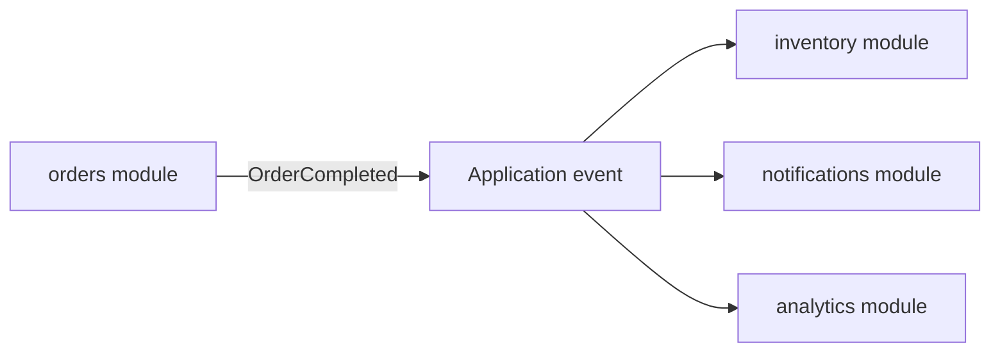
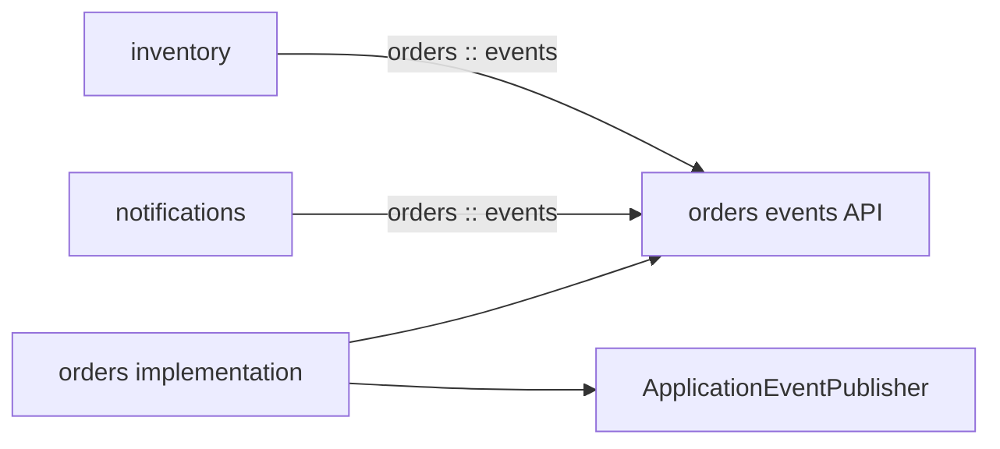
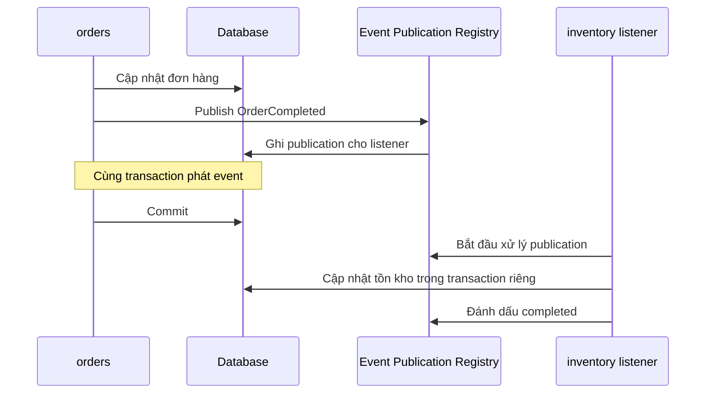

# Application event là kênh giao tiếp giữa module

Trong một modular monolith, các application module cùng chạy trong một ứng dụng nhưng vẫn cần giữ ranh giới rõ ràng. Nếu module `orders` gọi trực tiếp service của `inventory`, module tạo đơn hàng phải biết một module khác đang quan tâm đến việc đơn hàng hoàn tất. Khi có thêm billing, notification hoặc analytics, service ban đầu tiếp tục tích lũy dependency và thay đổi theo từng nhu cầu tích hợp.

Application event giúp tách hai vai trò đó. Module phát sự kiện mô tả một điều đã xảy ra trong nghiệp vụ; các module quan tâm tự đăng ký listener để phản ứng. Module phát không cần biết ai đang lắng nghe. Spring Modulith khuyến nghị event publication và consumption là phương tiện tương tác chính giữa các application module khi cần giảm coupling.

## Mục tiêu

Sau bài học, bạn có thể:

- Giải thích application event giúp giảm phụ thuộc trực tiếp giữa các module như thế nào.
- Thiết kế event thể hiện sự kiện nghiệp vụ đã xảy ra.
- Công bố event bằng `ApplicationEventPublisher` và tiêu thụ bằng listener.
- Công bố event type qua named interface để module khác chỉ phụ thuộc vào hợp đồng cần thiết.
- Phân biệt listener đồng bộ, `@TransactionalEventListener` và `@ApplicationModuleListener`.
- Hiểu tác động của transaction commit, xử lý bất đồng bộ và lỗi listener.
- Dùng Event Publication Registry để theo dõi và khôi phục event publication khi cần.
- Kiểm thử event được phát ra bằng `@ApplicationModuleTest` và `PublishedEvents`.

## Vì sao module giao tiếp qua event?

Giả sử `orders` quản lý đơn hàng và `inventory` quản lý tồn kho. Cách gọi trực tiếp thường có dạng:

```java
@Service
class OrderManagement {

    private final InventoryManagement inventory;

    OrderManagement(InventoryManagement inventory) {
        this.inventory = inventory;
    }

    @Transactional
    void complete(Order order) {
        order.complete();
        inventory.updateStockFor(order);
    }
}
```

`OrderManagement` phải biết `InventoryManagement`. Khi cần gửi email, ghi nhận loyalty point hoặc cập nhật báo cáo, service này có thể tiếp tục nhận thêm dependency. Điều đó khiến module phát sự kiện phải biết các module tiêu thụ và làm tăng phạm vi thay đổi, kiểm thử.

Với event, `orders` chỉ công bố `OrderCompleted`. `inventory`, `notifications` hoặc module khác có thể tự lắng nghe:



Module `orders` không gọi các listener và không cần biết có bao nhiêu module đang tiêu thụ event. Khi thêm một listener mới, nhóm có thể bổ sung nó trong module tương ứng mà không phải sửa luồng nghiệp vụ phát event.

Event không làm mất mọi dependency. Module tiêu thụ vẫn cần tham chiếu event type để biên dịch. Vì vậy, event type phải là hợp đồng công khai có chủ đích, thường được đặt trong named interface của module phát.

## Application event là một sự kiện nghiệp vụ

Application event nên diễn tả một sự kiện đã xảy ra, thường dùng tên ở thì quá khứ:

- `OrderCompleted`: đơn hàng đã hoàn tất.
- `PaymentReceived`: thanh toán đã được ghi nhận.
- `CustomerRegistered`: khách hàng đã đăng ký.
- `StockReserved`: hàng đã được giữ.

Event thường mang dữ liệu cần thiết để module tiêu thụ xử lý mà không phải truy cập trực tiếp vào trạng thái nội bộ của module phát. Ví dụ:

```java
package com.acme.orders.events;

import java.time.Instant;
import java.util.UUID;

public record OrderCompleted(
    UUID orderId,
    Instant completedAt
) {}
```

Đây là một hợp đồng bất biến, chứa định danh đơn hàng và thời điểm hoàn tất. Module tiêu thụ có thể dùng `orderId` để thực hiện nghiệp vụ của mình mà không cần nhận cả JPA entity `Order`.

Khi thiết kế event, hãy lưu ý:

- Đặt tên theo sự kiện đã xảy ra, không theo lệnh yêu cầu thực hiện hành động. `OrderCompleted` là event; `CompleteOrder` thường là command.
- Chỉ mang dữ liệu cần cho consumer. Ưu tiên ID, giá trị bất biến và snapshot tối thiểu có ý nghĩa nghiệp vụ.
- Tránh truyền JPA entity, repository, Spring bean hoặc object graph nội bộ qua event.
- Xem event là public contract. Thay đổi tên field, kiểu dữ liệu hoặc ngữ nghĩa có thể ảnh hưởng tất cả listener.
- Nếu event được lưu hoặc gửi ra hệ thống ngoài, cần cân nhắc khả năng tương thích khi thêm, đổi hoặc loại bỏ field.

## Công bố event bằng `ApplicationEventPublisher`

Spring Framework cung cấp `ApplicationEventPublisher` để một component phát event. Module phát chỉ cần phụ thuộc vào abstraction này:

```java
package com.acme.orders;

import java.time.Instant;
import java.util.UUID;
import org.springframework.context.ApplicationEventPublisher;
import org.springframework.stereotype.Service;
import org.springframework.transaction.annotation.Transactional;

import com.acme.orders.events.OrderCompleted;

@Service
class OrderManagement {

    private final ApplicationEventPublisher events;
    private final OrderRepository orders;

    OrderManagement(
            ApplicationEventPublisher events,
            OrderRepository orders) {
        this.events = events;
        this.orders = orders;
    }

    @Transactional
    void complete(UUID orderId) {
        Order order = orders.findById(orderId).orElseThrow();
        order.complete();

        events.publishEvent(new OrderCompleted(
            order.getId(),
            Instant.now()
        ));
    }
}
```

`publishEvent(…)` thông báo event cho application context. `OrderManagement` không gọi trực tiếp `InventoryManagement` hoặc `NotificationManagement`.

Hãy phát event sau khi aggregate đã thực hiện chuyển trạng thái nghiệp vụ hợp lệ. Event cần mô tả điều đã xảy ra, vì vậy không phát `OrderCompleted` trước khi đơn hàng thực sự được hoàn tất.

Trong ví dụ trên, event được phát bên trong transaction của `complete()`. Cách listener xử lý event sẽ quyết định listener tham gia transaction hiện tại, chạy sau commit hay chạy trong transaction riêng.

## Công bố event qua named interface

Module khác cần import event type, vì vậy package chứa event phải được công bố. Có thể đặt event trong named interface `events` của module `orders`:

```java
@org.springframework.modulith.NamedInterface("events")
package com.acme.orders.events;
```

Module tiêu thụ khai báo dependency đến đúng named interface:

```java
@org.springframework.modulith.ApplicationModule(
    allowedDependencies = "orders :: events"
)
package com.acme.inventory;
```

Như vậy, `inventory` được phép tham chiếu các event type công bố bởi `orders::events`. Package `orders.internal` vẫn được giữ kín. Nếu dự án không khai báo `allowedDependencies`, named interface vẫn là một phần API công khai của module; khai báo dependency tường minh giúp giới hạn hợp đồng mà consumer được phép sử dụng.

Sơ đồ phụ thuộc ở mức mã nguồn có hướng từ consumer đến module sở hữu event type:



Điểm quan trọng là module `orders` không cần import các listener của `inventory` hoặc `notifications`. Các module tiêu thụ phụ thuộc vào hợp đồng event của `orders`, còn module phát chỉ công bố sự kiện.

## Tiêu thụ event bằng listener

Một Spring bean có thể lắng nghe event bằng `@EventListener`:

```java
package com.acme.inventory;

import com.acme.orders.events.OrderCompleted;
import org.springframework.context.event.EventListener;
import org.springframework.stereotype.Component;

@Component
class InventoryManagement {

    @EventListener
    void on(OrderCompleted event) {
        // Xử lý khi đơn hàng hoàn tất.
    }
}
```

Spring gọi method khi event phù hợp được phát trong application context. Mặc định, event publication và listener invocation diễn ra đồng bộ. Vì vậy, listener có thể chạy trong luồng gọi `publishEvent(…)` và kéo dài thời gian xử lý của use case ban đầu.

Nếu listener thực hiện cập nhật tồn kho, hãy gọi service nội bộ của chính module `inventory`:

```java
import com.acme.orders.events.OrderCompleted;
import org.springframework.context.event.EventListener;
import org.springframework.stereotype.Component;

@Component
class InventoryManagement {

    private final StockReservationService reservations;

    InventoryManagement(StockReservationService reservations) {
        this.reservations = reservations;
    }

    @EventListener
    void on(OrderCompleted event) {
        reservations.updateForCompletedOrder(event.orderId());
    }
}
```

Listener là adapter nhận event; domain logic và quyền sở hữu tồn kho vẫn nằm trong module `inventory`.

## Đồng bộ và bất đồng bộ ảnh hưởng transaction ra sao?

Chỉ dùng `ApplicationEventPublisher` không có nghĩa event tự động chạy bất đồng bộ. Spring xử lý listener đồng bộ theo mặc định. Cần chọn rõ semantics phù hợp với use case.

### Listener đồng bộ bằng `@EventListener`

```java
@EventListener
void on(OrderCompleted event) {
    inventory.updateFor(event.orderId());
}
```

Listener chạy trong quá trình publish event. Nếu lời gọi được thực hiện bên trong transaction và listener tham gia transaction hiện tại, lỗi listener có thể làm transaction nghiệp vụ ban đầu rollback. Ưu điểm là mô hình nhất quán đơn giản: các thao tác cùng transaction có thể cùng thành công hoặc cùng thất bại. Nhược điểm là transaction và thời gian xử lý của use case mở rộng theo mọi listener đồng bộ.

### Listener theo transaction bằng `@TransactionalEventListener`

```java
@Component
class InventoryManagement {

    @TransactionalEventListener
    void on(OrderCompleted event) {
        // Thực hiện sau khi transaction phát event commit.
    }
}
```

`@TransactionalEventListener` mặc định gắn listener với phase `AFTER_COMMIT`. Listener chỉ được gọi khi có transaction phù hợp hoàn tất commit. Nếu không có transaction đang hoạt động, listener mặc định không chạy; chỉ bật `fallbackExecution` khi thật sự muốn xử lý cả trường hợp không có transaction.

Listener sau commit không mở rộng transaction gốc. Tuy nhiên, nếu listener lỗi sau khi commit, transaction gốc đã hoàn tất và không thể rollback để hoàn tác nghiệp vụ phát event. Nếu không có cơ chế lưu publication, event có thể bị mất khi listener chưa kịp chạy hoặc ứng dụng dừng đột ngột.

### Listener module bằng `@ApplicationModuleListener`

Spring Modulith cung cấp `@ApplicationModuleListener` làm shortcut cho kiểu tích hợp module được khuyến nghị. Annotation này tương đương một async, transactional event listener chạy trong transaction riêng với propagation `REQUIRES_NEW`:

```java
import com.acme.orders.events.OrderCompleted;
import org.springframework.modulith.events.ApplicationModuleListener;
import org.springframework.stereotype.Component;

@Component
class InventoryManagement {

    private final StockReservationService reservations;

    InventoryManagement(StockReservationService reservations) {
        this.reservations = reservations;
    }

    @ApplicationModuleListener
    void on(OrderCompleted event) {
        reservations.updateForCompletedOrder(event.orderId());
    }
}
```

Listener được gọi sau khi transaction phát event hoàn tất, xử lý bất đồng bộ và chạy trong transaction riêng. Điều này giúp tách lỗi xử lý thứ cấp khỏi transaction chính và giảm coupling giữa các module.

| Kiểu listener | Thời điểm xử lý | Transaction | Đặc điểm |
|---|---|---|---|
| `@EventListener` | Khi event được publish | Thường chạy đồng bộ trong luồng publish; có thể tham gia transaction hiện tại | Đơn giản, nhưng listener có thể kéo dài hoặc làm thất bại use case gốc |
| `@TransactionalEventListener` | Mặc định sau commit | Không tự tạo transaction mới | Tách thời điểm xử lý khỏi transaction phát event; cần lưu ý lỗi sau commit |
| `@ApplicationModuleListener` | Sau commit, bất đồng bộ | Transaction riêng với `REQUIRES_NEW` | Phù hợp cho tích hợp giữa application module |

Không có lựa chọn nào tự động phù hợp cho mọi tình huống. Nếu kết quả listener phải được hoàn thành trong cùng một transaction nghiệp vụ, xử lý đồng bộ có thể hợp lý. Nếu đây là công việc thứ cấp hoặc có thể xử lý sau commit, `@ApplicationModuleListener` thường phù hợp hơn.

## Event Publication Registry bảo vệ việc giao event

Khi dùng listener giao dịch như `@TransactionalEventListener` hoặc `@ApplicationModuleListener`, Spring Modulith có thể ghi nhận publication vào Event Publication Registry. Registry tạo một bản ghi cho từng listener cần nhận event trong cùng transaction nghiệp vụ ban đầu.



Nếu transaction phát event rollback, bản ghi publication trong transaction đó cũng rollback. Nếu transaction commit, publication được lưu để listener xử lý. Khi listener hoàn tất thành công, registry đánh dấu publication là completed. Nếu listener thất bại, bản ghi còn lại để nhóm có thể điều tra và resubmit theo chính sách vận hành.

Registry theo dõi từng listener riêng. Một event có ba consumer có thể có ba publication riêng, vì vậy một listener lỗi không buộc những listener đã hoàn thành phải chạy lại.

### Chọn persistence starter

Để lưu publication log bền vững, cần thêm starter tương ứng với công nghệ persistence:

| Công nghệ | Starter |
|---|---|
| JPA | `spring-modulith-starter-jpa` |
| JDBC | `spring-modulith-starter-jdbc` |
| MongoDB | `spring-modulith-starter-mongodb` |
| Neo4j | `spring-modulith-starter-neo4j` |

Ví dụ với JDBC:

```groovy
dependencies {
    implementation("org.springframework.modulith:spring-modulith-starter-jdbc")
}
```

Các starter tích hợp repository lưu publication với transaction của persistence tương ứng. Với JDBC, Spring Modulith có thể khởi tạo bảng publication nếu schema initialization được bật; nếu dự án dùng Flyway hoặc Liquibase, hãy quản lý schema theo quy trình migration hiện có.

Nếu chỉ dùng `ApplicationEventPublisher` và listener thông thường mà không cấu hình registry, đừng giả định event được lưu bền vững. Event in-memory không phải message broker và không tự tạo durable queue.

## Trạng thái publication và xử lý lại

Từ Spring Modulith 2.0, publication có lifecycle rõ ràng:

| Trạng thái | Ý nghĩa |
|---|---|
| `PUBLISHED` | Publication đã được lưu và chờ xử lý |
| `PROCESSING` | Listener đã nhận publication và đang thực thi |
| `COMPLETED` | Listener hoàn tất thành công |
| `FAILED` | Listener ném lỗi hoặc publication bị đánh dấu stale là thất bại |
| `RESUBMITTED` | Publication thất bại đã được gửi xử lý lại |
| `ABANDONED` | Từ 2.2, publication bị chính sách xác định là không nên thử lại |

API `FailedEventPublications` và `ResubmissionOptions` cho phép chọn publication thất bại để gửi lại, giới hạn batch size, số publication đang xử lý, độ tuổi tối thiểu hoặc bộ lọc. Tùy cấu hình, Staleness Monitor có thể đánh dấu publication bị treo quá lâu thành `FAILED` để nhóm xử lý tiếp.

Không nên xem retry là bảo đảm listener chỉ chạy đúng một lần. Listener có thể được gọi lại sau lỗi hoặc phục hồi. Vì vậy, consumer cần idempotent: xử lý cùng một event nhiều lần không được tạo ra tác dụng phụ sai, chẳng hạn trừ tồn kho hai lần hoặc gửi cùng một khoản hoàn tiền nhiều lần.

Một số cách thiết kế idempotency:

- Lưu event ID hoặc business key đã xử lý và kiểm tra trước khi áp dụng thay đổi.
- Dùng unique constraint cho operation gắn với `orderId` hoặc `paymentId`.
- Thiết kế cập nhật trạng thái theo điều kiện, ví dụ chỉ chuyển reservation từ `PENDING` sang `CONFIRMED` một lần.
- Với thao tác gọi dịch vụ ngoài, truyền idempotency key nếu API đích hỗ trợ.

Publication Registry hỗ trợ theo dõi và khôi phục listener publication; nó không thay thế thiết kế idempotency của consumer.

## Event nội bộ và event gửi ra hệ thống ngoài

Application event trong bài học này chủ yếu là kênh giao tiếp giữa các module trong cùng application context. Nếu cần gửi một số event đến Kafka, AMQP hoặc JMS, đó là bước externalization riêng.

Spring Modulith hỗ trợ chọn event để externalize bằng `@Externalized` và artifact tương ứng với broker. Ví dụ, một event được công bố cho Kafka cần cấu hình routing target và dependency Spring Modulith Kafka. Không phải mọi application event đều tự động được gửi ra broker.

Hãy phân biệt:

- **Module event:** consumer là module khác trong cùng ứng dụng.
- **Externalized event:** event được chuyển thành message cho hệ thống hoặc tiến trình bên ngoài.
- **Event Publication Registry:** lưu và theo dõi publication cho transactional listener; có thể hỗ trợ phục hồi khi listener lỗi.
- **Outbox integration:** lựa chọn riêng khi cần đặc tính outbox chuyên biệt cho việc gửi message ra broker.

Không nên đưa chi tiết Kafka topic, Rabbit exchange hoặc schema của message ngoài vào event nội bộ nếu module khác không cần biết. Có thể ánh xạ domain event sang payload tích hợp riêng ở ranh giới externalization.

## Kiểm thử event được phát ra

Spring Modulith hỗ trợ `@ApplicationModuleTest` và `PublishedEvents` để kiểm tra module có phát event mong đợi hay không:

```java
package com.acme.orders;

import static org.assertj.core.api.Assertions.assertThat;

import java.util.UUID;

import com.acme.orders.events.OrderCompleted;
import com.acme.orders.OrderManagement;
import org.junit.jupiter.api.Test;
import org.springframework.beans.factory.annotation.Autowired;
import org.springframework.modulith.test.ApplicationModuleTest;
import org.springframework.modulith.test.PublishedEvents;

@ApplicationModuleTest
class OrderIntegrationTests {

    @Autowired
    OrderManagement orders;

    @Autowired
    OrderTestData testData;

    @Test
    void publishesOrderCompleted(PublishedEvents events) {
        UUID orderId = testData.createOpenOrder();

        orders.complete(orderId);

        assertThat(events.ofType(OrderCompleted.class)
            .matching(OrderCompleted::orderId, orderId))
            .hasSize(1);
    }
}
```

Ví dụ giả định test fixture đã chuẩn bị order tương ứng và dùng AssertJ. `PublishedEvents` cho phép lọc event theo type và thuộc tính để xác nhận payload cụ thể, thay vì chỉ đếm tổng số event.

Khi cần kiểm thử toàn bộ tương tác của listener `@ApplicationModuleListener`, hãy dùng module integration testing hoặc `Scenario` API để kích hoạt hành động, chờ listener hoàn tất và xác nhận side effect. Điều này giúp kiểm tra hợp đồng event cùng hành vi thực tế của consumer.

## Những lỗi thường gặp

| Lỗi | Hậu quả | Cách xử lý |
|---|---|---|
| Producer gọi trực tiếp mọi consumer | Module phát biết các module quan tâm và tích lũy dependency | Công bố event và để consumer tự đăng ký listener |
| Event chứa JPA entity hoặc object nội bộ | Consumer bị ràng buộc với persistence và implementation | Dùng ID, value object hoặc snapshot nhỏ làm payload |
| Event type nằm trong package nội bộ | Consumer vi phạm module boundary khi import event | Công bố package event bằng `@NamedInterface` |
| Nghĩ `publishEvent()` luôn chạy async | Listener đồng bộ có thể kéo dài hoặc làm hỏng transaction gốc | Chọn `@ApplicationModuleListener` khi cần xử lý async sau commit |
| Dùng `@TransactionalEventListener` nhưng không có transaction | Listener mặc định không được gọi | Phát event trong transaction hoặc cấu hình fallback có chủ đích |
| Không có publication registry nhưng kỳ vọng event không mất | Listener có thể không được gọi nếu ứng dụng dừng sau commit | Thêm registry persistence khi yêu cầu độ bền vững cần thiết |
| Listener không idempotent | Retry có thể lặp side effect | Dùng event/business key và thao tác có điều kiện |
| Dùng event để thay mọi lời gọi đồng bộ | Luồng xử lý khó theo dõi và không có kết quả trả về ngay | Chỉ dùng event khi ngữ nghĩa nghiệp vụ phù hợp với publish/subscribe |

## Quy trình thiết kế giao tiếp giữa hai module

Khi module A cần thông báo cho module B về một sự kiện nghiệp vụ:

1. Xác định sự kiện đã xảy ra trong module A và đặt tên ở thì quá khứ.
2. Thiết kế payload bất biến, chỉ chứa dữ liệu cần cho consumer.
3. Đặt event type trong package API hoặc named interface của module A.
4. Dùng `ApplicationEventPublisher` phát event sau khi cập nhật trạng thái nghiệp vụ.
5. Trong module B, viết listener và gọi service nội bộ để xử lý nghiệp vụ của B.
6. Chọn `@EventListener`, `@TransactionalEventListener` hoặc `@ApplicationModuleListener` theo yêu cầu đồng bộ và transaction.
7. Nếu cần phục hồi khi listener lỗi, cấu hình Event Publication Registry với persistence phù hợp.
8. Thiết kế consumer idempotent và có cách quan sát publication thất bại.
9. Kiểm thử event được phát và hành vi listener; xác minh module boundary bằng `ApplicationModules.verify()`.

## Bài tập tự đánh giá

Ứng dụng bán hàng có module `orders`, `inventory` và `notifications`. Khi đơn hàng hoàn tất, `orders` cần thông báo cho hai module còn lại. Hiện `OrderManagement` đang inject cả `InventoryManagement` và `NotificationService`.

Hãy thiết kế lại:

1. Event nào nên được phát khi đơn hàng hoàn tất và payload nên chứa dữ liệu gì?
2. Package nào nên chứa event type để hai module consumer được phép import?
3. `inventory` và `notifications` nên khai báo listener như thế nào?
4. Khi nào dùng `@ApplicationModuleListener` thay cho `@EventListener`?
5. Nếu listener gửi thông báo lỗi sau khi xử lý, Event Publication Registry hỗ trợ điều tra và retry ra sao?
6. Consumer cần làm gì để retry không gửi email hoặc cập nhật tồn kho hai lần?

Một hướng thiết kế là để `orders` phát `OrderCompleted(orderId, completedAt)` từ named interface `orders::events`. `inventory` lắng nghe để cập nhật reservation; `notifications` lắng nghe để gửi thông báo. Hai consumer không cần được inject vào `OrderManagement`. Nếu xử lý sau commit và bất đồng bộ, dùng `@ApplicationModuleListener`; nếu cần theo dõi publication bền vững, cấu hình Event Publication Registry và làm listener idempotent.

## Kết luận

Application event cho phép module phát công bố một sự kiện nghiệp vụ mà không cần biết các module đang quan tâm. Event type là hợp đồng công khai, nên cần được thiết kế ổn định và công bố qua package API hoặc named interface. Spring Modulith bổ sung `@ApplicationModuleListener` cho xử lý sau commit, bất đồng bộ và có transaction riêng; Event Publication Registry hỗ trợ theo dõi, phục hồi publication khi listener lỗi. Kết hợp event contract rõ ràng, consumer idempotent và kiểm thử module giúp modular monolith mở rộng chức năng mà vẫn giữ dependency có hướng.

## Tài liệu tham khảo

- [Spring Modulith Reference — Working with Application Events](https://docs.spring.io/spring-modulith/reference/events.html)
- [Spring Modulith API — `ApplicationModuleListener`](https://docs.spring.io/spring-modulith/docs/current/api/org/springframework/modulith/events/ApplicationModuleListener.html)
- [Spring Modulith API — `EventPublication`](https://docs.spring.io/spring-modulith/docs/current/api/org/springframework/modulith/events/EventPublication.html)
- [Spring Modulith Reference — Integration Testing Application Modules](https://docs.spring.io/spring-modulith/reference/testing.html)
