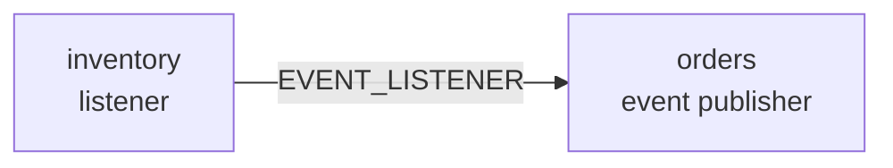
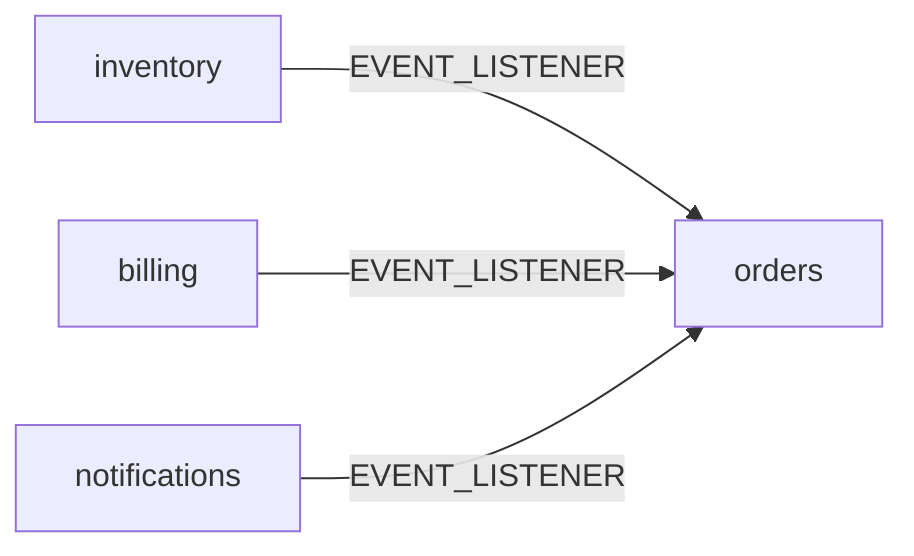
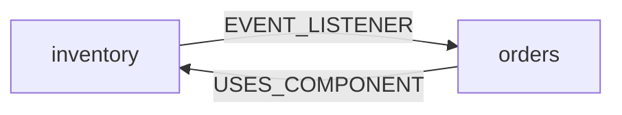

# Event listener tạo dependency không qua import

Trong một modular monolith, module phát event không cần biết module nào sẽ lắng nghe event đó. Tuy vậy, module khai báo event listener vẫn có quan hệ dependency với module sở hữu event contract. Spring Modulith nhận diện riêng quan hệ này bằng `DependencyType.EVENT_LISTENER`, dù publisher không inject hoặc import Spring bean của consumer.

Hướng dependency được tính từ module listener tới module công bố event. Listener phải tham chiếu event type trong chữ ký phương thức, nhưng publisher không cần tham chiếu class listener hoặc service của module nhận. Đây là điểm khác biệt giữa dependency do event listener và dependency do component injection.

Trong phạm vi **SPRING_MODULITH_MODULE_MODEL**, mô hình này giúp các module nghiệp vụ phối hợp mà không tạo danh sách consumer cố định trong module phát event. `orders` chỉ công bố sự kiện `OrderCompleted`; `inventory`, `billing` hoặc các module khác có thể lắng nghe độc lập khi cần.

## 1. Từ gọi bean trực tiếp sang phát event

Giả sử sau khi hoàn tất đơn hàng, module `orders` cần cập nhật tồn kho. Cách gọi trực tiếp khiến `orders` phải inject bean của `inventory`:

```java
@Service
class OrderManagement {

    private final InventoryManagement inventory;

    OrderManagement(InventoryManagement inventory) {
        this.inventory = inventory;
    }

    void complete(Order order) {
        // Cập nhật trạng thái đơn hàng.
        inventory.updateStockFor(order);
    }
}
```

Quan hệ này tạo dependency `orders → inventory` kiểu `USES_COMPONENT`. Khi muốn thêm hành vi sau khi đơn hoàn tất, `OrderManagement` phải biết thêm bean tương ứng hoặc được sửa để gọi chúng. Điều đó làm module phát event tích tụ trách nhiệm điều phối.

Có thể thay lời gọi trực tiếp bằng một sự kiện nghiệp vụ:

```java
@Service
class OrderManagement {

    private final ApplicationEventPublisher events;

    OrderManagement(ApplicationEventPublisher events) {
        this.events = events;
    }

    void complete(Order order) {
        // Chuyển trạng thái đơn hàng và hoàn tất thay đổi aggregate.
        events.publishEvent(new OrderCompleted(order.getId(), order.getSku()));
    }
}
```

`orders` chỉ dùng `ApplicationEventPublisher` và event type do chính module mình sở hữu. Nó không cần import `InventoryManagement`, `BillingManagement` hoặc listener implementation. Các module quan tâm tự đăng ký listener.

## 2. Công bố event contract từ module phát

Event là hợp đồng mà module khác có thể sử dụng. Hãy đặt event type ở package được module phát công khai. Ví dụ, dùng named interface `events` trong module `orders`:

```text
com.acme.shop.orders
├── OrderManagement.java
└── events
    ├── package-info.java
    └── OrderCompleted.java
```

`orders/events/package-info.java`:

```java
@org.springframework.modulith.NamedInterface("events")
package com.acme.shop.orders.events;
```

`OrderCompleted.java`:

```java
package com.acme.shop.orders.events;

import java.util.UUID;

public record OrderCompleted(UUID orderId, String sku) {}
```

Event nên mang dữ kiện cần thiết để consumer xử lý, chẳng hạn identifier, thời điểm, số lượng hoặc giá trị đã được xác nhận. Tránh truyền toàn bộ JPA entity hoặc aggregate đang được quản lý bởi persistence context. Payload gọn, ổn định giúp consumer không phụ thuộc vào cấu trúc nội bộ của module phát.

`@NamedInterface("events")` công khai event contract. Nó không đăng ký event listener và cũng không tạo dependency ngược từ `orders` sang consumer.

## 3. Consumer khai báo event listener

Module `inventory` lắng nghe `OrderCompleted`. Listener có thể nằm trong package nội bộ của module nhận:

```java
package com.acme.shop.inventory.internal;

import com.acme.shop.orders.events.OrderCompleted;
import org.springframework.modulith.events.ApplicationModuleListener;
import org.springframework.stereotype.Component;

@Component
class OrderCompletedListener {

    private final InventoryManagement inventory;

    OrderCompletedListener(InventoryManagement inventory) {
        this.inventory = inventory;
    }

    @ApplicationModuleListener
    void on(OrderCompleted event) {
        inventory.updateStockFor(event.sku());
    }
}
```

Listener import event type `OrderCompleted` để khai báo kiểu tham số, nhưng không import hoặc inject bean của module `orders`. Nó chỉ gọi service nội bộ `InventoryManagement` của chính module `inventory`.

`@ApplicationModuleListener` là cách Spring Modulith khuyến nghị để tích hợp application module qua event. Annotation này là tổ hợp của `@Async`, `@TransactionalEventListener` và `@Transactional(propagation = REQUIRES_NEW)`. Listener được xử lý sau khi transaction phát event hoàn tất thành công và chạy trong transaction riêng.

Nếu cần xử lý đồng bộ trong cùng luồng, Spring `@EventListener` có thể phù hợp. Nếu cần xử lý theo transaction commit nhưng tự cấu hình async/transaction, có thể dùng `@TransactionalEventListener` cùng các annotation tương ứng. Với giao tiếp liên module thông thường, `@ApplicationModuleListener` cung cấp cấu hình mặc định rõ ràng hơn.

## 4. Dependency được tạo theo hướng listener tới publisher

Với ví dụ trên, module `inventory` phụ thuộc vào event contract `orders::events`. Đồ thị có hướng như sau:



Đọc cạnh theo nghĩa: `inventory` cần biết event type mà `orders` công bố để khai báo listener. `orders` không cần biết `inventory` tồn tại. Nếu sau này module `billing` cũng lắng nghe `OrderCompleted`, đồ thị thêm một cạnh khác:



Module `orders` vẫn chỉ phát event một lần. Nó không cần thêm constructor dependency hoặc sửa code khi một consumer mới được thêm.

Đây là dependency ở mức kiến trúc, không phải dependency component. Trong Spring Modulith, `DependencyType.EVENT_LISTENER` mô tả module phụ thuộc vào module khác bằng cách khai báo listener cho event mà module đích expose. Target module không cần được bootstrap để chạy source module, khác với dependency `USES_COMPONENT` do inject bean.

## 5. Phân biệt EVENT_LISTENER với USES_COMPONENT

Hai module có thể liên hệ qua event hoặc gọi bean trực tiếp. Spring Modulith phân loại hai kiểu dependency này riêng:

| Dependency type | Cách hình thành | Hướng cạnh | Target module có cần bootstrap để chạy source module? |
|---|---|---|---|
| `EVENT_LISTENER` | Module khai báo listener cho event được module khác công bố | Listener module → publisher module | Không |
| `USES_COMPONENT` | Spring bean trong module này inject component/bean của module khác | Consumer module → provider module | Có |
| `DEFAULT` | Tham chiếu type thông thường giữa các module | Module chứa code tham chiếu → module sở hữu type | Tùy loại tham chiếu và ngữ cảnh sử dụng |
| `ENTITY` | Module tham chiếu entity của module khác | Module tham chiếu → module sở hữu entity | Không phải component dependency |

Ví dụ, nếu `inventory` inject `OrderManagement` và đồng thời lắng nghe `OrderCompleted`, nó có thể có cả `USES_COMPONENT` và `EVENT_LISTENER` dependency tới `orders`. Điều này thường cho thấy module đang dùng hai kiểu tích hợp song song; hãy xem xét có thể loại bỏ lời gọi bean trực tiếp để giảm coupling hay không.

## 6. Event type vẫn là hợp đồng cần tham chiếu

Tên bài học có cụm “không qua import” cần được hiểu chính xác:

- Module phát không import listener hoặc bean của module nhận.
- Module nhận vẫn cần tham chiếu event type trong chữ ký listener; nếu event ở package khác, code Java thường có một câu lệnh `import` cho event type.
- Spring Modulith phân loại quan hệ đó là `EVENT_LISTENER`, không phải một component dependency thông thường.

Vì vậy, event không xóa mọi dependency. Nó thay dependency vào service implementation bằng dependency vào event contract ổn định. Nếu đặt event type trong package `internal` của publisher, consumer sẽ vi phạm module boundary. Hãy công khai event bằng package gốc hoặc `NamedInterface`.

## 7. Giới hạn dependency bằng allowedDependencies

Nếu module `inventory` khai báo allowlist, hãy cho phép đúng named interface chứa event contract của `orders` trong `inventory/package-info.java`:

```java
@org.springframework.modulith.ApplicationModule(
    allowedDependencies = "orders::events"
)
package com.acme.shop.inventory;
```

`orders::events` gồm logical identifier của module phát và tên named interface chứa event. Quy tắc được khai báo ở module consumer (`inventory`), vì listener module là bên phụ thuộc vào event contract.

Nếu `inventory` cần thêm API khác của `orders`, hãy công khai API đó và cập nhật allowlist một cách tường minh. Không nên mở toàn bộ module chỉ để consumer có thể import một event class nằm sai package.

## 8. Kiểm tra event dependency bằng ApplicationModules

Tạo mô hình từ lớp ứng dụng:

```java
import org.springframework.modulith.core.ApplicationModules;

ApplicationModules modules = ApplicationModules.of(ShopApplication.class);
```

Lấy module nhận event và truy vấn các dependency thuộc `EVENT_LISTENER`:

```java
import org.springframework.modulith.core.ApplicationModule;
import org.springframework.modulith.core.DependencyType;

ApplicationModule inventory = modules.getModuleByName("inventory")
    .orElseThrow();

inventory.getDirectDependencies(modules, DependencyType.EVENT_LISTENER)
    .uniqueModules()
    .forEach(module -> System.out.println(module.getIdentifier()));
```

Kết quả dự kiến có module `orders`, vì `inventory` khai báo listener cho event do `orders` expose. Có thể lấy các event type mà module đang lắng nghe:

```java
inventory.getEventsListenedTo(modules)
    .forEach(eventType -> System.out.println(eventType.getName()));
```

Ở phía module phát, `getPublishedEvents()` trả về các event được module công bố:

```java
ApplicationModule orders = modules.getModuleByName("orders")
    .orElseThrow();

orders.getPublishedEvents().forEach(System.out::println);
```

Các API này giúp đối chiếu publisher, listener và dependency graph khi một event không được nhận diện như mong đợi. `getDirectDependencies(..., EVENT_LISTENER)` lọc đúng loại cạnh; nếu bỏ bộ lọc, kết quả có thể bao gồm cả dependency do bean injection hoặc type reference khác.

## 9. Kiểm chứng dependency và chu kỳ

Đưa kiểm tra module vào test:

```java
import org.junit.jupiter.api.Test;
import org.springframework.modulith.core.ApplicationModules;

class ModularityTests {

    @Test
    void verifiesApplicationModuleStructure() {
        ApplicationModules.of(ShopApplication.class).verify();
    }
}
```

`verify()` kiểm tra dependency có tuân thủ API package, `allowedDependencies` và đồ thị module có chu kỳ hay không. Event listener dependency vẫn là một cạnh trong đồ thị. Ví dụ, nếu `inventory` lắng nghe event từ `orders`, nhưng `orders` lại inject bean nội bộ của `inventory`, đồ thị có thể thành:



Đây là chu kỳ dù hai module không gọi nhau bằng cùng một cơ chế. Việc chuyển một lời gọi sang event không tự động bảo đảm đồ thị không còn cycle; cần loại bỏ dependency ngược nếu không cần thiết.

## 10. Ảnh hưởng tới module integration test

Vì `EVENT_LISTENER` không yêu cầu target module được bootstrap để chạy source module, test riêng module listener không nhất thiết phải khởi tạo toàn bộ bean của module phát. Module listener chỉ cần event type trên compile/test classpath và các dependency nội bộ của chính nó.

Điều này khác với `USES_COMPONENT`: nếu `inventory` inject bean từ `orders`, module `orders` cần có mặt hoặc bean được mock khi bootstrap test theo chế độ phù hợp. Event dependency giúp module nhận kiểm thử độc lập hơn và giảm số bean ngoài module cần tạo.

Trong integration test, có thể kiểm tra hành vi bằng cách phát event và xác nhận trạng thái mà listener tạo ra. Với event listener bất đồng bộ, test phải chờ hoặc đồng bộ theo cơ chế test support phù hợp; không nên giả định listener đã hoàn tất ngay sau `publishEvent()` trả về.

## 11. Transaction, async và độ tin cậy của event

Event publication trong Spring mặc định diễn ra đồng bộ. Nếu dùng `@EventListener`, listener có thể chạy ngay trong luồng publish và nằm trong cùng transaction tùy cách gọi. Điều này đơn giản nhưng có thể làm transaction của publisher kéo dài hoặc thất bại do logic phụ của listener.

`@ApplicationModuleListener` dùng transactional event listener bất đồng bộ và transaction riêng. Nó giúp tách xử lý của listener khỏi transaction ban đầu, nhưng việc thực thi bất đồng bộ tạo ra nhu cầu xử lý lỗi và khôi phục.

Spring Modulith cung cấp Event Publication Registry để ghi nhận publication cho các transactional listener trong transaction gốc. Khi listener hoàn tất thành công, publication được đánh dấu hoàn tất; nếu listener lỗi, publication còn lại ở trạng thái chưa hoàn tất để có thể retry/resubmit theo cấu hình. Tài liệu Spring Modulith khuyến nghị kết hợp registry với `@ApplicationModuleListener` khi cần bảo đảm publication không bị mất do ứng dụng hoặc listener gặp lỗi.

Hãy phân biệt hai vấn đề:

- `DependencyType.EVENT_LISTENER` mô tả quan hệ kiến trúc giữa các module.
- Event Publication Registry quản lý vòng đời publication ở runtime để hỗ trợ phát hiện lỗi và phục hồi.

Có dependency `EVENT_LISTENER` không tự động có nghĩa event đã được lưu bền vững hoặc listener chắc chắn sẽ xử lý thành công. Độ tin cậy runtime phụ thuộc vào transaction, registry, persistence implementation và chính sách retry.

## 12. Quy trình thiết kế tích hợp liên module bằng event

Khi module cần phản ứng với một sự kiện nghiệp vụ do module khác công bố, hãy thực hiện:

1. **Xác định sự kiện có ý nghĩa nghiệp vụ.** Chọn một sự kiện đã xảy ra, chẳng hạn `OrderCompleted`, thay vì phát event cho mọi thay đổi kỹ thuật.
2. **Thiết kế payload ổn định.** Chỉ đưa dữ kiện consumer cần; ưu tiên identifier và value type thay cho entity hoặc object nội bộ.
3. **Công khai event contract.** Đặt event ở package gốc hoặc named interface như `orders::events`.
4. **Phát event từ module sở hữu.** Dùng `ApplicationEventPublisher` sau khi thay đổi trạng thái nghiệp vụ phù hợp.
5. **Đăng ký listener ở module nhận.** Dùng `@ApplicationModuleListener` cho tích hợp bất đồng bộ, transactional theo cấu hình mặc định.
6. **Khai báo allowlist.** Nếu consumer có `allowedDependencies`, cho phép đúng event interface của publisher.
7. **Kiểm tra loại dependency.** Dùng `getDirectDependencies(modules, DependencyType.EVENT_LISTENER)` và `getEventsListenedTo(modules)`.
8. **Chạy `ApplicationModules.verify()`.** Xác nhận event contract được expose, allowlist đúng và không tạo chu kỳ.
9. **Kiểm thử xử lý lỗi.** Kiểm tra listener failure, retry và Event Publication Registry nếu luồng nghiệp vụ yêu cầu độ tin cậy cao.

## 13. Những ngộ nhận thường gặp

- **“Event xóa mọi dependency giữa hai module.”** Không đúng. Listener module vẫn phụ thuộc vào event contract của publisher và Spring Modulith ghi nhận bằng `EVENT_LISTENER`.
- **“Publisher phải import listener để event được nhận.”** Publisher chỉ publish event; Spring event infrastructure tìm listener đã đăng ký. Publisher không cần biết listener implementation.
- **“Listener không cần import gì từ publisher.”** Listener vẫn tham chiếu event type trong method signature; điều được loại bỏ là dependency vào publisher bean/service.
- **“EVENT_LISTENER giống USES_COMPONENT.”** Hai loại có hướng dependency và bootstrap semantics khác nhau. Target của event listener không cần bootstrap để chạy source module.
- **“Event type có thể nằm trong package internal.”** Consumer phải tham chiếu event type, nên event cần được công khai qua API package hoặc named interface.
- **“Chỉ cần thêm `allowedDependencies` là event hoạt động.”** Allowlist chỉ kiểm soát kiến trúc; Spring vẫn cần event publication và listener bean được đăng ký.
- **“@ApplicationModuleListener chạy đồng bộ trong transaction publisher.”** Annotation này dùng async transactional event listener và transaction riêng; không nên giả định listener hoàn tất trước khi publisher trả về.
- **“Có EVENT_LISTENER dependency thì event đã được lưu bền vững.”** Dependency graph không phải Event Publication Registry. Cần cấu hình registry và persistence phù hợp nếu cần retry/recovery.
- **“Dùng event là không thể có dependency cycle.”** Listener edge vẫn tham gia module graph; nếu còn dependency ngược, cycle vẫn xuất hiện.

## Kết luận

Khi một module khai báo listener cho event được module khác công bố, Spring Modulith tạo dependency loại `EVENT_LISTENER` từ module listener tới module publisher. Publisher không cần import hoặc inject bean của consumer; listener vẫn tham chiếu event type công khai trong chữ ký phương thức. Dùng `@NamedInterface` để công khai event contract, `allowedDependencies` để giới hạn consumer, `@ApplicationModuleListener` để tích hợp bất đồng bộ trong transaction riêng, và `ApplicationModules.verify()` cùng `getDirectDependencies(..., EVENT_LISTENER)` để kiểm tra dependency graph. Event giúp giảm coupling component, nhưng event contract vẫn là dependency cần quản lý và có thể tham gia chu kỳ module.

## Tài liệu tham khảo

- [Spring Modulith — Working with Application Events](https://docs.spring.io/spring-modulith/reference/events.html)
- [Spring Modulith — DependencyType API](https://docs.spring.io/spring-modulith/docs/current/api/org/springframework/modulith/core/DependencyType.html)
- [Spring Modulith — ApplicationModule API](https://docs.spring.io/spring-modulith/docs/current/api/org/springframework/modulith/core/ApplicationModule.html)
- [Spring Modulith — ApplicationModuleListener API](https://docs.spring.io/spring-modulith/docs/current/api/org/springframework/modulith/events/ApplicationModuleListener.html)
