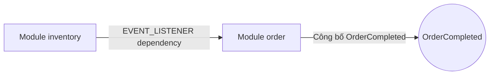
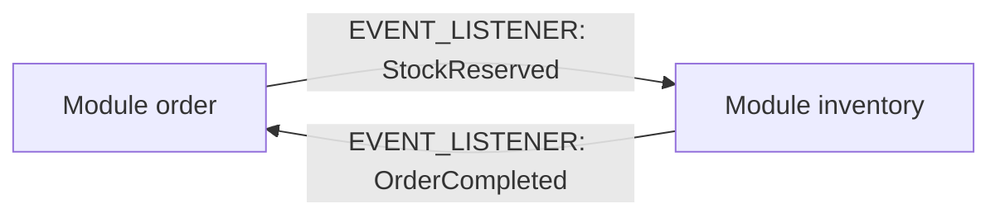
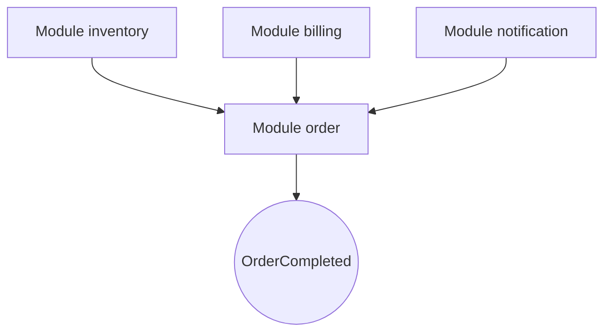

# Event publication có tạo cycle hay không?

Việc một module phát application event không tự tạo ra chu trình phụ thuộc với module nhận event. Module phát chỉ cần biết `ApplicationEventPublisher` và kiểu event mà nó công bố; nó không cần inject bean của từng module lắng nghe. Module nhận event tham chiếu kiểu event đó trong phương thức listener, vì vậy Spring Modulith ghi nhận một phụ thuộc theo chiều từ module lắng nghe về module sở hữu event.

Chu trình vẫn có thể xuất hiện nếu hai module cùng lắng nghe event do module còn lại công bố. Khi đó, đồ thị phụ thuộc có cạnh theo cả hai chiều. Bài học này giúp xác định đúng hướng của phụ thuộc, phân biệt chu trình kiến trúc với vòng lặp xử lý event ở runtime, và dùng `ApplicationModules.verify()` để kiểm tra.

## 1. Event publication tách bên phát khỏi các bên nhận

Giả sử module `order` hoàn tất một đơn hàng. Sau khi cập nhật trạng thái đơn, nó công bố event `OrderCompleted`. Module `inventory` quan tâm event này để giữ hoặc trừ tồn kho. Nếu gọi trực tiếp `inventory.updateStockFor(order)`, module `order` phải biết bean của `inventory` và phụ thuộc trực tiếp vào contract của module đó.

Khi dùng event, module `order` chỉ cần phát một sự kiện mô tả điều đã xảy ra:

```java
package com.acme.shop.order;

import java.util.UUID;

public record OrderCompleted(UUID orderId) {}
```

```java
package com.acme.shop.order.internal;

import com.acme.shop.order.OrderCompleted;
import org.springframework.context.ApplicationEventPublisher;
import org.springframework.stereotype.Service;
import org.springframework.transaction.annotation.Transactional;

import java.util.UUID;

@Service
public class OrderManagement {

    private final ApplicationEventPublisher events;

    public OrderManagement(ApplicationEventPublisher events) {
        this.events = events;
    }

    @Transactional
    public void complete(UUID orderId) {
        // Cập nhật trạng thái đơn hàng trong aggregate.
        events.publishEvent(new OrderCompleted(orderId));
    }
}
```

Module `order` không tham chiếu `InventoryManagement`. Nó không cần biết có bao nhiêu listener, listener nằm ở module nào hoặc sau này có thêm chức năng nào quan tâm đến `OrderCompleted`.

## 2. Hướng phụ thuộc do event listener tạo ra

Module `inventory` khai báo listener nhận `OrderCompleted`:

```java
package com.acme.shop.inventory.internal;

import com.acme.shop.order.OrderCompleted;
import org.springframework.modulith.events.ApplicationModuleListener;
import org.springframework.stereotype.Component;

@Component
public class InventoryManagement {

    @ApplicationModuleListener
    void on(OrderCompleted event) {
        // Giữ hoặc cập nhật tồn kho cho đơn hàng đã hoàn tất.
    }
}
```

Kiểu `OrderCompleted` thuộc API của module `order`; listener ở module `inventory` tham chiếu kiểu đó. Vì thế, đồ thị module có một phụ thuộc từ `inventory` đến `order`, được Spring Modulith phân loại là `DependencyType.EVENT_LISTENER`.



Mũi tên `inventory` đến `order` trong đồ thị phụ thuộc thể hiện module khai báo listener cần kiểu event do `order` sở hữu. Nó không có nghĩa `order` phải gọi bean của `inventory`. Do đó, với một event một chiều như ví dụ trên, chỉ có một cạnh phụ thuộc và không hình thành cycle.

Event class cần nằm trong package API của module phát hoặc trong named interface được công khai có chủ đích. Nếu đặt event trong package nội bộ của `order`, module `inventory` sẽ tham chiếu một kiểu nội bộ và vi phạm quy tắc truy cập API của Spring Modulith.

## 3. Khi nào event listener tạo thành cycle?

Giả sử module `inventory` cũng công bố event `StockReserved` sau khi giữ hàng:

```java
package com.acme.shop.inventory;

import java.util.UUID;

public record StockReserved(UUID orderId) {}
```

Và module `order` khai báo listener cho event đó:

```java
package com.acme.shop.order.internal;

import com.acme.shop.inventory.StockReserved;
import org.springframework.modulith.events.ApplicationModuleListener;
import org.springframework.stereotype.Component;

@Component
public class OrderInventoryListener {

    @ApplicationModuleListener
    void on(StockReserved event) {
        // Ghi nhận kết quả giữ hàng cho đơn.
    }
}
```

Lúc này có hai phụ thuộc listener:

- `inventory` phụ thuộc `order` vì listener của `inventory` nhận `OrderCompleted`.
- `order` phụ thuộc `inventory` vì listener của `order` nhận `StockReserved`.

Đồ thị trở thành:



Đây là cycle ở cấp module, dù cả hai module chỉ giao tiếp qua event và không inject bean của nhau. Event publication đã loại bỏ phụ thuộc trực tiếp giữa các service, nhưng các kiểu event và listener vẫn thể hiện quan hệ kiến trúc. Bất kỳ cạnh phụ thuộc nào tạo thành đường đi quay lại module ban đầu đều cần được xem xét.

## 4. Phân biệt cycle kiến trúc và vòng lặp event ở runtime

Hai vấn đề sau có liên quan nhưng không giống nhau:

| Hiện tượng | Bản chất | Ví dụ |
|---|---|---|
| Cycle phụ thuộc module | Đồ thị phụ thuộc giữa các module có đường đi khép kín | `order` lắng nghe event của `inventory`, đồng thời `inventory` lắng nghe event của `order`. |
| Vòng lặp xử lý event | Một chuỗi listener liên tục phát event khiến xử lý quay lại điểm ban đầu | `OrderCompleted` làm `inventory` phát `StockReserved`, listener ở `order` lại phát `OrderUpdated`, và một listener khác lại phát `OrderCompleted`. |

Cycle kiến trúc có thể bị phát hiện bằng phân tích cấu trúc ngay cả khi các listener không thực sự được kích hoạt trong một lần chạy. Vòng lặp runtime phụ thuộc dữ liệu và logic thực thi; nó có thể xảy ra khi các module dùng event chung hoặc khi chuỗi xử lý được cấu hình sai. Một ứng dụng có thể gặp một trong hai vấn đề hoặc cả hai.

Chạy listener bất đồng bộ không xóa phụ thuộc kiến trúc. `@ApplicationModuleListener` là listener bất đồng bộ và có transaction riêng theo cơ chế Spring Modulith, nhưng phương thức listener vẫn tham chiếu kiểu event của module khác. Vì vậy, cạnh `EVENT_LISTENER` vẫn tồn tại trong mô hình module.

## 5. Cách giữ event flow theo một chiều

Khi phát hiện hai module lắng nghe event của nhau, hãy xem lại quyền sở hữu nghiệp vụ và chiều luồng công việc:

1. Xác định module nào sở hữu sự kiện gốc. Event nên mô tả một sự kiện nghiệp vụ đã xảy ra trong module đó, chẳng hạn `OrderCompleted` thuộc `order`.
2. Để các module quan tâm đăng ký listener cho event đó. Module phát không cần biết danh sách subscriber.
3. Tránh để module phát event rồi chờ một module khác gọi ngược vào nó để hoàn tất cùng một thao tác đồng bộ. Nếu cần kết quả, cân nhắc mô hình hóa bước tiếp theo thành một command hoặc quy trình điều phối có chủ sở hữu rõ ràng.
4. Nếu nhiều module cần chia sẻ một contract thực sự độc lập, cân nhắc đưa kiểu event hoặc contract đó vào module nền tảng phù hợp. Không đưa mọi event vào một module `common` chỉ để che đi phụ thuộc vòng; module chung không nên chứa nghiệp vụ thuộc các module khác.
5. Nếu luồng nghiệp vụ có nhiều bước và phản hồi qua lại, mô hình hóa rõ saga hoặc process manager. Đặt trách nhiệm điều phối ở một nơi để các module nghiệp vụ không phải phụ thuộc vòng vào nhau.

Ví dụ, `order` công bố `OrderCompleted`; `inventory`, `billing` và `notification` có thể cùng lắng nghe. Đồ thị phụ thuộc chỉ có các cạnh từ những module nhận về `order`:



Module `order` không phải thay đổi khi có thêm subscriber mới. Các module tiêu thụ có thể triển khai chức năng của mình độc lập, miễn là chỉ phụ thuộc vào API event đã công bố.

## 6. Kiểm tra cycle bằng Spring Modulith

Spring Modulith phân tích quan hệ module, trong đó có phụ thuộc do event listener khai báo. Lời gọi `verify()` kiểm tra đồ thị module không có chu trình, đồng thời kiểm tra quyền truy cập API và các ràng buộc phụ thuộc khác:

```java
package com.acme.shop;

import org.junit.jupiter.api.Test;
import org.springframework.modulith.core.ApplicationModules;

class ModularityTests {

    @Test
    void applicationModulesShouldNotContainCycles() {
        ApplicationModules.of(ShopApplication.class).verify();
    }
}
```

Nếu `order` và `inventory` lắng nghe event của nhau, kiểm tra có thể báo cycle ở cấp application module. Hãy đọc các cạnh và kiểu tham chiếu trong thông báo vi phạm để xác định listener nào tạo phụ thuộc ngược, rồi điều chỉnh quyền sở hữu event hoặc luồng nghiệp vụ.

Khi muốn lấy danh sách vi phạm để xử lý trong một báo cáo, có thể dùng `detectViolations()`:

```java
var violations = ApplicationModules.of(ShopApplication.class)
        .detectViolations();

violations.throwIfPresent();
```

`verify()` phù hợp với bài kiểm tra kiến trúc thông thường và ném ngoại lệ khi có vi phạm. `detectViolations()` trả về tập vi phạm để nhóm có thể lọc hoặc trình bày thêm trước khi quyết định làm test thất bại.

## 7. Event publication registry giải quyết vấn đề khác

Spring Modulith cung cấp Event Publication Registry để ghi nhận các lần công bố event tới transactional listener và đánh dấu publication hoàn tất khi listener xử lý thành công. Cơ chế này hỗ trợ quan sát và phục hồi publication chưa hoàn tất theo cấu hình của ứng dụng.

Registry xử lý vòng đời giao nhận event. Nó không thay đổi hướng phụ thuộc do event type và listener tạo ra, cũng không làm cho một đồ thị module có cycle trở thành hợp lệ. Một ứng dụng cần cả hai lớp kiểm soát: kiểm tra kiến trúc để giữ đồ thị module đúng, và quản lý publication để xử lý đáng tin cậy các listener ở runtime.

Ngoài ra, event publication trong Spring mặc định diễn ra đồng bộ nếu listener không được cấu hình bất đồng bộ. Dùng `@TransactionalEventListener` hoặc `@ApplicationModuleListener` ảnh hưởng đến thời điểm và transaction xử lý event. Hãy lựa chọn theo yêu cầu nhất quán và độ trễ; đừng xem async là cách khắc phục cycle kiến trúc.

## 8. Tự đánh giá

Một module `payment` công bố `PaymentCaptured`. Module `order` lắng nghe event này để cập nhật trạng thái đơn hàng. Module `notification` cũng lắng nghe để gửi email. Cả hai module nhận chỉ phụ thuộc vào API event của `payment`; `payment` không cần biết chúng tồn tại. Đồ thị có hai cạnh `order → payment` và `notification → payment`, nên không có cycle nếu không xuất hiện phụ thuộc ngược khác.

Nếu `payment` lại khai báo listener cho `OrderCompleted` từ `order`, đồ thị có thêm cạnh `payment → order`. Kết hợp với cạnh `order → payment`, đây là cycle và `ApplicationModules.verify()` có thể phát hiện. Cần xem lại ranh giới nghiệp vụ hoặc tách trách nhiệm điều phối để luồng sự kiện không tạo phụ thuộc hai chiều.

## Tài liệu tham khảo

- [Spring Modulith – Working with Application Events](https://docs.spring.io/spring-modulith/reference/events.html)
- [Spring Modulith – Verifying Application Module Structure](https://docs.spring.io/spring-modulith/reference/verification.html)
- [Spring Modulith Javadoc – DependencyType](https://docs.spring.io/spring-modulith/docs/current/api/org/springframework/modulith/core/DependencyType.html)
- [Spring Modulith Javadoc – ApplicationModuleDependency](https://docs.spring.io/spring-modulith/docs/current/api/org/springframework/modulith/core/ApplicationModuleDependency.html)
