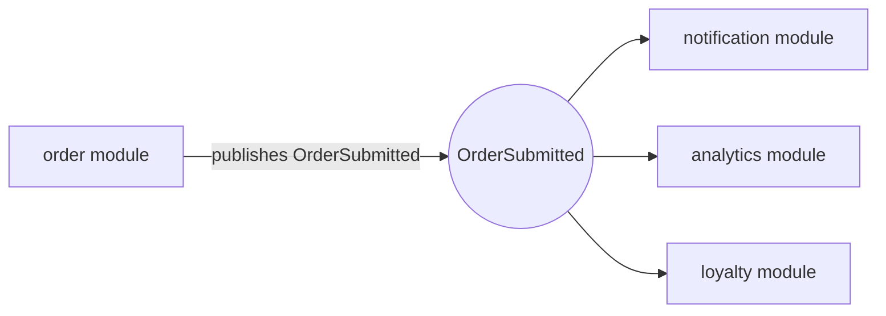
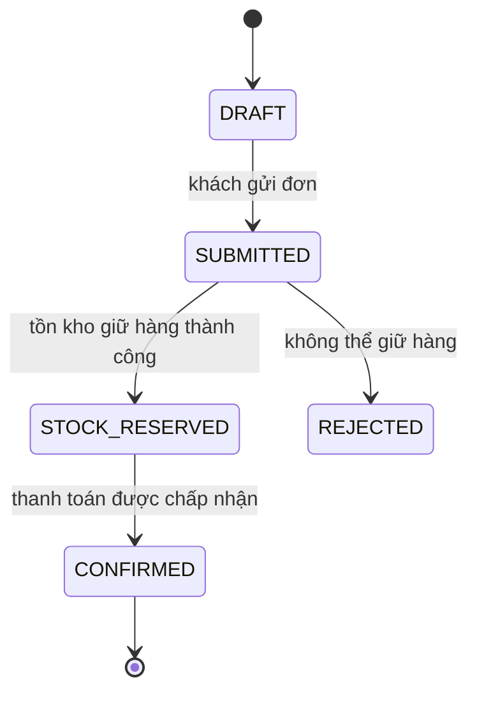
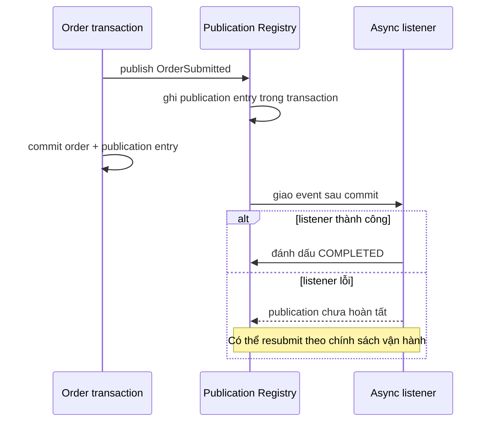

# Thiết kế event giảm coupling nhưng giữ ngữ nghĩa

Trong modular monolith, các application module cần phối hợp để hoàn thành quy trình nghiệp vụ. Nếu module phát sự kiện phải gọi trực tiếp mọi service đang quan tâm tới thay đổi đó, nó sẽ biết quá nhiều về cấu trúc của các module còn lại. Spring Modulith khuyến khích các module giao tiếp qua application event để module phát sự kiện không cần biết trước tất cả consumer.

Tuy nhiên, dùng event không tự động làm hệ thống ít coupling hơn hoặc đúng nghiệp vụ hơn. Event phải diễn tả một sự thật nghiệp vụ đã xảy ra, mang đủ dữ liệu để consumer hiểu sự thật đó và có thời điểm xử lý phù hợp. Nếu một thao tác cần kết quả ngay để quyết định giao dịch hiện tại thành công hay thất bại, một lời gọi trực tiếp có thể phù hợp hơn. Nếu module khác chỉ cần phản ứng độc lập sau khi trạng thái nghiệp vụ đã được xác nhận, event thường là lựa chọn tốt.

Trong `SPRING_MODULITH_MODULE_MODEL`, thiết kế event tốt giúp giữ ranh giới module, giảm phụ thuộc trực tiếp giữa bean, đồng thời bảo toàn ý nghĩa của trạng thái, thứ tự nghiệp vụ và khả năng xử lý khi listener gặp lỗi.

## 1. Event giảm coupling ở đâu?

Giả sử module `order` hoàn tất việc ghi nhận đơn hàng. Module `notification` cần gửi email, `analytics` cần cập nhật số liệu và `loyalty` cần tính điểm.

Nếu gọi trực tiếp từng module, `OrderManagement` phải biết mọi consumer:

```java
@Service
class OrderManagement {

    private final NotificationService notifications;
    private final AnalyticsService analytics;
    private final LoyaltyService loyalty;

    OrderManagement(
            NotificationService notifications,
            AnalyticsService analytics,
            LoyaltyService loyalty) {
        this.notifications = notifications;
        this.analytics = analytics;
        this.loyalty = loyalty;
    }

    void submit(Order order) {
        // Lưu trạng thái đơn hàng.
        notifications.sendOrderReceived(order);
        analytics.recordOrder(order);
        loyalty.awardPoints(order);
    }
}
```

Khi thêm một consumer mới, module `order` phải thay đổi constructor và logic điều phối. Các module cũng bị ràng buộc trực tiếp vào API của nhau.

Với event, module `order` công bố một sự kiện mô tả điều đã xảy ra:

```java
public record OrderSubmitted(
        UUID orderId,
        UUID customerId,
        Instant submittedAt) {
}
```

Publisher chỉ cần biết `ApplicationEventPublisher` và kiểu event:

```java
@Service
class OrderManagement {

    private final ApplicationEventPublisher events;

    OrderManagement(ApplicationEventPublisher events) {
        this.events = events;
    }

    void submit(Order order) {
        order.submit();
        events.publishEvent(new OrderSubmitted(
                order.getId(),
                order.getCustomerId(),
                Instant.now()));
    }
}
```

Các module quan tâm đăng ký listener riêng:

```java
@Component
class OrderNotificationListener {

    @ApplicationModuleListener
    void on(OrderSubmitted event) {
        // Gửi thông báo đơn hàng đã được ghi nhận.
    }
}
```

```java
@Component
class OrderAnalyticsListener {

    @ApplicationModuleListener
    void on(OrderSubmitted event) {
        // Ghi nhận số liệu đơn hàng.
    }
}
```



Publisher không cần biết có bao nhiêu listener. Có thể thêm consumer mới mà không phải sửa `OrderManagement`. Các consumer vẫn phụ thuộc vào hợp đồng event, nhưng không phụ thuộc trực tiếp vào bean service của publisher.

## 2. Phân biệt command và event

Command và event đều có thể được biểu diễn bằng object, nhưng mang ngữ nghĩa khác nhau.

| Tiêu chí | Command | Event |
|---|---|---|
| Ý nghĩa | Yêu cầu một hành động cần thực hiện | Thông báo một sự thật đã xảy ra |
| Cách đặt tên | Động từ yêu cầu, ví dụ `ReserveStock` | Sự kiện quá khứ, ví dụ `StockReserved` |
| Người nhận | Thường có một handler chịu trách nhiệm | Có thể có không, một hoặc nhiều consumer |
| Kết quả | Người gọi thường cần biết thành công/thất bại | Publisher không chờ từng consumer trả kết quả |
| Thời điểm | Thường gắn với quyết định hiện tại | Thường phát sau khi sự thật nghiệp vụ được xác lập |

Ví dụ:

- `ReserveStock` là command: yêu cầu module tồn kho thử giữ số lượng hàng.
- `StockReserved` là event: thông báo rằng việc giữ hàng đã thành công.
- `OrderSubmitted` là event: thông báo rằng đơn hàng đã được ghi nhận để xử lý tiếp.

Không nên đặt một yêu cầu chưa được thực hiện thành event đã xảy ra. Nếu publisher phát `StockReserved` trước khi tồn kho thực sự được giữ, tên event gây hiểu sai trạng thái và consumer có thể đưa ra quyết định sai.

Nếu module `order` cần biết ngay việc giữ hàng có thành công để quyết định có xác nhận đơn hay không, hãy gọi API/command của `inventory` và xử lý kết quả. Nếu việc giữ hàng là bước xử lý độc lập sau khi đơn được tiếp nhận, có thể phát `OrderSubmitted`, để inventory xử lý bất đồng bộ và công bố event kết quả như `StockReservationAccepted` hoặc `StockReservationRejected`.

## 3. Chọn thời điểm phát event theo trạng thái nghiệp vụ

Event cần được phát sau khi sự thật mà nó mô tả đã được xác lập. Hãy xác định rõ trạng thái nào đã hoàn tất tại thời điểm phát.

Ví dụ, một quy trình đơn hàng có các trạng thái:



Các event tương ứng có thể là:

| Event | Sự thật được xác nhận |
|---|---|
| `OrderSubmitted` | Đơn hàng đã được gửi và ghi nhận ở trạng thái `SUBMITTED` |
| `StockReservationAccepted` | Tồn kho đã giữ đủ số lượng cho đơn |
| `StockReservationRejected` | Yêu cầu giữ hàng bị từ chối |
| `OrderConfirmed` | Đơn đã đạt điều kiện xác nhận theo quy tắc nghiệp vụ |

Tên event không nên hứa nhiều hơn trạng thái thực tế. `OrderSubmitted` không có nghĩa là hàng đã được giữ hoặc thanh toán đã hoàn tất. Nếu consumer cần biết một trong các kết quả đó, publisher phải phát event riêng khi kết quả thực sự xảy ra.

Với mỗi event, hãy trả lời:

1. Sự kiện nghiệp vụ nào vừa xảy ra?
2. Điều kiện nào đã được kiểm tra trước khi phát?
3. Trạng thái nào đã được lưu thành công?
4. Consumer có thể dựa vào event này để làm gì mà không phải đoán?

## 4. Đặt tên event như một sự thật đã xảy ra

Tên event nên dùng dạng quá khứ hoặc mô tả trạng thái đã hình thành:

| Tên nên dùng | Tên dễ gây nhầm | Lý do |
|---|---|---|
| `OrderSubmitted` | `SubmitOrder` | `OrderSubmitted` mô tả sự thật; `SubmitOrder` giống command |
| `PaymentCaptured` | `CapturePayment` | Event nói khoản thanh toán đã được thu |
| `StockReserved` | `ReserveStock` | Event chỉ phát khi giữ hàng thành công |
| `CustomerAddressChanged` | `ChangeCustomerAddress` | Event mô tả thay đổi đã được lưu |
| `OrderCancelled` | `CancelOrder` | Event mô tả đơn đã chuyển sang trạng thái hủy |

Tên cần nhất quán với ngôn ngữ nghiệp vụ của module sở hữu sự kiện. Tránh các tên quá chung như `DataChanged`, `ProcessFinished` hoặc `UpdateCompleted`, vì consumer không thể biết dữ liệu hay quy trình nào đã thay đổi.

## 5. Event thuộc về module nào?

Module sở hữu sự thật nghiệp vụ nên sở hữu kiểu event mô tả sự thật đó. Ví dụ, `OrderSubmitted` thuộc module `order` vì module này chịu trách nhiệm về vòng đời đơn hàng.

```text
com.example.shop.order
├── OrderManagement.java
├── OrderSubmitted.java
└── internal
    └── OrderSubmissionPolicy.java

com.example.shop.notification
└── internal
    └── OrderNotificationListener.java
```

Consumer phụ thuộc vào event contract của `order`. Publisher không cần import hoặc biết listener của `notification`.

Nếu event cần được nhiều module tham chiếu, kiểu event phải nằm trong bề mặt API mà module sở hữu công bố. Có thể đặt event trong package gốc hoặc một named interface thích hợp. Không đặt event ở package `internal` rồi yêu cầu các module khác import trực tiếp.

Ví dụ, nếu event nằm trong package gốc `order`:

```java
package com.example.shop.order;

public record OrderSubmitted(
        UUID orderId,
        UUID customerId,
        Instant submittedAt) {
}
```

Nếu nhóm muốn gom event contract vào named interface:

```java
@org.springframework.modulith.NamedInterface("events")
package com.example.shop.order.events;
```

Consumer khai báo dependency tới `order::events` nếu module đang dùng whitelist:

```java
@org.springframework.modulith.ApplicationModule(
    allowedDependencies = "order::events"
)
package com.example.shop.notification;
```

Named interface làm rõ nhóm event được công bố. Nó không tạo module mới và cũng không thay đổi module sở hữu sự kiện.

## 6. Thiết kế payload đủ ngữ nghĩa

Payload event cần mang đủ dữ liệu để consumer hiểu và xử lý sự kiện đúng. Một event chỉ chứa `orderId` có thể phù hợp nếu consumer cần đọc trạng thái mới nhất từ API của order. Nhưng cách đó tạo thêm dependency và có thể khiến consumer đọc được trạng thái đã thay đổi sau thời điểm event xảy ra.

Ngược lại, payload quá lớn có thể làm lộ toàn bộ aggregate, chi tiết persistence hoặc dữ liệu không liên quan. Hãy chọn dữ liệu theo ngữ nghĩa sự kiện.

Ví dụ một event mang snapshot tối thiểu cho listener gửi thông báo:

```java
public record OrderSubmitted(
        UUID eventId,
        UUID orderId,
        UUID customerId,
        List<OrderLine> lines,
        Instant submittedAt) {

    public OrderSubmitted {
        lines = List.copyOf(lines);
    }
}

public record OrderLine(
        String productCode,
        int quantity,
        BigDecimal unitPrice,
        String currency) {
}
```

Payload trên cung cấp danh tính đơn hàng, khách hàng, các dòng hàng và thời điểm gửi. `List.copyOf` bảo vệ cấu trúc danh sách khỏi việc bị thay đổi sau khi event được tạo; các phần tử cũng nên là value object bất biến.

### Chọn giữa ID và snapshot

| Cách mang dữ liệu | Phù hợp khi | Rủi ro cần cân nhắc |
|---|---|---|
| Chỉ mang aggregate ID | Consumer cần trạng thái mới nhất và có API đọc ổn định | Consumer phải gọi ngược provider; dữ liệu có thể đã đổi hoặc bị xóa |
| Mang snapshot cần thiết | Consumer cần hiểu chính xác sự thật tại thời điểm phát | Payload lớn hơn; phải quản lý schema và dữ liệu nhạy cảm |
| Mang cả ID và một phần snapshot | Consumer cần định danh và một số giá trị lịch sử | Cần xác định rõ trường nào là snapshot, trường nào là tham chiếu |

Không đưa JPA entity hoặc object graph có lazy association vào event contract. Entity có thể thay đổi, chứa proxy persistence, tham chiếu dữ liệu nội bộ và khó serialize ổn định. Hãy tạo event payload độc lập bằng ID và value object cần thiết.

## 7. Giữ ý nghĩa của thời gian, tiền tệ và số lượng

Event có thể được xử lý sau thời điểm phát, vì vậy các giá trị phụ thuộc thời gian hoặc cấu hình cần được biểu diễn rõ.

- Dùng `Instant` cho thời điểm tuyệt đối; không dùng chuỗi thời gian không có timezone khi thời điểm có ý nghĩa nghiệp vụ.
- Với tiền, truyền cả số tiền và currency, ví dụ `BigDecimal amount` cùng `String currency`.
- Với số lượng, xác định đơn vị đo nếu nghiệp vụ có nhiều loại đơn vị.
- Nếu giá hoặc thuế cần phản ánh tại thời điểm đặt hàng, đưa giá trị snapshot vào event thay vì để listener tính lại theo bảng giá hiện tại.
- Nếu consumer cần xử lý theo phiên bản aggregate, cân nhắc mang `aggregateVersion` hoặc sequence number.

Ví dụ:

```java
public record PaymentCaptured(
        UUID eventId,
        UUID paymentId,
        UUID orderId,
        BigDecimal amount,
        String currency,
        Instant capturedAt,
        long paymentVersion) {
}
```

`PaymentCaptured` mang số tiền đã thu và currency tại thời điểm thu. Consumer không nên tự suy ra currency từ cấu hình hiện tại của hệ thống.

## 8. Phân biệt domain event và integration event

Domain event diễn tả sự thật trong mô hình nghiệp vụ của module. Integration event là hợp đồng được thiết kế để trao đổi qua ranh giới rộng hơn, chẳng hạn giữa các bounded context hoặc hệ thống bên ngoài.

| Tiêu chí | Domain event | Integration event |
|---|---|---|
| Đối tượng đọc | Module trong cùng domain hoặc modular monolith | Module khác, dịch vụ khác hoặc đối tác tích hợp |
| Ngôn ngữ | Có thể dùng thuật ngữ nội bộ của domain | Cần hợp đồng ổn định và rõ ràng với consumer bên ngoài |
| Dữ liệu | Phản ánh sự kiện nghiệp vụ trong mô hình nguồn | Chỉ chứa thông tin được phép chia sẻ và cần cho consumer |
| Thay đổi | Có thể tiến hóa theo mô hình nội bộ | Cần quản lý tương thích và versioning cẩn thận hơn |

Không nhất thiết phải có hai lớp event cho mọi sự kiện. Nhưng nếu event nội bộ chứa kiểu hoặc dữ liệu đặc thù của domain mà hệ thống ngoài không nên biết, hãy chuyển đổi nó thành integration event riêng trước khi externalize.

Ví dụ:

```java
// Event nội bộ của module order.
public record OrderSubmitted(
        UUID orderId,
        UUID customerId,
        List<OrderLine> lines,
        Instant submittedAt) {
}

// Contract dành cho đối tác hoặc hệ thống ngoài.
public record OrderReceivedV1(
        String orderReference,
        Instant receivedAt) {
}
```

Integration event chỉ công bố các trường mà consumer ngoài cần. Nó không buộc hệ thống ngoài hiểu cấu trúc aggregate hoặc kiểu nội bộ của `order`.

## 9. Phát event trong transaction của publisher

Một service có thể cập nhật aggregate và phát event bằng `ApplicationEventPublisher`:

```java
@Service
class OrderManagement {

    private final OrderRepository orders;
    private final ApplicationEventPublisher events;

    OrderManagement(OrderRepository orders, ApplicationEventPublisher events) {
        this.orders = orders;
        this.events = events;
    }

    @Transactional
    public void submit(Order order) {
        order.submit();
        orders.save(order);

        events.publishEvent(new OrderSubmitted(
                UUID.randomUUID(),
                order.getId(),
                order.getCustomerId(),
                order.getLines().stream()
                        .map(line -> new OrderLine(
                                line.getProductCode(),
                                line.getQuantity(),
                                line.getUnitPrice(),
                                line.getCurrency()))
                        .toList(),
                Instant.now()));
    }
}
```

Event được phát trong transaction sau khi aggregate đã chuyển trạng thái. Với listener đồng bộ thông thường, listener có thể được gọi ngay trong luồng publish và tham gia cùng transaction hiện tại. Nếu listener lỗi, lỗi có thể làm transaction publisher rollback.

Đây là consistency model đơn giản nhưng coupling về thời gian thực thi và lỗi cao hơn: nghiệp vụ phụ trong listener có thể làm giao dịch chính thất bại. Chỉ chọn cách này khi phản ứng đồng bộ thực sự là một phần của cùng quyết định nghiệp vụ.

## 10. Chọn đồng bộ, sau commit hay bất đồng bộ

Spring event mặc định được dispatch đồng bộ. Cách listener được khai báo quyết định khi nào và trong transaction nào listener chạy.

| Cách xử lý | Thời điểm | Transaction | Ảnh hưởng tới publisher |
|---|---|---|---|
| `@EventListener` thông thường | Ngay khi event được publish | Thường cùng luồng gọi, có thể cùng transaction đang mở | Listener lỗi có thể làm lời gọi publish và transaction hiện tại thất bại |
| `@TransactionalEventListener` mặc định | Sau khi transaction commit | Listener chạy ở phase sau commit; không tự động có transaction mới | Không thể rollback transaction publisher đã commit |
| `@TransactionalEventListener` + `@Async` + `@Transactional(REQUIRES_NEW)` | Sau commit, xử lý bất đồng bộ | Listener chạy trong transaction riêng | Publisher không chờ xử lý listener; lỗi cần cơ chế phục hồi |
| `@ApplicationModuleListener` | Sau commit, bất đồng bộ | `REQUIRES_NEW` | Cách khai báo gọn cho tích hợp giữa application module |

Spring Modulith cung cấp `@ApplicationModuleListener` như shortcut cho cấu hình listener tích hợp module thường được khuyến nghị. Annotation này kết hợp `@Async`, `@Transactional(propagation = REQUIRES_NEW)` và `@TransactionalEventListener`.

Với `@TransactionalEventListener`, phase mặc định là `AFTER_COMMIT`. Listener gắn với transaction đang phát event; nếu không có transaction phù hợp, listener mặc định không được gọi. Chỉ bật `fallbackExecution` khi việc xử lý event ngoài transaction thực sự có ý nghĩa và đã được thiết kế rõ, vì khi đó listener có thể chạy trong tình huống không có commit để làm mốc.

Ví dụ:

```java
@Component
class OrderNotificationListener {

    private final NotificationGateway notifications;

    OrderNotificationListener(NotificationGateway notifications) {
        this.notifications = notifications;
    }

    @ApplicationModuleListener
    void on(OrderSubmitted event) {
        notifications.sendOrderReceived(
                event.customerId(),
                event.orderId());
    }
}
```

Với cách này, transaction của `order` hoàn tất trước khi listener xử lý. Listener chạy bất đồng bộ trong transaction riêng, nên lỗi gửi thông báo không rollback việc ghi nhận đơn hàng.

Điều đó cũng có nghĩa publisher không nhận được kết quả thành công/thất bại của listener ngay trong lời gọi `submit()`. Nếu nghiệp vụ cần biết kết quả xử lý để quyết định trạng thái đơn hàng, hãy mô hình hóa một bước và event kết quả riêng hoặc dùng lời gọi đồng bộ phù hợp.

## 11. Transactional Event Publication Registry

Khi dùng listener sau commit, có một khoảng thời gian rủi ro: transaction nghiệp vụ đã commit nhưng ứng dụng có thể dừng trước khi listener thực thi xong. Nếu chỉ dùng một async listener thông thường mà không có cơ chế lưu publication, event có thể không được xử lý lại sau sự cố.

Spring Modulith cung cấp Event Publication Registry để theo dõi việc giao event cho transactional listeners. Khi event được publish, registry tạo publication entry cho từng listener liên quan trong transaction ban đầu. Nếu transaction publisher rollback, entry cũng rollback theo. Khi listener xử lý thành công, publication được đánh dấu hoàn tất. Nếu listener thất bại, publication vẫn chưa hoàn tất để ứng dụng có thể thực hiện cơ chế resubmission.



Registry giúp không mất dấu publication khi ứng dụng hoặc listener gặp lỗi. Để dùng persistent registry, ứng dụng cần cấu hình persistence integration phù hợp như JPA, JDBC hoặc MongoDB và các thành phần Spring Modulith Events tương ứng. Chỉ thêm `ApplicationEventPublisher` hoặc `@ApplicationModuleListener` không tự tạo ra kho publication bền vững.

Registry không có nghĩa là mọi event sẽ tự động được retry vô hạn theo mọi cấu hình. Nhóm cần chọn chính sách resubmit, theo dõi publication chưa hoàn tất và vận hành việc xử lý lỗi phù hợp với phiên bản Spring Modulith đang dùng.

## 12. Listener phải idempotent

Khi có retry hoặc resubmission, cùng một publication có thể được giao cho listener nhiều lần. Consumer cần xử lý lặp an toàn để một event không tạo ra tác động nghiệp vụ trùng lặp.

Ví dụ, listener cộng điểm loyalty:

```java
@ApplicationModuleListener
void on(OrderSubmitted event) {
    loyaltyPoints.awardForOrder(
            event.customerId(),
            event.orderId());
}
```

Nếu listener chạy lại sau khi đã cộng điểm nhưng trước khi publication được đánh dấu hoàn tất, khách hàng có thể được cộng điểm hai lần. Cần một khóa chống trùng, ví dụ unique key `(event_id)` hoặc `(order_id, reward_type)` trong bảng ghi nhận:

```java
@ApplicationModuleListener
@Transactional
void on(OrderSubmitted event) {
    if (processedEvents.existsById(event.eventId())) {
        return;
    }

    loyaltyPoints.awardForOrder(
            event.customerId(),
            event.orderId());

    processedEvents.save(new ProcessedEvent(event.eventId()));
}
```

Ví dụ trên minh họa ý tưởng; thao tác ghi dấu đã xử lý và tác động nghiệp vụ cần nằm trong cùng transaction để tránh cửa sổ lỗi giữa hai bước. Với tác động tới hệ thống ngoài, hãy dùng idempotency key mà API ngoài hỗ trợ hoặc lưu trạng thái xử lý đủ tin cậy.

Không nên dựa vào giả định “event chỉ được giao đúng một lần”. Thiết kế listener để chịu được xử lý lặp thường an toàn hơn.

## 13. Xử lý thứ tự event

Event bất đồng bộ có thể được xử lý ở các thời điểm khác nhau. Khi nhiều event của cùng aggregate được phát liên tiếp, không nên mặc định listener sẽ luôn xử lý đúng thứ tự phát, đặc biệt khi có nhiều thread, nhiều instance hoặc retry.

Nếu thứ tự có ý nghĩa nghiệp vụ:

- Mang `aggregateVersion` hoặc sequence number trong payload.
- Consumer kiểm tra version trước khi áp dụng thay đổi.
- Bỏ qua event cũ đã xử lý hoặc phát hiện event đến thiếu thứ tự.
- Nếu cần, cấu hình cơ chế tuần tự hóa theo aggregate hoặc partition key ở tầng messaging.
- Thiết kế handler có thể phục hồi khi nhận event trễ.

Ví dụ:

```java
public record OrderStatusChanged(
        UUID eventId,
        UUID orderId,
        long orderVersion,
        OrderStatus newStatus,
        Instant changedAt) {
}
```

`orderVersion` cho phép consumer phát hiện event version 5 đến sau khi đã xử lý version 6. Consumer có thể bỏ qua event cũ hoặc yêu cầu đồng bộ lại theo chính sách nghiệp vụ. Chỉ thêm timestamp không đủ để bảo đảm thứ tự vì đồng hồ và lịch thực thi giữa các instance có thể khác nhau.

## 14. Giữ coupling thấp mà không biến event thành truy vấn vòng

Event giúp publisher không cần biết consumer, nhưng consumer có thể vô tình gọi ngược publisher để lấy mọi dữ liệu cần thiết:

```java
@ApplicationModuleListener
void on(OrderSubmitted event) {
    Order order = orderApi.findById(event.orderId());
    // Đọc toàn bộ aggregate để gửi email.
}
```

Nếu listener luôn phải gọi ngược `order` để hiểu event, hợp đồng event có thể đang thiếu dữ liệu hoặc consumer đang phụ thuộc vào chi tiết không cần thiết.

Hãy chọn một trong hai ý định rõ ràng:

- **Snapshot event:** payload mang dữ liệu lịch sử cần cho phản ứng. Consumer không phải gọi ngược để dựng lại trạng thái tại thời điểm phát.
- **Reference event:** payload chỉ mang ID vì consumer cố ý cần trạng thái mới nhất. Dependency đọc phải đi qua API công khai của provider và được khai báo trong module model.

Đừng trộn hai ý định mà không ghi rõ. Ví dụ, event có `orderId` và `submittedAt` nhưng consumer lại cần giá từng dòng tại thời điểm đặt hàng; nếu giá đã thay đổi, truy vấn aggregate hiện tại có thể trả dữ liệu khác với sự thật lúc phát event.

## 15. Không phát event cho mọi thay đổi kỹ thuật

Event contract là một phần API mà consumer phụ thuộc. Nếu phát event cho mọi thao tác CRUD hoặc mọi lần setter được gọi, hệ thống tạo ra nhiều contract nhỏ, khó tiến hóa và không phản ánh ngôn ngữ nghiệp vụ.

Ưu tiên event gắn với ý nghĩa nghiệp vụ:

| Event có ngữ nghĩa | Event kỹ thuật dễ gây coupling |
|---|---|
| `OrderSubmitted` | `OrderRowInserted` |
| `PaymentCaptured` | `PaymentStatusColumnUpdated` |
| `CustomerAddressChanged` | `CustomerEntitySaved` |
| `StockReservationRejected` | `InventoryQueryReturnedZero` |

Event không nên phơi bày tên bảng, cấu trúc ORM hoặc chi tiết transaction nội bộ. Consumer cần biết sự thật nghiệp vụ và dữ liệu được phép sử dụng, không cần biết publisher lưu dữ liệu bằng cách nào.

## 16. Externalize event ra hệ thống bên ngoài

Một số event nội bộ có thể cần được gửi tới Kafka, AMQP, JMS hoặc hệ thống khác. Spring Modulith hỗ trợ event externalization bằng annotation `@Externalized` và các integration tương ứng.

Ví dụ event contract dành cho bên ngoài:

```java
import org.springframework.modulith.events.Externalized;

@Externalized("orders")
public record OrderReceivedV1(
        String orderReference,
        Instant receivedAt) {
}
```

Để externalize, ứng dụng cần thêm integration artifact tương ứng với broker và cấu hình routing/serialization. Event được chọn sẽ được chuyển tiếp qua cơ chế externalization của Spring Modulith.

Không nên xem việc gọi `publishEvent()` là đã gửi event ra broker. Application event nội bộ và message trên broker là hai bước khác nhau. Với yêu cầu độ tin cậy cao ở biên hệ thống, cần đánh giá giải pháp outbox phù hợp, serialization, schema evolution, retry, duplicate delivery và khả năng quan sát.

Event Publication Registry của Spring Modulith hỗ trợ theo dõi publication tới transactional listener trong ứng dụng. Nó không tự động biến mọi event thành một message broker contract hoặc bảo đảm exactly-once delivery trên mọi hệ thống ngoài.

## 17. Tiến hóa event contract

Khi nhiều consumer phụ thuộc vào một event, thay đổi payload có thể ảnh hưởng nhiều module. Hãy xem event như API:

- Không đổi ý nghĩa một field đang được consumer sử dụng mà không đánh giá tác động.
- Ưu tiên thêm field tùy chọn hoặc có giá trị mặc định khi tương thích.
- Nếu thay đổi không tương thích, cân nhắc event type phiên bản mới như `OrderReceivedV2`.
- Không tái sử dụng tên event cũ cho một ý nghĩa nghiệp vụ khác.
- Với event externalized, quản lý schema và compatibility rõ hơn vì consumer có thể nằm ngoài quyền kiểm soát của ứng dụng.
- Chỉ công bố dữ liệu cần thiết; tránh để event trở thành bản sao toàn bộ aggregate.

Version trong tên event hoặc schema là quyết định hợp đồng. Không phải event nội bộ nào cũng cần version ngay từ đầu, nhưng mọi thay đổi cần được đánh giá theo số lượng và mức độ độc lập của consumer.

## 18. Kiểm thử event và module integration

Kiểm thử event cần xác nhận cả nội dung sự kiện lẫn phản ứng của consumer.

**Kiểm thử publisher:** gọi hành vi nghiệp vụ và xác nhận event đúng được phát với payload phản ánh trạng thái đã commit. Không chỉ kiểm tra rằng một event có tên đúng được gửi; hãy xác nhận ID, số lượng, số tiền, thời điểm và trạng thái cần thiết.

**Kiểm thử listener:** đưa event hợp lệ vào listener và xác nhận tác động nghiệp vụ. Kiểm tra listener xử lý event lặp mà không nhân đôi tác động.

**Kiểm thử tích hợp module:** dùng công cụ test của Spring Modulith để kiểm tra publisher và listener trong phạm vi module phù hợp. Với listener bất đồng bộ, cần chờ điều kiện hoàn tất theo cách test hỗ trợ, không dùng `Thread.sleep()` tùy tiện.

**Kiểm thử lỗi và phục hồi:** xác nhận publication chưa hoàn tất khi listener lỗi, sau đó thử resubmit theo cấu hình của ứng dụng. Kiểm tra idempotency khi event được xử lý lại.

**Kiểm thử kiến trúc:** dùng `ApplicationModules.verify()` để bảo đảm event type được đặt trong API package hoặc named interface được expose, và consumer có dependency hợp lệ.

Ví dụ kiểm tra kiến trúc:

```java
@Test
void verifiesModuleBoundaries() {
    ApplicationModules.of(ShopApplication.class).verify();
}
```

Kiểm thử kiến trúc không thay thế kiểm thử nội dung event hoặc hành vi listener. Ngược lại, test listener chạy đúng không chứng minh module dependency đang tuân thủ ranh giới.

## 19. Những nhầm lẫn thường gặp

| Nhầm lẫn | Cách hiểu đúng |
|---|---|
| Event là command có tên khác | Event mô tả sự thật đã xảy ra; command yêu cầu một hành động. |
| Dùng event luôn làm xử lý bất đồng bộ | Spring application event mặc định dispatch đồng bộ; cần listener phù hợp để chạy sau commit hoặc async. |
| `@ApplicationModuleListener` chạy trong transaction publisher | Nó xử lý sau commit và trong transaction riêng (`REQUIRES_NEW`). |
| Publisher biết listener nào đang đăng ký | Publisher chỉ công bố event; consumer tự đăng ký listener. |
| Event chỉ cần chứa ID trong mọi trường hợp | Consumer có thể cần snapshot để hiểu đúng dữ liệu tại thời điểm phát. |
| Event có payload càng lớn càng tốt | Chỉ mang dữ liệu cần thiết; tránh lộ aggregate và persistence model. |
| Listener chỉ được gọi đúng một lần | Retry hoặc sự cố có thể dẫn tới xử lý lặp; listener cần idempotent. |
| Event đến đúng thứ tự phát | Async, nhiều thread và retry có thể làm thứ tự xử lý khác đi. |
| Publication Registry tự retry mọi lỗi vô hạn | Registry theo dõi publication; resubmission và chính sách phục hồi cần được cấu hình/vận hành. |
| `publishEvent()` đồng nghĩa gửi message ra Kafka | Externalization cần integration và cấu hình broker riêng. |
| Mọi thay đổi entity nên phát event | Event nên diễn tả sự thật nghiệp vụ, không phải chi tiết CRUD hoặc persistence. |

## 20. Quy trình thiết kế event cho một module

Khi thêm một event mới, có thể làm theo trình tự:

1. **Xác định sự thật nghiệp vụ.** Viết một câu mô tả điều gì đã xảy ra và điều kiện nào đã hoàn tất.
2. **Chọn chủ sở hữu.** Event thuộc module chịu trách nhiệm về sự thật đó.
3. **Phân biệt command và event.** Nếu đang yêu cầu một hành động và cần kết quả, dùng command/API; nếu thông báo fact, dùng event.
4. **Chọn thời điểm phát.** Xác định phát trong transaction, sau commit hay sau một trạng thái nghiệp vụ khác.
5. **Thiết kế payload.** Chọn ID, snapshot, thời gian, tiền tệ, đơn vị và version cần thiết.
6. **Công bố hợp đồng.** Đặt event trong API package hoặc named interface thích hợp.
7. **Chọn semantics listener.** Đồng bộ, `@TransactionalEventListener` hay `@ApplicationModuleListener` theo yêu cầu consistency.
8. **Thiết kế phục hồi.** Nếu listener bất đồng bộ và có yêu cầu không mất publication, cấu hình Event Publication Registry cùng persistence phù hợp.
9. **Bảo vệ xử lý lặp và thứ tự.** Dùng idempotency key và aggregate version khi nghiệp vụ cần.
10. **Kiểm thử publisher và consumer.** Kiểm tra payload, side effect, lỗi, retry và module boundary.
11. **Review consumer mới.** Xác nhận consumer thực sự cần event và không kéo thêm dependency ngược không cần thiết.

## 21. Checklist giữ coupling thấp và ngữ nghĩa đúng

- [ ] Event mô tả một sự thật nghiệp vụ đã xảy ra.
- [ ] Tên event dùng ngôn ngữ nghiệp vụ và không giống command.
- [ ] Module phát event là chủ sở hữu sự thật được mô tả.
- [ ] Event type nằm trong API package hoặc Named Interface được expose.
- [ ] Payload bất biến và không chứa JPA entity/proxy.
- [ ] Payload mang đủ dữ liệu cần cho consumer tại đúng thời điểm nghiệp vụ.
- [ ] Giá trị tiền, currency, đơn vị và thời gian có ngữ nghĩa rõ ràng.
- [ ] Không phát event trước khi điều kiện nghiệp vụ tương ứng hoàn tất.
- [ ] Chọn đồng bộ hay bất đồng bộ theo yêu cầu về consistency và phản hồi.
- [ ] Dùng `@ApplicationModuleListener` cho tích hợp module bất đồng bộ sau commit khi phù hợp.
- [ ] Cấu hình Event Publication Registry nếu cần theo dõi và phục hồi transactional listener publication.
- [ ] Listener idempotent và xử lý duplicate an toàn.
- [ ] Có chiến lược thứ tự nếu nhiều event của cùng aggregate cần được xử lý tuần tự.
- [ ] Phân biệt domain event nội bộ với integration event externalized.
- [ ] Quản lý schema/compatibility khi nhiều consumer phụ thuộc vào event.
- [ ] Kiểm thử payload, listener, retry và `ApplicationModules.verify()`.

## 22. Kết luận

Event giảm coupling vì module phát sự kiện không cần biết trước các module sẽ phản ứng với sự kiện đó. Nhưng để giữ ngữ nghĩa, event phải mô tả một sự thật đã xảy ra, thuộc về module sở hữu sự thật đó và mang dữ liệu đủ chính xác cho consumer. Command vẫn phù hợp khi module cần yêu cầu một hành động và nhận kết quả để quyết định nghiệp vụ hiện tại.

Spring Modulith hỗ trợ tích hợp module bằng application event và `@ApplicationModuleListener`, một listener bất đồng bộ chạy sau commit trong transaction riêng. Event Publication Registry giúp theo dõi publication tới transactional listener và hỗ trợ phục hồi khi có lỗi nếu được cấu hình persistence phù hợp. Consumer vẫn phải idempotent, cân nhắc thứ tự xử lý và quản lý event contract như một API. Khi chọn đúng thời điểm phát, payload, listener semantics và chính sách phục hồi, event giúp giảm phụ thuộc trực tiếp mà không làm sai lệch ý nghĩa nghiệp vụ.

## Tài liệu tham khảo

- [Spring Modulith — Working with Application Events](https://docs.spring.io/spring-modulith/reference/events.html)
- [Spring Modulith — `@ApplicationModuleListener` API](https://docs.spring.io/spring-modulith/docs/current/api/org/springframework/modulith/events/ApplicationModuleListener.html)
- [Spring Modulith — Event Publication Registry](https://docs.spring.io/spring-modulith/reference/events.html#events-publication-registry)
- [Spring Modulith — Event Externalization](https://docs.spring.io/spring-modulith/reference/events.html#events-externalization)
- [Spring Framework — Application Events and Listeners](https://docs.spring.io/spring-framework/reference/core/beans/context-introduction.html#context-functionality-events)
