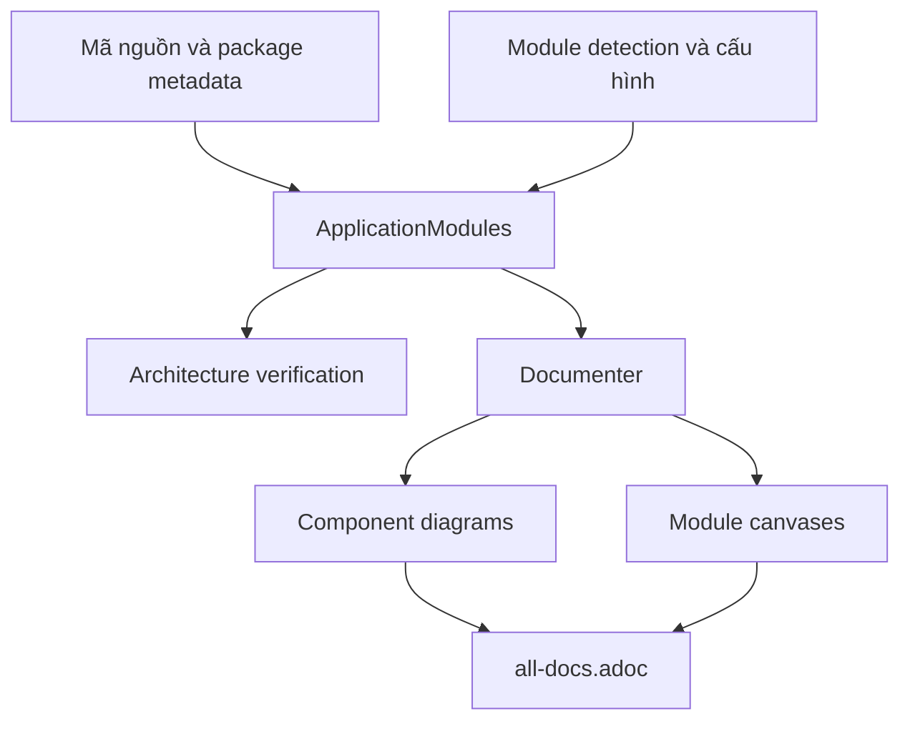

# ApplicationModules làm nguồn cho tài liệu module

Trong một modular monolith, cấu trúc package, module boundary, API công khai và dependency thường được mô tả ở nhiều nơi: mã nguồn, sơ đồ kiến trúc, wiki và tài liệu onboarding. Nếu các tài liệu này được cập nhật thủ công, chúng dễ lệch khỏi code sau vài lần đổi package hoặc thêm module.

Spring Modulith cung cấp `ApplicationModules` để xây dựng mô hình module từ ứng dụng. Mô hình đó có thể được dùng làm nguồn cho `Documenter`, công cụ sinh component diagram và Application Module Canvas. Nhờ vậy, tài liệu kiến trúc được tạo từ cùng cấu trúc mà Spring Modulith dùng để kiểm tra dependency.

Bài học này hướng dẫn cách tạo mô hình bằng `ApplicationModules`, sinh tài liệu bằng `Documenter`, tùy chỉnh biểu đồ và canvas, đưa việc sinh tài liệu vào test/build, cũng như duy trì đầu ra đồng bộ với source code.

## Mục tiêu

Sau bài học, bạn có thể:

- Giải thích vì sao `ApplicationModules` là nguồn mô hình phù hợp để sinh tài liệu kiến trúc.
- Tạo mô hình module từ application class bằng `ApplicationModules.of(…)`.
- Dùng `Documenter` để sinh sơ đồ tổng quan, sơ đồ riêng từng module và Module Canvas.
- Chọn kiểu biểu đồ C4 hoặc UML bằng `DiagramOptions`.
- Tùy chỉnh nội dung canvas và mức độ hiển thị implementation nội bộ bằng `CanvasOptions`.
- Sinh tài liệu tổng hợp `all-docs.adoc` để liên kết các đầu ra.
- Đặt việc sinh tài liệu trong test hoặc build và kiểm tra thay đổi kiến trúc qua version control.
- Phân biệt tài liệu kiến trúc được sinh với metadata runtime của application module.

## Vì sao lấy `ApplicationModules` làm nguồn?

`ApplicationModules` phân tích cấu trúc ứng dụng theo quy tắc Spring Modulith. Mô hình chứa các application module được phát hiện, base package, API công khai, named interfaces và các quan hệ dependency mà công cụ nhận diện.

Mô hình được tạo từ application class:

```java
ApplicationModules modules = ApplicationModules.of(Application.class);
```

`Application.class` là lớp Spring Boot application hoặc lớp gốc tương ứng mà Spring Modulith dùng để xác định phạm vi quét. Kết quả phụ thuộc vào cấu trúc package, module metadata, detection strategy và classpath của build hiện tại.

Khi đưa cùng một instance `ApplicationModules` vào `Documenter`, tài liệu được sinh dựa trên mô hình đó. Vì thế, nếu package được chuyển, named interface thay đổi hoặc dependency được thêm, tài liệu có thể phản ánh thay đổi sau lần sinh tiếp theo.



Điểm quan trọng là sơ đồ và canvas mô tả mô hình mà Spring Modulith phát hiện. Chúng không tự chứng minh mọi quyết định nghiệp vụ đều đúng. Nhóm vẫn cần review boundary, quyền sở hữu dữ liệu và ý nghĩa dependency.

## Chuẩn bị dependency cho `Documenter`

`Documenter` nằm trong artifact `spring-modulith-docs`. Vì sinh tài liệu thường diễn ra trong build hoặc test, dependency thường được khai báo ở test scope.

Ví dụ Gradle:

```groovy
dependencies {
    testImplementation("org.springframework.modulith:spring-modulith-docs")
}
```

Ví dụ Maven:

```xml
<dependency>
    <groupId>org.springframework.modulith</groupId>
    <artifactId>spring-modulith-docs</artifactId>
    <scope>test</scope>
</dependency>
```

Hãy dùng dependency management hoặc BOM tương ứng với phiên bản Spring Modulith của dự án để đồng bộ phiên bản các artifact. Nếu test đã dùng `ApplicationModules` từ `spring-modulith-core`, chỉ cần bổ sung artifact docs cho API sinh tài liệu.

## Sinh toàn bộ tài liệu bằng `writeDocumentation()`

Cách ngắn gọn nhất là tạo `ApplicationModules` rồi truyền cho `Documenter`:

```java
import org.junit.jupiter.api.Test;
import org.springframework.modulith.core.ApplicationModules;
import org.springframework.modulith.docs.Documenter;

class ModuleDocumentationTests {

    ApplicationModules modules = ApplicationModules.of(Application.class);

    @Test
    void writesModuleDocumentation() {
        modules.verify();

        new Documenter(modules).writeDocumentation();
    }
}
```

`writeDocumentation()` tạo các đầu ra chính:

1. Component diagram tổng quan chứa toàn bộ module và dependency giữa chúng.
2. Component diagram riêng cho từng module, thể hiện module đó cùng các module liên quan theo hướng dependency.
3. Application Module Canvas cho từng module.

Phương thức này cũng tạo `all-docs.adoc`, file Asciidoc tổng hợp liên kết các diagram và canvas vừa sinh.

Việc gọi `modules.verify()` trước khi sinh tài liệu giúp test thất bại nếu mô hình có vi phạm kiến trúc. `Documenter` là công cụ tạo tài liệu từ mô hình; không nên coi việc sinh sơ đồ thành công là thay thế cho verification.

Nếu chỉ cần một số loại đầu ra, có thể gọi các phương thức riêng:

```java
Documenter documenter = new Documenter(modules);

documenter
    .writeModulesAsPlantUml()
    .writeIndividualModulesAsPlantUml()
    .writeModuleCanvases();
```

Các phương thức trả về chính `Documenter`, nên có thể nối lời gọi. Cách này phù hợp khi nhóm muốn kiểm soát rõ loại tài liệu được sinh.

## Component diagram tổng quan và diagram riêng từng module

`writeModulesAsPlantUml()` tạo component diagram cho toàn bộ application module. Biểu đồ tổng quan giúp người đọc thấy cấu trúc lớn và hướng dependency.

```java
new Documenter(modules)
    .writeModulesAsPlantUml();
```

`writeIndividualModulesAsPlantUml()` tạo biểu đồ riêng cho từng module. Các biểu đồ này hữu ích khi tài liệu hóa một module cùng những module mà nó liên quan trực tiếp, giúp thành viên tập trung vào một phần của hệ thống.

```java
new Documenter(modules)
    .writeIndividualModulesAsPlantUml();
```

Spring Modulith hỗ trợ cả C4 component diagram và UML component diagram. Giá trị mặc định có thể phụ thuộc phiên bản và cấu hình; nếu đầu ra cần ổn định giữa các lần nâng cấp, hãy chọn `DiagramStyle` tường minh. Ví dụ dùng UML component diagram:

```java
import org.springframework.modulith.docs.Documenter.DiagramOptions;
import org.springframework.modulith.docs.Documenter.DiagramOptions.DiagramStyle;

var options = DiagramOptions.defaults()
    .withStyle(DiagramStyle.UML);

new Documenter(modules)
    .writeModulesAsPlantUml(options)
    .writeIndividualModulesAsPlantUml(options);
```

`DiagramStyle.C4` phù hợp để truyền đạt module như các thành phần cấp cao và dependency giữa chúng. `DiagramStyle.UML` phù hợp với nhóm đã dùng UML trong tài liệu thiết kế. Hãy chọn một kiểu nhất quán cho toàn bộ tài liệu.

## Application Module Canvas cho từng module

Module Canvas là bảng tổng hợp thông tin quan trọng của một application module. Nó giúp người đọc hiểu module làm gì, cung cấp những thành phần nào và tương tác với các module khác qua event ra sao.

```java
new Documenter(modules)
    .writeModuleCanvases();
```

Canvas mặc định có thể bao gồm:

| Phần | Nội dung được tổng hợp |
|---|---|
| Base package | Package gốc của application module |
| Spring components | Bean được công bố trong API package hoặc named interface, nhóm theo stereotype |
| Aggregate roots | Aggregate root được nhận diện qua repository hoặc mô hình jMolecules |
| Published events | Event do module công bố, nếu được đánh dấu theo vocabulary jMolecules mà Documenter nhận diện |
| Events listened to | Event module tiêu thụ qua listener được hỗ trợ |
| Configuration properties | Spring Boot configuration properties được nhận diện từ metadata |

Các bean được hiển thị là thành phần module công bố trong API hoặc named interface. Implementation nội bộ được ẩn theo mặc định trong canvas để người đọc tập trung vào hợp đồng module.

Việc nhận diện một số mục phụ thuộc vào metadata và thư viện trên classpath:

- Aggregate roots có thể được nhận diện qua repository hoặc jMolecules DDD model.
- Published events cần được đánh dấu bằng `@DomainEvent` hoặc triển khai `DomainEvent` theo vocabulary jMolecules.
- Event listener được nhận diện từ `@EventListener`, `@TransactionalEventListener`, `@DomainEventHandler` hoặc bean triển khai `ApplicationListener`.
- Configuration properties cần `spring-boot-configuration-processor` để tạo metadata mà Documenter sử dụng.

Nếu một mục không xuất hiện, hãy kiểm tra cách khai báo và dependency metadata tương ứng trước khi kết luận module không có thành phần đó.

## Tùy chỉnh Module Canvas

`Documenter.CanvasOptions` cho phép điều chỉnh cách nhóm và hiển thị các thành phần trong canvas. Ví dụ, nếu cần xem cả type nội bộ trong quá trình review hoặc migration, có thể bật `revealInternals()`:

```java
import org.springframework.modulith.docs.Documenter.CanvasOptions;

var canvasOptions = CanvasOptions.defaults()
    .revealInternals();

new Documenter(modules)
    .writeModuleCanvases(canvasOptions);
```

Đây là lựa chọn phục vụ tài liệu kỹ thuật hoặc phân tích nội bộ. Với tài liệu giới thiệu module cho người tiêu thụ, giữ mặc định ẩn implementation giúp API công khai dễ nhận biết hơn.

CanvasOptions cũng hỗ trợ điều chỉnh grouping và hiển thị dòng trống tùy phiên bản. Có thể dùng grouping mặc định hoặc định nghĩa nhóm riêng theo stereotype, interface, annotation hay tên type. Khi tùy chỉnh sâu, hãy đối chiếu API của đúng phiên bản Spring Modulith để chọn phương thức có sẵn.

Không nên đưa toàn bộ implementation vào canvas công khai nếu mục đích tài liệu là giải thích hợp đồng module. Tách tài liệu API và tài liệu nội bộ nếu hai nhóm người đọc cần mức chi tiết khác nhau.

## Tùy chỉnh component diagram

`Documenter.DiagramOptions` điều chỉnh cách dựng biểu đồ. Một số lựa chọn thường hữu ích:

- `withStyle(…)`: chọn kiểu C4 hoặc UML.
- `withDependencyDepth(…)`: điều chỉnh độ sâu dependency được thể hiện.
- `withExclusions(…)`: loại các thành phần không cần xuất hiện trong sơ đồ.
- `withDefaultDisplayName(…)`: đặt nhãn mặc định dễ đọc khi module chưa có display name.
- `withDependencyTypes(…)`: chọn loại quan hệ dependency được biểu diễn.

Ví dụ đặt display name mặc định theo module identifier:

```java
var diagramOptions = DiagramOptions.defaults()
    .withDefaultDisplayName(module -> module.getIdentifier().toString());

new Documenter(modules)
    .writeModulesAsPlantUml(diagramOptions);
```

Nếu module đã khai báo `displayName` bằng `@ApplicationModule`, metadata đó là nơi phù hợp để giữ tên nghiệp vụ nhất quán. Tùy chỉnh mặc định hữu ích cho module chưa có display name hoặc khi tài liệu cần một quy ước nhãn riêng.

Đừng lọc dependency chỉ để biểu đồ trông đơn giản hơn nếu các quan hệ đó quan trọng với người đọc. Nếu cần sơ đồ cho nhiều đối tượng, có thể tạo một biểu đồ tổng quan và các biểu đồ riêng theo module thay vì làm mất thông tin trong một hình duy nhất.

## Sinh tài liệu tổng hợp `all-docs.adoc`

Khi đã có component diagrams và Module Canvases, `writeAggregatingDocument()` tạo file Asciidoc `all-docs.adoc` liên kết các đầu ra hiện có:

```java
new Documenter(modules)
    .writeDocumentation()
    .writeAggregatingDocument();
```

File tổng hợp hữu ích khi nhóm muốn đưa toàn bộ tài liệu module vào một trang developer documentation viết bằng Asciidoc. Phương thức này liên kết các sơ đồ và canvas đã được tạo; nếu chưa có đầu ra tương ứng, nó không tự tạo nội dung thay thế.

Quy trình thường dùng:

1. Gọi `writeDocumentation()` để tạo sơ đồ và canvas.
2. Gọi `writeAggregatingDocument()` để tạo `all-docs.adoc`.
3. Đưa file tổng hợp vào Asciidoc site hoặc tài liệu developer portal của dự án.

Nếu tài liệu được render bởi hệ thống khác, hãy xác nhận hệ thống đó có hỗ trợ PlantUML và các include/đường dẫn mà file tổng hợp sử dụng.

## Vị trí đầu ra và cách tổ chức trong repository

Theo mặc định, `Documenter` ghi tài liệu vào thư mục `spring-modulith-docs` bên trong build directory của build tool. Ví dụ:

| Build tool | Thư mục mặc định |
|---|---|
| Gradle | `build/spring-modulith-docs` |
| Maven | `target/spring-modulith-docs` |

Đây là đầu ra của build. Nhóm có thể:

- Giữ đầu ra trong build folder và để pipeline tạo lại khi cần.
- Copy hoặc publish đầu ra sang vị trí tài liệu được quản lý riêng theo quy trình của dự án.
- Commit các file sinh ra nếu muốn reviewer xem trực tiếp thay đổi sơ đồ trong pull request.

Nếu commit đầu ra, cần quy định rõ khi nào sinh lại và tránh chỉnh sửa thủ công file được sinh. Mọi thay đổi nên bắt đầu từ source code hoặc module metadata, sau đó chạy lại Documenter để tạo kết quả mới.

Không nên coi thư mục output là nguồn sự thật. Nguồn sự thật là mã nguồn, package metadata, module detection và dependency rules tạo nên `ApplicationModules`.

## Phân biệt tài liệu module với runtime metadata

`Documenter` còn có `writeModuleMetadata()`, nhưng phương thức này phục vụ mục đích khác với sinh sơ đồ và canvas. Nó ghi application module metadata vào build folder để có thể đưa vào runtime.

| Phương thức | Mục đích |
|---|---|
| `writeModulesAsPlantUml()` | Sinh component diagram tổng quan |
| `writeIndividualModulesAsPlantUml()` | Sinh diagram riêng cho từng module |
| `writeModuleCanvases()` | Sinh bảng tổng hợp thông tin module |
| `writeAggregatingDocument()` | Tạo `all-docs.adoc` liên kết tài liệu đã sinh |
| `writeDocumentation()` | Sinh toàn bộ bộ tài liệu mặc định |
| `writeModuleMetadata()` | Ghi metadata module cho mục đích runtime |

Không dùng `writeModuleMetadata()` như một tên khác của `writeDocumentation()`. Nếu mục tiêu là tài liệu developer, hãy dùng các phương thức sinh diagrams, canvases và aggregating document.

## Đưa sinh tài liệu vào test/build

Một test riêng giúp tài liệu được sinh lại theo cùng mô hình mà test kiến trúc sử dụng:

```java
import org.junit.jupiter.api.Test;
import org.springframework.modulith.core.ApplicationModules;
import org.springframework.modulith.docs.Documenter;

class ModuleDocumentationTests {

    @Test
    void generatesCurrentModuleDocumentation() {
        var modules = ApplicationModules.of(Application.class);

        modules.verify();

        new Documenter(modules)
            .writeDocumentation()
            .writeAggregatingDocument();
    }
}
```

Đặt test trong source set được build CI thực thi. Với Gradle, có thể chạy `./gradlew test` hoặc `./gradlew check`; với Maven, chạy `mvn test` hoặc lifecycle `mvn verify` theo cấu hình dự án. Không cần tạo một bước publish riêng nếu đầu ra chỉ được dùng trong build; nếu tài liệu cần được phát hành, hãy nối bước publish sau khi test và sinh tài liệu thành công.

Nếu không muốn sinh tài liệu ở mọi lần test nhanh trên máy phát triển, có thể tách test/documentation task riêng và cấu hình CI chạy task đó ở pull request hoặc nhánh phát hành. Điều quan trọng là tài liệu phải được tạo lại trong một quy trình bắt buộc, dễ tái lập.

## Review tài liệu được sinh trong pull request

Khi module boundary thay đổi, hãy review cả source code và tài liệu được sinh:

- Module nào được thêm, xóa hoặc đổi tên?
- Dependency mới có đúng hướng và đúng named interface không?
- Có module nào bắt đầu phụ thuộc vào nhiều module hơn dự kiến?
- API công khai hoặc event contract nào được bổ sung?
- Canvas có hiển thị bean, aggregate root, event hoặc configuration property như mong đợi không?
- Tài liệu tổng hợp có liên kết đúng các sơ đồ và canvas mới không?

Một thay đổi sơ đồ có thể chỉ phản ánh việc đổi package hoặc display name, nhưng cũng có thể cho thấy dependency mới làm kiến trúc chặt hơn. Hãy xem diff của diagram cùng diff source để phân biệt thay đổi trình bày với thay đổi kiến trúc.

## Những lỗi thường gặp

| Lỗi | Hậu quả | Cách xử lý |
|---|---|---|
| Tự vẽ diagram độc lập với source | Sơ đồ nhanh chóng lỗi thời | Sinh từ `ApplicationModules` bằng `Documenter` |
| Chỉ gọi Documenter mà không verify | Tài liệu có thể mô tả một mô hình đang vi phạm quy tắc | Gọi `modules.verify()` trước khi sinh |
| Quên dependency `spring-modulith-docs` | Không biên dịch được import `Documenter` | Thêm artifact docs ở test scope |
| Chỉ sinh diagram tổng quan | Người đọc khó hiểu chi tiết của từng module | Sinh thêm individual diagrams và canvases |
| Nghĩ canvas luôn hiển thị mọi class | Implementation nội bộ bị ẩn theo mặc định | Dùng `revealInternals()` khi tài liệu nội bộ cần điều đó |
| Không có `spring-boot-configuration-processor` | Configuration properties có thể không xuất hiện trong canvas | Thêm processor và kiểm tra metadata được tạo |
| Nghĩ mọi event đều tự xuất hiện trong canvas | Event không được đánh dấu theo vocabulary có thể không được nhận diện | Dùng `@DomainEvent` hoặc `DomainEvent` theo jMolecules |
| Sửa file output bằng tay | Lần sinh sau ghi đè thay đổi thủ công | Sửa source hoặc options rồi sinh lại |
| Nhầm `writeModuleMetadata()` với tài liệu developer | Sinh sai loại output mong muốn | Dùng `writeDocumentation()` hoặc các phương thức riêng |

## Quy trình chuẩn để duy trì tài liệu module

1. Xác định application class và cấu hình detection dùng trong ứng dụng.
2. Tạo `ApplicationModules` từ application class đó.
3. Chạy `verify()` để chặn tài liệu hóa một mô hình có vi phạm.
4. Dùng `Documenter.writeDocumentation()` hoặc các phương thức riêng để sinh diagram và canvas.
5. Nếu cần, tùy chỉnh `DiagramOptions` và `CanvasOptions` theo đối tượng đọc.
6. Gọi `writeAggregatingDocument()` để tạo trang Asciidoc tổng hợp.
7. Review đầu ra cùng source diff khi có thay đổi module boundary.
8. Đưa việc sinh tài liệu vào test/build CI để tránh tài liệu cũ.
9. Nếu commit đầu ra, không sửa file sinh bằng tay; luôn tái tạo từ mô hình mới.

## Bài tập tự đánh giá

Một ứng dụng có ba module `orders`, `inventory` và `shipping`. Nhóm đã thay đổi dependency: `shipping` bắt đầu sử dụng named interface `orders::events`, còn `inventory` không còn phụ thuộc vào `orders.internal`. Tài liệu kiến trúc hiện tại vẫn là sơ đồ vẽ tay từ tháng trước.

Hãy đề xuất cách cập nhật tài liệu:

1. Tạo `ApplicationModules` từ lớp nào và vì sao cần dùng đúng application class?
2. Phương thức nào sinh sơ đồ tổng quan và sơ đồ riêng từng module?
3. Module Canvas cung cấp thêm thông tin gì ngoài dependency diagram?
4. Làm thế nào chọn UML thay cho C4 và khi nào nên bật `revealInternals()`?
5. Cần thêm dependency nào để dùng `Documenter` trong test?
6. Làm thế nào bảo đảm tài liệu không cũ sau các pull request tiếp theo?

Một hướng triển khai là thêm `spring-modulith-docs` ở test scope, tạo `ApplicationModules.of(Application.class)`, gọi `verify()`, rồi dùng `new Documenter(modules).writeDocumentation().writeAggregatingDocument()`. Nếu người đọc cần sơ đồ UML, truyền `DiagramOptions` với `DiagramStyle.UML`; chỉ bật `CanvasOptions.revealInternals()` cho tài liệu phục vụ nhóm phát triển nội bộ. Đưa test sinh tài liệu vào CI để các thay đổi boundary tạo ra diff có thể review.

## Kết luận

`ApplicationModules` là mô hình kiến trúc được Spring Modulith tạo từ source và module metadata; `Documenter` dùng mô hình đó để sinh component diagrams, Module Canvases và tài liệu tổng hợp. Kết hợp `verify()` trước khi sinh, tùy chỉnh options theo người đọc và đưa test tài liệu vào CI giúp sơ đồ phản ánh cấu trúc thực tế của modular monolith. Khi tài liệu được sinh từ cùng mô hình mà nhóm dùng để kiểm tra kiến trúc, chi phí duy trì giảm và các thay đổi boundary trở nên dễ review hơn.

## Tài liệu tham khảo

- [Spring Modulith Reference — Documenting Application Modules](https://docs.spring.io/spring-modulith/reference/documentation.html)
- [Spring Modulith API — `Documenter`](https://docs.spring.io/spring-modulith/docs/current/api/org/springframework/modulith/docs/Documenter.html)
- [Spring Modulith API — `ApplicationModules`](https://docs.spring.io/spring-modulith/docs/current/api/org/springframework/modulith/core/ApplicationModules.html)
- [Spring Modulith API — `Documenter.DiagramOptions`](https://docs.spring.io/spring-modulith/docs/current/api/org/springframework/modulith/docs/Documenter.DiagramOptions.html)
- [Spring Modulith API — `Documenter.CanvasOptions`](https://docs.spring.io/spring-modulith/docs/current/api/org/springframework/modulith/docs/Documenter.CanvasOptions.html)
