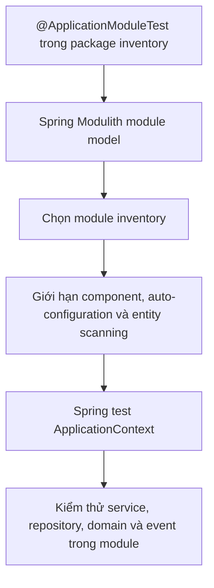
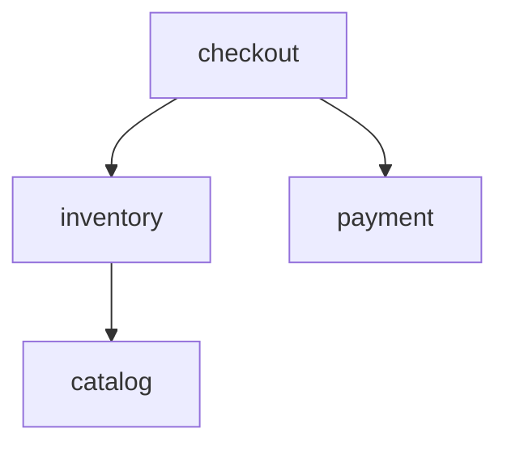

# Application module integration test dựa trên model

Spring Modulith có thể dùng application module model để khởi tạo một module riêng trong Spring test context. Annotation `@ApplicationModuleTest` xác định module chứa test, giới hạn component scanning, auto-configuration scanning và entity scanning theo package của module đó. Nhờ vậy, bạn có thể kiểm thử nhiều layer của một module cùng nhau mà không phải khởi tạo toàn bộ ứng dụng như một `@SpringBootTest` thông thường.

Module model cũng giúp chọn phạm vi dependency được khởi tạo cùng module đang kiểm thử. Bạn có thể chỉ chạy module hiện tại, chạy thêm các dependency trực tiếp hoặc chạy toàn bộ cây dependency. Khi cần kiểm tra tương tác qua event, `Scenario` cung cấp DSL để kích hoạt event hoặc gọi bean, chờ kết quả và xác minh trạng thái.

Sau bài học, bạn có thể:

- Thiết lập dependency test cho Spring Modulith.
- Đặt `@ApplicationModuleTest` đúng package để test được gắn với module cần kiểm tra.
- Chọn `STANDALONE`, `DIRECT_DEPENDENCIES` hoặc `ALL_DEPENDENCIES`.
- Xử lý bean dependency xuyên module bằng mock hoặc mở rộng bootstrap có chủ đích.
- Dùng `Scenario` để kiểm tra event và state change.
- Hiểu transaction và cleanup khi kiểm thử event bất đồng bộ.
- Phân biệt module integration test với architecture test và toàn ứng dụng integration test.

## 1. Module model hỗ trợ integration test như thế nào?

`ApplicationModules` mô tả các application module được phát hiện từ package, metadata và quan hệ phụ thuộc trong codebase. Spring Modulith dùng mô hình này để xác định module chứa test và các package cần đưa vào Spring test context.

`@ApplicationModuleTest` là một dạng test tích hợp theo chiều dọc (*vertical slice*): test có thể sử dụng controller, application service, domain service, repository và các bean khác thuộc module được chọn, trong khi component scanning và entity scanning được giới hạn theo ranh giới module.



Điểm khác biệt với `ApplicationModules.verify()`:

| Cơ chế | Mục đích |
|---|---|
| `ApplicationModules.of(...).verify()` | Phân tích cấu trúc code và kiểm tra quy tắc kiến trúc module |
| `@ApplicationModuleTest` | Khởi tạo Spring test context cho module và kiểm thử hành vi tích hợp của module |
| `@SpringBootTest` | Khởi tạo context ứng dụng với phạm vi cấu hình rộng hơn, thường bao gồm nhiều module |

`@ApplicationModuleTest` mặc định cũng tự động xác minh module structure. Tuy nhiên, kiểm tra cấu trúc và kiểm tra hành vi vẫn trả lời hai câu hỏi khác nhau: một bên xác minh ranh giới kiến trúc, bên còn lại thực thi bean và luồng nghiệp vụ trong test context.

## 2. Thêm dependency test

Thêm Spring Modulith test starter vào test scope. Ví dụ Maven:

```xml
<dependency>
    <groupId>org.springframework.modulith</groupId>
    <artifactId>spring-modulith-starter-test</artifactId>
    <scope>test</scope>
</dependency>
```

Nếu dự án dùng Gradle:

```groovy
dependencies {
    testImplementation 'org.springframework.modulith:spring-modulith-starter-test'
}
```

Hãy để Spring Modulith BOM hoặc dependency management của dự án quản lý phiên bản starter để các module test artifacts tương thích với phiên bản `spring-modulith-core` đang sử dụng.

## 3. Đặt test trong package của module

Theo mặc định, `@ApplicationModuleTest` xác định module từ package của test class. Vì vậy, hãy đặt test class trong package module hoặc một package con của nó.

Ví dụ cấu trúc ứng dụng:

```text
com.acme.shop
├── ShopApplication.java
├── inventory
│   ├── InventoryManagement.java
│   ├── InventoryQuery.java
│   └── internal
│       └── InventoryRepository.java
└── order
    └── OrderManagement.java
```

Đặt test ở `src/test/java/com/acme/shop/inventory/InventoryModuleIntegrationTests.java`:

```java
package com.acme.shop.inventory;

import org.junit.jupiter.api.Test;
import org.springframework.modulith.test.ApplicationModuleTest;

@ApplicationModuleTest
class InventoryModuleIntegrationTests {

    @Test
    void loadsInventoryModule() {
        // Các test tích hợp của module inventory
    }
}
```

Spring Modulith tìm module `inventory` từ package của test. Khi bootstrapping, framework giới hạn component scan và entity scan vào package của module tương ứng. Các bean trong package con như `inventory.internal` vẫn thuộc module này và có thể được đưa vào test context.

Bạn có thể bật log DEBUG cho `org.springframework.modulith` để xem module nào được chọn, logical name, base package, dependency trực tiếp và các Spring bean được đưa vào context:

```properties
logging.level.org.springframework.modulith=DEBUG
```

Log này hữu ích khi test khởi tạo nhầm module hoặc một bean không xuất hiện trong context.

## 4. Chọn bootstrap mode theo dependency graph

`@ApplicationModuleTest` hỗ trợ ba bootstrap mode:

| Mode | Phạm vi context |
|---|---|
| `STANDALONE` | Chỉ module chứa test; đây là mặc định |
| `DIRECT_DEPENDENCIES` | Module chứa test và tất cả module mà nó phụ thuộc trực tiếp |
| `ALL_DEPENDENCIES` | Module chứa test và toàn bộ cây dependency trực tiếp, gián tiếp |

Ví dụ, module `checkout` phụ thuộc trực tiếp vào `inventory` và `payment`; `inventory` lại phụ thuộc vào `catalog`:



Khi test `checkout`:

- `STANDALONE` chỉ khởi tạo `checkout`.
- `DIRECT_DEPENDENCIES` khởi tạo `checkout`, `inventory` và `payment`.
- `ALL_DEPENDENCIES` khởi tạo thêm `catalog` vì đây là dependency gián tiếp qua `inventory`.

Khai báo mode ngay trên annotation:

```java
package com.acme.shop.checkout;

import org.springframework.modulith.test.ApplicationModuleTest;

@ApplicationModuleTest(
        mode = ApplicationModuleTest.BootstrapMode.DIRECT_DEPENDENCIES
)
class CheckoutIntegrationTests {
}
```

Chọn phạm vi nhỏ nhất đáp ứng mục tiêu test. Nếu test chỉ cần kiểm tra logic của `checkout`, dùng `STANDALONE` và mock các bean ở module khác. Nếu cần xác minh phối hợp thực tế với dependency trực tiếp, chọn `DIRECT_DEPENDENCIES`. Dùng `ALL_DEPENDENCIES` khi hành vi cần kiểm tra thực sự phụ thuộc vào toàn bộ cây module phía dưới.

`extraIncludes` có thể bổ sung các module cần đưa vào test run bất kể bootstrap mode. Đây là cách thêm một module hỗ trợ có chủ đích mà không phải mở rộng toàn bộ cây dependency.

## 5. Xử lý bean dependency xuyên module

Trong mode `STANDALONE`, Spring Modulith khởi tạo các bean thuộc module đang kiểm thử. Nếu một bean trong module đó inject một Spring bean thuộc module khác nhưng module đích không được đưa vào test context, quá trình bootstrap có thể thất bại vì thiếu bean.

Giả sử `InventoryService` gọi `PricingPolicy` của module `pricing`:

```java
package com.acme.shop.inventory;

import com.acme.shop.pricing.PricingPolicy;
import org.springframework.stereotype.Service;

@Service
class InventoryService {

    private final PricingPolicy pricingPolicy;

    InventoryService(PricingPolicy pricingPolicy) {
        this.pricingPolicy = pricingPolicy;
    }
}
```

Nếu test chỉ tập trung vào `inventory`, có thể mock dependency bên ngoài:

```java
package com.acme.shop.inventory;

import com.acme.shop.pricing.PricingPolicy;
import org.junit.jupiter.api.Test;
import org.springframework.test.context.bean.override.mockito.MockitoBean;
import org.springframework.modulith.test.ApplicationModuleTest;

@ApplicationModuleTest
class InventoryIntegrationTests {

    @MockitoBean
    PricingPolicy pricingPolicy;

    @Test
    void calculatesInventoryValue() {
        // Kiểm tra hành vi inventory với pricing dependency được mock
    }
}
```

`@MockitoBean` đăng ký mock bean vào test `ApplicationContext`. Test vẫn khởi tạo các bean thật của `inventory`, còn lời gọi đến `PricingPolicy` được kiểm soát bằng mock.

Nếu một module cần quá nhiều bean từ module khác, đó có thể là dấu hiệu coupling cao. Hãy xem lại API, named interface hoặc khả năng chuyển một tương tác sang domain event. Không nên chọn `ALL_DEPENDENCIES` theo thói quen chỉ để che đi một thiết kế phụ thuộc quá rộng.

## 6. Viết test cho module nằm ngoài package test class

Thông thường, đặt test trong package module là cách dễ đọc nhất. Nếu cần đặt test ở một package chung như `com.acme.shop.architecture`, annotation có thể nhận `module` để chỉ định logical name của module và `classes` để chỉ định lớp ứng dụng chính:

```java
package com.acme.shop.architecture;

import com.acme.shop.ShopApplication;
import org.junit.jupiter.api.Test;
import org.springframework.modulith.test.ApplicationModuleTest;

@ApplicationModuleTest(
        module = "inventory",
        classes = ShopApplication.class
)
class InventoryModuleTests {

    @Test
    void verifiesInventoryUseCase() {
        // Test của module inventory
    }
}
```

`module` dùng logical identifier của module theo cấu hình detection và naming hiện tại. Nếu ứng dụng bật fully qualified module names, hãy dùng identifier đầy đủ tương ứng. `classes` chỉ định lớp ứng dụng khi test class nằm ngoài package cha mà Spring Boot có thể tự suy ra.

## 7. Kiểm thử event và trạng thái bằng `Scenario`

Các luồng event bất đồng bộ thường cần kích hoạt một stimulus, chờ listener xử lý rồi xác minh kết quả. Spring Modulith cung cấp `Scenario` để diễn đạt chuỗi này trong test method của `@ApplicationModuleTest`.

Giả sử module `order` công bố event:

```java
package com.acme.shop.order;

public record OrderPlaced(String orderId, String sku, int quantity) {
}
```

Module `inventory` lắng nghe event và tạo reservation:

```java
package com.acme.shop.inventory;

import com.acme.shop.order.OrderPlaced;
import org.springframework.modulith.events.ApplicationModuleListener;
import org.springframework.stereotype.Component;

@Component
class OrderPlacedListener {

    private final InventoryManagement inventory;

    OrderPlacedListener(InventoryManagement inventory) {
        this.inventory = inventory;
    }

    @ApplicationModuleListener
    void on(OrderPlaced event) {
        inventory.reserve(event.orderId(), event.sku(), event.quantity());
    }
}
```

Test đặt trong package `inventory` để kiểm tra listener và trạng thái của module đó:

```java
package com.acme.shop.inventory;

import com.acme.shop.order.OrderPlaced;
import org.junit.jupiter.api.Test;
import org.springframework.beans.factory.annotation.Autowired;
import org.springframework.modulith.test.ApplicationModuleTest;
import org.springframework.modulith.test.Scenario;

import static org.assertj.core.api.Assertions.assertThat;

@ApplicationModuleTest
class InventoryEventIntegrationTests {

    @Autowired
    InventoryQuery inventoryQuery;

    @Test
    void reservesStockWhenOrderIsPlaced(Scenario scenario) {
        scenario.publish(new OrderPlaced("order-42", "SKU-42", 2))
                .andWaitForStateChange(() -> inventoryQuery.findReservation("order-42"))
                .andVerify(reservation -> assertThat(reservation).isPresent());
    }
}
```

Trong ví dụ, `Scenario` thực hiện các bước:

1. `publish(...)` phát event `OrderPlaced` làm stimulus.
2. `andWaitForStateChange(...)` liên tục quan sát trạng thái reservation cho đến khi có thay đổi hoặc hết thời gian chờ.
3. `andVerify(...)` nhận kết quả quan sát và kiểm tra reservation đã được tạo.

Theo mặc định, giá trị trả về khác `null`, `Optional` không rỗng hoặc `boolean true` được xem là state change có thể kết luận. Nếu cách xác định thay đổi của ứng dụng khác mặc định, `andWaitForStateChange` có overload nhận predicate.

Bạn cũng có thể chờ một event khác được phát ra:

```java
scenario.publish(new OrderPlaced("order-42", "SKU-42", 2))
        .andWaitForEventOfType(StockReserved.class)
        .matching(event -> event.orderId().equals("order-42"))
        .toArriveAndVerify(event -> assertThat(event.quantity()).isEqualTo(2));
```

`Scenario` hỗ trợ cả event publication lẫn gọi một bean làm stimulus qua `scenario.stimulate(() -> someBean.someMethod(...))`. Bạn có thể đặt timeout bằng `waitAtMost(...)` hoặc tùy chỉnh điều kiện chờ bằng `customize(...)`.

## 8. Chú ý transaction và cleanup trong `Scenario`

Để bảo đảm event và transactional listener được xử lý trong đúng ranh giới transaction, `Scenario.publish(...)` và `Scenario.stimulate(...)` thực thi stimulus trong một transaction callback. Cơ chế này bắt đầu transaction mới kể cả khi test method đang chạy trong transaction.

Hệ quả quan trọng: thay đổi database được kích hoạt bởi stimulus không tự động rollback cùng transaction của test method. Sau khi scenario hoàn tất, dữ liệu có thể vẫn còn trong database test. Hãy dọn dữ liệu một cách tường minh bằng các phương thức cleanup của `Scenario` hoặc cơ chế cleanup phù hợp với test.

Ví dụ khái niệm:

```java
scenario.publish(new OrderPlaced("order-42", "SKU-42", 2))
        .andCleanup(() -> reservationRepository.deleteByOrderId("order-42"))
        .andWaitForStateChange(() -> inventoryQuery.findReservation("order-42"))
        .andVerify(reservation -> assertThat(reservation).isPresent());
```

`andCleanup(...)` thực hiện hành động dọn dữ liệu sau scenario. Hãy dùng khóa dữ liệu riêng cho mỗi test để tránh xóa dữ liệu do test khác tạo ra. Với event bất đồng bộ, cũng cần đặt timeout phù hợp để test không chờ quá lâu khi listener không được kích hoạt.

## 9. Kết hợp module slicing với Spring Boot slice test

`@ApplicationModuleTest` kiểm tra tất cả layer trong module theo chiều dọc. Nếu muốn kết hợp module slicing với một slice theo chiều ngang của Spring Boot, dùng `@ModuleSlicing` cùng annotation slice tương ứng.

Ví dụ, test repository của module `inventory` bằng `@DataJpaTest`:

```java
package com.acme.shop.inventory;

import org.junit.jupiter.api.Test;
import org.springframework.beans.factory.annotation.Autowired;
import org.springframework.boot.data.jpa.test.autoconfigure.DataJpaTest;
import org.springframework.modulith.test.ModuleSlicing;

@ModuleSlicing
@DataJpaTest
class InventoryRepositoryTests {

    @Autowired
    InventoryRepository inventoryRepository;

    @Test
    void persistsInventoryRecord() {
        // Kiểm tra persistence trong module inventory
    }
}
```

`@ModuleSlicing` là nền tảng của `@ApplicationModuleTest`. Khi kết hợp với `@DataJpaTest`, test được giới hạn theo module và chỉ khởi tạo các thành phần thuộc JPA slice. Hãy dùng cách này khi cần tập trung vào persistence; dùng `@ApplicationModuleTest` khi muốn kiểm tra nhiều layer của module cùng nhau.

## 10. Chẩn đoán khi module test khởi tạo thất bại

| Hiện tượng | Nguyên nhân thường gặp | Cách xử lý |
|---|---|---|
| Không xác định được module chứa test | Test class nằm ngoài package module và chưa chỉ định `module` | Đặt test trong module package hoặc dùng `module` và `classes` |
| Thiếu bean khi bootstrap `STANDALONE` | Bean trong module cần component từ module khác | Dùng `@MockitoBean` hoặc chọn bootstrap mode rộng hơn nếu cần integration thật |
| Test context chứa quá nhiều bean | Chọn `ALL_DEPENDENCIES` dù test chỉ cần module hiện tại | Thu hẹp về `STANDALONE` hoặc `DIRECT_DEPENDENCIES` |
| Entity không được tìm thấy | Entity scan bị giới hạn theo module hoặc entity thuộc module khác | Xác định quyền sở hữu entity; chọn mode phù hợp hoặc mock abstraction thay vì mở rộng context tùy tiện |
| Event listener không được gọi | Module listener không nằm trong test context, event type không đúng hoặc transactional event chưa được xử lý | Kiểm tra module được bootstrap, event contract, transaction và Scenario expectation |
| Test để lại dữ liệu | Scenario chạy transaction mới và state change không rollback tự động | Dùng `andCleanup(...)` hoặc cleanup tường minh |
| Scenario timeout | Listener không chạy, điều kiện matching sai hoặc thời gian chờ quá ngắn | Kiểm tra listener, predicate và tùy chỉnh timeout |

Khi cần xem bootstrap thực tế, đặt log level `org.springframework.modulith` thành `DEBUG`. Log cho biết module nào được chọn, dependency trực tiếp và package nào được dùng cho component/entity scanning.

## 11. Quy trình chọn phạm vi module test

Trước khi viết test, xác định câu hỏi cần trả lời:

1. Test có cần kiểm tra bean thật trong một module không? Nếu có, đặt class trong module package và dùng `@ApplicationModuleTest`.
2. Test có cần bean từ module khác không? Nếu không, giữ `STANDALONE` và mock dependency ngoài.
3. Nếu cần tích hợp trực tiếp với module phụ thuộc, dùng `DIRECT_DEPENDENCIES`.
4. Chỉ dùng `ALL_DEPENDENCIES` khi luồng cần kiểm tra thực sự đi qua toàn bộ cây dependency.
5. Nếu cần xác minh event hoặc state change bất đồng bộ, dùng `Scenario`.
6. Nếu dùng `Scenario`, thiết kế timeout và cleanup cho side effect transaction.
7. Giữ architecture test riêng để xác minh module graph bằng `ApplicationModules.verify()`.

## 12. Ghi nhớ

`@ApplicationModuleTest` dùng application module model để xác định module chứa test và giới hạn Spring test context theo package của module đó. `STANDALONE` chỉ khởi tạo module hiện tại; `DIRECT_DEPENDENCIES` thêm dependency trực tiếp; `ALL_DEPENDENCIES` thêm toàn bộ cây dependency. Khi module có bean tham chiếu module ngoài phạm vi bootstrap, hãy mock bằng `@MockitoBean` hoặc mở rộng phạm vi một cách có chủ đích. Dùng `Scenario` để kích hoạt event hoặc bean invocation, chờ event/state change và xác minh kết quả. Vì stimulus chạy trong transaction mới, dữ liệu phát sinh không tự rollback; hãy cleanup rõ ràng. Kết hợp module integration test với architecture test để kiểm tra cả cấu trúc lẫn hành vi.

## Tài liệu tham khảo

- [Spring Modulith 2.2.0 – Integration Testing Application Modules](https://docs.spring.io/spring-modulith/reference/testing.html)
- [Spring Modulith 2.2.0 API – `ApplicationModuleTest`](https://docs.spring.io/spring-modulith/docs/current/api/org/springframework/modulith/test/ApplicationModuleTest.html)
- [Spring Modulith 2.2.0 API – `Scenario`](https://docs.spring.io/spring-modulith/docs/current/api/org/springframework/modulith/test/Scenario.html)
- [Spring Modulith – Working with Application Events](https://docs.spring.io/spring-modulith/reference/events.html)
