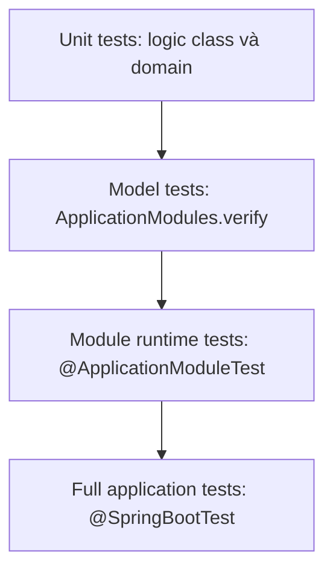

# Test model khác test runtime ra sao?

Khi kiểm tra một modular monolith, có hai câu hỏi khác nhau: cấu trúc module có tuân thủ quy tắc kiến trúc không, và các bean của module có thực sự hoạt động khi Spring khởi tạo ứng dụng không? Spring Modulith hỗ trợ cả hai, nhưng mỗi loại test quan sát một lớp khác nhau của hệ thống.

Test mô hình dùng `ApplicationModules` để phân tích package, module metadata, API công khai và dependency giữa các module. Nó không cần khởi động Spring `ApplicationContext`. Test runtime dùng `@ApplicationModuleTest` để khởi động một lát cắt Spring Boot giới hạn trong module, sau đó kiểm tra bean, persistence, transaction và tương tác thực tế.

Hai loại test bổ sung cho nhau. Test mô hình phát hiện sớm dependency sai ngay cả khi luồng nghiệp vụ chưa được gọi; test runtime xác nhận các thành phần thật sự được lắp ráp và vận hành đúng trong phạm vi đã khởi động.

## Mục tiêu

Sau bài học, bạn có thể:

- Phân biệt kiểm thử mô hình kiến trúc với kiểm thử Spring runtime.
- Dùng `ApplicationModules.of(…).verify()` để kiểm tra module structure mà không khởi động application context.
- Dùng `@ApplicationModuleTest` để khởi động một module theo phạm vi được chọn.
- Chọn `STANDALONE`, `DIRECT_DEPENDENCIES` hoặc `ALL_DEPENDENCIES` phù hợp với test.
- Quyết định khi nào mock bean của module khác và khi nào cần chạy cùng dependency thật.
- Kiểm thử event bất đồng bộ bằng `Scenario`.
- Kết hợp model test, module integration test và full application test trong một chiến lược kiểm thử cân bằng.

## Hai lớp kiểm tra trả lời hai câu hỏi khác nhau

Test mô hình trả lời câu hỏi: *Các module có được tổ chức và phụ thuộc đúng quy tắc không?* Nó đọc cấu trúc package và bytecode để tạo mô hình module. Những vi phạm như module truy cập package `internal`, dependency không được cho phép hoặc đồ thị module có chu trình có thể được phát hiện mà không cần tạo Spring bean.

Test runtime trả lời câu hỏi: *Khi khởi động các thành phần thật trong phạm vi cần kiểm tra, chúng có phối hợp đúng không?* Nó tạo `ApplicationContext`, khởi tạo bean, áp dụng cấu hình Spring và có thể kết nối persistence hoặc các thành phần tích hợp được cấu hình cho test.

| Tiêu chí | Test mô hình | Test runtime theo module |
|---|---|---|
| API tiêu biểu | `ApplicationModules.of(…).verify()` | `@ApplicationModuleTest` |
| Đối tượng kiểm tra | Package, module metadata, API và dependency | Spring bean, cấu hình, transaction, repository, listener và hành vi tích hợp |
| Khởi động `ApplicationContext` | Không | Có, trong phạm vi module và bootstrap mode |
| Cần gọi use case | Không bắt buộc | Thường có |
| Phát hiện dependency vào package nội bộ | Có | Cấu trúc module cũng được xác minh tự động mặc định |
| Phát hiện bean wiring hoặc cấu hình runtime sai | Không | Có trong phạm vi context được khởi động |
| Phát hiện lỗi SQL hoặc transaction | Không | Có nếu test dùng persistence và transaction thực tế |
| Tốc độ tương đối | Thường nhanh hơn | Thường chậm hơn do khởi động Spring và hạ tầng test |

Một test mô hình thành công không chứng minh rằng mọi bean đều khởi tạo được. Một test runtime thành công cũng không thay thế được việc kiểm tra toàn bộ module graph nếu test chỉ khởi động một module và không chạm đến các dependency khác.

## Test mô hình bằng `ApplicationModules`

`ApplicationModules` xây dựng mô hình từ lớp ứng dụng. `verify()` kiểm tra các quy tắc module mặc định, ví dụ đồ thị dependency không có chu trình, module không truy cập package nội bộ của module khác và các dependency tuân theo `allowedDependencies` nếu có khai báo.

Ví dụ một test kiến trúc độc lập:

```java
package com.acme;

import org.junit.jupiter.api.Test;
import org.springframework.modulith.core.ApplicationModules;

class ApplicationModuleStructureTests {

    @Test
    void verifiesModuleBoundaries() {
        ApplicationModules.of(Application.class).verify();
    }
}
```

Test này không dùng `@SpringBootTest` hay `@ApplicationModuleTest`. Nó không tạo bean `OrderManagement`, không chạy `@Transactional` và không kết nối database. Spring Modulith phân tích cấu trúc ứng dụng để xác minh dependency.

Nếu cần đọc kết quả trước khi quyết định làm test thất bại, dùng `detectViolations()`:

```java
@Test
void reportsAndRejectsArchitecturalViolations() {
    var violations = ApplicationModules.of(Application.class)
        .detectViolations();

    violations.getMessages().forEach(System.err::println);
    violations.throwIfPresent();
}
```

`detectViolations()` trả về tập kết quả để có thể in hoặc lọc. `throwIfPresent()` ném `Violations` nếu vẫn còn vi phạm. Nếu chỉ in thông báo mà không assertion hoặc ném exception, test có thể vẫn xanh dù kiến trúc sai.

### Test mô hình nên bao phủ điều gì?

Hãy tập trung vào quy tắc cấu trúc mà nhóm muốn bảo vệ:

- Module được phát hiện từ đúng package root và detection strategy.
- Module khác chỉ dùng package gốc hoặc named interface được công bố.
- `allowedDependencies` phản ánh đúng dependency được cho phép.
- Đồ thị dependency không có chu trình.
- Package bị exclusion nằm thực sự ngoài phạm vi kiến trúc cần kiểm tra.
- Các quy tắc DDD hoặc ArchUnit bổ sung được kích hoạt đúng nếu dự án đã cấu hình chúng.

Model test phù hợp để chạy thường xuyên trong CI vì nó kiểm tra cấu trúc mà không phải khởi động toàn bộ hệ thống. Tuy nhiên, nó không thể chứng minh một bean có đủ dependency để chạy hoặc một truy vấn repository trả về kết quả đúng.

## Test runtime theo module với `@ApplicationModuleTest`

Spring Modulith cung cấp `@ApplicationModuleTest` để chạy integration test với phạm vi khởi động được giới hạn theo application module. Đặt test class trong package module hoặc package con của module đó:

```java
package com.acme.orders;

import org.junit.jupiter.api.Test;
import org.springframework.beans.factory.annotation.Autowired;
import org.springframework.modulith.test.ApplicationModuleTest;

@ApplicationModuleTest
class OrderModuleIntegrationTests {

    @Autowired
    OrderManagement orders;

    @Test
    void createsAnOrder() {
        // Gọi use case qua Spring bean thật và kiểm tra kết quả.
    }
}
```

Annotation này dựa trên Spring Boot test infrastructure nhưng điều chỉnh bootstrap để:

- Giới hạn component scanning vào package của module đang kiểm thử.
- Dùng package module làm phạm vi auto-configuration và entity scanning.
- Chỉ đưa các module được chọn bởi bootstrap mode vào test context.

Vì vậy, đây là một module-sliced integration test. Nó khởi động Spring runtime thật trong phạm vi module, thay vì chỉ đọc cấu trúc package.

Thêm Spring Modulith test starter ở test scope:

```groovy
dependencies {
    testImplementation("org.springframework.modulith:spring-modulith-starter-test")
}
```

Với Maven:

```xml
<dependency>
    <groupId>org.springframework.modulith</groupId>
    <artifactId>spring-modulith-starter-test</artifactId>
    <scope>test</scope>
</dependency>
```

Sử dụng dependency management/BOM của phiên bản Spring Modulith trong dự án để đồng bộ phiên bản starter và các artifact liên quan.

## Chọn bootstrap mode

`@ApplicationModuleTest` mặc định dùng `STANDALONE`. Có ba mode chính:

| Mode | Phạm vi context | Khi phù hợp |
|---|---|---|
| `STANDALONE` | Chỉ module hiện tại | Kiểm tra module độc lập và mock các dependency bên ngoài |
| `DIRECT_DEPENDENCIES` | Module hiện tại và các module mà nó phụ thuộc trực tiếp | Cần tích hợp với API của các module trực tiếp được sử dụng |
| `ALL_DEPENDENCIES` | Module hiện tại và toàn bộ cây dependency của nó | Luồng cần nhiều tầng module phụ thuộc thật |

Ví dụ chọn các dependency trực tiếp:

```java
package com.acme.shipping;

import org.springframework.modulith.test.ApplicationModuleTest;

@ApplicationModuleTest(
    mode = ApplicationModuleTest.BootstrapMode.DIRECT_DEPENDENCIES
)
class ShippingIntegrationTests {
}
```

`DIRECT_DEPENDENCIES` không tự đưa mọi module có quan hệ ngược hoặc mọi consumer vào context. Nó mở rộng theo các module mà module đang kiểm thử phụ thuộc trực tiếp.

Nếu test class nằm ngoài package module, có thể chỉ định logical module name bằng thuộc tính `module`. Khi cần, dùng `classes` để chỉ định application class. `extraIncludes` cho phép thêm các module cụ thể ngoài phạm vi do mode lựa chọn. Hãy giữ phạm vi nhỏ nhất đủ để chứng minh hành vi đang kiểm thử.

## Vì sao `STANDALONE` thường là điểm bắt đầu tốt?

Giả sử `shipping` gọi API của `orders`. Khi test `shipping` ở mode `STANDALONE`, Spring chỉ khởi động bean trong module `shipping`. Nếu constructor của một bean cần `OrderManagement` thật từ module `orders`, context có thể không tạo được vì module đó không nằm trong test slice.

Đây là một tín hiệu có ích: test đang buộc nhóm quyết định ranh giới tích hợp. Nếu mục tiêu là kiểm tra riêng logic của `shipping`, hãy thay bean bên ngoài bằng mock:

```java
package com.acme.shipping;

import org.springframework.modulith.test.ApplicationModuleTest;
import org.springframework.test.context.bean.override.mockito.MockitoBean;

@ApplicationModuleTest
class ShippingServiceTests {

    @MockitoBean
    OrderLookup orderLookup;
}
```

Spring Boot tạo bean mock trong `ApplicationContext` của test. Test có thể tập trung vào cách `shipping` phản ứng với kết quả từ hợp đồng bên ngoài.

Nếu mục tiêu là kiểm tra tương tác thực giữa `shipping` và `orders`, chọn `DIRECT_DEPENDENCIES` hoặc viết test integration phù hợp để đưa dependency thật vào context. Đừng mở rộng mọi test sang `ALL_DEPENDENCIES` chỉ để tránh cấu hình mock; phạm vi quá rộng làm test chậm và che khuất module nào thực sự đang được kiểm tra.

Nếu một module cần quá nhiều bean từ các module khác để khởi động, đó có thể là dấu hiệu coupling cao. Hãy xem lại API, named interface hoặc khả năng chuyển tương tác sang application event.

## `@ApplicationModuleTest` tự xác minh cấu trúc module

Theo API hiện hành, `@ApplicationModuleTest` có thuộc tính `verifyAutomatically` mặc định là `true`. Vì vậy, khi module test khởi động, Spring Modulith tự xác minh cấu trúc module.

```java
@ApplicationModuleTest
class OrderModuleIntegrationTests {
    // verifyAutomatically = true theo mặc định
}
```

Có thể tắt bằng `verifyAutomatically = false`, nhưng chỉ nên làm khi có lý do rõ ràng và test kiến trúc riêng vẫn được chạy ở nơi khác:

```java
@ApplicationModuleTest(verifyAutomatically = false)
class OrderRuntimeTests {
}
```

Việc tự động verification không biến module runtime test thành model test thuần. Test vẫn tạo Spring context và kiểm tra hành vi runtime; nó chỉ bổ sung một bước xác minh module structure khi bootstrap.

## Kiểm thử event và tương tác bất đồng bộ bằng `Scenario`

Một model test có thể xác nhận event type được công bố qua API đúng package, nhưng không xác nhận listener thực sự nhận event và cập nhật trạng thái. Để kiểm tra hành vi đó, dùng `Scenario` trong test có `@ApplicationModuleTest`.

Ví dụ, khi `orders` phát `OrderCompleted`, module tiêu thụ phát `StockReserved` sau khi xử lý:

```java
package com.acme.inventory;

import java.time.Duration;
import java.util.UUID;

import static org.assertj.core.api.Assertions.assertThat;

import com.acme.orders.OrderManagement;
import org.junit.jupiter.api.Test;
import org.springframework.beans.factory.annotation.Autowired;
import org.springframework.modulith.test.ApplicationModuleTest;
import org.springframework.modulith.test.Scenario;

@ApplicationModuleTest(
    mode = ApplicationModuleTest.BootstrapMode.DIRECT_DEPENDENCIES
)
class InventoryEventIntegrationTests {

    @Autowired
    OrderManagement orders;

    @Autowired
    ReservationRepository reservations;

    @Autowired
    OrderFixture orderFixture;

    @Test
    void reactsToOrderCompletion(Scenario scenario) {
        UUID orderId = orderFixture.createOpenOrder();

        scenario.stimulate(() -> orders.complete(orderId))
            .customize(conditionFactory -> conditionFactory.atMost(Duration.ofSeconds(3)))
            .andWaitForStateChange(() -> reservations.findByOrderId(orderId))
            .andVerify(result -> assertThat(result).isPresent());
    }
}
```

Ví dụ đặt test trong module `inventory`, nên `DIRECT_DEPENDENCIES` đưa module `orders` vào context để có `OrderManagement` thật. `orderFixture` đại diện cho fixture tạo đơn đang mở; `ReservationRepository` đọc trạng thái thuộc sở hữu của `inventory`. `Scenario` chờ reservation xuất hiện thay vì giả định listener đã chạy ngay khi `publishEvent()` được gọi.

`Scenario` cho phép định nghĩa stimulus, thời gian chờ và kết quả mong đợi. Stimulus có thể là publish event hoặc gọi một Spring bean. Với xử lý bất đồng bộ, API chờ event phù hợp hoặc trạng thái module thay đổi thay vì dựa vào `Thread.sleep()`.

`Scenario` chạy stimulus trong transaction callback để bảo đảm event được chuyển tới transactional listener. Nó bắt đầu một transaction mới ngay cả khi test đã có transaction; thay đổi dữ liệu phát sinh từ stimulus vì thế không tự rollback cùng transaction test. Hãy chuẩn bị dữ liệu có thể tái lập và dọn dẹp qua `andCleanup(…)` hoặc fixture phù hợp.

Nếu muốn xác nhận event không được phát, dùng `notToArrive()` với timeout ngắn và điều kiện matching cụ thể. Việc chứng minh event không xuất hiện cần chờ hết khoảng thời gian đã đặt.

## Kết hợp `@ModuleSlicing` với test slice của Spring Boot

Đôi khi chỉ muốn kiểm tra một lớp hạ tầng theo lát cắt ngang, nhưng vẫn muốn giới hạn package theo module. `@ModuleSlicing` là nền tảng của `@ApplicationModuleTest` và có thể kết hợp với các annotation slice của Spring Boot.

Ví dụ kiểm tra repository trong module:

```java
package com.acme.orders;

import org.springframework.boot.data.jpa.test.autoconfigure.DataJpaTest;
import org.springframework.modulith.test.ModuleSlicing;

@ModuleSlicing
@DataJpaTest
class OrderRepositoryTests {
    // Chỉ kiểm tra JPA slice bên trong module orders.
}
```

Đây là cách kết hợp vertical slicing theo module với horizontal slicing theo tầng công nghệ. Tùy phiên bản Spring Boot, package của annotation test slice có thể khác; dùng đúng API thuộc dependency Spring Boot của dự án.

## Khi nào cần full `@SpringBootTest`?

Module runtime test chỉ khởi động phạm vi module được chọn. Có những hành vi cần xác minh ở cấp toàn ứng dụng:

- Luồng HTTP đi qua controller, security filter, application service và persistence.
- Cấu hình tích hợp nhiều module cùng hoạt động trong một context.
- Wiring giữa các module không nằm trong dependency tree của một module đơn lẻ.
- Cấu hình hệ thống hoặc auto-configuration chỉ xuất hiện ở application root.
- Một luồng nghiệp vụ xuyên nhiều module cần xác nhận từ đầu đến cuối.

Khi đó, `@SpringBootTest` phù hợp hơn:

```java
package com.acme;

import org.junit.jupiter.api.Test;
import org.springframework.boot.test.context.SpringBootTest;

@SpringBootTest
class ApplicationRuntimeTests {

    @Test
    void startsTheCompleteApplication() {
        // Kiểm tra wiring và cấu hình toàn application.
    }
}
```

Full application test có phạm vi rộng và chi phí cao hơn. Không cần dùng nó cho mọi quy tắc package hoặc mọi use case của module. Kết hợp unit test, model test và module integration test thường tạo feedback nhanh hơn; chỉ dùng full context cho những hành vi thực sự phụ thuộc vào toàn ứng dụng.

## Chiến lược test theo tầng

Một chiến lược thực tế có thể tổ chức như sau:



| Tầng | Câu hỏi chính | Phạm vi khuyến nghị |
|---|---|---|
| Unit test | Logic nhỏ có đúng không? | Một class hoặc domain object, ít hạ tầng |
| Model test | Boundary và dependency có đúng không? | Toàn bộ mô hình application module |
| Module runtime test | Bean và use case trong module có chạy đúng không? | Một module, có thể kèm dependency được chọn |
| Full application test | Các module và hạ tầng có phối hợp đúng ở cấp ứng dụng không? | Toàn Spring Boot context hoặc môi trường tích hợp cần thiết |

Model test thường có thể chạy trong mỗi pull request vì không cần khởi động context. Module runtime test nên tập trung vào use case quan trọng và các tích hợp thật cần kiểm chứng. Full application test giữ cho các luồng xuyên module và cấu hình tổng thể hoạt động đúng.

## Những lỗi thường gặp

| Lỗi | Hậu quả | Cách xử lý |
|---|---|---|
| Nghĩ `ApplicationModules.verify()` kiểm tra bean runtime | Bỏ sót lỗi wiring, transaction hoặc persistence | Bổ sung `@ApplicationModuleTest` cho hành vi runtime |
| Dùng `@SpringBootTest` cho mọi module test | Context lớn, test chậm và khó xác định module gây lỗi | Dùng module slicing khi chỉ cần kiểm tra một module |
| Luôn chọn `ALL_DEPENDENCIES` | Test scope mở rộng và coupling bị che khuất | Bắt đầu bằng `STANDALONE`, thêm dependency có chủ đích |
| Mock mọi dependency kể cả trong test tích hợp cần hành vi thật | Không kiểm tra được tương tác giữa module | Chọn bootstrap mode có dependency thật cho test tích hợp |
| Tắt `verifyAutomatically` mà không có model test riêng | Test runtime không còn bảo vệ module structure | Giữ verification mặc định hoặc bảo đảm model test riêng chạy trong CI |
| Dùng `Thread.sleep()` để chờ listener | Test chập chờn và chạy lâu | Dùng `Scenario` với timeout và event matcher |
| Nghĩ transaction test luôn rollback dữ liệu của `Scenario` | Dữ liệu stimulus có thể còn lại sau test | Dùng cleanup hoặc fixture có thể tái lập |
| Chỉ chạy module test và không có full application test | Bỏ sót cấu hình chỉ xuất hiện ở cấp toàn ứng dụng | Giữ một số test xuyên module phù hợp |

## Quy trình chọn loại test

Khi thêm một yêu cầu kiểm thử, hãy trả lời theo thứ tự:

1. Yêu cầu đang nói về cấu trúc package/dependency hay hành vi của bean?
2. Nếu là cấu trúc, viết model test với `ApplicationModules.verify()`.
3. Nếu cần Spring bean thật, đặt test trong module và dùng `@ApplicationModuleTest`.
4. Chọn `STANDALONE` trước; mock dependency ngoài nếu chỉ kiểm tra module hiện tại.
5. Nếu cần dependency thật, chọn `DIRECT_DEPENDENCIES`, `ALL_DEPENDENCIES` hoặc `extraIncludes` có chủ đích.
6. Nếu kiểm tra event bất đồng bộ, dùng `Scenario` và xác định timeout, matcher, cleanup.
7. Nếu hành vi phụ thuộc vào toàn ứng dụng, dùng một số test `@SpringBootTest`.
8. Đưa model test và các runtime test cần thiết vào pipeline CI bắt buộc.

## Bài tập tự đánh giá

Module `orders` có `OrderManagement`, `OrderRepository` và listener phát sinh `OrderCompleted`. Module `inventory` lắng nghe event để giữ hàng. Nhóm muốn kiểm tra ba điều:

1. `inventory` không được import `orders.internal.OrderRepository`.
2. Khi hoàn tất đơn hàng, listener của `inventory` thực sự tạo reservation.
3. Ứng dụng khởi động được với toàn bộ cấu hình security và database.

Hãy chọn test phù hợp cho từng yêu cầu, giải thích phạm vi context và đề xuất cách chờ listener bất đồng bộ.

Một hướng giải quyết:

- Dùng model test `ApplicationModules.of(Application.class).verify()` để bắt dependency vào `orders.internal`.
- Dùng `@ApplicationModuleTest` cho module liên quan và `Scenario` để gọi use case, chờ event hoặc trạng thái reservation. Chọn bootstrap mode phù hợp với dependency thật cần thiết.
- Dùng một full `@SpringBootTest` để xác nhận application context, security và database wiring ở cấp toàn ứng dụng.

Ba test này chứng minh ba điều khác nhau. Nếu chỉ có model test, nhóm chưa chứng minh listener và database hoạt động. Nếu chỉ có full application test, một luồng chạy thành công chưa chắc phát hiện được mọi dependency kiến trúc sai trong những package chưa được chạm tới.

## Kết luận

Test mô hình dùng `ApplicationModules` để xác minh cấu trúc và dependency mà không khởi động Spring runtime. `@ApplicationModuleTest` khởi động một lát cắt Spring Boot theo module để kiểm tra bean và hành vi tích hợp; bootstrap mode quyết định dependency nào được đưa vào context. `Scenario` hỗ trợ kiểm thử event bất đồng bộ, còn `@SpringBootTest` dành cho những hành vi cần toàn ứng dụng. Kết hợp các lớp test theo câu hỏi cần trả lời giúp modular monolith vừa giữ boundary đúng vừa vận hành đúng.

## Tài liệu tham khảo

- [Spring Modulith Reference — Integration Testing Application Modules](https://docs.spring.io/spring-modulith/reference/testing.html)
- [Spring Modulith API — `ApplicationModuleTest`](https://docs.spring.io/spring-modulith/docs/current/api/org/springframework/modulith/test/ApplicationModuleTest.html)
- [Spring Modulith API — `Scenario`](https://docs.spring.io/spring-modulith/docs/current/api/org/springframework/modulith/test/Scenario.html)
- [Spring Modulith API — `ModuleSlicing`](https://docs.spring.io/spring-modulith/docs/current/api/org/springframework/modulith/test/ModuleSlicing.html)
- [Spring Modulith Reference — Fundamentals](https://docs.spring.io/spring-modulith/reference/fundamentals.html)
