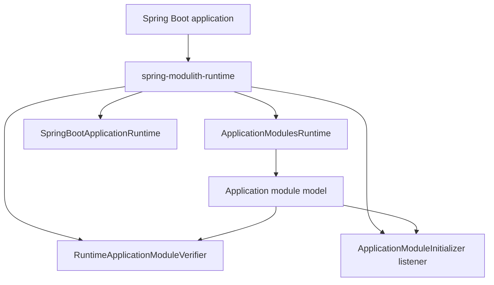
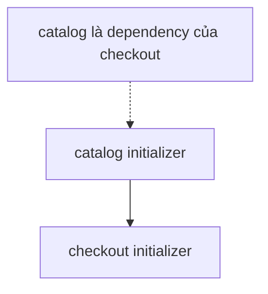

# `spring-modulith-runtime` cung cấp thành phần nào?

`spring-modulith-runtime` bổ sung khả năng sử dụng application module model ngay khi ứng dụng Spring Boot chạy. Artifact này kích hoạt Spring Boot auto-configuration để cung cấp các thành phần runtime: truy cập `ApplicationModules`, nhận diện môi trường ứng dụng, xác minh module arrangement khi khởi động nếu được bật, và gọi các `ApplicationModuleInitializer` theo thứ tự phụ thuộc giữa các module.

Từ Spring Modulith 2.0, runtime support còn có thể tùy chỉnh Flyway để chạy migration theo từng application module. Các tính năng này giúp ứng dụng sử dụng module model trong vòng đời runtime, bên cạnh việc dùng model trong architecture test, tài liệu và module integration test.

Sau bài học, bạn có thể:

- Giải thích mục đích của artifact `spring-modulith-runtime`.
- Nhận diện vai trò của `ApplicationModulesRuntime` và `SpringBootApplicationRuntime`.
- Bật runtime module verification bằng `spring.modulith.runtime.verification-enabled`.
- Viết `ApplicationModuleInitializer` và hiểu thứ tự thực thi theo dependency graph.
- Bật module-aware Flyway migration bằng `spring.modulith.runtime.flyway-enabled`.
- Phân biệt runtime support với Actuator, observability và test support.

## 1. Runtime support khác gì với module verification trong test?

Spring Modulith cho phép tạo module model bằng `ApplicationModules.of(ShopApplication.class)` và gọi `verify()` trong architecture test. Cách đó kiểm tra cấu trúc code khi chạy test. Khi ứng dụng được triển khai, nếu muốn có các tính năng gắn trực tiếp với module model, bạn cần runtime support.

Artifact `spring-modulith-runtime` đăng ký các thành phần qua Spring Boot auto-configuration. Những thành phần này có thể sử dụng application module arrangement trong Spring `ApplicationContext` đang chạy.



Các thành phần được đăng ký tự động khi artifact có mặt trên runtime classpath. Riêng runtime verifier chỉ thực hiện xác minh khi property `spring.modulith.runtime.verification-enabled` được bật. Các `ApplicationModuleInitializer` chỉ được gọi khi runtime support có mặt.

## 2. Thêm `spring-modulith-runtime` vào ứng dụng

Nếu dự án quản lý dependency trực tiếp, thêm artifact vào runtime scope.

Maven:

```xml
<dependency>
    <groupId>org.springframework.modulith</groupId>
    <artifactId>spring-modulith-runtime</artifactId>
    <scope>runtime</scope>
</dependency>
```

Gradle:

```groovy
dependencies {
    runtimeOnly 'org.springframework.modulith:spring-modulith-runtime'
}
```

Hãy dùng cùng phiên bản Spring Modulith do BOM hoặc dependency management của dự án quản lý. Nếu đã dùng `spring-modulith-starter-core`, runtime artifact thường đã được kéo vào theo dependency của starter; hãy kiểm tra cấu hình dependency hiện có trước khi khai báo thêm một dependency trực tiếp.

Runtime support sử dụng ArchUnit để phân tích module model và JGraphT để sắp xếp module theo thứ tự phụ thuộc. Vì vậy, việc thêm artifact này cũng đưa các dependency cần thiết vào runtime của ứng dụng.

## 3. `ApplicationModulesRuntime`: truy cập module model lúc runtime

`ApplicationModulesRuntime` là thành phần bootstrap để khởi tạo và cung cấp `ApplicationModules` trong runtime. Nó bảo đảm module model được khởi tạo một lần cho mỗi application class thay vì mỗi consumer tự phân tích lại codebase.

Class này triển khai `Supplier<ApplicationModules>`, vì vậy có thể lấy module model bằng `get()`:

```java
package com.acme.shop.infrastructure;

import org.springframework.modulith.core.ApplicationModules;
import org.springframework.modulith.runtime.ApplicationModulesRuntime;
import org.springframework.stereotype.Component;

@Component
class ModuleModelInspector {

    private final ApplicationModulesRuntime modulesRuntime;

    ModuleModelInspector(ApplicationModulesRuntime modulesRuntime) {
        this.modulesRuntime = modulesRuntime;
    }

    void printModules() {
        ApplicationModules modules = modulesRuntime.get();
        modules.forEach(System.out::println);
    }
}
```

Ví dụ minh họa cách một Spring bean nhận module model đã được runtime support cung cấp. Ứng dụng có thể dùng model này cho các thành phần cần tra cứu module, dependency hoặc package ownership khi đang chạy.

Không nên tự tạo `ApplicationModules.of(...)` trong mỗi request hoặc mỗi lần gọi service. Module model mô tả cấu trúc code của ứng dụng, không phải dữ liệu nghiệp vụ thay đổi theo request. Hãy để runtime support quản lý vòng đời khởi tạo và chỉ truy cập model khi tính năng thực sự cần đến.

## 4. `SpringBootApplicationRuntime`: nhận diện ứng dụng đang chạy

`SpringBootApplicationRuntime` là implementation của abstraction `ApplicationRuntime`, được xây dựng từ Spring `ApplicationContext` và lớp có annotation `@SpringBootApplication`.

Nó cung cấp thông tin để runtime support nhận diện:

- Lớp ứng dụng Spring Boot chính.
- Identifier của ứng dụng.
- Type thực của bean khi bean được bọc bởi proxy.
- Một type có thuộc package ứng dụng hay thuộc framework bên ngoài.

Thành phần này làm nền cho `ApplicationModulesRuntime`: runtime support cần biết lớp ứng dụng nào là điểm bắt đầu để tạo module model và type nào thuộc code của ứng dụng.

Thông thường, bạn không cần tự tạo `SpringBootApplicationRuntime`. Spring Boot auto-configuration của `spring-modulith-runtime` đăng ký nó cùng các thành phần runtime liên quan.

## 5. `RuntimeApplicationModuleVerifier`: xác minh module khi khởi động

Runtime support có thể kiểm tra application module arrangement ngay trong quá trình khởi động ứng dụng. Thành phần thực hiện việc này là `RuntimeApplicationModuleVerifier`.

Mặc định, runtime verification bị tắt. Bật nó trong `application.properties`:

```properties
spring.modulith.runtime.verification-enabled=true
```

Hoặc trong `application.yml`:

```yaml
spring:
  modulith:
    runtime:
      verification-enabled: true
```

Khi được bật, runtime verifier kiểm tra module arrangement và làm cho quá trình khởi động thất bại nếu phát hiện vi phạm. Các quy tắc cốt lõi tương ứng với module verification của Spring Modulith, chẳng hạn:

- Dependency graph giữa các module không có chu trình.
- Module không truy cập package nội bộ của module đóng khác.
- Phụ thuộc phải tuân thủ `allowedDependencies` nếu module khai báo allowlist.
- Các additional verification đã được cấu hình cũng có thể được áp dụng theo `VerificationOptions`.

Điều này giúp phát hiện vi phạm kiến trúc trong môi trường triển khai ngay cả khi một thay đổi không được phát hiện ở bước test trước đó.

Runtime verification không thay thế architecture test trong CI. Test vẫn là nơi phản hồi nhanh cho lập trình viên; runtime verification là một lớp bảo vệ bổ sung khi ứng dụng được khởi động. Nếu bật property này trong production, hãy bảo đảm detection strategy, custom module metadata và các tùy chỉnh verification cần thiết có mặt trong production sources/classpath.

## 6. `ApplicationModuleInitializer`: khởi tạo module theo dependency graph

Một số module cần thực hiện công việc riêng khi ứng dụng khởi động, ví dụ:

- Nạp dữ liệu tham chiếu ban đầu.
- Kiểm tra hoặc đồng bộ metadata do module sở hữu.
- Chuẩn bị registry hoặc cấu trúc nội bộ cần thiết.
- Đăng ký dữ liệu mặc định trước khi module phụ thuộc sử dụng.

Nếu module B phụ thuộc module A, phần khởi tạo của A cần chạy trước B. Dùng `@Order` hoặc `Ordered` có thể sắp xếp callback thủ công, nhưng thứ tự đó dễ bị lệch khi dependency graph thay đổi. Spring Modulith cung cấp interface `ApplicationModuleInitializer` để thứ tự gọi initializer tuân theo cấu trúc phụ thuộc module.

Ví dụ, module `catalog` chuẩn bị dữ liệu tham chiếu:

```java
package com.acme.shop.catalog;

import org.springframework.modulith.ApplicationModuleInitializer;
import org.springframework.stereotype.Component;

@Component
class CatalogInitializer implements ApplicationModuleInitializer {

    @Override
    public void initialize() {
        // Chuẩn bị dữ liệu tham chiếu do catalog sở hữu.
    }
}
```

Module `checkout` phụ thuộc `catalog` và có initializer riêng:

```java
package com.acme.shop.checkout;

import org.springframework.modulith.ApplicationModuleInitializer;
import org.springframework.stereotype.Component;

@Component
class CheckoutInitializer implements ApplicationModuleInitializer {

    @Override
    public void initialize() {
        // Chuẩn bị trạng thái ban đầu của checkout.
    }
}
```

Nếu dependency graph có cạnh `checkout → catalog`, initializer của `catalog` được gọi trước initializer của `checkout`. Spring Modulith sắp xếp các initializer theo thứ tự topo của module dependency graph, kể cả khi hai initializer không inject trực tiếp lẫn nhau.



Các initializer là Spring beans trong application context. Chúng được gọi thông qua listener cho `ApplicationStartedEvent` do runtime support đăng ký. Nếu `spring-modulith-runtime` không có trên classpath, các bean triển khai `ApplicationModuleInitializer` sẽ không được runtime support gọi.

Hãy giữ initializer ngắn gọn, có thể chạy lặp lại an toàn và chỉ chuẩn bị trạng thái thuộc module sở hữu. Không biến initializer thành nơi thực hiện toàn bộ quy trình nghiệp vụ hoặc phụ thuộc vào thứ tự ngẫu nhiên giữa nhiều initializer trong cùng một module.

## 7. Module-aware Flyway migrations

Từ Spring Modulith 2.0, runtime support có thể tùy chỉnh Flyway để mỗi application module quản lý migration cho dữ liệu bền vững do chính module đó sở hữu.

Tính năng này mặc định tắt. Bật bằng:

```properties
spring.modulith.runtime.flyway-enabled=true
```

Hoặc YAML:

```yaml
spring:
  modulith:
    runtime:
      flyway-enabled: true
```

Với cấu hình Flyway mặc định dùng `classpath:db/migration`, Spring Modulith tổ chức migration theo hai phạm vi:

```text
src/main/resources/db/migration
├── __root
│   └── V1__create_shared_schema.sql
├── catalog
│   └── V1__create_products.sql
└── checkout
    └── V1__create_orders.sql
```

- `db/migration/__root` chứa migration dùng chung, sử dụng bảng tracking mặc định của Flyway.
- `db/migration/{moduleIdentifier}` chứa migration riêng của module, mỗi module có bảng tracking `flyway_schema_history_{moduleIdentifier}`.
- Migration riêng module được cấu hình baseline version `0` và baseline on migrate.
- Các migration được thực thi theo thứ tự dependency graph của module.

Ví dụ, nếu `checkout` phụ thuộc `catalog`, migration của `catalog` được thực hiện trước migration của `checkout`. Version number được quản lý trong phạm vi từng module, vì vậy không cần tạo một chuỗi version toàn cục giữa tất cả module.

Trong test module, Spring Modulith chỉ chạy migration gốc và migration của các module tham gia test run. Điều này giúp module test không phải chạy migration của toàn bộ ứng dụng. Mặc định, runtime support thực thi migration của tất cả module có migration file; có thể đăng ký bean `MigrationFilter` nếu cần tùy chỉnh phạm vi.

Tính năng này cần Flyway được cấu hình trong ứng dụng và property `spring.modulith.runtime.flyway-enabled=true`. Nếu không dùng Flyway hoặc muốn giữ nguyên một chiến lược migration toàn ứng dụng, không cần bật property.

## 8. Phân biệt runtime với Actuator, observability và test support

Các artifact Spring Modulith có trách nhiệm khác nhau. Không nên hiểu `spring-modulith-runtime` là toàn bộ tính năng production-ready.

| Artifact/thành phần | Vai trò |
|---|---|
| `spring-modulith-runtime` | Bootstrap module model lúc runtime, runtime verification, module initializers và module-aware Flyway support |
| `spring-modulith-actuator` | Công bố cấu trúc module qua Actuator endpoint `modulith` |
| `spring-modulith-observability-core` | Hạ tầng observability cho tương tác module và event publication |
| `spring-modulith-test` | `@ApplicationModuleTest`, module slicing và hỗ trợ kiểm thử module |
| `spring-modulith-core` | Phân tích module model và các API verification cốt lõi |

Ví dụ, nếu muốn xem module arrangement qua `GET /actuator/modulith`, bạn cần Actuator support tương ứng, thường được cung cấp qua `spring-modulith-starter-insight`. Chỉ thêm `spring-modulith-runtime` không tự tạo endpoint Actuator này.

Tương tự, runtime verifier kiểm tra cấu trúc module lúc khởi động; nó không phải công cụ theo dõi mọi lời gọi giữa các module trong quá trình xử lý request. Muốn quan sát tương tác thực tế, cần observability support riêng.

## 9. Custom module detection phải có trong production sources

Runtime support xây dựng module model từ cấu hình và metadata mà ứng dụng có khi chạy. Nếu dự án có custom `ApplicationModuleDetectionStrategy` hoặc các tùy chỉnh module detection khác, hãy đặt chúng trong `src/main/java` và cấu hình trong `src/main/resources`.

Nếu custom strategy chỉ tồn tại trong `src/test/java`, architecture test có thể phát hiện module theo quy ước riêng nhưng ứng dụng production không có implementation đó trên classpath. Runtime support khi đó có thể xây dựng module model khác với mô hình mà test đã xác minh.

Hãy bảo đảm các phần sau nhất quán giữa test và runtime:

1. Lớp `@SpringBootApplication` được dùng làm root.
2. `@Modulithic` và `additionalPackages`.
3. `spring.modulith.detection-strategy`.
4. Custom `ApplicationModuleDetectionStrategy`, nếu có.
5. `@ApplicationModule`, named interfaces và `allowedDependencies`.
6. Fully qualified module identifiers, nếu được bật.

## 10. Lỗi thường gặp

| Hiện tượng | Nguyên nhân thường gặp | Cách xử lý |
|---|---|---|
| Không tìm thấy `ApplicationModulesRuntime` bean | `spring-modulith-runtime` không có trên runtime classpath hoặc auto-configuration không được kích hoạt | Kiểm tra dependency và cấu hình Spring Boot |
| `ApplicationModuleInitializer` không được gọi | Runtime artifact không có trên classpath hoặc initializer không phải Spring bean | Thêm runtime support và đăng ký initializer bằng `@Component` hoặc cơ chế bean phù hợp |
| Initializer chạy sai thứ tự mong đợi | Dependency graph không thể hiện quan hệ cần thiết hoặc module detection sai | Kiểm tra module dependencies và module model thực tế |
| Ứng dụng dừng khi startup | Runtime verification được bật và module arrangement có vi phạm | Đọc lỗi verification, sửa dependency/API boundary rồi khởi động lại |
| Test pass nhưng runtime verifier thất bại | Custom detection chỉ nằm trong test sources hoặc cấu hình test/runtime khác nhau | Đưa custom detection vào production sources và đồng bộ cấu hình |
| Migration không chạy theo module | Flyway chưa có hoặc `flyway-enabled` chưa bật | Kiểm tra Flyway dependency, location và property |
| Không thấy `/actuator/modulith` | Chỉ thêm runtime artifact | Thêm Actuator support phù hợp và expose endpoint theo cấu hình Spring Boot |

## 11. Ghi nhớ

`spring-modulith-runtime` kích hoạt runtime support thông qua Spring Boot auto-configuration. `ApplicationModulesRuntime` cung cấp module model; `SpringBootApplicationRuntime` nhận diện ứng dụng; `RuntimeApplicationModuleVerifier` kiểm tra module arrangement khi bật `spring.modulith.runtime.verification-enabled`; event listener gọi `ApplicationModuleInitializer` theo thứ tự phụ thuộc. Từ Spring Modulith 2.0, `spring.modulith.runtime.flyway-enabled` còn cho phép chạy migration theo module và theo dependency graph. Runtime artifact khác với Actuator, observability và test support; hãy chọn đúng artifact theo chức năng ứng dụng cần dùng.

## Tài liệu tham khảo

- [Spring Modulith 2.2 – Runtime Support](https://docs.spring.io/spring-modulith/reference/runtime.html)
- [Spring Modulith 2.2 – Configuration Properties](https://docs.spring.io/spring-modulith/reference/appendix.html)
- [Spring Modulith API – `ApplicationModulesRuntime`](https://docs.spring.io/spring-modulith/docs/current/api/org/springframework/modulith/runtime/ApplicationModulesRuntime.html)
- [Spring Modulith API – `ApplicationModuleInitializer`](https://docs.spring.io/spring-modulith/docs/current/api/org/springframework/modulith/ApplicationModuleInitializer.html)
- [Spring Modulith API – `SpringBootApplicationRuntime`](https://docs.spring.io/spring-modulith/docs/current/api/org/springframework/modulith/runtime/SpringBootApplicationRuntime.html)
- [Spring Modulith API – `RuntimeApplicationModuleVerifier`](https://docs.spring.io/spring-modulith/docs/current/api/org/springframework/modulith/runtime/autoconfigure/SpringModulithRuntimeAutoConfiguration.RuntimeApplicationModuleVerifier.html)
